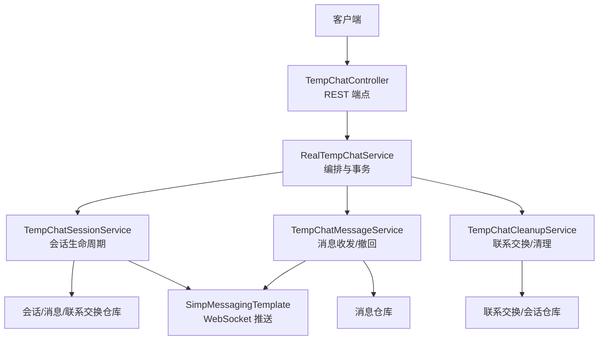
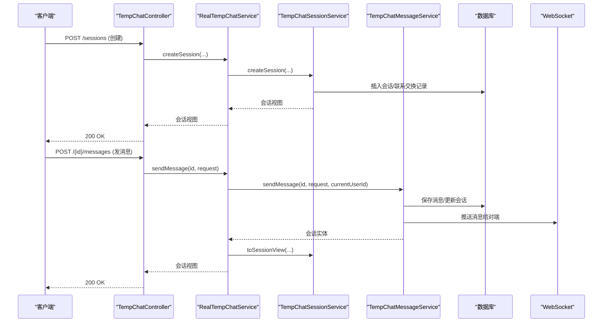
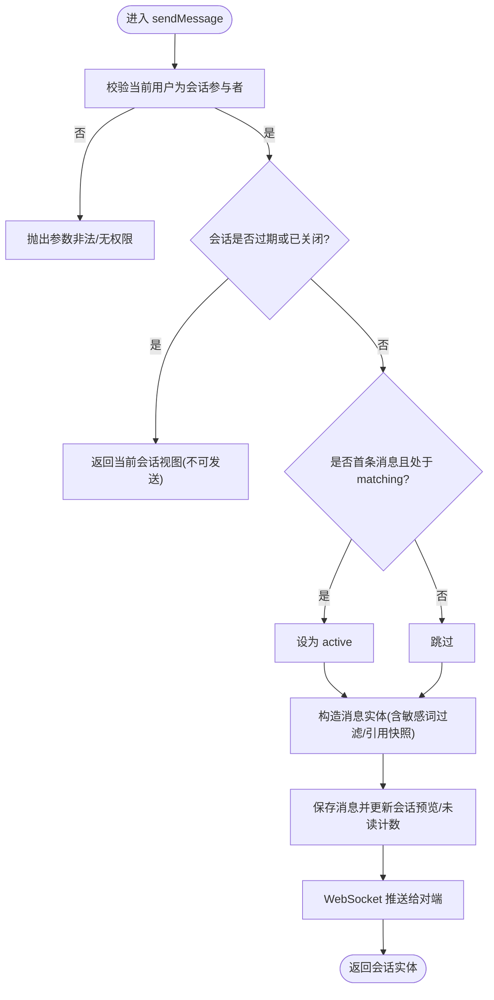
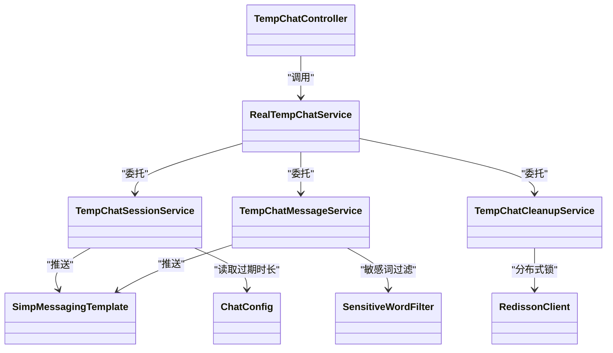
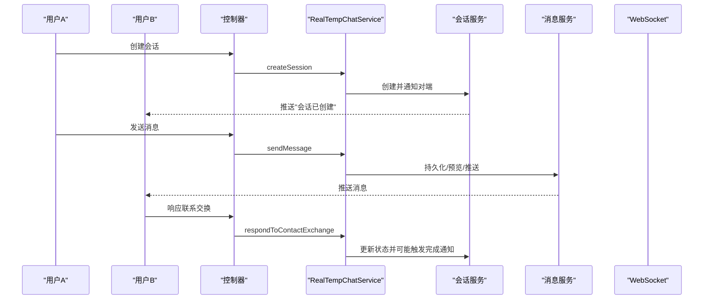

# 临时匿名聊天

<cite>
**本文引用的文件**
- [TempChatController.java](file://apps/api/src/main/java/com/campuslove/api/chat/TempChatController.java)
- [TempChatService.java](file://apps/api/src/main/java/com/campuslove/api/chat/TempChatService.java)
- [RealTempChatService.java](file://apps/api/src/main/java/com/campuslove/api/chat/RealTempChatService.java)
- [TempChatSessionService.java](file://apps/api/src/main/java/com/campuslove/api/chat/TempChatSessionService.java)
- [TempChatMessageService.java](file://apps/api/src/main/java/com/campuslove/api/chat/TempChatMessageService.java)
- [TempChatCleanupService.java](file://apps/api/src/main/java/com/campuslove/api/chat/TempChatCleanupService.java)
- [ChatConfig.java](file://apps/api/src/main/java/com/campuslove/api/config/ChatConfig.java)
- [TempChatControllerTest.java](file://apps/api/src/test/java/com/campuslove/api/chat/TempChatControllerTest.java)
</cite>

## 目录
1. [简介](#简介)
2. [项目结构](#项目结构)
3. [核心组件](#核心组件)
4. [架构总览](#架构总览)
5. [详细组件分析](#详细组件分析)
6. [依赖关系分析](#依赖关系分析)
7. [性能考虑](#性能考虑)
8. [故障排查指南](#故障排查指南)
9. [结论](#结论)
10. [附录：API 与使用流程](#附录api-与使用流程)

## 简介
本技术文档面向“临时匿名聊天”子系统，围绕 TempChatController 的会话管理 API、TempChatService 的核心编排、以及 TempChatSessionService、TempChatMessageService、TempChatCleanupService 的职责边界进行系统性说明。重点覆盖：
- 临时会话创建、消息发送、会话查询接口
- 会话生命周期管理、参与者匹配、联系交换状态机与会话清理机制
- TTL 与自动清理策略（含 3600 秒上限约束）
- 匿名身份保护、消息时效性与会话安全性设计
- 完整使用流程与异常处理方案

## 项目结构
该子系统位于后端 API 模块中，采用分层与职责拆分的设计：
- 控制器层：对外暴露 REST 端点（创建会话、获取会话、发送消息、撤回消息、置顶/取消置顶、标记已读、响应联系交换等）
- 服务编排层：统一权限校验与事务编排，委托具体业务组件执行
- 会话组件：会话创建、查询、过期标记、视图转换、未读计数维护
- 消息组件：消息持久化、引用快照、预览构建、WebSocket 推送、撤回时限控制
- 清理组件：联系交换状态机、定时扫描过期会话、分布式锁保证单实例执行
- 配置：会话过期时长等参数外置

图表来源
- [TempChatController.java:1-174](file://apps/api/src/main/java/com/campuslove/api/chat/TempChatController.java#L1-L174)
- [RealTempChatService.java:1-134](file://apps/api/src/main/java/com/campuslove/api/chat/RealTempChatService.java#L1-L134)
- [TempChatSessionService.java:1-200](file://apps/api/src/main/java/com/campuslove/api/chat/TempChatSessionService.java#L1-L200)
- [TempChatMessageService.java:1-200](file://apps/api/src/main/java/com/campuslove/api/chat/TempChatMessageService.java#L1-L200)
- [TempChatCleanupService.java:1-200](file://apps/api/src/main/java/com/campuslove/api/chat/TempChatCleanupService.java#L1-L200)

章节来源
- [TempChatController.java:1-174](file://apps/api/src/main/java/com/campuslove/api/chat/TempChatController.java#L1-L174)
- [RealTempChatService.java:1-134](file://apps/api/src/main/java/com/campuslove/api/chat/RealTempChatService.java#L1-L134)

## 核心组件
- TempChatController：提供 /api/v1/temp-chat/sessions 下的 REST 端点，负责请求入参校验与权限注解，调用服务层完成业务。
- TempChatService：定义临时聊天的能力契约（概览、列表、创建、发送、结束、置顶、已读、撤回等）。
- RealTempChatService：真实实现，注入并编排会话、消息、清理三个组件，承担权限与事务边界。
- TempChatSessionService：会话全生命周期管理（创建、查询、过期标记、置顶/已读、视图转换），以及与推荐、心动信号等入口解析对端用户。
- TempChatMessageService：消息发送、撤回、敏感词过滤、引用快照、预览构建、WebSocket 推送。
- TempChatCleanupService：联系交换状态机与会话过期清理（分布式锁 + 定时任务）。
- ChatConfig：配置项 app.chat.sessionExpireHours，控制会话默认过期时长（小时）。

章节来源
- [TempChatService.java:1-71](file://apps/api/src/main/java/com/campuslove/api/chat/TempChatService.java#L1-L71)
- [RealTempChatService.java:1-134](file://apps/api/src/main/java/com/campuslove/api/chat/RealTempChatService.java#L1-L134)
- [TempChatSessionService.java:1-200](file://apps/api/src/main/java/com/campuslove/api/chat/TempChatSessionService.java#L1-L200)
- [TempChatMessageService.java:1-200](file://apps/api/src/main/java/com/campuslove/api/chat/TempChatMessageService.java#L1-L200)
- [TempChatCleanupService.java:1-200](file://apps/api/src/main/java/com/campuslove/api/chat/TempChatCleanupService.java#L1-L200)
- [ChatConfig.java:1-26](file://apps/api/src/main/java/com/campuslove/api/config/ChatConfig.java#L1-L26)

## 架构总览
临时匿名聊天采用“控制器-编排服务-领域组件”的分层架构。控制器仅做路由与校验；编排服务负责权限与事务；领域组件按职责内聚。消息通过 WebSocket 实时推送，过期清理由定时任务驱动。

图表来源
- [TempChatController.java:1-174](file://apps/api/src/main/java/com/campuslove/api/chat/TempChatController.java#L1-L174)
- [RealTempChatService.java:1-134](file://apps/api/src/main/java/com/campuslove/api/chat/RealTempChatService.java#L1-L134)
- [TempChatSessionService.java:1-200](file://apps/api/src/main/java/com/campuslove/api/chat/TempChatSessionService.java#L1-L200)
- [TempChatMessageService.java:1-200](file://apps/api/src/main/java/com/campuslove/api/chat/TempChatMessageService.java#L1-L200)

## 详细组件分析

### TempChatController：会话管理 API
- 端点范围：/api/v1/temp-chat/sessions
- 关键方法：
  - POST /sessions：创建临时会话（支持 recommendedPersonId/matchId/signalId 三种入口）
  - GET /{id}：获取会话详情
  - POST /{id}/messages：发送消息（文本/语音/表情/系统）
  - POST /{id}/contact-exchange/respond：响应联系交换（accept/reject/revoke）
  - POST /{id}/end：结束会话
  - POST /{id}/pin /unpin：置顶/取消置顶
  - POST /{id}/read：标记已读
  - POST /{id}/messages/{messageId}/recall：撤回消息（2 分钟内）
- 安全与校验：
  - 全部端点要求 USER 角色
  - 请求体使用 Jakarta Validation 校验（长度、格式、枚举）
  - 定义常量 MAX_TEMP_CHAT_DURATION_SECONDS = 3600，限制消息时长字段上限

章节来源
- [TempChatController.java:1-174](file://apps/api/src/main/java/com/campuslove/api/chat/TempChatController.java#L1-L174)

### TempChatService 与 RealTempChatService：编排与事务
- TempChatService：定义能力契约（概览、列表、创建、发送、结束、置顶、已读、撤回等）
- RealTempChatService：
  - 注入会话、消息、清理三个组件，避免手动 new 导致的事务代理失效
  - 所有 public 方法加 @Transactional，确保原子性
  - 通过 SecurityUtils.getCurrentUserId() 获取当前用户 ID，用于参与人校验与安全推导

章节来源
- [TempChatService.java:1-71](file://apps/api/src/main/java/com/campuslove/api/chat/TempChatService.java#L1-L71)
- [RealTempChatService.java:1-134](file://apps/api/src/main/java/com/campuslove/api/chat/RealTempChatService.java#L1-L134)

### TempChatSessionService：会话生命周期与状态
- 会话创建：
  - 解析对端用户（推荐人/匹配/心动信号）
  - 若已有活跃会话则复用
  - 新会话阶段为 matching，设置 closesAt（当前时间 + sessionExpireHours 小时）
  - 创建默认联系交换记录（idle）
  - 通过 WebSocket 通知对端“会话已创建”
- 会话列表：
  - 按置顶与最后消息排序
  - 惰性检查并标记过期会话（matching/active 且 closesAt < now）
  - 批量预加载对方信息，减少 N+1 查询
- 会话视图转换：
  - 根据接收方视角翻转 sender，构造 ChatMessageView
  - 聚合联系交换状态
- 其他：
  - 置顶/取消置顶、标记已读、结束会话
  - 过期判定与标记（matching/active -> expired）

章节来源
- [TempChatSessionService.java:1-200](file://apps/api/src/main/java/com/campuslove/api/chat/TempChatSessionService.java#L1-L200)

### TempChatMessageService：消息处理逻辑
- 发送消息：
  - 校验当前用户为会话参与者（防越权）
  - 过期或已关闭会话不允许发送
  - 首条消息将 matching 转为 active
  - 服务端推导 sender（self/peer），不信任客户端传入值（防冒充）
  - 敏感词过滤（可插拔）
  - 引用回复：校验 quoteRef 属于同一会话，生成 JSON 快照（转义特殊字符）
  - 更新会话预览、最后消息时间、未读计数
  - WebSocket 推送消息给对端（按接收方视角翻转 sender）
- 撤回消息：
  - 仅允许发送者本人在 2 分钟内撤回
  - 标记 recalled=true，正文替换为提示文本
- 数据模型与复杂度：
  - 消息写入 O(1)，预览构建 O(L)（L 为消息体长度）
  - 引用快照生成涉及一次同会话历史查询（缓存友好）

图表来源
- [TempChatMessageService.java:1-200](file://apps/api/src/main/java/com/campuslove/api/chat/TempChatMessageService.java#L1-L200)

### TempChatCleanupService：联系交换与会话清理
- 联系交换状态机：
  - idle → accepted-by-self / accepted-by-peer → completed（双方同意）
  - rejected 为终态
  - actor 由服务端推导（self/peer），拒绝客户端传入值
- 定时清理：
  - cron 每小时整点执行
  - 扫描 matching/active 且 closesAt < now 的会话，标记为 expired 并记录原因
  - 使用 Redisson 分布式锁（scheduled:tempChatCleanup）保证多实例下仅一个执行
  - 单条失败不影响整体任务，异常捕获并记录日志

章节来源
- [TempChatCleanupService.java:1-200](file://apps/api/src/main/java/com/campuslove/api/chat/TempChatCleanupService.java#L1-L200)

### 配置与 TTL 机制
- 会话过期时长：ChatConfig.sessionExpireHours（默认 24 小时），用于计算 closesAt
- 消息时长上限：TempChatController.MAX_TEMP_CHAT_DURATION_SECONDS = 3600 秒（用于请求体 durationSeconds 校验）
- 过期策略：
  - 惰性标记：访问会话时检查并标记过期
  - 主动清理：定时任务扫描并批量标记过期，释放资源

章节来源
- [ChatConfig.java:1-26](file://apps/api/src/main/java/com/campuslove/api/config/ChatConfig.java#L1-L26)
- [TempChatController.java:1-174](file://apps/api/src/main/java/com/campuslove/api/chat/TempChatController.java#L1-L174)
- [TempChatSessionService.java:1-200](file://apps/api/src/main/java/com/campuslove/api/chat/TempChatSessionService.java#L1-L200)
- [TempChatCleanupService.java:1-200](file://apps/api/src/main/java/com/campuslove/api/chat/TempChatCleanupService.java#L1-L200)

## 依赖关系分析
- 控制器依赖服务编排层；编排层依赖三大组件
- 组件间松耦合：会话、消息、清理各司其职
- 外部依赖：
  - RedissonClient：分布式锁
  - SimpMessagingTemplate：WebSocket 推送
  - 各 Repository：数据持久化
  - SensitiveWordFilter：敏感词过滤
  - RecommendationService/HeartSignalRepository：会话入口解析对端用户

图表来源
- [TempChatController.java:1-174](file://apps/api/src/main/java/com/campuslove/api/chat/TempChatController.java#L1-L174)
- [RealTempChatService.java:1-134](file://apps/api/src/main/java/com/campuslove/api/chat/RealTempChatService.java#L1-L134)
- [TempChatSessionService.java:1-200](file://apps/api/src/main/java/com/campuslove/api/chat/TempChatSessionService.java#L1-L200)
- [TempChatMessageService.java:1-200](file://apps/api/src/main/java/com/campuslove/api/chat/TempChatMessageService.java#L1-L200)
- [TempChatCleanupService.java:1-200](file://apps/api/src/main/java/com/campuslove/api/chat/TempChatCleanupService.java#L1-L200)
- [ChatConfig.java:1-26](file://apps/api/src/main/java/com/campuslove/api/config/ChatConfig.java#L1-L26)

## 性能考虑
- N+1 优化：会话列表批量预加载对方用户信息，避免逐条查库
- 惰性标记 + 定时清理：减少无效会话在活跃阶段的占用，提升查询性能
- 事务粒度：编排层方法级事务，避免跨组件多次提交
- 推送优化：仅向对端推送消息视图，降低带宽与解析开销
- 敏感词过滤：可选开关，避免不必要的 CPU 开销（空实现时短路）

[本节为通用性能建议，无需特定文件引用]

## 故障排查指南
- 无法创建会话：
  - 检查 recommendedPersonId/matchId/signalId 是否至少提供一个
  - 确认心动信号归属与状态（如适用）
- 无法发送消息：
  - 检查会话是否已过期或已关闭
  - 确认当前用户为会话参与者
  - 检查消息 kind 是否为允许的枚举值
- 无法撤回消息：
  - 超过 2 分钟窗口或不是原发送者
- 联系交换失败：
  - 检查会话状态（已关闭/过期不可操作）
  - 确认 actor 由服务端推导（不要信任客户端传入）
- 清理任务未生效：
  - 检查分布式锁是否成功获取（Redisson 可用）
  - 查看调度日志（cron 表达式）
  - 关注异常捕获后的日志输出

章节来源
- [TempChatController.java:1-174](file://apps/api/src/main/java/com/campuslove/api/chat/TempChatController.java#L1-L174)
- [TempChatMessageService.java:1-200](file://apps/api/src/main/java/com/campuslove/api/chat/TempChatMessageService.java#L1-L200)
- [TempChatCleanupService.java:1-200](file://apps/api/src/main/java/com/campuslove/api/chat/TempChatCleanupService.java#L1-L200)

## 结论
临时匿名聊天子系统以清晰的职责划分和严格的安全边界，实现了高可用的临时会话管理与消息通信。通过惰性标记与定时清理结合，保障了资源回收；通过服务端推导 sender/actor 与参与人校验，确保了匿名身份与数据安全；通过 WebSocket 实时推送与引用快照，提升了交互体验。TTL 与时长上限配置灵活可控，满足业务演进需求。

[本节为总结性内容，无需特定文件引用]

## 附录：API 与使用流程

### REST 端点总览
- POST /api/v1/temp-chat/sessions：创建临时会话
- GET /api/v1/temp-chat/sessions/{id}：获取会话详情
- POST /api/v1/temp-chat/sessions/{id}/messages：发送消息
- POST /api/v1/temp-chat/sessions/{id}/contact-exchange/respond：响应联系交换
- POST /api/v1/temp-chat/sessions/{id}/end：结束会话
- POST /api/v1/temp-chat/sessions/{id}/pin：置顶
- POST /api/v1/temp-chat/sessions/{id}/unpin：取消置顶
- POST /api/v1/temp-chat/sessions/{id}/read：标记已读
- POST /api/v1/temp-chat/sessions/{id}/messages/{messageId}/recall：撤回消息

章节来源
- [TempChatController.java:1-174](file://apps/api/src/main/java/com/campuslove/api/chat/TempChatController.java#L1-L174)

### 完整使用流程
1. 创建会话
   - 选择入口：推荐人、匹配记录或心动信号
   - 服务端解析对端用户，创建会话与联系交换记录
   - 通知对端“会话已创建”
2. 发送消息
   - 首条消息将会话从 matching 转为 active
   - 服务端推导 sender，进行敏感词过滤与引用校验
   - 更新预览与未读计数，推送消息给对端
3. 联系交换
   - 任一方发起，另一方响应；双方同意后进入 completed
   - 服务端强制推导 actor，防止冒认
4. 会话结束/过期
   - 主动结束或到达 closesAt 被标记为 expired
   - 过期后不可发送消息或响应联系交换
5. 置顶与已读
   - 置顶影响列表排序；已读标记用于清除未读数

图表来源
- [TempChatController.java:1-174](file://apps/api/src/main/java/com/campuslove/api/chat/TempChatController.java#L1-L174)
- [RealTempChatService.java:1-134](file://apps/api/src/main/java/com/campuslove/api/chat/RealTempChatService.java#L1-L134)
- [TempChatSessionService.java:1-200](file://apps/api/src/main/java/com/campuslove/api/chat/TempChatSessionService.java#L1-L200)
- [TempChatMessageService.java:1-200](file://apps/api/src/main/java/com/campuslove/api/chat/TempChatMessageService.java#L1-L200)

### 异常处理要点
- 入参校验失败：由 Jakarta Validation 返回错误
- 权限不足：需要 USER 角色
- 会话不存在/非参与者：参数非法或无权限
- 会话已过期/已关闭：不允许发送或联系交换
- 撤回超窗：超过 2 分钟或不是发送者
- 清理任务异常：单条失败不中断，记录日志继续

章节来源
- [TempChatController.java:1-174](file://apps/api/src/main/java/com/campuslove/api/chat/TempChatController.java#L1-L174)
- [TempChatMessageService.java:1-200](file://apps/api/src/main/java/com/campuslove/api/chat/TempChatMessageService.java#L1-L200)
- [TempChatCleanupService.java:1-200](file://apps/api/src/main/java/com/campuslove/api/chat/TempChatCleanupService.java#L1-L200)