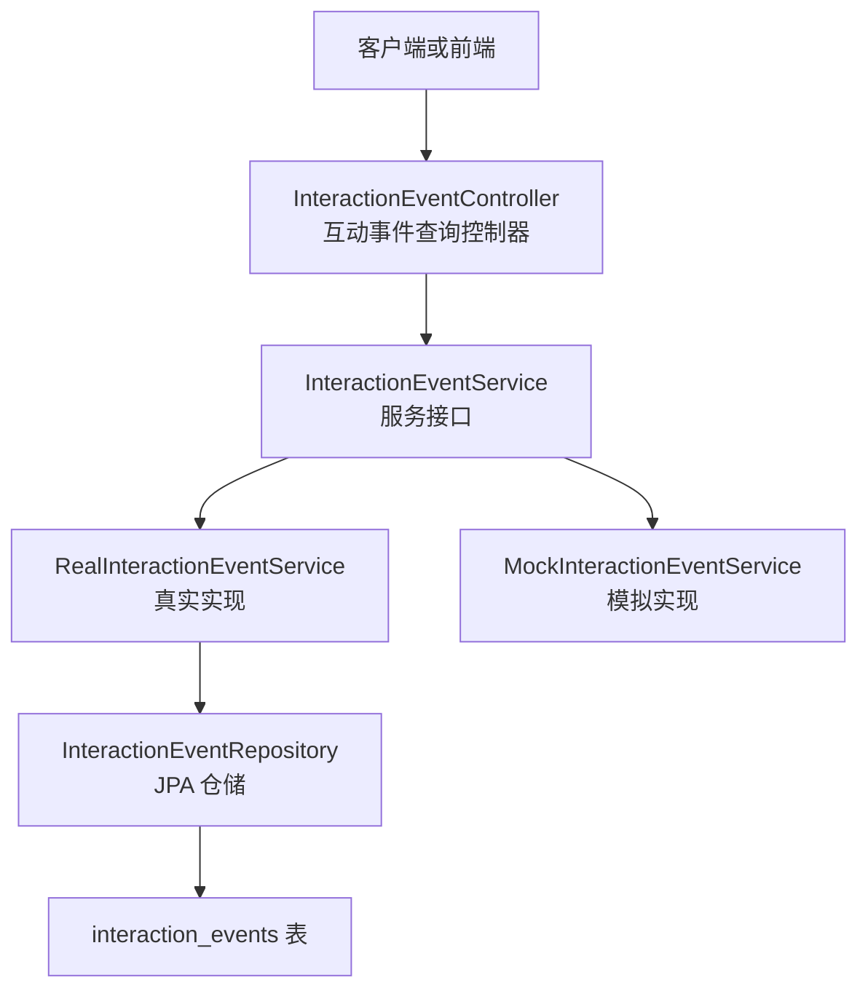
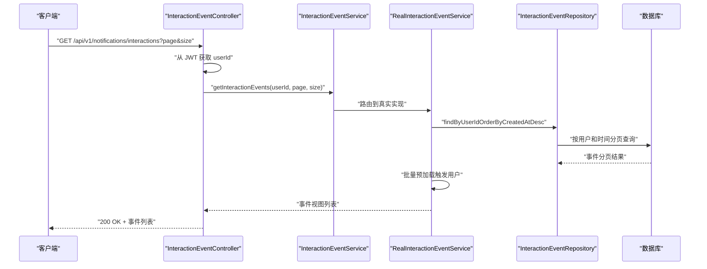
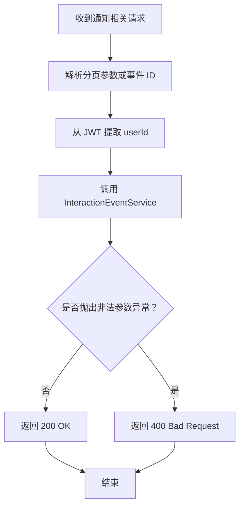
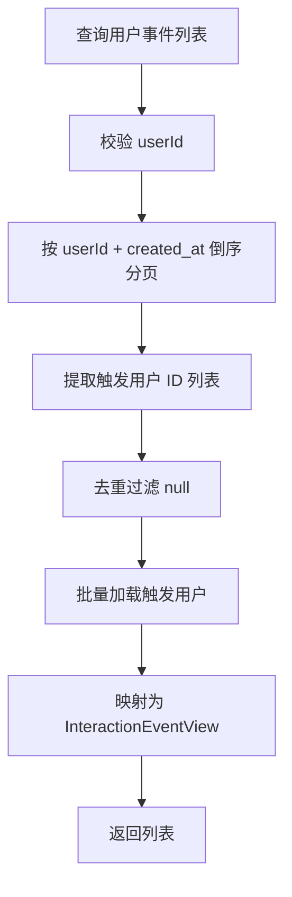
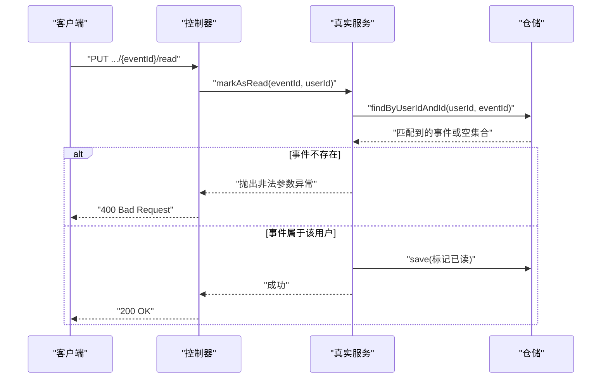
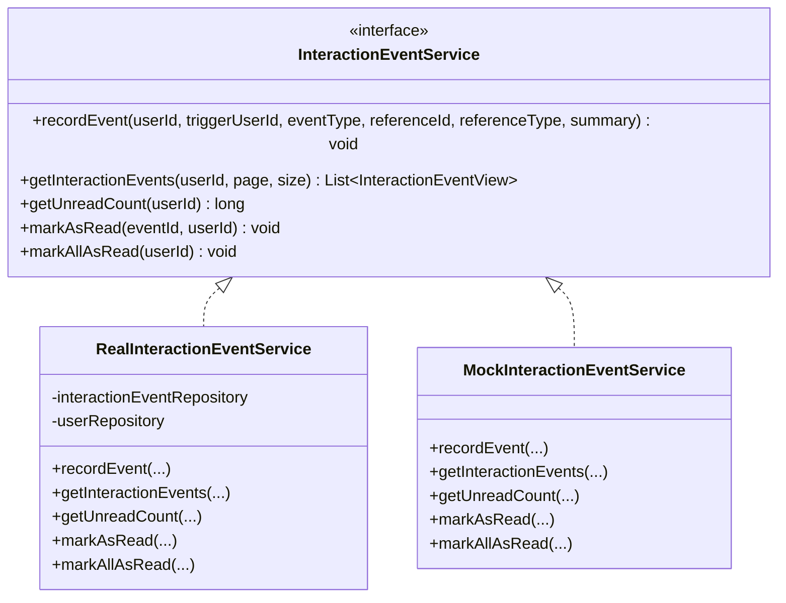
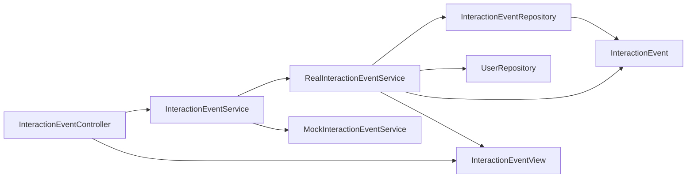
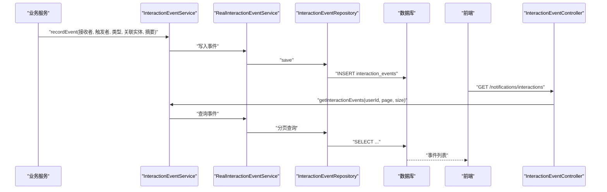

# 互动事件追踪

<cite>
**本文引用的文件**   
- [InteractionEventController.java](file://apps/api/src/main/java/com/campuslove/api/chat/InteractionEventController.java)
- [InteractionEventService.java](file://apps/api/src/main/java/com/campuslove/api/chat/InteractionEventService.java)
- [RealInteractionEventService.java](file://apps/api/src/main/java/com/campuslove/api/chat/RealInteractionEventService.java)
- [MockInteractionEventService.java](file://apps/api/src/main/java/com/campuslove/api/chat/MockInteractionEventService.java)
- [InteractionEventView.java](file://apps/api/src/main/java/com/campuslove/api/chat/InteractionEventView.java)
- [InteractionEvent.java](file://apps/api/src/main/java/com/campuslove/api/entity/InteractionEvent.java)
- [InteractionEventRepository.java](file://apps/api/src/main/java/com/campuslove/api/repository/InteractionEventRepository.java)
- [V2026.05.30.0004__create_interaction_events.sql](file://database/flyway/sql/V2026.05.30.0004__create_interaction_events.sql)
- [V2026.07.28.0005__add_indexes.sql](file://database/flyway/sql/V2026.07.28.0005__add_indexes.sql)
- [InteractionEventControllerTest.java](file://apps/api/src/test/java/com/campuslove/api/chat/InteractionEventControllerTest.java)
</cite>

## 目录

1. [引言](#引言)
2. [项目结构定位](#项目结构定位)
3. [核心组件总览](#核心组件总览)
4. [架构总览](#架构总览)
5. [详细组件分析](#详细组件分析)
6. [依赖关系分析](#依赖关系分析)
7. [性能与并发特性](#性能与并发特性)
8. [错误处理与边界条件](#错误处理与边界条件)
9. [数据模型与索引设计](#数据模型与索引设计)
10. [事件分类体系与用户行为画像](#事件分类体系与用户行为画像)
11. [去重、隐私与合规建议](#去重隐私与合规建议)
12. [集成示例：从业务到事件上报](#集成示例从业务到事件上报)
13. [分析报告生成方法](#分析报告生成方法)
14. [故障排查指南](#故障排查指南)
15. [结论](#结论)

## 引言

本技术文档聚焦于系统中的“互动事件追踪”能力，围绕以下目标展开：

- 说明 `InteractionEventController` 提供的互动提醒相关接口。
- 定义互动事件的类型、字段规范和数据流转。
- 解释 `InteractionEventService` 的抽象契约，以及真实实现 `RealInteractionEventService` 与测试用 `MockInteractionEventService` 的双实现模式。
- 梳理事件分类体系、时间戳记录方式、未读计数和已读标记逻辑。
- 分析当前实现中的去重机制、数据一致性手段、性能优化点。
- 给出事件追踪的集成位置和报告分析方法。

需要特别说明的是：当前仓库中并未提供独立的“用户行为采集前端 SDK”，而是由后端多个业务服务直接调用 `InteractionEventService.recordEvent(...)` 来产生事件；同时控制器暴露的是“查询、统计、标记已读”等读取类接口，而不是一个通用的“任意事件上报入口”。因此，“用户行为采集”在本系统中更接近“业务动作触发后写入互动事件”的后端流程。

## 项目结构定位

互动事件追踪能力位于后端 API 模块中，主要分布在 `apps/api/src/main/java/com/campuslove/api/chat` 包下，并与实体、仓储、数据库迁移脚本共同构成完整链路：

**图表来源**
- [InteractionEventController.java:1-109](file://apps/api/src/main/java/com/campuslove/api/chat/InteractionEventController.java#L1-L109)
- [InteractionEventService.java:1-56](file://apps/api/src/main/java/com/campuslove/api/chat/InteractionEventService.java#L1-L56)
- [RealInteractionEventService.java:1-211](file://apps/api/src/main/java/com/campuslove/api/chat/RealInteractionEventService.java#L1-L211)
- [MockInteractionEventService.java:1-41](file://apps/api/src/main/java/com/campuslove/api/chat/MockInteractionEventService.java#L1-L41)
- [InteractionEventRepository.java:1-96](file://apps/api/src/main/java/com/campuslove/api/repository/InteractionEventRepository.java#L1-L96)
- [V2026.05.30.0004__create_interaction_events.sql:1-17](file://database/flyway/sql/V2026.05.30.0004__create_interaction_events.sql#L1-L17)

**章节来源**
- [InteractionEventController.java:1-109](file://apps/api/src/main/java/com/campuslove/api/chat/InteractionEventController.java#L1-L109)
- [InteractionEventService.java:1-56](file://apps/api/src/main/java/com/campuslove/api/chat/InteractionEventService.java#L1-L56)

## 核心组件总览

| 组件 | 职责 | 关键输入 | 关键输出 | 是否对外暴露 |
|---|---|---|---|---|
| `InteractionEventController` | 提供互动事件列表、未读数、已读标记等 REST 接口 | HTTP 请求参数、JWT 用户 ID | JSON 响应 | 是 |
| `InteractionEventService` | 定义事件记录、查询、统计、已读操作的契约 | 用户 ID、事件类型、关联实体信息 | 视图对象、计数值 | 否（接口） |
| `RealInteractionEventService` | 使用 JPA Repository 读写数据库的真实实现 | 业务参数、Spring Profile=real | 持久化结果、分页事件 | 否（内部服务） |
| `MockInteractionEventService` | 在 mock profile 下返回空数据的无副作用实现 | 同接口契约 | 空列表、零计数 | 否（内部服务） |
| `InteractionEvent` | 数据库实体，对应 `interaction_events` 表 | 用户、触发者、事件类型、摘要、时间戳 | 持久化记录 | 否（数据层） |
| `InteractionEventView` | 面向控制器的只读视图对象 | 实体 + 触发用户信息 | JSON 序列化结构 | 间接（通过控制器） |
| `InteractionEventRepository` | JPA 数据访问接口 | 用户 ID、时间范围、已读状态 | 分页对象、计数值、更新条数 | 否（数据层） |

**章节来源**
- [InteractionEventController.java:1-109](file://apps/api/src/main/java/com/campuslove/api/chat/InteractionEventController.java#L1-L109)
- [InteractionEventService.java:1-56](file://apps/api/src/main/java/com/campuslove/api/chat/InteractionEventService.java#L1-L56)
- [RealInteractionEventService.java:1-211](file://apps/api/src/main/java/com/campuslove/api/chat/RealInteractionEventService.java#L1-L211)
- [MockInteractionEventService.java:1-41](file://apps/api/src/main/java/com/campuslove/api/chat/MockInteractionEventService.java#L1-L41)
- [InteractionEvent.java:1-159](file://apps/api/src/main/java/com/campuslove/api/entity/InteractionEvent.java#L1-L159)
- [InteractionEventView.java:1-37](file://apps/api/src/main/java/com/campuslove/api/chat/InteractionEventView.java#L1-L37)
- [InteractionEventRepository.java:1-96](file://apps/api/src/main/java/com/campuslove/api/repository/InteractionEventRepository.java#L1-L96)

## 架构总览

互动事件追踪系统采用典型的分层架构：

1. **接口层**：`InteractionEventController` 接收 HTTP 请求，提取当前用户 ID，并委托给服务层。
2. **服务层**：`InteractionEventService` 定义统一契约；`RealInteractionEventService` 提供生产实现，`MockInteractionEventService` 提供测试实现。
3. **数据层**：`InteractionEventRepository` 基于 Spring Data JPA 访问数据库。
4. **存储层**：MySQL 表 `interaction_events`，由 Flyway 迁移脚本创建并维护索引。

**图表来源**
- [InteractionEventController.java:20-60](file://apps/api/src/main/java/com/campuslove/api/chat/InteractionEventController.java#L20-L60)
- [RealInteractionEventService.java:80-120](file://apps/api/src/main/java/com/campuslove/api/chat/RealInteractionEventService.java#L80-L120)
- [InteractionEventRepository.java:17-30](file://apps/api/src/main/java/com/campuslove/api/repository/InteractionEventRepository.java#L17-L30)

**章节来源**
- [InteractionEventController.java:1-109](file://apps/api/src/main/java/com/campuslove/api/chat/InteractionEventController.java#L1-L109)
- [RealInteractionEventService.java:1-211](file://apps/api/src/main/java/com/campuslove/api/chat/RealInteractionEventService.java#L1-L211)

## 详细组件分析

### 互动事件控制器：`InteractionEventController`

该控制器负责暴露三类能力：

| 接口 | 方法 | 路径 | 用途 | 安全要求 |
|---|---:|---|---|---|
| 查询事件列表 | GET | `/api/v1/notifications/interactions` | 分页获取当前用户的互动事件 | 需登录 |
| 查询未读数 | GET | `/api/v1/notifications/interactions/unread-count` | 返回当前用户未读事件数量 | 需登录 |
| 标记单条已读 | PUT | `/api/v1/notifications/interactions/{eventId}/read` | 将指定事件标记为已读 | 需要 USER 角色 |
| 全部标记已读 | PUT | `/api/v1/notifications/interactions/read-all` | 将所有互动事件标记为已读 | 需要 USER 角色 |

关键行为：

- 用户 ID 来自认证上下文，不信任前端传入的 `userId`。
- 所有异常路径统一捕获 `IllegalArgumentException`，并返回 `400 Bad Request`。
- 分页参数 `page` 默认 0，`size` 默认 20，且上限为 100。
- 控制器本身不做业务校验，仅做参数约束和异常转换。

**图表来源**
- [InteractionEventController.java:20-109](file://apps/api/src/main/java/com/campuslove/api/chat/InteractionEventController.java#L20-L109)

**章节来源**
- [InteractionEventController.java:1-109](file://apps/api/src/main/java/com/campuslove/api/chat/InteractionEventController.java#L1-L109)
- [InteractionEventControllerTest.java:1-146](file://apps/api/src/test/java/com/campuslove/api/chat/InteractionEventControllerTest.java#L1-L146)

### 服务接口：`InteractionEventService`

该接口定义了五类操作：

| 方法 | 输入 | 语义 |
|---|---|---|
| `recordEvent` | 接收者用户 ID、触发者用户 ID、事件类型、关联实体 ID、关联实体类型、摘要 | 记录一次用户互动 |
| `getInteractionEvents` | 用户 ID、页码、每页大小 | 分页查询用户收到的互动事件 |
| `getUnreadCount` | 用户 ID | 统计未读事件数量 |
| `markAsRead` | 事件 ID、用户 ID | 验证事件归属后标记为已读 |
| `markAllAsRead` | 用户 ID | 将该用户所有未读事件批量标记为已读 |

这个接口是后续真实实现和模拟实现的统一契约，也是其他业务服务接入事件追踪的入口。

**章节来源**
- [InteractionEventService.java:1-56](file://apps/api/src/main/java/com/campuslove/api/chat/InteractionEventService.java#L1-L56)

### 真实实现：`RealInteractionEventService`

#### 事件记录逻辑

`recordEvent` 的核心规则如下：

1. 如果接收者用户 ID 或触发者用户 ID 为空，抛出非法参数异常。
2. 如果接收者与触发者是同一用户，则直接丢弃，不写库。
3. 构造 `InteractionEvent` 实体，设置接收者、触发者、事件类型、关联实体、摘要、未读标志和创建时间。
4. 创建时间使用业务时区。
5. 调用 Repository 保存。
6. 使用 debug 级别日志记录事件写入。

这意味着：**当前实现没有全局唯一键去重**。若上游多次调用 `recordEvent` 且传入相同业务含义参数，可能产生重复事件。

#### 查询逻辑与 N+1 优化

`getInteractionEvents` 执行以下步骤：

1. 校验用户 ID。
2. 按用户 ID 和创建时间倒序分页查询。
3. 从分页结果中提取触发者用户 ID 列表。
4. 去重后批量加载触发用户。
5. 将每个事件转换为 `InteractionEventView`，其中触发用户昵称缺失时使用占位值。

**图表来源**
- [RealInteractionEventService.java:80-140](file://apps/api/src/main/java/com/campuslove/api/chat/RealInteractionEventService.java#L80-L140)
- [InteractionEventRepository.java:17-30](file://apps/api/src/main/java/com/campuslove/api/repository/InteractionEventRepository.java#L17-L30)

#### 未读计数与已读标记

- `getUnreadCount`：直接按用户 ID 和未读状态统计。
- `markAsRead`：先按用户 ID 和事件 ID 查询事件；若不存在则抛异常；存在则标记已读。
- `markAllAsRead`：使用单条批量 UPDATE SQL，避免全量加载后再逐条保存。

**图表来源**
- [RealInteractionEventService.java:140-180](file://apps/api/src/main/java/com/campuslove/api/chat/RealInteractionEventService.java#L140-L180)
- [InteractionEventRepository.java:35-46](file://apps/api/src/main/java/com/campuslove/api/repository/InteractionEventRepository.java#L35-L46)

**章节来源**
- [RealInteractionEventService.java:1-211](file://apps/api/src/main/java/com/campuslove/api/chat/RealInteractionEventService.java#L1-L211)
- [InteractionEventRepository.java:1-96](file://apps/api/src/main/java/com/campuslove/api/repository/InteractionEventRepository.java#L1-L96)

### 模拟实现：`MockInteractionEventService`

`MockInteractionEventService` 使用 Spring Profile `mock` 激活，其特点是：

- `recordEvent` 不执行任何操作。
- `getInteractionEvents` 返回空列表。
- `getUnreadCount` 返回 0。
- 已读标记方法不改变状态。

这种双实现模式适合：

- 在不需要真实数据库的环境运行前端或集成测试。
- 隔离数据库依赖，让控制器和服务层单元测试更稳定。
- 快速验证接口契约，而不关心具体存储细节。

**图表来源**
- [InteractionEventService.java:1-56](file://apps/api/src/main/java/com/campuslove/api/chat/InteractionEventService.java#L1-L56)
- [RealInteractionEventService.java:1-211](file://apps/api/src/main/java/com/campuslove/api/chat/RealInteractionEventService.java#L1-L211)
- [MockInteractionEventService.java:1-41](file://apps/api/src/main/java/com/campuslove/api/chat/MockInteractionEventService.java#L1-L41)

**章节来源**
- [MockInteractionEventService.java:1-41](file://apps/api/src/main/java/com/campuslove/api/chat/MockInteractionEventService.java#L1-L41)

### 视图对象：`InteractionEventView`

`InteractionEventView` 是一个不可变记录对象，包含：

| 字段 | 类型 | 含义 |
|---|---|---|
| `id` | Long | 事件主键 |
| `triggerUser` | `InteractionTriggerUserView` | 触发事件的用户信息 |
| `eventType` | String | 事件类型 |
| `referenceId` | Long | 关联实体 ID |
| `referenceType` | String | 关联实体类型 |
| `summary` | String | 人类可读摘要 |
| `isRead` | boolean | 是否已读 |
| `createdAt` | String | ISO 格式字符串表示的创建时间 |

`InteractionTriggerUserView` 包含：

| 字段 | 类型 | 含义 |
|---|---|---|
| `userId` | Long | 触发者用户 ID |
| `nickname` | String | 触发者昵称 |
| `avatarUrl` | String | 触发者头像地址 |

这些对象用于向前端暴露最小必要字段，避免直接暴露实体版本字段、内部状态等敏感信息。

**章节来源**
- [InteractionEventView.java:1-37](file://apps/api/src/main/java/com/campuslove/api/chat/InteractionEventView.java#L1-L37)

## 依赖关系分析

互动事件追踪涉及的直接依赖如下：

**图表来源**
- [InteractionEventController.java:1-109](file://apps/api/src/main/java/com/campuslove/api/chat/InteractionEventController.java#L1-L109)
- [RealInteractionEventService.java:1-211](file://apps/api/src/main/java/com/campuslove/api/chat/RealInteractionEventService.java#L1-L211)
- [InteractionEventRepository.java:1-96](file://apps/api/src/main/java/com/campuslove/api/repository/InteractionEventRepository.java#L1-L96)
- [InteractionEventView.java:1-37](file://apps/api/src/main/java/com/campuslove/api/chat/InteractionEventView.java#L1-L37)

从仓库搜索结果可以看到，除了控制器和自身服务外，还有其他业务模块会调用 `InteractionEventService.recordEvent`，包括圈子、关注、匹配、村庄等场景。这说明互动事件追踪是一个横向能力，被多个业务域复用。

**章节来源**
- [InteractionEventController.java:1-109](file://apps/api/src/main/java/com/campuslove/api/chat/InteractionEventController.java#L1-L109)
- [RealInteractionEventService.java:1-211](file://apps/api/src/main/java/com/campuslove/api/chat/RealInteractionEventService.java#L1-L211)

## 性能与并发特性

### 查询性能

- 事件列表查询使用分页，并按 `created_at` 倒序排序。
- 触发用户信息通过批量加载避免 N+1 查询。
- 未读计数走聚合查询，不加载事件正文。

### 写入性能

- 单条事件写入是简单插入。
- “全部标记已读”使用单条批量 UPDATE，避免全量加载后逐条 save。

### 并发控制

- 实体 `InteractionEvent` 使用了乐观锁字段 `version`。
- 注释说明冲突时会抛出 `ObjectOptimisticLockingFailureException`，并由全局异常处理器转换为 HTTP 409。
- 但当前 `markAsRead` 的实现是先查询再修改，没有显式重试逻辑；高并发下仍可能出现乐观锁失败。

### 潜在瓶颈

1. **事件写入缺乏去重**：同一业务动作若被重复触发，会产生多条记录。
2. **未读标记非幂等**：虽然标记已读可重复调用，但没有对“事件是否存在且属于该用户”之外的幂等保护。
3. **N+1 已缓解但未完全消除**：批量预加载触发用户改善了常见场景，但如果未来事件视图需要更多关联实体，仍需继续优化。

**章节来源**
- [RealInteractionEventService.java:60-211](file://apps/api/src/main/java/com/campuslove/api/chat/RealInteractionEventService.java#L60-L211)
- [InteractionEvent.java:1-159](file://apps/api/src/main/java/com/campuslove/api/entity/InteractionEvent.java#L1-L159)
- [InteractionEventRepository.java:1-96](file://apps/api/src/main/java/com/campuslove/api/repository/InteractionEventRepository.java#L1-L96)

## 错误处理与边界条件

| 场景 | 当前行为 | 风险 |
|---|---|---|
| 查询事件列表时 userId 为空 | 抛出非法参数异常 | 由控制器转为 400 |
| 查询事件列表参数越界 | 由注解校验拦截 | 通常返回 400 |
| 标记单条已读时事件不存在 | 抛出非法参数异常 | 400 |
| 标记单条已读时事件不属于该用户 | 查询结果为空，抛异常 | 防止越权 |
| 全部标记已读时 userId 为空 | 抛出非法参数异常 | 400 |
| 自己对自己互动 | 直接丢弃，不写库 | 避免自我通知噪音 |
| 乐观锁冲突 | 由全局异常处理器转 409 | 当前服务层未重试 |

控制器测试覆盖了以下路径：

- 正常返回事件列表。
- 服务抛出非法参数异常时返回 400。
- 未读数返回正确结构。
- 标记单条已读成功。
- 标记单条已读失败。
- 全部标记已读成功。
- 构造函数可注入服务。

**章节来源**
- [InteractionEventController.java:20-109](file://apps/api/src/main/java/com/campuslove/api/chat/InteractionEventController.java#L20-L109)
- [RealInteractionEventService.java:60-211](file://apps/api/src/main/java/com/campuslove/api/chat/RealInteractionEventService.java#L60-L211)
- [InteractionEventControllerTest.java:1-146](file://apps/api/src/test/java/com/campuslove/api/chat/InteractionEventControllerTest.java#L1-L146)

## 数据模型与索引设计

### 实体字段

`InteractionEvent` 对应 `interaction_events` 表，核心字段如下：

| 字段 | 类型 | 含义 |
|---|---|---|
| `id` | BIGINT UNSIGNED | 自增主键 |
| `user_id` | BIGINT UNSIGNED | 接收事件的用户 |
| `trigger_user_id` | BIGINT UNSIGNED | 触发事件的用户 |
| `event_type` | VARCHAR(30) | 事件类型 |
| `reference_id` | BIGINT UNSIGNED | 关联实体 ID |
| `reference_type` | VARCHAR(30) | 关联实体类型 |
| `summary` | VARCHAR(200) | 事件摘要 |
| `is_read` | BOOLEAN | 是否已读 |
| `created_at` | DATETIME | 创建时间 |
| `version` | BIGINT | 乐观锁版本号 |

### 索引设计

初始迁移创建了以下索引：

| 索引 | 列组合 | 用途 |
|---|---|---|
| `idx_user_id_created` | `(user_id, created_at DESC)` | 按用户分页查询事件列表 |
| `idx_user_id_unread` | `(user_id, is_read)` | 按用户和已读状态统计或查询 |

此外，`V2026.07.28.0005__add_indexes.sql` 是一个通用索引补齐迁移，包含大量表的索引修复；但该文件中并未出现针对 `interaction_events` 表的新增索引条目。因此，当前互动事件的高频查询主要依赖创建时的两个基础索引。

**章节来源**
- [InteractionEvent.java:1-159](file://apps/api/src/main/java/com/campuslove/api/entity/InteractionEvent.java#L1-L159)
- [V2026.05.30.0004__create_interaction_events.sql:1-17](file://database/flyway/sql/V2026.05.30.0004__create_interaction_events.sql#L1-L17)
- [V2026.07.28.0005__add_indexes.sql:1-453](file://database/flyway/sql/V2026.07.28.0005__add_indexes.sql#L1-L453)

## 事件分类体系与用户行为画像

### 事件类型

根据接口注释和实体注释，当前支持的事件类型包括：

| 事件类型 | 典型含义 | 关联实体类型 |
|---|---|---|
| `NEW_LIKE` | 新点赞 | POST |
| `NEW_VISITOR` | 新访客 | USER |
| `NEW_FOLLOW` | 新关注 | USER |
| `POST_LIKED` | 帖子被点赞 | POST |
| `POST_COMMENTED` | 帖子被评论 | POST |
| `TOPIC_REPLIED` | 话题被回复 | TOPIC |

关联实体类型注释中明确列出：

| 关联实体类型 | 含义 |
|---|---|
| `POST` | 帖子 |
| `COMMENT` | 评论 |
| `TOPIC` | 话题 |
| `USER` | 用户 |

### 时间戳记录

- 实体使用 JPA Auditing 的 `@CreatedDate` 自动填充 `created_at`。
- 真实实现写入事件时又显式设置创建时间为业务时区。
- 视图对象将 `createdAt` 序列化为字符串，便于前端展示。

### 用户行为画像构建思路

互动事件本身不是完整的用户画像，但可以作为行为信号源。基于现有数据，可以构建如下画像维度：

| 维度 | 数据来源 | 计算方式 |
|---|---|---|
| 活跃用户 | `user_id` | 统计有互动事件的用户 |
| 内容偏好 | `reference_type` + `event_type` | 统计用户对 POST、COMMENT、TOPIC 的互动分布 |
| 社交关系强度 | `trigger_user_id` → `user_id` | 统计双向互动频率 |
| 通知敏感度 | `is_read` 变化 | 统计用户阅读通知的行为 |
| 时间段活跃度 | `created_at` | 按小时或日期统计事件密度 |

注意：由于 `summary` 最大长度为 200，且事件类型已经是结构化字段，建议优先使用结构化字段进行分析，而非解析摘要文本。

**章节来源**
- [InteractionEventService.java:12-27](file://apps/api/src/main/java/com/campuslove/api/chat/InteractionEventService.java#L12-L27)
- [InteractionEvent.java:20-70](file://apps/api/src/main/java/com/campuslove/api/entity/InteractionEvent.java#L20-L70)
- [InteractionEventRepository.java:70-96](file://apps/api/src/main/java/com/campuslove/api/repository/InteractionEventRepository.java#L70-L96)

## 去重、隐私与合规建议

### 当前去重机制

当前实现**没有唯一键去重**：

- 表上没有 `(user_id, event_type, reference_id, reference_type)` 之类的唯一约束。
- `recordEvent` 只做了“自己对自己不记录”的轻量过滤。
- 如果上游业务多次调用，可能产生重复事件。

建议：

1. 增加业务级去重键，例如结合 `user_id`、`event_type`、`reference_id`、`reference_type`。
2. 对于高频短周期重复事件，可在应用层加入短时缓存去重。
3. 对“关注”“点赞”等同义动作进行归一化处理，避免 `NEW_LIKE` 与 `POST_LIKED` 造成语义歧义。

### 数据隐私保护

现有实现已经有一些隐私友好设计：

- 控制器使用 JWT 用户 ID，不信任前端传入。
- 视图对象只暴露昵称和头像 URL，不暴露邮箱、手机号等敏感字段。
- 事件摘要限制长度，降低存储体积。

建议增强：

1. 对 `summary` 做长度和字符集校验，避免超长或恶意内容进入统计报表。
2. 在外部报表导出时对昵称、头像 URL 做脱敏策略。
3. 如需长期保留事件日志，应评估是否需要匿名化或定期归档。
4. 审计日志中不要记录用户会话 token、密码或其他敏感头。

### 合规注意事项

- 如果用户所在地区要求“删除权”，需要补充基于用户 ID 的互动事件清理接口。
- 如果互动事件会被用于个性化推荐或广告，应明确数据用途并在产品侧披露。
- 对第三方分析平台导出前，应进行字段裁剪和去标识化。

[本节为通用合规建议，不直接分析具体代码文件]

## 集成示例：从业务到事件上报

### 事件生产者位置

从仓库搜索可见，以下服务会调用 `InteractionEventService.recordEvent`：

- 圈子相关服务
- 个人主页相关服务
- 关注服务
- 匹配记录器
- 村庄互动服务

这些服务的共性是：当某个用户 A 对用户 B 的内容产生互动时，调用 `recordEvent`，以 B 作为接收者、A 作为触发者。

### 事件消费者位置

事件消费者主要包括两类：

1. **前端 UI**：通过控制器接口拉取事件列表和未读数。
2. **统计分析**：通过 Repository 的统计方法或数据库查询汇总事件。

### 端到端调用链

**图表来源**
- [InteractionEventService.java:12-27](file://apps/api/src/main/java/com/campuslove/api/chat/InteractionEventService.java#L12-L27)
- [RealInteractionEventService.java:60-120](file://apps/api/src/main/java/com/campuslove/api/chat/RealInteractionEventService.java#L60-L120)
- [InteractionEventController.java:20-60](file://apps/api/src/main/java/com/campuslove/api/chat/InteractionEventController.java#L20-L60)

**章节来源**
- [InteractionEventService.java:12-27](file://apps/api/src/main/java/com/campuslove/api/chat/InteractionEventService.java#L12-L27)
- [RealInteractionEventService.java:60-120](file://apps/api/src/main/java/com/campuslove/api/chat/RealInteractionEventService.java#L60-L120)
- [InteractionEventController.java:20-60](file://apps/api/src/main/java/com/campuslove/api/chat/InteractionEventController.java#L20-L60)

## 分析报告生成方法

### 可用统计能力

当前 Repository 提供以下统计能力：

| 统计方法 | 用途 |
|---|---|
| `countByUserIdAndIsRead(userId, false)` | 用户未读数 |
| `countByCreatedAtAfter(since)` | 指定时间后的互动事件总数 |
| `countByCreatedAtAfterAndCampusName(since, campusName)` | 指定校区的时间后互动数 |
| `countByCreatedAtBetween(from, to)` | 时间范围内互动事件数 |

### 建议的分析报告维度

| 报告类型 | 指标 | 数据源 |
|---|---|---|
| 总体活跃度 | 每日互动事件数 | `countByCreatedAtAfter` |
| 校区活跃度 | 各校区互动事件数 | `countByCreatedAtAfterAndCampusName` |
| 用户参与度 | 有互动事件的用户数 | 聚合 `user_id` |
| 事件类型分布 | 各类事件占比 | `event_type` |
| 内容热度 | 按 `reference_type` + `reference_id` 统计 | `reference_*` |
| 通知打开率 | 已读事件数 / 总事件数 | `is_read` |

### 报告生成步骤

1. 确定时间窗口，例如最近 7 天或本月。
2. 使用 Repository 统计方法或数据库 SQL 拉取原始计数。
3. 按用户、校区、事件类型分组聚合。
4. 将结构化字段写入分析结果，避免把 `summary` 作为主键。
5. 如需对外导出，对昵称、头像 URL 做脱敏处理。
6. 将报告结果落盘或推送至 BI 系统。

**章节来源**
- [InteractionEventRepository.java:60-96](file://apps/api/src/main/java/com/campuslove/api/repository/InteractionEventRepository.java#L60-L96)

## 故障排查指南

### 常见问题

| 现象 | 可能原因 | 排查方向 |
|---|---|---|
| 事件列表为空 | 用户无事件、分页参数错误、服务返回空 | 检查 `userId`、`page`、`size` |
| 未读数始终为 0 | Mock 环境或未读事件尚未写入 | 确认运行 Profile 是否为 real |
| 标记已读失败 | 事件不存在或不属于当前用户 | 检查事件 ID 和用户归属 |
| 重复事件过多 | 上游业务重复调用 recordEvent | 检查业务触发点和去重逻辑 |
| 高并发下标记已读失败 | 乐观锁冲突 | 检查全局异常处理和重试策略 |
| 前端显示未知用户 | 触发用户信息缺失 | 检查 `loadTriggerUserMap` 和用户表数据 |

### 调试建议

1. 使用单元测试复现控制器异常路径。
2. 在真实服务中开启 debug 日志，观察事件写入和用户加载。
3. 对数据库执行对应 SQL，确认索引命中情况。
4. 区分 mock profile 和 real profile，避免误判“功能未实现”。
5. 对重复事件问题，优先检查上游业务是否重复触发，而不是只在存储层加唯一键。

**章节来源**
- [InteractionEventControllerTest.java:1-146](file://apps/api/src/test/java/com/campuslove/api/chat/InteractionEventControllerTest.java#L1-L146)
- [RealInteractionEventService.java:60-211](file://apps/api/src/main/java/com/campuslove/api/chat/RealInteractionEventService.java#L60-L211)

## 结论

互动事件追踪系统在仓库中表现为一个围绕“用户互动通知”的后端能力：

- 控制器暴露查询和已读管理接口。
- 服务接口统一了事件记录、查询、统计和已读操作。
- 真实实现使用 JPA 和数据库，完成事件写入、分页查询、批量已读标记。
- 模拟实现用于隔离测试。
- 数据模型清晰，具备基础索引和乐观锁。
- 当前实现缺少强一致的业务去重键，也未提供通用事件上报 API。

改进优先级建议如下：

1. 增加业务级去重键，防止重复事件污染统计。
2. 明确事件类型枚举，避免字符串散乱。
3. 补充用户侧的事件上报接口，使前端行为采集可配置。
4. 完善高并发下的乐观锁重试策略。
5. 扩展分析接口，直接提供事件分布、活跃度、通知打开率等指标。
6. 完善隐私脱敏和合规导出能力。