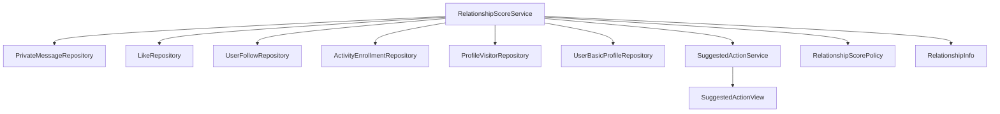
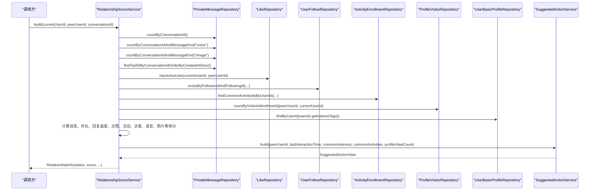
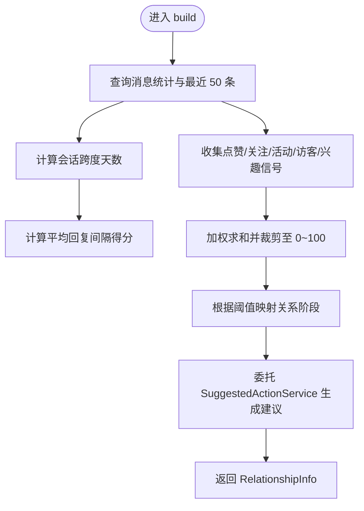
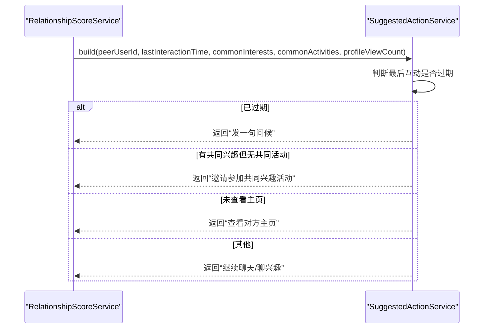
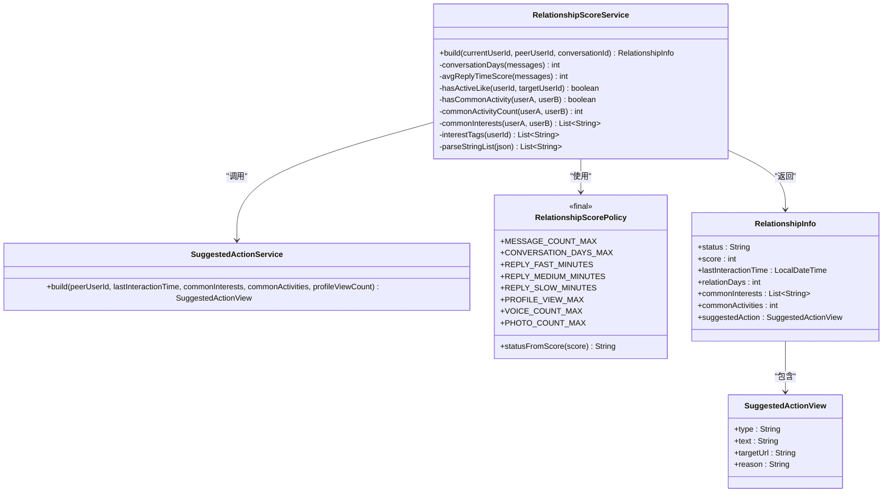

# 关系评分系统

<cite>
**本文引用的文件**   
- [RelationshipScoreService.java](file://apps/api/src/main/java/com/campuslove/api/chat/RelationshipScoreService.java)
- [RelationshipScorePolicy.java](file://apps/api/src/main/java/com/campuslove/api/chat/RelationshipScorePolicy.java)
- [SuggestedActionService.java](file://apps/api/src/main/java/com/campuslove/api/chat/SuggestedActionService.java)
- [RelationshipInfo.java](file://apps/api/src/main/java/com/campuslove/api/chat/RelationshipInfo.java)
- [SuggestedActionView.java](file://apps/api/src/main/java/com/campuslove/api/chat/SuggestedActionView.java)
- [PrivateMessageRepository.java](file://apps/api/src/main/java/com/campuslove/api/repository/PrivateMessageRepository.java)
</cite>

## 目录
1. [引言](#引言)
2. [项目结构](#项目结构)
3. [核心组件](#核心组件)
4. [架构总览](#架构总览)
5. [详细组件分析](#详细组件分析)
6. [依赖分析](#依赖分析)
7. [性能与缓存策略](#性能与缓存策略)
8. [配置与扩展指南](#配置与扩展指南)
9. [排错与常见问题](#排错与常见问题)
10. [结论](#结论)

## 引言
本技术文档围绕关系评分系统的核心实现展开，重点说明以下目标：
- RelationshipScoreService 的多维度评分算法：消息频率、互动深度、用户画像、活动交集等。
- RelationshipScorePolicy 的策略常量与状态划分，以及如何通过集中常量实现可配置化与可扩展性。
- SuggestedActionService 的智能建议生成机制：对话引导、破冰话题和行为推荐。
- 评分权重、阈值、阶段划分的配置方式，以及当前实现中的缓存策略和性能优化点。
- 用户行为分析、互动质量评估、关系发展阶段识别的落地方式。
- 评分规则配置示例与建议功能的集成指南。

## 项目结构
关系评分相关代码位于后端 API 模块的 chat 包中，采用“服务 + 策略常量 + 视图模型”的分层组织方式：
- 计算与服务：RelationshipScoreService、SuggestedActionService
- 策略与阈值：RelationshipScorePolicy
- 数据模型：RelationshipInfo、SuggestedActionView
- 数据访问：PrivateMessageRepository（以及其他 Repository）

图示来源
- [RelationshipScoreService.java:1-188](file://apps/api/src/main/java/com/campuslove/api/chat/RelationshipScoreService.java#L1-L188)
- [RelationshipScorePolicy.java:1-32](file://apps/api/src/main/java/com/campuslove/api/chat/RelationshipScorePolicy.java#L1-L32)
- [SuggestedActionService.java:1-34](file://apps/api/src/main/java/com/campuslove/api/chat/SuggestedActionService.java#L1-L34)
- [RelationshipInfo.java:1-18](file://apps/api/src/main/java/com/campuslove/api/chat/RelationshipInfo.java#L1-L18)
- [SuggestedActionView.java:1-11](file://apps/api/src/main/java/com/campuslove/api/chat/SuggestedActionView.java#L1-L11)
- [PrivateMessageRepository.java:1-161](file://apps/api/src/main/java/com/campuslove/api/repository/PrivateMessageRepository.java#L1-L161)

章节来源
- [RelationshipScoreService.java:1-188](file://apps/api/src/main/java/com/campuslove/api/chat/RelationshipScoreService.java#L1-L188)
- [RelationshipScorePolicy.java:1-32](file://apps/api/src/main/java/com/campuslove/api/chat/RelationshipScorePolicy.java#L1-L32)
- [SuggestedActionService.java:1-34](file://apps/api/src/main/java/com/campuslove/api/chat/SuggestedActionService.java#L1-L34)
- [RelationshipInfo.java:1-18](file://apps/api/src/main/java/com/campuslove/api/chat/RelationshipInfo.java#L1-L18)
- [SuggestedActionView.java:1-11](file://apps/api/src/main/java/com/campuslove/api/chat/SuggestedActionView.java#L1-L11)
- [PrivateMessageRepository.java:1-161](file://apps/api/src/main/java/com/campuslove/api/repository/PrivateMessageRepository.java#L1-L161)

## 核心组件
- RelationshipScoreService：统一的关系分数计算入口，聚合消息、点赞、关注、活动、访客、兴趣标签等多源信号，输出关系状态、分数与建议动作。
- RelationshipScorePolicy：关系分数与阈值的集中策略常量，负责将分数映射为关系阶段。
- SuggestedActionService：基于最后互动时间、共同兴趣、活动参与、主页浏览等行为生成下一步建议。
- RelationshipInfo / SuggestedActionView：对外暴露的统一视图模型，便于前端消费。

章节来源
- [RelationshipScoreService.java:1-188](file://apps/api/src/main/java/com/campuslove/api/chat/RelationshipScoreService.java#L1-L188)
- [RelationshipScorePolicy.java:1-32](file://apps/api/src/main/java/com/campuslove/api/chat/RelationshipScorePolicy.java#L1-L32)
- [SuggestedActionService.java:1-34](file://apps/api/src/main/java/com/campuslove/api/chat/SuggestedActionService.java#L1-L34)
- [RelationshipInfo.java:1-18](file://apps/api/src/main/java/com/campuslove/api/chat/RelationshipInfo.java#L1-L18)
- [SuggestedActionView.java:1-11](file://apps/api/src/main/java/com/campuslove/api/chat/SuggestedActionView.java#L1-L11)

## 架构总览
下图展示关系评分从输入到输出的完整调用链：控制器或业务方调用 RelationshipScoreService.build(...)，内部读取多源数据，计算分数并生成建议动作，最终返回 RelationshipInfo。

图示来源
- [RelationshipScoreService.java:1-188](file://apps/api/src/main/java/com/campuslove/api/chat/RelationshipScoreService.java#L1-L188)
- [SuggestedActionService.java:1-34](file://apps/api/src/main/java/com/campuslove/api/chat/SuggestedActionService.java#L1-L34)
- [PrivateMessageRepository.java:1-161](file://apps/api/src/main/java/com/campuslove/api/repository/PrivateMessageRepository.java#L1-L161)

## 详细组件分析

### RelationshipScoreService：多维度评分引擎
职责
- 采集多源信号：私信数量、语音/图片消息数、最近互动时间、会话跨度天数、平均回复间隔、双向点赞、双向关注、共同活动、主页访客、兴趣标签交集。
- 计算加权分数：对各项指标归一化后乘以对应权重，再裁剪到 0~100。
- 判定关系阶段：通过 RelationshipScorePolicy.statusFromScore(score) 得到关系状态。
- 生成建议动作：委托 SuggestedActionService 生成下一步建议。

关键计算逻辑
- 消息数量得分：min(消息数/MESSAGE_COUNT_MAX, 1.0)*20
- 会话跨度得分：min(会话天数/CONVERSATION_DAYS_MAX, 1.0)*15
- 回复速度得分：根据平均回复分钟数落入快速/中等/慢速三档，分别得 10/7/4 分；无有效间隔则得 0 分
- 双向点赞：+20
- 共同活动：+15
- 主页访客：min(访客数/PROFILE_VIEW_MAX, 1.0)*5
- 语音消息：min(语音数/VOICE_COUNT_MAX, 1.0)*5
- 图片消息：min(图片数/PHOTO_COUNT_MAX, 1.0)*10
- 总分裁剪：max(0, min(100, round(score)))

关系阶段划分
- just_met：score ≤ 20
- chatting：20 < score ≤ 50
- ambiguous：50 < score ≤ 80
- mutual_follow：score > 80

建议动作优先级
- 最后互动超过 48 小时：优先“发一句问候”
- 有共同兴趣但未一起参加活动：优先“邀请参加一场共同兴趣活动”
- 从未查看对方主页：优先“看看 TA 最新动态”
- 其他情况：继续聊天，若存在共同兴趣则结合兴趣话题引导

复杂度分析
- 消息处理：取最近 50 条并按时间排序 O(n log n)，n≤50
- 平均回复间隔：一次线性扫描 O(n)
- 兴趣标签交集：取决于标签集合大小，通常为常数级
- 整体复杂度可控，适合在线实时计算

错误与边界处理
- 无 conversationId：所有与消息相关的计数和列表视为空
- 兴趣标签 JSON 解析异常：回退为空列表，不影响主流程
- 回复间隔为 0：得分为 0，避免异常分支

章节来源
- [RelationshipScoreService.java:1-188](file://apps/api/src/main/java/com/campuslove/api/chat/RelationshipScoreService.java#L1-L188)
- [RelationshipScorePolicy.java:1-32](file://apps/api/src/main/java/com/campuslove/api/chat/RelationshipScorePolicy.java#L1-L32)

#### 评分算法流程图

图示来源
- [RelationshipScoreService.java:1-188](file://apps/api/src/main/java/com/campuslove/api/chat/RelationshipScoreService.java#L1-L188)

### RelationshipScorePolicy：策略与阈值
设计要点
- 以静态常量集中管理权重上限与阈值，便于后续调参而不改动业务逻辑。
- 提供 statusFromScore(score) 将分数映射为关系阶段字符串。

可配置项
- MESSAGE_COUNT_MAX：消息数量上限，用于归一化
- CONVERSATION_DAYS_MAX：会话跨度天数上限
- REPLY_FAST_MINUTES / REPLY_MEDIUM_MINUTES / REPLY_SLOW_MINUTES：回复速度档位
- PROFILE_VIEW_MAX / VOICE_COUNT_MAX / PHOTO_COUNT_MAX：各媒体类型上限

扩展性
- 新增评分维度时，可在 RelationshipScoreService 中添加新项并在 Policy 中声明上限与权重；也可引入策略接口，使不同环境使用不同策略实现。

章节来源
- [RelationshipScorePolicy.java:1-32](file://apps/api/src/main/java/com/campuslove/api/chat/RelationshipScorePolicy.java#L1-L32)

### SuggestedActionService：智能建议生成
职责
- 根据最后互动时间、共同兴趣、共同活动、主页浏览次数，选择最优建议动作。
- 输出包含 type、text、targetUrl、reason 的建议视图，便于前端渲染与埋点。

决策规则
- 最后互动时间缺失或超过 48 小时：返回“发一句问候”，理由 lastInteractionStale
- 有共同兴趣但未一起参加活动：返回“邀请参加一场共同兴趣活动”，附带活动页链接，理由 commonInterestWithoutActivity
- 未查看过对方主页：返回“看看 TA 最新动态”，附带个人主页链接，理由 noProfileView
- 默认：返回“继续聊天”或“一起聊聊某兴趣？”，理由 keepChatting

章节来源
- [SuggestedActionService.java:1-34](file://apps/api/src/main/java/com/campuslove/api/chat/SuggestedActionService.java#L1-L34)
- [SuggestedActionView.java:1-11](file://apps/api/src/main/java/com/campuslove/api/chat/SuggestedActionView.java#L1-L11)

#### 建议生成时序图

图示来源
- [SuggestedActionService.java:1-34](file://apps/api/src/main/java/com/campuslove/api/chat/SuggestedActionService.java#L1-L34)

### 数据模型
- RelationshipInfo：包含关系阶段、分数、最后互动时间、关系天数、共同兴趣、共同活动数与建议动作。
- SuggestedActionView：包含建议类型、文案、跳转链接与原因码。

章节来源
- [RelationshipInfo.java:1-18](file://apps/api/src/main/java/com/campuslove/api/chat/RelationshipInfo.java#L1-L18)
- [SuggestedActionView.java:1-11](file://apps/api/src/main/java/com/campuslove/api/chat/SuggestedActionView.java#L1-L11)

## 依赖分析
耦合关系
- RelationshipScoreService 高度依赖多个 Repository 以获取多维信号，属于典型的数据聚合服务。
- SuggestedActionService 仅依赖基础时间与传入信号，低耦合、易替换。
- RelationshipScorePolicy 作为纯常量与函数类，零运行时依赖。

外部依赖
- Spring Profile：“real”环境下启用 RelationshipScoreService，便于测试或 Mock 场景隔离。
- Jackson ObjectMapper：用于解析兴趣标签 JSON。

潜在循环依赖
- 当前实现无循环依赖；Service 之间单向调用。

图示来源
- [RelationshipScoreService.java:1-188](file://apps/api/src/main/java/com/campuslove/api/chat/RelationshipScoreService.java#L1-L188)
- [SuggestedActionService.java:1-34](file://apps/api/src/main/java/com/campuslove/api/chat/SuggestedActionService.java#L1-L34)
- [RelationshipScorePolicy.java:1-32](file://apps/api/src/main/java/com/campuslove/api/chat/RelationshipScorePolicy.java#L1-L32)
- [RelationshipInfo.java:1-18](file://apps/api/src/main/java/com/campuslove/api/chat/RelationshipInfo.java#L1-L18)
- [SuggestedActionView.java:1-11](file://apps/api/src/main/java/com/campuslove/api/chat/SuggestedActionView.java#L1-L11)

章节来源
- [RelationshipScoreService.java:1-188](file://apps/api/src/main/java/com/campuslove/api/chat/RelationshipScoreService.java#L1-L188)
- [RelationshipScorePolicy.java:1-32](file://apps/api/src/main/java/com/campuslove/api/chat/RelationshipScorePolicy.java#L1-L32)
- [SuggestedActionService.java:1-34](file://apps/api/src/main/java/com/campuslove/api/chat/SuggestedActionService.java#L1-L34)
- [RelationshipInfo.java:1-18](file://apps/api/src/main/java/com/campuslove/api/chat/RelationshipInfo.java#L1-L18)
- [SuggestedActionView.java:1-11](file://apps/api/src/main/java/com/campuslove/api/chat/SuggestedActionView.java#L1-L11)

## 性能与缓存策略
现有实现特点
- 消息量限制：仅读取最近 50 条消息，控制内存与排序开销。
- 直接数据库查询：每次计算都执行多次 Repository 查询，未见本地缓存或分布式缓存。
- 轻量对象：返回值均为简单记录对象，序列化成本低。

优化建议
- 增加会话维度的短期缓存：如按 (currentUserId, peerUserId) 键缓存 RelationshipInfo，TTL 与用户活跃度匹配（例如 1~5 分钟）。
- 对热点指标预聚合：例如互赞、互关、共同活动、主页访客数等可考虑 Redis 增量计数与过期策略。
- 异步刷新：在消息写入、点赞、关注、活动报名、主页访问等事件后触发评分缓存失效或异步重算。
- 分页与批量查询：对于会话列表场景，可对多个会话的未读数、最近消息等进行批量聚合查询，减少 N+1。

章节来源
- [PrivateMessageRepository.java:1-161](file://apps/api/src/main/java/com/campuslove/api/repository/PrivateMessageRepository.java#L1-L161)
- [RelationshipScoreService.java:1-188](file://apps/api/src/main/java/com/campuslove/api/chat/RelationshipScoreService.java#L1-L188)

## 配置与扩展指南
评分权重与阈值配置
- 修改 RelationshipScorePolicy 中的上限与阈值即可调整权重分配与阶段划分。
- 如需动态配置，可将 Policy 抽象为接口并提供配置文件加载器，支持热更新。

新增评分维度
- 在 RelationshipScoreService.build 中添加新的归一化项与权重，同时在 RelationshipScorePolicy 中声明上限。
- 在 SuggestedActionService 中补充该维度对建议的影响。

建议功能集成
- 前端消费 RelationshipInfo.suggestedAction.type 与 text 进行引导展示，并通过 reason 字段进行埋点与分析。
- 当建议类型为 view_profile 或 invite 时，可使用 targetUrl 进行页面跳转。

章节来源
- [RelationshipScorePolicy.java:1-32](file://apps/api/src/main/java/com/campuslove/api/chat/RelationshipScorePolicy.java#L1-L32)
- [SuggestedActionService.java:1-34](file://apps/api/src/main/java/com/campuslove/api/chat/SuggestedActionService.java#L1-L34)
- [RelationshipInfo.java:1-18](file://apps/api/src/main/java/com/campuslove/api/chat/RelationshipInfo.java#L1-L18)

## 排错与常见问题
常见问题
- 关系分数始终偏低：检查消息数量、会话跨度、平均回复间隔、互赞与共同活动等信号是否缺失。
- 建议总是“发一句问候”：确认 lastInteractionTime 是否有效且不超过 48 小时。
- 兴趣标签不生效：确认 UserBasicProfile.interestTags 是否为合法 JSON 列表。
- 共同活动未命中：确认 ActivityEnrollmentRepository.findCommonActivityIdsByUserIds 是否能正确返回交集。

调试建议
- 打印中间变量：messageCount、conversationDays、avgReplyScore、mutualLike、activityTogether、profileViewCount、commonInterests、commonActivities。
- 验证阈值：对照 RelationshipScorePolicy 的各上限与分档分钟数。
- 观察建议 reason：用于定位具体触发条件。

章节来源
- [RelationshipScoreService.java:1-188](file://apps/api/src/main/java/com/campuslove/api/chat/RelationshipScoreService.java#L1-L188)
- [RelationshipScorePolicy.java:1-32](file://apps/api/src/main/java/com/campuslove/api/chat/RelationshipScorePolicy.java#L1-L32)
- [SuggestedActionService.java:1-34](file://apps/api/src/main/java/com/campuslove/api/chat/SuggestedActionService.java#L1-L34)

## 结论
关系评分系统以 RelationshipScoreService 为核心，聚合消息、互动、画像与活动等多源信号，通过 RelationshipScorePolicy 提供的阈值与权重计算关系分数并划分阶段，再由 SuggestedActionService 生成下一步建议。当前实现简洁清晰，具备良好的可扩展性；在生产环境中可通过缓存与异步刷新提升性能，并通过策略抽象实现更灵活的规则管理。