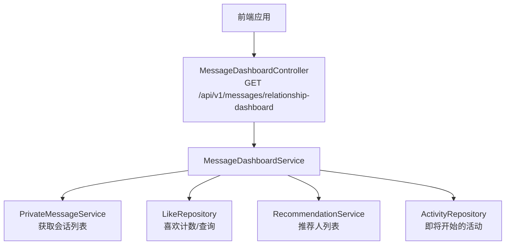
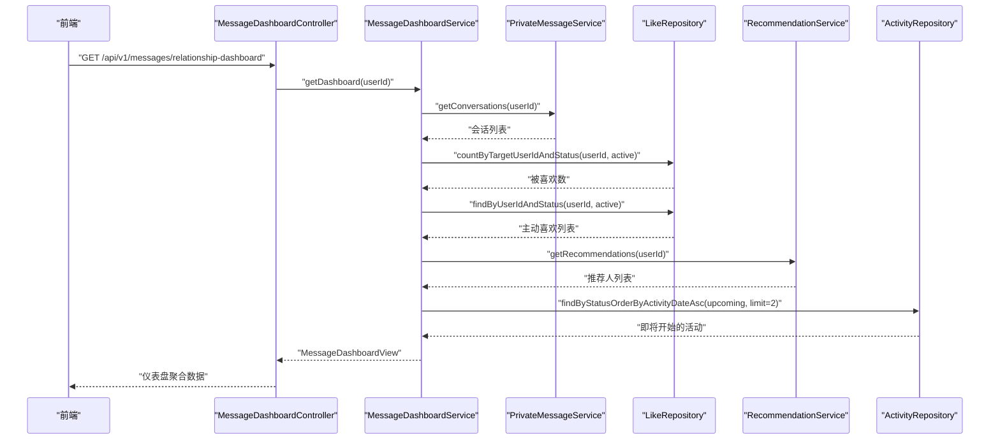
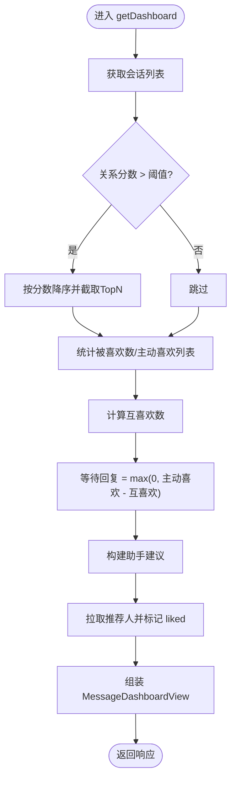
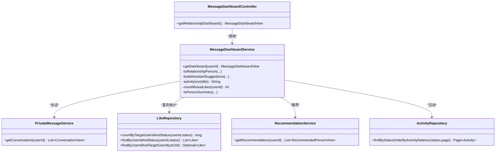

# 消息仪表盘

<cite>
**本文引用的文件**
- [MessageDashboardController.java](file://apps/api/src/main/java/com/campuslove/api/chat/MessageDashboardController.java)
- [MessageDashboardService.java](file://apps/api/src/main/java/com/campuslove/api/chat/MessageDashboardService.java)
- [MessageDashboardView.java](file://apps/api/src/main/java/com/campuslove/api/chat/MessageDashboardView.java)
- [PersonSummaryView.java](file://apps/api/src/main/java/com/campuslove/api/chat/PersonSummaryView.java)
- [TodayHeartView.java](file://apps/api/src/main/java/com/campuslove/api/chat/TodayHeartView.java)
- [ConversationView.java](file://apps/api/src/main/java/com/campuslove/api/chat/ConversationView.java)
- [PrivateMessageService.java](file://apps/api/src/main/java/com/campuslove/api/chat/PrivateMessageService.java)
- [RecommendationService.java](file://apps/api/src/main/java/com/campuslove/api/discover/RecommendationService.java)
- [LikeRepository.java](file://apps/api/src/main/java/com/campuslove/api/repository/LikeRepository.java)
- [ActivityRepository.java](file://apps/api/src/main/java/com/campuslove/api/repository/ActivityRepository.java)
</cite>

## 目录
1. [简介](#简介)
2. [项目结构](#项目结构)
3. [核心组件](#核心组件)
4. [架构总览](#架构总览)
5. [详细组件分析](#详细组件分析)
6. [依赖关系分析](#依赖关系分析)
7. [性能与缓存](#性能与缓存)
8. [可视化接口与前端集成](#可视化接口与前端集成)
9. [定时更新与运维](#定时更新与运维)
10. [故障排查](#故障排查)
11. [结论](#结论)

## 简介
本技术文档围绕“消息仪表盘”功能，系统化说明后端数据聚合 API、统计指标算法、视图模型设计、查询优化策略以及前端集成方式。重点覆盖：
- 用户活跃度指标（今日心动、等待回复数、升温人数）
- 消息量与会话维度信息（最近聊天列表）
- 互动趋势与推荐人摘要（基于喜欢与推荐服务）
- 助手建议卡片（活动推荐、有人喜欢你、建议回复）

该能力由控制器暴露 REST 接口，服务层聚合私信、喜欢、推荐与活动等多源数据，返回统一的聚合视图供客户端渲染消息首页。

## 项目结构
消息仪表盘位于后端 API 模块的 chat 包中，采用分层设计：
- 控制器层：接收请求、鉴权、限流并委派到服务
- 服务层：聚合多数据源、计算统计指标、组装视图对象
- 视图对象：定义对外返回的数据结构
- 仓库与服务：通过 Spring Data 与领域服务访问 Likes、活动与推荐等数据

图示来源
- [MessageDashboardController.java:1-34](file://apps/api/src/main/java/com/campuslove/api/chat/MessageDashboardController.java#L1-L34)
- [MessageDashboardService.java:1-183](file://apps/api/src/main/java/com/campuslove/api/chat/MessageDashboardService.java#L1-L183)
- [PrivateMessageService.java:1-50](file://apps/api/src/main/java/com/campuslove/api/chat/PrivateMessageService.java#L1-L50)
- [RecommendationService.java](file://apps/api/src/main/java/com/campuslove/api/discover/RecommendationService.java)
- [LikeRepository.java](file://apps/api/src/main/java/com/campuslove/api/repository/LikeRepository.java)
- [ActivityRepository.java](file://apps/api/src/main/java/com/campuslove/api/repository/ActivityRepository.java)

章节来源
- [MessageDashboardController.java:1-34](file://apps/api/src/main/java/com/campuslove/api/chat/MessageDashboardController.java#L1-L34)
- [MessageDashboardService.java:1-183](file://apps/api/src/main/java/com/campuslove/api/chat/MessageDashboardService.java#L1-L183)

## 核心组件
- MessageDashboardController：提供 GET /api/v1/messages/relationship-dashboard，读取当前用户 ID，调用服务层并返回聚合视图。接口具备限流保护。
- MessageDashboardService：核心聚合逻辑，负责：
  - 拉取用户会话列表并筛选高关系分数的“升温人物”
  - 计算今日心动指标（被喜欢数、等待回复数、升温人数）
  - 生成助手建议卡片（活动、有人喜欢你、建议回复）
  - 从推荐服务获取推荐人，标记是否已喜欢
- 视图对象：
  - MessageDashboardView：仪表盘总览数据容器
  - TodayHeartView：今日心跳（likedMeCount、waitingReplyCount、warmingCount）
  - PersonSummaryView：推荐人摘要（含 liked 标志）
  - ConversationView：会话视图（含关系信息）

章节来源
- [MessageDashboardView.java:1-14](file://apps/api/src/main/java/com/campuslove/api/chat/MessageDashboardView.java#L1-L14)
- [TodayHeartView.java:1-10](file://apps/api/src/main/java/com/campuslove/api/chat/TodayHeartView.java#L1-L10)
- [PersonSummaryView.java:1-17](file://apps/api/src/main/java/com/campuslove/api/chat/PersonSummaryView.java#L1-L17)
- [ConversationView.java:1-51](file://apps/api/src/main/java/com/campuslove/api/chat/ConversationView.java#L1-L51)
- [PrivateMessageService.java:1-50](file://apps/api/src/main/java/com/campuslove/api/chat/PrivateMessageService.java#L1-L50)

## 架构总览
下图展示了从请求到响应的主要交互路径及数据流向：

图示来源
- [MessageDashboardController.java:1-34](file://apps/api/src/main/java/com/campuslove/api/chat/MessageDashboardController.java#L1-L34)
- [MessageDashboardService.java:1-183](file://apps/api/src/main/java/com/campuslove/api/chat/MessageDashboardService.java#L1-L183)
- [PrivateMessageService.java:1-50](file://apps/api/src/main/java/com/campuslove/api/chat/PrivateMessageService.java#L1-L50)
- [LikeRepository.java](file://apps/api/src/main/java/com/campuslove/api/repository/LikeRepository.java)
- [RecommendationService.java](file://apps/api/src/main/java/com/campuslove/api/discover/RecommendationService.java)
- [ActivityRepository.java](file://apps/api/src/main/java/com/campuslove/api/repository/ActivityRepository.java)

## 详细组件分析

### 控制器：MessageDashboardController
- 职责：接收 HTTP 请求，提取当前用户 ID，调用服务层，返回聚合视图
- 安全与限流：使用安全工具获取当前用户；接口具备限流注解，限制单位时间请求次数
- 路由：GET /api/v1/messages/relationship-dashboard

章节来源
- [MessageDashboardController.java:1-34](file://apps/api/src/main/java/com/campuslove/api/chat/MessageDashboardController.java#L1-L34)

### 服务：MessageDashboardService
- 聚合流程：
  - 会话维度：拉取会话列表，筛选关系分数大于阈值的“升温人物”，排序并限制数量
  - 今日心动：统计被喜欢数、计算等待回复数（主动喜欢数减去互喜欢数）、升温人数
  - 助手建议：优先展示即将开始的真实活动，若无则回退推广卡；如有被喜欢或升温人物，追加对应建议
  - 推荐人：从推荐服务拉取，标记当前用户是否已喜欢
- 关键算法：
  - 等待回复数 = max(0, 主动喜欢数 - 互喜欢数)
  - 升温人物排序：按关系分数降序
  - 活动图标映射：根据标题关键词选择不同图标
- 异常与兜底：
  - 头像缺失时回退到默认头像资源
  - 活动为空时显示通用推广卡

图示来源
- [MessageDashboardService.java:1-183](file://apps/api/src/main/java/com/campuslove/api/chat/MessageDashboardService.java#L1-L183)

章节来源
- [MessageDashboardService.java:1-183](file://apps/api/src/main/java/com/campuslove/api/chat/MessageDashboardService.java#L1-L183)

### 视图对象设计
- MessageDashboardView：包含今日心跳、助手建议、升温人物、推荐人、最近聊天
- TodayHeartView：likedMeCount（被喜欢数）、waitingReplyCount（等待回复数）、warmingCount（升温人数）
- PersonSummaryView：userId、name、avatarUrl、headline、tags、distanceText、liked（基于 likes 表真源）
- ConversationView：会话基础信息与关系字段（phase、sessionType、muted、relationship）

章节来源
- [MessageDashboardView.java:1-14](file://apps/api/src/main/java/com/campuslove/api/chat/MessageDashboardView.java#L1-L14)
- [TodayHeartView.java:1-10](file://apps/api/src/main/java/com/campuslove/api/chat/TodayHeartView.java#L1-L10)
- [PersonSummaryView.java:1-17](file://apps/api/src/main/java/com/campuslove/api/chat/PersonSummaryView.java#L1-L17)
- [ConversationView.java:1-51](file://apps/api/src/main/java/com/campuslove/api/chat/ConversationView.java#L1-L51)

### 统计指标与算法
- 用户活跃度指标
  - 被喜欢数：按目标用户和状态统计
  - 等待回复数：主动喜欢数减去互喜欢数（下限为 0）
  - 升温人数：会话中关系分数超过阈值的对方人数
- 消息量统计
  - 最近聊天列表：来自会话服务，包含未读计数、最后消息预览等
- 互动趋势分析
  - 助手建议中的“有人喜欢你”基于被喜欢数动态呈现
  - “建议回复”基于升温人物首名进行引导
- 异常检测与兜底
  - 头像缺失时回退默认资源
  - 无即将活动时回退推广内容

章节来源
- [MessageDashboardService.java:1-183](file://apps/api/src/main/java/com/campuslove/api/chat/MessageDashboardService.java#L1-L183)

## 依赖关系分析
- 控制器依赖服务：MessageDashboardController -> MessageDashboardService
- 服务依赖：
  - PrivateMessageService：会话列表
  - LikeRepository：喜欢计数与查询
  - RecommendationService：推荐人列表
  - ActivityRepository：即将开始的活动
- 外部系统：数据库（通过 Repository 抽象）、推荐服务、活动数据源

图示来源
- [MessageDashboardController.java:1-34](file://apps/api/src/main/java/com/campuslove/api/chat/MessageDashboardController.java#L1-L34)
- [MessageDashboardService.java:1-183](file://apps/api/src/main/java/com/campuslove/api/chat/MessageDashboardService.java#L1-L183)
- [PrivateMessageService.java:1-50](file://apps/api/src/main/java/com/campuslove/api/chat/PrivateMessageService.java#L1-L50)
- [LikeRepository.java](file://apps/api/src/main/java/com/campuslove/api/repository/LikeRepository.java)
- [RecommendationService.java](file://apps/api/src/main/java/com/campuslove/api/discover/RecommendationService.java)
- [ActivityRepository.java](file://apps/api/src/main/java/com/campuslove/api/repository/ActivityRepository.java)

章节来源
- [MessageDashboardController.java:1-34](file://apps/api/src/main/java/com/campuslove/api/chat/MessageDashboardController.java#L1-L34)
- [MessageDashboardService.java:1-183](file://apps/api/src/main/java/com/campuslove/api/chat/MessageDashboardService.java#L1-L183)

## 性能与缓存
- 查询优化要点
  - 会话列表：仅用于首页聚合，避免过度分页；对高价值数据进行过滤与排序后再裁剪
  - 喜欢统计：优先使用聚合查询（计数）减少往返；互喜欢判断可考虑批量查询与内存去重
  - 活动拉取：限制条数并过滤已发布条目，减少无效数据传输
- 缓存策略建议
  - 会话列表：可按用户粒度短期缓存（例如分钟级），降低重复聚合开销
  - 推荐人列表：可结合推荐服务的缓存机制，避免频繁全量拉取
  - 活动数据：变更频率低，可采用短 TTL 缓存
  - 喜欢统计：高频只读指标可引入本地缓存或计数器（注意一致性）
- 并发与限流
  - 接口已配置限流，防止恶意刷取；在高并发场景下可结合网关层做更细粒度的速率控制
- 资源与体积
  - 头像缺失兜底使用静态资源，避免额外网络请求
  - 视图对象精简字段，减少序列化与传输开销

[本节为通用性能指导，不直接分析具体文件]

## 可视化接口与前端集成
- 接口契约
  - 方法：GET
  - 路径：/api/v1/messages/relationship-dashboard
  - 认证：需要当前登录上下文（通过安全工具获取 userId）
  - 限流：单 IP 短时请求受限
- 响应体结构（MessageDashboardView）
  - todayHeart：{ likedMeCount, waitingReplyCount, warmingCount }
  - assistant：[{ icon, title, subtitle, targetUrl }]
  - warmPeople：[{ userId, name, avatarUrl, headline, relationship }]
  - recommendedPeople：[{ userId, name, avatarUrl, headline, tags, distanceText, liked }]
  - recentChats：[ConversationView...]
- 前端集成指南
  - 在消息首页加载时调用上述接口，获取仪表盘数据
  - 渲染今日心动区域：展示被喜欢数、等待回复数、升温人数
  - 渲染助手建议卡片：按顺序展示活动、有人喜欢你、建议回复（最多 3 条）
  - 渲染升温人物轮播：按关系分数从高到低展示前若干名
  - 渲染推荐人列表：标记已喜欢状态，支持点击跳转
  - 错误处理：网络失败或数据不完整时提供降级展示（如空状态、重试按钮）
  - 性能优化：首次加载后缓存结果，支持增量刷新

章节来源
- [MessageDashboardController.java:1-34](file://apps/api/src/main/java/com/campuslove/api/chat/MessageDashboardController.java#L1-L34)
- [MessageDashboardView.java:1-14](file://apps/api/src/main/java/com/campuslove/api/chat/MessageDashboardView.java#L1-L14)
- [TodayHeartView.java:1-10](file://apps/api/src/main/java/com/campuslove/api/chat/TodayHeartView.java#L1-L10)
- [PersonSummaryView.java:1-17](file://apps/api/src/main/java/com/campuslove/api/chat/PersonSummaryView.java#L1-L17)
- [ConversationView.java:1-51](file://apps/api/src/main/java/com/campuslove/api/chat/ConversationView.java#L1-L51)

## 定时更新与运维
- 定时更新机制
  - 当前实现为按需聚合：每次请求实时计算，适合低延迟与高新鲜度需求
  - 如需提升性能，可在服务层引入缓存（按用户维度）或在网关/CDN 层做短 TTL 缓存
  - 对于非实时指标（如活动列表），可提前预取并缓存
- 监控与告警
  - 接口限流：观察限流触发情况，评估是否需要调整容量
  - 慢查询：关注会话、喜欢、推荐、活动的查询耗时，必要时索引优化
  - 错误率：监控异常与兜底逻辑触发频率（如头像缺失、活动为空）
- 容量规划
  - 峰值时段可能集中刷新，建议在网关层做统一限流与熔断
  - 若用户规模增长，考虑将热门数据（推荐、活动）下沉至缓存层

[本节为通用运维指导，不直接分析具体文件]

## 故障排查
- 常见问题定位
  - 接口返回空数据：检查会话是否存在、推荐服务是否正常、活动是否发布
  - 头像显示异常：确认头像资源存在，或缺失时使用兜底资源
  - 助手建议不出现：检查活动列表是否为空或被过滤，或被喜欢数为 0
  - 限流触发：观察限流计数，适当放宽或扩容
- 日志与调试
  - 记录关键步骤：会话拉取、喜欢统计、推荐拉取、活动查询
  - 打印中间结果：如升温人物数量、等待回复数、推荐人数
  - 追踪外部依赖：推荐服务与活动数据源的响应时间与错误码

章节来源
- [MessageDashboardService.java:1-183](file://apps/api/src/main/java/com/campuslove/api/chat/MessageDashboardService.java#L1-L183)
- [MessageDashboardController.java:1-34](file://apps/api/src/main/java/com/campuslove/api/chat/MessageDashboardController.java#L1-L34)

## 结论
消息仪表盘以简洁的 REST 接口聚合多维度数据，提供用户活跃度、消息量与互动趋势的统一视图。其核心优势在于：
- 清晰的分层设计与职责分离
- 多数据源聚合与健壮兜底
- 面向前端的结构化视图对象
- 可扩展的缓存与性能优化空间

后续可结合业务规模引入缓存层与监控体系，进一步提升稳定性与性能。