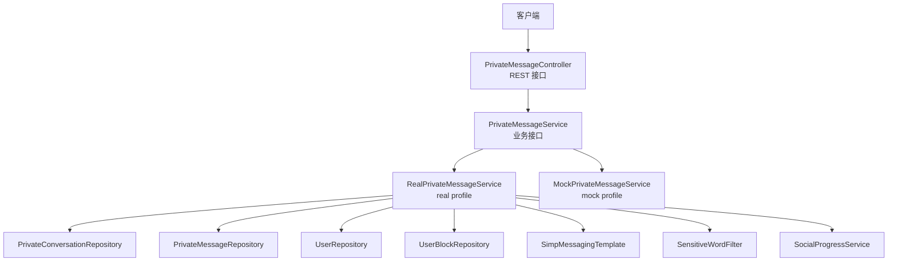
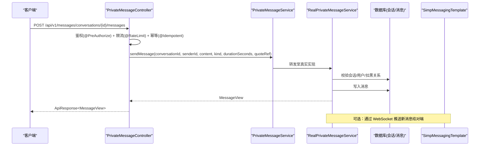
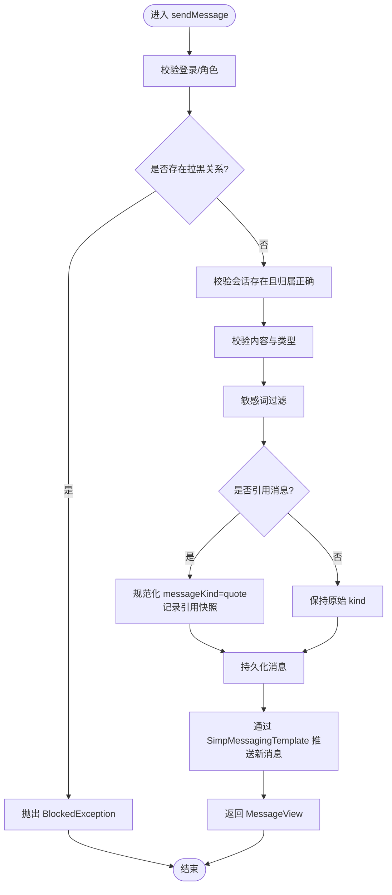
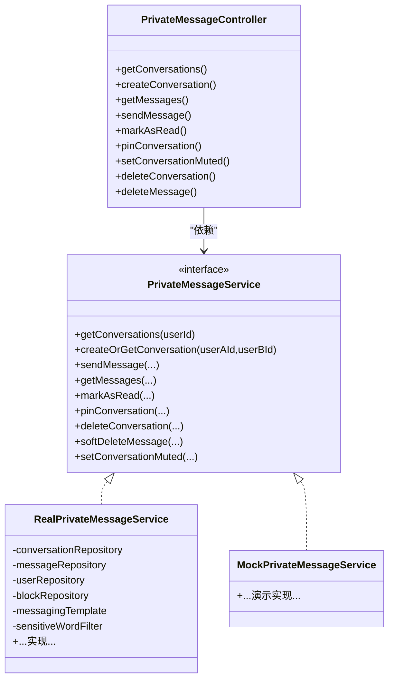

# 私密消息系统

<cite>
**本文引用的文件**   
- [PrivateMessageController.java](file://apps/api/src/main/java/com/campuslove/api/chat/PrivateMessageController.java)
- [PrivateMessageService.java](file://apps/api/src/main/java/com/campuslove/api/chat/PrivateMessageService.java)
- [RealPrivateMessageService.java](file://apps/api/src/main/java/com/campuslove/api/chat/RealPrivateMessageService.java)
- [MockPrivateMessageService.java](file://apps/api/src/main/java/com/campuslove/api/chat/MockPrivateMessageService.java)
- [ConversationView.java](file://apps/api/src/main/java/com/campuslove/api/chat/ConversationView.java)
- [MessageView.java](file://apps/api/src/main/java/com/campuslove/api/chat/MessageView.java)
</cite>

## 目录
1. [简介](#简介)
2. [项目结构](#项目结构)
3. [核心组件](#核心组件)
4. [架构总览](#架构总览)
5. [详细组件分析](#详细组件分析)
6. [依赖关系分析](#依赖关系分析)
7. [性能考量](#性能考量)
8. [故障排查指南](#故障排查指南)
9. [结论](#结论)
10. [附录：API 参考与调用示例](#附录api-参考与调用示例)

## 简介
本技术文档围绕私密消息系统，聚焦 PrivateMessageController 暴露的 RESTful API 以及 PrivateMessageService 的业务实现。内容涵盖会话列表获取、创建或复用会话、消息发送、分页读取消息、已读回执、置顶、免打扰、删除会话与软删除消息等能力；并解释 RealPrivateMessageService 与 MockPrivateMessageService 的双实现模式、权限控制、错误处理与性能优化点。同时提供完整的 API 调用示例和常见问题排查建议。

## 项目结构
私密消息模块位于后端 API 服务中，采用控制器-服务-仓储的分层设计：
- 控制器层：PrivateMessageController 定义 /api/v1/messages 下的 REST 接口
- 服务层：PrivateMessageService 接口统一业务契约；RealPrivateMessageService 为真实实现（real profile），MockPrivateMessageService 为演示/测试实现（mock profile）
- 视图对象：ConversationView、MessageView 作为对外数据载体
- 外部依赖：Repository、用户信息、拉黑关系、敏感词过滤、消息推送模板、社交进度埋点等由服务层按需注入

图表来源
- [PrivateMessageController.java:1-220](file://apps/api/src/main/java/com/campuslove/api/chat/PrivateMessageController.java#L1-L220)
- [PrivateMessageService.java:1-116](file://apps/api/src/main/java/com/campuslove/api/chat/PrivateMessageService.java#L1-L116)
- [RealPrivateMessageService.java:1-200](file://apps/api/src/main/java/com/campuslove/api/chat/RealPrivateMessageService.java#L1-L200)

章节来源
- [PrivateMessageController.java:1-220](file://apps/api/src/main/java/com/campuslove/api/chat/PrivateMessageController.java#L1-L220)
- [PrivateMessageService.java:1-116](file://apps/api/src/main/java/com/campuslove/api/chat/PrivateMessageService.java#L1-L116)

## 核心组件
- PrivateMessageController：封装所有私信相关 HTTP 端点，负责参数校验、鉴权、限流、结果包装
- PrivateMessageService：定义会话与消息的业务契约，包括查询、发送、已读、置顶、免打扰、删除与会话管理
- RealPrivateMessageService：真实实现，包含数据库读写、拉黑拦截、批量预加载、未读数统计、敏感词过滤、WebSocket 推送、社交埋点等
- MockPrivateMessageService：演示/测试用轻量实现，返回固定数据，便于前端联调与快速验证

章节来源
- [PrivateMessageController.java:1-220](file://apps/api/src/main/java/com/campuslove/api/chat/PrivateMessageController.java#L1-L220)
- [PrivateMessageService.java:1-116](file://apps/api/src/main/java/com/campuslove/api/chat/PrivateMessageService.java#L1-L116)
- [RealPrivateMessageService.java:1-200](file://apps/api/src/main/java/com/campuslove/api/chat/RealPrivateMessageService.java#L1-L200)
- [MockPrivateMessageService.java:1-119](file://apps/api/src/main/java/com/campuslove/api/chat/MockPrivateMessageService.java#L1-L119)

## 架构总览
下图展示了从请求到响应的主要路径，包括鉴权、限流、业务逻辑、持久化与推送。

图表来源
- [PrivateMessageController.java:1-220](file://apps/api/src/main/java/com/campuslove/api/chat/PrivateMessageController.java#L1-L220)
- [PrivateMessageService.java:1-116](file://apps/api/src/main/java/com/campuslove/api/chat/PrivateMessageService.java#L1-L116)
- [RealPrivateMessageService.java:1-200](file://apps/api/src/main/java/com/campuslove/api/chat/RealPrivateMessageService.java#L1-L200)

## 详细组件分析

### 控制器层：PrivateMessageController
职责与要点
- 基础路径：/api/v1/messages
- 会话列表：GET /conversations
- 创建或复用会话：POST /conversations（幂等）
- 消息分页读取：GET /conversations/{id}/messages（支持 page/size/order）
- 发送消息：POST /conversations/{id}/messages（限流、幂等、鉴权）
- 标记已读：PUT /conversations/{id}/read
- 会话置顶：PUT /conversations/{id}/pin
- 会话级免打扰：PUT /conversations/{id}/mute
- 删除会话：DELETE /conversations/{id}
- 软删除消息：DELETE /{messageId}

安全与约束
- 所有写操作均要求 USER 角色（@PreAuthorize）
- 发送消息启用令牌桶限流（容量 30，每秒补充 1）
- 使用 @Idempotent 保证重复请求幂等

章节来源
- [PrivateMessageController.java:1-220](file://apps/api/src/main/java/com/campuslove/api/chat/PrivateMessageController.java#L1-L220)

### 服务接口：PrivateMessageService
契约说明
- getConversations(userId)：获取当前用户的会话列表
- createOrGetConversation(userAId, userBId)：存在则复用，否则新建
- sendMessage(...)：发送消息，支持引用与语音时长
- getMessages(..., pageable, order)：分页读取消息，order 支持 desc/asc
- markAsRead(conversationId, userId)：标记会话未读为已读
- pinConversation(conversationId, pinned, userId)：置顶
- deleteConversation(conversationId, userId)：删除会话及消息
- softDeleteMessage(messageId, userId)：仅对发送者隐藏（微信语义）
- setConversationMuted(conversationId, muted, userId)：会话级免打扰

章节来源
- [PrivateMessageService.java:1-116](file://apps/api/src/main/java/com/campuslove/api/chat/PrivateMessageService.java#L1-L116)

### 真实实现：RealPrivateMessageService
关键能力
- 会话列表
  - 按最近消息时间倒序取会话
  - 批量过滤拉黑关系（双方互不可见）
  - 批量预加载对方用户信息，避免 N+1
  - 批量统计未读数，避免逐会话 count
- 创建或复用会话
  - 校验双方非同一用户、对方存在
  - 拉黑检查（任一方拉黑即禁止新建）
  - 若已有会话直接返回，否则新建并立即 flush 回填 ID
- 发送消息
  - 校验会话与用户、拉黑关系
  - 敏感词过滤
  - 引用消息时规范化类型为 quote 并保存引用快照
  - 持久化后通过 WebSocket 推送给对端（如启用）
  - 社交埋点（可空，单测场景跳过）
- 分页读取消息
  - 支持 order=desc（默认最新在前）与 asc（最早在前，上拉加载历史）
  - 读取时可标记为已读
- 置顶、免打扰、删除会话
  - 参与者校验，防 IDOR
  - 会话删除会清理对应消息
- 软删除消息
  - 仅对发送者本人隐藏（deleted_for_sender 标记），不影响对方可见性
  - 幂等：重复删除返回成功

图表来源
- [RealPrivateMessageService.java:1-200](file://apps/api/src/main/java/com/campuslove/api/chat/RealPrivateMessageService.java#L1-L200)

章节来源
- [RealPrivateMessageService.java:1-200](file://apps/api/src/main/java/com/campuslove/api/chat/RealPrivateMessageService.java#L1-L200)

### 模拟实现：MockPrivateMessageService
特点
- mock profile 下激活，返回预设会话与消息
- 用于前端演示、快速联调与回归用例
- 不落库，因此删除/静音等操作无副作用

章节来源
- [MockPrivateMessageService.java:1-119](file://apps/api/src/main/java/com/campuslove/api/chat/MockPrivateMessageService.java#L1-L119)

### 数据模型与视图
- ConversationView：会话视图，包含会话 id、uid、双方用户 id、对方名称与头像、最后消息预览与时间、未读数、标题、置顶、阶段、会话类型、静音标志、关系信息等
- MessageView：消息视图，包含 id、会话 id、发送者 id、内容、消息类型、是否已读、创建时间、引用上下文、语音时长

章节来源
- [ConversationView.java:1-51](file://apps/api/src/main/java/com/campuslove/api/chat/ConversationView.java#L1-L51)
- [MessageView.java:1-31](file://apps/api/src/main/java/com/campuslove/api/chat/MessageView.java#L1-L31)

## 依赖关系分析
- 控制器依赖服务接口，屏蔽具体实现
- 真实服务依赖多个 Repository：会话、消息、用户、拉黑关系
- 真实服务依赖基础设施：消息推送模板、敏感词过滤器、社交进度服务
- 双实现通过 Spring Profile 切换：real 与 mock

图表来源
- [PrivateMessageController.java:1-220](file://apps/api/src/main/java/com/campuslove/api/chat/PrivateMessageController.java#L1-L220)
- [PrivateMessageService.java:1-116](file://apps/api/src/main/java/com/campuslove/api/chat/PrivateMessageService.java#L1-L116)
- [RealPrivateMessageService.java:1-200](file://apps/api/src/main/java/com/campuslove/api/chat/RealPrivateMessageService.java#L1-L200)
- [MockPrivateMessageService.java:1-119](file://apps/api/src/main/java/com/campuslove/api/chat/MockPrivateMessageService.java#L1-L119)

## 性能考量
- 会话列表：批量预加载对方用户信息与未读数，避免 N+1 查询
- 消息分页：支持 desc/asc 两种排序方向，配合 page/size 提升大会话体验
- 发送消息：限流防止刷屏；敏感词过滤在内存中进行，减少无效 IO
- 已读标记：按会话聚合标记，降低更新次数
- WebSocket：异步推送，不阻塞主流程

[本节为通用性能讨论，不直接分析具体文件]

## 故障排查指南
常见问题与定位思路
- 无法创建会话或与某用户发消息被拒绝
  - 检查是否存在拉黑关系（任一方拉黑另一方将阻止创建会话或发送消息）
  - 查看是否触发 BlockedException
- 会话列表为空或不对
  - 确认是否被拉黑过滤；检查批量未读数统计是否命中
  - 检查是否有置顶/静音状态影响展示
- 消息未送达或对端未收到
  - 检查 WebSocket 推送链路是否正常；确认服务端已持久化消息
- 软删除后仍能看到消息
  - 确认调用方是否为消息发送者；服务端仅对发送者隐藏
- 分页异常或顺序不符合预期
  - 检查 order 参数是否为 desc/asc；page/size 是否在允许范围

章节来源
- [RealPrivateMessageService.java:1-200](file://apps/api/src/main/java/com/campuslove/api/chat/RealPrivateMessageService.java#L1-L200)
- [PrivateMessageController.java:1-220](file://apps/api/src/main/java/com/campuslove/api/chat/PrivateMessageController.java#L1-L220)

## 结论
私密消息系统通过清晰的控制器-服务分层与双实现策略，提供了健壮的会话管理与消息处理能力。RealPrivateMessageService 实现了生产所需的关键特性：拉黑拦截、敏感词过滤、批量优化、分页与排序、已读回执、置顶/免打扰、会话删除与消息软删除。配合限流、鉴权与幂等机制，整体具备高可用与良好的扩展性。

[本节为总结，不直接分析具体文件]

## 附录：API 参考与调用示例

### 通用约定
- 基础路径：/api/v1/messages
- 认证：所有写操作需要 USER 角色；用户 ID 从 JWT 上下文获取
- 响应体：统一包裹 ApiResponse<T>

### 会话管理
- 获取会话列表
  - GET /api/v1/messages/conversations
  - 示例：curl -H "Authorization: Bearer <token>" http://host/api/v1/messages/conversations
- 创建或复用会话
  - POST /api/v1/messages/conversations
  - 请求体：CreateConversationRequest{ userBId: 数字 }
  - 示例：curl -X POST -H "Authorization: Bearer <token>" -H "Content-Type: application/json" -d '{"userBId":1001}' http://host/api/v1/messages/conversations
- 设置会话置顶
  - PUT /api/v1/messages/conversations/{id}/pin?pinned=true|false
  - 示例：curl -X PUT -H "Authorization: Bearer <token>" 'http://host/api/v1/messages/conversations/1/pin?pinned=true'
- 设置会话级免打扰
  - PUT /api/v1/messages/conversations/{id}/mute|muted=true|false
  - 示例：curl -X PUT -H "Authorization: Bearer <token>" 'http://host/api/v1/messages/conversations/1/mute?muted=true'
- 删除会话
  - DELETE /api/v1/messages/conversations/{id}
  - 示例：curl -X DELETE -H "Authorization: Bearer <token>" http://host/api/v1/messages/conversations/1

### 消息操作
- 发送消息
  - POST /api/v1/messages/conversations/{id}/messages
  - 请求体：SendMessageRequest{ content, kind, durationSeconds?, quoteRef? }
  - 示例：curl -X POST -H "Authorization: Bearer <token>" -H "Content-Type: application/json" -d '{"content":"你好","kind":"text"}' http://host/api/v1/messages/conversations/1/messages
- 分页读取消息
  - GET /api/v1/messages/conversations/{id}/messages?page=0&size=20&order=desc|asc
  - 示例：curl -H "Authorization: Bearer <token>" 'http://host/api/v1/messages/conversations/1/messages?page=0&size=20&order=desc'
- 标记已读
  - PUT /api/v1/messages/conversations/{id}/read
  - 示例：curl -X PUT -H "Authorization: Bearer <token>" http://host/api/v1/messages/conversations/1/read
- 软删除消息（仅发送者可见）
  - DELETE /api/v1/messages/{messageId}
  - 示例：curl -X DELETE -H "Authorization: Bearer <token>" http://host/api/v1/messages/123

### 错误处理
- 鉴权失败：返回未授权错误
- 资源不存在：例如会话或消息不存在时返回资源未找到错误
- 拉黑限制：发送或创建会话时被拉黑将返回业务错误码 BLOCKED
- 限流：短时间内频繁发送消息将被限流
- 参数校验：非法参数将返回校验错误

[本节为概念性说明，不直接分析具体文件]