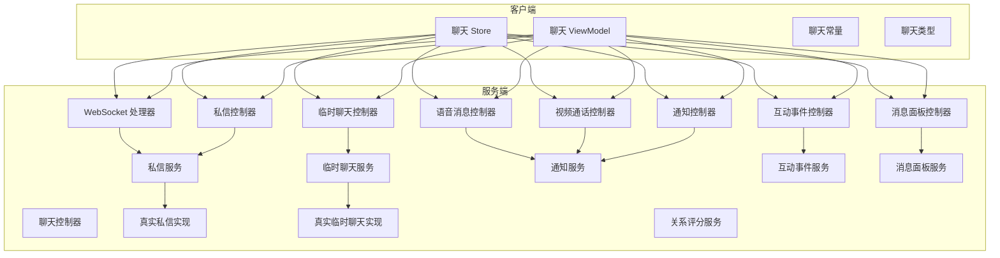
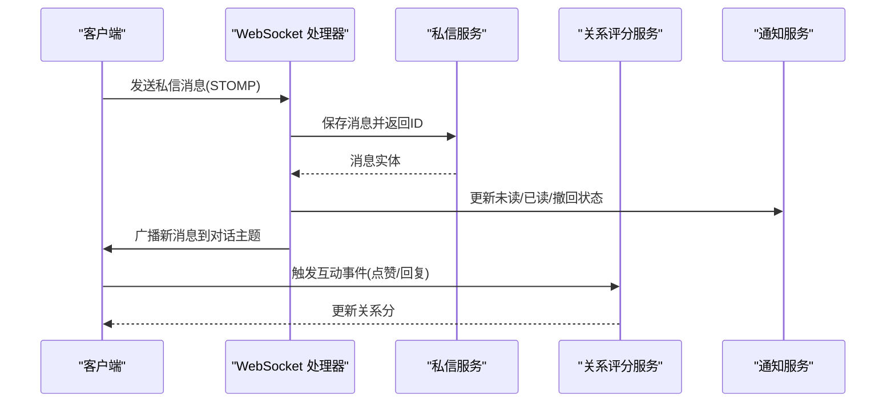
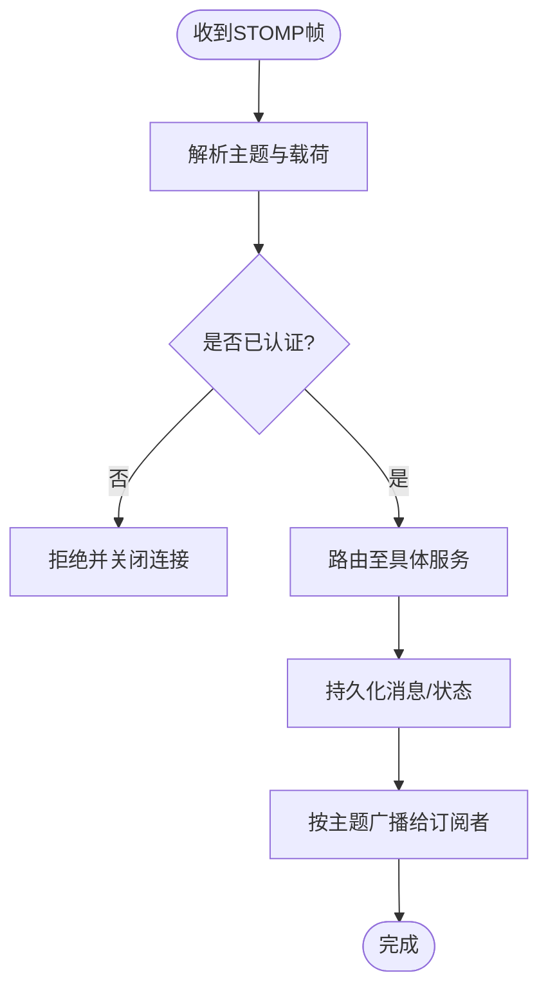
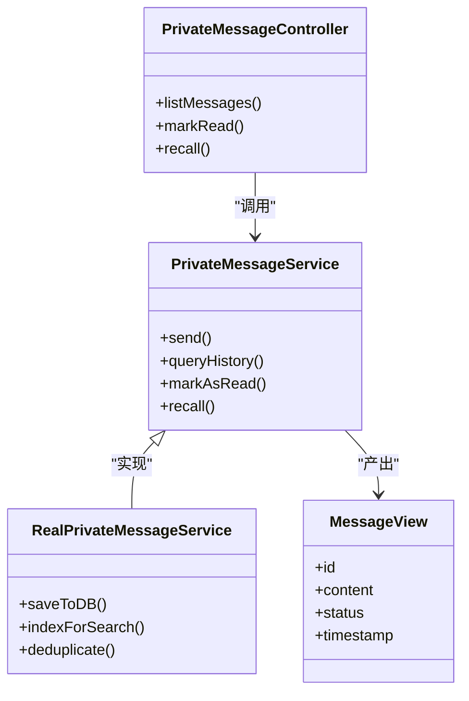
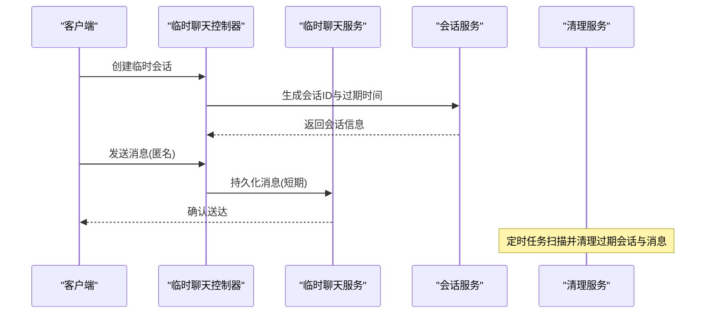
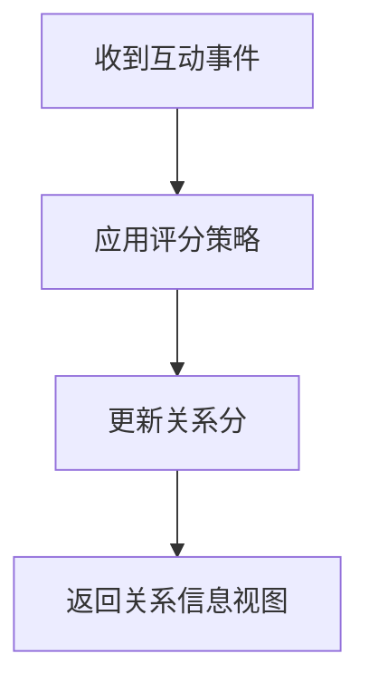
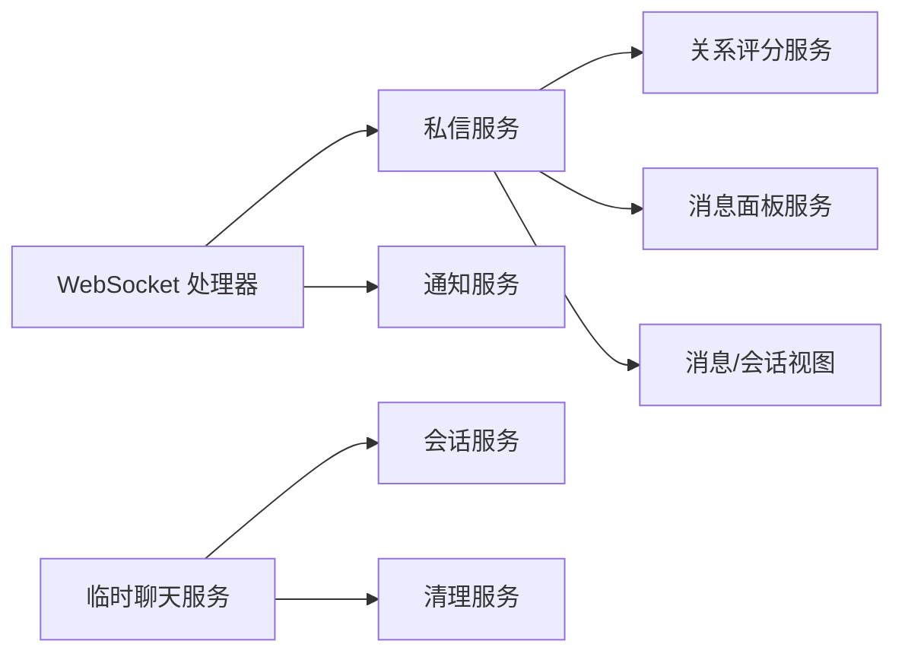

# 聊天与消息系统

<cite>
**本文引用的文件**
- [MessageWebSocketHandler.java](file://apps/api/src/main/java/com/campuslove/api/chat/MessageWebSocketHandler.java)
- [ChatController.java](file://apps/api/src/main/java/com/campuslove/api/chat/ChatController.java)
- [PrivateMessageController.java](file://apps/api/src/main/java/com/campuslove/api/chat/PrivateMessageController.java)
- [PrivateMessageService.java](file://apps/api/src/main/java/com/campuslove/api/chat/PrivateMessageService.java)
- [RealPrivateMessageService.java](file://apps/api/src/main/java/com/campuslove/api/chat/RealPrivateMessageService.java)
- [TempChatController.java](file://apps/api/src/main/java/com/campuslove/api/chat/TempChatController.java)
- [TempChatService.java](file://apps/api/src/main/java/com/campuslove/api/chat/TempChatService.java)
- [RealTempChatService.java](file://apps/api/src/main/java/com/campuslove/api/chat/RealTempChatService.java)
- [TempChatSessionService.java](file://apps/api/src/main/java/com/campuslove/api/chat/TempChatSessionService.java)
- [TempChatMessageService.java](file://apps/api/src/main/java/com/campuslove/api/chat/TempChatMessageService.java)
- [TempChatCleanupService.java](file://apps/api/src/main/java/com/campuslove/api/chat/TempChatCleanupService.java)
- [VoiceMessageController.java](file://apps/api/src/main/java/com/campuslove/api/chat/VoiceMessageController.java)
- [VoiceMessageService.java](file://apps/api/src/main/java/com/campuslove/api/chat/VoiceMessageService.java)
- [VideoCallController.java](file://apps/api/src/main/java/com/campuslove/api/chat/VideoCallController.java)
- [VideoCallService.java](file://apps/api/src/main/java/com/campuslove/api/chat/VideoCallService.java)
- [NotificationController.java](file://apps/api/src/main/java/com/campuslove/api/chat/NotificationController.java)
- [NotificationService.java](file://apps/api/src/main/java/com/campuslove/api/chat/NotificationService.java)
- [RealNotificationService.java](file://apps/api/src/main/java/com/campuslove/api/chat/RealNotificationService.java)
- [RelationshipScoreService.java](file://apps/api/src/main/java/com/campuslove/api/chat/RelationshipScoreService.java)
- [InteractionEventController.java](file://apps/api/src/main/java/com/campuslove/api/chat/InteractionEventController.java)
- [InteractionEventService.java](file://apps/api/src/main/java/com/campuslove/api/chat/InteractionEventService.java)
- [MessageDashboardController.java](file://apps/api/src/main/java/com/campuslove/api/chat/MessageDashboardController.java)
- [MessageDashboardService.java](file://apps/api/src/main/java/com/campuslove/api/chat/MessageDashboardService.java)
- [MessageView.java](file://apps/api/src/main/java/com/campuslove/api/chat/MessageView.java)
- [ConversationView.java](file://apps/api/src/main/java/com/campuslove/api/chat/ConversationView.java)
- [UnreadCountView.java](file://apps/api/src/main/java/com/campuslove/api/chat/UnreadCountView.java)
- [NotificationView.java](file://apps/api/src/main/java/com/campuslove/api/chat/NotificationView.java)
- [SuggestedActionService.java](file://apps/api/src/main/java/com/campuslove/api/chat/SuggestedActionService.java)
- [chat.ts](file://apps/client/src/constants/chat.ts)
- [chat.ts (stores)](file://apps/client/src/stores/chat.ts)
- [chat.ts (view-models)](file://apps/client/src/view-models/chat.ts)
- [chat.ts (types)](file://apps/client/src/types/chat.ts)
- [whispers.yaml](file://docs/openapi/whispers.yaml)
</cite>

## 目录
1. [简介](#简介)
2. [项目结构](#项目结构)
3. [核心组件](#核心组件)
4. [架构总览](#架构总览)
5. [详细组件分析](#详细组件分析)
6. [依赖关系分析](#依赖关系分析)
7. [性能考量](#性能考量)
8. [故障排查指南](#故障排查指南)
9. [结论](#结论)
10. [附录](#附录)

## 简介
本技术文档聚焦于聊天与消息系统的实时通信、协议处理、消息持久化与安全机制，覆盖临时匿名聊天、私密消息、关系评分、语音消息、视频通话、消息状态同步、去重与历史查询、搜索、通知推送、已读回执与撤回等能力。后端采用 WebSocket + STOMP 的实时通道，结合 REST API 提供消息收发、会话管理、音视频信令与统计面板；前端通过 Store 与视图模型统一管理消息状态与交互流程。

## 项目结构
- 后端（Spring Boot）：位于 apps/api，按功能域拆分 chat 子包，包含控制器、服务层、WebSocket 处理器、数据视图对象等。
- 前端（Vue/Pinia）：位于 apps/client，包含聊天常量、类型定义、Store 与视图模型，用于驱动 UI 与用户交互。
- OpenAPI：位于 docs/openapi，描述 whispers（私信）等接口契约。
- 数据库迁移与种子脚本：位于 database，支撑消息、会话、通知等数据表结构与示例数据。

图表来源
- [MessageWebSocketHandler.java:1-200](file://apps/api/src/main/java/com/campuslove/api/chat/MessageWebSocketHandler.java#L1-L200)
- [PrivateMessageController.java:1-200](file://apps/api/src/main/java/com/campuslove/api/chat/PrivateMessageController.java#L1-L200)
- [TempChatController.java:1-200](file://apps/api/src/main/java/com/campuslove/api/chat/TempChatController.java#L1-L174)
- [VoiceMessageController.java:1-200](file://apps/api/src/main/java/com/campuslove/api/chat/VoiceMessageController.java#L1-L177)
- [VideoCallController.java:1-200](file://apps/api/src/main/java/com/campuslove/api/chat/VideoCallController.java#L1-L163)
- [NotificationController.java:1-200](file://apps/api/src/main/java/com/campuslove/api/chat/NotificationController.java#L1-L127)
- [InteractionEventController.java:1-200](file://apps/api/src/main/java/com/campuslove/api/chat/InteractionEventController.java#L1-L109)
- [MessageDashboardController.java:1-200](file://apps/api/src/main/java/com/campuslove/api/chat/MessageDashboardController.java#L1-L34)

章节来源
- [MessageWebSocketHandler.java:1-200](file://apps/api/src/main/java/com/campuslove/api/chat/MessageWebSocketHandler.java#L1-L200)
- [PrivateMessageController.java:1-200](file://apps/api/src/main/java/com/campuslove/api/chat/PrivateMessageController.java#L1-L200)
- [TempChatController.java:1-200](file://apps/api/src/main/java/com/campuslove/api/chat/TempChatController.java#L1-L174)
- [VoiceMessageController.java:1-200](file://apps/api/src/main/java/com/campuslove/api/chat/VoiceMessageController.java#L1-L177)
- [VideoCallController.java:1-200](file://apps/api/src/main/java/com/campuslove/api/chat/VideoCallController.java#L1-L163)
- [NotificationController.java:1-200](file://apps/api/src/main/java/com/campuslove/api/chat/NotificationController.java#L1-L127)
- [InteractionEventController.java:1-200](file://apps/api/src/main/java/com/campuslove/api/chat/InteractionEventController.java#L1-L109)
- [MessageDashboardController.java:1-200](file://apps/api/src/main/java/com/campuslove/api/chat/MessageDashboardController.java#L1-L34)

## 核心组件
- 实时通信：WebSocket 处理器负责连接生命周期、订阅主题、消息路由与广播。
- 协议处理：STOMP 主题与端点用于区分私信、群聊、通知、音视频信令等通道。
- 消息持久化：私信与临时聊天通过各自服务层抽象，统一由真实实现对接存储与索引。
- 关系评分：基于互动事件与服务策略计算双方关系分，影响推荐与排序。
- 多媒体：语音消息上传与转码、视频通话信令交换。
- 通知与状态：未读数、已读回执、消息撤回、搜索与历史查询、仪表盘统计。

章节来源
- [MessageWebSocketHandler.java:1-200](file://apps/api/src/main/java/com/campuslove/api/chat/MessageWebSocketHandler.java#L1-L200)
- [PrivateMessageService.java:1-200](file://apps/api/src/main/java/com/campuslove/api/chat/PrivateMessageService.java#L1-L116)
- [RealPrivateMessageService.java:1-200](file://apps/api/src/main/java/com/campuslove/api/chat/RealPrivateMessageService.java#L1-L200)
- [TempChatService.java:1-200](file://apps/api/src/main/java/com/campuslove/api/chat/TempChatService.java#L1-L71)
- [RealTempChatService.java:1-200](file://apps/api/src/main/java/com/campuslove/api/chat/RealTempChatService.java#L1-L134)
- [RelationshipScoreService.java:1-200](file://apps/api/src/main/java/com/campuslove/api/chat/RelationshipScoreService.java#L1-L188)
- [VoiceMessageService.java:1-200](file://apps/api/src/main/java/com/campuslove/api/chat/VoiceMessageService.java#L1-L200)
- [VideoCallService.java:1-200](file://apps/api/src/main/java/com/campuslove/api/chat/VideoCallService.java#L1-L200)
- [NotificationService.java:1-200](file://apps/api/src/main/java/com/campuslove/api/chat/NotificationService.java#L1-L86)
- [RealNotificationService.java:1-200](file://apps/api/src/main/java/com/campuslove/api/chat/RealNotificationService.java#L1-L200)

## 架构总览
系统采用“控制器-服务-存储”的分层架构，实时通道通过 WebSocket+STOMP 暴露主题，REST API 提供数据操作与查询。关键路径包括：
- 私信收发：客户端通过 STOMP 订阅私信主题，服务端经私信服务写入并广播。
- 临时聊天：匿名会话创建、消息暂存与清理，适合快速破冰场景。
- 音视频：信令通过专用主题或 WebSocket 通道传递，媒体流由外部信令服务器承载。
- 通知与状态：未读数、已读回执、撤回与搜索在通知服务与面板服务中集中处理。

图表来源
- [MessageWebSocketHandler.java:1-200](file://apps/api/src/main/java/com/campuslove/api/chat/MessageWebSocketHandler.java#L1-L200)
- [PrivateMessageService.java:1-200](file://apps/api/src/main/java/com/campuslove/api/chat/PrivateMessageService.java#L1-L116)
- [RealPrivateMessageService.java:1-200](file://apps/api/src/main/java/com/campuslove/api/chat/RealPrivateMessageService.java#L1-L200)
- [NotificationService.java:1-200](file://apps/api/src/main/java/com/campuslove/api/chat/NotificationService.java#L1-L86)
- [RelationshipScoreService.java:1-200](file://apps/api/src/main/java/com/campuslove/api/chat/RelationshipScoreService.java#L1-L188)

## 详细组件分析

### 实时消息通信与 STOMP 处理
- 角色：WebSocket 处理器维护会话、鉴权、主题订阅与消息分发。
- 行为：接收 STOMP 帧，解析目标主题，调用对应服务层进行持久化与广播；支持错误重试与断线重连提示。
- 安全：基于会话上下文校验用户身份，限制可访问的主题范围。

图表来源
- [MessageWebSocketHandler.java:1-200](file://apps/api/src/main/java/com/campuslove/api/chat/MessageWebSocketHandler.java#L1-L200)

章节来源
- [MessageWebSocketHandler.java:1-200](file://apps/api/src/main/java/com/campuslove/api/chat/MessageWebSocketHandler.java#L1-L200)

### 私密消息系统
- 控制器：私信控制器暴露 REST 端点，用于获取历史、标记已读、撤回等。
- 服务：私信服务抽象出 CRUD、分页、去重与撤回逻辑；真实实现对接存储与索引。
- 视图：消息视图封装消息体、时间戳、状态位等字段。

图表来源
- [PrivateMessageController.java:1-200](file://apps/api/src/main/java/com/campuslove/api/chat/PrivateMessageController.java#L1-L200)
- [PrivateMessageService.java:1-200](file://apps/api/src/main/java/com/campuslove/api/chat/PrivateMessageService.java#L1-L116)
- [RealPrivateMessageService.java:1-200](file://apps/api/src/main/java/com/campuslove/api/chat/RealPrivateMessageService.java#L1-L200)
- [MessageView.java:1-200](file://apps/api/src/main/java/com/campuslove/api/chat/MessageView.java#L1-L31)

章节来源
- [PrivateMessageController.java:1-200](file://apps/api/src/main/java/com/campuslove/api/chat/PrivateMessageController.java#L1-L200)
- [PrivateMessageService.java:1-200](file://apps/api/src/main/java/com/campuslove/api/chat/PrivateMessageService.java#L1-L116)
- [RealPrivateMessageService.java:1-200](file://apps/api/src/main/java/com/campuslove/api/chat/RealPrivateMessageService.java#L1-L200)
- [MessageView.java:1-200](file://apps/api/src/main/java/com/campuslove/api/chat/MessageView.java#L1-L31)

### 临时匿名聊天
- 控制器：临时聊天控制器提供会话创建、加入、消息发送与列表查询。
- 服务：临时聊天服务与会话服务分别管理生命周期与消息存储；清理服务定期回收过期会话。
- 特性：匿名身份生成、会话过期自动销毁、消息短期保留。

图表来源
- [TempChatController.java:1-200](file://apps/api/src/main/java/com/campuslove/api/chat/TempChatController.java#L1-L174)
- [TempChatService.java:1-200](file://apps/api/src/main/java/com/campuslove/api/chat/TempChatService.java#L1-L71)
- [RealTempChatService.java:1-200](file://apps/api/src/main/java/com/campuslove/api/chat/RealTempChatService.java#L1-L134)
- [TempChatSessionService.java:1-200](file://apps/api/src/main/java/com/campuslove/api/chat/TempChatSessionService.java#L1-L200)
- [TempChatCleanupService.java:1-200](file://apps/api/src/main/java/com/campuslove/api/chat/TempChatCleanupService.java#L1-L200)

章节来源
- [TempChatController.java:1-200](file://apps/api/src/main/java/com/campuslove/api/chat/TempChatController.java#L1-L174)
- [TempChatService.java:1-200](file://apps/api/src/main/java/com/campuslove/api/chat/TempChatService.java#L1-L71)
- [RealTempChatService.java:1-200](file://apps/api/src/main/java/com/campuslove/api/chat/RealTempChatService.java#L1-L134)
- [TempChatSessionService.java:1-200](file://apps/api/src/main/java/com/campuslove/api/chat/TempChatSessionService.java#L1-L200)
- [TempChatCleanupService.java:1-200](file://apps/api/src/main/java/com/campuslove/api/chat/TempChatCleanupService.java#L1-L200)

### 关系评分机制
- 入口：互动事件控制器收集点赞、回复、关注等行为。
- 服务：关系评分服务根据策略计算双方关系分数，影响推荐与排序。
- 输出：关系信息视图供前端展示与决策。

图表来源
- [InteractionEventController.java:1-200](file://apps/api/src/main/java/com/campuslove/api/chat/InteractionEventController.java#L1-L109)
- [InteractionEventService.java:1-200](file://apps/api/src/main/java/com/campuslove/api/chat/InteractionEventService.java#L1-L56)
- [RelationshipScoreService.java:1-200](file://apps/api/src/main/java/com/campuslove/api/chat/RelationshipScoreService.java#L1-L188)

章节来源
- [InteractionEventController.java:1-200](file://apps/api/src/main/java/com/campuslove/api/chat/InteractionEventController.java#L1-L109)
- [InteractionEventService.java:1-200](file://apps/api/src/main/java/com/campuslove/api/chat/InteractionEventService.java#L1-L56)
- [RelationshipScoreService.java:1-200](file://apps/api/src/main/java/com/campuslove/api/chat/RelationshipScoreService.java#L1-L188)

### 语音消息处理
- 控制器：语音消息控制器接收上传、转码与分享链接。
- 服务：语音消息服务负责文件校验、存储与元数据记录。
- 集成：与通知服务联动，发送语音消息到达与播放状态。

章节来源
- [VoiceMessageController.java:1-200](file://apps/api/src/main/java/com/campuslove/api/chat/VoiceMessageController.java#L1-L177)
- [VoiceMessageService.java:1-200](file://apps/api/src/main/java/com/campuslove/api/chat/VoiceMessageService.java#L1-L200)
- [NotificationService.java:1-200](file://apps/api/src/main/java/com/campuslove/api/chat/NotificationService.java#L1-L86)

### 视频通话服务
- 控制器：视频通话控制器提供房间创建、加入与信令转发。
- 服务：视频通话服务协调信令与状态机（等待、进行中、结束）。
- 通知：通过通知服务向参与者推送状态变更。

章节来源
- [VideoCallController.java:1-200](file://apps/api/src/main/java/com/campuslove/api/chat/VideoCallController.java#L1-L163)
- [VideoCallService.java:1-200](file://apps/api/src/main/java/com/campuslove/api/chat/VideoCallService.java#L1-L200)
- [RealNotificationService.java:1-200](file://apps/api/src/main/java/com/campuslove/api/chat/RealNotificationService.java#L1-L200)

### 消息状态同步、去重、历史查询与搜索
- 状态同步：WebSocket 广播与 REST 回调共同保证多端一致性；通知服务维护未读数与已读回执。
- 去重：基于消息 ID 与内容指纹在服务层去重，避免重复入库。
- 历史查询：私信服务提供分页与过滤条件；视图对象统一响应格式。
- 搜索：消息面板服务聚合检索结果，支持关键词与时间范围筛选。

章节来源
- [MessageWebSocketHandler.java:1-200](file://apps/api/src/main/java/com/campuslove/api/chat/MessageWebSocketHandler.java#L1-L200)
- [PrivateMessageService.java:1-200](file://apps/api/src/main/java/com/campuslove/api/chat/PrivateMessageService.java#L1-L116)
- [RealPrivateMessageService.java:1-200](file://apps/api/src/main/java/com/campuslove/api/chat/RealPrivateMessageService.java#L1-L200)
- [MessageDashboardController.java:1-200](file://apps/api/src/main/java/com/campuslove/api/chat/MessageDashboardController.java#L1-L34)
- [MessageDashboardService.java:1-200](file://apps/api/src/main/java/com/campuslove/api/chat/MessageDashboardService.java#L1-L183)

### 消息推送通知、已读回执与撤回
- 推送：通知控制器与通知服务负责站内通知与离线提醒。
- 已读回执：通过 WebSocket 与 REST 双通道更新已读状态，确保最终一致。
- 撤回：私信服务支持撤回语义，广播给会话成员并更新本地视图。

章节来源
- [NotificationController.java:1-200](file://apps/api/src/main/java/com/campuslove/api/chat/NotificationController.java#L1-L127)
- [NotificationService.java:1-200](file://apps/api/src/main/java/com/campuslove/api/chat/NotificationService.java#L1-L86)
- [RealNotificationService.java:1-200](file://apps/api/src/main/java/com/campuslove/api/chat/RealNotificationService.java#L1-L200)
- [PrivateMessageController.java:1-200](file://apps/api/src/main/java/com/campuslove/api/chat/PrivateMessageController.java#L1-L200)

### 聊天室管理与群聊功能
- 会话视图：会话视图对象抽象会话元信息与最近消息。
- 建议动作：建议动作服务提供快捷操作（如邀请加入、设置管理员）。
- 未读数：未读数视图汇总各会话未读计数，便于 UI 展示。

章节来源
- [ConversationView.java:1-200](file://apps/api/src/main/java/com/campuslove/api/chat/ConversationView.java#L1-L51)
- [SuggestedActionService.java:1-200](file://apps/api/src/main/java/com/campuslove/api/chat/SuggestedActionService.java#L1-L34)
- [UnreadCountView.java:1-200](file://apps/api/src/main/java/com/campuslove/api/chat/UnreadCountView.java#L1-L8)

### 前端状态管理与交互
- Store：聊天 Store 管理消息集合、当前会话、未读数与加载状态。
- ViewModel：视图模型封装交互逻辑，如发送、撤回、已读上报。
- 常量与类型：聊天常量定义主题、状态码；类型定义统一数据结构。

章节来源
- [chat.ts (stores)](file://apps/client/src/stores/chat.ts)
- [chat.ts (view-models)](file://apps/client/src/view-models/chat.ts)
- [chat.ts (constants)](file://apps/client/src/constants/chat.ts)
- [chat.ts (types)](file://apps/client/src/types/chat.ts)

## 依赖关系分析
- 控制器依赖服务层：所有控制器仅作为入口，业务逻辑下沉至服务。
- 服务间协作：私信服务与通知服务、关系评分服务、面板服务存在交叉调用。
- WebSocket 与 REST：实时通道与 REST API 互补，前者用于即时推送，后者用于查询与管理。

图表来源
- [MessageWebSocketHandler.java:1-200](file://apps/api/src/main/java/com/campuslove/api/chat/MessageWebSocketHandler.java#L1-L200)
- [PrivateMessageService.java:1-200](file://apps/api/src/main/java/com/campuslove/api/chat/PrivateMessageService.java#L1-L116)
- [NotificationService.java:1-200](file://apps/api/src/main/java/com/campuslove/api/chat/NotificationService.java#L1-L86)
- [RelationshipScoreService.java:1-200](file://apps/api/src/main/java/com/campuslove/api/chat/RelationshipScoreService.java#L1-L188)
- [MessageDashboardService.java:1-200](file://apps/api/src/main/java/com/campuslove/api/chat/MessageDashboardService.java#L1-L183)
- [TempChatService.java:1-200](file://apps/api/src/main/java/com/campuslove/api/chat/TempChatService.java#L1-L71)
- [TempChatSessionService.java:1-200](file://apps/api/src/main/java/com/campuslove/api/chat/TempChatSessionService.java#L1-L200)
- [TempChatCleanupService.java:1-200](file://apps/api/src/main/java/com/campuslove/api/chat/TempChatCleanupService.java#L1-L200)

章节来源
- [MessageWebSocketHandler.java:1-200](file://apps/api/src/main/java/com/campuslove/api/chat/MessageWebSocketHandler.java#L1-L200)
- [PrivateMessageService.java:1-200](file://apps/api/src/main/java/com/campuslove/api/chat/PrivateMessageService.java#L1-L116)
- [NotificationService.java:1-200](file://apps/api/src/main/java/com/campuslove/api/chat/NotificationService.java#L1-L86)
- [RelationshipScoreService.java:1-200](file://apps/api/src/main/java/com/campuslove/api/chat/RelationshipScoreService.java#L1-L188)
- [MessageDashboardService.java:1-200](file://apps/api/src/main/java/com/campuslove/api/chat/MessageDashboardService.java#L1-L183)
- [TempChatService.java:1-200](file://apps/api/src/main/java/com/campuslove/api/chat/TempChatService.java#L1-L71)
- [TempChatSessionService.java:1-200](file://apps/api/src/main/java/com/campuslove/api/chat/TempChatSessionService.java#L1-L200)
- [TempChatCleanupService.java:1-200](file://apps/api/src/main/java/com/campuslove/api/chat/TempChatCleanupService.java#L1-L200)

## 性能考量
- 高并发推送：WebSocket 连接池与异步广播减少阻塞；大流量场景下按需降级为轮询。
- 消息去重与批量写入：服务层合并写操作，降低数据库压力。
- 索引优化：消息与对话索引提升历史查询与搜索性能。
- 缓存策略：未读数与会话摘要使用缓存加速读取。
- 音视频信令：轻量信令优先，媒体流外置以降低服务端负载。

## 故障排查指南
- 连接问题：检查 WebSocket 握手、STOMP 主题订阅是否正确；查看连接日志与心跳。
- 消息丢失：核对去重逻辑与幂等键；确认广播是否失败与重试机制。
- 状态不一致：比对已读回执与未读数；核查撤回广播是否及时。
- 临时会话泄漏：确认清理任务是否运行；检查会话过期策略。
- 音视频掉线：验证信令通道连通性；检查房间状态与超时处理。

章节来源
- [MessageWebSocketHandler.java:1-200](file://apps/api/src/main/java/com/campuslove/api/chat/MessageWebSocketHandler.java#L1-L200)
- [TempChatCleanupService.java:1-200](file://apps/api/src/main/java/com/campuslove/api/chat/TempChatCleanupService.java#L1-L200)
- [RealNotificationService.java:1-200](file://apps/api/src/main/java/com/campuslove/api/chat/RealNotificationService.java#L1-L200)

## 结论
本系统通过 WebSocket+STOMP 实现了低延迟的消息实时通信，配合 REST API 完成消息持久化、状态同步与统计分析。临时匿名聊天降低了沟通门槛，私信系统保障了隐私与可靠性，关系评分增强了匹配与推荐效果。语音与视频能力扩展了交互维度，通知与回执提升了用户体验。未来可在去重、索引与缓存方面进一步优化，以支撑更大规模的用户与消息量。

## 附录
- OpenAPI 契约：whispers.yaml 描述了私信相关接口的请求与响应格式，便于前后端联调与自动化测试。
- 数据库：database 目录下的迁移与种子脚本支撑消息、会话、通知等数据的初始化与演示。

章节来源
- [whispers.yaml:1-200](file://docs/openapi/whispers.yaml#L1-L128)
- [database/complete-guest-account.sql](file://database/complete-guest-account.sql)
- [database/seed-demo-data.sql](file://database/seed-demo-data.sql)