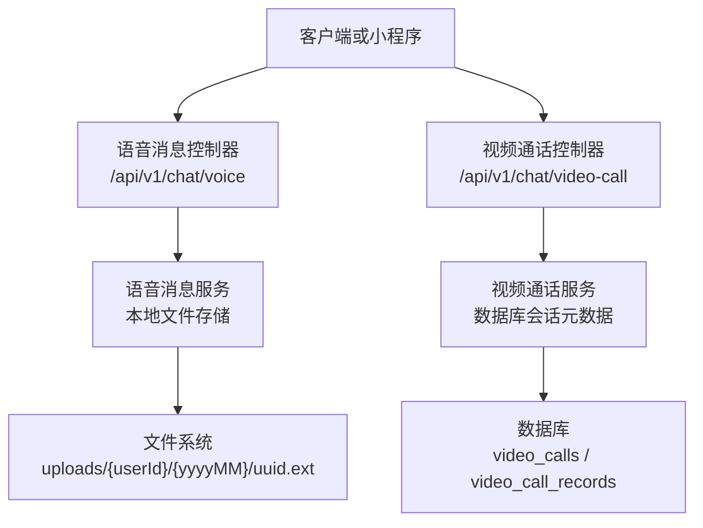
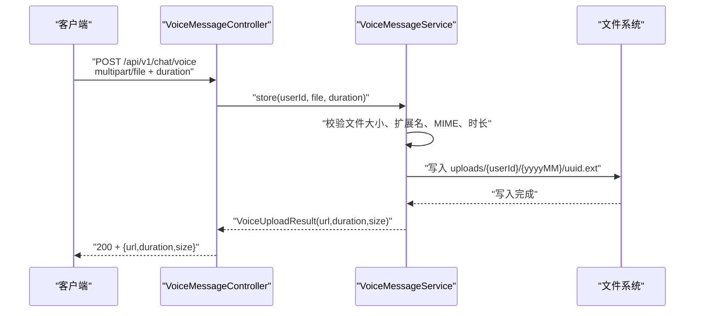
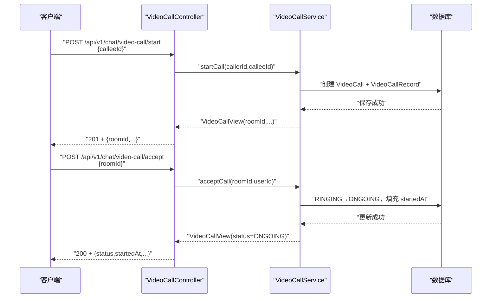
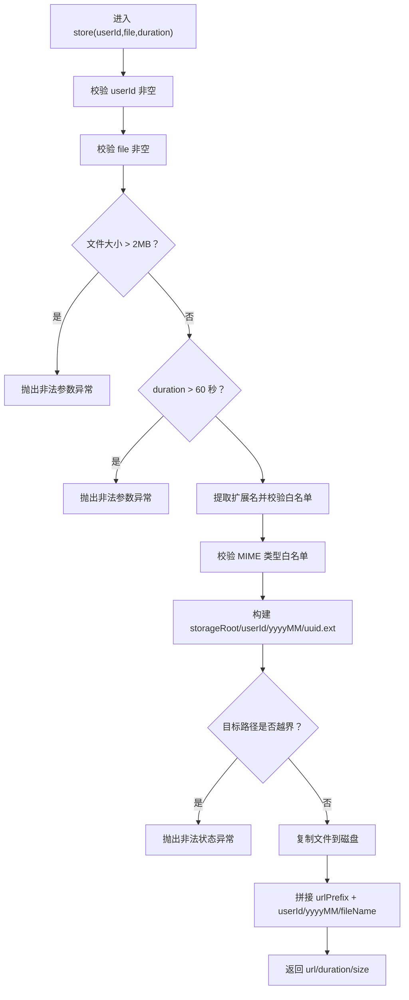
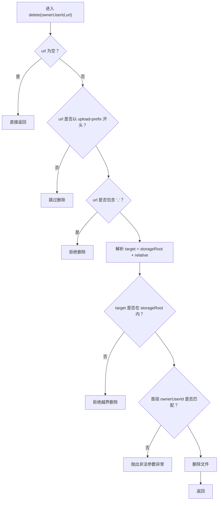
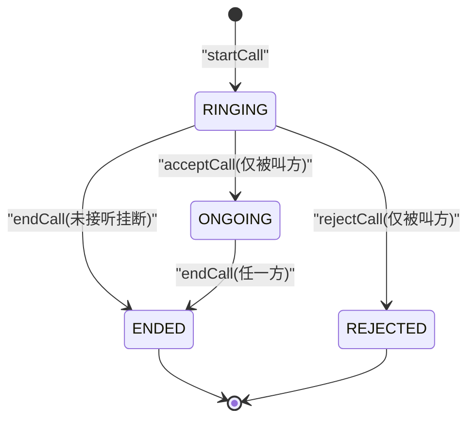
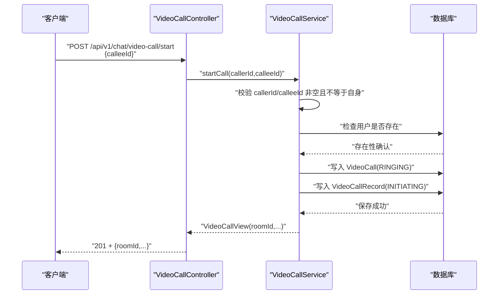
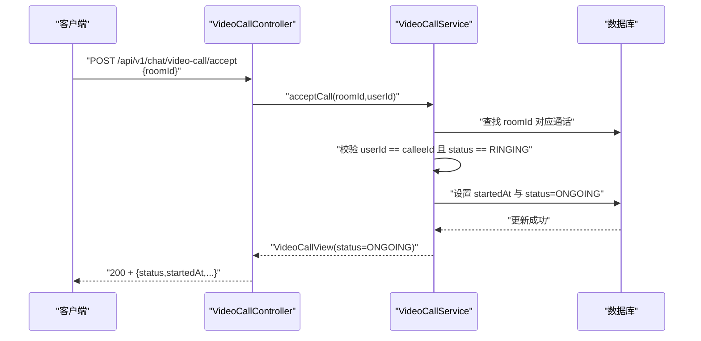
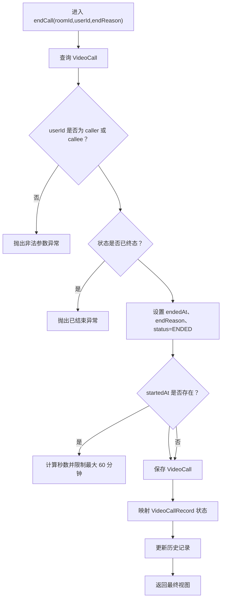
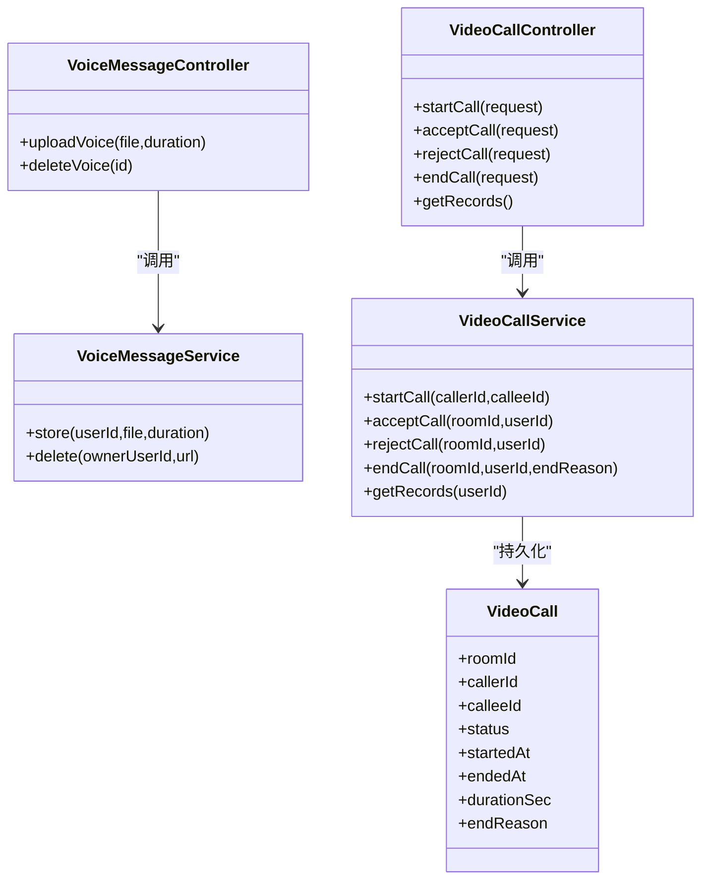

# 语音与视频通话

<cite>
**本文引用的文件**   
- [VoiceMessageController.java](file://apps/api/src/main/java/com/campuslove/api/chat/VoiceMessageController.java)
- [VoiceMessageService.java](file://apps/api/src/main/java/com/campuslove/api/chat/VoiceMessageService.java)
- [VideoCallController.java](file://apps/api/src/main/java/com/campuslove/api/chat/VideoCallController.java)
- [VideoCallService.java](file://apps/api/src/main/java/com/campuslove/api/chat/VideoCallService.java)
- [VideoCall.java](file://apps/api/src/main/java/com/campuslove/api/entity/VideoCall.java)
</cite>

## 目录
1. [引言](#引言)
2. [项目结构定位](#项目结构定位)
3. [核心组件总览](#核心组件总览)
4. [架构概览](#架构概览)
5. [语音消息处理：VoiceMessageController 与 VoiceMessageService](#语音消息处理voicemessagecontroller-与-voicemesageservice)
6. [视频通话协调：VideoCallController 与 VideoCallService](#视频通话协调videocallcontroller-与-videocallservice)
7. [依赖关系分析](#依赖关系分析)
8. [媒体格式、协议与性能调优](#媒体格式协议与性能调优)
9. [开发指南](#开发指南)
10. [故障排查指南](#故障排查指南)
11. [结论](#结论)

## 引言
本文面向后端开发者，系统化说明语音消息上传存储与视频通话元数据管理的实现。重点覆盖：
- 语音消息上传、校验、存储和删除接口。
- 语音文件的扩展名、MIME 类型、大小与时长约束。
- 视频通话的发起、接听、拒绝、结束与记录查询。
- 通话状态机、双表设计、事务一致性与限流策略。
- 前端集成要点、协议边界与常见排错方法。

需要特别说明的是：当前仓库中未包含“音频格式转换”“实时音视频编码压缩优化”“网络质量监控”等运行时媒体管线代码；本文严格基于已发现的控制器与服务实现进行文档化，并明确标注哪些能力不在当前实现范围内。

## 项目结构定位
语音与视频通话功能集中在后端 API 模块 `apps/api` 下：
- 语音消息相关：`chat/VoiceMessageController.java`、`chat/VoiceMessageService.java`。
- 视频通话相关：`chat/VideoCallController.java`、`chat/VideoCallService.java`、`entity/VideoCall.java`。
- 这些类使用 Spring Boot REST 风格，通过 `@Profile("real")` 激活，仅在真实运行环境生效。

**图示来源**
- [VoiceMessageController.java:23-177](file://apps/api/src/main/java/com/campuslove/api/chat/VoiceMessageController.java#L23-L177)
- [VoiceMessageService.java:23-281](file://apps/api/src/main/java/com/campuslove/api/chat/VoiceMessageService.java#L23-L281)
- [VideoCallController.java:24-163](file://apps/api/src/main/java/com/campuslove/api/chat/VideoCallController.java#L24-L163)
- [VideoCallService.java:27-479](file://apps/api/src/main/java/com/campuslove/api/chat/VideoCallService.java#L27-L479)

**章节来源**
- [VoiceMessageController.java:1-177](file://apps/api/src/main/java/com/campuslove/api/chat/VoiceMessageController.java#L1-L177)
- [VoiceMessageService.java:1-281](file://apps/api/src/main/java/com/campuslove/api/chat/VoiceMessageService.java#L1-L281)
- [VideoCallController.java:1-163](file://apps/api/src/main/java/com/campuslove/api/chat/VideoCallController.java#L1-L163)
- [VideoCallService.java:1-479](file://apps/api/src/main/java/com/campuslove/api/chat/VideoCallService.java#L1-L479)

## 核心组件总览
| 组件 | 职责 | 关键输入 | 关键输出 | 主要约束 |
|---|---|---|---|---|
| `VoiceMessageController` | 暴露语音上传与删除 REST 接口 | multipart 文件、duration、URL 编码 id | 上传响应、删除响应 | 用户角色 USER；参数校验与异常映射 |
| `VoiceMessageService` | 校验语音文件、生成路径、写入文件系统、构造访问 URL | userId、MultipartFile、duration | 上传结果 url/duration/size；删除成功语义 | 最大 2MB、时长 ≤60s、扩展名与 MIME 白名单 |
| `VideoCallController` | 暴露视频通话发起、接听、拒绝、结束、记录查询接口 | calleeId、roomId、endReason | 通话视图、记录列表 | 用户角色 USER；呼叫限流；参数校验 |
| `VideoCallService` | 维护通话实时状态与历史记录、计算时长、映射记录状态 | roomId、userId、endReason | VideoCallView、VideoCallRecordView | RINGING/ONGOING/ENDED/MISSED/REJECTED；事务一致性 |

**章节来源**
- [VoiceMessageController.java:23-177](file://apps/api/src/main/java/com/campuslove/api/chat/VoiceMessageController.java#L23-L177)
- [VoiceMessageService.java:23-281](file://apps/api/src/main/java/com/campuslove/api/chat/VoiceMessageService.java#L23-L281)
- [VideoCallController.java:24-163](file://apps/api/src/main/java/com/campuslove/api/chat/VideoCallController.java#L24-L163)
- [VideoCallService.java:27-479](file://apps/api/src/main/java/com/campuslove/api/chat/VideoCallService.java#L27-L479)

## 架构概览
整体调用链分为两条独立通路：
1. 语音消息通路：客户端 → `VoiceMessageController` → `VoiceMessageService` → 文件系统。
2. 视频通话通路：客户端 → `VideoCallController` → `VideoCallService` → 数据库实体表。

**图示来源**
- [VoiceMessageController.java:61-103](file://apps/api/src/main/java/com/campuslove/api/chat/VoiceMessageController.java#L61-L103)
- [VoiceMessageService.java:95-198](file://apps/api/src/main/java/com/campuslove/api/chat/VoiceMessageService.java#L95-L198)

**图示来源**
- [VideoCallController.java:58-116](file://apps/api/src/main/java/com/campuslove/api/chat/VideoCallController.java#L58-L116)
- [VideoCallService.java:87-189](file://apps/api/src/main/java/com/campuslove/api/chat/VideoCallService.java#L87-L189)

## 语音消息处理：VoiceMessageController 与 VoiceMessageService

### 接口定义与权限模型
`VoiceMessageController` 提供两个接口：
- `POST /api/v1/chat/voice`：上传语音消息，返回 URL、时长、文件大小。
- `DELETE /api/v1/chat/voice/{id}`：删除语音消息，id 为 URL 编码后的语音 URL。

两者均要求认证用户，且仅允许拥有 `USER` 角色的用户操作。上传接口的 `duration` 参数使用最小值 0、最大值 60 秒约束；实际业务上限由 Service 层再次校验。

**章节来源**
- [VoiceMessageController.java:23-103](file://apps/api/src/main/java/com/campuslove/api/chat/VoiceMessageController.java#L23-L103)
- [VoiceMessageController.java:105-177](file://apps/api/src/main/java/com/campuslove/api/chat/VoiceMessageController.java#L105-L177)

### 上传流程与校验规则
`VoiceMessageService.store` 的核心流程如下：

**图示来源**
- [VoiceMessageService.java:95-198](file://apps/api/src/main/java/com/campuslove/api/chat/VoiceMessageService.java#L95-L198)

关键约束：
- 文件大小上限：2MB。
- 语音时长上限：60 秒。
- 支持扩展名：mp3、aac、m4a、wav、amr。
- 支持 MIME：audio/mpeg、audio/mp3、audio/aac、audio/x-m4a、audio/wav、audio/x-wav、audio/amr。
- 存储路径：`uploads/{userId}/{yyyyMM}/{uuid}.{ext}`。
- URL 前缀默认 `/api/v1/media/`，可通过配置覆盖。

注意：当前实现没有执行音频格式转换或压缩；它直接保存客户端上传的文件。

**章节来源**
- [VoiceMessageService.java:23-94](file://apps/api/src/main/java/com/campuslove/api/chat/VoiceMessageService.java#L23-L94)
- [VoiceMessageService.java:95-198](file://apps/api/src/main/java/com/campuslove/api/chat/VoiceMessageService.java#L95-L198)

### 删除流程与安全控制
删除逻辑重点在安全边界：
1. 仅处理以 `file-storage.upload-prefix` 开头的 URL。
2. 拒绝包含 `..` 的路径穿越段。
3. normalize 后校验目标路径仍在 `storageRoot` 内。
4. 按 normalize 后相对路径首段匹配 ownerUserId，防止 IDOR。
5. 文件不存在时静默忽略；IO 异常包装为运行时异常。

**图示来源**
- [VoiceMessageService.java:201-261](file://apps/api/src/main/java/com/campuslove/api/chat/VoiceMessageService.java#L201-L261)

**章节来源**
- [VoiceMessageService.java:201-261](file://apps/api/src/main/java/com/campuslove/api/chat/VoiceMessageService.java#L201-L261)

### 错误处理与异常语义
- 参数非法：`IllegalArgumentException`，通常映射为 HTTP 400。
- IO 异常或路径越界：`RuntimeException`，通常映射为 HTTP 500。
- 删除越权：抛出非法参数异常，阻止跨用户删除。

**章节来源**
- [VoiceMessageController.java:81-103](file://apps/api/src/main/java/com/campuslove/api/chat/VoiceMessageController.java#L81-L103)
- [VoiceMessageController.java:123-152](file://apps/api/src/main/java/com/campuslove/api/chat/VoiceMessageController.java#L123-L152)
- [VoiceMessageService.java:170-198](file://apps/api/src/main/java/com/campuslove/api/chat/VoiceMessageService.java#L170-L198)
- [VoiceMessageService.java:201-261](file://apps/api/src/main/java/com/campuslove/api/chat/VoiceMessageService.java#L201-L261)

## 视频通话协调：VideoCallController 与 VideoCallService

### 接口定义
`VideoCallController` 暴露以下接口：
- `POST /api/v1/chat/video-call/start`：发起视频通话，返回 roomId。
- `POST /api/v1/chat/video-call/accept`：被叫方接听。
- `POST /api/v1/chat/video-call/reject`：被叫方拒绝。
- `POST /api/v1/chat/video-call/end`：结束通话，携带 endReason。
- `GET /api/v1/chat/video-call/records`：查询当前用户参与的通话记录。

请求体包括：
- `StartCallRequest.calleeId`：接收方用户 ID。
- `RoomIdRequest.roomId`：通话房间 ID。
- `EndCallRequest.roomId`、`EndCallRequest.endReason`：结束原因限定为 CALLER_HANGUP、CALLEE_HANGUP、TIMEOUT、NETWORK_ERROR。

**章节来源**
- [VideoCallController.java:24-163](file://apps/api/src/main/java/com/campuslove/api/chat/VideoCallController.java#L24-L163)

### 通话状态机
视频通话使用双表设计：
- `VideoCall`：实时通话状态表，状态包括 RINGING、ONGOING、ENDED、MISSED、REJECTED。
- `VideoCallRecord`：历史通话记录表，状态包括 INITIATING、CONNECTED、MISSED、REJECTED、FAILED。

状态流转要点：
- 发起：创建 RINGING 通话记录，同时创建 INITIATING 历史记录。
- 接听：仅被叫方可将 RINGING 改为 ONGOING，并填充 startedAt；同步将记录状态改为 CONNECTED。
- 拒绝：仅被叫方可将 RINGING 改为 REJECTED，记录 endedAt 与 endReason。
- 结束：双方均可结束；根据是否已开始通话计算 durationSec，并将记录状态映射为 CONNECTED、MISSED、REJECTED 或 FAILED。

**图示来源**
- [VideoCallService.java:87-189](file://apps/api/src/main/java/com/campuslove/api/chat/VideoCallService.java#L87-L189)
- [VideoCallService.java:201-362](file://apps/api/src/main/java/com/campuslove/api/chat/VideoCallService.java#L201-L362)
- [VideoCall.java:23-120](file://apps/api/src/main/java/com/campuslove/api/entity/VideoCall.java#L23-L120)

### 发起通话流程

**图示来源**
- [VideoCallController.java:58-76](file://apps/api/src/main/java/com/campuslove/api/chat/VideoCallController.java#L58-L76)
- [VideoCallService.java:87-149](file://apps/api/src/main/java/com/campuslove/api/chat/VideoCallService.java#L87-L149)

### 接听与拒绝流程
接听与拒绝都限制为被叫方，且通话必须处于 RINGING 状态。接听会填充 startedAt，拒绝会设置 endedAt 与 endReason。

**图示来源**
- [VideoCallController.java:78-100](file://apps/api/src/main/java/com/campuslove/api/chat/VideoCallController.java#L78-L100)
- [VideoCallService.java:151-189](file://apps/api/src/main/java/com/campuslove/api/chat/VideoCallService.java#L151-L189)

### 结束通话与时长计算
结束通话时，服务会根据是否已有 startedAt 计算 durationSec，并限制最大通话时长为 60 分钟。同时根据 endReason 与 duration 映射历史记录状态：
- durationSec > 0：CONNECTED。
- endReason 为 REJECTED：REJECTED。
- endReason 为 NETWORK_ERROR：FAILED。
- endReason 为 TIMEOUT 或未提供：MISSED。
- CALLER_HANGUP/CALLEE_HANGUP：映射为 MISSED（若 durationSec 为 0）。

**图示来源**
- [VideoCallService.java:263-362](file://apps/api/src/main/java/com/campuslove/api/chat/VideoCallService.java#L263-L362)

**章节来源**
- [VideoCallController.java:102-163](file://apps/api/src/main/java/com/campuslove/api/chat/VideoCallController.java#L102-L163)
- [VideoCallService.java:151-479](file://apps/api/src/main/java/com/campuslove/api/chat/VideoCallService.java#L151-L479)
- [VideoCall.java:23-120](file://apps/api/src/main/java/com/campuslove/api/entity/VideoCall.java#L23-L120)

## 依赖关系分析
- Controller 层依赖 Service 层，不直接访问文件或数据库。
- `VoiceMessageService` 依赖文件系统与配置注入的 `file-storage.base-dir`、`file-storage.upload-prefix`。
- `VideoCallService` 依赖 JPA Repository 与实体，维护事务一致性。
- 视频通话控制器的 start 接口带有速率限制注解，用于防刷。

**图示来源**
- [VoiceMessageController.java:23-177](file://apps/api/src/main/java/com/campuslove/api/chat/VoiceMessageController.java#L23-L177)
- [VoiceMessageService.java:23-281](file://apps/api/src/main/java/com/campuslove/api/chat/VoiceMessageService.java#L23-L281)
- [VideoCallController.java:24-163](file://apps/api/src/main/java/com/campuslove/api/chat/VideoCallController.java#L24-L163)
- [VideoCallService.java:27-479](file://apps/api/src/main/java/com/campuslove/api/chat/VideoCallService.java#L27-L479)
- [VideoCall.java:23-204](file://apps/api/src/main/java/com/campuslove/api/entity/VideoCall.java#L23-L204)

**章节来源**
- [VoiceMessageController.java:23-177](file://apps/api/src/main/java/com/campuslove/api/chat/VoiceMessageController.java#L23-L177)
- [VoiceMessageService.java:23-281](file://apps/api/src/main/java/com/campuslove/api/chat/VoiceMessageService.java#L23-L281)
- [VideoCallController.java:24-163](file://apps/api/src/main/java/com/campuslove/api/chat/VideoCallController.java#L24-L163)
- [VideoCallService.java:27-479](file://apps/api/src/main/java/com/campuslove/api/chat/VideoCallService.java#L27-L479)
- [VideoCall.java:23-204](file://apps/api/src/main/java/com/campuslove/api/entity/VideoCall.java#L23-L204)

## 媒体格式、协议与性能调优

### 语音文件格式规范
当前后端不接受“任意音频转任意音频”的通用转码服务，而是对上传文件做白名单校验：
- 扩展名：mp3、aac、m4a、wav、amr。
- MIME：audio/mpeg、audio/mp3、audio/aac、audio/x-m4a、audio/wav、audio/x-wav、audio/amr。
- 文件大小：≤2MB。
- 时长：≤60 秒。
- 存储路径：`uploads/{userId}/{yyyyMM}/{uuid}.{ext}`。
- 访问 URL：`{file-storage.upload-prefix}{userId}/{yyyyMM}/{fileName}`。

这意味着“格式兼容性”主要由客户端录音和上传决定；服务端不做格式转换。

**章节来源**
- [VoiceMessageService.java:23-94](file://apps/api/src/main/java/com/campuslove/api/chat/VoiceMessageService.java#L23-L94)
- [VoiceMessageService.java:95-198](file://apps/api/src/main/java/com/campuslove/api/chat/VoiceMessageService.java#L95-L198)

### 视频通话协议边界
- 控制器和服务只负责信令元数据：roomId、状态、时间、时长、结束原因。
- 实际音视频流由 WebRTC 与外部信令服务器处理；本仓库未包含 WebRTC 信令交换实现。
- 前端拿到 roomId 后，应通过 WebSocket 或其他信令通道协商 SDP/ICE，再建立 P2P 或 SFU 媒体连接。

因此，“信令交换、连接建立、会话管理”在本仓库中的体现是：
- 发起通话：分配 roomId 并落库。
- 接听/拒绝：状态机迁移。
- 结束通话：计算时长并映射记录状态。
- 查询记录：返回用户参与的历史通话。

**章节来源**
- [VideoCallController.java:24-163](file://apps/api/src/main/java/com/campuslove/api/chat/VideoCallController.java#L24-L163)
- [VideoCallService.java:27-85](file://apps/api/src/main/java/com/campuslove/api/chat/VideoCallService.java#L27-L85)
- [VideoCallService.java:87-479](file://apps/api/src/main/java/com/campuslove/api/chat/VideoCallService.java#L87-L479)

### 性能调优建议
- 语音上传：
  - 前端应在录音阶段控制采样率、码率和时长，避免超过 2MB 或 60 秒。
  - 生产部署应确保 `file-storage.base-dir` 所在磁盘有足够空间与 I/O 性能。
  - 可结合对象存储网关或 CDN 加速 `file-storage.upload-prefix` 指向的静态资源访问。
- 视频通话：
  - 使用 RateLimit 保护 start 接口，防止呼叫轰炸。
  - 数据库索引应覆盖 room_id、caller_id、receiver_id、start_time 等高频查询字段。
  - 对于高并发场景，考虑将通话状态缓存到内存，但需保证与数据库最终一致。

[本节为通用性能建议，不直接分析具体源码片段]

## 开发指南

### 新增语音上传约束
如需收紧或扩展语音格式：
1. 修改 `VoiceMessageService` 中的扩展名白名单与 MIME 白名单。
2. 调整 `MAX_FILE_SIZE` 与 `MAX_DURATION_SECONDS`。
3. 保持 Controller 的 `@Min`/`@Max` 与 Service 校验一致，避免前后端约束不一致。
4. 如涉及新格式转码，应在 Service 层增加转码步骤，并记录原始文件与转码文件的关系。

**章节来源**
- [VoiceMessageService.java:23-94](file://apps/api/src/main/java/com/campuslove/api/chat/VoiceMessageService.java#L23-L94)
- [VoiceMessageService.java:95-198](file://apps/api/src/main/java/com/campuslove/api/chat/VoiceMessageService.java#L95-L198)

### 新增视频通话状态
如需扩展通话状态：
1. 在 `VideoCall` 实体注释和数据库中补充新状态语义。
2. 在 `VideoCallService` 的状态迁移逻辑中添加合法跳转。
3. 在 `mapRecordStatus` 中补充历史记录状态映射。
4. 在 Controller 的请求体中补充必要校验，例如正则或枚举白名单。

**章节来源**
- [VideoCall.java:23-120](file://apps/api/src/main/java/com/campuslove/api/entity/VideoCall.java#L23-L120)
- [VideoCallService.java:263-479](file://apps/api/src/main/java/com/campuslove/api/chat/VideoCallService.java#L263-L479)
- [VideoCallController.java:140-163](file://apps/api/src/main/java/com/campuslove/api/chat/VideoCallController.java#L140-L163)

### 前端集成要点
- 语音上传：
  - 使用 multipart/form-data 上传 file 与 duration。
  - 前端记录录音时长，并在上传时传入 duration。
  - 收到 URL 后通过 `file-storage.upload-prefix` 对应的媒体访问路径播放。
- 视频通话：
  - 调用 start 获取 roomId。
  - 使用 WebSocket 或其他信令通道传递 SDP/ICE Candidate。
  - 接听/拒绝/结束分别调用对应接口，并刷新 UI 状态。

[本节为集成指导，不直接分析具体源码片段]

## 故障排查指南

### 语音上传失败
常见问题与排查方向：
- 400 非法参数：
  - 文件为空、超过 2MB。
  - 时长超过 60 秒。
  - 扩展名或 MIME 类型不在白名单。
- 500 内部错误：
  - 文件系统不可写。
  - 存储根目录配置错误。
  - 路径越界或写入异常。

排查步骤：
1. 检查上传文件大小、时长、扩展名、MIME。
2. 检查 `file-storage.base-dir` 与 `file-storage.upload-prefix` 配置。
3. 查看日志中的 userId、url、size 信息，确认路径是否落在 uploads 目录下。
4. 检查删除接口是否正确对 URL 进行编码，避免反斜杠或路径穿越触发拒绝。

**章节来源**
- [VoiceMessageController.java:61-103](file://apps/api/src/main/java/com/campuslove/api/chat/VoiceMessageController.java#L61-L103)
- [VoiceMessageService.java:95-198](file://apps/api/src/main/java/com/campuslove/api/chat/VoiceMessageService.java#L95-L198)
- [VoiceMessageService.java:201-261](file://apps/api/src/main/java/com/campuslove/api/chat/VoiceMessageService.java#L201-L261)

### 视频通话状态异常
常见问题与排查方向：
- 无法接听：
  - roomId 不存在。
  - 非被叫方操作。
  - 通话状态不是 RINGING。
- 通话时长为 0：
  - 未正确调用 accept，导致 startedAt 未填充。
  - endReason 或数据库更新异常。
- 记录状态不正确：
  - mapRecordStatus 映射逻辑与 endReason、duration 不匹配。

排查步骤：
1. 通过 records 接口查询当前用户的通话记录。
2. 核对 roomId 是否唯一且未被复用。
3. 检查 start → accept → end 的顺序是否符合状态机。
4. 检查数据库 video_calls 表中 status、startedAt、endedAt、duration_sec、end_reason 字段。

**章节来源**
- [VideoCallService.java:151-189](file://apps/api/src/main/java/com/campuslove/api/chat/VideoCallService.java#L151-L189)
- [VideoCallService.java:201-362](file://apps/api/src/main/java/com/campuslove/api/chat/VideoCallService.java#L201-L362)
- [VideoCallService.java:364-479](file://apps/api/src/main/java/com/campuslove/api/chat/VideoCallService.java#L364-L479)

## 结论
本仓库中的语音与视频通话后端实现聚焦于两类能力：
- 语音消息：以轻量、安全的文件上传与存储为主，强调大小、时长、格式白名单与路径安全。
- 视频通话：以信令元数据与状态机为核心，提供通话生命周期管理与历史记录查询，而不直接处理音视频流。

在实际产品中，若需要更完善的音视频体验，应在此基础上补充：
- 前端录音与转码策略。
- 统一的媒体网关或对象存储接入。
- WebRTC 信令服务器与媒体服务器。
- 网络质量监控、码率自适应与回放统计。

这些能力在当前代码中未出现，不应误认为已由后端实现；它们属于后续扩展范围。