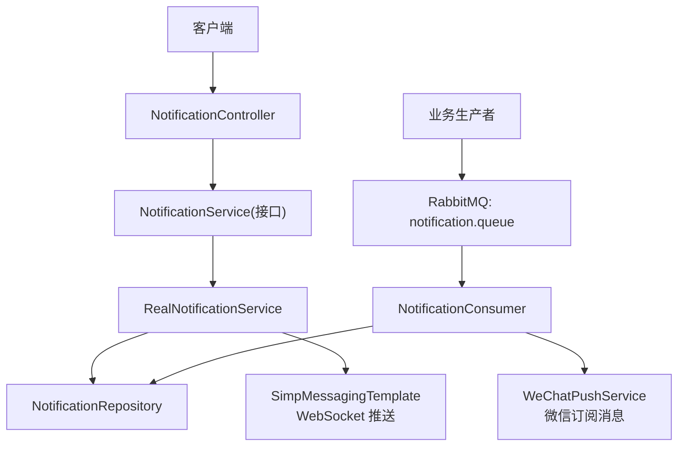
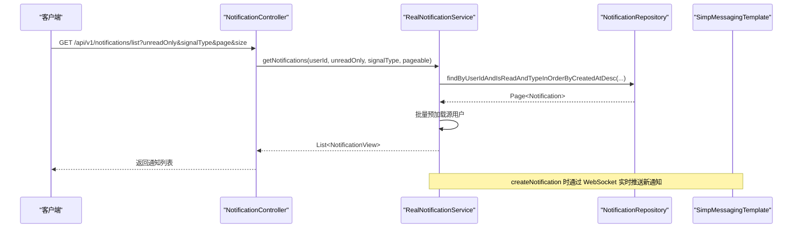
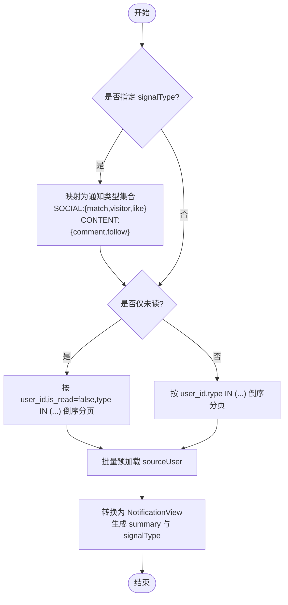
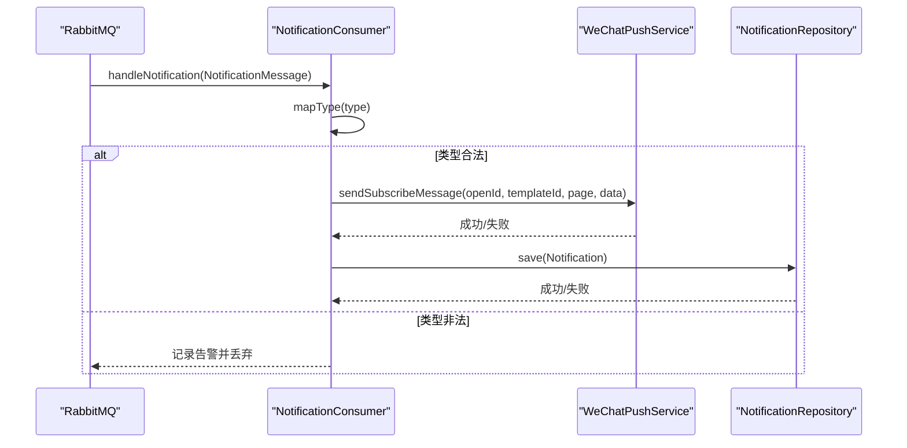
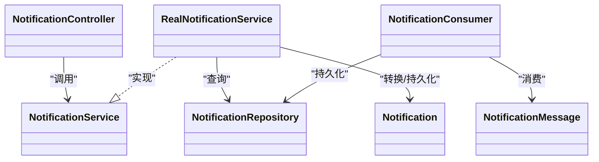

# 通知系统

<cite>
**本文引用的文件**
- [NotificationController.java](file://apps/api/src/main/java/com/campuslove/api/chat/NotificationController.java)
- [NotificationService.java](file://apps/api/src/main/java/com/campuslove/api/chat/NotificationService.java)
- [RealNotificationService.java](file://apps/api/src/main/java/com/campuslove/api/chat/RealNotificationService.java)
- [Notification.java](file://apps/api/src/main/java/com/campuslove/api/entity/Notification.java)
- [NotificationRepository.java](file://apps/api/src/main/java/com/campuslove/api/repository/NotificationRepository.java)
- [NotificationConsumer.java](file://apps/api/src/main/java/com/campuslove/api/mq/NotificationConsumer.java)
- [NotificationMessage.java](file://apps/api/src/main/java/com/campuslove/api/mq/NotificationMessage.java)
- [notifications.yaml](file://docs/openapi/notifications.yaml)
</cite>

## 目录
1. [简介](#简介)
2. [项目结构](#项目结构)
3. [核心组件](#核心组件)
4. [架构总览](#架构总览)
5. [详细组件分析](#详细组件分析)
6. [依赖关系分析](#依赖关系分析)
7. [性能与扩展性](#性能与扩展性)
8. [故障排查指南](#故障排查指南)
9. [结论](#结论)
10. [附录：API 契约与数据模型](#附录api-契约与数据模型)

## 简介
本技术文档面向后端通知子系统，围绕 NotificationController、NotificationService 与 RealNotificationService 的职责边界、接口行为与实现细节进行系统化说明。内容覆盖：
- 通知列表获取、分页与筛选（含 signalType 社交/内容信号分类）
- 已读标记与未读数查询
- 消息队列消费、微信订阅消息推送与数据库持久化
- 通知数据结构、时间排序与分页策略
- 批量处理与性能优化建议
- 扩展指南：新增自定义通知类型与渠道

## 项目结构
通知子系统位于 API 应用模块中，采用控制器-服务-仓储-消息消费者的分层设计：
- Controller：对外暴露 REST 接口，负责鉴权与参数校验
- Service：业务编排，封装查询、聚合、转换与实时推送
- Repository：JPA 访问层，提供按用户、已读状态、类型与时间的高效查询
- MQ Consumer：异步消费通知消息，执行“微信推送 + 持久化”的解耦流程
- Entity/View：实体模型与视图对象，承载领域语义与展示字段

图表来源
- [NotificationController.java:1-127](file://apps/api/src/main/java/com/campuslove/api/chat/NotificationController.java#L1-L127)
- [NotificationService.java:1-86](file://apps/api/src/main/java/com/campuslove/api/chat/NotificationService.java#L1-L86)
- [RealNotificationService.java:1-359](file://apps/api/src/main/java/com/campuslove/api/chat/RealNotificationService.java#L1-L359)
- [NotificationRepository.java:1-89](file://apps/api/src/main/java/com/campuslove/api/repository/NotificationRepository.java#L1-L89)
- [NotificationConsumer.java:1-271](file://apps/api/src/main/java/com/campuslove/api/mq/NotificationConsumer.java#L1-L271)

章节来源
- [NotificationController.java:1-127](file://apps/api/src/main/java/com/campuslove/api/chat/NotificationController.java#L1-L127)
- [NotificationService.java:1-86](file://apps/api/src/main/java/com/campuslove/api/chat/NotificationService.java#L1-L86)
- [RealNotificationService.java:1-359](file://apps/api/src/main/java/com/campuslove/api/chat/RealNotificationService.java#L1-L359)
- [NotificationRepository.java:1-89](file://apps/api/src/main/java/com/campuslove/api/repository/NotificationRepository.java#L1-L89)
- [NotificationConsumer.java:1-271](file://apps/api/src/main/java/com/campuslove/api/mq/NotificationConsumer.java#L1-L271)

## 核心组件
- NotificationController：提供获取通知列表、分页列表、标记已读、全部已读、未读数等接口；所有接口均基于当前登录用户上下文。
- NotificationService：定义通知能力契约，包括基础查询、分页查询、signalType 筛选、已读标记、未读数、创建通知等。
- RealNotificationService：真实实现，完成数据加载、聚合、视图转换、WebSocket 推送、批量预加载、signalType 下推 SQL 过滤等。
- NotificationRepository：基于 Spring Data JPA 的查询方法集合，支持按用户、已读状态、类型集合与时间倒序分页。
- NotificationConsumer：监听队列，先尝试微信推送，再持久化到数据库；对未知类型拒绝并记录告警。
- Notification/NotificationMessage：领域实体与消息载体，定义通知类型、关联实体与时序字段。

章节来源
- [NotificationController.java:1-127](file://apps/api/src/main/java/com/campuslove/api/chat/NotificationController.java#L1-L127)
- [NotificationService.java:1-86](file://apps/api/src/main/java/com/campuslove/api/chat/NotificationService.java#L1-L86)
- [RealNotificationService.java:1-359](file://apps/api/src/main/java/com/campuslove/api/chat/RealNotificationService.java#L1-L359)
- [NotificationRepository.java:1-89](file://apps/api/src/main/java/com/campuslove/api/repository/NotificationRepository.java#L1-L89)
- [NotificationConsumer.java:1-271](file://apps/api/src/main/java/com/campuslove/api/mq/NotificationConsumer.java#L1-L271)
- [Notification.java:1-189](file://apps/api/src/main/java/com/campuslove/api/entity/Notification.java#L1-L189)
- [NotificationMessage.java:1-169](file://apps/api/src/main/java/com/campuslove/api/mq/NotificationMessage.java#L1-L169)

## 架构总览
通知系统采用“同步查询 + 异步投递”的双通道模式：
- 同步通道：客户端通过 REST 接口拉取通知、标记已读与查询未读数；服务端以分页、索引与批量预加载保障性能。
- 异步通道：业务事件产生后发送消息到 RabbitMQ，消费者执行“微信推送 + 持久化”，失败不阻断主链路。

图表来源
- [NotificationController.java:1-127](file://apps/api/src/main/java/com/campuslove/api/chat/NotificationController.java#L1-L127)
- [RealNotificationService.java:1-359](file://apps/api/src/main/java/com/campuslove/api/chat/RealNotificationService.java#L1-L359)
- [NotificationRepository.java:1-89](file://apps/api/src/main/java/com/campuslove/api/repository/NotificationRepository.java#L1-L89)

## 详细组件分析

### NotificationController：通知管理 API
- 功能要点
  - 获取通知列表：GET /api/v1/notifications
  - 分页列表：GET /api/v1/notifications/list，支持 unreadOnly、signalType、page、size
  - 标记已读：PUT /api/v1/notifications/{id}/read（带用户校验）
  - 全部已读：PUT /api/v1/notifications/read-all
  - 未读数：GET /api/v1/notifications/unread-count 与历史兼容 /count
- 安全与校验
  - 所有接口从 JWT 上下文解析 userId，避免 IDOR
  - 分页 size 限制在 1–100，page ≥ 0
  - 路径变量 id 必须为正数

章节来源
- [NotificationController.java:1-127](file://apps/api/src/main/java/com/campuslove/api/chat/NotificationController.java#L1-L127)

### NotificationService：接口契约
- 能力范围
  - 基础查询：getNotifications(userId)
  - 分页查询：getNotifications(userId, unreadOnly, pageable)
  - 分类筛选：getNotifications(userId, unreadOnly, signalType, pageable)，signalType 取值 SOCIAL/CONTENT
  - 已读标记：markAsRead(notificationId)、markAsRead(notificationId, userId)
  - 未读数：getUnreadCount(userId)
  - 创建通知：createNotification(userId, type, sourceUserId, referenceId, referenceType)

章节来源
- [NotificationService.java:1-86](file://apps/api/src/main/java/com/campuslove/api/chat/NotificationService.java#L1-L86)

### RealNotificationService：聚合、分发与去重
- 列表查询与分页
  - 无分页兼容接口限制最大条数，防止大响应与 OOM
  - 分页查询使用 Pageable，按 created_at 倒序
  - 支持 unreadOnly 仅未读过滤
  - signalType 下推到 SQL：SOCIAL 映射 {match, visitor, like}，CONTENT 映射 {comment, follow}
- 聚合与视图转换
  - 批量预加载 sourceUser，避免 N+1 查询
  - 构建 summary 摘要文本，计算 signalType 分类
  - 通过 SimpMessagingTemplate 将新通知实时推送至目标用户会话
- 已读与计数
  - markAsRead(id, userId) 强校验归属，防越权
  - markAllAsRead(userId) 批量更新，避免写放大
  - getUnreadCount(userId) 基于 count 查询
- 创建通知
  - 参数校验严格，写入实体并保存
  - 保存后转换为视图并通过 WebSocket 推送
- 去重策略
  - 代码层面未发现基于业务键的去重逻辑；如需幂等可引入唯一约束或去重表

图表来源
- [RealNotificationService.java:1-359](file://apps/api/src/main/java/com/campuslove/api/chat/RealNotificationService.java#L1-L359)
- [NotificationRepository.java:1-89](file://apps/api/src/main/java/com/campuslove/api/repository/NotificationRepository.java#L1-L89)

章节来源
- [RealNotificationService.java:1-359](file://apps/api/src/main/java/com/campuslove/api/chat/RealNotificationService.java#L1-L359)
- [NotificationRepository.java:1-89](file://apps/api/src/main/java/com/campuslove/api/repository/NotificationRepository.java#L1-L89)

### NotificationConsumer：消息消费与渠道分发
- 消费流程
  - 接收消息后先尝试微信订阅消息推送（best effort），失败不影响后续
  - 再尝试持久化到 notifications 表（best effort），失败不抛异常以避免消息重投风暴
- 类型映射
  - 字符串 type 映射为枚举：like/match/comment/follow/visitor/system
  - 无法识别的类型直接拒绝并记录警告日志
- 字段填充
  - sourceUserId：来自消息，缺省回退系统虚拟用户
  - referenceId/referenceType：透传消息，非法回退 user
  - isRead=false，createdAt 由 Instant 转换
- 微信推送
  - 仅在 real profile 且 WeChatPushService 可用时执行
  - 模板数据包含标题、内容与时间；templateId 为空则跳过并告警

图表来源
- [NotificationConsumer.java:1-271](file://apps/api/src/main/java/com/campuslove/api/mq/NotificationConsumer.java#L1-L271)

章节来源
- [NotificationConsumer.java:1-271](file://apps/api/src/main/java/com/campuslove/api/mq/NotificationConsumer.java#L1-L271)

### 通知数据结构与排序
- 实体字段
  - 接收者 user_id、类型 type、来源 source_user_id、关联 reference_id/reference_type、是否已读 is_read、创建时间 created_at、版本 version
- 索引设计
  - user_id、user_id+is_read、created_at、type、user_id+created_at 复合索引支撑高频查询与排序
- 排序规则
  - 默认按 created_at 倒序，确保最新通知优先
- 视图字段
  - 包含 id、type、sourceUser(displayName/avatar)、referenceId、referenceType、isRead、createdAt、summary、signalType

章节来源
- [Notification.java:1-189](file://apps/api/src/main/java/com/campuslove/api/entity/Notification.java#L1-L189)
- [RealNotificationService.java:1-359](file://apps/api/src/main/java/com/campuslove/api/chat/RealNotificationService.java#L1-L359)

### 分页与查询参数
- 分页参数
  - page 从 0 开始，size 限制 1–100
- 过滤条件
  - unreadOnly：仅未读
  - signalType：SOCIAL/CONTENT，空值不过滤
- 兼容接口
  - 旧版 /unread-count 与 /count 返回同一数据源，前者返回视图对象，后者返回 long

章节来源
- [NotificationController.java:1-127](file://apps/api/src/main/java/com/campuslove/api/chat/NotificationController.java#L1-L127)

### 去重与幂等
- 现状
  - 代码层未发现基于业务键的去重逻辑
- 建议
  - 若需幂等，可在数据库增加 (user_id, type, reference_id, source_user_id) 唯一约束，或在消费者侧维护去重窗口

[本节为概念性建议，无需附加章节来源]

## 依赖关系分析
- 控制器依赖服务接口，便于在不同 profile 切换实现
- 服务依赖仓储与消息模板，实现查询与推送
- 消费者依赖仓库与微信推送服务，实现异步分发
- 实体与仓储通过 JPA 注解与索引协同，提升查询性能

图表来源
- [NotificationController.java:1-127](file://apps/api/src/main/java/com/campuslove/api/chat/NotificationController.java#L1-L127)
- [NotificationService.java:1-86](file://apps/api/src/main/java/com/campuslove/api/chat/NotificationService.java#L1-L86)
- [RealNotificationService.java:1-359](file://apps/api/src/main/java/com/campuslove/api/chat/RealNotificationService.java#L1-L359)
- [NotificationRepository.java:1-89](file://apps/api/src/main/java/com/campuslove/api/repository/NotificationRepository.java#L1-L89)
- [NotificationConsumer.java:1-271](file://apps/api/src/main/java/com/campuslove/api/mq/NotificationConsumer.java#L1-L271)
- [Notification.java:1-189](file://apps/api/src/main/java/com/campuslove/api/entity/Notification.java#L1-L189)
- [NotificationMessage.java:1-169](file://apps/api/src/main/java/com/campuslove/api/mq/NotificationMessage.java#L1-L169)

章节来源
- [NotificationController.java:1-127](file://apps/api/src/main/java/com/campuslove/api/chat/NotificationController.java#L1-L127)
- [NotificationService.java:1-86](file://apps/api/src/main/java/com/campuslove/api/chat/NotificationService.java#L1-L86)
- [RealNotificationService.java:1-359](file://apps/api/src/main/java/com/campuslove/api/chat/RealNotificationService.java#L1-L359)
- [NotificationRepository.java:1-89](file://apps/api/src/main/java/com/campuslove/api/repository/NotificationRepository.java#L1-L89)
- [NotificationConsumer.java:1-271](file://apps/api/src/main/java/com/campuslove/api/mq/NotificationConsumer.java#L1-L271)
- [Notification.java:1-189](file://apps/api/src/main/java/com/campuslove/api/entity/Notification.java#L1-L189)
- [NotificationMessage.java:1-169](file://apps/api/src/main/java/com/campuslove/api/mq/NotificationMessage.java#L1-L169)

## 性能与扩展性
- 查询性能
  - 使用 Pageable 分页，避免全量加载
  - signalType 筛选下推到 SQL，减少内存过滤开销
  - 批量预加载 sourceUser，消除 N+1 查询
  - 未读数统计使用 count 查询
- 写入性能
  - 全部已读使用批量 UPDATE，避免逐条 saveAll
  - 消费者端 best-effort 推送与持久化，降低主链路影响
- 资源保护
  - 无分页兼容接口限制最大条数，防止大响应
- 可扩展点
  - 新增通知类型：在实体枚举与消费者映射中增加类型
  - 新增 signalType 分类：在服务中扩展映射与筛选逻辑
  - 新增推送渠道：在消费者中增加渠道适配器，保持 best-effort 原则

[本节为通用指导，无需附加章节来源]

## 故障排查指南
- 通知未到达
  - 检查队列是否存在、消费者是否启动
  - 查看消费者日志中类型映射结果与持久化结果
- 微信推送失败
  - 确认 WeChatPushService 是否注入、templateId 是否配置
  - 关注 openid 是否为空及推送返回值
- 分页结果为空
  - 检查 signalType 映射是否正确，SQL 是否下推
  - 确认 unreadOnly 与 page/size 参数
- 标记已读无效
  - 确认传入的 notificationId 属于当前用户
  - 检查事务与仓储更新是否生效

章节来源
- [NotificationController.java:1-127](file://apps/api/src/main/java/com/campuslove/api/chat/NotificationController.java#L1-L127)
- [RealNotificationService.java:1-359](file://apps/api/src/main/java/com/campuslove/api/chat/RealNotificationService.java#L1-L359)
- [NotificationConsumer.java:1-271](file://apps/api/src/main/java/com/campuslove/api/mq/NotificationConsumer.java#L1-L271)

## 结论
通知系统通过清晰的层次划分与异步解耦，实现了高效的通知拉取与可靠的分发。借助分页、索引、批量预加载与 SQL 下推，系统在大数据量场景下具备良好性能。消费者端的 best-effort 策略保障了主链路的稳定性。未来可按需在实体与消费者中扩展新的通知类型与推送渠道，同时建议引入幂等机制以提升健壮性。

[本节为总结，无需附加章节来源]

## 附录：API 契约与数据模型
- 接口契约
  - 详见 OpenAPI 规范文件：[notifications.yaml](file://docs/openapi/notifications.yaml)
- 数据模型
  - 通知实体字段与索引：见 [Notification.java](file://apps/api/src/main/java/com/campuslove/api/entity/Notification.java#L1-L189)
  - 消息载体字段与用途：见 [NotificationMessage.java](file://apps/api/src/main/java/com/campuslove/api/mq/NotificationMessage.java#L1-L169)

章节来源
- [notifications.yaml](file://docs/openapi/notifications.yaml)
- [Notification.java:1-189](file://apps/api/src/main/java/com/campuslove/api/entity/Notification.java#L1-L189)
- [NotificationMessage.java:1-169](file://apps/api/src/main/java/com/campuslove/api/mq/NotificationMessage.java#L1-L169)