# CI/CD 流水线

<cite>
**本文引用的文件**
- [ci.yml](file://.github/workflows/ci.yml)
- [.gitleaks.toml](file://.gitleaks.toml)
- [.gitignore](file://.gitignore)
- [doc/DEPLOYMENT.md](file://doc/DEPLOYMENT.md)
- [package.json](file://package.json)
- [pnpm-workspace.yaml](file://pnpm-workspace.yaml)
- [pull_request_template.md](file://.github/pull_request_template.md)
- [CODEOWNERS](file://.github/CODEOWNERS)
- [playwright.config.ts](file://tests/e2e/playwright.config.ts)
- [docker-compose.yml](file://docker-compose.yml)
- [Dockerfile](file://apps/api/Dockerfile)
- [apps/client/package.json](file://apps/client/package.json)
- [apps/admin/package.json](file://apps/admin/package.json)
- [JwtTokenProvider.java](file://apps/api/src/main/java/com/campuslove/api/config/JwtTokenProvider.java)
- [JwtAuthenticationFilter.java](file://apps/api/src/main/java/com/campuslove/api/config/JwtAuthenticationFilter.java)
- [JwtAuthenticationFilterTest.java](file://apps/api/src/test/java/com/campuslove/api/config/JwtAuthenticationFilterTest.java)
- [JwtChannelInterceptorTest.java](file://apps/api/src/test/java/com/campuslove/api/config/JwtChannelInterceptorTest.java)
- [JwtConfigTest.java](file://apps/api/src/test/java/com/campuslove/api/config/JwtConfigTest.java)
- [SecurityConfigTest.java](file://apps/api/src/test/java/com/campuslove/api/config/SecurityConfigTest.java)
- [ContentSecurityCoverageTest.java](file://apps/api/src/test/java/com/campuslove/api/config/ContentSecurityCoverageTest.java)
- [AccountSecurityControllerTest.java](file://apps/api/src/test/java/com/campuslove/api/auth/AccountSecurityControllerTest.java)
- [RealAccountSecurityServiceTest.java](file://apps/api/src/test/java/com/campuslove/api/auth/RealAccountSecurityServiceTest.java)
- [RedisTokenBlacklistServiceTest.java](file://apps/api/src/test/java/com/campuslove/api/auth/RedisTokenBlacklistServiceTest.java)
</cite>

## 目录
1. [简介](#简介)
2. [项目结构](#项目结构)
3. [核心组件](#核心组件)
4. [架构总览](#架构总览)
5. [触发器、权限与并发模型](#触发器权限与并发模型)
6. [详细组件分析](#详细组件分析)
7. [安全扫描集成](#安全扫描集成)
   - [镜像推送闸（三段判定）](#镜像推送闸三段判定)
   - [推送闸的 fail-closed 语义](#推送闸的-fail-closed-语义)
   - [CI 只签不验：验签发生在部署端](#ci-只签不验验签发生在部署端)
   - [镜像构建细节](#镜像构建细节)
   - [仓库里没有的能力](#仓库里没有的能力)
8. [泄露面管控：.gitignore 与 gitleaks 的分工](#泄露面管控gitignore-与-gitleaks-的分工)
   - [新增的泄露面规则](#新增的泄露面规则)
   - [与 gitleaks 的分工边界](#与-gitleaks-的分工边界)
9. [多环境构建策略](#多环境构建策略)
10. [分支策略、标签规则与发布流程](#分支策略标签规则与发布流程)
11. [缓存优化与失败重试](#缓存优化与失败重试)
12. [本地模拟 CI 环境](#本地模拟-ci-环境)
13. [配置与开关](#配置与开关)
14. [故障排查指南](#故障排查指南)
15. [结论](#结论)

## 简介

本页文档化 Campus Love 仓库的持续集成流水线现状。仓库的 CI 由单一 GitHub Actions 工作流承载：`.github/workflows/ci.yml`（512 行），它在同一个 workflow 文件内串行编排了密钥扫描、结构与代码质量检查、三个前端/后端应用的类型检查与构建、单元测试、安全扫描、阶段验收（phase01）以及端到端（E2E）测试共十个作业。

写作本页遵循一条原则：**只描述工作流文件里真实存在的能力**。凡官方目录要求但仓库尚未实现的部分（例如数据库迁移在 CI 中的自动校验、生产环境自动部署、流水线内的镜像验签），本页明确标注为"仓库里没有该能力"，并给出仓库实际采用的替代手段（例如 PR 模板中的人工核对项、部署端的验签流程），避免把规划当成现状。

需要特别更正一处旧表述：**镜像构建、向 GHCR 推送与 cosign 签名在本仓库是已实现能力**，不是待建设项。`security-scan` 作业内已完成 GHCR 登录、`docker/build-push-action@v6` 构建推送（API 与 Admin 两个镜像）与 `cosign sign` 逐 tag 签名（`ci.yml:352-422`），并在 2026-10-05 追加了供应链推送闸：未配置签名密钥时默认拒绝未签名镜像出仓（`ci.yml:276-304`、注释 `ci.yml:50-53`）。与推送/签名相邻但**不存在**的能力是"验签"：流水线内没有任何 `cosign verify` 步骤，验签属于部署端动作（见「CI 只签不验」一节）。

阅读对象是需要在提交代码前理解门禁会跑什么、门禁失败后如何定位、以及如何在本地复现 CI 行为的开发者。

**章节来源**
- [ci.yml:1-512](file://.github/workflows/ci.yml#L1-L512)
- [ci.yml:276-304](file://.github/workflows/ci.yml#L276-L304)
- [ci.yml:352-422](file://.github/workflows/ci.yml#L352-L422)

## 项目结构

流水线相关的文件在仓库中分布紧凑，可分为五层：

| 层 | 路径 | 作用 |
|---|---|---|
| 工作流定义 | `.github/workflows/ci.yml` | 唯一的 Actions 入口，定义全部作业与门禁顺序 |
| 扫描器配置 | `.gitleaks.toml` | 密钥扫描的规则集与白名单（51 行） |
| 泄露面预防 | `.gitignore` | 243 行；2026-10-05 追加 `tmp_*_token.txt`、`*.aof` 等规则（`:241-243`），与 gitleaks 分工见「泄露面管控」一节 |
| 本地等价命令 | `package.json` 的 `scripts` | 与 CI 步骤一一对应的 npm 脚本（48 行） |
| 评审约定 | `.github/pull_request_template.md` | 承载 CI 无法自动校验的检查项 |

作业名与工作流文件的对应关系是本页的主线：`gitleaks-scan`、`lint-and-structure`、`client-typecheck-and-build`、`client-test`、`admin-typecheck-and-build`、`api-compile`、`api-test`、`security-scan`、`phase01-verify`、`e2e`。

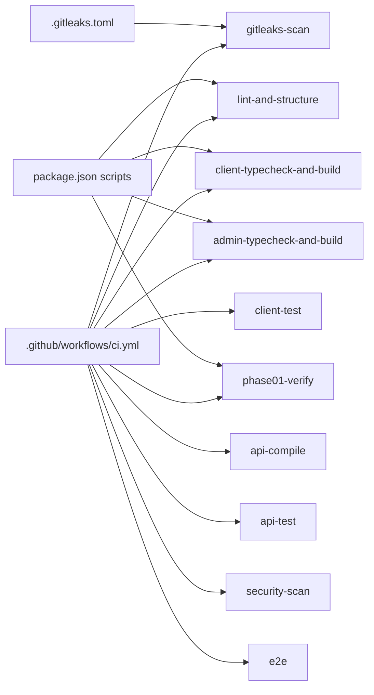

**图表来源**
- [ci.yml:1-512](file://.github/workflows/ci.yml#L1-L512)
- [.gitleaks.toml:17-51](file://.gitleaks.toml#L17-L51)
- [package.json:1-48](file://package.json#L1-L48)

**章节来源**
- [ci.yml:1-512](file://.github/workflows/ci.yml#L1-L512)
- [.gitleaks.toml:1-51](file://.gitleaks.toml#L1-L51)
- [.gitignore:239-243](file://.gitignore#L239-L243)
- [package.json:1-48](file://package.json#L1-L48)

## 核心组件

工作流在 `jobs:` 段（`.github/workflows/ci.yml:56-512`）下声明了十个作业。每个作业都是独立的 `runs-on: ubuntu-latest` 虚拟机，自带 `actions/checkout@v4`，因此作业之间不共享文件系统，只共享 `needs` 依赖关系。

| 作业 ID | 显示名 | 位置 | needs | timeout-minutes |
|---|---|---|---|---|
| `gitleaks-scan` | Gitleaks Secret Scan | `ci.yml:60-79` | — | 15 |
| `lint-and-structure` | Lint & Structure | `ci.yml:84-119` | — | 30 |
| `client-typecheck-and-build` | Client Typecheck & Build | `ci.yml:124-150` | — | 30 |
| `client-test` | Client Unit Tests | `ci.yml:155-175` | — | 30 |
| `admin-typecheck-and-build` | Admin Typecheck & Build | `ci.yml:180-203` | — | 30 |
| `api-compile` | API Compile | `ci.yml:208-222` | — | 30 |
| `api-test` | API Unit Tests | `ci.yml:227-242` | `api-compile` | 60 |
| `security-scan` | Trivy Security Scan（含推送闸说明） | `ci.yml:261-422` | `api-test`、`admin-typecheck-and-build` | 30 |
| `phase01-verify` | Phase 01 Verify | `ci.yml:428-456` | `security-scan` | 60 |
| `e2e` | E2E Tests | `ci.yml:461-512` | 前八个作业全部 | 45 |

组件可以按职能归为三类：

- **门禁类**：`gitleaks-scan` 用 `docker run gitleaks/gitleaks:v8.18.4 detect` 扫描整个仓库历史（`fetch-depth: 0`），配置来自仓库根 `.gitleaks.toml`；`lint-and-structure` 串起依赖审计、ESLint、OpenAPI lint、Spectral lint 与结构测试五道检查。
- **构建验证类**：`client-typecheck-and-build`（H5 + 微信小程序两个平台产物）、`admin-typecheck-and-build`、`api-compile`（Maven `-B` 批模式编译）。
- **测试与制品类**：`client-test`、`api-test`、`security-scan`（Trivy fs/image + 构建并推送 GHCR 镜像 + cosign 签名）、`phase01-verify`（运行 `npm run verify:phase01`）、`e2e`（Playwright Chromium）。

工具链版本在工作流内被显式固定：pnpm 由 `pnpm/action-setup@v3` 安装为 `11.17.0`（与根 `package.json` 的 `packageManager: "pnpm@11.17.0+sha512..."` 一致），Node 由 `actions/setup-node@v4` 固定为 `'20'`，Java 由 `actions/setup-java@v4` 固定为 `'17'` / `temurin`，Trivy 动作固定为 `aquasecurity/trivy-action@v0.23.0`，gitleaks 镜像固定为 `v8.18.4`。

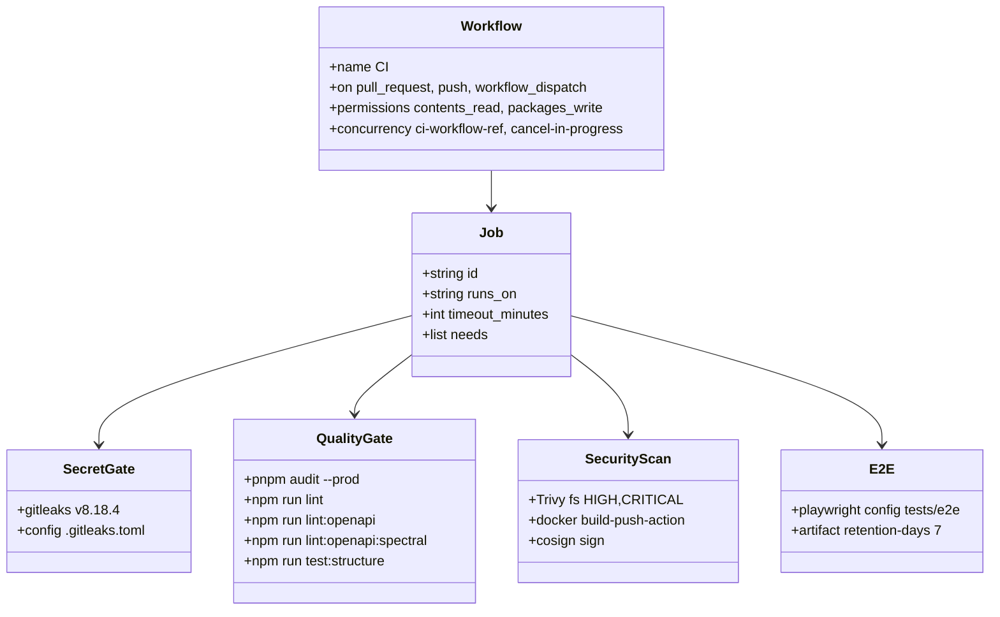

**图表来源**
- [ci.yml:1-19](file://.github/workflows/ci.yml#L1-L19)
- [ci.yml:60-119](file://.github/workflows/ci.yml#L60-L119)
- [ci.yml:261-422](file://.github/workflows/ci.yml#L261-L422)
- [ci.yml:461-512](file://.github/workflows/ci.yml#L461-L512)

**章节来源**
- [ci.yml:56-512](file://.github/workflows/ci.yml#L56-L512)
- [ci.yml:1-54](file://.github/workflows/ci.yml#L1-L54)
- [package.json:47-47](file://package.json#L47-L47)
- [.gitleaks.toml:17-20](file://.gitleaks.toml#L17-L20)

## 架构总览

十个作业组成的依赖图呈"菱形 + 漏斗"结构：前六个作业互不依赖、并行起跑；`api-test` 在 `api-compile` 之后；`security-scan` 需要 `api-test` 与 `admin-typecheck-and-build` 同时通过；`phase01-verify` 只等 `security-scan`；`e2e` 显式 `needs` 八个作业，是流水线唯一终点。

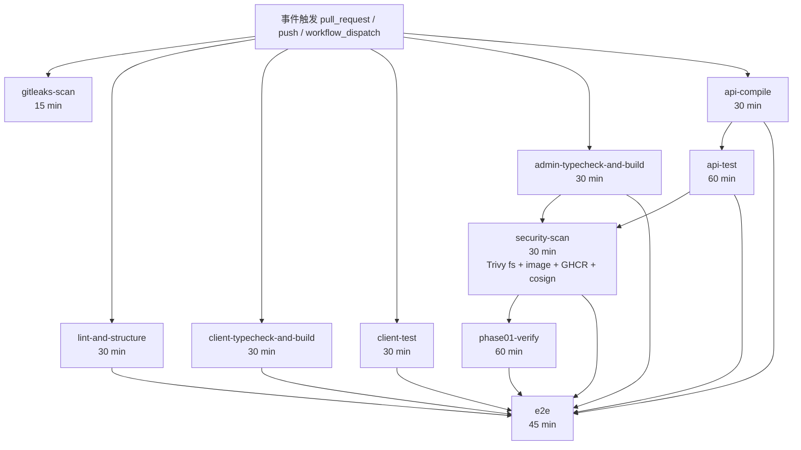

**图表来源**
- [ci.yml:1-9](file://.github/workflows/ci.yml#L1-L9)
- [ci.yml:60-63](file://.github/workflows/ci.yml#L60-L63)
- [ci.yml:84-87](file://.github/workflows/ci.yml#L84-L87)
- [ci.yml:124-127](file://.github/workflows/ci.yml#L124-L127)
- [ci.yml:155-158](file://.github/workflows/ci.yml#L155-L158)
- [ci.yml:180-183](file://.github/workflows/ci.yml#L180-L183)
- [ci.yml:208-231](file://.github/workflows/ci.yml#L208-L231)
- [ci.yml:261-267](file://.github/workflows/ci.yml#L261-L267)
- [ci.yml:428-433](file://.github/workflows/ci.yml#L428-L433)
- [ci.yml:461-473](file://.github/workflows/ci.yml#L461-L473)

三个设计约束值得注意：

1. **没有跨作业制品传递**。工作流内没有 `actions/upload-artifact` / `actions/download-artifact` 组合（唯一一次上传是 `e2e` 作业把 Playwright HTML 报告作为归档产物保存 7 天，`ci.yml:506-512`）。因此每个作业各自执行 `pnpm install --frozen-lockfile` 或 `mvn` 编译，安装成本随作业数线性增长，换来的是各作业可完全并行。
2. **`gitleaks-scan` 不在 `e2e` 的 `needs` 列表里**（`ci.yml:464-472`），它只作为独立 status check 存在；`e2e` 依赖的是 `lint-and-structure` 起八个作业。同理，`gitleaks-scan` 失败不会阻断其余作业的运行，阻断发生在评审阶段的必检项配置上。
3. **`security-scan` 是镜像出仓的唯一入口**。GHCR 登录、`docker/build-push-action` 构建推送、cosign 签名全部集中在同一个作业（`ci.yml:352-422`），并由一个前置判定步骤统一控制。

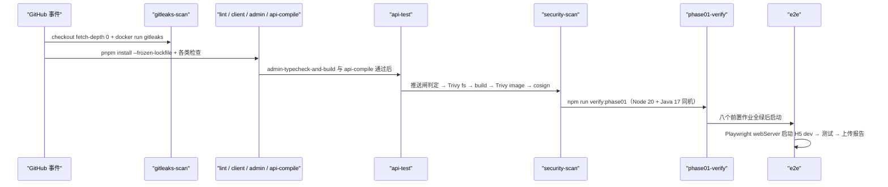

**图表来源**
- [ci.yml:60-79](file://.github/workflows/ci.yml#L60-L79)
- [ci.yml:84-242](file://.github/workflows/ci.yml#L84-L242)
- [ci.yml:261-422](file://.github/workflows/ci.yml#L261-L422)
- [ci.yml:428-456](file://.github/workflows/ci.yml#L428-L456)
- [ci.yml:461-512](file://.github/workflows/ci.yml#L461-L512)

**章节来源**
- [ci.yml:461-473](file://.github/workflows/ci.yml#L461-L473)
- [ci.yml:506-512](file://.github/workflows/ci.yml#L506-L512)

## 触发器、权限与并发模型

### 事件触发

`on:` 段声明了三类触发源（`ci.yml:3-9`）：

- `pull_request` 面向 `branches: [main, develop]`；
- `push` 面向 `branches: [main, develop]` 且带 `tags: ['v*']`；
- `workflow_dispatch`（`ci.yml:9`），允许在 Actions 界面手动起跑，用于在不产生提交的情况下重跑整套门禁。

标签规则只有一条：以 `v` 开头的 tag 会触发流水线（`ci.yml:8`）。仓库里没有把 tag 事件映射到发布作业的逻辑——tag 触发跑的仍是同一套十个作业，`security-scan` 会用 `type=sha` 与 `ci-<短 SHA>` 打标签（`ci.yml:339-341`、`ci.yml:349-350`），而不是 `v*` 版本号。

### 权限最小化

工作流级 `permissions` 只开了两项（`ci.yml:11-14`）：

```yaml
permissions:
  contents: read
  packages: write
```

`contents: read` 覆盖所有作业的检出与只读访问；`packages: write` 是 `security-scan` 向 `ghcr.io/${{ github.repository }}/api` 与 `/admin` 推送镜像所需的最小写权限（注释在 `ci.yml:13` 标明来自 P3-D.2 + infra #46，且仅 push 事件用到）。没有任何作业申请 `security-events`、`pull-requests` 或 `id-token` 写权限，因此流水线不会回写 PR 评论、不会上传 Code Scanning SARIF、也不会使用 OIDC 免密签名。

GHCR 登录用的是 Actions 自带的 `GITHUB_TOKEN`（`ci.yml:358-359`），仓库内没有维护额外的镜像推送机器人账号。

### 并发控制

```yaml
concurrency:
  group: ci-${{ github.workflow }}-${{ github.ref }}
  cancel-in-progress: true
```

分组键包含工作流名与 `github.ref`（`ci.yml:17-19`），语义是"同一分支/同一 tag 上只保留最新一次运行"。同一 refs 上的新提交会立即取消仍在排队或运行的旧工作流，避免连续 push 把 runner 耗尽。注释（`ci.yml:16`）记录了该配置的来源编号 FIN-00866 / infra #51。

需要注意的副作用：`cancel-in-progress` 对 `pull_request` 同样生效，PR 分支上快速连续推送会让前一版检查结果消失，评审时应以最新一次运行（HEAD SHA）为准。

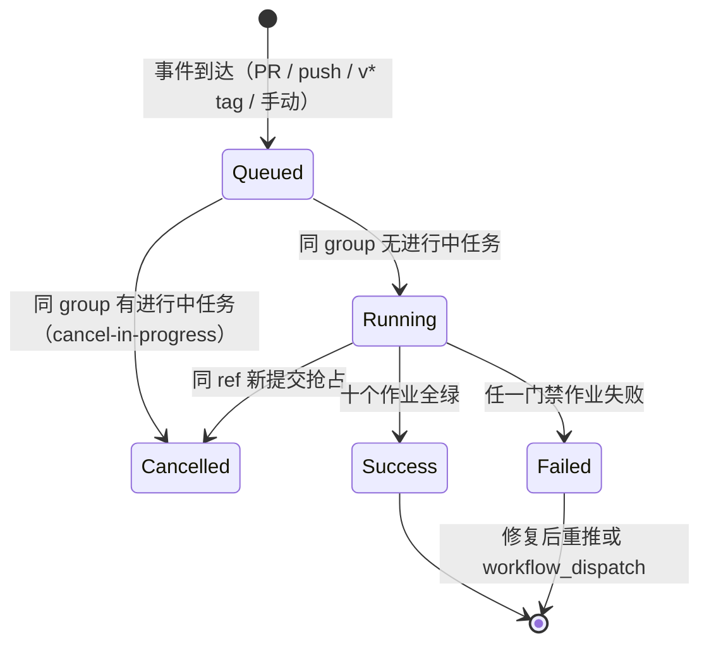

**图表来源**
- [ci.yml:3-9](file://.github/workflows/ci.yml#L3-L9)
- [ci.yml:11-19](file://.github/workflows/ci.yml#L11-L19)

**章节来源**
- [ci.yml:3-19](file://.github/workflows/ci.yml#L3-L19)
- [ci.yml:334-359](file://.github/workflows/ci.yml#L334-L359)

## 详细组件分析

### gitleaks-scan：历史全量密钥扫描

作业体（`ci.yml:60-79`）只有两步。第一步 `actions/checkout@v4` 带 `fetch-depth: 0`（`ci.yml:65-67`），即拉取完整提交历史——这是关键选择：gitleaks 因此能扫描历史提交里的密钥，而不只是当前工作树；代价是大仓库检出变慢，所以 `timeout-minutes: 15`（`ci.yml:63`）给得很紧。

第二步直接用 Docker 跑固定版本镜像（`ci.yml:69-79`）：

```bash
docker run --rm -v "${{ github.workspace }}":/repo gitleaks/gitleaks:v8.18.4 detect \
  --source /repo --config /repo/.gitleaks.toml --no-banner --redact --verbose
```

- 镜像版本显式 pin 到 `v8.18.4`，注释（`ci.yml:70`）写明"禁止 latest"；
- `--redact` 让命中内容在日志里被脱敏，避免 CI 日志本身泄露密钥；
- `--verbose` 便于定位是哪条规则命中；
- 未使用第三方 Action，而是裸 `docker run`，因此该作业不依赖任何 marketplace 动作，也无需 `packages: write`。

规则来自仓库根 `.gitleaks.toml`（51 行）：`[extend] useDefault = true`（`ci.yml` 之外，见 `.gitleaks.toml:19-20`）继承 gitleaks 官方规则集，再用 `[allowlist]`（`.gitleaks.toml:23-51`）做两层收窄：

| 白名单维度 | 内容 | 位置 |
|---|---|---|
| `regexes` | `admin-default-openid-change-me`（Flyway 占位符默认值）、`campus_love`（MySQL 库名，非凭据） | `.gitleaks.toml:34-40` |
| `paths` | 两个含历史 BCrypt 占位哈希的 Flyway 迁移文件、`^apps/api/src/test/resources/.*`、`^apps/api/src/main/resources/application-db\.yml` | `.gitleaks.toml:41-51` |

配置文件的注释记录了两次收紧决策：Task 20（FIN-00008）移除了 `.github/workflows/ci.yml` 与 `application-db.yml` 的宽泛路径白名单，改为"精确字符串 + 精确文件路径"双重控制（`.gitleaks.toml:4-8`）；Task 0.6.4 进一步删除了通用 BCrypt 哈希正则，因为它会让所有密码哈希一并放行（`.gitleaks.toml:25-28`）；2026-08-05 的 infra 补充把占位哈希从全局 `regexes` 迁到按文件粒度的 `paths`（`.gitleaks.toml:31-33`）。结果是：**同一占位哈希出现在白名单之外的任何文件仍会被检出**。

**章节来源**
- [ci.yml:60-79](file://.github/workflows/ci.yml#L60-L79)
- [.gitleaks.toml:1-51](file://.gitleaks.toml#L1-L51)
- [.gitleaks.toml:19-51](file://.gitleaks.toml#L19-L51)

### lint-and-structure：五道质量检查串成一条链

作业（`ci.yml:84-119`）的上下文装配是三个前端作业的标准范式：`pnpm/action-setup@v3` + `version: 11.17.0`（`ci.yml:91-93`）、`actions/setup-node@v4` + `node-version: '20'` + `cache: 'pnpm'`（`ci.yml:95-98`）、`pnpm install --frozen-lockfile`（`ci.yml:101`）。锁文件不一致时安装直接失败，这是依赖一致性的第一道保险。

随后五个步骤顺序执行，任一非零退出即作业失败（Steps 串行、无 `continue-on-error`）：

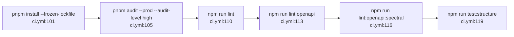

**图表来源**
- [ci.yml:100-120](file://.github/workflows/ci.yml#L100-L120)
- [package.json:15-19](file://package.json#L15-L19)

各步骤落到根 `package.json` 的真实命令：

| CI 步骤 | npm 脚本 | 实际命令 |
|---|---|---|
| Audit dependencies | —（工作流内直接写） | `pnpm audit --prod --audit-level high`（`ci.yml:105`，仅生产依赖，HIGH 及以上即失败） |
| Run ESLint (product code) | `lint` | `eslint apps/admin/src apps/client/src tools eslint.config.mjs`（`package.json:15`） |
| Run OpenAPI lint | `lint:openapi` | `node tools/lint-openapi.mjs` 后接 9 个契约文件：`feedback-growth-and-auth` / `likes` / `village` / `recommendations` / `users` / `check-in` / `notifications` / `official-accounts` / `whispers`（`package.json:16`） |
| Run Spectral lint | `lint:openapi:spectral` | `spectral lint "docs/openapi/*.yaml"`（`package.json:17`） |
| Run structure tests | `test:structure` | `node tests/project-structure.spec.mjs`（`package.json:19`） |

ESLint 的注释（`ci.yml:107-108`）明确了门禁判定口径：**0 errors 即失败，warning 不阻塞**，历史 style 债另项清理；扫描范围是产品代码（`apps/admin/src`、`apps/client/src`）加 `tools` 与配置文件本身。

自定义 OpenAPI 检查器 `tools/lint-openapi.mjs` 与 Spectral 是两套互补的契约校验：前者按文件清单逐个显式列出（新增契约文件不会自动进入门禁），后者用通配 `docs/openapi/*.yaml` 覆盖全部；规则集为根目录 `.spectral.yaml`（15 行）。

**章节来源**
- [ci.yml:84-119](file://.github/workflows/ci.yml#L84-L119)
- [package.json:9-27](file://package.json#L9-L27)

### 前端构建与单测作业

`client-typecheck-and-build`（`ci.yml:124-150`）在同一作业内跑三步：`pnpm --filter @campus-love/client run typecheck`、`build:h5`、`build:mp-weixin`（`ci.yml:144`、`ci.yml:147`、`ci.yml:150`）。三个脚本在客户端包里的实体是：

- `typecheck` = `vue-tsc --noEmit`（`apps/client/package.json:33`）；
- `build:h5` = `node scripts/prepare-static.mjs --h5 && uni build --platform h5`（`apps/client/package.json:21`）；
- `build:mp-weixin` = `prepare-static.mjs --dev` → `profile-svg-to-png.mjs` → `uni build --platform mp-weixin --mode mp-weixin` → `node ../../scripts/verify-package-size.mjs --allow-mock`（`apps/client/package.json:25`）。

最后一步是**包体积门禁**：小程序构建产物大小由 `scripts/verify-package-size.mjs` 校验，超限即构建失败，这是 CI 里唯一直接把平台限制（微信主包体积）编进流水线的地方。

`client-test`（`ci.yml:155-175`）与上一作业**并行**而非依赖它，只跑 `pnpm --filter @campus-love/client run test:unit`（`ci.yml:175`），实体命令是 `node scripts/run-vitest.mjs run --config vitest.config.ts`（`apps/client/package.json:41`）。

`admin-typecheck-and-build`（`ci.yml:180-203`）跑 `typecheck`（`ci.yml:200`，`vue-tsc --noEmit`，见 `apps/admin/package.json:20`）与 `build`（`ci.yml:203`，`vue-tsc && vite build`，见 `apps/admin/package.json:18`）。注意管理后台的单测脚本 `test:unit`（`apps/admin/package.json:21`）**没有被任何 CI 作业调用**——仓库里没有 admin 单元测试门禁。

**章节来源**
- [ci.yml:124-150](file://.github/workflows/ci.yml#L124-L150)
- [ci.yml:155-175](file://.github/workflows/ci.yml#L155-L175)
- [ci.yml:180-203](file://.github/workflows/ci.yml#L180-L203)
- [apps/client/package.json:21-41](file://apps/client/package.json#L21-L41)
- [apps/admin/package.json:18-21](file://apps/admin/package.json#L18-L21)

### api-compile 与 api-test：Java 侧两段式

`api-compile`（`ci.yml:208-222`）用 `actions/setup-java@v4` 装 `java-version: '17'` / `distribution: 'temurin'` / `cache: 'maven'`（`ci.yml:215-219`），随后 `mvn -B -f apps/api/pom.xml compile`（`ci.yml:222`）。`-B` 是批模式，注释（`ci.yml:27`）说明其目的是避免 Maven 在无 TTY 的 runner 上因交互式提示阻塞直至超时。

`api-test`（`ci.yml:227-242`）显式 `needs: api-compile`（`ci.yml:230`），跑 `mvn -B -f apps/api/pom.xml test`（`ci.yml:242`），`timeout-minutes` 提升到 60（`ci.yml:231`），是全流水线第二长的作业。由于作业间不传制品，`api-test` 会重新编译（`mvn test` 自带 compile 阶段），`needs` 在这里的作用是**先失败先止损**：编译不过就不必再等一轮测试时间。

`setup-java` 的 `cache: 'maven'` 以 `~/.m2` 为缓存目录，key 由动作内部按 `pom.xml` 摘要生成，因此新增依赖第一次构建才会真的下载。

后端测试集中于安全链路，构成 `api-test` 的实质覆盖面（下列为测试类及其体量，均由 `mvn test` 执行）：

| 测试类 | 行数 | 覆盖对象 |
|---|---|---|
| `JwtAuthenticationFilterTest` | 349 | 过滤器与 `JwtTokenProvider`、`UserRepository`、`TokenBlacklistService` 的协作（`apps/api/src/test/java/com/campuslove/api/config/JwtAuthenticationFilterTest.java:50-70`） |
| `JwtChannelInterceptorTest` | 368 | WebSocket 频道的 JWT 拦截（同文件 `:41-49`） |
| `RedisTokenBlacklistServiceTest` | 344 | 基于 Redis 的令牌黑名单 |
| `SecurityConfigTest` | 247 | `MockMvc` 校验安全配置（同文件 `:45-53`） |
| `RealAccountSecurityServiceTest` | 223 | 账号安全服务与 `PasswordEncoder`、`AesEncryptor`、`DeviceSessionService`（同文件 `:37-45`） |
| `ContentSecurityCoverageTest` | 130 | `SensitiveWordFilter` 与 `LocalContentSecurityChecker`（同文件 `:28-31`） |
| `AccountSecurityControllerTest` | 102 | 控制器层 |
| `JwtConfigTest` | 105 | 配置绑定 |

主代码侧 `JwtTokenProvider`（438 行，`apps/api/src/main/java/com/campuslove/api/config/JwtTokenProvider.java:37-38`）暴露 `generateToken`、`generateMediaToken`、`validateToken`、`revokeToken`、`isTokenRevoked`、`cleanupExpiredRevokedTokens` 等方法，是上述测试的主要被测面；`JwtAuthenticationFilter`（290 行）内的 `strictMediaQueryToken` 开关（`apps/api/src/main/java/com/campuslove/api/config/JwtAuthenticationFilter.java:115`）也在单测覆盖范围内。

**章节来源**
- [ci.yml:208-242](file://.github/workflows/ci.yml#L208-L242)
- [apps/api/src/test/java/com/campuslove/api/config/JwtAuthenticationFilterTest.java:50-70](file://apps/api/src/test/java/com/campuslove/api/config/JwtAuthenticationFilterTest.java#L50-L70)
- [apps/api/src/test/java/com/campuslove/api/config/JwtChannelInterceptorTest.java:41-49](file://apps/api/src/test/java/com/campuslove/api/config/JwtChannelInterceptorTest.java#L41-L49)
- [apps/api/src/test/java/com/campuslove/api/config/SecurityConfigTest.java:45-53](file://apps/api/src/test/java/com/campuslove/api/config/SecurityConfigTest.java#L45-L53)
- [apps/api/src/test/java/com/campuslove/api/auth/RealAccountSecurityServiceTest.java:37-45](file://apps/api/src/test/java/com/campuslove/api/auth/RealAccountSecurityServiceTest.java#L37-L45)
- [apps/api/src/test/java/com/campuslove/api/config/ContentSecurityCoverageTest.java:28-31](file://apps/api/src/test/java/com/campuslove/api/config/ContentSecurityCoverageTest.java#L28-L31)
- [apps/api/src/main/java/com/campuslove/api/config/JwtTokenProvider.java:37-38](file://apps/api/src/main/java/com/campuslove/api/config/JwtTokenProvider.java#L37-L38)
- [apps/api/src/main/java/com/campuslove/api/config/JwtAuthenticationFilter.java:115-115](file://apps/api/src/main/java/com/campuslove/api/config/JwtAuthenticationFilter.java#L115-L115)
- [apps/api/src/test/java/com/campuslove/api/auth/RedisTokenBlacklistServiceTest.java:44-52](file://apps/api/src/test/java/com/campuslove/api/auth/RedisTokenBlacklistServiceTest.java#L44-L52)
- [apps/api/src/test/java/com/campuslove/api/auth/AccountSecurityControllerTest.java:22-27](file://apps/api/src/test/java/com/campuslove/api/auth/AccountSecurityControllerTest.java#L22-L27)
- [apps/api/src/test/java/com/campuslove/api/config/JwtConfigTest.java:19-19](file://apps/api/src/test/java/com/campuslove/api/config/JwtConfigTest.java#L19-L19)

### phase01-verify：把根脚本链当作集成门禁

`phase01-verify`（`ci.yml:428-456`）是唯一同时装配 Node 与 Java 的作业：`pnpm/action-setup@v3` + `setup-node@v4`（`cache: 'pnpm'`）+ `setup-java@v4`（`cache: 'maven'`）三件套（`ci.yml:437-450`），跑 `npm run verify:phase01`（`ci.yml:456`），超时 60 分钟（`ci.yml:433`），`needs: security-scan`（`ci.yml:431-432`）。

该脚本（`package.json:23`）是一条六段串行链：

```
npm run test
  → npm run lint:openapi
  → npm run lint:openapi:spectral
  → npm --workspace apps/client run typecheck
  → npm run verify:client-builds
  → npm run api:test
```

其中 `npm run test` 自身又是 `test:prototype && test:structure && test:client` 的串联（`package.json:21`），而 `test:client` 会先 `generate:openapi` 再跑客户端单测（`package.json:20`），`verify:client-builds` 执行 `node tools/verify-client-builds.mjs`（`package.json:22`），`api:test` 走 `node tools/run-api-wrapper.cjs test`（`package.json:11`）。

由此形成一个**有意的重复执行**：`lint:openapi`、`lint:openapi:spectral`、client typecheck、client 单测、Maven 测试都在前面的作业里已经跑过一遍，`phase01-verify` 又在同一台机器上按依赖顺序整体重跑，价值在于验证"从干净仓库一次跑通全链"的可行性（含 `docs/openapi` → 客户端类型生成的前后一致性），成本是约一个完整作业的时间。

**章节来源**
- [ci.yml:428-456](file://.github/workflows/ci.yml#L428-L456)
- [package.json:9-27](file://package.json#L9-L27)

### e2e：漏斗终点与自托管服务

`e2e`（`ci.yml:461-512`）`needs` 八个作业（`ci.yml:464-472`），只有全绿才会起跑，超时 45 分钟（`ci.yml:473`）。步骤序列：

1. `pnpm install --frozen-lockfile`（`ci.yml:487`）；
2. `actions/cache@v4` 缓存 `~/.cache/ms-playwright`，key 为 `playwright-${{ runner.os }}-${{ hashFiles('pnpm-lock.yaml') }}`，`restore-keys` 退化为 `playwright-${{ runner.os }}-`（`ci.yml:490-496`）；
3. `npx playwright install --with-deps chromium`（`ci.yml:499`）——只装 Chromium，不装 Firefox/WebKit；
4. `npx playwright test --config=tests/e2e/playwright.config.ts`（`ci.yml:503`）；
5. `if: always()` 上传 `tests/e2e/report` 为 `playwright-report` 归档，`retention-days: 7`（`ci.yml:506-512`）。

第 4 步的显式 `--config` 来自修复 FIN-00278：仓库根目录没有 `playwright.config`，不加参数的 `npx playwright test` 实际跑不起来（注释见 `ci.yml:47-48`、`ci.yml:501`）。

配置文件 `tests/e2e/playwright.config.ts`（83 行）决定了 CI 里的执行形态：

- `testDir: './specs'`、`outputDir: './test-results'`，路径相对配置文件解析（`playwright.config.ts:36-37`，注释 `:34-35` 记录了原 `./tests/e2e/specs` 造成路径重复、命中 0 个测试的修复）；
- `fullyParallel: false`、`workers: 1`（`:38`、`:41`），因为 uni-app H5 dev server 是单实例；
- `forbidOnly: !!process.env.CI`（`:39`），CI 里遗留 `test.only` 直接失败；
- `retries: process.env.CI ? 2 : 0`（`:40`）——**这是流水线里唯一的重试机制，且只作用于单个测试用例**；
- `reporter` 在 CI 下追加 `github-actions` reporter，HTML 报告输出到 `tests/e2e/report`（`:42-46`），与第 5 步上传路径吻合；
- `baseURL: process.env.E2E_BASE_URL ?? 'http://localhost:5173'`（`:49`）；
- 两个 project：`chromium-mobile`（Pixel 5）与 `chromium-desktop`（Desktop Chrome）（`:59-69`）；
- `webServer` 自托管被测服务：`pnpm --filter @campus-love/client run dev:h5`，探测 `http://localhost:5173`，`timeout: 180_000`，`reuseExistingServer: true`，`env.NODE_ENV = 'development'`（`:73-82`）。

注释（`:70-72`，infra R2-00005）说明了这个设计的由来：CI 里没有 docker-compose 服务编排，若禁用 `webServer` 则 E2E 无服务可测；改用 mock 模式的 H5 dev server，避开真实微信登录依赖。也就是说，**E2E 验证的是前端旅程与 mock 契约，不是生产后端的连通性**。

**章节来源**
- [ci.yml:461-512](file://.github/workflows/ci.yml#L461-L512)
- [tests/e2e/playwright.config.ts:1-83](file://tests/e2e/playwright.config.ts#L1-L83)

## 安全扫描集成

安全能力分散在三个作业里，构成"密钥 → 依赖 → 源码 → 镜像 → 签名 → 出仓拦截"的链条，其中镜像扫描、签名与推送闸集中在 `security-scan`（`ci.yml:261-422`）。链条之外还有两道不在这个列表里、但属于同一治理意图的机制：流水线外的 `.gitignore` 泄露面规则（见「泄露面管控」一节）与流水线外的部署端验签（见「CI 只签不验」一节）。

| 层次 | 工具与版本 | 位置 | 失败条件 |
|---|---|---|---|
| 提交历史密钥 | `gitleaks/gitleaks:v8.18.4` | `ci.yml:69-79` | 命中且不在 `.gitleaks.toml` 白名单 |
| 生产依赖漏洞 | `pnpm audit --prod --audit-level high` | `ci.yml:104-105` | HIGH 及以上 |
| 源码文件系统漏洞 | `aquasecurity/trivy-action@v0.23.0`，`scan-type: fs` | `ci.yml:308-322`（`apps/api`、`apps/admin` 各一次） | `severity: HIGH,CRITICAL` + `exit-code: 1` |
| 镜像漏洞 | 同上，`image-ref` 模式 | `ci.yml:387-399` | 同上 |
| 镜像签名 | `sigstore/cosign-installer@v3` + `cosign sign` | `ci.yml:404-422` | 仅在配置了 `COSIGN_PRIVATE_KEY` 时执行 |
| 未签名出仓拦截 | `push-gate` 判定 + 显式 fail 步骤（fail-closed） | `ci.yml:276-304` | 非 PR 事件下 `mode=refuse`（既无密钥又未显式 `ALLOW_UNSIGNED_IMAGES=true`）即作业失败 |

`trivy-action` 被固定为 `@v0.23.0`（`ci.yml:309`、`ci.yml:317`、`ci.yml:388`、`ci.yml:395`），注释（`ci.yml:307`，infra #47 / FIN-00277）明确"禁止 @master"——此前该动作引用未 pin 的 `master` 分支，属于可被上游篡改的供应链风险点。

### 镜像推送闸（三段判定）

2026-10-05 引入的显式门禁解决的是"cosign 未配密钥时镜像照推不签名"。判定步骤 `push-gate`（`ci.yml:276-291`）把 secrets 经 `env` 中转（注释 `ci.yml:275` 说明：`secrets` 上下文不能直接用在 step 级 `if` 表达式里），输出三种 `mode`：

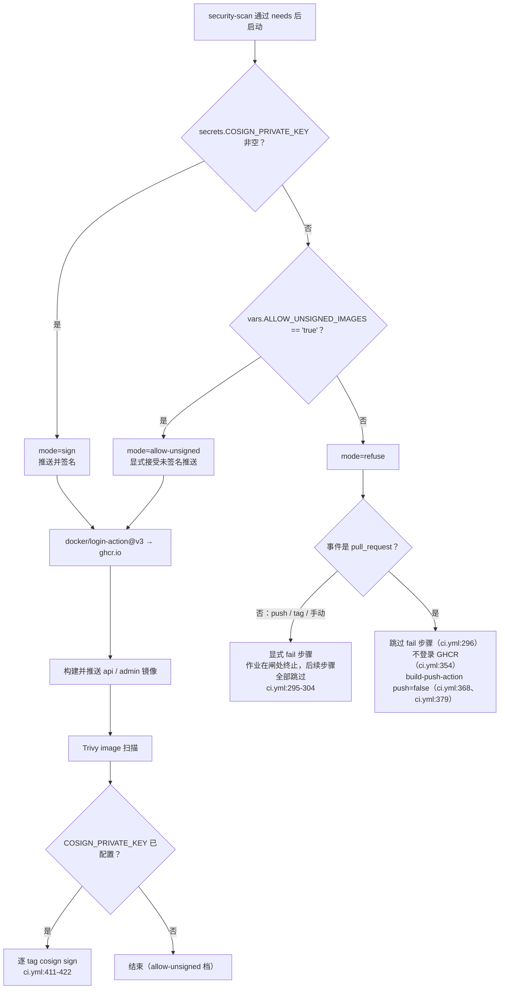

**图表来源**
- [ci.yml:276-304](file://.github/workflows/ci.yml#L276-L304)
- [ci.yml:352-381](file://.github/workflows/ci.yml#L352-L381)
- [ci.yml:404-422](file://.github/workflows/ci.yml#L404-L422)

失败步骤用 `::error::` 注解把两条处置路径直接写进日志（`ci.yml:298-303`）：配置 `COSIGN_PRIVATE_KEY` / `COSIGN_PASSWORD` 走签名，或在仓库 Variables 里显式设 `ALLOW_UNSIGNED_IMAGES=true` 留痕放行；并注明"PR 场景只构建不推送，不受本闸影响"。作业显示名本身也被用作决策说明，把拒绝未签名镜像出仓的策略直接展示在 Actions 列表上（`ci.yml:262`）。

PR 与非 PR 的分野在多处重复出现：`if: github.event_name != 'pull_request'` 控制登录（`ci.yml:354`）与推送（`ci.yml:368`、`ci.yml:379`），因此 PR 只验证"镜像能构建出来"，不产生任何 registry 写入。

### 推送闸的 fail-closed 语义

推送闸（`ci.yml:271-304`，2026-10-05 引入，变更史见注释 `ci.yml:50-53`）修复的是"cosign 未配密钥时镜像照推不签名"这一供应链缺口，其默认档位是**拒绝（fail-closed）而不是放行**：

- **默认档位 = 拒签即拒推**。判定步骤 `push-gate`（`ci.yml:276-291`）先取 `COSIGN_KEY: ${{ secrets.COSIGN_PRIVATE_KEY }}` 与 `ALLOW_UNSIGNED: ${{ vars.ALLOW_UNSIGNED_IMAGES }}`（`ci.yml:278-280`），三分支：私钥非空 → `mode=sign`（`ci.yml:282-284`）；否则变量**恰好等于字符串** `true` → `mode=allow-unsigned`（`ci.yml:285-287`）；否则 `mode=refuse`（`ci.yml:288-291`）。注意 `[ "$ALLOW_UNSIGNED" = "true" ]` 是区分大小写、不接受 `1` / `True` / `yes` 的精确比较，变量缺失（未定义）与定义为其他值同样落入 `refuse`。
- **放行必须是显式决策**。要从未配密钥的仓库出仓未签名镜像，唯一途径是在 Settings → Secrets and variables → Actions → **Variables** 里新增 `ALLOW_UNSIGNED_IMAGES=true`（`ci.yml:302`）。该档位不静默通过：判定步骤会把"COSIGN_PRIVATE_KEY 未配置，但 vars.ALLOW_UNSIGNED_IMAGES=true（显式决策），允许未签名推送"打进日志（`ci.yml:287`），即留痕于运行记录。
- **拒绝是三处联动的**，而不是只打个警告：`mode=refuse` 时不登录 GHCR（`if: ... && steps.push-gate.outputs.mode != 'refuse'`，`ci.yml:354`）、两个 `build-push-action` 的 `push` 输入被求值为 false 从而只构建不推送（`ci.yml:368`、`ci.yml:379`），并额外执行一个显式失败步骤（`ci.yml:295-304`）。注释（`ci.yml:293-294`）说明选择 fail 而非 warning 的理由：让"未签名镜像可否出仓"成为显式门禁，同时把原因写进作业名（`ci.yml:262`）以便在 Actions UI 列表上直接看到为什么挂。
- **失败位置在扫描之前**。失败步骤（`ci.yml:295`）排在 Trivy fs 扫描（`ci.yml:308`）之前，且作业没有 `continue-on-error`，因此 push / tag / `workflow_dispatch` 事件一旦落入 `refuse`，该作业在闸处即终止，本轮不再产出 fs / image 扫描结果——修复密钥或显式放行后才能拿到完整扫描结论。
- **PR 场景不受该闸影响**。失败步骤的条件是 `steps.push-gate.outputs.mode == 'refuse' && github.event_name != 'pull_request'`（`ci.yml:296`），因此从 fork 或功能分支提来的 PR 即使仓库既没有 `COSIGN_PRIVATE_KEY` 也没有 `ALLOW_UNSIGNED_IMAGES`，`security-scan` 仍会继续跑完 fs 扫描、镜像构建（`push: false`）与 image 扫描，只是不写入 registry。这一区分是必要的：PR 本就不具备 GHCR 写权限（注释 `ci.yml:326`），若让闸在无密钥仓库里对 PR 也 fail，等于把所有外部贡献者的流水线全部变红。
- **判定必须经 `env` 中转**。`secrets` 上下文不能直接出现在 step 级 `if` 表达式里，故 `push-gate` 先用 `env` 把密钥与变量取出再在 `run` 内判定（注释 `ci.yml:275`）；而后续签名步骤的 `if` 反过来必须直接写 `secrets.COSIGN_PRIVATE_KEY != ''`，早前写成 `env.COSIGN_PRIVATE_KEY` 时因 step 级 `env` 仅在步骤内可见而恒为 false，导致签名长期未执行（`ci.yml:402-405`，infra #45 / FIN-00277）。两处方向相反，是同一限制的两面。

`::error::` 注解给出的两条处置路径逐字如下（`ci.yml:298-303`）：

1. Settings → Secrets and variables → Actions → **Secrets** 新增 `COSIGN_PRIVATE_KEY` / `COSIGN_PASSWORD`，启用 cosign 签名后推送；
2. Settings → Secrets and variables → Actions → **Variables** 新增 `ALLOW_UNSIGNED_IMAGES=true`，显式接受未签名推送（会留痕于本日志）。

注解的最后一行补充："PR 场景只构建不推送，不受本闸影响。"（`ci.yml:303`），随后 `exit 1` 使作业失败（`ci.yml:304`）。

**章节来源**
- [ci.yml:271-304](file://.github/workflows/ci.yml#L271-L304)
- [ci.yml:50-53](file://.github/workflows/ci.yml#L50-L53)
- [ci.yml:254-259](file://.github/workflows/ci.yml#L254-L259)
- [ci.yml:326-381](file://.github/workflows/ci.yml#L326-L381)
- [ci.yml:402-405](file://.github/workflows/ci.yml#L402-L405)

### CI 只签不验：验签发生在部署端

流水线对镜像签名的职责边界是**只签不验**：

- `ci.yml` 全文出现的签名命令只有 `cosign sign --key env://COSIGN_PRIVATE_KEY "$tag"`（`ci.yml:421`），配合 `sigstore/cosign-installer@v3`（`ci.yml:404-406`）；**没有任何 `cosign verify` 步骤**，也没有对上游基础镜像或已入库 tag 做签名校验。逐行核对 512 行工作流后确认：验签不属于本仓库的 CI 能力。
- 验签的规范流程写在 `doc/DEPLOYMENT.md`（注意路径是 **`doc/`** 而非 `docs/`，994 行）的「镜像签名验证（P3-D.2）」小节：部署机放置公钥 `/etc/campus-love/cosign.pub`（不入库），对 `ghcr.io/$GHCR_REPO/api:ci-<commit-sha>` 与 `/admin:ci-<commit-sha>` 执行 `cosign verify --key $COSIGN_PUB_PATH ...`，通过返回 0、失败返回非 0（`doc/DEPLOYMENT.md:388-411`）。该文档还给出"先验签再 `docker compose up`"的部署脚本范式（`doc/DEPLOYMENT.md:413-422`）与升级前检查里的验签项（`doc/DEPLOYMENT.md:891-895`），并提醒固定 cosign 容器版本 `gcr.io/projectsigstore/cosign:v2.4.1`、禁止 latest（`doc/DEPLOYMENT.md:397-399`，R4-02088）。
- 密钥分发关系由同一文档记录：仓库管理员在 Secrets 中配置 `COSIGN_PRIVATE_KEY`（`cosign generate-key-pair` 产出的 `cosign.key` 内容）与 `COSIGN_PASSWORD`，对应公钥 `cosign.pub` 分发给部署方用于验签（`doc/DEPLOYMENT.md:424-429`）。这解释了为什么流水线侧不需要公钥：签名只需要私钥，验证只需要公钥。
- 一处措辞需按 HEAD 校正：`doc/DEPLOYMENT.md:430` 仍写"未配置 secrets 时，CI 中签名步骤自动跳过（PR 场景不影响构建）"。这句描述的是 2026-10-05 推送闸之前的语义——签名步骤本身确实仍是条件执行（`ci.yml:405`、`ci.yml:412`），但在**非 PR 事件**上未配密钥现在会先在推送闸处 fail（`ci.yml:295-304`），而不是静默跳过签名后照常推送。以工作流文件为准。

因此本仓库的信任链是：CI 负责"构建 + 扫描 + 推送闸 + 签名"，部署方负责"验签 + 起容器"，两半分别由 `ci.yml` 与 `doc/DEPLOYMENT.md` 描述，中间靠 `ci-<短 SHA>` / `sha-<短 SHA>` 镜像 tag（`ci.yml:327-329`、`ci.yml:339-341`）对齐。

**章节来源**
- [ci.yml:404-422](file://.github/workflows/ci.yml#L404-L422)
- [doc/DEPLOYMENT.md:388-430](file://doc/DEPLOYMENT.md#L388-L430)
- [doc/DEPLOYMENT.md:891-895](file://doc/DEPLOYMENT.md#L891-L895)
- [ci.yml:327-341](file://.github/workflows/ci.yml#L327-L341)

### 镜像构建细节

镜像由 `docker/build-push-action@v6` 构建，`context` 分别是 `./apps/api` 与 `./apps/admin`，`target: runtime`（`ci.yml:361-381`）。选 `runtime` 是为了跳过 API Dockerfile 里的 `trivy-scanner` 中间阶段（注释 `ci.yml:325`）：该文件在 Stage 3 定义了 `FROM aquasec/trivy:0.53.0 AS trivy-scanner`，把 builder 产出的 jar 复制进去后执行 `trivy fs --severity HIGH,CRITICAL --exit-code 1 /scan`（`apps/api/Dockerfile:123-131`）。最终运行镜像基于 `eclipse-temurin:17.0.12-jre`（`apps/api/Dockerfile:44`），builder 阶段是 `17.0.12-jdk`（`:22`），版本 pin 到小版本、禁止浮点 tag（注释 `:21`、`:43`）。

tag 生成有两处：`Set image tag` 步骤输出 `TAG=ci-${GITHUB_SHA::7}`（`ci.yml:327-329`），再由 `docker/metadata-action@v5` 组合成 `type=raw,value=ci-<sha>` 与 `type=sha` 两个标签（`ci.yml:334-350`），镜像名是 `ghcr.io/${{ github.repository }}/api` 与 `/admin`。

这里有两个被注释记录下来的坑：

- Trivy 的 `image-ref` 只接受单镜像引用，而 `outputs.tags` 是逗号分隔多 tag，故取 `split(',')[0]`（`ci.yml:390`、`ci.yml:397`，infra R2-00006）；
- `cosign sign` 同样只接受单引用，签名步骤把 `API_TAGS` / `ADMIN_TAGS` 里的逗号替换成空格后逐 tag 循环签名（`ci.yml:411-422`，R4-02098），空串用 `[ -z "$tag" ] && continue` 跳过。

签名密钥通过 `env://COSIGN_PRIVATE_KEY` 传入，`COSIGN_PASSWORD` 同批注入（`ci.yml:413-415`），不落盘。

### 仓库里没有的能力

- **没有 SARIF 上传**：Trivy 与 gitleaks 的结果只作为步骤退出码使用，未配置 `security-events: write`，GitHub 的 Code scanning / Dependabot 告警页面不会因此流水线产生数据。
- **没有依赖机器人配置**：`.github/` 下不存在 Dependabot 或 Renovate 的配置文件（该目录仅有 `workflows/`、`pull_request_template.md` 与 `ISSUE_TEMPLATE/`），依赖升级完全靠人工提 PR，由 `pnpm install --frozen-lockfile` 与 `pnpm audit` 把关。
- **没有流水线里的数据库迁移校验**：`ci.yml` 全文没有 Flyway 相关步骤，`database/flyway` 的 migrate/validate 只以 PR 模板的人工核对项存在（见「多环境构建策略」与「分支策略」两节）。
- **没有流水线内的镜像验签**：`ci.yml` 只有 `cosign sign`（`ci.yml:421`），没有 `cosign verify`；验签规范属于部署端，见 `doc/DEPLOYMENT.md:388-430`。
- **没有部署作业**：`ci.yml` 里没有向任何运行环境发布应用的步骤，最远只到镜像推送与签名。

**章节来源**
- [ci.yml:261-422](file://.github/workflows/ci.yml#L261-L422)
- [apps/api/Dockerfile:22-44](file://apps/api/Dockerfile#L22-L44)
- [apps/api/Dockerfile:116-131](file://apps/api/Dockerfile#L116-L131)
- [ci.yml:11-14](file://.github/workflows/ci.yml#L11-L14)

## 泄露面管控：.gitignore 与 gitleaks 的分工

密钥与敏感数据的防线在仓库里分两道：**`.gitignore`（243 行）负责让东西进不来，gitleaks 负责把已经进来的查出来**。2026-10-05 那次提交（新增 CI 供应链推送闸的同一次变更）同时给 `.gitignore` 追加了泄露面规则，两道防线的关系值得单独说明。

### 新增的泄露面规则

`.gitignore:239-243` 是标题为「泄露面清理（2026-10-05）」的分组，注释写明动机是"本地临时 token 文件与 Redis 持久化数据不入库"（`.gitignore:240`），三条规则：

| 规则 | 位置 | 语义 |
|---|---|---|
| `tmp_*_token.txt` | `.gitignore:241` | 无路径前缀的模式，在任意层级生效，覆盖调试时随手导出的 token 文本（如 `tmp_access_token.txt`） |
| `*.aof` | `.gitignore:242` | 任意目录下所有 Redis 追加持久化文件，含 compose 挂载产生的子目录副本 |
| `appendonly.aof` | `.gitignore:243` | 无锚定的同名文件兜底（任意层级） |

这三条与文件里既有的规则是**补集关系而非重复**：

- `.gitignore:110` 早已有 `/appendonly.aof`，前导斜杠把它锚定在仓库根，子目录（例如 `data/`、`volumes/`）里的同名文件不受约束；`*.aof` 才把范围铺满全仓。
- `.gitignore:115-116` 的 `/tmp-*.*`、`/tmp_*.*` 同样锚定根目录且要求带扩展名；`tmp_*_token.txt` 在任意层级生效，覆盖 `apps/api/` 等子目录下产出的 token 文件。
- `.gitignore:226-230` 的「apps/api 运行临时产物」分组只清 `apps/api/` 一层的 `*.json` / `*.txt` / `*.err` / `*.tmp`，对新文件类型无一般性保护。

同组规则之外，凭据类忽略在 `.gitignore:19-34`：`start-local.bat`、`scripts-start-backend.cmd`、`*.local`、`.env`（保留 `!**/.env.example`）、`database/flyway/flyway.user.toml`、`backups/`、自签证书 `*.pem`、`set-root-password.sql`、含个人 openid 的 `project.private.config.json`。

### 与 gitleaks 的分工边界

两道防线不可互相替代，差异在三个维度：

| 维度 | `.gitignore` | `gitleaks-scan`（`ci.yml:60-79`） |
|---|---|---|
| 作用对象 | 工作树中**未跟踪**的路径（决定是否出现在 `git add` 候选里） | 已入库的内容：`fetch-depth: 0` 检出全部历史（`ci.yml:65-67`），逐提交与逐文件匹配规则 |
| 时机 | 提交前，预防性、静默 | 提交后，检测性、非零退出即门禁失败 |
| 绕过方式 | 文件一旦已被跟踪，ignore 规则完全不生效（`.gitignore:233-234` 的注释正是就此提醒：`报告/` 下已有数百个跟踪文件，ignore 不影响已跟踪文件） | 命中内容需靠 `.gitleaks.toml` 白名单精确放行，规则外即检出 |

因此 `tmp_*_token.txt` 的实际价值是**避免误提交**（尤其是有人在仓库根跑脚本导出 token 的情形），而不是"发现泄露"：如果这类文件曾经被 `git add -f` 或在被忽略规则加入之前就已提交，历史里依然存在，只能由 gitleaks 检出——而 gitleaks 扫到后会要求清理历史，不是加白名单了事。反过来，gitleaks 对从未进入 git 对象的本地临时文件没有处置意义，它只看仓库内容。

白名单侧的口径见「gitleaks-scan」一节：`.gitleaks.toml:34-51` 只按精确字符串与精确文件路径放行，同一占位哈希出现在白名单之外的任何文件仍会被检出（`.gitleaks.toml:4-8` 记录了 Task 20 移除宽泛路径的决策）。日志侧还有 `--redact`（`ci.yml:78`）保证 CI 输出本身不再造成二次泄露。

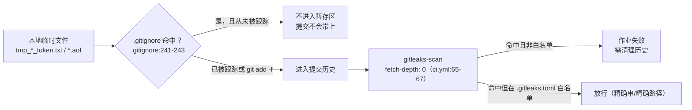

**图表来源**
- [.gitignore:239-243](file://.gitignore#L239-L243)
- [ci.yml:60-79](file://.github/workflows/ci.yml#L60-L79)
- [.gitleaks.toml:34-51](file://.gitleaks.toml#L34-L51)

**章节来源**
- [.gitignore:19-34](file://.gitignore#L19-L34)
- [.gitignore:110-116](file://.gitignore#L110-L116)
- [.gitignore:226-243](file://.gitignore#L226-L243)
- [ci.yml:60-79](file://.github/workflows/ci.yml#L60-L79)
- [.gitleaks.toml:4-51](file://.gitleaks.toml#L4-L51)

## 多环境构建策略

### CI 侧：单一环境，不做矩阵

`.github/workflows/ci.yml` 里没有 `strategy.matrix`，也没有按环境拆分的作业：所有作业统一 `runs-on: ubuntu-latest`，统一 Node `'20'`（`ci.yml:97`、`ci.yml:137`、`ci.yml:168`、`ci.yml:194`、`ci.yml:443`、`ci.yml:483`）、Java `'17'` / `temurin`（`ci.yml:217-218`、`ci.yml:237-238`、`ci.yml:448-449`）、pnpm `11.17.0`。根 `package.json` 的 `engines` 约束是 `node >=18.0.0 <23.0.0`、`npm >=9.0.0`（`package.json:43-46`），CI 用的 20 落在区间内；`packageManager` 字段锁到 `pnpm@11.17.0+sha512...`（`package.json:47`），与工作流里的 `version: 11.17.0` 对齐。

结论：**"开发 / 测试 / 生产"的差异化不发生在 CI，而发生在运行时配置**。CI 只保证同一份代码在固定工具链下可编译、可测试、可打包成同一份制品。

### 运行时环境维度

区分环境的真实手段有三层：

1. **Spring profile**。API 镜像默认 `ENV SPRING_PROFILES_ACTIVE=real`，同时固定 `APP_PORT=8080`、`APP_LOGGING_PATH=/app/logs`、`APP_MEDIA_STORAGE_ROOT=/app/uploads`（`apps/api/Dockerfile:100-104`），注释明确"可通过 SPRING_PROFILES_ACTIVE 覆盖"。资源目录里能看到的配置文件是 `application.yml`、`application-mock.yml`、`application-real.yml`、`application-wechat.yml`。本地开发走 mock：根脚本 `api:dev` 的实际命令是 `node tools/run-api-wrapper.cjs spring-boot:run -Dspring-boot.run.profiles=mock`（`package.json:10`）。
2. **docker-compose 变量注入**。`api` 服务显式设 `SPRING_PROFILES_ACTIVE: real`（`docker-compose.yml:203`），镜像名带环境标签变量 `campus-love/api:${TAG:-dev}`（`docker-compose.yml:194`），默认 tag 就是 `dev`。敏感项一律用 `${VAR:?... is required}` 强制注入，缺失即 compose 启动失败：`DB_PASSWORD`（FIN-00270）、`REDIS_PASSWORD`（FIN-00271）、`JWT_SECRET`（FIN-00272，要求 >=48 字符）；非敏感项保留本地默认值，如 `CORS_ALLOWED_ORIGINS` 默认只含 `localhost:5173/5174/5177`（注释说明生产必须由 `.env` 覆盖）、`ADMIN_OPENID` 默认空（infra #8 移除了可被冒充登录的 `admin-default-openid-change-me` 默认值）。`depends_on` 用 `condition: service_healthy` 挂在 mysql / redis 上（`docker-compose.yml:197-201`）。
3. **镜像 tag**。CI 产出 `ci-<短 SHA>` 与 `sha-<短 SHA>`（`ci.yml:327-329`、`ci.yml:339-341`），部署侧再由 compose 的 `TAG` 变量选择版本，环境差异体现在"拉哪个 tag + 注入哪套 `.env`"，而不是构建参数不同。

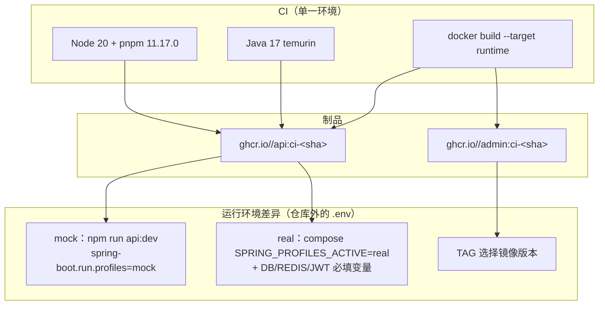

**图表来源**
- [ci.yml:327-350](file://.github/workflows/ci.yml#L327-L350)
- [ci.yml:361-381](file://.github/workflows/ci.yml#L361-L381)
- [apps/api/Dockerfile:100-104](file://apps/api/Dockerfile#L100-L104)
- [docker-compose.yml:190-240](file://docker-compose.yml#L190-L240)
- [package.json:10-10](file://package.json#L10-L10)

### E2E 的环境选择

`e2e` 作业不启动 docker-compose，也不连真实后端：`webServer` 拉起的是客户端 H5 dev server，`NODE_ENV: 'development'`（`tests/e2e/playwright.config.ts:73-82`），`baseURL` 允许被 `E2E_BASE_URL` 覆盖以便把测试指向别处（`playwright.config.ts:49`）。配置注释（`:10-14`）声明支持 H5 与 mp-weixin 两种环境，但 CI 里 `npx playwright install --with-deps chromium` 只装 Chromium（`ci.yml:499`），两个 project 也都是 Chromium 系列（`playwright.config.ts:59-69`），**mp-weixin 的 E2E 没有进入 CI**。

### 可观测性栈与按需服务

compose 里 prometheus / grafana / alertmanager / node-exporter 与 backup 服务镜像均 pin 了具体版本（`mysql:8.0.39`、`redis:7.2.5-alpine`、`nginx:1.27.3-alpine`、`prom/prometheus:v2.55.0`、`grafana/grafana:11.3.0`、`prom/alertmanager:v0.27.0`、`prom/node-exporter:v1.8.2`、`alpine:3.19.4`），且部分服务挂在 compose `profiles:` 下按需启用（`docker-compose.yml:395`、`docker-compose.yml:581`、`docker-compose.yml:662`）。CI 不调用 compose，因此这套栈属于本地/部署环境，不构成流水线依赖。

**章节来源**
- [ci.yml:95-98](file://.github/workflows/ci.yml#L95-L98)
- [package.json:43-47](file://package.json#L43-L47)
- [apps/api/Dockerfile:100-114](file://apps/api/Dockerfile#L100-L114)
- [docker-compose.yml:83-85](file://docker-compose.yml#L83-L85)
- [docker-compose.yml:190-240](file://docker-compose.yml#L190-L240)
- [docker-compose.yml:399-401](file://docker-compose.yml#L399-L401)
- [tests/e2e/playwright.config.ts:47-82](file://tests/e2e/playwright.config.ts#L47-L82)

## 分支策略、标签规则与发布流程

### 分支与标签

流水线只对 `main` 与 `develop` 两条分支响应 `pull_request` 和 `push`（`ci.yml:3-8`）。由此可推出的分支约定是两级长期分支：功能分支向 `develop` / `main` 提 PR 才会触发门禁，往其他分支 push 不会跑 CI（`workflow_dispatch` 可手动补跑，`ci.yml:9`）。标签规则只有 `tags: ['v*']`（`ci.yml:8`），用于在发布 tag 上再跑一次全量校验。

CODEOWNERS 把评审权按目录分配，与流水线共同构成合并前置条件（`.github/CODEOWNERS:1-12`）：通配 `*` 归 `@campus-love/maintainers`（`:2`）；`.github/workflows/` 归 `release-managers` + `backend-owners`（`:5`），意味着改 CI 本身需要这两组人评审；`apps/api/` 归 backend-owners（`:7`）、`apps/client/` 归 client-owners（`:6`）、`database/flyway/` 归 backend-owners + release-managers（`:8`）、`docs/openapi/` 归 backend-owners + client-owners（`:9`，契约双签）、`tests/` 归 qa-owners（`:11`）。文件首行注明这些团队需先与组织同步才能启用严格模式（`:1`）。

### PR 模板承载的门禁清单

`.github/pull_request_template.md`（89 行）是 CI 的书面补充，包含三块结构化内容：

- **本地检查项**（`:21-30`）：`npm test`、`npm run lint:openapi`、`npm run lint:openapi:spectral`、`npm --workspace apps/client run typecheck`、`npm run verify:client-builds`、`npm run api:test`、`npm run verify:phase01`，以及最后一条 **`Flyway migrate + validate executed against a disposable database when database/flyway changed`**（`:30`）。这一条是数据库校验的唯一落点：`ci.yml` 全文没有任何 Flyway 步骤，schema 校验靠作者在改动迁移后手动跑一次并把复选框勾上。
- **CI 检查清单**（`:32-45`）：逐条列出七个作业名并要求勾选，抬头写明"以下所有 status check 必须全部绿才能合并，任一 check 失败即阻断合并，禁止使用 `Admin force merge` 跳过"，指向 `.github/workflows/ci.yml`（`:36`）。清单覆盖 `lint-and-structure`、`client-typecheck-and-build`、`client-test`、`admin-typecheck-and-build`、`api-compile`、`api-test`、`security-scan`、`e2e`；**未列 `gitleaks-scan` 与 `phase01-verify`**，尽管二者同为作业。
- **超时表**（`:47-60`）：把 `lint-and-structure` / client / admin / api-compile / security-scan 记为 30、`api-test` 记为 60、`e2e` 记为 45，与 `ci.yml` 各作业的 `timeout-minutes` 一致；表下说明"任一 job 超过 timeout-minutes 将自动取消并标记为失败，禁止重试跳过门禁"（`:60`）。该表同样缺 `gitleaks-scan` 的 15 分钟。

此外模板还要求声明 Scope（`Phase 0 / Phase 1` / `Launch governance` / `Hotfix`，`:7`）、五类标签（`type:*` / `area:*` / `priority:*` / `risk:*` / `scope:*`，`:15-19`）、契约与数据变更（`:62-68`，含 `Flyway migration changed: Yes / No` 与向后兼容说明）、AI plan 行为不变（`:70-74`，指定 `GET /home/dashboard` → `HomeDashboard.aiPlan` 与 `chat_ai_enabled = false` 回退）、风险与回滚计划（`:76-80`）、证据（`:82-85`）与 Release Notes（`:87-89`）。

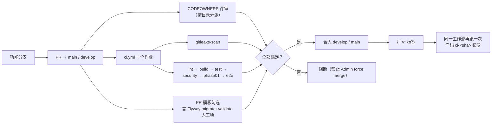

**图表来源**
- [ci.yml:3-9](file://.github/workflows/ci.yml#L3-L9)
- [ci.yml:60-512](file://.github/workflows/ci.yml#L60-L512)
- [.github/CODEOWNERS:1-12](file://.github/CODEOWNERS#L1-L12)
- [.github/pull_request_template.md:21-60](file://.github/pull_request_template.md#L21-L60)

### 发布流程的实际边界

流水线在"镜像推送 + 签名"就结束了。`v*` 标签触发的工作流与 push 分支跑的是同一份 YAML，没有 `deploy` 作业、没有环境（`environment:`）声明、没有人工审批闸（GitHub Environments 的 `required reviewers` 在仓库里不可见）。`security-scan` 的推送逻辑对 tag 与分支一视同仁：只要不是 `pull_request` 且推送闸不是 `refuse`，就推送 `ci-<sha>` / `sha-<sha>` 标签（`ci.yml:354`、`ci.yml:368`、`ci.yml:379`）——**镜像仓库里因此没有 `latest` 或版本号 tag 的写入**，`v*` 事件的可发布性需要由人工把 SHA 标签对应到版本。

发布相关的资产存在于仓库但不在流水线里：`doc/DEPLOYMENT.md`、`doc/CHANGELOG.md` 与校验脚本 `scripts/verify-env-release.mjs`。本页只描述它们在 CI 中的调用情况：`verify-env-release.mjs` 未被 `ci.yml` 的任何步骤或 `package.json` 的脚本引用，因此**发布前环境校验当前是手工执行的**。

**章节来源**
- [.github/pull_request_template.md:21-89](file://.github/pull_request_template.md#L21-L89)
- [ci.yml:3-9](file://.github/workflows/ci.yml#L3-L9)
- [ci.yml:334-381](file://.github/workflows/ci.yml#L334-L381)
- [.github/CODEOWNERS:4-9](file://.github/CODEOWNERS#L4-L9)

## 缓存优化与失败重试

### 缓存来源

流水线里一共有四类缓存，全部通过官方动作或构建器内建能力实现，没有手写 `actions/cache` 去缓存 `node_modules` 或 `~/.m2`：

| 缓存 | 声明位置 | 键的生成 |
|---|---|---|
| pnpm _store_ | `actions/setup-node@v4` 的 `cache: 'pnpm'`（`ci.yml:98`、`ci.yml:138`、`ci.yml:169`、`ci.yml:194`、`ci.yml:444`、`ci.yml:484`） | 由动作按锁文件哈希生成 |
| Maven 本地仓库 | `actions/setup-java@v4` 的 `cache: 'maven'`（`ci.yml:219`、`ci.yml:239`、`ci.yml:450`） | 由动作按 `pom.xml` 哈希生成 |
| Playwright 浏览器 | 显式 `actions/cache@v4`，`path: ~/.cache/ms-playwright`（`ci.yml:490-496`） | `playwright-${{ runner.os }}-${{ hashFiles('pnpm-lock.yaml') }}`，`restore-keys` 前缀回退 |
| Docker 层缓存 | `cache-from: type=gha` / `cache-to: type=gha,mode=max`（`ci.yml:369-370`、`ci.yml:380-381`） | GitHub Actions 缓存后端，按 builder 内容寻址 |

注释（`ci.yml:31-33`）记录了这些做法的来源：所有安装改用 `--frozen-lockfile`、改用 `setup-node@v4` 与 `setup-java@v4` 的内建缓存，替代此前自定义缓存键——后者常在锁文件变更后仍命中旧缓存。

镜像构建还有两处结构性缓存优化：

- builder 阶段先 `COPY mvnw mvnw.cmd pom.xml ./` 与 `COPY .mvn .mvn`，再 `COPY src ./src`（`apps/api/Dockerfile:27-31`），使依赖解析层与源码层分离，源码改动不会击穿依赖层缓存；
- runtime 阶段用 `java -Djarmode=layertools` 先 `list`（`apps/api/Dockerfile:39-40`）后 `extract --destination /app`（`:69-72`），按 Spring Boot 分层（dependencies / spring-boot-loader / snapshot-dependencies / application）拆目录 COPY，注释（`:13`）说明目的是"依赖未变更时复用 Docker 缓存"。

检出层面也做了裁剪：只有 `gitleaks-scan` 需要完整历史而设 `fetch-depth: 0`（`ci.yml:65-67`），其余九个作业使用 `actions/checkout@v4` 默认深度（`ci.yml:89`、`ci.yml:129` 等），减少大历史仓库的检出时间。

### 重试机制的真实范围

**作业级与步骤级没有任何重试**。`ci.yml` 里不存在 `continue-on-error`、不存在 job 重试动作、也没有 `if: failure()` 后的重跑步骤；一次非零退出即作业失败，需要重新推送或手动触发。

唯一的重试发生在测试用例级：`retries: process.env.CI ? 2 : 0`（`tests/e2e/playwright.config.ts:40`），即 CI 中每个失败的用例最多重跑 2 次，本地 0 次。与之配套的是 `trace: 'on-first-retry'`（`:50`）——第一次重试才录 trace，保证重跑用例留下可回放证据；失败截图 `screenshot: 'only-on-failure'`、视频 `video: 'retain-on-failure'`（`:51-52`）。

超时是重试的硬上限：各作业 `timeout-minutes`（15 / 30 / 30 / 30 / 30 / 30 / 60 / 30 / 60 / 45，见 `ci.yml:63`、`ci.yml:87`、`ci.yml:127`、`ci.yml:158`、`ci.yml:183`、`ci.yml:211`、`ci.yml:231`、`ci.yml:267`、`ci.yml:433`、`ci.yml:473`）；PR 模板的表述是"超过即自动取消并标记为失败，禁止重试跳过门禁"（`.github/pull_request_template.md:60`）。

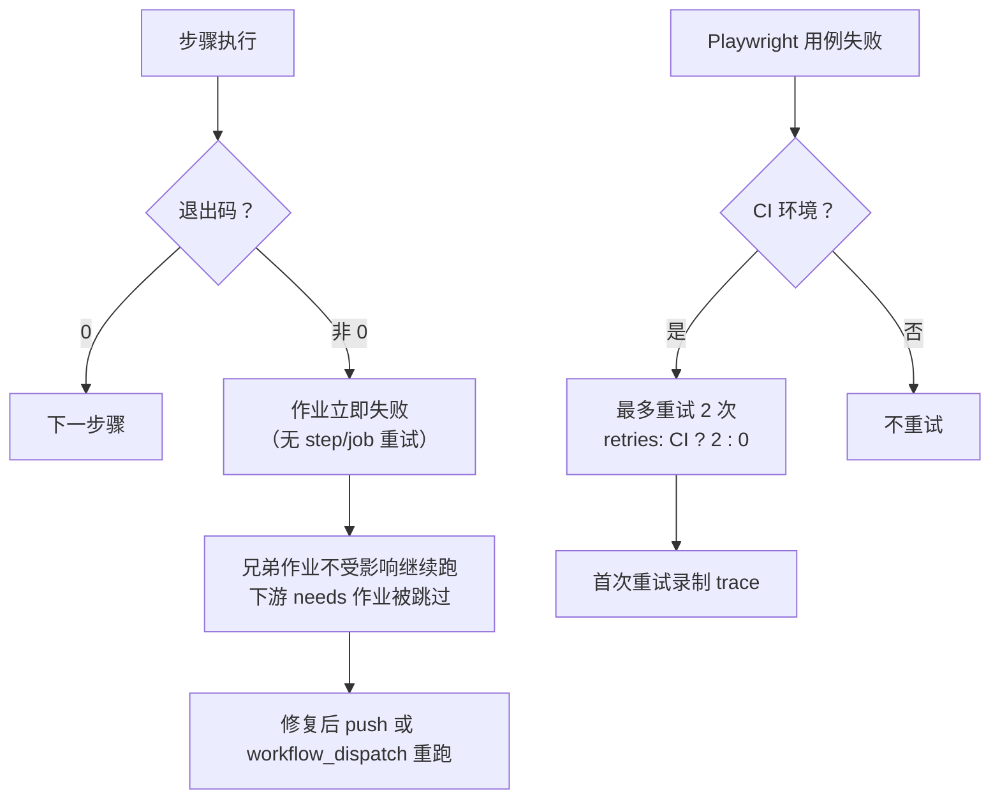

**图表来源**
- [ci.yml:60-512](file://.github/workflows/ci.yml#L60-L512)
- [tests/e2e/playwright.config.ts:39-52](file://tests/e2e/playwright.config.ts#L39-L52)
- [.github/pull_request_template.md:47-60](file://.github/pull_request_template.md#L47-L60)

**章节来源**
- [ci.yml:31-33](file://.github/workflows/ci.yml#L31-L33)
- [ci.yml:65-67](file://.github/workflows/ci.yml#L65-L67)
- [ci.yml:369-381](file://.github/workflows/ci.yml#L369-L381)
- [ci.yml:490-496](file://.github/workflows/ci.yml#L490-L496)
- [apps/api/Dockerfile:27-40](file://apps/api/Dockerfile#L27-L40)
- [apps/api/Dockerfile:66-72](file://apps/api/Dockerfile#L66-L72)

## 本地模拟 CI 环境

CI 的每个步骤都能映射到一条本地命令，因为工作流本身就是在调用根 `package.json` 的脚本（`package.json:9-27`）而不是内联复杂逻辑。对照关系如下：

| CI 作业 / 步骤 | CI 命令 | 本地等价命令 |
|---|---|---|
| `gitleaks-scan` | `docker run --rm -v "$PWD":/repo gitleaks/gitleaks:v8.18.4 detect --source /repo --config /repo/.gitleaks.toml --no-banner --redact --verbose`（`ci.yml:72-79`） | 同一条命令把 `${{ github.workspace }}` 换成 `$PWD` 即可原样运行 |
| 依赖安装 | `pnpm install --frozen-lockfile`（`ci.yml:101` 等） | 相同 |
| 依赖审计 | `pnpm audit --prod --audit-level high`（`ci.yml:105`） | 相同 |
| ESLint | `npm run lint`（`ci.yml:110`） | 相同，展开为 `eslint apps/admin/src apps/client/src tools eslint.config.mjs`（`package.json:15`） |
| OpenAPI lint | `npm run lint:openapi`（`ci.yml:113`） | 相同（`package.json:16`，逐个列出 9 个契约文件） |
| Spectral | `npm run lint:openapi:spectral`（`ci.yml:116`） | 相同（`package.json:17`，规则集 `.spectral.yaml`） |
| 结构测试 | `npm run test:structure`（`ci.yml:119`） | `node tests/project-structure.spec.mjs`（`package.json:19`） |
| 客户端三件套 | `pnpm --filter @campus-love/client run typecheck / build:h5 / build:mp-weixin`（`ci.yml:144-150`） | 相同；工作区成员定义在 `pnpm-workspace.yaml`（`packages: ["apps/*"]`） |
| 客户端单测 | `pnpm --filter @campus-love/client run test:unit`（`ci.yml:175`） | 相同（`node scripts/run-vitest.mjs run --config vitest.config.ts`） |
| 管理后台 | `pnpm --filter @campus-love/admin run typecheck / build`（`ci.yml:200-203`） | 相同 |
| Java 编译 / 测试 | `mvn -B -f apps/api/pom.xml compile` / `test`（`ci.yml:222`、`ci.yml:242`） | 相同，或 `npm run api:test`（走 `tools/run-api-wrapper.cjs test`，`package.json:11`） |
| 综合验证 | `npm run verify:phase01`（`ci.yml:456`） | 相同，一次跑完 test + 两个 lint + typecheck + 构建校验 + api:test（`package.json:23`） |
| E2E | `npx playwright install --with-deps chromium` + `npx playwright test --config=tests/e2e/playwright.config.ts`（`ci.yml:499-503`） | 配置文件注释给出了三种本地跑法：普通跑、`--ui` 带界面跑、`--grep="@core-journey"` 只跑核心旅程（`tests/e2e/playwright.config.ts:17-31`） |
| Trivy fs | `aquasecurity/trivy-action@v0.23.0` + `scan-ref: apps/api`（`ci.yml:308-314`） | 本地 `trivy fs --severity HIGH,CRITICAL --exit-code 1 apps/api`；等价逻辑也内嵌在镜像 Stage 3（`apps/api/Dockerfile:131`） |
| 镜像构建 | `docker/build-push-action@v6` + `target: runtime`（`ci.yml:361-370`） | `docker build --target runtime -t campus-love/api:local ./apps/api`；单独触发扫描用 `docker build --target trivy-scanner .`（`apps/api/Dockerfile:117-119`） |
| 推送闸判定 | `push-gate` 步骤的三分支 shell（`ci.yml:281-291`） | 判定逻辑本身可本地复现：`COSIGN_KEY=... ALLOW_UNSIGNED=...` 后照抄那段 `if [ -n "$COSIGN_KEY" ]; then ... elif [ "$ALLOW_UNSIGNED" = "true" ]; then ...`，即可验证仓库当前配置会落在 `sign` / `allow-unsigned` / `refuse` 哪一档 |
| 镜像验签 | —（流水线内不存在，`ci.yml` 无 `cosign verify`） | 按 `doc/DEPLOYMENT.md:396-411` 在部署机执行 `cosign verify --key /etc/campus-love/cosign.pub ghcr.io/$GHCR_REPO/api:ci-<sha>`，或容器化跑固定版本 `gcr.io/projectsigstore/cosign:v2.4.1`（`doc/DEPLOYMENT.md:397-399`） |

本地跑 E2E 时 `webServer` 会自动拉起 H5 dev server 并复用已存在实例（`reuseExistingServer: true`，`tests/e2e/playwright.config.ts:73-82`），因此不需要手工启动；若要测别处的服务，设 `E2E_BASE_URL`（`:49`）。完整依赖栈则用 `docker compose up` 起 mysql / redis / api / admin / client（`docker-compose.yml:83`、`:144`、`:190`、`:300`、`:349`），此时 API 走 `SPRING_PROFILES_ACTIVE: real`（`docker-compose.yml:203`），与 CI 的 mock 路径不同，能覆盖真实数据库与 Redis 行为。

**本地模拟的边界**：仓库里没有 `act` 配置、没有 Makefile、没有本地 runner 编排脚本，也没有 pre-commit 钩子配置（无 `.husky/`、无 lint-staged 声明）。因此 CI 的以下行为无法在本地完整复现：`concurrency` 取消、`needs` 编排、GHCR 登录与 cosign 签名（依赖 `secrets.COSIGN_PRIVATE_KEY`）、`retention-days` 归档。推送闸需要单独说明：判定逻辑可以本地重放（见上表），但"非 PR 事件 + `refuse` 档触发显式 fail"（`ci.yml:296`）依赖 GitHub 的 `github.event_name` 上下文与仓库 Variables（`vars.ALLOW_UNSIGNED_IMAGES`，`ci.yml:280`），本地无法等价触发；未配任何密钥与变量的新建仓库在 push 事件上默认就落入 `refuse`，这正是 fail-closed 的含义。作业级并行带来的"干净机器"假设也只能靠手工清理 `node_modules` / `target` 近似模拟。

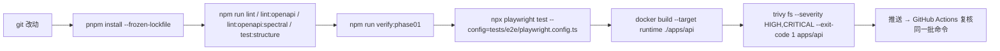

[此图为概念流程，不直接对应具体源文件，故不提供图表来源]

**章节来源**
- [ci.yml:60-512](file://.github/workflows/ci.yml#L60-L512)
- [package.json:9-27](file://package.json#L9-L27)
- [tests/e2e/playwright.config.ts:17-82](file://tests/e2e/playwright.config.ts#L17-L82)
- [apps/api/Dockerfile:116-131](file://apps/api/Dockerfile#L116-L131)
- [docker-compose.yml:190-204](file://docker-compose.yml#L190-L204)
- [doc/DEPLOYMENT.md:396-411](file://doc/DEPLOYMENT.md#L396-L411)

## 配置与开关

流水线可调的开关按下表分类，主要在 `.github/workflows/ci.yml` 与两个配置文件（`.gitleaks.toml`、`tests/e2e/playwright.config.ts`）里；末行的 `.gitignore` 属于流水线之外的预防面，列在此处以便与 gitleaks 白名单对照：

| 类别 | 键 | 取值 / 位置 | 作用 |
|---|---|---|---|
| Secrets | `COSIGN_PRIVATE_KEY` | 未配置时镜像不可未签名出仓（`ci.yml:279`、`ci.yml:405`、`ci.yml:412`） | 决定 cosign 安装与签名是否执行、推送闸进入 `sign` 档；缺失即默认 `refuse`（fail-closed，`ci.yml:288-291`） |
| Secrets | `COSIGN_PASSWORD` | `ci.yml:415` | 解密签名私钥 |
| Secrets | `GITHUB_TOKEN` | `ci.yml:359` | GHCR 登录口令，由 Actions 自动签发 |
| 仓库变量 | `vars.ALLOW_UNSIGNED_IMAGES` | 必须显式等于字符串 `true`（`ci.yml:280`、`ci.yml:285`） | 未配签名密钥时是否放行未签名推送，作为显式决策留痕；未定义、`True`、`1` 均不放行 |
| 工作流级 | `permissions` | `contents: read` / `packages: write`（`ci.yml:11-14`） | 最小权限；去掉 `packages: write` 会使 push 事件的 GHCR 推送 403 |
| 工作流级 | `concurrency.group` / `cancel-in-progress` | `ci-${{ github.workflow }}-${{ github.ref }}` / `true`（`ci.yml:17-19`） | 同 ref 只留最新运行 |
| 作业级 | `timeout-minutes` | 15（`gitleaks-scan`）/ 30（多数）/ 60（`api-test`、`phase01-verify`）/ 45（`e2e`） | 超时即取消并判失败 |
| 作业级 | `needs` | `ci.yml:230`、`ci.yml:264-266`、`ci.yml:431-432`、`ci.yml:464-472` | 编排顺序 |
| 步骤级 | `if: github.event_name != 'pull_request'` | `ci.yml:354`、`ci.yml:368`、`ci.yml:379`、`ci.yml:296` | PR 只构建不推送、不触发推送闸失败 |
| 步骤级 | `if: always()` | `ci.yml:507` | 保证失败时也上传 Playwright 报告 |
| 环境变量 | `E2E_BASE_URL` | 缺省 `http://localhost:5173`（`tests/e2e/playwright.config.ts:49`） | 把 E2E 指向任意被测服务 |
| 环境变量 | `CI` | 由 Actions 注入，驱动 `forbidOnly` / `retries` / `github-actions` reporter（`tests/e2e/playwright.config.ts:39-45`） | 本地与 CI 行为分叉的唯一开关 |
| 环境变量 | `TAG` | compose 镜像标签，缺省 `dev`（`docker-compose.yml:194`、`:309`） | 部署侧选择 CI 产出的镜像版本 |
| 环境变量 | `SPRING_PROFILES_ACTIVE` | 镜像默认 `real`（`apps/api/Dockerfile:101`），compose 显式 `real`（`docker-compose.yml:203`），本地脚本 `mock`（`package.json:10`） | 运行环境切换 |
| 构建期 | `target` | `runtime` / `trivy-scanner`（`ci.yml:365`、`ci.yml:376`，`apps/api/Dockerfile:44`、`:123`） | 是否把扫描阶段带进最终镜像 |
| 归档 | `retention-days` | `7`（`ci.yml:512`） | Playwright 报告保留期 |
| 扫描阈值 | `severity` / `exit-code` | `HIGH,CRITICAL` / `1`（`ci.yml:313-314`、`ci.yml:391-392`、`ci.yml:398-399`），`--audit-level high`（`ci.yml:105`） | 漏洞门禁灵敏度；放宽 `severity` 即降低门禁强度 |
| 扫描豁免 | `[allowlist].regexes` / `paths` | `.gitleaks.toml:34-51` | 密钥扫描白名单，只按精确串与精确路径放行 |
| 泄露面预防 | `.gitignore` 规则 | `tmp_*_token.txt`、`*.aof`、`appendonly.aof`（`.gitignore:241-243`），根级锚定的 `/appendonly.aof`、`/tmp_*.*`（`.gitignore:110`、`:115-116`） | 让本地 token 与 Redis 持久化文件不进入暂存区；对已跟踪文件无效，历史泄露仍需 gitleaks |

需要留意的两处历史教训已固化在注释里：`env.COSIGN_PRIVATE_KEY` 用作 step 级 `if` 条件时恒为 false（`env` 只在步骤内可见），导致签名长期未执行，现改为直接判断 `secrets.COSIGN_PRIVATE_KEY != ''`（`ci.yml:402-405`）；同一原因也要求推送闸在步骤内通过 `env` 中转后再判定（`ci.yml:275`）。

另一点白名单与现状的偏差值得核对：`.gitleaks.toml:50` 放行的 `^apps/api/src/main/resources/application-db\.yml` 在 `apps/api/src/main/resources/` 目录中当前并不存在（该目录实际只有 `application.yml`、`application-mock.yml`、`application-real.yml`、`application-wechat.yml`、`i18n`、`logback-spring.xml`、`redisson-dev.yaml`），属于指向历史文件的残留条目。

**章节来源**
- [ci.yml:261-422](file://.github/workflows/ci.yml#L261-L422)
- [ci.yml:11-19](file://.github/workflows/ci.yml#L11-L19)
- [ci.yml:506-512](file://.github/workflows/ci.yml#L506-L512)
- [.gitleaks.toml:34-51](file://.gitleaks.toml#L34-L51)
- [.gitignore:110-116](file://.gitignore#L110-L116)
- [.gitignore:239-243](file://.gitignore#L239-L243)
- [tests/e2e/playwright.config.ts:39-49](file://tests/e2e/playwright.config.ts#L39-L49)
- [docker-compose.yml:190-204](file://docker-compose.yml#L190-L204)
- [apps/api/Dockerfile:100-123](file://apps/api/Dockerfile#L100-L123)
- [package.json:10-10](file://package.json#L10-L10)

## 故障排查指南

### 按作业定位失败

| 现象 | 根因 | 定位与处置 |
|---|---|---|
| `gitleaks-scan` 失败但本地扫描干净 | 检出用了 `fetch-depth: 0`，命中来自历史提交而非当前文件 | 看 `--verbose` 输出（`ci.yml:79`）定位规则与提交；确属占位符才按 `.gitleaks.toml` 的精确串/精确路径方式加白名单（`:34-51`），不要恢复宽泛路径 |
| token 文件 / Redis 持久化文件被提交 | `.gitignore` 只挡未跟踪路径，已跟踪文件不受规则约束（`.gitignore:233-234` 的注释就此提醒） | 新规则 `tmp_*_token.txt`、`*.aof`、`appendonly.aof` 见 `.gitignore:241-243`；已入库的内容要靠 gitleaks 检出后清理历史，加 ignore 规则不会让它消失 |
| `Install dependencies` 步骤失败 | `pnpm install --frozen-lockfile` 与 `pnpm-lock.yaml` 不一致 | 本地重新生成锁文件一并提交（`ci.yml:101` 等六处） |
| `Audit dependencies` 失败 | `pnpm audit --prod --audit-level high` 命中 HIGH+（`ci.yml:105`） | 只统计生产依赖；`overrides` 已在 `pnpm-workspace.yaml:12-13` 用于统一 `@vitejs/plugin-vue` 版本，可沿用该机制修复 |
| `Run ESLint` 失败 | 产品代码出现 error（`ci.yml:110`） | warning 不阻塞；`npm run lint` 的范围是 `apps/admin/src`、`apps/client/src`、`tools`、`eslint.config.mjs`（`package.json:15`），范围外文件报错说明配置被改动 |
| `Run OpenAPI lint` 通过但新增契约没被检查 | `lint:openapi` 逐个列文件，新契约不会自动入列 | 在 `package.json:16` 追加文件名；Spectral 侧由 `docs/openapi/*.yaml` 通配自动覆盖（`package.json:17`） |
| `Client build (mp-weixin)` 失败 | 包体积门禁 `scripts/verify-package-size.mjs --allow-mock` 超限（`apps/client/package.json:25`） | 与静态资源准备脚本 `prepare-static.mjs`、SVG 转 PNG 步骤同链，先确认是哪一段非零退出 |
| Maven 作业卡在下载/提示 | 未使用批模式（`-B` 缺失）或缓存未命中 | 现网命令是 `mvn -B -f apps/api/pom.xml compile/test`（`ci.yml:222`、`ci.yml:242`）；`cache: 'maven'`（`ci.yml:219`、`ci.yml:239`）失效时表现为耗时暴涨而非失败 |
| `api-test` 超时 | `timeout-minutes: 60`（`ci.yml:231`） | 单测以安全链路为主（JWT、黑名单、内容安全），先定位新增的慢测试 |
| `security-scan` 在第一步就红 | 推送闸判定为 `refuse`：未配 `COSIGN_PRIVATE_KEY` 且未显式设 `vars.ALLOW_UNSIGNED_IMAGES=true` | 日志里的 `::error::` 已给出两条处置路径（`ci.yml:298-303`）；该闸只作用于非 PR 事件（`ci.yml:296`）。注意失败步骤在 Trivy 扫描之前（`ci.yml:295` 早于 `ci.yml:308`），因此本轮不会产出 fs / image 扫描结论，需先补密钥或显式放行再看扫描结果 |
| `security-scan` 在 PR 上是绿的、push 到 main 后才红 | PR 跳过 fail 步骤只构建（`ci.yml:296`、`ci.yml:368`、`ci.yml:379`），推送闸在 push 事件才生效 | 属预期行为：合并前就该确认仓库已配 `COSIGN_PRIVATE_KEY`，或已显式设 `ALLOW_UNSIGNED_IMAGES=true`（`ci.yml:279-291`） |
| 变量已加但仍被拒 | `vars.ALLOW_UNSIGNED_IMAGES` 的值不是精确字符串 `true`（如 `True`、`1`、`yes`） | 判定用的是 `[ "$ALLOW_UNSIGNED" = "true" ]`（`ci.yml:285`），区分大小写；改回 `true` |
| `Trivy scan ... image` 报"invalid reference" | 直接用了 `outputs.tags` 整串（逗号分隔多 tag） | 正确写法是 `split(',')[0]`（`ci.yml:390`、`ci.yml:397`，infra R2-00006） |
| 镜像推上去了但没有签名 | `if` 用了 `env.COSIGN_PRIVATE_KEY`，step 级恒为 false | 现改为 `secrets.COSIGN_PRIVATE_KEY != ''`（`ci.yml:402-405`）；多 tag 需逐个签（`ci.yml:411-422`） |
| GHCR 登录 403 | `packages: write` 被移除，或 PR 事件本就不登录 | `ci.yml:11-14` 权限声明与 `ci.yml:354` 的条件 |
| `e2e` 显示 0 个测试 | 配置路径重复导致 testDir 解析错误 | `testDir: './specs'`、`outputDir: './test-results'` 必须相对配置文件（`tests/e2e/playwright.config.ts:34-37`） |
| `e2e` 报 `browserType.launch` 失败 | 缓存命中了旧浏览器目录但 `playwright` 版本变了 | 缓存 key 取 `hashFiles('pnpm-lock.yaml')`（`ci.yml:494`），必要时改 key 强制重装 |
| `e2e` 连接被拒 | `webServer` 180 秒内没就绪 | 见 `webServer.timeout: 180_000`、`url: http://localhost:5173`（`tests/e2e/playwright.config.ts:73-82`）；`workers: 1` + `fullyParallel: false` 是为避开端口冲突（`:38`、`:41`） |
| 找不到失败截图/trace | 报告保留期只有 7 天 | `retention-days: 7`（`ci.yml:512`）；trace 仅在首次重试录制（`playwright.config.ts:50`） |
| 运行 mysteriously "被取消" | 同分支新提交触发 `cancel-in-progress: true` | `ci.yml:17-19`；需要保留历史运行时改 `false` 或换 group |
| 想在不产生提交的情况下复跑 | 无自动重跑入口 | 使用 `workflow_dispatch`（`ci.yml:9`） |

### 第三方动作的使用与调试

工作流引用的外部动作全部 pin 了 major 版本：`actions/checkout@v4`、`pnpm/action-setup@v3`、`actions/setup-node@v4`、`actions/setup-java@v4`、`aquasecurity/trivy-action@v0.23.0`、`docker/setup-buildx-action@v3`、`docker/metadata-action@v5`、`docker/login-action@v3`、`docker/build-push-action@v6`、`sigstore/cosign-installer@v3`、`actions/cache@v4`、`actions/upload-artifact@v4`（分布于 `ci.yml:65-512`）。两个高危引用已被改掉：`trivy-action@master` → `@v0.23.0`（`ci.yml:307`、`ci.yml:309`），gitleaks 镜像 `latest` → `v8.18.4`（`ci.yml:70-74`）。

仓库内**没有自定义 Action**：不存在任何 `action.yml`，也没有 `composite` 作业；因此调试面局限在标准动作与裸命令上。可用手段包括：用 `--verbose`（`ci.yml:79`）与 `::error::` 工作流命令（`ci.yml:298-303`）主动输出诊断信息；把中间值写入 `$GITHUB_OUTPUT` 供后续步骤判断（`push-gate` 与 `Set image tag` 两处，`ci.yml:283-290`、`ci.yml:329`）；用 `if: always()` 保证失败路径仍产出报告（`ci.yml:507`）；以及在本地按「本地模拟 CI 环境」一节逐条重放命令。

**章节来源**
- [ci.yml:65-512](file://.github/workflows/ci.yml#L65-L512)
- [ci.yml:296-304](file://.github/workflows/ci.yml#L296-L304)
- [ci.yml:285-291](file://.github/workflows/ci.yml#L285-L291)
- [ci.yml:307-309](file://.github/workflows/ci.yml#L307-L309)
- [ci.yml:402-422](file://.github/workflows/ci.yml#L402-L422)
- [tests/e2e/playwright.config.ts:34-52](file://tests/e2e/playwright.config.ts#L34-L52)
- [apps/client/package.json:21-25](file://apps/client/package.json#L21-L25)
- [package.json:15-23](file://package.json#L15-L23)
- [.gitignore:233-243](file://.gitignore#L233-L243)

## 结论

Campus Love 的 CI 是一份"单文件、十作业、全串行编排"的门禁：`.github/workflows/ci.yml` 用 512 行覆盖了从提交历史密钥、生产依赖漏洞、代码风格、OpenAPI 契约、三端构建、Java 编译与单测、源码与镜像漏洞、镜像推送与签名，到阶段综合验证与端到端旅程的完整链条。它的强度来自三个习惯：**工具版本全部 pin 死**（gitleaks `v8.18.4`、trivy-action `v0.23.0`、pnpm `11.17.0`、Node `20`、Java `17`、temurin 基础镜像 `17.0.12`、compose 里的 mysql/redis/nginx 全部具体版本），**门禁口径显式写在注释与作业名里**（`ci.yml:21-54` 的变更史、`ci.yml:262` 的策略自述），以及**把不可自动化的决策做成显式失败步骤**（推送闸的 `refuse` 档，`ci.yml:295-304`）。

按现状核对，以下几项在本仓库的流水线里并不存在，不应被当作已有能力引用；与之相邻的**镜像构建、GHCR 推送与 cosign 签名则是已实现能力**（`ci.yml:352-422`），旧稿把后者列为"仓库里没有"与 HEAD 矛盾，本页已更正：

- **流水线内的镜像验签**：`ci.yml` 只有 `cosign sign`（`ci.yml:421`），没有 `cosign verify` 步骤——CI 的职责止于"签"，"验"是部署端动作，规范流程在 `doc/DEPLOYMENT.md:388-430`（含"先验签再 compose up"的脚本范式），升级前检查清单里的验签项在同文件 `:891-895`。
- **数据库迁移校验**：`ci.yml` 无 Flyway 步骤，migrate + validate 仅是 PR 模板的人工复选项（`.github/pull_request_template.md:30`）与契约声明项（`:66`）。
- **部署与环境审批**：工作流最远到镜像推送与签名，没有 `environment:` 声明、没有发布作业；`v*` 标签只是重跑同一套作业。
- **管理后台单元测试**：`apps/admin/package.json:21` 定义了 `test:unit`，但无任何 CI 作业调用。
- **小程序端 E2E**：CI 只安装 Chromium（`ci.yml:499`），两个 project 均为 Chromium 系（`tests/e2e/playwright.config.ts:59-69`）。
- **SARIF / 代码扫描上报与依赖机器人**：`permissions` 未申请 `security-events`（`ci.yml:11-14`），`.github/` 下无 Dependabot/Renovate 配置。
- **作业级重试**：仅 Playwright 用例级 `retries: CI ? 2 : 0`（`tests/e2e/playwright.config.ts:40`），其余作业一次失败即终局。

需要长期关注的四处漂移：`phase01-verify` 与前置作业的命令重复（`package.json:23`）使其成为时间成本最高的"全链复跑"，在作业数增加时最容易变成瓶颈；PR 模板的 CI 清单与超时表尚未收录 `gitleaks-scan` 与 `phase01-verify`（`.github/pull_request_template.md:38-45`、`:49-58`），新增门禁后需要同步勾选口径；`.gitleaks.toml:50` 仍指向 `apps/api/src/main/resources/application-db.yml`，而该文件已不在目录中，白名单条目应向实际存在的文件收敛；`doc/DEPLOYMENT.md:430` 的"未配置 secrets 时 CI 中签名步骤自动跳过"仍是推送闸之前的语义，与 `ci.yml:295-304` 现在的 fail-closed 行为存在措辞落差，部署文档应向工作流对齐。

改进方向与既有约束并不冲突：把 PR 模板里"Flyway migrate + validate 一次性数据库"这一步落成一个独立作业（可用 `docker-compose.yml:83-144` 的 mysql 服务），是把唯一人工门禁自动化的最小改动；给 `security-scan` 追加 `--format sarif` 上传则需要 `security-events: write`，属于权限面的扩展决策；同理，若希望验签也进入流水线（当前只在部署端），需要给作业加 `cosign verify` 步骤并解决公钥来源问题。

**章节来源**
- [ci.yml:11-19](file://.github/workflows/ci.yml#L11-L19)
- [ci.yml:21-54](file://.github/workflows/ci.yml#L21-L54)
- [ci.yml:261-422](file://.github/workflows/ci.yml#L261-L422)
- [ci.yml:295-304](file://.github/workflows/ci.yml#L295-L304)
- [ci.yml:499-512](file://.github/workflows/ci.yml#L499-L512)
- [doc/DEPLOYMENT.md:388-430](file://doc/DEPLOYMENT.md#L388-L430)
- [.gitignore:239-243](file://.gitignore#L239-L243)
- [package.json:23-26](file://package.json#L23-L26)
- [.github/pull_request_template.md:30-66](file://.github/pull_request_template.md#L30-L66)
- [.gitleaks.toml:41-51](file://.gitleaks.toml#L41-L51)
- [tests/e2e/playwright.config.ts:40-69](file://tests/e2e/playwright.config.ts#L40-L69)
- [apps/admin/package.json:18-21](file://apps/admin/package.json#L18-L21)
- [docker-compose.yml:83-144](file://docker-compose.yml#L83-L144)

