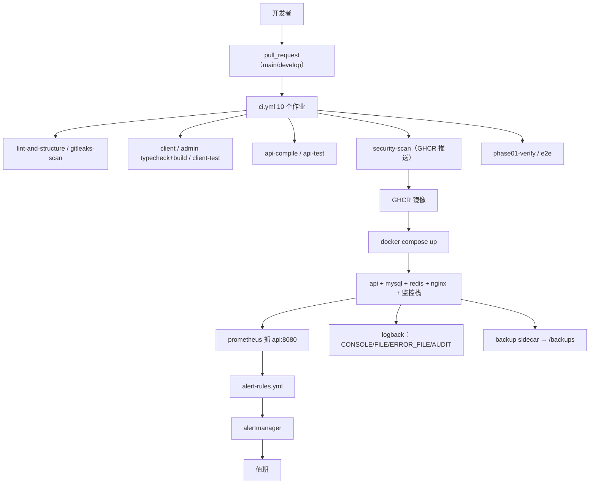
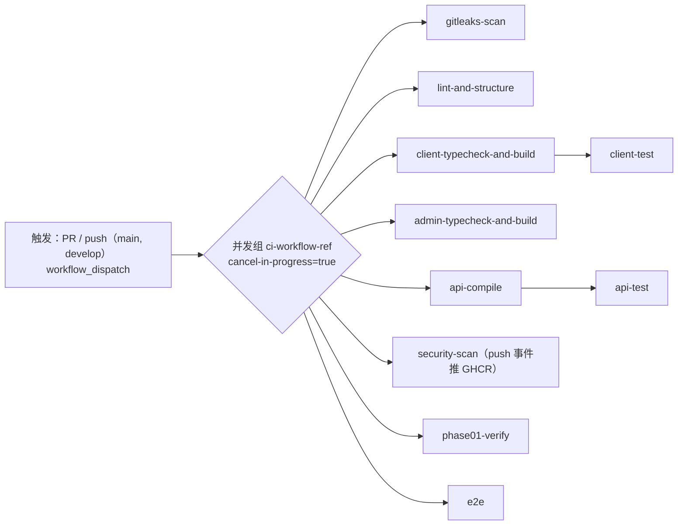
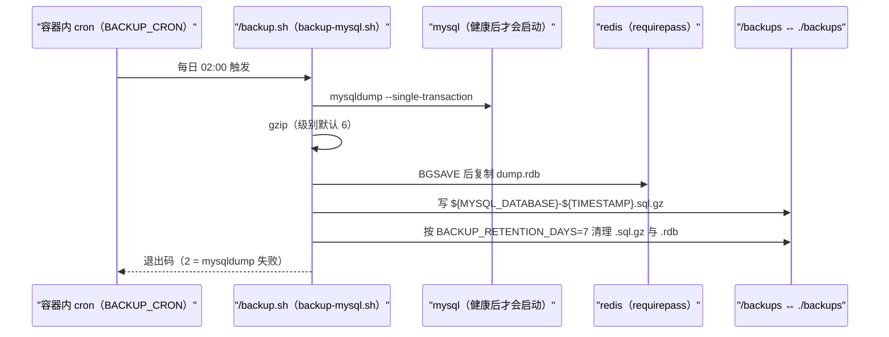

# 基础设施与DevOps

<cite>
**本文引用的文件**
- [docker-compose.yml](file://docker-compose.yml)
- [Dockerfile](file://apps/api/Dockerfile)
- [ci.yml](file://.github/workflows/ci.yml)
- [client-nginx.conf](file://docker/client-nginx.conf)
- [prometheus.yml](file://docker/prometheus/prometheus.yml)
- [alert-rules.yml](file://docker/prometheus/rules/alert-rules.yml)
- [alertmanager.yml](file://docker/alertmanager/alertmanager.yml)
- [logback-spring.xml](file://apps/api/src/main/resources/logback-spring.xml)
- [CODEOWNERS](file://.github/CODEOWNERS)
- [pull_request_template.md](file://.github/pull_request_template.md)
- [backup-mysql.sh](file://scripts/backup-mysql.sh)
- [crontab](file://docker/backup/crontab)
- [flyway.toml](file://database/flyway/flyway.toml)
- [application-real.yml](file://apps/api/src/main/resources/application-real.yml)
</cite>

## 目录
1. [简介](#简介)
2. [项目结构](#项目结构)
3. [核心组件](#核心组件)
4. [架构总览](#架构总览)
5. [子页面导航与边界](#子页面导航与边界)
6. [四份配置各自的职责](#四份配置各自的职责)
7. [交付流水线](#交付流水线)
8. [运行拓扑](#运行拓扑)
9. [可观测栈](#可观测栈)
10. [日志体系](#日志体系)
11. [备份与恢复](#备份与恢复)
12. [流水线没有覆盖的部分](#流水线没有覆盖的部分)
13. [依赖关系分析](#依赖关系分析)
14. [性能考虑](#性能考虑)
15. [故障排查指南](#故障排查指南)
16. [结论](#结论)

## 简介
基础设施由四份声明式配置撑起：**一份编排**（`docker-compose.yml`，663 行，10 个服务）、
**一份镜像定义**（`apps/api/Dockerfile`，131 行，三阶段）、
**一份流水线**（`.github/workflows/ci.yml`，512 行，10 个作业），
以及**一组可观测与日志配置**（Prometheus 69 行 + 规则 354 行、Alertmanager 135 行、
Grafana 供给目录、Logback 281 行）。

本页负责把这几层的关系说清楚，并指出哪些环节目前**只有约定、没有自动化**。

## 项目结构
- `docker-compose.yml`：网络 `data-net`/`app-net`(L55-L59)、7 个命名卷(L64-L77)、
  服务 `mysql`(L83)、`redis`(L144)、`api`(L190)、`admin`(L300)、`client`(L349)、
  `prometheus`(L399)、`grafana`(L449)、`alertmanager`(L499)、`node-exporter`(L546)、
  `backup`(L585)；`client`、`node-exporter`、`backup` 三个带 `profiles:`(L395、L581、L662)。
- `apps/api/Dockerfile`：`builder`(L22) → `runtime`(L44) → `trivy-scanner`(L123)。
- `.github/workflows/ci.yml`：`gitleaks-scan`(L60)、`lint-and-structure`(L84)、
  `client-typecheck-and-build`(L124)、`client-test`(L155)、
  `admin-typecheck-and-build`(L180)、`api-compile`(L208)、`api-test`(L227)、
  `security-scan`(L261)、`phase01-verify`(L428)、`e2e`(L461)。
- `docker/`：`client-nginx.conf`(68 行)、`prometheus/prometheus.yml`(69 行)、
  `prometheus/rules/alert-rules.yml`(354 行)、`alertmanager/alertmanager.yml`(135 行)、
  `grafana/dashboards` 与 `grafana/provisioning`、`backup/crontab`(21 行)。
- `scripts/backup-mysql.sh`（301 行）：备份实现。
- `apps/api/src/main/resources/logback-spring.xml`（281 行）：日志出口。

**章节来源**
- [docker-compose.yml:55-80](file://docker-compose.yml#L55-L80)
- [docker-compose.yml:585-585](file://docker-compose.yml#L585-L585)
- [Dockerfile:22-44](file://apps/api/Dockerfile#L22-L44)
- [ci.yml:60-461](file://.github/workflows/ci.yml#L60-L461)

## 核心组件
- **编排**：以"网络按安全域拆分"为原则（注释见 L47 附近与定义 L55-L59）——
  数据层与备份在 `data-net`，其余在 `app-net`。
  api 端口只绑 `127.0.0.1:${API_PORT:-8080}:8080`(L266-L268)，对外必须经 Nginx。
- **镜像**：构建阶段用 `eclipse-temurin:17.0.12-jdk`(L22) 与 Maven Wrapper，
  先 COPY `pom.xml` 再 COPY `src`(L27-L31) 以缓存依赖；
  运行阶段用 `17.0.12-jre`(L44)、非 root 用户 `app`（`groupadd/useradd ... -s /sbin/nologin` L62、`USER app` L78）、
  `EXPOSE 8080`(L81)、`HEALTHCHECK` 30s/5s/60s/3(L107)、
  `ENTRYPOINT ["dumb-init", "--"]`(L111) + `JarLauncher`(L114)。
- **门禁**：`trivy fs --severity HIGH,CRITICAL --exit-code 1`(L131) 把高危漏洞变成构建失败。
- **流水线权限与并发**：`contents: read`(L12) 与 `packages: write`(L14)，
  注释说明"security-scan 需要推送镜像到 GHCR（仅 push 事件）"(L13)；
  `concurrency.group: ci-${{ github.workflow }}-${{ github.ref }}` 配
  `cancel-in-progress: true`(L18-L19)。
- **备份**：cron sidecar + `scripts/backup-mysql.sh`，
  `mysqldump --single-transaction`、gzip、Redis `BGSAVE`、滚动保留 7 天(L6-L9)。

**章节来源**
- [Dockerfile:22-131](file://apps/api/Dockerfile#L22-L131)
- [docker-compose.yml:266-268](file://docker-compose.yml#L266-L268)
- [ci.yml:12-19](file://.github/workflows/ci.yml#L12-L19)
- [backup-mysql.sh:6-9](file://scripts/backup-mysql.sh#L6-L9)

## 架构总览

[此图为概念流程，不直接对应具体源文件，故不提供图表来源]

## 子页面导航与边界
本页不重复子页细节，分工如下：

- **容器化部署**：服务逐个拆解、镜像阶段、编排注入的环境变量、安全取向。
- **CI/CD 流水线**：10 个作业的触发条件、步骤与权限。
- **监控告警**：Prometheus 抓取与 `alert-rules.yml`（354 行规则）、Alertmanager 路由、Grafana 供给。
- **日志管理与故障排查**：Logback 四类 appender 与滚动策略。
- **性能优化**：JVM 参数、索引与缓存等跨层优化。

与相邻文档的边界：`系统架构设计/后端架构设计` 讲代码分层；
`数据库设计与迁移` 讲迁移与备份脚本的数据侧语义；
`开发指南与规范` 讲本地环境与规范。本页只讲"怎么把这套系统跑起来并守住它"。

## 四份配置各自的职责
| 配置 | 行数 | 决定什么 | 不改会怎样 |
|---|---|---|---|
| `docker-compose.yml` | 663 | 服务、网络、卷、profile、环境变量注入 | 端口暴露范围、凭据来源、备份是否运行 |
| `apps/api/Dockerfile` | 131 | 构建可复现性、运行用户、健康检查、漏洞门禁 | 镜像体积与权限、启动是否被健康检查误杀 |
| `.github/workflows/ci.yml` | 512 | 哪些检查必须绿、谁有写权限、并发取消策略 | 回归与泄漏检查形同手工 |
| `logback-spring.xml` | 281 | 日志分级、落盘与切割、审计日志独立出口 | 排障时无结构化日志可查 |

**章节来源**
- [docker-compose.yml:1-663](file://docker-compose.yml#L1-L663)
- [Dockerfile:1-131](file://apps/api/Dockerfile#L1-L131)
- [ci.yml:1-512](file://.github/workflows/ci.yml#L1-L512)
- [logback-spring.xml:58-126](file://apps/api/src/main/resources/logback-spring.xml#L58-L126)

## 交付流水线
`ci.yml` 的触发与并发（L3-L19）：

- `pull_request` 与 `push` 都针对 `branches: [main, develop]`(L4-L7)，
  另有 `workflow_dispatch`(L9) 支持手动触发。
- `concurrency.group` 以 workflow + ref 分组并 `cancel-in-progress: true`(L18-L19)：
  同一分支的新提交会取消仍在跑的旧流水线，避免排队堆积。
- 作业分工（按定义行号）：
  `gitleaks-scan`(L60) 扫密钥泄漏；`lint-and-structure`(L84) 跑规范与结构检查；
  `client-typecheck-and-build`(L124) 与 `client-test`(L155) 覆盖 uni-app 客户端；
  `admin-typecheck-and-build`(L180) 覆盖后台前端；
  `api-compile`(L208) 与 `api-test`(L227) 覆盖后端编译与测试；
  `security-scan`(L261) 负责镜像与 GHCR 推送；
  `phase01-verify`(L428) 与 `e2e`(L461) 负责阶段验收与端到端。

**图表来源**
- [ci.yml:3-19](file://.github/workflows/ci.yml#L3-L19)
- [ci.yml:60-461](file://.github/workflows/ci.yml#L60-L461)

**章节来源**
- [ci.yml:3-19](file://.github/workflows/ci.yml#L3-L19)
- [ci.yml:60-261](file://.github/workflows/ci.yml#L60-L261)
- [ci.yml:428-461](file://.github/workflows/ci.yml#L428-L461)

## 运行拓扑
默认 `docker compose up -d` 起 7 个服务（mysql、redis、api、admin、prometheus、grafana、alertmanager），
另外 3 个（client、node-exporter、backup）挂在 profile 后面。

关键运行参数（api 服务环境块 L230-L265）：

- `APP_FLYWAY_LOCATIONS: filesystem:/app/db/migration`(L240)——容器内迁移目录，
  与宿主直跑用的 `filesystem:../../database/flyway/sql`（`application-real.yml` L76）不同基准。
- `ADMIN_OPENID` / `ADMIN_NICKNAME` / `ADMIN_INITIAL_PASSWORD_HASH` 全部 `${VAR:-}` 形式(L233-L235)，
  注释记录 infra #8：移除公开默认值 `admin-default-openid-change-me`（可被冒充登录）。
- `APP_MEDIA_STORAGE_ROOT: /app/uploads`(L242)，落在 `api-uploads` 卷(L270)。
- `RABBITMQ_*` 默认空(L247-L250)：编排未部署 MQ，应用不可用时自动降级（R4-02096）。
- `SWAGGER_UI_ENABLED` 默认 `false`(L253)：生产关闭文档端点（infra #11）。
- `JAVA_OPTS`(L255-L265)：`UseContainerSupport`、`MaxRAMPercentage=75.0`、G1GC、
  `MaxGCPauseMillis=200`、OOM 堆转储、`file.encoding=UTF-8`、`user.timezone=Asia/Shanghai`。

数据层镜像与强制凭据：`mysql:8.0.39`(L84) 的
`MYSQL_ROOT_PASSWORD` / `MYSQL_PASSWORD` 用 `${VAR:?... is required}` 强制非空(L89、L92)；
`redis:7.2.5-alpine`(L145) 以 `--requirepass`(L150)、`--maxmemory 256mb`(L151)、
`--maxmemory-policy allkeys-lru`(L152) 启动。

**章节来源**
- [docker-compose.yml:83-94](file://docker-compose.yml#L83-L94)
- [docker-compose.yml:144-152](file://docker-compose.yml#L144-L152)
- [docker-compose.yml:230-272](file://docker-compose.yml#L230-L272)
- [application-real.yml:68-77](file://apps/api/src/main/resources/application-real.yml#L68-L77)

## 可观测栈
- **Prometheus**（`docker/prometheus/prometheus.yml`，69 行）：
  `scrape_interval: 15s`、`evaluation_interval: 30s`、`scrape_timeout: 10s`(L22-L24)，
  注释写明超时小于间隔是"保证不重叠"；
  作业含自监控 `prometheus`(L42-L44) 与业务 `campuslove-api`，
  目标 `api:8080`(L49-L55)，规则文件在 `docker/prometheus/rules/`。
  `node-exporter` 的作业在配置中是**注释掉的**(L65-L66)——与 compose 里该服务被 profile 化一致。
- **告警规则**：`docker/prometheus/rules/alert-rules.yml`（354 行）。
- **Alertmanager**：`docker/alertmanager/alertmanager.yml`（135 行），数据卷
  `alertmanager-data`(L73)。
- **Grafana**：`docker/grafana/provisioning` 与 `docker/grafana/dashboards` 目录提供
  数据源与看板的声明式供给，卷 `grafana-data`(L71)。
- **指标来源**：应用侧由 `monitor` 包的组件产出并暴露在 `/actuator/prometheus`
  （见 `基础设施与DevOps/监控告警`）。

**章节来源**
- [prometheus.yml:22-66](file://docker/prometheus/prometheus.yml#L22-L66)
- [alert-rules.yml:1-354](file://docker/prometheus/rules/alert-rules.yml#L1-L354)
- [alertmanager.yml:1-135](file://docker/alertmanager/alertmanager.yml#L1-L135)
- [docker-compose.yml:64-77](file://docker-compose.yml#L64-L77)

## 日志体系
`logback-spring.xml`（281 行）定义了四个滚动出口：

- `CONSOLE`(L58)：容器标准输出，供 `docker logs` 与采集器读取。
- `FILE`(L66)：`RollingFileAppender` + `SizeAndTimeBasedRollingPolicy`(L68)，
  文件名模式 `${LOG_PATH}/${APP_NAME}.%d{yyyy-MM-dd}.%i.log`(L70)——
  **按天 + 按大小双维切割**，注释里给的具体口径是"logs/campus-love.%d{yyyy-MM-dd}.%i.log"(L13)。
- `ERROR_FILE`(L87)：同样的滚动策略但只收错误级(L92-L93 的 `-error.` 模式)，
  使告警与排障可以只看一个文件。
- `AUDIT`(L126)：审计日志独立 appender，与业务日志分流；
  审计写入的异步执行由 `AuditAsyncConfig`（`@Configuration` L21，`auditLogExecutor()` L38）承担。

日志目录落在容器内 `/app/logs`，由命名卷 `api-logs`(L271) 持久化，
因此容器重建不会丢历史日志。

**章节来源**
- [logback-spring.xml:13-126](file://apps/api/src/main/resources/logback-spring.xml#L13-L126)
- [docker-compose.yml:269-271](file://docker-compose.yml#L269-L271)
- [AuditAsyncConfig.java:21-38](file://apps/api/src/main/java/com/campuslove/api/admin/audit/AuditAsyncConfig.java#L21-L38)

## 备份与恢复
备份是编排内的独立 sidecar：`backup` 服务（L585 起）用 `alpine:3.19.4`(L586)、
`restart: unless-stopped`(L588)，并 `depends_on` mysql 与 redis 的 `service_healthy`(L589-L594)；
它被 profile 化(L662)，因此**默认不启动**，
需要 `docker compose --profile backup up -d`。

`scripts/backup-mysql.sh`（301 行）的四步职责是
`mysqldump` 全量（`--single-transaction` 保一致性）、gzip 压缩、Redis `BGSAVE` 后复制 RDB、
按 `BACKUP_RETENTION_DAYS`（默认 7）滚动清理 `.sql.gz` 与 `.rdb`(L6-L9)；
产物名 `${BACKUP_DIR}/${MYSQL_DATABASE}-${TIMESTAMP}.sql.gz`(L87)，
`BACKUP_DIR` 默认 `/backups`(L59) 与编排里 `BACKUP_DIR: /backups`(L610) 对齐（infra #16）。

`docker/backup/crontab`（21 行）头部说明该文件自 2026-08-05 起**不再挂载**，
实际 cron 由服务启动命令按 `BACKUP_CRON` 生成(L4-L7)，默认 `0 2 * * *`(L21)；
注释还记录过历史故障：脚本挂到 `/backup.sh` 而 crontab 调旧路径导致 "command not found"(L13-L17)。

**图表来源**
- [backup-mysql.sh:6-9](file://scripts/backup-mysql.sh#L6-L9)
- [backup-mysql.sh:59-99](file://scripts/backup-mysql.sh#L59-L99)
- [crontab:4-21](file://docker/backup/crontab#L4-L21)
- [docker-compose.yml:585-610](file://docker-compose.yml#L585-L610)

**章节来源**
- [docker-compose.yml:585-594](file://docker-compose.yml#L585-L594)
- [docker-compose.yml:609-610](file://docker-compose.yml#L609-L610)
- [docker-compose.yml:662-662](file://docker-compose.yml#L662-L662)
- [backup-mysql.sh:6-9](file://scripts/backup-mysql.sh#L6-L9)
- [backup-mysql.sh:59-99](file://scripts/backup-mysql.sh#L59-L99)
- [crontab:1-21](file://docker/backup/crontab#L1-L21)

## 流水线没有覆盖的部分
以下几处是"配置存在但未被自动化守住"的真实缺口，运维时必须人工兜住：

1. **数据库迁移不进 CI**：`.github/workflows/` 下只有 `ci.yml`，其中没有任何 Flyway 步骤；
   `.github/CODEOWNERS` 把 `/database/flyway/` 指派给
   `@campus-love/backend-owners @campus-love/release-managers`(L8)，
   而 `.github/pull_request_template.md` 里是一条人工核对项——
   "Flyway migrate + validate executed against a disposable database when `database/flyway` changed"(L30)，
   以及一行"Flyway migration changed: Yes / No"(L66)。
   也就是说校验和一致性目前由评审承诺，而不是由流水线证明。
   与此呼应的是 `FlywayMigrationRepeatableTest` 需要
   `-Dflyway.repeatable.test=true` 才会执行（见 `数据库设计与迁移/Flyway数据库迁移管理`）。
2. **备份默认关闭**：`backup` 在 profile 内(L662)，新环境若忘了
   `--profile backup`，就完全没有备份。
3. **主机指标默认缺席**：`node-exporter` 既被 profile 化(L581)，
   其 Prometheus 作业也在配置里被注释(L65-L66)，
   因此默认监控只覆盖应用与 Prometheus 自身。
4. **MQ 未编排**：`RABBITMQ_*` 存在但编排里没有 rabbitmq 服务(L243-L250)，
   依赖 MQ 的链路在生产上是降级态。
5. **站点默认不起**：`client`（提供 `/api/` 反代与安全头、限流的 Nginx）同样 profile 化(L395)，
   仅起默认服务时对外访问路径并不完整。

**章节来源**
- [ci.yml:1-512](file://.github/workflows/ci.yml#L1-L512)
- [CODEOWNERS:8-8](file://.github/CODEOWNERS#L8-L8)
- [pull_request_template.md:30-66](file://.github/pull_request_template.md#L30-L66)
- [flyway.toml:1-9](file://database/flyway/flyway.toml#L1-L9)
- [docker-compose.yml:243-250](file://docker-compose.yml#L243-L250)
- [docker-compose.yml:395-395](file://docker-compose.yml#L395-L395)

## 依赖关系分析
- **流水线 → 镜像 → 编排**：`security-scan`(L261) 需要 `packages: write`(L14) 才能推 GHCR，
  且注释限定"仅 push 事件"(L13)；运行期镜像再由 compose 引用。
- **编排 → 应用配置**：`APP_FLYWAY_LOCATIONS`、`ADMIN_*`、`DEMO_SEED` 一类变量
  同时是 compose 与 `application-real.yml` 的输入，两侧默认值必须一致。
- **可观测闭环**：应用暴露 actuator 端点 → Prometheus 抓 `api:8080`(L49-L55) →
  规则评估(30s) → Alertmanager 路由 → Grafana 看板消费同源数据。
- **备份闭环**：`backup` 依赖 mysql/redis 健康(L589-L594)，
  凭据复用 `MYSQL_ROOT_PASSWORD`(L600-L607)，产物落 `BACKUP_DIR`(L610)。
- **日志闭环**：Logback 落 `/app/logs`(L70 模式) → `api-logs` 卷(L271) →
  容器重启后仍可回溯；`ERROR_FILE` 与 `AUDIT` 分流便于分别处理。

**章节来源**
- [ci.yml:12-14](file://.github/workflows/ci.yml#L12-L14)
- [docker-compose.yml:589-610](file://docker-compose.yml#L589-L610)
- [application-real.yml:68-104](file://apps/api/src/main/resources/application-real.yml#L68-L104)

## 性能考虑
- **并发取消比排队更省**：`cancel-in-progress: true`(L19) 让同一分支的旧运行被取消，
  在 PR 频繁推送时显著减少机器占用。
- **依赖层缓存决定构建时长**：Dockerfile 先 COPY 构建描述再 COPY 源码(L27-L31)。
- **堆随容器伸缩**：`UseContainerSupport` + `MaxRAMPercentage=75.0`(L256-L257)
  比固定 `-Xmx` 更适应不同规格；`MaxGCPauseMillis=200`(L259) 约束停顿。
- **抓取节奏**：15s 抓取 / 30s 评估 / 10s 超时(L22-L24)，
  评估间隔大于抓取间隔，保证规则看到的是完整采样点。
- **Redis 有内存上限**：`--maxmemory 256mb`(L151) 决定缓存容量，
  也意味着容量规划时不能把 Redis 当作无界存储。

**章节来源**
- [ci.yml:18-19](file://.github/workflows/ci.yml#L18-L19)
- [Dockerfile:27-31](file://apps/api/Dockerfile#L27-L31)
- [docker-compose.yml:151-152](file://docker-compose.yml#L151-L152)
- [docker-compose.yml:255-265](file://docker-compose.yml#L255-L265)
- [prometheus.yml:22-24](file://docker/prometheus/prometheus.yml#L22-L24)

## 故障排查指南
- **本地起不来、报缺少变量**：`MYSQL_ROOT_PASSWORD`、`MYSQL_PASSWORD`、`REDIS_PASSWORD`
  都是 `${VAR:?... is required}` 形式(L89、L92、L150)，未设置时 compose 直接拒绝启动——
  这是有意的凭据守卫，补 `.env` 而不是改编排。
- **api 容器被健康检查判定失败**：`HEALTHCHECK` 有 60s `start-period`(L107)，
  首次冷启动若同时跑迁移与索引补齐可能超过，需先看 Flyway 进度而不是先改阈值。
- **端口不通**：api 只绑回环(L268)，外部访问走 client/nginx 的 `/api/`(L35-L37)；
  若没起 `client` profile，就没有反代入口。
- **请求间歇 503**：nginx `limit_req` 为每 IP 5r/s、burst 10(L14、L36)。
- **告警没触发**：先确认 Prometheus 是否在跑、规则是否被加载
  （`evaluation_interval: 30s`(L23)），再看目标 `api:8080` 是否被成功抓取(L49-L55)。
- **没有主机指标**：`node-exporter` 属 profile(L581) 且其抓取作业被注释(L65-L66)，
  默认状态下这是预期表现。
- **找不到备份文件**：`backup` 也在 profile 内(L662)，确认是否以
  `--profile backup` 启动；产物目录是容器 `/backups` ↔ 宿主 `./backups`(L609-L610)。
- **迁移改动没被拦住**：CI 中没有 Flyway 作业，唯一防线是 PR 清单的人工核对项(L30)。

**章节来源**
- [docker-compose.yml:83-94](file://docker-compose.yml#L83-L94)
- [docker-compose.yml:144-152](file://docker-compose.yml#L144-L152)
- [docker-compose.yml:266-268](file://docker-compose.yml#L266-L268)
- [client-nginx.conf:14-37](file://docker/client-nginx.conf#L14-L37)
- [prometheus.yml:22-66](file://docker/prometheus/prometheus.yml#L22-L66)
- [pull_request_template.md:30-30](file://.github/pull_request_template.md#L30-L30)

## 结论
这套基础设施的边界很清楚：**编排管运行形态，镜像管可复现构建，CI 管回归与泄漏，
监控栈管在线可见性，Logback 管事后取证，backup sidecar 管数据可回收**。
其中三条约束是安全性的直接体现——非 root 运行、端口只绑回环、
凭据一律强制注入且不给默认值；一条约束是成本控制的体现——
可选能力（站点、主机指标、备份）用 profile 分离，默认只起必需服务。

需要人守着的三件事也同样是这三条 profile 与一处 CI 缺口：
备份默认不启动、主机指标默认缺席、Flyway migrate+validate 仍写在 PR 清单里而没有成为流水线步骤。
把这三件事自动化，是本域最直接的建设方向。
