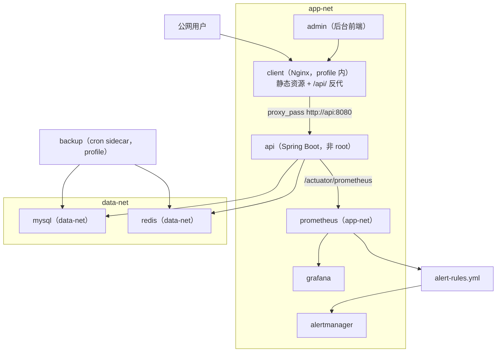
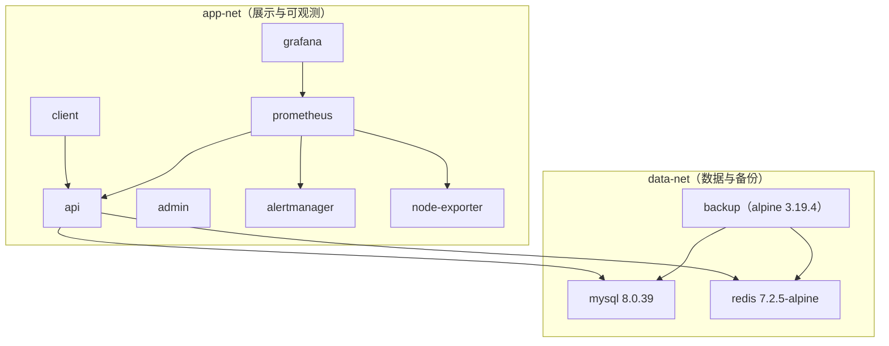
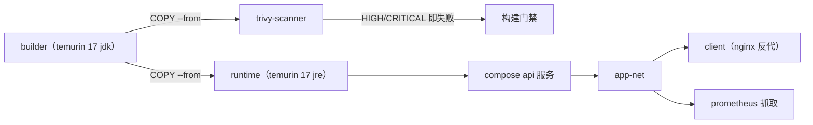

# 容器化部署

<cite>
**本文引用的文件**
- [docker-compose.yml](file://docker-compose.yml)
- [Dockerfile](file://apps/api/Dockerfile)
- [client-nginx.conf](file://docker/client-nginx.conf)
- [prometheus.yml](file://docker/prometheus/prometheus.yml)
- [alert-rules.yml](file://docker/prometheus/rules/alert-rules.yml)
- [alertmanager.yml](file://docker/alertmanager/alertmanager.yml)
- [init-mysql.sql](file://database/init-mysql.sql)
- [flyway.toml](file://database/flyway/flyway.toml)
- [application-real.yml](file://apps/api/src/main/resources/application-real.yml)
- [RedisTokenBlacklistService.java](file://apps/api/src/main/java/com/campuslove/api/auth/RedisTokenBlacklistService.java)
- [JwtTokenProvider.java](file://apps/api/src/main/java/com/campuslove/api/config/JwtTokenProvider.java)
</cite>

## 目录
1. [简介](#简介)
2. [项目结构](#项目结构)
3. [核心组件](#核心组件)
4. [架构总览](#架构总览)
5. [服务拓扑与网络分段](#服务拓扑与网络分段)
6. [运行期约定：用户、进程与 healthcheck](#运行期约定用户进程与-healthcheck)
7. [镜像分层与依赖缓存](#镜像分层与依赖缓存)
8. [编排注入的环境变量](#编排注入的环境变量)
9. [数据层容器](#数据层容器)
10. [前端与反向代理](#前端与反向代理)
11. [可观测性容器](#可观测性容器)
12. [profile 分组与按需启动](#profile-分组与按需启动)
13. [卷与数据持久化](#卷与数据持久化)
14. [安全取向](#安全取向)
15. [依赖关系分析](#依赖关系分析)
16. [性能考虑](#性能考虑)
17. [故障排查指南](#故障排查指南)
18. [结论](#结论)

## 简介
本项目用一份 `docker-compose.yml`（663 行）描述完整可运行环境：
10 个服务、2 个网络、7 个命名卷。API 镜像是**三阶段构建**
（builder / runtime / trivy-scanner），以非 root 用户运行、
用 `dumb-init` 作为 PID 1、并以 Spring Boot 分层 jar（layertools）方式启动。
前端由 Nginx 提供静态资源并把 `/api/` 反代到 `api:8080`，
监控栈（Prometheus + Grafana + Alertmanager + node-exporter）与备份 sidecar 挂在 profile 上按需启用。

## 项目结构
- `docker-compose.yml`：唯一的编排文件。
  网络定义在 L55-L59（`data-net`、`app-net`），卷在 L64-L77，服务从 L80 起：
  `mysql`(L83)、`redis`(L144)、`api`(L190)、`admin`(L300)、`client`(L349)、
  `prometheus`(L399)、`grafana`(L449)、`alertmanager`(L499)、
  `node-exporter`(L546)、`backup`(L585)。
- `apps/api/Dockerfile`（131 行）：后端镜像。
- `docker/client-nginx.conf`（68 行）：H5/客户端静态站点与反代。
- `docker/prometheus/prometheus.yml`（69 行）与 `docker/prometheus/rules/alert-rules.yml`（354 行）：抓取与告警规则。
- `docker/alertmanager/alertmanager.yml`（135 行）：告警路由。
- `docker/backup/crontab` 与 `scripts/backup-mysql.sh`：备份 sidecar 使用的内容。
- `database/init-mysql.sql`（19 行）：MySQL 容器 `docker-entrypoint-initdb.d/00-init.sql`。

**章节来源**
- [docker-compose.yml:55-80](file://docker-compose.yml#L55-L80)
- [docker-compose.yml:83-84](file://docker-compose.yml#L83-L84)
- [docker-compose.yml:144-145](file://docker-compose.yml#L144-L145)
- [client-nginx.conf:1-68](file://docker/client-nginx.conf#L1-L68)
- [Dockerfile:1-131](file://apps/api/Dockerfile#L1-L131)
- [prometheus.yml:1-69](file://docker/prometheus/prometheus.yml#L1-L69)

## 核心组件
- **api 服务**：端口只绑回环——`"127.0.0.1:${API_PORT:-8080}:8080"`(L266-L268)，
  注释说明"API 由外层 Nginx 反代对外（infra #4）"；
  挂载 `api-uploads`、`api-logs` 与只读迁移目录
  `./database/flyway/sql:/app/db/migration:ro`(L269-L272)；
  健康检查 `curl -fsS http://localhost:8080/actuator/health`，30s 间隔 / 5s 超时(L273-L275)。
- **镜像构建**：`FROM eclipse-temurin:17.0.12-jdk AS builder`(L22) →
  `FROM eclipse-temurin:17.0.12-jre AS runtime`(L44) →
  `FROM aquasec/trivy:0.53.0 AS trivy-scanner`(L123)。
- **nginx**：`limit_req_zone $binary_remote_addr zone=api_limit:10m rate=5r/s`(L14)，
  `/api/` 反代 `http://api:8080/api/`(L35-L37) 并透传
  `X-Real-IP` / `X-Forwarded-For` / `X-Forwarded-Proto`(L40-L42)。
- **prometheus**：全局 `scrape_interval: 15s`、`evaluation_interval: 30s`、
  `scrape_timeout: 10s`(L22-L24)，作业 `api` 抓取 `api:8080`(L49-L55)。

**章节来源**
- [docker-compose.yml:266-275](file://docker-compose.yml#L266-L275)
- [Dockerfile:22-44](file://apps/api/Dockerfile#L22-L44)
- [client-nginx.conf:14-46](file://docker/client-nginx.conf#L14-L46)
- [prometheus.yml:22-55](file://docker/prometheus/prometheus.yml#L22-L55)

## 架构总览

**图表来源**
- [docker-compose.yml:55-59](file://docker-compose.yml#L55-L59)
- [docker-compose.yml:190-190](file://docker-compose.yml#L190-L190)
- [client-nginx.conf:35-37](file://docker/client-nginx.conf#L35-L37)
- [prometheus.yml:49-55](file://docker/prometheus/prometheus.yml#L49-L55)

## 服务拓扑与网络分段
编排把服务切进两个网络，注释写明"网络按安全域拆分：data-net（mysql/redis/backup）
与 app-net（其余服务）"(L47 附近说明，见 L55-L59 定义)：

- `data-net`：`mysql`、`redis`、`backup` —— 只有数据层与能碰数据文件的备份容器在同一广播域。
- `app-net`：`api`、`admin`、`client`、`prometheus`、`grafana`、`alertmanager`、`node-exporter`。

服务清单（`services:` 起始于 L80）：

| 服务 | 行号 | 角色 | 是否 profile 化 |
|---|---|---|---|
| mysql | L83 | 业务库 | 否 |
| redis | L144 | 缓存 / Redisson / 会话 | 否 |
| api | L190 | Spring Boot 后端 | 否 |
| admin | L300 | 后台前端 | 否 |
| client | L349 | H5/客户端站点 | 是（L395）|
| prometheus | L399 | 指标抓取 | 否 |
| grafana | L449 | 看板 | 否 |
| alertmanager | L499 | 告警路由 | 否 |
| node-exporter | L546 | 主机指标 | 是（L581）|
| backup | L585 | 定时备份 sidecar | 是（L662）|

**图表来源**
- [docker-compose.yml:55-59](file://docker-compose.yml#L55-L59)
- [docker-compose.yml:83-84](file://docker-compose.yml#L83-L84)
- [docker-compose.yml:144-145](file://docker-compose.yml#L144-L145)
- [docker-compose.yml:585-587](file://docker-compose.yml#L585-L587)

**章节来源**
- [docker-compose.yml:80-662](file://docker-compose.yml#L80-L662)

## 运行期约定：用户、进程与 healthcheck
`apps/api/Dockerfile` 的运行阶段做了几件不可省略的事：

- **依赖安装**：`RUN apt-get update && ...`(L54) 装入运行所需工具（含 `curl`，供健康检查使用）。
- **非 root 用户**：`RUN groupadd -r app && useradd -r -g app -d /app -s /sbin/nologin app`(L62)，
  随后 `USER app`(L78)。登录 shell 设为 `/sbin/nologin`，即该账号不可交互登录。
- **目录准备**：`RUN mkdir -p /app/logs /app/uploads && ...`(L75)，
  与编排里的命名卷 `api-logs`、`api-uploads` 对应。
- **端口**：`EXPOSE 8080`(L81)。
- **PID 1**：`ENTRYPOINT ["dumb-init", "--"]`(L111) 配
  `CMD ["sh", "-c", "java $JAVA_OPTS org.springframework.boot.loader.launch.JarLauncher"]`(L114)。
  用 `dumb-init` 是为了让信号（SIGTERM）正确转发给 JVM，从而优雅停机；
  启动命令读取 `JAVA_OPTS`，容器化下的 JVM 参数因此由编排注入而不是写死在镜像里。
- **容器健康检查**：`HEALTHCHECK --interval=30s --timeout=5s --start-period=60s --retries=3`(L107)，
  `start-period` 60s 给足 Spring Boot + Flyway 冷启动时间；
  编排侧 `backup` 服务用 `depends_on: mysql/redis: condition: service_healthy` 依赖健康态，
  api 自身也定义了 healthcheck(L273-L275)。

**章节来源**
- [Dockerfile:44-81](file://apps/api/Dockerfile#L44-L81)
- [Dockerfile:107-114](file://apps/api/Dockerfile#L107-L114)
- [docker-compose.yml:269-275](file://docker-compose.yml#L269-L275)
- [docker-compose.yml:585-594](file://docker-compose.yml#L585-L594)

## 镜像分层与依赖缓存
构建阶段用 Maven Wrapper 并利用 Spring Boot 的 **layertools** 拆分：

- 先 `COPY mvnw mvnw.cmd pom.xml ./`(L27) 与 `COPY .mvn .mvn`(L28)，
  再单独 `COPY src ./src`(L31) —— 顺序保证**依赖层可缓存**，改代码不会重下依赖。
- `RUN chmod +x mvnw && ...`(L36) 构建 jar，
  `RUN java -Djarmode=layertools -jar target/*.jar list --verbose`(L40) 列出分层，
  运行阶段以 `COPY --from=builder /build/target/*.jar /tmp/app.jar`(L68) 取产物，
  再由 `mkdir` 与解层步骤(L69)铺成 `/app` 目录结构。
- 安全扫描是**独立构建阶段**：`FROM aquasec/trivy:0.53.0 AS trivy-scanner`(L123)、
  `COPY --from=builder ... /scan/app.jar`(L128)、
  `RUN trivy fs --severity HIGH,CRITICAL --exit-code 1 /scan`(L131)——
  `--exit-code 1` 意味着发现 HIGH/CRITICAL 漏洞即构建失败，而不是只打印告警。

## 编排注入的环境变量
api 服务的环境块把"镜像不带凭据"这一原则落到实处：

- **迁移路径**：`APP_FLYWAY_LOCATIONS: filesystem:/app/db/migration`(L236-L240)，
  与 `application-real.yml` 中 `${APP_FLYWAY_LOCATIONS:filesystem:../../database/flyway/sql}`(L76) 对应；
  容器里改用挂载点路径，宿主机直跑仍走相对路径。
- **管理员凭据**：`ADMIN_OPENID: ${ADMIN_OPENID:-}`(L233)、
  `ADMIN_NICKNAME: ${ADMIN_NICKNAME:-系统管理员}`(L234)、
  `ADMIN_INITIAL_PASSWORD_HASH: ${ADMIN_INITIAL_PASSWORD_HASH:-}`(L235)，
  注释记录 infra #8："移除公开默认值 admin-default-openid-change-me（可被冒充登录）"，
  生产必须在 `.env` 配置 `ADMIN_OPENID`。
- **媒体存储**：`APP_MEDIA_STORAGE_ROOT: /app/uploads`(L242)，落在命名卷上。
- **MQ 可选**：`RABBITMQ_*` 四项默认空(L247-L250)，注释说明"本编排未部署 rabbitmq 服务，
  应用在 MQ 不可用时自动降级（R4-02096）"，并要求启用时禁用默认 `guest/guest`（infra #12/#13）。
- **文档端点**：`SWAGGER_UI_ENABLED: ${SWAGGER_UI_ENABLED:-false}`(L253)，
  生产默认关闭 Swagger UI 与 `/v3/api-docs`（infra #11）。
- **JVM**：`JAVA_OPTS` 多行块(L255-L265)包含
  `-XX:+UseContainerSupport`、`MaxRAMPercentage=75.0`、`InitialRAMPercentage=50.0`、
  `-XX:+UseG1GC`、`MaxGCPauseMillis=200`、堆转储开关与路径、
  `-Dfile.encoding=UTF-8`、`-Duser.timezone=Asia/Shanghai`。
  `UseContainerSupport` + 百分比堆让同一镜像在不同规格容器里自适应，
  而不是固定 `-Xmx`。

**章节来源**
- [docker-compose.yml:230-265](file://docker-compose.yml#L230-L265)
- [application-real.yml:68-77](file://apps/api/src/main/resources/application-real.yml#L68-L77)

## 数据层容器
- **mysql**（L83 起，镜像钉在 `mysql:8.0.39`(L84)、容器名 `campus-mysql`(L85)、
  `restart: unless-stopped`(L86)）：口令强制注入——
  `MYSQL_ROOT_PASSWORD: ${MYSQL_ROOT_PASSWORD:?MYSQL_ROOT_PASSWORD is required}`(L89) 与
  `MYSQL_PASSWORD: ${MYSQL_PASSWORD:?MYSQL_PASSWORD is required}`(L92)，
  注释记录 "Task 22（FIN-00269/00270）：移除默认密码，强制通过环境变量注入"(L88)；
  库名与业务账号保留可读默认值 `MYSQL_DATABASE:-campus_love`(L90)、`MYSQL_USER:-campus`(L91)，
  并设 `TZ: Asia/Shanghai`(L93)，`command:` 段以 `--character-set-server=utf8mb4` 起步(L94)。
  数据在命名卷 `mysql-data`(L65)。
- **redis**（L144 起，镜像 `redis:7.2.5-alpine`(L145)，容器名 `campus-redis`(L146)）：
  启动命令同时做三件事——`--requirepass ${REDIS_PASSWORD:?...}`(L150) 强制口令、
  `--maxmemory 256mb`(L151) 限内存、`--maxmemory-policy allkeys-lru`(L152) 定淘汰策略。
  数据卷 `redis-data`(L67)。运行期用途可从代码侧读出：
  令牌吊销走 `RedisTokenBlacklistService`（`@Service` L44；`revoke(String jti, long ttlSeconds)` L114、
  `isRevoked(String jti)` L161、`cleanupExpiredLocalEntries()` L74），
  `JwtTokenProvider` 持有 `RedissonClient`(L78)。

这里有一处**配置与用途之间的张力值得复核**：`allkeys-lru` 的含义是内存达到 256mb 上限时
可以淘汰**任意**键（而不是仅淘汰带 TTL 的键），而吊销名单正是靠 TTL 过期的键存放的。
一旦 Redis 因内存压力淘汰了吊销记录，被登出的令牌就可能重新被视为有效。
缓解方向有两个：把淘汰策略改为 `volatile-lru`/`noeviction`，或把吊销判定改为
"以数据库侧状态为准、Redis 只做加速"。当前编排选择的是前者不成立、后者未见的组合。

因此**Redis 不可用会让登出/吊销语义退化**，它不是纯缓存组件；
把它当作缓存来运维（随意重启、限小内存）会直接影响安全属性。
- **初始化脚本的边界**：迁移目录**不挂载**为 MySQL 的 `initdb.d`，
  编排注释理由是"避免迁移脚本重复执行损坏数据"(L41-L42)，MySQL 侧"仅保留 CI 初始化脚本"(L114)；
  作为 `docker-entrypoint-initdb.d/00-init.sql` 的 `database/init-mysql.sql` 把职责收缩为
  "为 CI 环境创建隔离的测试库（可选）"，库与账号交给 `MYSQL_*` 环境变量，
  并规定脚本内不得出现明文凭据(L1-L19)。

**章节来源**
- [docker-compose.yml:41-42](file://docker-compose.yml#L41-L42)
- [docker-compose.yml:64-77](file://docker-compose.yml#L64-L77)
- [docker-compose.yml:83-94](file://docker-compose.yml#L83-L94)
- [docker-compose.yml:114-114](file://docker-compose.yml#L114-L114)
- [docker-compose.yml:144-152](file://docker-compose.yml#L144-L152)
- [init-mysql.sql:1-19](file://database/init-mysql.sql#L1-L19)
- [RedisTokenBlacklistService.java:44-161](file://apps/api/src/main/java/com/campuslove/api/auth/RedisTokenBlacklistService.java#L44-L161)
- [JwtTokenProvider.java:78-78](file://apps/api/src/main/java/com/campuslove/api/config/JwtTokenProvider.java#L78-L78)

## 前端与反向代理
`docker/client-nginx.conf`（68 行）是客户端站点的完整服务器块：

- 监听 80、`server_name _`、站点根 `/usr/share/nginx/html`(L16-L21)。
- **限流**：`limit_req_zone $binary_remote_addr zone=api_limit:10m rate=5r/s`(L14)，
  在 `/api/` 上以 `limit_req zone=api_limit burst=10 nodelay`(L36) 应用——
  即每客户端 IP 5 req/s、突发 10 立即放行，超出返回 503。
- **压缩**：`gzip on` + `gzip_comp_level 6` + `gzip_min_length 1024`，
  类型覆盖 js/css/json/svg 等(L23-L27)。
- **安全响应头**：`X-Content-Type-Options nosniff`、`X-Frame-Options SAMEORIGIN`、
  `Referrer-Policy strict-origin-when-cross-origin`，全部 `always`(L30-L32)。
- **反代与超时**：`proxy_http_version 1.1`，透传 `Host`、`X-Real-IP`、
  `X-Forwarded-For`、`X-Forwarded-Proto`，
  `proxy_connect_timeout 30s` / `send 60s` / `read 60s`(L38-L45)。
- **静态资源缓存**：对 js/css/字体/图片类扩展名 `expires 1y`(L49-L50)。

`admin` 服务（L300）与 `client` 服务（L349）分别承载后台与 H5 前端；
`client` 受 profile 控制，因此默认 `docker compose up` 起的是 API + 数据 + 监控，
站点按需再开。

**章节来源**
- [client-nginx.conf:14-50](file://docker/client-nginx.conf#L14-L50)
- [docker-compose.yml:300-300](file://docker-compose.yml#L300-L300)
- [docker-compose.yml:349-395](file://docker-compose.yml#L349-L395)

## 可观测性容器
- **prometheus**（L399）：配置在 `docker/prometheus/prometheus.yml`，
  `scrape_interval 15s` / `evaluation_interval 30s` / `scrape_timeout 10s`(L22-L24)
  ——注释解释超时特意小于间隔以"保证不重叠"；
  抓取目标含 `api:8080`(L49-L55)，指标出口是 `/actuator/prometheus`；
  `node-exporter` 的作业在配置中是**注释状态**(L65-L66)。
  规则文件为 `docker/prometheus/rules/alert-rules.yml`（354 行）。
- **alertmanager**（L499）：路由与抑制在 `docker/alertmanager/alertmanager.yml`（135 行），
  数据卷 `alertmanager-data`(L73)。
- **grafana**（L449）：看板，卷 `grafana-data`(L71)。
- **node-exporter**（L546）：主机指标，profile 化（L581）。

**章节来源**
- [prometheus.yml:22-66](file://docker/prometheus/prometheus.yml#L22-L66)
- [alert-rules.yml:1-354](file://docker/prometheus/rules/alert-rules.yml#L1-L354)
- [alertmanager.yml:1-135](file://docker/alertmanager/alertmanager.yml#L1-L135)
- [docker-compose.yml:64-77](file://docker-compose.yml#L64-L77)

## profile 分组与按需启动
三个服务带 `profiles:`（client L395、node-exporter L581、backup L662），
意味着默认 `docker compose up -d` 不会启动它们。备份的启动方式在
`docker/backup/crontab` 注释里给出：`docker compose --profile backup up -d`，
并说明 cron 表达式由 `BACKUP_CRON` 环境变量生成、修改无需重建镜像。

这套分组的取向是：**默认起"能被访问的后端 + 数据 + 监控"**，
把"面向用户的站点""主机指标""定时备份"三类可选能力留在 profile 里，
避免本地一次性拉起十个容器。

**章节来源**
- [docker-compose.yml:395-395](file://docker-compose.yml#L395-L395)
- [docker-compose.yml:581-581](file://docker-compose.yml#L581-L581)
- [docker-compose.yml:662-662](file://docker-compose.yml#L662-L662)

## 卷与数据持久化
7 个命名卷（L64-L77）：`mysql-data`、`redis-data`、`prometheus-data`、
`grafana-data`、`alertmanager-data`、`api-uploads`、`api-logs`。

- api 挂载三个：`api-uploads:/app/uploads`、`api-logs:/app/logs`(L270-L271)，
  以及只读的 `./database/flyway/sql:/app/db/migration:ro`(L272)——
  迁移脚本不进卷，直接从宿主 bind mount 只读挂载。
- 编排注释记录 infra #16：备份目录与脚本 `BACKUP_DIR` 对齐
  （宿主 `./backups` ↔ 容器 `/backups`）；同一处还记录了"移除未使用的 mysql-backup 死卷"(L46)。

**章节来源**
- [docker-compose.yml:64-77](file://docker-compose.yml#L64-L77)
- [docker-compose.yml:46-46](file://docker-compose.yml#L46-L46)
- [docker-compose.yml:269-272](file://docker-compose.yml#L269-L272)
- [docker-compose.yml:609-610](file://docker-compose.yml#L609-L610)

## 安全取向
容器化层面可读到的显式安全动作：

1. **不对外直暴 API**：api 端口绑 `127.0.0.1`，公网流量必须经 Nginx 反代(L266-L268)。
2. **网络分段**：数据层与展示层分属 `data-net` / `app-net`(L55-L59)。
3. **非 root 运行**：`USER app` + `nologin` shell(Dockerfile L62、L78)。
4. **镜像内带漏洞门禁**：trivy 阶段 `--severity HIGH,CRITICAL --exit-code 1`(L131)。
5. **凭据不入库**：`ADMIN_OPENID` 等一律 `${VAR:-}` 形式从 `.env` 注入(L233-L235)，
   公开默认值 `admin-default-openid-change-me` 被明确移除；
   MySQL 初始化脚本规定"不得包含任何明文凭据"(init-mysql.sql L7)。
6. **入口默认关闭**：`SWAGGER_UI_ENABLED` 默认 `false`(L253)，
   Redis 口令与 MQ 凭据要求强值（`REDIS_PASSWORD` 用 `${...:?...}` 强制非空，L614 附近；
   MQ 若启用禁止 `guest/guest`）。
7. **速率与头部基线**：nginx 5r/s 限流(L14) + 三个安全响应头(L30-L32)。

**章节来源**
- [docker-compose.yml:233-235](file://docker-compose.yml#L233-L235)
- [docker-compose.yml:251-253](file://docker-compose.yml#L251-L253)
- [docker-compose.yml:266-268](file://docker-compose.yml#L266-L268)
- [Dockerfile:62-78](file://apps/api/Dockerfile#L62-L78)
- [Dockerfile:123-131](file://apps/api/Dockerfile#L123-L131)
- [client-nginx.conf:14-32](file://docker/client-nginx.conf#L14-L32)
- [init-mysql.sql:4-15](file://database/init-mysql.sql#L4-L15)

## 依赖关系分析
- **启动顺序**：`backup` 依赖 `mysql` 与 `redis` 的 `service_healthy`(L589-L594)；
  api 通过 healthcheck 让自身状态可被探测(L273-L275)。
- **构建顺序**：runtime 阶段依赖 builder 产物（两次 `COPY --from=builder`，L68、L128），
  trivy 阶段只读 jar，不进入最终运行镜像。
- **配置耦合**：`APP_FLYWAY_LOCATIONS` 同时出现在编排(L240)、
  `application-real.yml` 默认值(L76) 与 `flyway.toml`(L2)，
  三处路径基准不同，是跨层最容易错的一处。
- **前端耦合后端**：nginx `proxy_pass http://api:8080/api/`(L37) 用容器名寻址，
  因此 client 必须与 api 同处 `app-net`。
- **可观测性耦合应用**：Prometheus 抓 `api:8080` 的 actuator 端点，
  指标由 `AuthMetrics` / `ChatMetrics` / `MatchMetrics` 等组件产出（见
  `基础设施与DevOps/监控告警`）。

**图表来源**
- [Dockerfile:22-44](file://apps/api/Dockerfile#L22-L44)
- [Dockerfile:68-68](file://apps/api/Dockerfile#L68-L68)
- [Dockerfile:123-131](file://apps/api/Dockerfile#L123-L131)

**章节来源**
- [docker-compose.yml:589-594](file://docker-compose.yml#L589-L594)
- [client-nginx.conf:35-37](file://docker/client-nginx.conf#L35-L37)

## 性能考虑
- **JVM 随容器规格伸缩**：`UseContainerSupport` + `MaxRAMPercentage=75.0`(L256-L257)
  让堆上限跟随容器内存，避免固定 `-Xmx` 在小容器里被 OOMKill；
  `MaxGCPauseMillis=200`(L259) 给出 G1 的停顿目标。
- **分层依赖缓存**：Dockerfile 先 COPY pom 再 COPY src(L27-L31)，
  日常改代码不会触发依赖重解，是构建耗时最主要的节省点。
- **静态资源一年缓存**：`expires 1y`(L50) 配合带指纹的构建产物文件名生效。
- **抓取与超时匹配**：15s 间隔 / 10s 超时(L22-L24)，避免慢抓取叠代。
- **限流前置在代理层**：5r/s 在 nginx 判定，不消耗应用线程(L14、L36)。

**章节来源**
- [Dockerfile:27-31](file://apps/api/Dockerfile#L27-L31)
- [docker-compose.yml:255-265](file://docker-compose.yml#L255-L265)
- [client-nginx.conf:49-50](file://docker/client-nginx.conf#L49-L50)
- [prometheus.yml:22-24](file://docker/prometheus/prometheus.yml#L22-L24)

## 故障排查指南
- **容器反复重启但日志无异常**：先看是否被 OOMKill——`JAVA_OPTS` 用百分比堆，
  若 compose 未给容器加内存限制，`UseContainerSupport` 会按宿主内存计算堆。
- **健康检查一直 unhealthy**：`HEALTHCHECK` 依赖镜像内 `curl`（apt 安装步骤），
  若构建阶段裁剪了该依赖，检查会失败而不是应用故障；
  `start-period=60s` 也可能被 Flyway 慢启动耗尽（453 行索引脚本或种子脚本首跑时）。
- **迁移在容器里找不到脚本**：容器走 `filesystem:/app/db/migration`，
  需要 `./database/flyway/sql:/app/db/migration:ro` 挂载存在；
  从宿主直跑则默认 `filesystem:../../database/flyway/sql`（基准 `apps/api`）。
- **管理员登录失败**：`ADMIN_OPENID` / `ADMIN_INITIAL_PASSWORD_HASH` 在编排里默认空值，
  必须由 `.env` 提供；用公开默认值会出现"能登录的账号"或"账号不存在"两种偏差。
- **api 端口外部访问不通**：这是设计如此，端口只绑 `127.0.0.1`(L268)，
  外部访问应经 client/nginx 的 `/api/`。
- **503 且客户端集中**：命中 nginx 的 5r/s 限流(L14)，
  需要看是否被脚本请求或前端轮询放大。
- **备份容器不起作用**：它在 `backup` profile 内(L662)，
  需要 `docker compose --profile backup up -d`，且 `BACKUP_CRON` 决定实际执行时间。
- **构建被 trivy 打断**：`--exit-code 1` 表示存在 HIGH/CRITICAL 漏洞；
  这是门禁而非误报，应升级依赖而不是移除该阶段。

**章节来源**
- [Dockerfile:54-54](file://apps/api/Dockerfile#L54-L54)
- [Dockerfile:107-107](file://apps/api/Dockerfile#L107-L107)
- [Dockerfile:131-131](file://apps/api/Dockerfile#L131-L131)
- [docker-compose.yml:233-240](file://docker-compose.yml#L233-L240)
- [docker-compose.yml:266-272](file://docker-compose.yml#L266-L272)
- [client-nginx.conf:36-36](file://docker/client-nginx.conf#L36-L36)

## 结论
容器化部署的形状是：**三阶段 Dockerfile（jdk 构建 → jre 运行 → trivy 门禁）
+ 一份 663 行编排（10 服务 / 2 网络 / 7 卷，3 个 profile 化）**。
镜像侧的关键约定是非 root、`dumb-init` 作为 PID 1、Spring Boot 分层启动、
60s 启动缓冲的健康检查；编排侧的关键约定是端口只绑回环、
凭据一律 `${VAR:-}` 从 `.env` 注入、迁移目录只读挂载而不进 `initdb.d`。

两处最容易出运行时问题的耦合点：一是 `APP_FLYWAY_LOCATIONS` 在
编排、应用配置与 CLI 配置里基准路径各不相同；二是 Redis 同时承担缓存与
**令牌吊销**（`RedisTokenBlacklistService`、`RedissonClient`），
把它当纯缓存看待会让登出语义在故障时静默退化。
