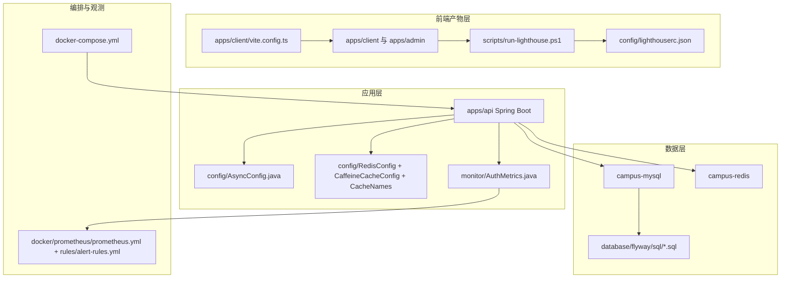
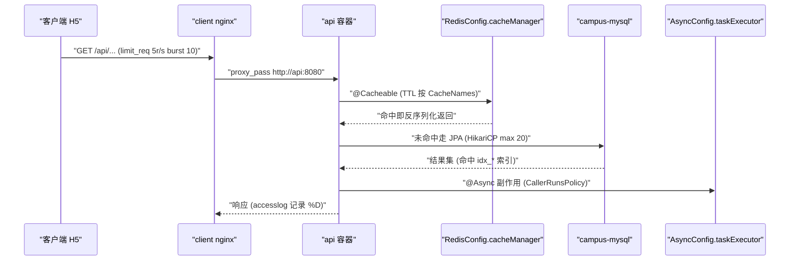
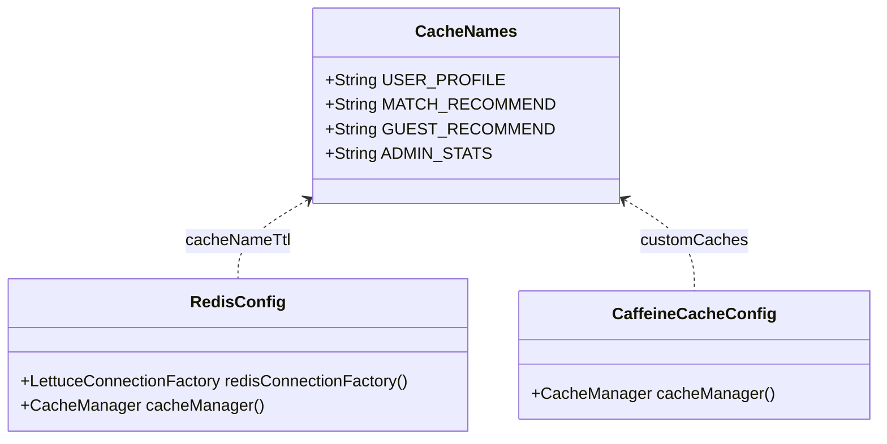
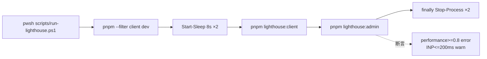
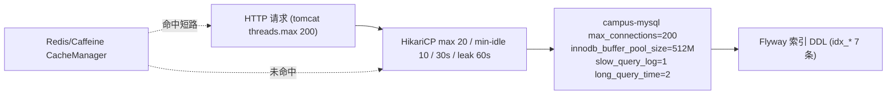
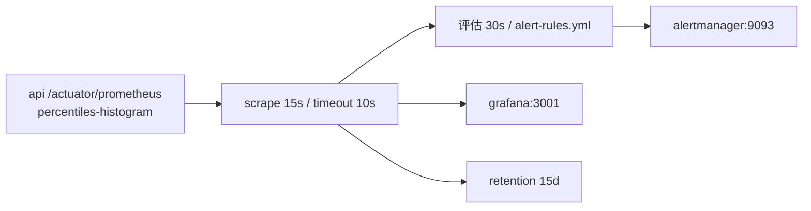

# 性能优化

<cite>
**本文引用的文件**
- [lighthouserc.json](file://config/lighthouserc.json)
- [run-lighthouse.ps1](file://scripts/run-lighthouse.ps1)
- [docker-compose.yml](file://docker-compose.yml)
- [Dockerfile](file://apps/api/Dockerfile)
- [client-nginx.conf](file://docker/client-nginx.conf)
- [prometheus.yml](file://docker/prometheus/prometheus.yml)
- [alert-rules.yml](file://docker/prometheus/rules/alert-rules.yml)
- [vite.config.ts](file://apps/client/vite.config.ts)
- [application.yml](file://apps/api/src/main/resources/application.yml)
- [application-real.yml](file://apps/api/src/main/resources/application-real.yml)
- [AsyncConfig.java](file://apps/api/src/main/java/com/campuslove/api/config/AsyncConfig.java)
- [CacheNames.java](file://apps/api/src/main/java/com/campuslove/api/config/CacheNames.java)
- [RedisConfig.java](file://apps/api/src/main/java/com/campuslove/api/config/RedisConfig.java)
- [CaffeineCacheConfig.java](file://apps/api/src/main/java/com/campuslove/api/config/CaffeineCacheConfig.java)
- [AuthMetrics.java](file://apps/api/src/main/java/com/campuslove/api/monitor/AuthMetrics.java)
- [V2026.07.26.0001__add_entity_index_annotations.sql](file://database/flyway/sql/V2026.07.26.0001__add_entity_index_annotations.sql)
- [V2026.07.28.0007__rebuild_indexes_after_enum_migration.sql](file://database/flyway/sql/V2026.07.28.0007__rebuild_indexes_after_enum_migration.sql)
- [NotifyConfig.java](file://apps/api/src/main/java/com/campuslove/api/entity/NotifyConfig.java)
- [MatchConfigEntityRepository.java](file://apps/api/src/main/java/com/campuslove/api/repository/MatchConfigEntityRepository.java)
- [CacheTest.java](file://apps/api/src/test/java/com/campuslove/api/config/CacheTest.java)
- [I18nTest.java](file://apps/api/src/test/java/com/campuslove/api/config/I18nTest.java)
- [FlywayMigrationRepeatableTest.java](file://apps/api/src/test/java/com/campuslove/api/database/FlywayMigrationRepeatableTest.java)
- [pull_request_template.md](file://.github/pull_request_template.md)
- [ci.yml](file://.github/workflows/ci.yml)
</cite>

## 目录
1. [简介](#简介)
2. [项目结构](#项目结构)
3. [核心组件](#核心组件)
4. [架构总览](#架构总览)
5. [详细组件分析](#详细组件分析)
6. [前端性能优化](#前端性能优化)
7. [后端性能调优](#后端性能调优)
8. [容器资源限制与水平扩展](#容器资源限制与水平扩展)
9. [性能监控与基准测试](#性能监控与基准测试)
10. [依赖关系分析](#依赖关系分析)
11. [性能考虑](#性能考虑)
12. [故障排查指南](#故障排查指南)
13. [能力缺口登记](#能力缺口登记)
14. [结论](#结论)

## 简介
本页记录 Campus Love 仓库中已被代码固化的性能手段，覆盖前端（Lighthouse 门禁、产物体积）、后端（线程池、缓存、连接池、指标埋点）与运行时（compose 编排与资源配额）三条链路。写作纪律：只有能在源码里指出具体类、配置键或索引名的才写；通用实践而仓库无对应实现的，全部进[能力缺口登记](#能力缺口登记)。

前置事实：`.github/workflows/` 下只有 `ci.yml`（512 行），其中**没有任何 Flyway/数据库迁移步骤，也没有 Lighthouse 或压测任务**；数据库校验只以 PR 模板的人工核对项存在（`.github/pull_request_template.md` L30、L66）。因此本页的体系是"人工触发的前端门禁 + 应用内配置 + 单机容器配额"，不是自动化流水线。

**章节来源**
- [lighthouserc.json:1-24](file://config/lighthouserc.json#L1-L24)
- [ci.yml:56-62](file://.github/workflows/ci.yml#L56-L62)
- [pull_request_template.md:21-31](file://.github/pull_request_template.md#L21-L31)

## 项目结构
性能资产分布在四个位置，由 `docker-compose.yml` 与 `config/lighthouserc.json` 串联：

[此图为概念流程，不直接对应具体源文件，故不提供图表来源]

职责划分：`config/` 放跨应用工具配置；`scripts/` 放可执行入口；`apps/api/.../config/` 是后端性能配置主聚集地；`database/flyway/sql/` 用版本化 SQL 承载索引；`docker/` 放网关与观测配置；compose 定义拓扑与配额。

**章节来源**
- [docker-compose.yml:1-663](file://docker-compose.yml#L1-L663)
- [client-nginx.conf:1-68](file://docker/client-nginx.conf#L1-L68)
- [run-lighthouse.ps1:1-25](file://scripts/run-lighthouse.ps1#L1-L25)

## 核心组件
| 组件 | 位置 | 可核实的性能取值 |
| --- | --- | --- |
| Lighthouse 断言 | `config/lighthouserc.json` | `categories:performance` minScore 0.8（error）、`numeric-timing-INP` 200（warn）、`numberOfRuns 3`、`preset desktop` |
| Lighthouse 脚本 | `scripts/run-lighthouse.ps1` | 起 5173/5177 dev server → `pnpm lighthouse:client`/`lighthouse:admin` → `finally` 收进程 |
| 构建期体积策略 | `apps/client/vite.config.ts` | `manualChunks`、`chunkSizeWarningLimit 1000`、`cssCodeSplit`、`minify esbuild`、`treeshake` |
| 异步线程池 | `config/AsyncConfig.java` | 8/32/200/60s、`CallerRunsPolicy`、优雅停机 30s |
| 缓存体系 | `CacheNames` + `RedisConfig` + `CaffeineCacheConfig` | 11 个 CacheName 独立 TTL；Redis（`real`）/Caffeine（非 `real`）双实现 |
| 指标与告警 | `AuthMetrics` + `docker/prometheus/**` | Micrometer → `/actuator/prometheus` → 成文阈值 |
| 容器配额 | `docker-compose.yml` | 10 个服务全部 `deploy.resources.limits` |

关键约束：`RedisConfig` 标 `@Profile("real")`、`CaffeineCacheConfig` 标 `@Profile("!real")`，两者都带 `@ConditionalOnMissingBean(CacheManager.class)`，运行时只有一个 `CacheManager`；compose 的 `SPRING_PROFILES_ACTIVE: real` 决定生产走 Redis。

**章节来源**
- [AsyncConfig.java:42-107](file://apps/api/src/main/java/com/campuslove/api/config/AsyncConfig.java#L42-L107)
- [CacheNames.java:12-111](file://apps/api/src/main/java/com/campuslove/api/config/CacheNames.java#L12-L111)
- [RedisConfig.java:47-51](file://apps/api/src/main/java/com/campuslove/api/config/RedisConfig.java#L47-L51)
- [CaffeineCacheConfig.java:32-36](file://apps/api/src/main/java/com/campuslove/api/config/CaffeineCacheConfig.java#L32-L36)
- [docker-compose.yml:190-297](file://docker-compose.yml#L190-L297)

## 架构总览
一次读请求经过的性能关卡，均对应真实 Bean 与容器：

**图表来源**
- [client-nginx.conf:34-46](file://docker/client-nginx.conf#L34-L46)
- [RedisConfig.java:272-303](file://apps/api/src/main/java/com/campuslove/api/config/RedisConfig.java#L272-L303)
- [AsyncConfig.java:88-107](file://apps/api/src/main/java/com/campuslove/api/config/AsyncConfig.java#L88-L107)

三条结构性约束：

1. 网络分域：`data-net`（mysql/redis/backup）与 `app-net`（其余），`api` 同时接入两者。
2. 启动依赖即预热窗口：`api` 以 `condition: service_healthy` 等 mysql（`start_period: 30s`）与 redis（10s），`admin`/`client` 再等 api（90s），冷启动观测窗口至少 90 秒量级。
3. JVM 与 cgroup 耦合：api 容器 `memory: 1g` + `-XX:MaxRAMPercentage=75.0`，堆取容器内存 75%，与宿主机无关。

**章节来源**
- [docker-compose.yml:54-61](file://docker-compose.yml#L54-L61)
- [docker-compose.yml:197-201](file://docker-compose.yml#L197-L201)
- [docker-compose.yml:254-297](file://docker-compose.yml#L254-L297)

## 详细组件分析

### Lighthouse 门禁与执行脚本
`config/lighthouserc.json` 顶层只有 `ci`，下分 `collect`/`assert`/`upload`。`collect.url` 为 `http://localhost:5173`（client）与 `http://localhost:5177`（admin），`numberOfRuns: 3` 抑制单次抖动，`preset: "desktop"` + `onlyCategories: ["performance"]` 只评性能类目。断言两条：性能分 `minScore 0.8`（error，低于 80 直接失败）、INP `maxNumericValue 200`（warn，超阈值只告警不阻断）。`upload.target: "temporary-public-storage"` 表示报告临时留存，不构成历史基线。

`scripts/run-lighthouse.ps1` 只做编排：`$ErrorActionPreference = "Stop"` → `Start-Process pnpm --filter client dev` → `Start-Sleep -Seconds 8` → 拉起 admin 再等 8 秒 → `pnpm lighthouse:client`、`pnpm lighthouse:admin`（报告落 `./test-screenshots/lighthouse-*.html`）→ `finally` 用 `Stop-Process -Id ... -Force` 收进程。头注释要求已 `pnpm install`（需 `@lhci/cli` 与 `lighthouse`）并在仓库根执行。

**章节来源**
- [lighthouserc.json:1-24](file://config/lighthouserc.json#L1-L24)
- [run-lighthouse.ps1:1-25](file://scripts/run-lighthouse.ps1#L1-L25)

### 线程池与异步处理
`AsyncConfig` 用 `ThreadPoolTaskExecutor` 替换 `SimpleAsyncTaskExecutor`，Bean 名固定 `taskExecutor`。参数与外部化键：核心 8（`app.async.core-pool-size`）、最大 32（`max-pool-size`）、队列 200（`queue-capacity`）、前缀 `async-`（`thread-name-prefix`）、空闲 60s（`keep-alive-seconds`）。`@Value` 默认值拼接 `DEFAULT_*` 常量避免双写漂移；拒绝策略 `CallerRunsPolicy`（提交线程直接执行，形成背压而非丢任务）；`setWaitForTasksToCompleteOnShutdown(true)` + `setAwaitTerminationSeconds(30)`；`initialize()` 后 `log.info` 打印全部参数。类尾注释记录一次修复：`auditLogExecutor` 因同名 Bean 冲突（`BeanDefinitionOverrideException`）迁至 `AuditAsyncConfig`。

**章节来源**
- [AsyncConfig.java:42-112](file://apps/api/src/main/java/com/campuslove/api/config/AsyncConfig.java#L42-L112)

### 缓存体系与 TTL 治理
`CacheNames` 定义名称，`RedisConfig`（real）与 `CaffeineCacheConfig`（非 real）提供 TTL 一致的两套实现：

| CacheName | TTL | 失效方式 |
| --- | --- | --- |
| `user_profile` | 10 分钟 | TTL |
| `match_recommend` | 5 分钟 | 偏好/互动后 `@CacheEvict` |
| `guest_recommend` | 60 秒 | TTL（2026-08-12 卡顿修复） |
| `village_hot_posts` | 15 分钟 | `@CacheEvict(allEntries=true)` |
| `campus_schools` / `daily_question` / `sensitive_words` | 1 小时 | TTL / Admin 增删后失效 |
| `system_config` | 30 分钟 | Admin 更新后 `@CacheEvict(allEntries=true)` |
| `user_tags` | 10 分钟 | TTL 自然过期 |
| `client_config` / `admin_stats` | 5 分钟 | Admin `@CacheEvict` 或 TTL |
| 默认 `DEFAULT_CACHE_TTL` | 30 分钟 | 未注册名称使用默认 |

`RedisConfig.cacheManager()` 以 `defaultCacheConfig()` 起步，加 `disableCachingNullValues()`，把 `cacheNameTtl` 映射经 `withInitialCacheConfigurations(...)` 注入并 `transactionAware()`。最直白的性能修复是 `guest_recommend`：游客推荐无个性化上下文（固定 key），每次全量重算约 8 次 SQL（候选池 200 人）是未登录切页卡顿主因，缓存后降为 1 次 Redis GET；候选池对应 `app.recommendation.candidate-page-size: 200`。

序列化一致性同样是稳定性前提：`redisJsonSerializer()` 为双重检查锁的懒加载单例，`RedisTemplate` 与 `CacheManager` 共用；注册 `JavaTimeModule` 并 `activateDefaultTyping(ptv, NON_FINAL, PROPERTY)`，白名单只放行 `com.campuslove.api.`、`java.util.`、`java.lang.`、`java.time.`。注释记载：不启用类型信息时缓存命中反序列化回 `LinkedHashMap`，转具体 DTO 抛 `ClassCastException`（实测 500）。

**图表来源**
- [CacheNames.java:22-110](file://apps/api/src/main/java/com/campuslove/api/config/CacheNames.java#L22-L110)
- [RedisConfig.java:272-303](file://apps/api/src/main/java/com/campuslove/api/config/RedisConfig.java#L272-L303)
- [CaffeineCacheConfig.java:86-114](file://apps/api/src/main/java/com/campuslove/api/config/CaffeineCacheConfig.java#L86-L114)

**章节来源**
- [CacheNames.java:12-111](file://apps/api/src/main/java/com/campuslove/api/config/CacheNames.java#L12-L111)
- [RedisConfig.java:96-130](file://apps/api/src/main/java/com/campuslove/api/config/RedisConfig.java#L96-L130)
- [RedisConfig.java:305-361](file://apps/api/src/main/java/com/campuslove/api/config/RedisConfig.java#L305-L361)
- [application.yml:301-304](file://apps/api/src/main/resources/application.yml#L301-L304)

### 索引迁移与实体校验
`V2026.07.26.0001__add_entity_index_annotations.sql` 头部写明背景：项目用 `spring.jpa.hibernate.ddl-auto=validate`，Hibernate 不依据实体 `@Index` 建索引，索引必须由 Flyway 创建。脚本新增 7 条索引（`idx_notifications_user_created_at`、`idx_heart_signals_created_at`、`idx_vip_bills_created_at`、`idx_feedback_created_at`、`idx_private_messages_conversation_created_at`、`idx_private_messages_created_at`、`idx_private_messages_delivery_status`），命名与实体注解一致；尾部附 DOWN 段（7 行 `DROP INDEX ... ON ...`），并说明幂等性依赖 Flyway `validateOnMigrate` checksum——MySQL 不支持 `CREATE INDEX IF NOT EXISTS`，不得人工重跑。`V2026.07.28.0007__rebuild_indexes_after_enum_migration.sql`（93 行）处理枚举迁移后的索引重建。`NotifyConfig`（`@Table(name = "notify_config")`，含 `version` 乐观锁）与 `MatchConfigEntityRepository` 等是 `validate` 的校验对象：元数据与库表不一致会在启动期失败。

**章节来源**
- [V2026.07.26.0001__add_entity_index_annotations.sql:1-77](file://database/flyway/sql/V2026.07.26.0001__add_entity_index_annotations.sql#L1-L77)
- [V2026.07.28.0007__rebuild_indexes_after_enum_migration.sql:1-93](file://database/flyway/sql/V2026.07.28.0007__rebuild_indexes_after_enum_migration.sql#L1-L93)
- [NotifyConfig.java:20-60](file://apps/api/src/main/java/com/campuslove/api/entity/NotifyConfig.java#L20-L60)
- [application-real.yml:104-110](file://apps/api/src/main/resources/application-real.yml#L104-L110)

### 指标埋点与基数治理
`AuthMetrics` 构造时预注册两个无标签 Counter（`auth.login.success`、`auth.token.refresh`），`auth.login.failure` 在 `recordLoginFailure(String reason)` 中按 `reason` 标签动态注册（空值归一 `unknown`）；三个方法都以 `try-catch (RuntimeException)` 包裹并只 `log.warn`。类注释记录 R4-00381 动机：`userId` 是高基数标签，长期运行导致指标基数爆炸与 Prometheus 存储膨胀，故从成功计数移除，参数仅供日志。同一治理延续到观测层：`prometheus.yml` 移除了 mysql/redis/blackbox 抓取任务（对应服务未部署，target 永久 DOWN 会产生无效告警）。

**章节来源**
- [AuthMetrics.java:9-97](file://apps/api/src/main/java/com/campuslove/api/monitor/AuthMetrics.java#L9-L97)
- [prometheus.yml:7-18](file://docker/prometheus/prometheus.yml#L7-L18)

## 前端性能优化

### 评分标准与关键指标
仓库级前端标准只有两条：`categories:performance` 的 `minScore: 0.8`（error）与 `numeric-timing-INP` 的 `maxNumericValue: 200`（warn），基线建立在桌面档三次采样上。**`FCP`、`LCP`、`CLS`、`TBT` 在 `assert.assertions` 中没有任何条目**，即仓库对这些指标无阈值，只能看临时报告——该缺口登记在[能力缺口登记](#能力缺口登记)。与 INP 相关的后端配合是 `guest_recommend` 缓存（消除约 8 次 SQL 的卡顿根因）。

**图表来源**
- [run-lighthouse.ps1:1-25](file://scripts/run-lighthouse.ps1#L1-L25)
- [lighthouserc.json:14-19](file://config/lighthouserc.json#L14-L19)

### Bundle 大小控制
`apps/client/vite.config.ts` 的 `build` 段是唯一成体系的产物体积策略：

| 配置 | 值 | 作用 |
| --- | --- | --- |
| `rollupOptions.treeshake` | `true` | 剔除未使用导出 |
| `rollupOptions.output.manualChunks` | `resolveH5ManualChunk` | 仅 H5 生效的分包函数 |
| `chunkSizeWarningLimit` | `1000` | vendor 拆分后避免频繁告警 |
| `cssCodeSplit` | `true` | 按 chunk 拆 CSS |
| `minify` | `"esbuild"` | 注释称比 terser 快 20–40 倍 |
| `sourcemap` | 开发 `true` / 生产 `"hidden"` | 生产生成但不引用，供 Sentry 上传 |
| `reportCompressedSize` | `false` | 跳过 gzip 体积计算，加速构建 |
| `target` | mp-weixin `es2018`；H5 `["es2020","edge88","firefox78","chrome87","safari14"]` | 平台兼容性驱动 |
| `outDir` / `assetsDir` | `dist/build` / `assets` | 与 compose 挂载 `./apps/client/dist/build/h5` 对齐 |

`resolveH5ManualChunk()` 只处理 `node_modules`：`vue|vue-i18n|pinia` 与 `@vue/(shared|reactivity|runtime-core|runtime-dom|compiler-dom|compiler-core)` 归 `vue-vendor`；`@sentry/` 归 `sentry`；`gsap`、`@vueuse/` 各自成 chunk；其余交 rollup 默认。注释解释三条约束：仅 H5 启用（mp-weixin 由 uni-app 编译器处理分包，强制 `manualChunks` 会破坏依赖分析）；`vue` 已被 `resolve.alias` 重定向到 `@dcloudio/uni-h5-vue/dist/vue.runtime.esm.js`，故 `vue-vendor` 实际装 uni-h5-vue 产物；不显式拆 `@dcloudio/uni-h5`，因 `@sentry/browser` 未被 pnpm hoist，显式拆分会导致构建失败。

### 传输层：压缩、长缓存与限流
`docker/client-nginx.conf` 是仓库唯一可读的前端传输层实现：`gzip on` + `gzip_comp_level 6` + `gzip_min_length 1024`，`gzip_types` 覆盖 css/js/json/svg；静态后缀设 `expires 1y` + `Cache-Control: public, immutable, max-age=31536000` 并 `access_log off`；`/api/` 段 `limit_req zone=api_limit burst=10 nodelay`（zone 为 `rate=5r/s`、`10m`）；`proxy_connect_timeout 30s`/`proxy_send_timeout 60s`/`proxy_read_timeout 60s`；`client_max_body_size 50m` 与后端 multipart 50MB 对齐。`plugins` 段的 `vite-plugin-compression`（`threshold: 10240`）与 `unplugin-imagemin` 均为注释示例——构建期预压缩不存在，压缩只发生在运行期。

**章节来源**
- [vite.config.ts:120-240](file://apps/client/vite.config.ts#L120-L240)
- [lighthouserc.json:1-24](file://config/lighthouserc.json#L1-L24)
- [client-nginx.conf:13-68](file://docker/client-nginx.conf#L13-L68)
- [docker-compose.yml:347-396](file://docker-compose.yml#L347-L396)

## 后端性能调优

### JVM 参数与构建分层
`apps/api/Dockerfile` 的 `ENV JAVA_OPTS` 与 compose 中 api 服务的 `JAVA_OPTS` 同组（compose 覆盖镜像默认）：`-XX:+UseContainerSupport`、`-XX:MaxRAMPercentage=75.0`、`-XX:InitialRAMPercentage=50.0`、`-XX:+UseG1GC`、`-XX:MaxGCPauseMillis=200`、`-XX:+HeapDumpOnOutOfMemoryError`、`-XX:HeapDumpPath=/app/logs/heap-dump.hprof`、`-Djava.security.egd=file:/dev/./urandom`、`-Dfile.encoding=UTF-8`、`-Duser.timezone=Asia/Shanghai`。Dockerfile 逐条给理由：容器感知、堆按容器限额算以避免 OOM Killer、G1 适合多核、OOM 自动 dump、`egd` 加速 `SecureRandom`。构建侧优化：多阶段（`eclipse-temurin:17.0.12-jdk` → `17.0.12-jre`）、`-Djarmode=layertools` 分层 extract（依赖未变时复用 Docker 缓存）、`mvnw clean package -DskipTests`、`dumb-init` 作 PID 1 转发 SIGTERM；`trivy-scanner` stage 不进最终镜像。

### 数据库连接池（HikariCP）
`application-real.yml` 的 `spring.datasource.hikari` 是唯一显式池配置：`maximum-pool-size` 20（`DB_POOL_MAX`）、`minimum-idle` 10、`connection-timeout` 30000ms、`max-lifetime` 1800000ms、`idle-timeout` 600000ms、`leak-detection-threshold` 60000ms（`DB_POOL_LEAK_DETECTION`）、`connection-test-query: SELECT 1`、`pool-name: CampusLoveHikariPool`。注释强调 20 适合中小规模（生产按 `(CPU×2)+磁盘数` 调整）、`max-lifetime` 应小于数据库 `wait_timeout`；注意注释写"泄漏检测默认 0（禁用）"，而实际默认取 `${DB_POOL_LEAK_DETECTION:60000}`，以配置键值为准。容量耦合：MySQL `--max_connections=200` 对比 Hikari 20/实例，多副本时 `副本数 × DB_POOL_MAX` 需留余量。JPA 侧 `ddl-auto: validate`、`open-in-view: false`（避免请求级会话长期占用连接）、`MySQLDialect`。

**图表来源**
- [application-real.yml:19-37](file://apps/api/src/main/resources/application-real.yml#L19-L37)
- [docker-compose.yml:94-108](file://docker-compose.yml#L94-L108)
- [V2026.07.26.0001__add_entity_index_annotations.sql:33-66](file://database/flyway/sql/V2026.07.26.0001__add_entity_index_annotations.sql#L33-L66)

### Web 容器、Redis 客户端与容错超时
`server.tomcat`：`threads.max 200`、`threads.min-spare 10`、`accept-count 100`、`max-connections 8192`、`connection-timeout 20s`。访问日志默认开启，pattern 含 `%D`（耗时毫秒）、`%b`、`%U`（不含 query）、`%{X-Trace-Id}i`；注释说明不记 `%r` 是因 query 可能带 JWT/token。

`RedisConfig` 用 `LettucePoolingClientConfiguration` 启用 commons-pool2：`max-active 8`/`max-idle 8`/`min-idle 0`/`max-wait -1`（`REDIS_POOL_*`）、命令超时 3000ms、`setJmxEnabled(false)`；Redisson 仅当 `app.redisson.manual-config=true` 时建 Bean（`RESP2`、`connectionPoolSize 4`、操作 3000ms、连接 5000ms、重试间隔 1000ms、`retryAttempts 1`）。降级语义在注释里：Redis 首次连接失败才抛异常、不阻塞容器启动；非 real 走 Caffeine；real 下可 `spring.cache.type=caffeine` 切本地。

`resilience4j` 是慢调用治理的另一半：`wechatApi`/`objectStorage`/`sms` 的 `slow-call-duration-threshold` 分别 3s/10s/5s，`failure-rate-threshold` 50/60/50，`wait-duration-in-open-state` 30s/60s/60s；重试均 3 次尝试（指数退避 multiplier 2.0 或固定 200ms）；限流 `wechatApi` 10/s、`sms` 5/s；熔断器与限流器状态接入健康检查。RabbitMQ 是可选异步链路：real 下 `auto-startup: ${APP_EVENTS_ENABLED:false}`、`management.health.rabbit.enabled: false`，compose 未部署 rabbitmq，按 `MessagingFallback` 降级为日志（R4-02096）。

**章节来源**
- [Dockerfile:1-131](file://apps/api/Dockerfile#L1-L131)
- [application-real.yml:19-60](file://apps/api/src/main/resources/application-real.yml#L19-L60)
- [application.yml:58-90](file://apps/api/src/main/resources/application.yml#L58-L90)
- [application.yml:352-465](file://apps/api/src/main/resources/application.yml#L352-L465)
- [RedisConfig.java:53-94](file://apps/api/src/main/java/com/campuslove/api/config/RedisConfig.java#L53-L94)
- [RedisConfig.java:141-208](file://apps/api/src/main/java/com/campuslove/api/config/RedisConfig.java#L141-L208)

## 容器资源限制与水平扩展
compose 头注释记录加固动机："全部服务增加 `deploy.resources.limits`（防止 JVM/容器无限制占用宿主机资源）"。10 个服务的配额与探活：

| 服务 | 镜像 | cpus | memory | healthcheck | interval/timeout/start | profile |
| --- | --- | --- | --- | --- | --- | --- |
| mysql | `mysql:8.0.39` | 2.0 | 1g | `mysqladmin ping` | 10s/5s/30s | — |
| redis | `redis:7.2.5-alpine` | 0.5 | 512m | `redis-cli ping` | 10s/5s/10s | — |
| api | `campus-love/api:${TAG:-dev}` | 2.0 | 1g | `/actuator/health` | 30s/5s/**90s** | — |
| admin | `campus-love/admin:${TAG:-dev}` | 0.25 | 256m | `/healthz` | 30s/5s/10s | — |
| client | `nginx:1.27.3-alpine` | 0.25 | 256m | `wget http://localhost/` | 30s/5s/10s | `client-h5` |
| prometheus | `prom/prometheus:v2.55.0` | 1.0 | 512m | `/-/healthy` | 30s/5s | — |
| grafana | `grafana/grafana:11.3.0` | 0.5 | 512m | `/api/health` | 30s/5s/30s | — |
| alertmanager | `prom/alertmanager:v0.27.0` | 0.25 | 128m | `/-/healthy` | 30s/5s | — |
| node-exporter | `prom/node-exporter:v1.8.2` | 0.25 | 256m | `wget /-/healthy` | 30s/5s/10s | `monitoring` |
| backup | `alpine:3.19.4` | 0.25 | 256m | `pgrep crond` | 60s/5s/30s | `backup` |

配额与运行参数的耦合：`api` 容器 1g、堆约 768MB，而 `tomcat threads.max 200` + `async max-pool-size 32` 接近 232 线程，默认 1MB 栈即可能挤爆堆外空间（`JvmThreadsHigh` 的 500 阈值晚于 cgroup OOM，实际约束来自配额）。`mysql` 容器 1g 而 `innodb_buffer_pool_size=512M` 占一半，其余要容纳 200 连接与 binlog（`--log-bin=mysql-bin`、`--binlog-format=ROW`、`--binlog-expire-logs-seconds=604800`）。`redis` 容器 512m 而 `--maxmemory 256mb`，AOF（`--appendonly yes`、`--save 60 1000`）占其余，触顶后 `allkeys-lru` 无差别淘汰。MySQL 的 `--slow_query_log=1` + `--long_query_time=2` + `--slow_query_log_file=/var/lib/mysql/slow.log` 是诊断数据源。

日志与只读：所有服务 `logging: json-file` + `max-size 10m` + `max-file 5`（backup 为 3），单机日志占用被硬性封顶；`admin`/`client`/`prometheus`/`grafana`/`alertmanager`/`node-exporter` 设 `read_only: true` 并配 `tmpfs`，静态站点 `cap_drop: ALL`。

水平扩展现状：已核实的文件中没有扩展配置——compose 无 `deploy.replicas`/`placement`，`client-nginx.conf` 无 `upstream` 块（单点 `proxy_pass http://api:8080/api/`），`prometheus.yml` 只有 `api:8080` 一个静态 target；多副本与负载均衡依赖仓库外编排，见[能力缺口登记](#能力缺口登记)。

**章节来源**
- [docker-compose.yml:38-50](file://docker-compose.yml#L38-L50)
- [docker-compose.yml:82-187](file://docker-compose.yml#L82-L187)
- [docker-compose.yml:266-297](file://docker-compose.yml#L266-L297)
- [docker-compose.yml:545-582](file://docker-compose.yml#L545-L582)
- [docker-compose.yml:584-663](file://docker-compose.yml#L584-L663)
- [application.yml:84-90](file://apps/api/src/main/resources/application.yml#L84-L90)
- [client-nginx.conf:34-46](file://docker/client-nginx.conf#L34-L46)

## 性能监控与基准测试
### 采集链路
应用侧 `management.endpoints.web.exposure.include: health,info,prometheus,metrics`、`management.metrics.tags.application: campus-love-api`、`percentiles-histogram.http.server.requests: true`（这是规则里 `histogram_quantile` 的前提）、`endpoint.health.show-details: when_authorized`。抓取侧 `scrape_interval 15s`、`scrape_timeout 10s`（注释要求小于 interval）、`evaluation_interval 30s`；`campuslove-api` 任务 `metrics_path: /actuator/prometheus`、`targets ['api:8080']`；`rule_files /etc/prometheus/rules/*.yml`；`alerting` 指向 `alertmanager:9093`（`timeout 10s`）。compose 注入 `--web.external-labels=cluster=campus-love`、`environment=${PROMETHEUS_ENVIRONMENT:-production}` 与 `--storage.tsdb.retention.time=15d`。

**图表来源**
- [application.yml:92-120](file://apps/api/src/main/resources/application.yml#L92-L120)
- [prometheus.yml:21-60](file://docker/prometheus/prometheus.yml#L21-L60)
- [docker-compose.yml:405-422](file://docker-compose.yml#L405-L422)

### 成文的性能阈值
`alert-rules.yml` 是唯一成文的 SLO 表（组 `interval` 30s，`business-metrics` 60s）：`ApiDown`（`up == 0`，5m，critical）、`ApiHealthCheckFailed`（`spring_boot_health_status{status="DOWN"} > 0`，2m，critical）、`ApiHighLatencyP99`（>2s，5m，warning）、`ApiHighLatencyP95`（>1s，10m，info）、`ApiSlowAverageResponse`（均值 >0.5s，10m，info）、`ApiHighErrorRate`（5xx >1%）、`ApiHighClientErrorRate`（4xx >5%）、`JvmHeapMemoryHigh`（used/max >0.85）、`JvmFrequentFullGc`（`increase(jvm_gc_pause_seconds_count[5m]) > 5`）、`JvmThreadsHigh`（>500）、`DbConnectionPoolHigh`（`hikaricp_connections_active/_max > 0.8`）、`DbSlowQuery`（获取连接均值 >1s）、`HostDiskHigh`/`HostMemoryHigh`/`HostCpuHigh`（>0.8/>0.85/>0.8）、`HighLoginFailureRate`（失败/(失败+成功) >0.1）、`MatchRecommendSlowP99`（P99 >1.5s）。

文件头给出设计原则（持续异常才告警、critical/warning/info 三档），部分规则带 `runbook` 注解（`docs/CI-CD.md#性能问题排查`、`docs/DR/restore-procedure.md#jvm-oom`）。`JvmFrequentFullGc` 有 infra #27 口径修正：不再按 `action` 标签过滤（值随 GC 算法变化），统计全部 GC 暂停。已停用规则：`AdminDown`、`WechatApiUnreachable`、`AgnesApiUnreachable` 依赖未部署的 blackbox-exporter；`host-resources` 依赖受 `monitoring` profile 门控的 node-exporter。

### 业务指标与测试现状
规则显式对齐四个埋点：`AuthMetrics`（`auth_login_success`/`auth_login_failure`/`auth_token_refresh`）、`PaymentMetrics.recordCallbackFailure`（`payment_callback_failure_total`，`reason` 区分 `signature_invalid`/`order_not_found`/`duplicate_notify`/`persist_error`）、`ChatMetrics.recordMessageFailed`（`chat_message_failed_total`）、`MatchMetrics.recommendLatencyTimer`（`match_recommend_latency_seconds_bucket`）；注释亦坦白 `BillingService` 接入前该规则无序列、静默不触发，但该自述已过期——计数器的写入点实际存在于 `BillingController`、`WxPayRefundNotifyController` 与 `VipOrderService.recordFailure` 三处（见本节来源），属注释与代码漂移而非性能盲区。

可核实的性能验证停留在行为测试层：`CacheTest`（431 行，注入 `CaffeineCacheConfig`）、`FlywayMigrationRepeatableTest`（118 行，注入 `JdbcTemplate`）、`I18nTest`（523 行，注入 `MessageSource`/`LocaleResolver`/`I18nConfig`），均无耗时/吞吐断言。CI 只有时长兜底（`api-test` 60 分钟、`e2e` 45 分钟、其余 30 分钟，超时即取消且禁止重试跳过门禁）。`minScore: 0.8` 是最接近性能回归门禁的机制，但由人工执行、`ci.yml` 无对应 job。

**章节来源**
- [alert-rules.yml:1-354](file://docker/prometheus/rules/alert-rules.yml#L1-L354)
- [prometheus.yml:1-69](file://docker/prometheus/prometheus.yml#L1-L69)
- [application.yml:92-120](file://apps/api/src/main/resources/application.yml#L92-L120)
- [AuthMetrics.java:27-97](file://apps/api/src/main/java/com/campuslove/api/monitor/AuthMetrics.java#L27-L97)
- [BillingController.java:134-194](file://apps/api/src/main/java/com/campuslove/api/vip/BillingController.java#L134-L194)
- [WxPayRefundNotifyController.java:94-153](file://apps/api/src/main/java/com/campuslove/api/wxpay/WxPayRefundNotifyController.java#L94-L153)
- [VipOrderService.java:614-619](file://apps/api/src/main/java/com/campuslove/api/vip/VipOrderService.java#L614-L619)
- [CacheTest.java:54-57](file://apps/api/src/test/java/com/campuslove/api/config/CacheTest.java#L54-L57)
- [FlywayMigrationRepeatableTest.java:38-41](file://apps/api/src/test/java/com/campuslove/api/database/FlywayMigrationRepeatableTest.java#L38-L41)
- [I18nTest.java:50-59](file://apps/api/src/test/java/com/campuslove/api/config/I18nTest.java#L50-L59)
- [pull_request_template.md:47-60](file://.github/pull_request_template.md#L47-L60)

## 依赖关系分析
| 配置来源 | 键 | 消费方 | 缺省 |
| --- | --- | --- | --- |
| `application.yml` | `app.async.*` | `AsyncConfig.taskExecutor()` | 8/32/200/`async-`/60 |
| `application.yml` | `server.tomcat.*` | 内嵌 Tomcat | 200/10/100/8192/20s |
| `application.yml` | `spring.data.redis.lettuce.pool.*` | `RedisConfig.redisConnectionFactory()` | 8/8/0/-1 |
| `application-real.yml` | `spring.datasource.hikari.*` | HikariCP | 20/10/30s/30min/10min/60s |
| `application-real.yml` | `app.redisson.manual-config` | `RedisConfig.redissonClient()` | 未设则不建 Bean |
| `application-real.yml` | `spring.flyway.locations` | Flyway | `filesystem:../../database/flyway/sql`，docker 下由 `APP_FLYWAY_LOCATIONS` 覆盖 |
| compose | `JAVA_OPTS` | JVM 启动 | 覆盖 Dockerfile 默认 |

启动依赖链：mysql(30s) / redis(10s) → api(90s) → admin/client；prometheus 依赖 api，grafana 与 alertmanager 依赖 prometheus；backup 依赖 mysql 与 redis 健康。

构建与制品依赖：`admin` 的 `context: .` 是刻意设置（`apps/admin` 无独立 lockfile，Dockerfile 需从根目录 `COPY pnpm-lock.yaml / pnpm-workspace.yaml` 走 pnpm workspace 安装），并经 `build.args` 注入 `VITE_API_BASE_URL: /api`、`VITE_APP_VERSION`；`api` 上下文为 `./apps/api`，用 Maven Wrapper 解析 `pom.xml`。镜像 tag `${TAG:-dev}`，注释明确"禁止 latest 默认上线，生产必须注入 `ci-<sha>` 或 release tag"；基础镜像全部 pin 小版本（`eclipse-temurin:17.0.12-jdk`/`-jre`、`mysql:8.0.39`、`redis:7.2.5-alpine`、`nginx:1.27.3-alpine`、`prom/prometheus:v2.55.0`、`aquasec/trivy:0.53.0`、`alpine:3.19.4`）。

**章节来源**
- [AsyncConfig.java:63-77](file://apps/api/src/main/java/com/campuslove/api/config/AsyncConfig.java#L63-L77)
- [RedisConfig.java:53-83](file://apps/api/src/main/java/com/campuslove/api/config/RedisConfig.java#L53-L83)
- [application-real.yml:19-77](file://apps/api/src/main/resources/application-real.yml#L19-L77)
- [docker-compose.yml:190-201](file://docker-compose.yml#L190-L201)
- [docker-compose.yml:299-320](file://docker-compose.yml#L299-L320)
- [Dockerfile:20-44](file://apps/api/Dockerfile#L20-L44)

## 性能考虑
仓库里已存在的取舍：

1. **缓存换 SQL 次数，用新鲜度买单**：`guest_recommend` 把约 8 次 SQL（候选池 200）压成 1 次 Redis GET，代价是最长 60 秒不可见；`admin_stats` 用 5 分钟 TTL 换掉全表 COUNT/GROUP BY；低频数据用 1 小时 TTL 最大化命中率。口径统一：实时性高 → TTL 短，变更少 → TTL 长。`disableCachingNullValues()` 则把空值穿透风险留在 DB 侧。
2. **`CallerRunsPolicy` 用尾延迟换零丢失**：队列 200 + 32 线程打满时表现为同步请求变慢；审计日志侧注释记录该策略优于历史上的 `DiscardPolicy`。
3. **高基数标签是最大隐性成本**：`auth.login.success` 去掉 `userId` 标签；`percentiles-histogram` 为每个 uri 生成一组 bucket 序列，uri 增长直接放大抓取与存储开销，由 `--storage.tsdb.retention.time=15d` 封顶。
4. **Redis 容量策略偏保守**：`maxmemory 256mb` + `allkeys-lru` 不区分业务重要性，11 个 CacheName 共用 `database: 0`（仅 `REDIS_DATABASE` 整体切换）。
5. **序列化用 CPU 换正确性**：`activateDefaultTyping(NON_FINAL, PROPERTY)` 每值多写 `@class`，换来消除一次实测 500，并用白名单收敛多态反序列化风险。
6. **线程与配额不自洽**：Tomcat 200 + async 32 线程对 1g 容器（堆 768MB），`JvmThreadsHigh`（500）阈值晚于 cgroup OOM。
7. **前端压缩只有一层**：构建期预压缩插件是注释示例，`reportCompressedSize: false` 让构建日志不再报 gzip 尺寸，传输体积全押在 nginx `gzip_comp_level 6`。
8. **弹性阈值划定性能边界**：熔断慢调用阈值 3s/10s/5s、`limit_req 5r/s burst 10`、`app.ai.daily-generation-quota: 20` 是三道不同的闸；`DbSlowQuery` 看获取连接耗时，与 SQL 执行耗时需分开解读。

**章节来源**
- [CacheNames.java:24-110](file://apps/api/src/main/java/com/campuslove/api/config/CacheNames.java#L24-L110)
- [RedisConfig.java:272-361](file://apps/api/src/main/java/com/campuslove/api/config/RedisConfig.java#L272-L361)
- [AuthMetrics.java:10-62](file://apps/api/src/main/java/com/campuslove/api/monitor/AuthMetrics.java#L10-L62)
- [application.yml:364-459](file://apps/api/src/main/resources/application.yml#L364-L459)
- [docker-compose.yml:148-181](file://docker-compose.yml#L148-L181)
- [vite.config.ts:194-239](file://apps/client/vite.config.ts#L194-L239)

## 故障排查指南
**请求变慢/尾延迟**：按 `ApiHighLatencyP99`（>2s）、`ApiHighLatencyP95`（>1s）、`ApiSlowAverageResponse`（>0.5s）、`MatchRecommendSlowP99`（>1.5s）定位接口，规则注解直接给方向"检查慢 SQL / 缓存命中 / 第三方调用"。慢 SQL 证据在 `/var/lib/mysql/slow.log`（`long_query_time=2`）；HTTP 耗时看访问日志 `%D` 与 `%{X-Trace-Id}i`（`%U` 不含 query）。推荐接口先确认是否命中 `guest_recommend`/`match_recommend`。

**缓存命中后 500**：`ClassCastException`（`LinkedHashMap` 转 DTO）根因是序列化器未启用类型信息；含 `LocalDateTime` 的 DTO 未注册 `JavaTimeModule` 时抛 `SerializationException`。两处修复都写在 `RedisConfig.redisJsonSerializer()`。

**本地 Redis 连不上**：注释给出原文 `ERR Client sent AUTH, but no password is set`（空密码时 Redisson 仍发 AUTH）。路径是设 `app.redisson.manual-config=true` 并排除 `RedissonAutoConfiguration`/`RedissonAutoConfigurationV2`，由该 Bean 在密码空白时不设密码并强制 `RESP2`（兼容 Windows Redis 3.0.504）。

**连接池与启动失败**：`SQLTransientConnectionException` 表示 30s 内拿不到连接，结合 `DbConnectionPoolHigh`（>0.8）与 `DbSlowQuery`（>1s）判断是被慢 SQL 占住还是池太小，`leak-detection-threshold: 60000` 提供泄漏堆栈。启动即缺表/缺列是 `ddl-auto: validate` 的表现，索引须由 Flyway 建；checksum 不符不要手工重跑索引脚本，按文件尾 `DROP INDEX` 段回滚。`BeanDefinitionOverrideException` 参考 `AsyncConfig` 尾注的同名 `auditLogExecutor` 处理。

**内存与 GC**：`JvmHeapMemoryHigh`（>85%）、`JvmFrequentFullGc`（5m >5 次）、`JvmThreadsHigh`（>500）。Java `OutOfMemoryError` 有 dump（`/app/logs/heap-dump.hprof`，`api-logs` 卷）；cgroup OOM Kill 没有，此时看容器配额与 `MaxRAMPercentage`。

**Lighthouse 与编排层**：<0.8 为 error 失败，INP >200ms 仅 warn；脚本用 `Start-Sleep 8s` 固定等待而非健康探测，慢机器可能采到未就绪页面；未 `pnpm install` 时缺 `@lhci/cli`/`lighthouse`。`docker compose up` 默认不启动 `client`（`client-h5`）、`node-exporter`（`monitoring`）、`backup`（`backup`），需 `--profile` 开启；密码变量以 `${VAR:?...}` 强制注入，未配 `.env` 直接失败；所有端口仅绑 `127.0.0.1`，外部直连 3306/6379/9090/9093/9100 必然失败（策略而非故障）；api `start_period: 90s` 期间 `admin`/`client` 持续等待，别误判为前端故障。

**章节来源**
- [alert-rules.yml:60-213](file://docker/prometheus/rules/alert-rules.yml#L60-L213)
- [docker-compose.yml:94-128](file://docker-compose.yml#L94-L128)
- [docker-compose.yml:254-297](file://docker-compose.yml#L254-L297)
- [application.yml:60-90](file://apps/api/src/main/resources/application.yml#L60-L90)
- [application-real.yml:68-110](file://apps/api/src/main/resources/application-real.yml#L68-L110)
- [RedisConfig.java:170-208](file://apps/api/src/main/java/com/campuslove/api/config/RedisConfig.java#L170-L208)
- [V2026.07.26.0001__add_entity_index_annotations.sql:24-77](file://database/flyway/sql/V2026.07.26.0001__add_entity_index_annotations.sql#L24-L77)
- [run-lighthouse.ps1:1-25](file://scripts/run-lighthouse.ps1#L1-L25)

## 能力缺口登记
主题要求但仓库**没有实现或无接入证据**的能力：

| 能力项 | 现状与判定依据 |
| --- | --- |
| FCP/LCP/CLS/TBT 阈值 | 无。`assert.assertions` 只有 `categories:performance` 与 `numeric-timing-INP` 两条 |
| Bundle 体积预算断言 | 无。`chunkSizeWarningLimit: 1000` 是告警阈值不是门禁 |
| Lighthouse 进 CI | 无。`ci.yml` 的 job 清单（Gitleaks、Lint & Structure、Client Typecheck & Build、Client Unit Tests、Admin Typecheck & Build、API Compile、API Unit Tests、Trivy Security Scan、Phase 01 Verify、E2E Tests）不含 lighthouse/performance |
| 压测工具链（k6/JMeter/Gatling/wrk/ab） | 仓库里没有该能力，也无接入证据：compose 的 10 个服务无压测容器，`scripts/` 无 bench/load 脚本，`ci.yml` 无相关关键字 |
| 基准测试框架与基线库 | 无。`CacheTest`/`FlywayMigrationRepeatableTest`/`I18nTest` 只校验行为，无耗时断言 |
| 性能回归检测 | 无自动机制。`upload.target: temporary-public-storage` 是临时存储；CI 仅 job 超时兜底 |
| APM 接入 | 无接入证据。`X-Trace-Id` 只作为访问日志字段出现，无 trace 上报 SDK 或后端容器 |
| 性能剖析器（JFR/async-profiler） | 无。`JAVA_OPTS` 无 `-XX:StartFlightRecording`、无 agent 挂载 |
| 数据库迁移/校验进 CI | 无。`.github/workflows/` 下仅 `ci.yml`（512 行），无 Flyway 步骤；数据库校验只在 PR 模板 L30、L66 以人工核对项存在 |
| MySQL/Redis/HTTP 探针指标源 | 默认缺失。`prometheus.yml` 移除 mysql/redis/blackbox 抓取，node-exporter 抓取注释且服务受 `monitoring` 门控；`AdminDown`、`WechatApiUnreachable`、`AgnesApiUnreachable` 停用 |
| 静态资源预压缩 | 未启用。`vite-plugin-compression`、`unplugin-imagemin` 是注释示例，运行期只有 nginx `gzip_*` |
| 副本数与负载均衡 | 已核实文件中没有：compose 无 `deploy.replicas`/`placement`，nginx 无 `upstream` 块，`prometheus.yml` 单 target |
| Redis 按 CacheName 拆实例 | 无配置。全部共用 `database: 0`，只有 `REDIS_DATABASE` 一个整体开关 |
| 池参数运行时调整 | 无。参数经 `@Value` 与环境变量在启动时固定 |
| Grafana 性能面板 | 未核对。compose 挂载 `./docker/grafana/dashboards`，本页未读面板文件，不断言其内容 |

**章节来源**
- [lighthouserc.json:14-22](file://config/lighthouserc.json#L14-L22)
- [vite.config.ts:202-239](file://apps/client/vite.config.ts#L202-L239)
- [ci.yml:56-62](file://.github/workflows/ci.yml#L56-L62)
- [pull_request_template.md:21-60](file://.github/pull_request_template.md#L21-L60)
- [prometheus.yml:7-18](file://docker/prometheus/prometheus.yml#L7-L18)
- [alert-rules.yml:45-58](file://docker/prometheus/rules/alert-rules.yml#L45-L58)
- [client-nginx.conf:34-53](file://docker/client-nginx.conf#L34-L53)

## 结论
仓库的性能优化是一组可读、可改、可验证的配置与代码事实：前端以 `lighthouserc.json` 两条断言（性能分 ≥0.8 error、INP ≤200ms warn）为唯一标准、由 `run-lighthouse.ps1` 人工触发，体积靠 `vite.config.ts` 的 `manualChunks`/`cssCodeSplit`/`minify: esbuild`/`treeshake`，传输靠 nginx 的 `gzip_*` 与 `expires 1y` + `immutable`；后端以 `AsyncConfig`（8/32/200/60s + `CallerRunsPolicy` + 优雅停机）替代无限建线程，`CacheNames` + `RedisConfig`/`CaffeineCacheConfig` 按 TTL 分级 11 个缓存域，HikariCP（20/10/30s/30min/10min/60s）与 Tomcat（200 线程 / 8192 连接）划定请求容量，`resilience4j` 按 3s/10s/5s 分档熔断第三方；运行时 10 个服务全部设 `deploy.resources.limits`，MySQL 带 `max_connections=200` + `innodb_buffer_pool_size=512M` + 2 秒慢查询日志，Redis 带 `maxmemory 256mb` + `allkeys-lru`，api 用 `UseContainerSupport` + `MaxRAMPercentage=75.0` + `UseG1GC` + `MaxGCPauseMillis=200`；观测面 `/actuator/prometheus` + `percentiles-histogram` → 15s 抓取 → `alert-rules.yml` 成文阈值 → Alertmanager。

边界同样清楚：CI 中没有 Lighthouse、压测、基准比对或数据库迁移步骤；FCP/LCP/CLS 无阈值、Bundle 无预算门禁、无 APM 与剖析器、部分 exporter 数据源默认缺失、副本与负载均衡在仓库内无配置。建议顺序（代价由低到高）：先把 Lighthouse 升为 CI 任务并补 FCP/LCP 断言；再加资源体积预算让 `manualChunks` 成果可回归；随后引入压测使 `ApiHighLatencyP99`/`MatchRecommendSlowP99` 有主动验证；最后把 Flyway `validate`/`migrate` 从 PR 人工项变为 CI 步骤，并部署 mysql/redis exporter 恢复 `database-health`、`host-resources` 两组规则的数据源。

**章节来源**
- [lighthouserc.json:1-24](file://config/lighthouserc.json#L1-L24)
- [application.yml:58-120](file://apps/api/src/main/resources/application.yml#L58-L120)
- [application-real.yml:19-60](file://apps/api/src/main/resources/application-real.yml#L19-L60)
- [docker-compose.yml:82-187](file://docker-compose.yml#L82-L187)
- [alert-rules.yml:60-213](file://docker/prometheus/rules/alert-rules.yml#L60-L213)
