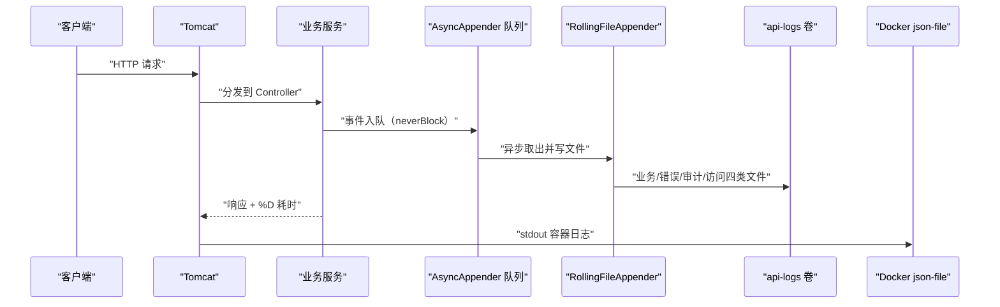
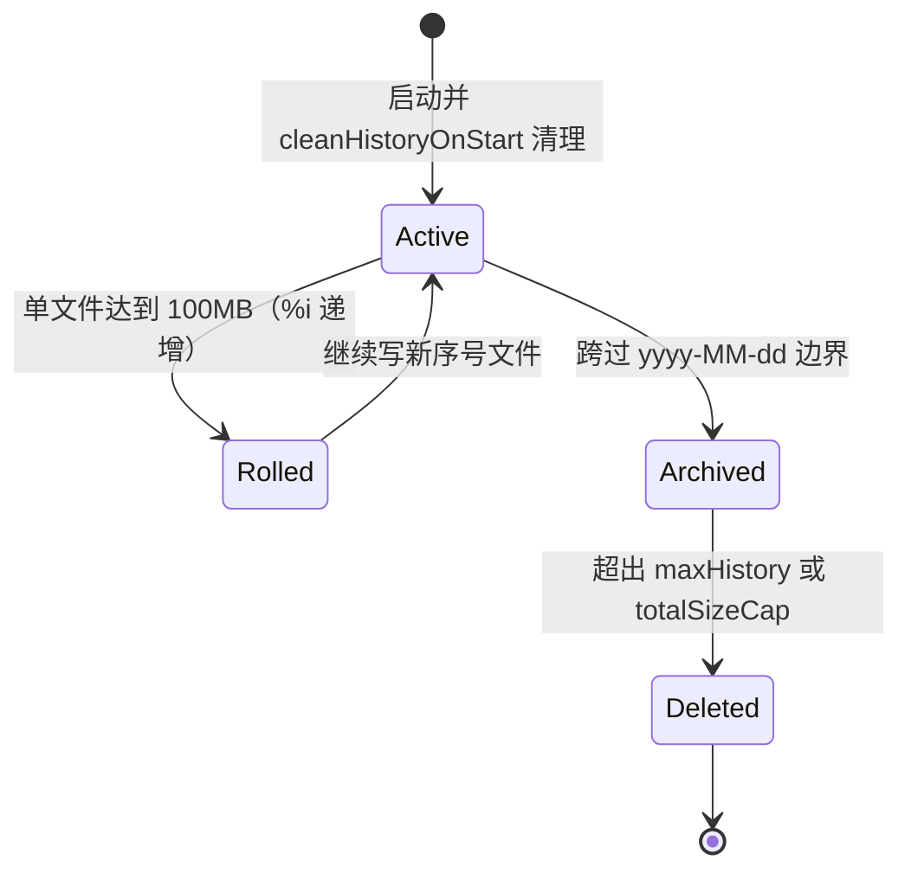
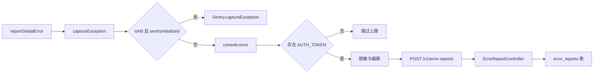
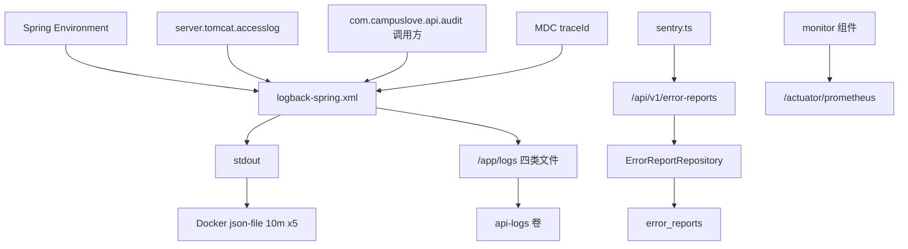
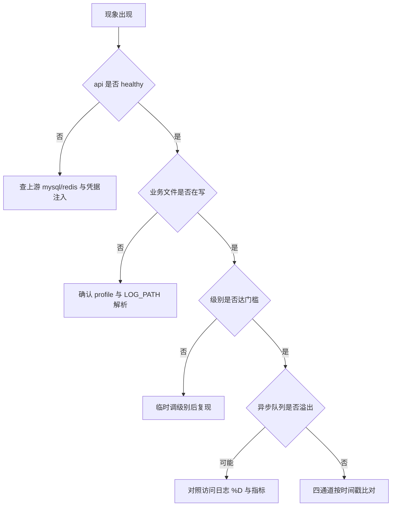

# 日志管理与故障排查

<cite>
**本文引用的文件**
- [logback-spring.xml](file://apps/api/src/main/resources/logback-spring.xml)
- [application.yml](file://apps/api/src/main/resources/application.yml)
- [application-real.yml](file://apps/api/src/main/resources/application-real.yml)
- [application-mock.yml](file://apps/api/src/main/resources/application-mock.yml)
- [application-wechat.yml](file://apps/api/src/main/resources/application-wechat.yml)
- [redisson-dev.yaml](file://apps/api/src/main/resources/redisson-dev.yaml)
- [docker-compose.yml](file://docker-compose.yml)
- [Dockerfile](file://apps/api/Dockerfile)
- [sentry.ts](file://apps/client/src/services/sentry.ts)
- [global-error.ts](file://apps/client/src/utils/global-error.ts)
- [ErrorReportController.java](file://apps/api/src/main/java/com/campuslove/api/report/ErrorReportController.java)
- [MediaAccessController.java](file://apps/api/src/main/java/com/campuslove/api/media/MediaAccessController.java)
- [AuthMetrics.java](file://apps/api/src/main/java/com/campuslove/api/monitor/AuthMetrics.java)
- [ChatMetrics.java](file://apps/api/src/main/java/com/campuslove/api/monitor/ChatMetrics.java)
- [MatchMetrics.java](file://apps/api/src/main/java/com/campuslove/api/monitor/MatchMetrics.java)
- [PaymentMetrics.java](file://apps/api/src/main/java/com/campuslove/api/monitor/PaymentMetrics.java)
- [VillageMetrics.java](file://apps/api/src/main/java/com/campuslove/api/monitor/VillageMetrics.java)
- [AsyncConfig.java](file://apps/api/src/main/java/com/campuslove/api/config/AsyncConfig.java)
- [CacheNames.java](file://apps/api/src/main/java/com/campuslove/api/config/CacheNames.java)
- [CacheTest.java](file://apps/api/src/test/java/com/campuslove/api/config/CacheTest.java)
</cite>

## 目录
1. [简介](#简介)
2. [项目结构](#项目结构)
3. [核心组件](#核心组件)
4. [架构总览](#架构总览)
5. [详细组件分析](#详细组件分析)
6. [前端错误捕获与用户行为日志](#前端错误捕获与用户行为日志)
7. [配置与开关](#配置与开关)
8. [故障排查工具链](#故障排查工具链)
9. [依赖关系分析](#依赖关系分析)
10. [性能考虑](#性能考虑)
11. [故障排查指南](#故障排查指南)
12. [日志分析与应急响应](#日志分析与应急响应)
13. [能力缺口登记](#能力缺口登记)
14. [结论](#结论)

## 简介
本页记录 Campus Love 仓库中"日志"与"故障排查"两条主线的真实落地情况：Spring Boot 后端如何由 `logback-spring.xml`（281 行）划分控制台、业务全量、错误专用、审计、访问日志五条通道并各自轮转；`docker-compose.yml` 与 `apps/api/Dockerfile` 如何决定日志根目录、持久化卷与健康探针；`monitor` 包指标组件与 Actuator 端点如何提供日志之外的第二条证据链；客户端 `sentry.ts` 与后端 `ErrorReportController` 如何构成跨端错误采集。

catalog 指令中提到但仓库没有对应实现（或证据不足）的能力，统一登记在"能力缺口登记"一节。

**章节来源**
- [logback-spring.xml:1-19](file://apps/api/src/main/resources/logback-spring.xml#L1-L19)
- [docker-compose.yml:190-204](file://docker-compose.yml#L190-L204)
- [Dockerfile:100-108](file://apps/api/Dockerfile#L100-L108)

## 项目结构
能力分散在四层，每层都能定位到具体文件：

- 配置层：`apps/api/src/main/resources/` 下的 `logback-spring.xml`、`application.yml`，同目录另有 `application-real.yml`、`application-mock.yml`、`application-wechat.yml` 与 `redisson-dev.yaml`（后四者仅列入清单，本页未逐行核证）。
- 运行层：`apps/api/Dockerfile`（镜像内日志目录、JVM 参数、HEALTHCHECK）与 `docker-compose.yml`（api 服务的卷挂载、探针、`logging` 驱动）。
- 代码层：`monitor` 包五个指标组件、`config/AsyncConfig.java` 线程池、`config/CacheNames.java` 缓存名清单、`media/MediaAccessController.java` 的审计 logger 持有者。
- 客户端层：`apps/client/src/services/sentry.ts` 与 `apps/client/src/utils/global-error.ts`，异常经 `POST /api/v1/error-reports` 汇入 `report/ErrorReportController.java`。

本页所有行号引用均来自逐行读到的文件：`logback-spring.xml`（281 行）、`application.yml`（477 行）、`apps/api/Dockerfile`（131 行）、`sentry.ts`、`global-error.ts`（37 行）、`ErrorReportController.java`（前 110 行）、`docker-compose.yml`（L96-L310 与检索命中行），`monitor`/`config` 文件的符号与总行数取自事实包。

**章节来源**
- [AuthMetrics.java:22-23](file://apps/api/src/main/java/com/campuslove/api/monitor/AuthMetrics.java#L22-L23)
- [CacheTest.java:54-57](file://apps/api/src/test/java/com/campuslove/api/config/CacheTest.java#L54-L57)
- [global-error.ts:9-18](file://apps/client/src/utils/global-error.ts#L9-L18)

## 核心组件
`<configuration scan="false" scanPeriod="30 seconds">`（`logback-spring.xml` L20）下声明 7 个 appender，其中 5 个是具体输出通道、2 个是异步包装：

| appender | 类 | 声明行 | 活动文件 | 说明 |
| --- | --- | --- | --- | --- |
| `CONSOLE` | `ConsoleAppender` | L58 | stdout | `charset` UTF-8（L61） |
| `FILE` | `RollingFileAppender` | L66 | `${LOG_PATH}/${APP_NAME}.log`（L67） | 全量业务日志 |
| `ERROR_FILE` | `RollingFileAppender` | L87 | `${APP_NAME}-error.log`（L88） | `ThresholdFilter` ERROR（L89-L91） |
| `AUDIT` | `RollingFileAppender` | L126 | `${LOG_PATH}/audit.log`（L127） | 单行 JSON（L141） |
| `ACCESS_FILE` | `RollingFileAppender` | L173 | `${APP_NAME}-access.log`（L174） | Tomcat 访问日志（L189-L191） |
| `ASYNC_FILE` | `AsyncAppender` | L222 | 包装 `FILE`（L226） | `queueSize` 2048（L224） |
| `ASYNC_ERROR_FILE` | `AsyncAppender` | L229 | 包装 `ERROR_FILE`（L233） | `queueSize` 1024（L231） |

路径与应用名来自 Spring 环境：`LOG_PATH` ← `app.logging.path`（缺省 `logs`，L23），`APP_NAME` ← `spring.application.name`（缺省 `campus-love-api`，L24），该属性在 `application.yml` L2-L3 显式定义为 `campus-love-api`。

指标组件均为 `@Component`：`AuthMetrics`（`recordLoginSuccess` L63、`recordLoginFailure` L76、`recordTokenRefresh` L91）、`ChatMetrics`（`recordMessageSent` L60、`recordMessageFailed` L77）、`MatchMetrics`（`recordSwipe` L87、`recordRecommendLatency` L120）、`PaymentMetrics`（`recordCallbackLatency` L61、`recordCallbackFailure` L79）、`VillageMetrics`（`recordPostCreated` L123、`recordPostLiked` L137）。它们与 Actuator 的 `health,info,prometheus,metrics` 暴露集（`application.yml` L94-L120）共同支撑无日志场景下的判断。

**章节来源**
- [logback-spring.xml:20-24](file://apps/api/src/main/resources/logback-spring.xml#L20-L24)
- [logback-spring.xml:58-103](file://apps/api/src/main/resources/logback-spring.xml#L58-L103)
- [logback-spring.xml:126-191](file://apps/api/src/main/resources/logback-spring.xml#L126-L191)

## 架构总览
一次请求的可观测数据沿四条通道离开进程，任一条单独看都不完整：stdout（`CONSOLE`，三套 profile 均挂在 `root`）、业务/错误文件（`real,prod` 下追加两个异步 appender）、审计文件（独立 logger，`additivity=false`）、访问日志（`org.apache.catalina.accesslog` → `ACCESS_FILE`）。

**图表来源**
- [logback-spring.xml:58-63](file://apps/api/src/main/resources/logback-spring.xml#L58-L63)
- [logback-spring.xml:66-104](file://apps/api/src/main/resources/logback-spring.xml#L66-L104)
- [logback-spring.xml:173-191](file://apps/api/src/main/resources/logback-spring.xml#L173-L191)

进程外还有两条汇入路径：媒体访问授权经 `MediaAccessController` 的 `AUDIT_LOG = LoggerFactory.getLogger("com.campuslove.api.audit")`（L102）写入审计文件；小程序端异常在 Sentry 不可用时经 `POST ${appEnv.apiBaseUrl}/v1/error-reports`（`sentry.ts` L498）提交给 `ErrorReportController`（L66-L91），返回 `201 CREATED`（L67）并落 `error_reports` 表。

**章节来源**
- [logback-spring.xml:213-215](file://apps/api/src/main/resources/logback-spring.xml#L213-L215)
- [MediaAccessController.java:102-102](file://apps/api/src/main/java/com/campuslove/api/media/MediaAccessController.java#L102-L102)
- [sentry.ts:455-506](file://apps/client/src/services/sentry.ts#L455-L506)

## 详细组件分析

### 业务全量通道与错误专用通道
`FILE`（L66-L84）不设级别过滤器，继承 `root` 的 `INFO` 门槛；`ERROR_FILE`（L87-L103）以 `ThresholdFilter` 限定 `ERROR`（L89-L91）。real/prod 下 `root` 同时引用两个异步 appender（L253-L254），ERROR 事件因此在两处重复出现：统计以 `*-error.log` 为准，查不到的异常先确认级别是否为 `WARN`。异步包装以 `neverBlock=true`（L223、L230）换取"队列满不阻塞业务线程"，注释直说是"生产环境推荐"（L218）；`discardingThreshold=0`（L225、L232）关闭"队列接近满时先丢 DEBUG/TRACE"的降级（L220），因此日志缺行属设计内结果，须与访问日志 `%D`/`%s`（`application.yml` L81）和指标计数交叉验证。

### profile × 级别矩阵
| profile 块 | `root` | appender | logger 覆盖 |
| --- | --- | --- | --- |
| `dev,local,mock`（L237-L247） | INFO | 仅 `CONSOLE` | `com.campuslove.api=DEBUG`（L242）、`org.hibernate.SQL=DEBUG`（L245）、`BasicBinder=TRACE`（L246） |
| `real,prod`（L250-L265） | INFO | `CONSOLE`+`ASYNC_FILE`+`ASYNC_ERROR_FILE` | `com.campuslove.api=INFO`（L257）、`org.springframework.web=WARN`（L259）、`com.zaxxer.hikari=WARN`（L262）、`io.lettuce=WARN`（L264） |
| `default`（L268-L273） | INFO | 仅 `CONSOLE` | `com.campuslove.api=DEBUG`（L272） |
| profile 无关 | — | — | `org.apache.catalina.accesslog=INFO`（L189）、`com.campuslove.api.audit=INFO`（L213）、`Http11NioProtocol=WARN`（L278） |

审计与访问两条通道在 dev/mock 下同样产出文件，可用于验证目录与权限。

### 轮转策略与容量
四条文件通道均为 `SizeAndTimeBasedRollingPolicy`：`%d{yyyy-MM-dd}` 负责日切、`%i` 是当日内按大小切割的序号、`totalSizeCap` 超限清理最老文件（设计说明 L12-L18）。

| 通道 | 归档名 | `maxFileSize` | `maxHistory` | `totalSizeCap` |
| --- | --- | --- | --- | --- |
| `FILE` | `${APP_NAME}.%d{yyyy-MM-dd}.%i.log`（L70） | 100MB（L72） | 30（L74） | 10GB（L76） |
| `ERROR_FILE` | `${APP_NAME}-error.%d{...}.%i.log`（L93） | 100MB（L94） | 30（L95） | 5GB（L96） |
| `AUDIT` | `audit.%d{yyyy-MM-dd}.%i.log`（L130） | 100MB（L132） | 90（L134） | 10GB（L136） |
| `ACCESS_FILE` | `${APP_NAME}-access.%d{...}.%i.log`（L176） | 100MB（L177） | 14（L178） | 5GB（L179） |

四者都设 `cleanHistoryOnStart=true`（L78、L97、L138、L180）；审计保留 90 天而业务仅 30 天，注释理由是"审计日志保留时间应长于业务日志，满足合规审计需求"（L117、L133）。容器 stdout 侧另有独立轮转（`json-file` + `max-size: 10m` + `max-file: 5`，compose L279-L283、L124-L128、L170-L174）；数据库侧为慢查询日志（`--long_query_time=2` → `/var/lib/mysql/slow.log`，L101-L103）与 ROW 格式 binlog（保留 604800 秒，注释 L104 说明用于 PITR 增量恢复，L105-L108）。

**图表来源**
- [logback-spring.xml:12-18](file://apps/api/src/main/resources/logback-spring.xml#L12-L18)
- [logback-spring.xml:66-104](file://apps/api/src/main/resources/logback-spring.xml#L66-L104)
- [logback-spring.xml:126-186](file://apps/api/src/main/resources/logback-spring.xml#L126-L186)

### 格式与敏感字段脱敏
单行 JSON 只用于审计通道：键为 `timestamp`/`level`/`logger`/`traceId`/`message`/`exception`，`timestamp` 取 `yyyy-MM-dd'T'HH:mm:ss.SSSZ`，`traceId` 来自 MDC 键 `traceId`（`%X{traceId}`），JSON 引号以 `&quot;` 转义（L54-L55，要点 L46-L52）。控制台与文件为文本 pattern：`%d{yyyy-MM-dd HH:mm:ss.SSS} [%thread] %-5level %logger{36} - <消息>`（L30-L35）。

脱敏由 pattern 内 `%replace` 对 `%msg` 与 `%ex` 各做一次替换实现（L31、L35、L55），命中字段名后跟 `=` 或 `:` 的值替换为 `字段名=***`，字段清单：`password`、`passwd`、`sessionToken`、`accessToken`、`refreshToken`、`secret`、`appSecret`、`jwtSecret`、`openId`、`unionId`；目标写在配置头注释 L7-L8。访问日志走另一条防泄露路径：pattern 使用 `%m %U`（方法 + 不含 query 的路径）而非请求首行 `%r`，原因是 query 可能携带 JWT/token（如 `/api/v1/media/{id}?token=xxx`），见 `application.yml` L68-L70 与 `logback-spring.xml` L162-L166；同一 pattern 还输出 `%u`、`%s`、`%D`、`%{X-Trace-Id}i`（L71-L81）。

配置注释称 JSON 审计格式"便于 ELK/Loki 等日志采集器解析"（L40），仓库内的采集侧部署未见证据（见能力缺口登记）。

**章节来源**
- [logback-spring.xml:7-8](file://apps/api/src/main/resources/logback-spring.xml#L7-L8)
- [logback-spring.xml:30-55](file://apps/api/src/main/resources/logback-spring.xml#L30-L55)
- [logback-spring.xml:113-138](file://apps/api/src/main/resources/logback-spring.xml#L113-L138)

## 前端错误捕获与用户行为日志
模块头注释给出设计目标：H5 用 `@sentry/vue` 上报异常与性能数据；mp-weixin 不加载 SDK，降级为 `console.error` + 上报后端 `/api/error-reports`；对外暴露统一 `captureException`（`sentry.ts` L1-L20）。

- 平台判定：`isH5 = typeof window !== "undefined"`（L30），`@sentry/vue` 的 import 在 `// #ifdef H5` 块内（L68-L70），构建小程序产物时被剥离（L16-L19）。
- 初始化：`initSentry(app)`（L83）非 H5 直接返回（L85-L87）；`readSentryDsn` 读 `process.env.VITE_SENTRY_DSN`（L49-L62），未配置则跳过并开发期告警（L90-L96）；启用 `tracesSampleRate: 0.2`（L104）与 `browserTracingIntegration()`（L106），初始化异常不阻断启动（L113-L117）。
- 统一出口：`reportGlobalError(source, err, context)`（`global-error.ts` L18-L37）先输出 `[Global Error][<source>]`，再把 `source`/`context` 并入 extra 交给 `captureException`；独立成模块是为切断 `App.vue ↔ main.ts` 循环依赖（L1-L8）。
- 分发：`captureException`（L143-L196）把 `context.source`、`http_url`、`http_status` 提升为 tag、其余作 extra（L151-L174）；未初始化或非 H5 时 `console.error` 后异步调用 `reportErrorToBackend`（L188-L195）。`captureMessage`（L214-L235）、`addBreadcrumb`（L258-L289，分类 `navigation`/`ui`/`http` 及业务节点，L241-L248）、`setUser`（L312-L345，`nickname` 映射为 `username`）、`clearUser`（L358-L375）同构。
- 兜底三道防护：无 `AUTH_TOKEN` 静默跳过（L460-L472，避免冷启动 401 噪音）；用 `uni.request` 绕开业务拦截器、`timeout: 5000`、`fail` 静默 resolve（L493-L505）；context 先经 `sanitizeContextForReport`——敏感 key 正则 `/token|authorization|password|secret|phone|idcard|id_card|cookie/i` 替换为 `***`（L392、L403-L405），值截断 1000 字符（L393、L408-L410）、数组留前 20 项（L417-L424），`message` 截 2000、`stack` 截 8000（L484-L485）。
- 服务端接收：`@Profile("real")`（L43）、映射 `/api/v1/error-reports`（L45）、`@RateLimit(capacity = 20, refillTokens = 2, key = "#request.remoteAddr")`（L68）；`context` 为 `JsonNode` 不受 `@Size` 约束，按序列化字节拒绝超 `MAX_CONTEXT_BYTES = 4096` 的请求（L52、L76-L80），请求体阈值与客户端一致（L106-L109）；该路径已 `permitAll`，避免"上报失败 → 再报错 → 再上报"级联（L29-L31）。

**图表来源**
- [global-error.ts:9-37](file://apps/client/src/utils/global-error.ts#L9-L37)
- [sentry.ts:30-33](file://apps/client/src/services/sentry.ts#L30-L33)
- [sentry.ts:143-196](file://apps/client/src/services/sentry.ts#L143-L196)

客户端注释亦记录脱敏边界："脱敏只覆盖 key 名匹配的字段，嵌套深层敏感字段仍可能漏网"（`sentry.ts` L479-L480）。性能数据前后端各自采样：客户端为 20% 事务采样（L104-L106），服务端为 `http.server.requests` 百分位直方图（`application.yml` L109-L113），二者不共享 trace 上下文。

**章节来源**
- [sentry.ts:1-33](file://apps/client/src/services/sentry.ts#L1-L33)
- [sentry.ts:49-119](file://apps/client/src/services/sentry.ts#L49-L119)
- [sentry.ts:143-289](file://apps/client/src/services/sentry.ts#L143-L289)

## 配置与开关
| 键 | 位置 | 值/默认 | 排障含义 |
| --- | --- | --- | --- |
| `app.logging.path` | `logback-spring.xml` L23 | 缺省 `logs` | 解析失败即回落相对目录 |
| `APP_LOGGING_PATH` | `Dockerfile` L103 | `/app/logs` | 与卷挂载点一致（compose L271） |
| `SPRING_PROFILES_ACTIVE` | `Dockerfile` L101、compose L203 | `real` | 决定是否写文件（L250-L255） |
| `spring.profiles.default` | `application.yml` L15 | `mock` | 仅测试引导生效；启动期 `main()` 强制校验并 fail-fast（L4-L14） |
| `APP_ACCESS_LOG_ENABLED` / `APP_ACCESS_LOG_DISABLED` | `application.yml` L66、L83 | `true` / `false` | 关闭后访问日志通道无数据 |
| `management.endpoints.web.exposure.include` | `application.yml` L103 | `health,info,prometheus,metrics` | 探针与指标端点存在性 |
| `management.endpoint.health.show-details` | `application.yml` L117 | `when_authorized` | 未授权看不到组件明细 |
| `JAVA_OPTS` | compose L255-L265、`Dockerfile` L89-L98 | G1GC、`MaxRAMPercentage=75.0`、`HeapDumpPath=/app/logs/heap-dump.hprof` | OOM 产物落在日志卷内 |

吞吐与连接基线：Tomcat 线程 `max` 200、`min-spare` 10、`accept-count` 100、`max-connections` 8192、`connection-timeout` 20s（`application.yml` L85-L90）；Multipart 50MB（L18-L21）；Redis 超时 3000ms 与 Lettuce 池参数（L24-L36）；RabbitMQ 连接超时 5000ms、监听重试 3 次（L41-L56），编排未部署 MQ 时由 `MessagingFallback` 降级（compose L243-L250、`application.yml` L37-L40）；Resilience4j 熔断与限流健康指示默认开启并汇入 `/actuator/health`（L461-L465）。

同目录的 `application-real.yml`、`application-mock.yml`、`application-wechat.yml`、`redisson-dev.yaml` 承载 profile 覆盖项，本页未逐行核证其内部键值。

**章节来源**
- [logback-spring.xml:20-24](file://apps/api/src/main/resources/logback-spring.xml#L20-L24)
- [logback-spring.xml:250-255](file://apps/api/src/main/resources/logback-spring.xml#L250-L255)
- [application.yml:16-56](file://apps/api/src/main/resources/application.yml#L16-L56)

## 故障排查工具链
**探针定义两层。** 镜像内 `HEALTHCHECK --interval=30s --timeout=5s --start-period=60s --retries=3 CMD curl -fsS http://localhost:8080/actuator/health || exit 1`（`Dockerfile` L106-L108），编排层同命令但 `start_period: 90s`、`retries: 5`（compose L273-L278，以 compose 生效值为准）。依赖服务用带凭据的探针：`mysqladmin ping`（L117-L123）、`redis-cli ping | grep -q PONG`（L163-L169），注释说明密码经容器环境变量传递而不进进程参数（L118、L164）。镜像已装 `curl` 与 `dumb-init`（`Dockerfile` L51-L59），后者作为 PID 1 转发信号（L110-L114）。

**取数位置速查。**

| 目标 | 位置 | 依据 |
| --- | --- | --- |
| stdout / 探针输出 | `docker compose logs api`（容器名 `campus-api`，Redis `campus-redis`） | compose L195、L146、L279-L283 |
| 业务全量 | `campus-love-api.log` 与按日归档 | `logback-spring.xml` L67、L70 |
| 错误聚合 | `campus-love-api-error.log` | L88、L93 |
| 审计回放 | `audit.log`（单行 JSON） | L127、L130 |
| 请求耗时/状态码 | `campus-love-api-access.log` | `application.yml` L81 |
| 慢 SQL | `/var/lib/mysql/slow.log`（阈值 2s） | compose L101-L103 |
| 数据增量取证 | ROW 格式 binlog，7 天 | compose L104-L108 |
| 客户端异常明细 | `error_reports` 表 | `ErrorReportController.java` L69-L91 |

**回归与旁证工具。** 缓存改动以 `CacheTest`（431 行）的 `caffeineCacheConfig`（L57）为回归入口，缓存名清单见 `CacheNames`（L12）；`@Async` 堆积先核对 `AsyncConfig` 的 `corePoolSize`/`maxPoolSize`/`queueCapacity`/`threadNamePrefix`/`keepAliveSeconds`（L65-L77）与 `taskExecutor()`（L89）。声明依赖中的 `scripts/debug-*.cjs`、`scripts/probe-*.cjs` 不存在（brief 已标注）。

**章节来源**
- [Dockerfile:51-59](file://apps/api/Dockerfile#L51-L59)
- [Dockerfile:89-114](file://apps/api/Dockerfile#L89-L114)
- [docker-compose.yml:117-169](file://docker-compose.yml#L117-L169)

## 依赖关系分析
**编排依赖。** `api` 要求 `mysql`、`redis` 达到 `service_healthy`（compose L197-L201），网络 `data-net` + `app-net` 均为 `driver: bridge`（L284-L286、L57-L60）；三个服务端口均绑 `127.0.0.1`（L111、L160、L266-L268），因此访问日志 `%h` 依赖反代与 `RemoteIpValve` 注入（`application.yml` L71），限流键可信性由 `app.security.trusted-proxies` 决定（L210-L216）。

**图表来源**
- [logback-spring.xml:23-24](file://apps/api/src/main/resources/logback-spring.xml#L23-L24)
- [logback-spring.xml:55-55](file://apps/api/src/main/resources/logback-spring.xml#L55-L55)
- [logback-spring.xml:189-191](file://apps/api/src/main/resources/logback-spring.xml#L189-L191)

**模块依赖方向。** `global-error.ts` 单向引用 `sentry.ts` 的 `captureException`（L9），后者依赖 `./env` 的 `appEnv`、`isDev`（L22）与 `STORAGE_KEYS`（L23），并刻意不反向引用 `services/http.ts` 以避免循环 import（L464-L465、L495-L496）——错误上报因此不走业务请求的鉴权与重试链。服务端链依赖 `ErrorReportRepository`（L7、L54）、`@RateLimit`（L6、L68）与 `TimeZones.BUSINESS`（L3、L83），整体受 `@Profile("real")` 约束（L43），mock 环境无该路由，客户端兜底上报静默失败（`sentry.ts` L504）。

**时间基准。** `-Duser.timezone=Asia/Shanghai`（`Dockerfile` L98、compose L265）、JDBC `serverTimezone=Asia/Shanghai`（L206）、审计 pattern 的带时区格式（L55）、`LocalDateTime.now(TimeZones.BUSINESS)`（L83）四处共同保证跨端对齐；比对差 8 小时时先核查这四处。

**章节来源**
- [global-error.ts:9-9](file://apps/client/src/utils/global-error.ts#L9-L9)
- [sentry.ts:22-23](file://apps/client/src/services/sentry.ts#L22-L23)
- [sentry.ts:464-506](file://apps/client/src/services/sentry.ts#L464-L506)

## 性能考虑
业务线程只负责把事件放入队列（`logback-spring.xml` L222-L234），磁盘写由 Logback 工作线程完成；`neverBlock=true` 把"队列满"从阻塞降级为丢事件，代价是高峰日志不完整。队列事件驻留堆内，叠加 `MaxRAMPercentage=75.0`（`Dockerfile` L90）与容器 `memory: 1g`（compose L291），停顿目标为 `MaxGCPauseMillis=200`（compose L260）。

每条日志要跑两次带捕获组的正则（`%msg` 与 `%ex`，L31、L35），堆栈越长成本越高；这正是生产把项目包降到 `INFO`、`org.hibernate.SQL` 降到 `WARN`（L257、L260）的原因，而 dev 的 `DEBUG` + `BasicBinder=TRACE`（L242、L246）会输出 SQL 与参数绑定。

磁盘侧四通道 `totalSizeCap` 合计 30GB（10+5+10+5，L76、L96、L136、L179）落在同一卷（compose L271），堆转储也在同目录（L262）；`cleanHistoryOnStart` 使每次启动都做一次清理（L78、L97、L138、L180），应结合 `start_period: 90s` 理解冷启动耗时。

客户端上报体积有明确上界：值截断 1000 字符、数组前 20 项（`sentry.ts` L393、L419）、请求 `timeout: 5000`（L502）、性能采样 20%（L104），服务端再按 4096 字节拒绝（`ErrorReportController.java` L52、L77-L80）。

**章节来源**
- [logback-spring.xml:31-35](file://apps/api/src/main/resources/logback-spring.xml#L31-L35)
- [logback-spring.xml:76-97](file://apps/api/src/main/resources/logback-spring.xml#L76-L97)
- [logback-spring.xml:136-180](file://apps/api/src/main/resources/logback-spring.xml#L136-L180)

## 故障排查指南
按"通道是否在写 → 级别是否被压制 → 事件是否被丢弃"的顺序排查。

**图表来源**
- [docker-compose.yml:197-214](file://docker-compose.yml#L197-L214)
- [docker-compose.yml:273-278](file://docker-compose.yml#L273-L278)
- [logback-spring.xml:23-24](file://apps/api/src/main/resources/logback-spring.xml#L23-L24)

### 容器 unhealthy 或反复重启
先核对探针本身（compose L273-L278，启动期 90s 内失败不计）；api 未起通常是上游未 healthy（`depends_on` L197-L201，MySQL/Redis 探针 L117-L123、L163-L169）；组件明细受 `show-details: when_authorized` 限制（`application.yml` L117），改由熔断/限流健康指示判断（L461-L465）；`restart: unless-stopped`（L196）每次拉起都触发启动清理（`logback-spring.xml` L78、L97、L138、L180）。

### 找不到日志文件
只有 `real,prod` 把文件 appender 挂到 `root`（L250-L255），其余 profile 仅 `CONSOLE`（L237-L247、L268-L273）。容器内路径 `/app/logs` 来自镜像 ENV（`Dockerfile` L103），而 compose 的 api `environment` 未重复该键（L202-L253），覆盖 ENV 即回落相对 `logs`（L23）。目录权限由 root 建目录后 `chown -R app:app /app`、再 `USER app`（L74-L78）。用不受 profile 限制的 `audit.log`、`*-access.log`（L189-L191、L213-L215）交叉验证目录是否可写。

### 连接与凭据
`MYSQL_PASSWORD`、`REDIS_PASSWORD`、`JWT_SECRET` 为强制注入（`${VAR:?}`，L209、L214、L217），缺失时报错发生在 compose 层。端口只绑 `127.0.0.1`（L111、L160、L266-L268），须进宿主机或容器内验证（镜像已装 `curl`，`Dockerfile` L54-L58）。生产把 `com.zaxxer.hikari`、`io.lettuce` 压到 `WARN`（L262、L264），连接抖动默认不可见；Redis 超时 3000ms、池 `max-wait: -1`（`application.yml` L30、L36）使池耗尽表现为等待而非失败；MQ 缺失属预期降级（compose L243-L250）。

### 慢请求与吞吐
`%D`/`%s` 定位个体慢请求（`application.yml` L81）→ `slow.log` 阈值 2s（compose L101-L103）→ 直方图分位（L109-L113）→ `MatchMetrics.recordRecommendLatency`（L120）与 `PaymentMetrics.recordCallbackLatency`（L61）→ 并发上限（L85-L89）与 `AsyncConfig.queueCapacity`（L71）。`allkeys-lru` 驱逐（L151-L152）会放大回源查询，可结合 `CacheTest`（L54-L57）与 `CacheNames`（L12）核对。

### 错误数量对不上
ERROR 同时写业务与错误文件（L253-L254），统计须去重；`ERROR_FILE` 只收 `ERROR` 及以上（L89-L91），`WARN` 仅在业务文件；队列满丢事件（L223、L230）会让两处同时缺行；`error_reports` 记录的是客户端捕获量，与服务端错误文件无包含关系，且未登录时不上报（`sentry.ts` L466-L472）。

### 前端异常采集不到
依次核对运行平台（非 H5 不初始化，`sentry.ts` L85-L87）、`VITE_SENTRY_DSN` 是否为空（L89-L96）、登录态（L466-L472）、服务端 profile（`ErrorReportController.java` L43）、context 是否超 4096 字节（L77-L80）、URL 前缀是否匹配（L498 对 L45）。熔断侧另需判读：微信 `failure-rate-threshold: 50`、`slow-call-duration-threshold: 3s`、`wait-duration-in-open-state: 30s` 且 `WeChatAuthException` 被忽略（`application.yml` L368-L384），对象存储为 60% / 10s / 60s（L386-L399）；上报接口按 IP `capacity = 20, refillTokens = 2` 限流（`ErrorReportController.java` L68），`error_reports` 停滞不代表客户端错误减少。

**章节来源**
- [logback-spring.xml:78-104](file://apps/api/src/main/resources/logback-spring.xml#L78-L104)
- [logback-spring.xml:150-180](file://apps/api/src/main/resources/logback-spring.xml#L150-L180)
- [logback-spring.xml:199-273](file://apps/api/src/main/resources/logback-spring.xml#L199-L273)

## 日志分析与应急响应
**可解析字段。** 文本通道前缀定长：时间戳、`[%thread]`、`%-5level`、`%logger{36}`（`logback-spring.xml` L31、L35），分别用于时间线对齐、并发聚类（线程名对应 `AsyncConfig` 的 `threadNamePrefix`，L74）、级别过滤与包级定位；审计行按 JSON 六键解析（L54-L55），`message` 内是调用方控制的 `key=value`（L50）；访问日志按 `%h %l %u %t "%m %U %s" %b %D` 解析（`application.yml` L81）。

**取证窗口。** 访问 14 天（L178）、业务与错误 30 天（L74、L95）、审计 90 天（L134）、stdout 约 5×10MB（compose L281-L282）、binlog 7 天（L108）、`error_reports` 无清理参数（`ErrorReportController.java` L85）。

**分级首动作。**

1. 服务不可用：执行既有探针命令确认端点（`Dockerfile` L107-L108），取 `*-error.log` 尾部与 `docker compose logs api`；api 未起回到上游健康状态（compose L197-L201）。
2. 错误风暴：先判级别是否真为 ERROR（L89-L91），再看熔断是否开启（`application.yml` L376、L394）；上报被限流时 `error_reports` 增长会停滞（`ErrorReportController.java` L68）。
3. 内存/被杀：卷内出现 `heap-dump.hprof` 即确认 dump 路径生效（`Dockerfile` L94-L95），对照 `memory: 1g` 与 `MaxRAMPercentage=75.0`（compose L291、L257）。
4. 数据一致性事故：优先审计通道（90 天）与 ROW binlog（L107、L134），注释说明 binlog 支撑 PITR（compose L104）。

**现场保全约束。** `api-logs` 为显式命名卷 `campus-api-logs`（L77-L78），带 `-v` 的销毁会连日志一起删除；崩溃自动重启（L196）触发启动清理，抓取须早于任何重启；`scan="false"`（L20）使临时改级别必须重启生效；profile 不可留空规避——`main()` 启动前强制校验并 fail-fast（`application.yml` L4-L14）。

**章节来源**
- [logback-spring.xml:31-55](file://apps/api/src/main/resources/logback-spring.xml#L31-L55)
- [logback-spring.xml:74-97](file://apps/api/src/main/resources/logback-spring.xml#L74-L97)
- [logback-spring.xml:134-186](file://apps/api/src/main/resources/logback-spring.xml#L134-L186)

## 能力缺口登记
以下条目为 catalog 指令覆盖但本页无法举证的项，逐条登记为"仓库里没有该能力/无证据"。

1. **探针/调试脚本族不存在**：声明依赖 `scripts/debug-*.cjs`、`scripts/probe-*.cjs` 路径无效（brief 已标注）；`scripts/qa/test-evidence-verdict.cjs` 等 QA 脚本与日志排障的对应关系未经核证，故不提供脚本用法与自定义诊断工具开发指导。
2. **全量 JSON 日志未实现**：JSON 仅见于 `AUDIT_PATTERN`（`logback-spring.xml` L54-L55），全文 281 行内无 `LogstashEncoder`/`JsonLayout` 之类编码器；其余通道均为文本 pattern（L30-L35）。
3. **集中式采集无证据**：注释称便于 ELK/Loki 解析（L40），但本页读取的 compose 区段（L96-L310）与 `logs`/`logging`/`volumes`/`healthcheck` 检索均未出现 Loki/Promtail/Filebeat/ELK 定义，各服务 `logging` 均为本地 `json-file`；compose 其余区段（L311-L663）未逐行核证，故记为"未证实"。
4. **服务端 Sentry 无证据**：`logback-spring.xml` 与 `application.yml` 无 Sentry appender 或 DSN 键，服务端错误追踪依赖 `*-error.log` 与 `error_reports`。
5. **`traceId` 注入实现未定位**：`%X{traceId}`（L55）与 `X-Trace-Id`（`application.yml` L81）存在，注释称由"Logback MDCFilter / Spring Cloud Sleuth"注入（L49），但本页未定位该过滤器或 Sleuth 依赖，审计中该字段是否恒为空需实测。
6. **Sentry 调用点与配置未核证**：`main.ts`、`services/http.ts`、`apps/client/.env.example` 命中 `sentry` 关键字，且 `sentry.ts` L247 注明 HTTP 面包屑由 `services/http.ts` 记录，但内容未经打开，故不描述 `initSentry` 调用时机与 DSN 取值来源。
7. **上报端点前缀待校验**：`${appEnv.apiBaseUrl}/v1/error-reports`（L498）与服务端 `/api/v1/error-reports`（`ErrorReportController.java` L45）能否匹配取决于未核证的 `services/env.ts`。
8. **独立用户行为日志平台无实现**：现有能力为面包屑（L258-L289）、Sentry 用户身份（L312-L345）与服务端计数（`VillageMetrics` L123、L137、L154）。
9. **`error_reports` 消费侧未证实**：写入已核证（L69-L91），`ErrorReport` 实体与 `database/flyway/sql/V2026.08.07.0027__create_error_reports.sql` 仅存在性命中，未找到查询、导出或清理实现。
10. **Prometheus/Grafana 抓取侧未证实**：端点与直方图开关存在（`application.yml` L94-L120），无抓取配置或看板进入取证范围。
11. **`app.logging.path` 未在配置文件声明**：`application.yml` 的 `app:` 段（L159-L350）不含该键，实际值来自镜像 `ENV APP_LOGGING_PATH`（`Dockerfile` L103），非容器运行回落 `logs`（L23）。
12. **访问日志桥接前提待实测**：配置仅设 `enabled`/`pattern`/`condition-unless`（`application.yml` L64-L83），未指定 accesslog 的 logger 名与目录，logback 却按 `org.apache.catalina.accesslog` 路由（L189）；是否生成 `*-access.log` 须以运行时为准。
13. **CI 层日志未取证**：`.github/workflows/`、`docker/` 未进入核证范围，仅 `Dockerfile` 的 Trivy 扫描阶段有证据（L116-L131），故不描述工作流的日志归档与失败诊断步骤。

**章节来源**
- [logback-spring.xml:30-55](file://apps/api/src/main/resources/logback-spring.xml#L30-L55)
- [logback-spring.xml:116-191](file://apps/api/src/main/resources/logback-spring.xml#L116-L191)
- [application.yml:64-120](file://apps/api/src/main/resources/application.yml#L64-L120)

## 结论
本仓库日志能力分层自治：Logback 用 5 个通道 + 2 个异步包装划分业务、错误、审计、访问四类文件（`logback-spring.xml` L58-L234），容器层以命名卷与 `json-file` 分别保全文件与 stdout（`docker-compose.yml` L77-L78、L271、L279-L283），镜像层固化日志根目录与探针（`Dockerfile` L103、L107-L108），客户端以 Sentry 优先、自有接口兜底（`sentry.ts` L83-L196、L455-L510），服务端以 Actuator 与 `*Metrics` 组件补足量化视角（`application.yml` L94-L120）。

四条可落地结论：通道由 profile 决定（`logback-spring.xml` L237-L273），审计与访问两条不受 profile 限制（L189-L191、L213-L215）；保留期即取证窗口（14/30/30/90 天）；`neverBlock=true` 下日志缺行属设计内结果，须用访问日志 `%D` 与指标交叉验证；改配置必须重启（`scan="false"`），而重启即触发 `cleanHistoryOnStart` 清理，现场抓取要早于任何一次重启。

**章节来源**
- [logback-spring.xml:58-104](file://apps/api/src/main/resources/logback-spring.xml#L58-L104)
- [logback-spring.xml:126-234](file://apps/api/src/main/resources/logback-spring.xml#L126-L234)
- [logback-spring.xml:237-279](file://apps/api/src/main/resources/logback-spring.xml#L237-L279)
