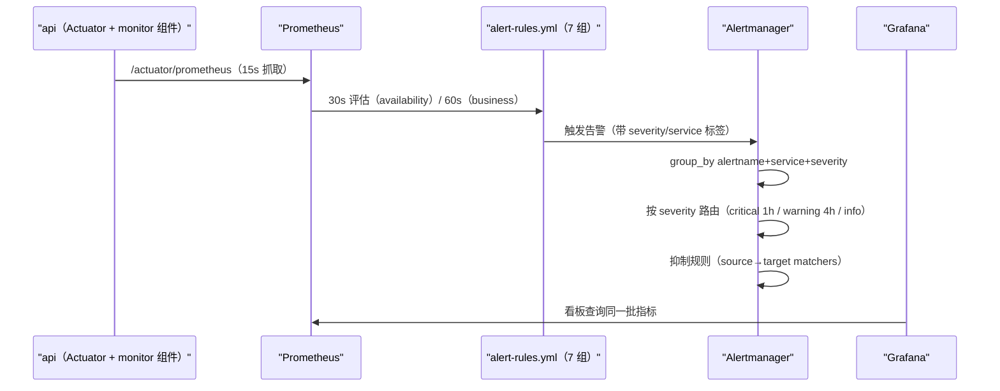
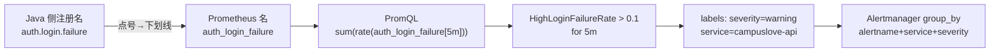
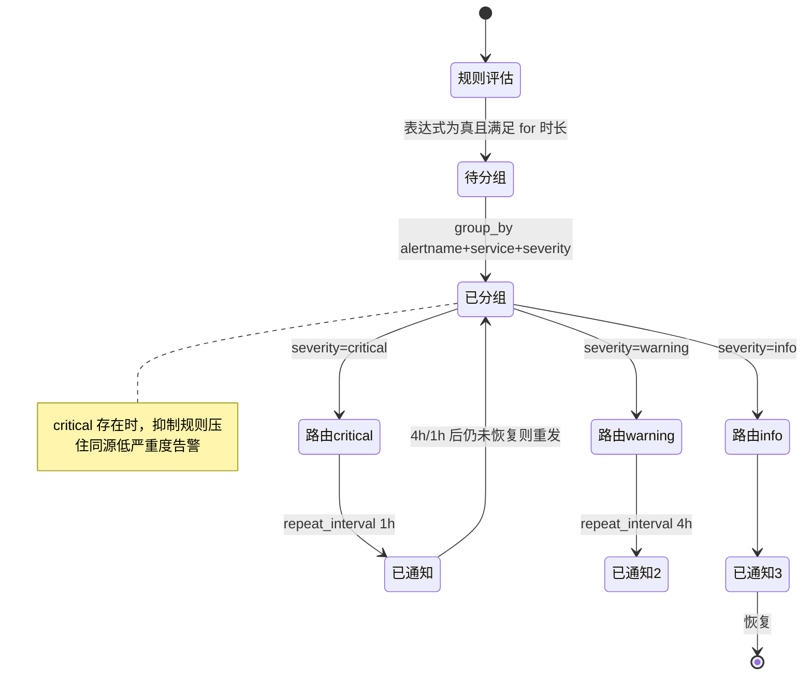

# 监控告警

<cite>
**本文引用的文件**
- [prometheus.yml](file://docker/prometheus/prometheus.yml)
- [alert-rules.yml](file://docker/prometheus/rules/alert-rules.yml)
- [alertmanager.yml](file://docker/alertmanager/alertmanager.yml)
- [docker-compose.yml](file://docker-compose.yml)
- [AuthMetrics.java](file://apps/api/src/main/java/com/campuslove/api/monitor/AuthMetrics.java)
- [ChatMetrics.java](file://apps/api/src/main/java/com/campuslove/api/monitor/ChatMetrics.java)
- [MatchMetrics.java](file://apps/api/src/main/java/com/campuslove/api/monitor/MatchMetrics.java)
- [VillageMetrics.java](file://apps/api/src/main/java/com/campuslove/api/monitor/VillageMetrics.java)
- [PaymentMetrics.java](file://apps/api/src/main/java/com/campuslove/api/monitor/PaymentMetrics.java)
- [logback-spring.xml](file://apps/api/src/main/resources/logback-spring.xml)
- [Dockerfile](file://apps/api/Dockerfile)
- [application.yml](file://apps/api/src/main/resources/application.yml)
- [RecommendationCacheManager.java](file://apps/api/src/main/java/com/campuslove/api/discover/RecommendationCacheManager.java)
- [verify-env-release.mjs](file://scripts/verify-env-release.mjs)
- [package.json](file://apps/client/package.json)
- [release-chain.mjs](file://apps/client/scripts/release-chain.mjs)
- [.gitignore](file://.gitignore)
- [DEPLOYMENT.md](file://doc/DEPLOYMENT.md)
</cite>

## 目录
1. [简介](#简介)
2. [项目结构](#项目结构)
3. [核心组件](#核心组件)
4. [架构总览](#架构总览)
5. [指标采集与抓取节奏](#指标采集与抓取节奏)
6. [业务指标注册点](#业务指标注册点)
7. [告警规则分组](#告警规则分组)
8. [规则文件装载与热加载](#规则文件装载与热加载)
9. [阈值设计原则](#阈值设计原则)
10. [可用性告警](#可用性告警)
11. [性能与错误率告警](#性能与错误率告警)
12. [JVM 与数据库告警](#jvm-与数据库告警)
13. [主机资源告警](#主机资源告警)
14. [业务指标告警](#业务指标告警)
15. [告警路由与抑制](#告警路由与抑制)
16. [看板与日志的关系](#看板与日志的关系)
17. [发布环境覆盖档校验](#发布环境覆盖档校验)
18. [当前静默或不完整的规则](#当前静默或不完整的规则)
19. [依赖关系分析](#依赖关系分析)
20. [性能考虑](#性能考虑)
21. [故障排查指南](#故障排查指南)
22. [结论](#结论)

## 简介
可观测栈由三个容器组成：Prometheus（抓取 + 规则评估）、Alertmanager（分组、路由、抑制）、
Grafana（看板），全部在 `docker-compose.yml` 内声明
（`prometheus` L399、`grafana` L449、`alertmanager` L499、`node-exporter` L546）。

告警面由一份规则文件定义：`docker/prometheus/rules/alert-rules.yml`，
按"P0/P1/P2"三级严重度组织；路由在 `docker/alertmanager/alertmanager.yml`（135 行）。
指标来源有两类：Spring Boot Actuator 自带的 JVM/HikariCP/HTTP 指标，
以及 `apps/api/.../monitor/` 下 5 个 `@Component` 显式注册的业务指标。

关于规则文件的两个口径必须先说清，否则各文档的计数会互相打架：

- **行数**：`wc -l` 口径 **354 行**（等于换行符数），逐行切分（`split('\n')` / Python `splitlines`
  一类"含末尾空尾行"）口径 **355 行**；两者相差 1 的唯一原因是文件以换行符结尾
  （末条 annotation 在 L354）。本文所有行号引用按 `wc -l` 口径，即最大可引用行号为 354，
  与 `node .qoder/wiki_verify.cjs` 的行校验（它切分后弹掉尾部空元素）保持一致。
- **规则条数**：**19 条生效 + 3 条被注释 = 22 条 `alert:` 声明**。
  生效数取缩进 6 空格的 `      - alert:` 形式（`grep -c "^      - alert:"` = 19）；
  注释掉的 3 条分别是 `AdminDown`(L49，缩进 6 空格的 `      # - alert:`) 与
  `WechatApiUnreachable`(L268)、`AgnesApiUnreachable`(L280)（这两条属于整组被注释的
  `third-party-availability`，缩进为 `  #     - alert:`，用 6 空格正则会漏数）。
  分组同理：**7 个生效分组 + 1 个整组注释**。旧版本文档写的"21 条生效"既没区分注释行、
  也没区分两种缩进，属错误值。

## 项目结构
- `docker/prometheus/prometheus.yml`（69 行）：全局抓取与评估参数、作业清单、规则文件加载。
- `docker/prometheus/rules/alert-rules.yml`（`wc -l` 口径 354 行 / 含空尾行口径 355 行）：
  7 个生效规则分组（`api-availability` L15、`api-performance` L61、`api-errors` L109、
  `jvm-health` L142、`database-health` L187、`host-resources` L215、`business-metrics` L291），
  外加 1 个整组注释的 `third-party-availability`（L263-L288）。
- `docker/alertmanager/alertmanager.yml`（135 行）：`route` L49、`receivers` L98、抑制规则 L85-L93。
- `docker/grafana/provisioning` 与 `docker/grafana/dashboards`：声明式数据源与看板。
- `apps/api/src/main/java/com/campuslove/api/monitor/`：`AuthMetrics`(98 行)、
  `ChatMetrics`(111 行)、`MatchMetrics`(128 行)、`VillageMetrics`(162 行)、
  `PaymentMetrics`(90 行)。
- `apps/api/src/main/resources/application.yml`（476 行）：Actuator 端点暴露与
  `management.metrics` 配置（L104-L113），决定哪些指标真的带直方图桶。
- `scripts/verify-env-release.mjs`（97 行）：release 构建的环境变量门禁（发布侧防线，
  与告警侧共同保证"打后端"的是同一个 HTTPS 域名）。
- `doc/DEPLOYMENT.md`（994 行，注意目录是 `doc` 不带 `s`）：运维手册，其"监控与告警"
  小节 L756-L788 与规则文件存在明显漂移（见「当前静默或不完整的规则」）。

**章节来源**
- [prometheus.yml:1-69](file://docker/prometheus/prometheus.yml#L1-L69)
- [alert-rules.yml:15-291](file://docker/prometheus/rules/alert-rules.yml#L15-L291)
- [alert-rules.yml:263-288](file://docker/prometheus/rules/alert-rules.yml#L263-L288)
- [alertmanager.yml:49-98](file://docker/alertmanager/alertmanager.yml#L49-L98)
- [docker-compose.yml:399-399](file://docker-compose.yml#L399-L399)
- [docker-compose.yml:546-546](file://docker-compose.yml#L546-L546)
- [application.yml:104-113](file://apps/api/src/main/resources/application.yml#L104-L113)
- [DEPLOYMENT.md:756-788](file://doc/DEPLOYMENT.md#L756-L788)

## 核心组件
- **抓取参数**（`prometheus.yml` L22-L24）：`scrape_interval: 15s`、
  `evaluation_interval: 30s`、`scrape_timeout: 10s`，
  注释说明超时特意小于间隔以"保证不重叠"。
- **作业**：自监控 `job_name: prometheus` 抓 `localhost:9090`(L42-L44)；
  业务 `job_name: campuslove-api`，独立 `scrape_interval: 15s`(L52) 抓 `api:8080`(L54-L55)；
  `node-exporter` 作业**处于注释状态**(L65-L66)。
- **规则分组节奏**：`api-availability` 的 `interval: 30s`(L16)，
  `business-metrics` 的 `interval: 60s`(L292)——业务类告警评估更慢，避免抖动误报。
- **路由**：`group_by: ['alertname', 'service', 'severity']`(L51)、
  默认 `repeat_interval: 4h`(L57)，按 `severity` 分子路由：
  `critical` 1h(L64-L68)、`warning` 4h(L71-L75)、`info`(L77-L78)。

**章节来源**
- [prometheus.yml:22-66](file://docker/prometheus/prometheus.yml#L22-L66)
- [alert-rules.yml:15-16](file://docker/prometheus/rules/alert-rules.yml#L15-L16)
- [alert-rules.yml:291-292](file://docker/prometheus/rules/alert-rules.yml#L291-L292)
- [alertmanager.yml:49-78](file://docker/alertmanager/alertmanager.yml#L49-L78)

## 架构总览


[此图为概念流程，不直接对应具体源文件，故不提供图表来源]

## 指标采集与抓取节奏
指标出口是 `/actuator/prometheus`，因此 `monitor` 包里的组件只需向 Micrometer 注册即可被导出。
命名映射有一条明确规则，写在业务指标分组的注释里（L296-L297）：
应用侧注册 `auth.login.success` / `auth.login.failure`
（`AuthMetrics.java:30-32`），Prometheus 侧导出为 `auth_login_success` / `auth_login_failure`
——**点号变下划线**，这是 PromQL 表达式与 Java 代码之间的对齐约定，
也是历史上出过错的地方（注释标注为 infra R2-00004"指标名对齐应用实际注册的"）。

抓取节奏上的三点设计：
1. 全局 15s 抓取、30s 评估(L22-L23)——评估间隔是抓取的两倍，
   保证一次评估看到的是完整采样。
2. `scrape_timeout: 10s` 小于 `scrape_interval`(L24)，注释理由是"保证不重叠"。
3. 分组自带 `interval`（可用性 30s、业务 60s），
   覆盖全局评估节奏，让不同风险等级用不同灵敏度。



**图表来源**
- [alert-rules.yml:296-305](file://docker/prometheus/rules/alert-rules.yml#L296-L305)
- [AuthMetrics.java:63-76](file://apps/api/src/main/java/com/campuslove/api/monitor/AuthMetrics.java#L63-L76)
- [alertmanager.yml:51-51](file://docker/alertmanager/alertmanager.yml#L51-L51)

**章节来源**
- [prometheus.yml:22-24](file://docker/prometheus/prometheus.yml#L22-L24)
- [alert-rules.yml:16-16](file://docker/prometheus/rules/alert-rules.yml#L16-L16)
- [alert-rules.yml:292-297](file://docker/prometheus/rules/alert-rules.yml#L292-L297)

## 业务指标注册点
`monitor` 包五个组件是业务指标的唯一注册处，方法名即指标语义：

| 组件 | 行数 | 关键方法 | 服务的告警 |
|---|---|---|---|
| `AuthMetrics` | 98 | `recordLoginSuccess(Long userId)`(L63)、`recordLoginFailure(String reason)`(L76)、`recordTokenRefresh()`(L91) | `HighLoginFailureRate` |
| `ChatMetrics` | 111 | `recordMessageSent(String messageType)`(L60)、`recordMessageFailed(String reason)`(L77)、`incrementActiveSession()`(L92)、`decrementActiveSession()`(L103) | `ChatMessageSendFailure` |
| `MatchMetrics` | 128 | `recordSwipe(String direction)`(L87)、`recordMatchSuccess()`(L107)、`recordRecommendLatency(long durationMs)`(L120) | `MatchRecommendSlowP99` |
| `PaymentMetrics` | 90 | `recordCallbackLatency(long durationMs)`(L61)、`recordCallbackFailure(String reason)`(L79) | `PaymentCallbackFailure` |
| `VillageMetrics` | 162 | `refreshPostTotalCache()`(L107)、`recordPostCreated()`(L123)、`recordPostLiked(Long postId)`(L137)、`recordCommentCreated()`(L154) | 社区内容趋势（看板侧） |

**但"组件里有方法"不等于"告警有数据"**——三条 2026-10-05 补充的业务告警要按写入点逐个核：

| 告警 | 数据源指标 | 生产写入点 | 结论 |
|---|---|---|---|
| `PaymentCallbackFailure` | `payment_callback_failure_total` | `BillingController` L137/L149/L155/L168/L180/L197、`WxPayRefundNotifyController` L94/L106/L112/L125/L137/L153、`VipOrderService.recordFailure()` L615-L619 | **已接线**，首次失败即产生序列 |
| `ChatMessageSendFailure` | `chat_message_failed_total` | `ChatMetrics.recordMessageFailed()`(L77) 在全仓 `apps/api/src` 内**无任何调用方**（`ChatMetrics` 只是被 `@Component` 实例化，L23） | **未接线**，指标恒无序列，规则静默 |
| `MatchRecommendSlowP99` | `match_recommend_latency_seconds_bucket` | `recordRecommendLatency()` 由 `RecommendationCacheManager` L121/L159/L242 调用（计时器本身有样本） | **有埋点但无桶**：`MatchMetrics` 只 `.publishPercentiles(0.5,0.95,0.99)`(L75-L78)，Prometheus 侧导出为带 `quantile` 的 summary，`_bucket` 序列需要 `percentiles-histogram`，而 `application.yml` 只对 `http.server.requests` 打开（L109-L113）→ `histogram_quantile()` 无输入，规则静默 |

也就是说 `business-metrics` 分组 4 条规则里，当前代码状态下**至多 2 条**（登录失败率、支付回调失败）
有机会响，而且这两条还共用一种 counter 命名口径的赌注（详见「当前静默或不完整的规则」第 11 条）。

这些组件同时是**排障入口**：例如 `ChatMetrics` 的
`recordMessageSent` / `recordMessageFailed` 比值可以区分"发送侧失败"与"接收侧丢失"，
`incrementActiveSession` / `decrementActiveSession` 是否成对则反映是否存在
未走正常关闭路径的连接。

**章节来源**
- [AuthMetrics.java:63-91](file://apps/api/src/main/java/com/campuslove/api/monitor/AuthMetrics.java#L63-L91)
- [ChatMetrics.java:23-103](file://apps/api/src/main/java/com/campuslove/api/monitor/ChatMetrics.java#L23-L103)
- [MatchMetrics.java:75-120](file://apps/api/src/main/java/com/campuslove/api/monitor/MatchMetrics.java#L75-L120)
- [PaymentMetrics.java:61-79](file://apps/api/src/main/java/com/campuslove/api/monitor/PaymentMetrics.java#L61-L79)
- [VillageMetrics.java:107-154](file://apps/api/src/main/java/com/campuslove/api/monitor/VillageMetrics.java#L107-L154)
- [BillingController.java:137-197](file://apps/api/src/main/java/com/campuslove/api/vip/BillingController.java#L137-L197)
- [WxPayRefundNotifyController.java:94-153](file://apps/api/src/main/java/com/campuslove/api/wxpay/WxPayRefundNotifyController.java#L94-L153)
- [VipOrderService.java:614-619](file://apps/api/src/main/java/com/campuslove/api/vip/VipOrderService.java#L614-L619)
- [RecommendationCacheManager.java:121-242](file://apps/api/src/main/java/com/campuslove/api/discover/RecommendationCacheManager.java#L121-L242)
- [application.yml:104-113](file://apps/api/src/main/resources/application.yml#L104-L113)

## 告警规则分组
7 个生效分组 / 19 条生效规则 + 1 个整组注释（`third-party-availability`）/ 3 条注释规则。
**每个分组都显式声明了 `interval:`**（不是省略后走全局 30s）：6 组 30s、`business-metrics` 60s。

| 分组 | 起始行 | interval | 规则（alert 声明所在行） |
|---|---|---|---|
| `api-availability` | L15 | 30s(L16) | `ApiDown`(L20)、`ApiHealthCheckFailed`(L35)；`AdminDown` 整条被注释(L49-L58) |
| `api-performance` | L61 | 30s(L62) | `ApiHighLatencyP99`(L67)、`ApiHighLatencyP95`(L82)、`ApiSlowAverageResponse`(L96) |
| `api-errors` | L109 | 30s(L110) | `ApiHighErrorRate`(L115)、`ApiHighClientErrorRate`(L129) |
| `jvm-health` | L142 | 30s(L143) | `JvmHeapMemoryHigh`(L148)、`JvmThreadsHigh`(L161)、`JvmFrequentFullGc`(L175) |
| `database-health` | L187 | 30s(L188) | `DbConnectionPoolHigh`(L192)、`DbSlowQuery`(L204) |
| `host-resources` | L215 | 30s(L216) | `HostDiskHigh`(L221)、`HostMemoryHigh`(L235)、`HostCpuHigh`(L247)；紧随其后的 `third-party-availability` 整组被注释(L263-L288)，含 `WechatApiUnreachable`(L268)、`AgnesApiUnreachable`(L280) |
| `business-metrics` | L291 | 60s(L292) | `HighLoginFailureRate`(L298)、`PaymentCallbackFailure`(L316)、`ChatMessageSendFailure`(L329)、`MatchRecommendSlowP99`(L343) |

按 severity 汇总这 19 条生效规则（`grep -c "^          severity: "` 逐值计数）：
**critical 2 条**（`ApiDown` L24、`ApiHealthCheckFailed` L39）、
**warning 12 条**（`ApiHighLatencyP99` L74、`ApiHighErrorRate` L121、`JvmHeapMemoryHigh` L153、
`JvmFrequentFullGc` L180、`DbConnectionPoolHigh` L197、`DbSlowQuery` L208、`HostDiskHigh` L226、
`HostMemoryHigh` L240、`HighLoginFailureRate` L304、`PaymentCallbackFailure` L320、
`ChatMessageSendFailure` L334、`MatchRecommendSlowP99` L350）、
**info 5 条**（`ApiHighLatencyP95` L89、`ApiSlowAverageResponse` L102、`ApiHighClientErrorRate` L135、
`JvmThreadsHigh` L165、`HostCpuHigh` L252）。
业务类 4 条**清一色 warning**——包括涉及资金的支付回调失败，全文件没有一个业务告警升到 critical。

**章节来源**
- [alert-rules.yml:15-58](file://docker/prometheus/rules/alert-rules.yml#L15-L58)
- [alert-rules.yml:61-135](file://docker/prometheus/rules/alert-rules.yml#L61-L135)
- [alert-rules.yml:142-208](file://docker/prometheus/rules/alert-rules.yml#L142-L208)
- [alert-rules.yml:215-288](file://docker/prometheus/rules/alert-rules.yml#L215-L288)
- [alert-rules.yml:291-354](file://docker/prometheus/rules/alert-rules.yml#L291-L354)

## 规则文件装载与热加载
规则不是"放在 `docker/prometheus/rules/` 就自动生效"，链路上有三处必须同时对齐：

1. **容器内路径**：`prometheus.yml` 用 glob 声明规则目录
   ```yaml
   rule_files:
     - /etc/prometheus/rules/*.yml
   ```
   （L27-L28）——注意是 `*.yml`，**不是 `*.yaml`**；新建规则文件若用 `.yaml` 后缀会被静默忽略。
2. **挂载**：`docker-compose.yml` 的 `prometheus` 服务把整个规则目录只读挂进容器
   `- ./docker/prometheus/rules:/etc/prometheus/rules:ro`(L422)，同批挂载还有主配置
   `./docker/prometheus/prometheus.yml:/etc/prometheus/prometheus.yml:ro`(L421)
   与数据卷 `prometheus-data:/prometheus`(L420)；启动命令显式指定配置位置
   `--config.file=/etc/prometheus/prometheus.yml`(L406)。
   因为是目录级挂载，**新增/修改规则文件不需要改 compose**，只要落进 `docker/prometheus/rules/`。
3. **热加载入口**：compose 启动了 `--web.enable-lifecycle`(L411)，
   因此改完规则可以 `POST http://localhost:9090/-/reload` 让 Prometheus 重读
   `rule_files`，无需重建容器；未带该参数时只能靠重启生效。
   另外 `--web.enable-lifecycle` 只对 `rule_files` / scrape 配置生效，
   Alertmanager 侧的配置挂载是单文件级
   `./docker/alertmanager/alertmanager.yml:/etc/alertmanager/alertmanager.yml:ro`(L515)、
   由 `--config.file=/etc/alertmanager/alertmanager.yml`(L506) 指定，改动需重启 Alertmanager。

评估节奏在装载之后才起作用：全局 `evaluation_interval: 30s` 是默认值，
分组级 `interval:` 覆盖它（见上表），所以 `business-metrics` 的 4 条规则实际每 60s 求值一次。

**章节来源**
- [prometheus.yml:26-36](file://docker/prometheus/prometheus.yml#L26-L36)
- [docker-compose.yml:404-422](file://docker-compose.yml#L404-L422)
- [docker-compose.yml:504-515](file://docker-compose.yml#L504-L515)


## 阈值设计原则
文件头部把设计原则写成三条(L4-L9)：

1. **避免误报**：阈值基于 SLO 与历史基线，"触发后 5 分钟内持续异常才告警"
   （对应规则里的 `for: 5m`，如 `ApiDown` L22、`HighLoginFailureRate` L302、
   `ChatMessageSendFailure` L332；`JvmThreadsHigh` L163 与 `ApiHighLatencyP95` L87 则是 `for: 10m`）。
   **这条原则不是全覆盖的**：`PaymentCallbackFailure`(L316-L324) 整条规则**没有 `for:` 键**
   （L318 表达式之后直接就是 L319 的 `labels:`），也就是单次求值满足
   `increase(...) > 0` 就进入 pending、下一个分组评估周期（60s）即可 fired——
   对资金类告警刻意"宁滥勿缺"，与头部原则第 1 条相反，改规则时不要误当作漏写补上。
2. **优先级清晰**：`critical` = P0 需立即处理（服务不可用、数据丢失）；
   `warning` = P1 需 1 小时内响应（性能下降、容量预警）；
   `info` = P2 提示，纳入日报（趋势异常）(L7-L9)。
3. **标签驱动路由**：每条规则都带 `severity` 与 `service` 标签
   （如 `ApiDown` 的 L23-L25、`HighLoginFailureRate` 的 L303-L305），
   Alertmanager 的分组与子路由完全依赖这两个标签(L51、L64-L78)。

严重度分配体现取舍：`ApiHighLatencyP99` 是 `warning`(L74)，
而同一指标的 `P95` 与平均值退化只是 `info`(L89、L102)；
`ApiHighErrorRate` 是 `warning`(L121)、`ApiHighClientErrorRate`（4xx）是 `info`(L135)；
`JvmThreadsHigh` 也归 `info`(L165)。也就是**趋势观察类（P95/均值/4xx/线程数/CPU）留在 info，
一旦是"SLO 违约或容量逼近上限"就升到 warning，只有"服务不在了"才是 critical**。

**章节来源**
- [alert-rules.yml:4-9](file://docker/prometheus/rules/alert-rules.yml#L4-L9)
- [alert-rules.yml:19-30](file://docker/prometheus/rules/alert-rules.yml#L19-L30)
- [alert-rules.yml:67-135](file://docker/prometheus/rules/alert-rules.yml#L67-L135)
- [alert-rules.yml:302-324](file://docker/prometheus/rules/alert-rules.yml#L302-L324)
- [alertmanager.yml:51-78](file://docker/alertmanager/alertmanager.yml#L51-L78)

## 可用性告警
- **`ApiDown`（L20）**：`expr: up{job="campuslove-api"} == 0`(L21)，
  `severity: critical`(L24)，注释语义是"API 服务下线（5 分钟内健康检查持续失败）"(L19)。
- **`ApiHealthCheckFailed`（L35）**：
  `expr: spring_boot_health_status{status="DOWN"} > 0`(L36)，`for: 2m`(L37)，`critical`(L39)。
  注释(L32-L34)交代了接线依据：该 gauge 由 micrometer 注册（Spring Boot 3 + actuator，
  `apps/api/pom.xml` 含 `micrometer-registry-prometheus`），并说明表达式刻意放宽为 `> 0`
  以及"若应用未暴露该指标则规则无数据、不触发"。
  这条与 Actuator 健康端点直接挂钩，也就是 `Dockerfile` 里
  `HEALTHCHECK` 用的同一个健康判定源(Dockerfile L106-L107)——
  容器级健康检查与集群级告警看到的是同一个信号，不会出现"容器活着但告警说挂了"的分裂。
- **`AdminDown`（L49-L58，整条被注释）**：原本用
  `probe_success{instance="http://admin:8080/healthz"} == 0`(L50) 探测后台前端，
  需要 blackbox exporter 的 `probe_success` 指标；`prometheus.yml` 头注 L11-L13 记录了
  `blackbox-http` 抓取任务已被移除（compose 未部署对应服务，infra #18/#25），
  因此这条规则连注释(L46-L48)一起被注掉，并写明"部署 blackbox-exporter 并恢复
  blackbox-http 抓取任务后取消注释即可恢复"。后台前端目前**没有可用性告警**。

**章节来源**
- [alert-rules.yml:19-58](file://docker/prometheus/rules/alert-rules.yml#L19-L58)
- [Dockerfile:105-107](file://apps/api/Dockerfile#L105-L107)
- [prometheus.yml:7-18](file://docker/prometheus/prometheus.yml#L7-L18)
- [prometheus.yml:49-69](file://docker/prometheus/prometheus.yml#L49-L69)

## 性能与错误率告警
- `ApiHighLatencyP99`(L67)：多行表达式(L68)，`warning`(L74)——P99 是用户可感知的尾延迟。
- `ApiHighLatencyP95`(L82)：`info`(L89)；`ApiSlowAverageResponse`(L96)：`info`(L102)。
  三条延迟规则构成梯度：尾延迟报警、P95 与均值只做趋势提示。
- `ApiHighErrorRate`(L115)：`warning`(L121)（5xx 面）；
  `ApiHighClientErrorRate`(L129)：`info`(L135)（4xx 面）。
  这个区分很重要：4xx 升高通常是客户端契约漂移或参数错误，
  不是服务端故障，因此不应占用 P1 响应时间。

**章节来源**
- [alert-rules.yml:61-135](file://docker/prometheus/rules/alert-rules.yml#L61-L135)

## JVM 与数据库告警
- `JvmHeapMemoryHigh`(L148)：`warning`(L153)。
  与编排侧的堆策略联动——`JAVA_OPTS` 用 `MaxRAMPercentage=75.0`(docker-compose L256-L257)，
  堆上限随容器内存变化，因此该告警的绝对值含义依赖容器规格。
  另有 `-XX:+HeapDumpOnOutOfMemoryEvent`（实为 `HeapDumpOnOutOfMemoryError`）
  与 `HeapDumpPath=/app/logs/heap-dump.hprof`(L261-L262)，
  触发后可在 `api-logs` 卷里取到堆转储。
- `JvmThreadsHigh`(L161)：`expr: jvm_threads_states_threads > 500`(L162)，`info`(L165)。
- `JvmFrequentFullGc`(L175)：`warning`(L180)。
- `DbConnectionPoolHigh`(L192)：`warning`(L197)——HikariCP 连接池占用。
- `DbSlowQuery`(L204)：
  `expr: hikaricp_connections_acquire_seconds_sum / hikaricp_connections_acquire_seconds_count > 1`(L205)，
  `warning`(L208)。
  需要说明这条的实际语义：**它测的是"获取连接的平均耗时 > 1 秒"**，
  即连接池等待时间，而不是 SQL 执行慢查询。
  真正的库内慢查询需要 MySQL 侧的 slow log，本文件没有对应规则。

**章节来源**
- [alert-rules.yml:142-208](file://docker/prometheus/rules/alert-rules.yml#L142-L208)
- [docker-compose.yml:255-265](file://docker-compose.yml#L255-L265)

## 主机资源告警
`host-resources`(L215, interval 30s L216) 有 `HostDiskHigh`(L221)、`HostMemoryHigh`(L235)、
`HostCpuHigh`(L247) 三条，阈值分别是磁盘 > 0.8(L223)、内存 > 0.85(L237)、CPU > 0.8(L249)；
severity 为 `HostDiskHigh` warning(L226)、`HostMemoryHigh` warning(L240)、
`HostCpuHigh` **info**(L252)（并非三条同级，CPU 高只进日报）。它们依赖 `node_exporter` 指标，而：

- `node-exporter` 服务被 profile 化（`docker-compose.yml` L546、`profiles:` L581）；
- Prometheus 里的对应抓取作业整段是**注释状态**（`prometheus.yml` L65-L69，原因见 L14-L18 的 R4-00486 注记）。

因此在默认部署（不带 profile）下，这三条规则**永远不会有数据、也永远不会触发**。
要启用必须同时做两件事：以 profile 启动 node-exporter，并取消抓取作业注释。
另外 `doc/DEPLOYMENT.md` L783 把这三条写成"HostDiskHigh >85% / HostMemoryHigh >90% / HostCpuHigh >80%"，
前两个阈值与规则文件的 80% / 85% 不符，排查时应以 `alert-rules.yml` 为准。

紧接着被整组注释的是**另一个分组** `third-party-availability`(L263-L288)，
含 `WechatApiUnreachable`(L268，微信 jscode2session) 与 `AgnesApiUnreachable`(L280，Agnes AI)，
同样卡在 blackbox-exporter 未部署（infra #18，见 L259-L262 的注记）。
这意味着微信接口与第三方服务不可达时不会被告警发现，只能从 `HighLoginFailureRate` 的失败率间接观察。

**章节来源**
- [alert-rules.yml:215-288](file://docker/prometheus/rules/alert-rules.yml#L215-L288)
- [prometheus.yml:14-18](file://docker/prometheus/prometheus.yml#L14-L18)
- [prometheus.yml:62-69](file://docker/prometheus/prometheus.yml#L62-L69)
- [docker-compose.yml:546-581](file://docker-compose.yml#L546-L581)
- [DEPLOYMENT.md:782-785](file://doc/DEPLOYMENT.md#L782-L785)

## 业务指标告警
`business-metrics` 分组（L291，`interval: 60s` L292）共 4 条规则，全部 `severity: warning`、
`service: campuslove-api`。其中 `PaymentCallbackFailure`、`ChatMessageSendFailure`、
`MatchRecommendSlowP99` 是提交 `73a45f18`（2026-10-09 入库，规则内注释标 2026-10-05）新增的三条，
逐条拆到表达式与接线层面：

- **`HighLoginFailureRate`（L298）**：
  ```
  sum(rate(auth_login_failure[5m]))
  / (sum(rate(auth_login_failure[5m])) + sum(rate(auth_login_success[5m]))) > 0.1
  ```
  (L300-L301)，`for: 5m`(L302)，`warning`(L304)、`service: campuslove-api`(L305)，
  描述文案为"可能存在撞库或微信 API 异常"(L308)。
  分母是失败+成功之和，因此它是**比率**而非计数，登录总量下降时不会被误读为改善。
  接线依据在注释 L296-L297：指标名对齐 `AuthMetrics.java:30-32` 注册的
  `auth.login.success` / `auth.login.failure`，写入点 `recordLoginSuccess()`(L63) /
  `recordLoginFailure()`(L76) 有真实调用方（`AuthController` L283、L343；
  `WechatLoginSupport` L35、L44），规则可用。
- **`PaymentCallbackFailure`（L316）**：
  `expr: sum(increase(payment_callback_failure_total[5m])) > 0`(L317-L318)，
  **没有 `for:`**（L318 之后直接是 L319 `labels:`），`warning`(L320)、`service: campuslove-api`(L321)。
  阈值语义是"5 分钟窗口内只要出现过 1 次失败就告"，即 `> 0` 而非比率，涉及资金采取宁滥勿缺。
  描述指出"可能存在资金状态不一致，请立即核查 payment_callback_log 与回调日志"(L324)。
  接线依据在注释 L311-L313：指标名对齐 `PaymentMetrics.recordCallbackFailure` 按
  `reason` 标签动态注册的 `payment.callback.failure`(PaymentMetrics.java:37、L79-L89)，
  Micrometer 计数器在 Prometheus 侧导出为 `payment_callback_failure_total`；
  生产写入点为 `BillingController`(L137/L149/L155/L168/L180/L197)、
  `WxPayRefundNotifyController`(L94/L106/L112/L125/L137/L153) 与
  `VipOrderService.recordFailure()`(L615-L619)，因此**规则当前有效**。
  注释 L314-L315 保留的"接入前该指标无序列、本规则静默不触发"已过期
  （见「当前静默或不完整的规则」第 4 条）。
  一个表达式层面的实际影响：`sum()` 未按 `by (reason)` 分组，所以告警实例上不带 `reason`，
  annotation 里的 `{{ $labels.reason }}`(L324) 渲染为空——排查失败原因要回到
  Prometheus 里手工按 `reason` 展开查 `payment_callback_failure_total`，不能指望告警文本。
- **`ChatMessageSendFailure`（L329）**：
  `expr: sum(rate(chat_message_failed_total[5m])) > 0`(L330-L331)，`for: 5m`(L332)，
  `warning`(L334)、`service: campuslove-api`(L335)，
  描述"消息发送失败持续 5 分钟（原因 {{ $labels.reason }}）…"(L338)。
  注释 L327-L328 给出的接线目标是 `ChatMetrics.recordMessageFailed` 注册的
  `chat.message.failed`(ChatMetrics.java:31、L77-L89)。
  但**调用方为零**：`ChatMetrics` 仅被 `@Component` 实例化，`apps/api/src` 全仓没有任何注入点
  或 `recordMessageFailed()` / `recordMessageSent()` 调用，因此 `chat_message_failed_total`
  无序列、这条规则目前静默；同理 `{{ $labels.reason }}` 也因 `sum()` 而拿不到标签。
- **`MatchRecommendSlowP99`（L343）**：
  ```
  histogram_quantile(0.99,
    sum(rate(match_recommend_latency_seconds_bucket[5m])) by (le)
  ) > 1.5
  ```
  (L344-L347)，`for: 5m`(L348)，`warning`(L350)、`service: campuslove-api`(L351)，
  阈值 1.5s 写在描述"超过 1.5s 阈值"(L354)。
  注释 L341-L342 说明数据源是 `MatchMetrics.recommendLatencyTimer` 的
  `match.recommend.latency`（Micrometer Timer 在 Prometheus 侧导出为
  `match_recommend_latency_seconds_*` 系列）。埋点本身是通的：
  `recordRecommendLatency()`(L120) 由 `RecommendationCacheManager` L121/L159/L242 调用。
  **但表达式要的是 `_bucket` 序列**，而 `MatchMetrics` 只声明了
  `.publishPercentiles(0.5, 0.95, 0.99)`(L75-L78)——这只产生带 `quantile` 标签的 summary，
  直方图桶需要 `management.metrics.distribution.percentiles-histogram`
  （`application.yml` L109-L113 只对 `http.server.requests` 打开）。
  所以 `MatchRecommendSlowP99` 与 HTTP 侧的 `ApiHighLatencyP99`(L67) 写法相同、可用性却不同：
  前者无桶可查、恒不触发，除非给 `match.recommend.latency` 补上 percentile-histogram 配置
  （或把表达式改为直接取 `match_recommend_latency_seconds{quantile="0.99"}`）。

**章节来源**
- [alert-rules.yml:291-354](file://docker/prometheus/rules/alert-rules.yml#L291-L354)
- [AuthMetrics.java:28-91](file://apps/api/src/main/java/com/campuslove/api/monitor/AuthMetrics.java#L28-L91)
- [ChatMetrics.java:23-89](file://apps/api/src/main/java/com/campuslove/api/monitor/ChatMetrics.java#L23-L89)
- [PaymentMetrics.java:35-89](file://apps/api/src/main/java/com/campuslove/api/monitor/PaymentMetrics.java#L35-L89)
- [MatchMetrics.java:74-120](file://apps/api/src/main/java/com/campuslove/api/monitor/MatchMetrics.java#L74-L120)
- [RecommendationCacheManager.java:121-242](file://apps/api/src/main/java/com/campuslove/api/discover/RecommendationCacheManager.java#L121-L242)
- [application.yml:108-113](file://apps/api/src/main/resources/application.yml#L108-L113)
- [BillingController.java:137-197](file://apps/api/src/main/java/com/campuslove/api/vip/BillingController.java#L137-L197)
- [WxPayRefundNotifyController.java:94-153](file://apps/api/src/main/java/com/campuslove/api/wxpay/WxPayRefundNotifyController.java#L94-L153)


## 告警路由与抑制
`docker/alertmanager/alertmanager.yml`：

- `route:`(L49) 顶层，`group_by: ['alertname', 'service', 'severity']`(L51)——
  同一告警名在不同服务/严重度下不会互相合并。
- 默认 `repeat_interval: 4h`(L57)：未恢复的告警每 4 小时重发一次。
- 子路由按 `severity` 匹配：`critical` 单独设 `repeat_interval: 1h`(L64-L68)，
  `warning` 保持 4h(L71-L75)，`info` 走第三条分支(L77-L78)。
  即 P0 每小时提醒一次直到处理，P1/P2 不打扰。
- 抑制规则用 `source_matchers`(L85) / `target_matchers`(L87) 成对声明，共两组(L85-L93)：
  典型语义是"高严重度告警压住同源的低严重度告警"，
  避免一次 API 下线同时冒出延迟、错误率等一堆 P2。
- `receivers:`(L98) 定义通知目标。



**图表来源**
- [alertmanager.yml:49-93](file://docker/alertmanager/alertmanager.yml#L49-L93)

**章节来源**
- [alertmanager.yml:49-98](file://docker/alertmanager/alertmanager.yml#L49-L98)

## 看板与日志的关系
- **Grafana**：容器 L449，数据源与看板通过 `docker/grafana/provisioning` 与
  `docker/grafana/dashboards` 声明式导入，卷 `grafana-data`(L71)。
  看板查询的是 Prometheus 里同一批指标，因此"看板看到的"与"告警判定的"不会有第二套口径。
- **日志**：与指标互补。`logback-spring.xml` 的 `ERROR_FILE` appender(L87)
  只收错误级、按天+大小滚动(L92-L98)，`AUDIT` appender(L126) 独立分流；
  告警描述文案也直接指向日志与数据表
  （`PaymentCallbackFailure` 要求核查 `payment_callback_log` 与回调日志，L324）。
- **落盘位置**：日志在容器 `/app/logs`，由命名卷 `api-logs`(L271) 持久化，
  因此告警排查可以在容器重建后回看历史日志。
- **但业务看板与业务告警目前不是同一套指标名**。`docker/grafana/dashboards/business-metrics.json`
  （119 行）查的是 `campuslove_auth_login_total{status="success"/"failed"}`(L14-L15)、
  `campuslove_match_total{result="matched"}`(L37)、`campuslove_chat_messages_sent_total`(L47)、
  `campuslove_ratelimit_rejected_total`(L57)、`campuslove_reports_pending_total`(L98)、
  `campuslove_feedback_pending_total`(L108)；
  而 `monitor` 包注册的指标名里**没有任何 `campuslove.` 前缀**（见上表五个类的 `METRIC_*` 常量），
  `alert-rules.yml` 用的也是 `auth_login_failure` / `payment_callback_failure_total` 这套名字。
  结果是"看板看到的"与"告警判定的"在业务面**存在第三套口径**：这些 `campuslove_*` panel
  在当前代码下取不到序列，`business-metrics.json` 不能作为业务告警已覆盖的证据。
  相比之下 `api-overview.json`（173 行，L26/L45/L84/L102 等）与 `jvm-health.json`
  用的 `http_server_requests_*`、`jvm_*`、`up{job="campuslove-api"}` 与规则文件完全一致，
  技术面仍是同源的。

**章节来源**
- [logback-spring.xml:87-126](file://apps/api/src/main/resources/logback-spring.xml#L87-L126)
- [alert-rules.yml:316-324](file://docker/prometheus/rules/alert-rules.yml#L316-L324)
- [alert-rules.yml:296-301](file://docker/prometheus/rules/alert-rules.yml#L296-L301)
- [docker-compose.yml:64-77](file://docker-compose.yml#L64-L77)
- [docker-compose.yml:269-271](file://docker-compose.yml#L269-L271)
- [business-metrics.json:1-119](file://docker/grafana/dashboards/business-metrics.json#L1-L119)
- [api-overview.json:26-102](file://docker/grafana/dashboards/api-overview.json#L26-L102)
- [AuthMetrics.java:28-32](file://apps/api/src/main/java/com/campuslove/api/monitor/AuthMetrics.java#L28-L32)


## 发布环境覆盖档校验
`scripts/verify-env-release.mjs`（97 行）不是告警链路的一部分，而是**发布侧的环境门禁**，
与提交 `73a45f18` 的三条告警规则同一批入库（该提交的改动面正好两个文件：
`docker/prometheus/rules/alert-rules.yml` +46 行、`scripts/verify-env-release.mjs` +4/-2 行）。
之所以放在监控文档里登记，是因为它决定了"前端产物打到哪个后端"，
而告警判定的是那个后端的指标——两者口径必须一致，否则会出现"构建通过但监控永远静默"。

- **覆盖序（ENV_FILES）**：`const ENV_FILES = [".env", ".env.real", ".env.real.local"]`(L32)，
  语义是 Vite 的"后加载覆盖先加载"（注释 L29-L31）。合并逻辑在 `loadClientEnv()`：
  按数组顺序遍历、`existsSync` 跳过缺失文件(L59-L60)、`Object.assign(merged, ...)` 逐档覆盖(L61)，
  因此**最右存在者胜**，`.env.real.local` 是最高优先级的本机覆盖档。
- **当前实际生效链**：`apps/client/` 下并不存在 `.env`
  （只有 `.env.development`、`.env.example`、`.env.mp-weixin`、`.env.production`、`.env.real` 等），
  所以链路实际是 `.env.real` → `.env.real.local`（后者存在时）。
- **不入库**：`.gitignore` L23 的 `*.local` 覆盖 `.env.real.local`，
  L24 另忽略 `.env`、L25 用 `!**/.env.example` 放行模板。
  注释 L30-L31 自述动机：对齐 Vite `*.local` 约定，供本机度量/联调临时覆盖正式值。
  这也意味着**门禁结果不可复现于 CI**：本地放了 `.env.real.local` 就会改变被校验的 URL，
  排障时应先确认这个文件是否存在（仓库里的度量记录
  `reports/audit/round-7/release-size-recheck-2026-10-05.md` L77 就是用"写入→测后删除"的方式用它）。
- **校验项**：只针对 `VITE_API_BASE_URL`(L67)，三条红线为必须 `https://`(L74-L76)、
  不得含 `127.0.0.1`/`localhost`/`0.0.0.0`(L77-L79)、不得含 `example.com`(L80-L82)；
  未配置也算失败(L70-L72)。失败逐条打印并 `exit 1`(L85-L93)，通过也走 `console.error` 打印
  `OK` 行后 `exit 0`(L96-L97)——输出在 stderr 而非 stdout，取日志时别只收 stdout。
- **接线位置**：`apps/client/package.json` L22 的 `build:h5:real` 用 `&&` 串在 `uni build` 之前；
  小程序侧 `build:mp-weixin:real` 走 `scripts/release-chain.mjs`，其步骤表把
  `verify-env-release` 列为一步（L46），失败会中断整条发布链（L8 注释即指此档）。

与监控的耦合点：`campuslove-api` 抓取的是 `api:8080`(prometheus.yml L55)，
业务告警全部建立在 `up{job="campuslove-api"}` 有数据的前提上；
若 release 包打的是本机或示例域名，真实用户流量根本不会进入被抓取的那个实例，
`HighLoginFailureRate` / `PaymentCallbackFailure` 即便接线完好也不会产生任何序列。

**章节来源**
- [verify-env-release.mjs:29-97](file://scripts/verify-env-release.mjs#L29-L97)
- [.gitignore:23-25](file://.gitignore#L23-L25)
- [package.json:22-22](file://apps/client/package.json#L22-L22)
- [release-chain.mjs:8-46](file://apps/client/scripts/release-chain.mjs#L8-L46)
- [prometheus.yml:49-55](file://docker/prometheus/prometheus.yml#L49-L55)

## 当前静默或不完整的规则
把"看起来有告警、实际不会响"的情况单独登记，避免误判为已覆盖：

1. **主机三条**（`HostDiskHigh`/`HostMemoryHigh`/`HostCpuHigh`）：
   依赖 node-exporter，而该服务 profile 化(L581)、抓取作业被注释(L65-L69) → 无数据。
2. **`AdminDown`**：整条被注释(L49-L58)，后台前端无可用性告警。
3. **外部依赖探测**：`WechatApiUnreachable`(L268) 与 `AgnesApiUnreachable`(L280) 被注释 →
   第三方不可达只能靠登录失败率间接发现。
4. **`PaymentCallbackFailure` 的规则注释已过期（不是静默）**：注释自述
   "BillingService（vip 包）回调失败路径接入 `recordCallbackFailure` 之前该指标无序列，
   本规则静默不触发"(L314-L315)，但仓库当前的写入点已有三处：`BillingController` 的六道失败出口
   （`signature_invalid`/`envelope_invalid`/`decrypt_failed`/`payload_invalid`/`internal_error`，
   L134、L146-L152、L165、L177、L194）、`WxPayRefundNotifyController` 的同构六处（L94-L153），
   以及 `VipOrderService.recordFailure` 私有辅助（L614-L619，业务原因
   `order_not_found`/`amount_mismatch`/`duplicate_notify` 由 `VipOrderServiceTest` L332-L366 断言）。
   残留问题因此是**文档漂移**而非缺接线：`PaymentMetrics` 的 javadoc(L17-L20) 与规则注释
   都把写入点指向 `BillingService`，据此排查会误判"资金告警尚未接线"，
   进而在告警真的响起时怀疑指标本身。
5. **`DbSlowQuery` 名不副实**：表达式测的是连接获取平均耗时(L205)，
   库内 SQL 慢查询没有对应规则。
6. **`ChatMessageSendFailure` 未接线**：注释(L327-L328)声明数据源是
   `ChatMetrics.recordMessageFailed` 的 `chat.message.failed`，方法确实存在
   （ChatMetrics.java:77-L89），但 `ChatMetrics` 在 `apps/api/src` 内**没有任何注入点或调用方**，
   所以 `chat_message_failed_total` 永远没有序列 → 规则恒静默。
   这与缺口 4 当年被描述的形态一模一样，只是这次没有写在注释里。
7. **`MatchRecommendSlowP99` 有埋点、无桶**：表达式取
   `match_recommend_latency_seconds_bucket`(L346)，而 `MatchMetrics` 的 Timer 只配了
   `.publishPercentiles(0.5, 0.95, 0.99)`(MatchMetrics.java:75-L78)，
   `application.yml` 的 `percentiles-histogram` 只覆盖 `http.server.requests`(L109-L113)，
   Micrometer 因此导出带 `quantile` 的 summary 而非 `_bucket` → `histogram_quantile()` 无输入，
   规则恒静默。修法二选一：给 `match.recommend.latency` 打开 percentile-histogram，
   或把表达式改用 `{quantile="0.99"}` 序列。
8. **业务告警文案里的 `{{ $labels.reason }}` 是空的**：`PaymentCallbackFailure`(L324) 与
   `ChatMessageSendFailure`(L338) 的 description 都引用 `reason` 标签，但两条表达式分别是
   `sum(increase(...))`(L318) 与 `sum(rate(...))`(L331)，未 `by (reason)` 分组，
   告警实例上不携带该标签 → 收到告警后必须回 Prometheus 手工按 `reason` 展开定位原因。
9. **runbook 全部指向不存在的文档**：7 条 annotation 写的是
   `docs/DR/restore-procedure.md`(L29、L58、L158、L231、L277) 与 `docs/CI-CD.md`(L79、L126)，
   而仓库里既没有 `docs/DR/` 也没有任何 `CI-CD.md`（全仓检索无命中），
   文档目录实际是 **`doc/`（不带 s）**，运维手册在 `doc/DEPLOYMENT.md`。
   也就是说 critical/warning 告警附带的"操作手册链接"点开是 404。
10. **`doc/DEPLOYMENT.md` 的告警清单与规则文件脱节**：其 L782-L785 列出的
    `MysqlDown`、`RedisDown`、`JvmMemoryHigh`、`JvmGcPauseHigh`、`MatchSuccessRateLow`、
    `ChatMessageLatencyHigh`、`AuthFailureSpike` 在 `alert-rules.yml` 中**一条都不存在**
    （实际名字是 `JvmHeapMemoryHigh`、`JvmFrequentFullGc`、`HighLoginFailureRate` 等），
    主机阈值也写错（见「主机资源告警」）；L771-L776 的抓取目标清单仍列着
    `mysql-exporter`(L773) / `redis-exporter`(L774) / `blackbox-http`(L775)，而这三项已从
    `prometheus.yml` 移除（其头注 L11-L13 记录了移除原因）。
    以部署手册核对告警覆盖面会得出"已覆盖"的错误结论，须以规则文件为准。

11. **counter 命名口径在同一文件内自相矛盾（登录规则 vs 三条新规则）**：
    `HighLoginFailureRate` 用的是**无 `_total` 后缀**的 `auth_login_failure`(L300-L301)，
    注释 L296-L297 说明这是 infra R2-00004 对齐后的结果；
    而 `PaymentCallbackFailure` 用 `payment_callback_failure_total`(L318)、
    `ChatMessageSendFailure` 用 `chat_message_failed_total`(L331)——**带后缀**。
    两组指标在 Java 侧注册方式完全相同（`Counter.builder(...)` 动态注册，
    AuthMetrics.java:78、PaymentMetrics.java:81、ChatMetrics.java:79），
    导出名却按两种约定书写，因此必有一种与当前 Micrometer/Prometheus registry 的实际导出名不符：
    若真实导出带 `_total`，则登录失败率规则取不到序列；若不带，则两条新规则取不到序列。
    这一条**只能靠一次真实 `/actuator/prometheus` 抓取来定名**，无法凭仓库文档裁决，
    所以它既是文案漂移也是潜在的整体静默风险，改规则前应先跑这一次核对。

这些缺口大多能在配置文件与代码注释里自查，不是推测；只有第 11 条需要一次实测抓样才能定论。

**章节来源**
- [alert-rules.yml:49-58](file://docker/prometheus/rules/alert-rules.yml#L49-L58)
- [alert-rules.yml:204-208](file://docker/prometheus/rules/alert-rules.yml#L204-L208)
- [alert-rules.yml:263-288](file://docker/prometheus/rules/alert-rules.yml#L263-L288)
- [alert-rules.yml:296-301](file://docker/prometheus/rules/alert-rules.yml#L296-L301)
- [alert-rules.yml:312-346](file://docker/prometheus/rules/alert-rules.yml#L312-L346)
- [docker-compose.yml:546-581](file://docker-compose.yml#L546-L581)
- [prometheus.yml:11-13](file://docker/prometheus/prometheus.yml#L11-L13)
- [prometheus.yml:62-69](file://docker/prometheus/prometheus.yml#L62-L69)
- [ChatMetrics.java:77-89](file://apps/api/src/main/java/com/campuslove/api/monitor/ChatMetrics.java#L77-L89)
- [MatchMetrics.java:75-78](file://apps/api/src/main/java/com/campuslove/api/monitor/MatchMetrics.java#L75-L78)
- [application.yml:108-113](file://apps/api/src/main/resources/application.yml#L108-L113)
- [BillingController.java:137-197](file://apps/api/src/main/java/com/campuslove/api/vip/BillingController.java#L137-L197)
- [WxPayRefundNotifyController.java:94-153](file://apps/api/src/main/java/com/campuslove/api/wxpay/WxPayRefundNotifyController.java#L94-L153)
- [VipOrderService.java:614-619](file://apps/api/src/main/java/com/campuslove/api/vip/VipOrderService.java#L614-L619)
- [VipOrderServiceTest.java:332-366](file://apps/api/src/test/java/com/campuslove/api/vip/VipOrderServiceTest.java#L332-L366)
- [PaymentMetrics.java:17-20](file://apps/api/src/main/java/com/campuslove/api/monitor/PaymentMetrics.java#L17-L20)
- [DEPLOYMENT.md:768-788](file://doc/DEPLOYMENT.md#L768-L788)


## 依赖关系分析
- **代码 → 指标**：`monitor` 组件被业务服务注入（`MatchController` 构造器持有 `MatchMetrics`，
  L60、L63；`RecommendationCacheManager` 同样持有它，L38、L58），
  因此指标覆盖范围等于"业务代码是否调用"——这正是缺口 6（`ChatMetrics` 无人注入）的成因，
  也是 `VillageMetrics`/`AuthMetrics`/`PaymentMetrics` 可用而 `ChatMetrics` 不可用的原因。
- **指标 → 序列形态**：告警表达式还依赖注册方式选得对不对——
  Timer 用 `publishPercentiles` 只出 summary、要 `histogram_quantile()` 就得开 percentile-histogram
  （`application.yml` L109-L113 目前只对 `http.server.requests` 开），
  Counter 的 `_total` 后缀口径在规则文件里两处写法不一致（见缺口 11）。
  也就是说"接了埋点"不等于"规则能查"。
- **Actuator → 抓取**：所有 `spring_boot_*`、`jvm_*`、`hikaricp_*` 指标
  来自应用暴露的 `/actuator/prometheus`，抓取目标是 `api:8080`(L54-L55)。
- **规则 → 路由**：规则只打标签，路由只看标签(L64-L78)，
  二者通过 `severity`/`service` 解耦；加新规则不需要改 Alertmanager。
- **容器健康 → 告警**：`Dockerfile` 的 `HEALTHCHECK`(L106-L107) 与
  `ApiHealthCheckFailed`(L36) 同源；`backup` 服务则依赖 mysql/redis 的
  `service_healthy`(L589-L594)，健康态在编排与监控两侧都被使用。
- **编排 → 数据可用性**：node-exporter 是否运行、profile 是否启用，
  直接决定 `host-resources` 分组有无输入；`rule_files` 的 glob 与目录挂载
  决定规则文件是否被读入（见「规则文件装载与热加载」）。
- **发布门禁 → 告警有效性**：`verify-env-release.mjs` 校验的 `VITE_API_BASE_URL`
  决定前端产物打到哪个后端；打错目标时业务告警即便接线完好也不会有序列（见「发布环境覆盖档校验」）。

**章节来源**
- [prometheus.yml:49-55](file://docker/prometheus/prometheus.yml#L49-L55)
- [alert-rules.yml:35-39](file://docker/prometheus/rules/alert-rules.yml#L35-L39)
- [docker-compose.yml:589-594](file://docker-compose.yml#L589-L594)
- [docker-compose.yml:420-422](file://docker-compose.yml#L420-L422)
- [MatchController.java:60-63](file://apps/api/src/main/java/com/campuslove/api/match/MatchController.java#L60-L63)
- [RecommendationCacheManager.java:38-58](file://apps/api/src/main/java/com/campuslove/api/discover/RecommendationCacheManager.java#L38-L58)
- [application.yml:108-113](file://apps/api/src/main/resources/application.yml#L108-L113)
- [Dockerfile:105-107](file://apps/api/Dockerfile#L105-L107)

## 性能考虑
- **评估成本随分组节奏下降**：7 个分组都显式写了 `interval:`，6 组 30s、`business-metrics` 60s(L292)；
  比率类表达式（含两次 `sum(rate(...))` 相加，L299-L301）计算量更大，放慢节奏更划算。
- **`rate` 窗口统一 5m**：业务规则一律 `[5m]`（L300-L301、L318、L331、L346），
  窗口一致才能横向对比；改窗口需同步改 `for:`，否则触发条件会被拉长。
- **`increase` vs `rate` 的取舍**：支付失败用 `increase(...[5m]) > 0`(L318) **且不带 `for:`**，
  关注"有没有发生"，最快 60s（分组 interval）就能 fired；
  聊天失败用 `rate(...) > 0`(L331) 配 `for: 5m`(L332)，
  要求持续失败才报——前者宁滥勿缺（涉及资金），后者避免单条抖动。
  注意 `increase()` 是外推函数，对短窗口低基数会给出非整数值，
  所以描述文案用 `{{ $value | humanize }}`(L324) 而不是直接当次数读。
- **抓取超时保护**：10s < 15s(L22-L24)，避免慢抓取堆积拖垮 Prometheus。
- **容器侧资源上限约束了规则容量**：prometheus 服务 `cpus: "1.0"` / `memory: 512m`
  （docker-compose L435-L439）、alertmanager `cpus: "0.25"` / `memory: 128m`(L528-L532)，
  再叠加 `--storage.tsdb.retention.time=15d`(L408)；规则数量与评估频率继续增长时要先看这三处。

**章节来源**
- [prometheus.yml:22-24](file://docker/prometheus/prometheus.yml#L22-L24)
- [alert-rules.yml:292-331](file://docker/prometheus/rules/alert-rules.yml#L292-L331)
- [alert-rules.yml:344-354](file://docker/prometheus/rules/alert-rules.yml#L344-L354)
- [docker-compose.yml:404-439](file://docker-compose.yml#L404-L439)
- [docker-compose.yml:526-532](file://docker-compose.yml#L526-L532)

## 故障排查指南
- **先数对规则条数**：`grep -c "^      - alert:" docker/prometheus/rules/alert-rules.yml` = **19**
  是生效数；被注释的 3 条分两种缩进（`AdminDown` 是 `      # - alert:`，
  第三方探测两条是 `  #     - alert:`），只用一种正则会漏数。
  行数同理：`wc -l` 给 354、含空尾行的切分给 355，两者都对、口径不同。
- **规则存在但从不触发**：按三层顺序查——① 指标有没有序列（业务指标看 `monitor` 组件是否被注入，
  技术类看 `up{job="campuslove-api"}` 是否有值）；② 序列形态对不对
  （要 `_bucket` 就得开 percentile-histogram，要 `_total` 就得和实际导出名一致）；
  ③ 抓取作业在不在（node-exporter 作业整段被注释，L65-L69）。
- **告警名与指标名不匹配**：按命名约定检查点号/下划线转换——
  应用注册 `auth.login.failure`，Prometheus 侧是 `auth_login_failure`(L296-L297)；
  但同一文件里 `payment_callback_failure_total`(L318) 与 `chat_message_failed_total`(L331)
  带了 `_total` 后缀，两种口径并存，**必须实抓一次 `/actuator/prometheus` 才能定谁错**（缺口 11）。
- **支付回调告警不响**：不要再照注释 L314-L315 去找 `BillingService`——那是过期描述；
  真实写入点在 `BillingController`(L137-L197)、`WxPayRefundNotifyController`(L94-L153)
  与 `VipOrderService.recordFailure()`(L615-L619)。先查指标名口径，再查这三处是否被走到。
- **聊天/推荐告警不响**：属预期，不是故障——`ChatMetrics` 无调用方（缺口 6）、
  `match_recommend_latency_seconds_bucket` 无桶（缺口 7）。
- **告警文本里"原因"是空的**：`sum()` 未 `by (reason)`，实例不带该标签（缺口 8），
  要回 Prometheus 手工展开 `payment_callback_failure_total` 按 `reason` 看。
- **点开 runbook 是 404**：`docs/DR/restore-procedure.md`、`docs/CI-CD.md` 在仓库中不存在，
  文档目录实际是 `doc/`（如 `doc/DEPLOYMENT.md`），这是文案漂移（缺口 9），
  现场处置请走 `doc/DEPLOYMENT.md` 的运维章节。
- **收到 critical 但没收到 warning**：这是抑制规则生效的结果（L85-L93），属预期行为。
- **同一告警被反复通知**：看 `repeat_interval`——critical 1h(L68)、warning 4h(L57、L75)。
- **告警文案需要人工核查数据**：`PaymentCallbackFailure` 的描述直接给出核查路径
  （`payment_callback_log` 表与回调日志，L324），照此顺序排查。
- **业务看板一片空白但告警配置正常**：`business-metrics.json` 查的是 `campuslove_*` 一套名字，
  与 `monitor` 组件注册、规则文件书写的都不同源，见「看板与日志的关系」。
- **release 包上线后业务告警全静默**：先用 `node scripts/verify-env-release.mjs` 看它读到的
  `VITE_API_BASE_URL`，并确认 `apps/client/.env.real.local` 是否存在（本机覆盖档、不入库，
  会改变校验结果），再确认产物指向的就是被抓取的 `api:8080` 那个实例。
- **想看历史曲线但 Grafana 空**：确认 Prometheus 容器在跑（L399），
  以及 `grafana-data` 卷是否保留了看板（L71）。

**章节来源**
- [prometheus.yml:42-69](file://docker/prometheus/prometheus.yml#L42-L69)
- [alert-rules.yml:296-354](file://docker/prometheus/rules/alert-rules.yml#L296-L354)
- [alertmanager.yml:57-93](file://docker/alertmanager/alertmanager.yml#L57-L93)
- [docker-compose.yml:64-77](file://docker-compose.yml#L64-L77)
- [verify-env-release.mjs:32-67](file://scripts/verify-env-release.mjs#L32-L67)
- [business-metrics.json:14-108](file://docker/grafana/dashboards/business-metrics.json#L14-L108)


## 结论
监控体系是**声明式且分层清晰**的：Prometheus 用 15s 抓取盯住 `api:8080` 的 Actuator 端点与自身，
评估节奏由分组自定（6 组 30s、`business-metrics` 60s）；`alert-rules.yml`
（`wc -l` 口径 354 行 / 含空尾行口径 355 行）用 **7 个生效分组、19 条生效规则**
（另有 1 个整组注释的 `third-party-availability`，含 3 条被注释规则，共 22 条 `alert:` 声明）
把风险分为 critical 2 / warning 12 / info 5 三级；Alertmanager 用
`alertname+service+severity` 分组，并给 critical 单独 1 小时的重发节奏。
业务指标不靠猜，全部来自 `monitor` 包 5 个组件的显式注册，
命名与 PromQL 之间的点号—下划线映射在注释里被当作易错点写死(L296-L297)。
旧版本文档的"21 条生效"是错值，根因是没把注释行与两种缩进分开数。

真正需要动手的从四件事变成六件事：启用 node-exporter（否则主机资源三条永久静默）、
补上后台前端的可用性探测（`AdminDown` 与 blackbox 作业一起被注释）、
改掉 `PaymentCallbackFailure` 规则注释与 `PaymentMetrics` javadoc 里过期的写入点描述
（指标实际已由 `BillingController`、`WxPayRefundNotifyController`、`VipOrderService` 写入，
"静默不触发"的自述已不成立），
为 `DbSlowQuery` 之外补一条真正的 SQL 慢查询告警，
再补两条本轮新增规则的真实可用性——把 `ChatMetrics.recordMessageFailed` 接进聊天发送失败路径、
给 `match.recommend.latency` 打开 percentile-histogram（或改用 `{quantile="0.99"}` 序列），
以及先实测一次 `/actuator/prometheus` 裁决 counter 名到底带不带 `_total`。
在此之前，"告警清单"应被理解为**上限**而不是已覆盖范围：19 条生效规则里有 5 条当前恒静默
（主机资源 3 条缺 node-exporter、`ChatMessageSendFailure` 缺调用方、`MatchRecommendSlowP99` 缺直方图桶），
再加上 `_total` 命名口径未裁决的登录/支付两条中至少还会躺 1 条——
真正可以依赖的大约是 13 条，而不是文件看起来的 19 条。

