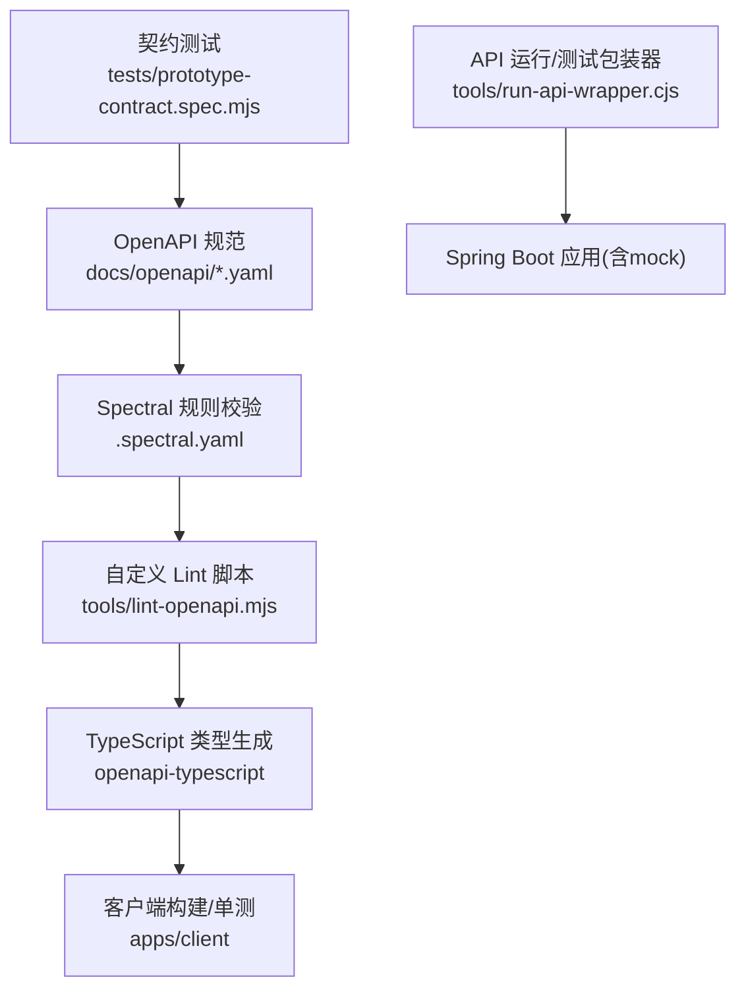
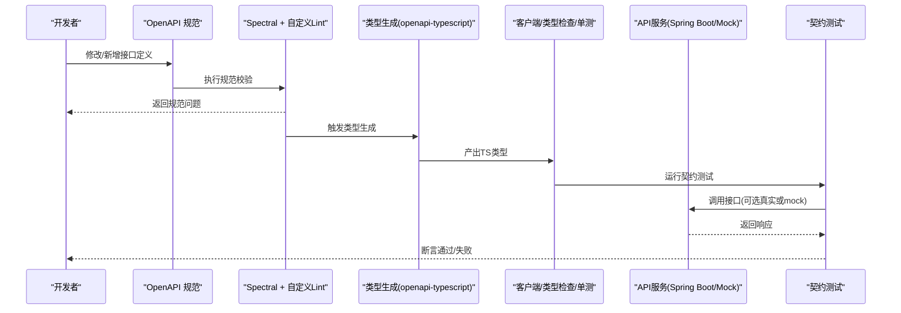
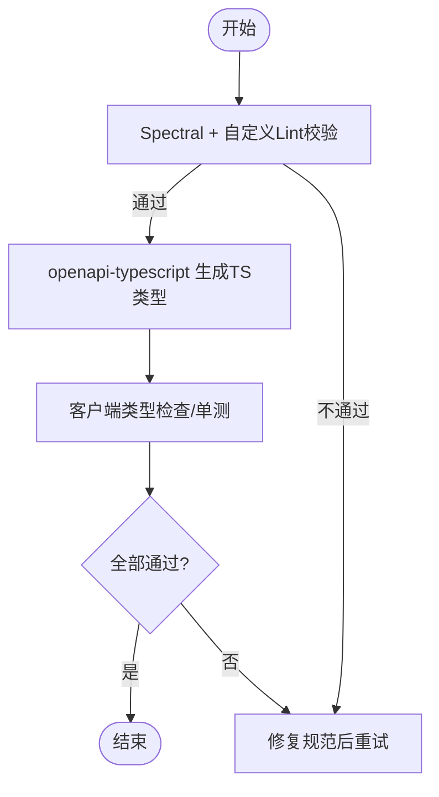
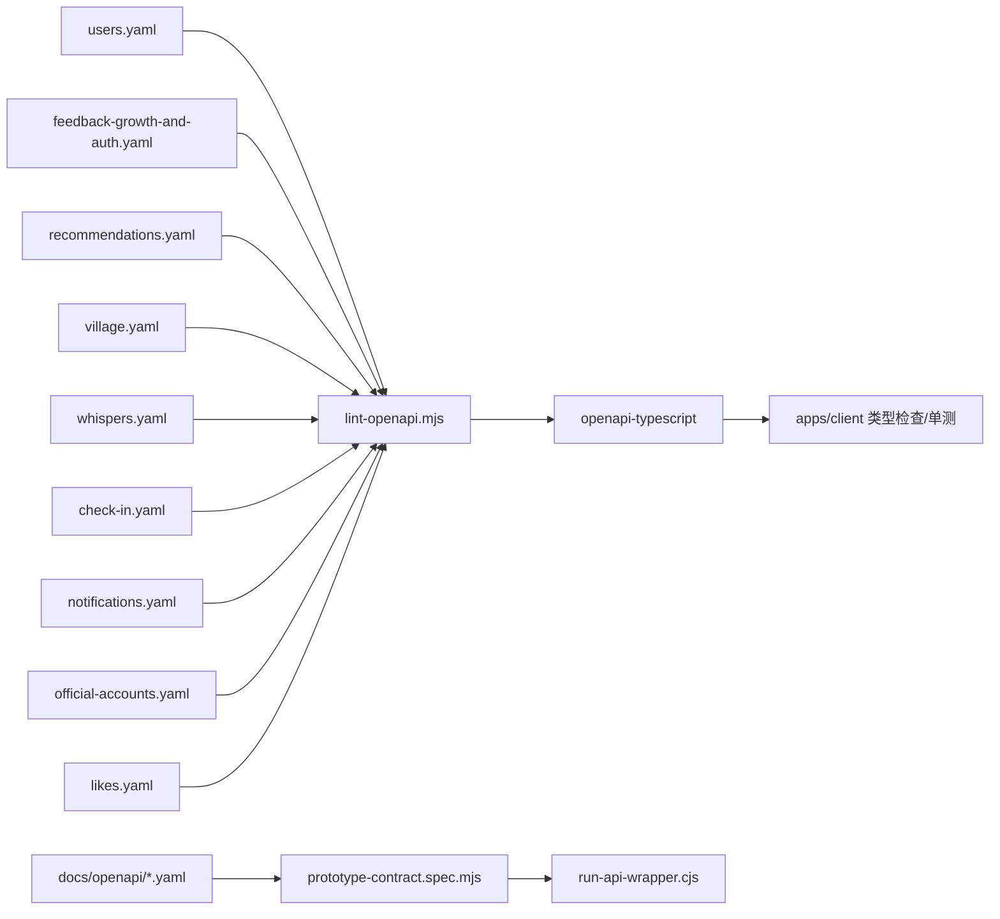

# API 接口契约

<cite>
**本文引用的文件**
- [package.json](file://package.json)
- [.spectral.yaml](file://.spectral.yaml)
- [lint-openapi.mjs](file://tools/lint-openapi.mjs)
- [run-api-wrapper.cjs](file://tools/run-api-wrapper.cjs)
- [prototype-contract.spec.mjs](file://tests/prototype-contract.spec.mjs)
- [project-structure.spec.mjs](file://tests/project-structure.spec.mjs)
- [users.yaml](file://docs/openapi/users.yaml)
- [feedback-growth-and-auth.yaml](file://docs/openapi/feedback-growth-and-auth.yaml)
- [recommendations.yaml](file://docs/openapi/recommendations.yaml)
- [village.yaml](file://docs/openapi/village.yaml)
- [whispers.yaml](file://docs/openapi/whispers.yaml)
- [check-in.yaml](file://docs/openapi/check-in.yaml)
- [notifications.yaml](file://docs/openapi/notifications.yaml)
- [official-accounts.yaml](file://docs/openapi/official-accounts.yaml)
- [likes.yaml](file://docs/openapi/likes.yaml)
</cite>

## 目录
1. [简介](#简介)
2. [项目结构](#项目结构)
3. [核心组件](#核心组件)
4. [架构总览](#架构总览)
5. [详细组件分析](#详细组件分析)
6. [依赖关系分析](#依赖关系分析)
7. [性能考虑](#性能考虑)
8. [故障排查指南](#故障排查指南)
9. [结论](#结论)
10. [附录](#附录)

## 简介
本文件面向前后端协作与质量保障，围绕 OpenAPI 规范驱动的类型生成与契约测试，系统化说明用户管理、认证授权、匹配推荐、消息聊天、圈子社区、反馈成长等模块的接口契约。文档覆盖：
- 从 OpenAPI 到前端 TypeScript 类型的自动化转换流程
- 各业务域接口的请求参数、响应结构与错误响应规范
- 版本管理与向后兼容策略、迁移路径
- Mock 数据支持、接口测试与联调工作流
- 接口变更管理、文档同步与质量保证措施
- 性能优化建议、分页策略与批量操作实践

## 项目结构
本项目采用 Monorepo 组织方式，OpenAPI 规范集中存放在 docs/openapi 下，并通过脚本进行 lint、类型生成与契约测试；API 服务通过工具脚本启动（含 mock 模式），前端通过 openapi-typescript 将 OpenAPI 转为 TypeScript 类型并参与构建验证。

图表来源
- [package.json:1-48](file://package.json#L1-L48)
- [.spectral.yaml](file://.spectral.yaml)
- [lint-openapi.mjs](file://tools/lint-openapi.mjs)
- [run-api-wrapper.cjs](file://tools/run-api-wrapper.cjs)
- [prototype-contract.spec.mjs](file://tests/prototype-contract.spec.mjs)

章节来源
- [package.json:1-48](file://package.json#L1-L48)

## 核心组件
- OpenAPI 规范集：以领域为维度拆分多个 YAML 文件，覆盖用户、认证、推荐、圈子、消息、通知、点赞、签到、公众号等。
- 规范校验：使用 Spectral 规则与自定义脚本对规范进行一致性检查。
- 类型生成：通过 openapi-typescript 将规范转换为 TypeScript 类型，纳入前端类型检查与单测。
- 契约测试：基于 prototype-contract.spec.mjs 对关键接口进行契约级断言。
- API 运行与测试：通过 run-api-wrapper.cjs 启动 Spring Boot 服务（可切换 mock 配置）并执行测试用例。

章节来源
- [package.json:1-48](file://package.json#L1-L48)
- [.spectral.yaml](file://.spectral.yaml)
- [lint-openapi.mjs](file://tools/lint-openapi.mjs)
- [run-api-wrapper.cjs](file://tools/run-api-wrapper.cjs)
- [prototype-contract.spec.mjs](file://tests/prototype-contract.spec.mjs)

## 架构总览
下图展示从 OpenAPI 到前端类型与测试的端到端链路，以及 API 运行时的 mock 能力与契约测试闭环。

图表来源
- [package.json:1-48](file://package.json#L1-L48)
- [lint-openapi.mjs](file://tools/lint-openapi.mjs)
- [run-api-wrapper.cjs](file://tools/run-api-wrapper.cjs)
- [prototype-contract.spec.mjs](file://tests/prototype-contract.spec.mjs)

## 详细组件分析

### 类型生成机制（OpenAPI → TypeScript）
- 输入：docs/openapi/*.yaml 中的接口定义（路径、方法、参数、响应模型）。
- 校验：.spectral.yaml 定义的规则与 tools/lint-openapi.mjs 的自定义校验逻辑确保规范一致性与完整性。
- 生成：openapi-typescript 将规范转换为 TypeScript 类型声明，供客户端编译期类型检查与单测使用。
- 集成：npm scripts 中提供 generate:openapi 任务，配合 test:client 在构建前自动执行，确保类型与契约一致。

图表来源
- [package.json:1-48](file://package.json#L1-L48)
- [.spectral.yaml](file://.spectral.yaml)
- [lint-openapi.mjs](file://tools/lint-openapi.mjs)

章节来源
- [package.json:1-48](file://package.json#L1-L48)
- [.spectral.yaml](file://.spectral.yaml)
- [lint-openapi.mjs](file://tools/lint-openapi.mjs)

### 用户管理模块（users.yaml）
- 职责：用户注册、登录态维护、个人资料查询与更新、头像与资料字段校验等。
- 典型交互：
  - 注册/登录：接收账号信息，返回会话令牌或用户标识。
  - 资料更新：提交个人基本信息，服务端校验并返回最新资料。
- 建议的数据结构：包含用户ID、昵称、头像URL、性别/年龄等基础字段；响应统一包裹状态码与消息。
- 错误处理：参数校验失败、重复注册、权限不足等明确错误码与提示。

章节来源
- [users.yaml](file://docs/openapi/users.yaml)

### 认证授权模块（feedback-growth-and-auth.yaml）
- 职责：认证鉴权、权限控制、与反馈成长相关的鉴权边界。
- 典型交互：
  - 令牌签发/刷新：基于凭证获取访问令牌与刷新令牌。
  - 鉴权中间件：保护受保护资源，校验角色/权限。
- 安全建议：最小权限原则、令牌过期策略、敏感字段脱敏。
- 错误处理：无效凭证、令牌过期、越权访问等。

章节来源
- [feedback-growth-and-auth.yaml](file://docs/openapi/feedback-growth-and-auth.yaml)

### 匹配推荐模块（recommendations.yaml）
- 职责：为用户推荐潜在匹配对象或内容，支撑“附近”“发现”等场景。
- 典型交互：
  - 推荐列表：分页返回推荐项（用户/内容卡片）。
  - 过滤条件：基于兴趣、距离、时间等维度的筛选。
- 数据结构：推荐项包含ID、标题/摘要、图片、评分/相似度等。
- 性能建议：缓存热点推荐、惰性加载、按需预取。

章节来源
- [recommendations.yaml](file://docs/openapi/recommendations.yaml)

### 消息聊天模块（whispers.yaml）
- 职责：私聊消息收发、会话管理、消息历史与未读数。
- 典型交互：
  - 发送消息：携带会话ID、内容、媒体附件等。
  - 获取历史：按会话分页拉取历史消息。
  - 未读标记：已读回执、未读数统计。
- 数据结构：消息体包含文本/媒体、时间戳、发送者、状态等。
- 错误处理：会话不存在、权限不足、媒体上传失败等。

章节来源
- [whispers.yaml](file://docs/openapi/whispers.yaml)

### 圈子社区模块（village.yaml）
- 职责：圈子创建与管理、帖子发布与互动、评论与收藏。
- 典型交互：
  - 圈子列表/详情：分页与详情视图。
  - 帖子发布/编辑：富文本/图片、标签分类。
  - 互动：点赞、收藏、评论。
- 数据结构：圈子与帖子实体、作者信息、互动计数等。
- 性能建议：列表分页、懒加载详情、图片压缩与CDN。

章节来源
- [village.yaml](file://docs/openapi/village.yaml)

### 反馈成长模块（feedback-growth-and-auth.yaml）
- 职责：收集用户反馈、成长轨迹记录、与认证授权的联动。
- 典型交互：
  - 提交反馈：表单内容、分类、优先级。
  - 成长记录：经验值、等级、里程碑事件。
- 数据结构：反馈条目、成长指标、时间线等。
- 错误处理：非法输入、权限限制、服务降级。

章节来源
- [feedback-growth-and-auth.yaml](file://docs/openapi/feedback-growth-and-auth.yaml)

### 通知模块（notifications.yaml）
- 职责：站内通知、系统公告、活动提醒。
- 典型交互：
  - 获取通知：分页列表、按类型过滤。
  - 标记已读：批量更新状态。
- 数据结构：通知项、时间、类型、是否已读等。
- 错误处理：无权限查看、数据缺失等。

章节来源
- [notifications.yaml](file://docs/openapi/notifications.yaml)

### 官方账号模块（official-accounts.yaml）
- 职责：官方账号信息管理、内容与运营相关接口。
- 典型交互：
  - 账号列表/详情：公开信息展示。
  - 内容发布：公告、活动、素材管理。
- 数据结构：账号实体、内容条目、发布时间等。
- 错误处理：权限校验、内容审核状态等。

章节来源
- [official-accounts.yaml](file://docs/openapi/official-accounts.yaml)

### 点赞模块（likes.yaml）
- 职责：对帖子、圈子、消息等进行点赞/取消点赞。
- 典型交互：
  - 点赞/取消：幂等操作，返回当前状态。
  - 列表：获取某对象的点赞者或我的点赞列表。
- 数据结构：点赞项、时间戳、目标对象ID等。
- 错误处理：重复操作、目标不存在等。

章节来源
- [likes.yaml](file://docs/openapi/likes.yaml)

### 签到模块（check-in.yaml）
- 职责：用户每日签到、连续天数统计、奖励发放。
- 典型交互：
  - 签到：提交当日签到，返回结果与累计天数。
  - 记录：查询签到历史与连续天数。
- 数据结构：签到记录、连续天数、奖励信息等。
- 错误处理：重复签到、时间窗口校验等。

章节来源
- [check-in.yaml](file://docs/openapi/check-in.yaml)

## 依赖关系分析
- 规范依赖：每个业务域的接口定义在独立 YAML 文件中，便于维护与评审。
- 工具链依赖：
  - Spectral：基于 .spectral.yaml 的规则进行规范校验。
  - 自定义 Lint：tools/lint-openapi.mjs 补充领域特定规则。
  - 类型生成：openapi-typescript 将规范转换为 TS 类型。
  - 测试：tests/prototype-contract.spec.mjs 与 tests/project-structure.spec.mjs 保证契约与结构稳定。
- 运行依赖：tools/run-api-wrapper.cjs 用于启动 Spring Boot 服务（支持 mock 模式），配合 npm scripts 完成端到端验证。

图表来源
- [package.json:1-48](file://package.json#L1-L48)
- [lint-openapi.mjs](file://tools/lint-openapi.mjs)
- [run-api-wrapper.cjs](file://tools/run-api-wrapper.cjs)
- [prototype-contract.spec.mjs](file://tests/prototype-contract.spec.mjs)
- [project-structure.spec.mjs](file://tests/project-structure.spec.mjs)

章节来源
- [package.json:1-48](file://package.json#L1-L48)
- [lint-openapi.mjs](file://tools/lint-openapi.mjs)
- [run-api-wrapper.cjs](file://tools/run-api-wrapper.cjs)
- [prototype-contract.spec.mjs](file://tests/prototype-contract.spec.mjs)
- [project-structure.spec.mjs](file://tests/project-structure.spec.mjs)

## 性能考虑
- 分页策略：所有列表接口建议使用分页参数（如页码、每页条数、排序键），避免全量返回。
- 批量操作：对点赞、已读标记等场景提供批量接口，减少往返次数。
- 缓存与预取：推荐、圈子列表等热点数据可采用缓存与预取策略。
- 媒体优化：图片/视频上传后进行压缩与转码，结合 CDN 提升加载速度。
- 限流与降级：对高频接口实施限流，异常时降级返回空数据或默认值。

[本节为通用指导，不直接分析具体文件]

## 故障排查指南
- 规范校验失败：
  - 使用 Spectral 与自定义 Lint 定位问题，参考 .spectral.yaml 与 tools/lint-openapi.mjs 的输出。
- 类型生成错误：
  - 检查 OpenAPI 规范语法与模型定义，确保必填字段、枚举值、格式正确。
- 契约测试失败：
  - 确认 API 服务已启动（可用 run-api-wrapper.cjs 切换 mock），核对请求路径、方法与参数。
- 构建/类型检查失败：
  - 重新执行 generate:openapi，确保最新类型已生成；检查 apps/client 的类型检查配置。

章节来源
- [.spectral.yaml](file://.spectral.yaml)
- [lint-openapi.mjs](file://tools/lint-openapi.mjs)
- [run-api-wrapper.cjs](file://tools/run-api-wrapper.cjs)
- [prototype-contract.spec.mjs](file://tests/prototype-contract.spec.mjs)
- [project-structure.spec.mjs](file://tests/project-structure.spec.mjs)

## 结论
本方案以 OpenAPI 为核心契约，结合 Spectral 与自定义 Lint 确保规范质量，通过 openapi-typescript 实现前端类型自动化生成，并以契约测试与构建流程形成闭环。各业务域接口清晰分层，便于扩展与维护。建议在迭代中持续完善规范、强化测试覆盖与性能优化，保障前后端高效协同与质量稳定。

[本节为总结性内容，不直接分析具体文件]

## 附录

### 版本管理与兼容性
- 版本化：接口路径或请求头中包含版本号，便于并行维护多版本。
- 向后兼容：新增字段优先采用可选字段，删除字段需废弃而非直接移除。
- 迁移策略：提供过渡期双写与灰度发布，逐步淘汰旧字段/路径。

[本节为通用指导，不直接分析具体文件]

### Mock 数据与联调工作流
- Mock 模式：通过 tools/run-api-wrapper.cjs 启动服务时启用 mock，快速联调。
- 契约测试：tests/prototype-contract.spec.mjs 断言关键接口行为，确保前后端一致。
- 本地调试：结合 package.json 的脚本一键启动与测试，提高开发效率。

章节来源
- [run-api-wrapper.cjs](file://tools/run-api-wrapper.cjs)
- [prototype-contract.spec.mjs](file://tests/prototype-contract.spec.mjs)
- [package.json:1-48](file://package.json#L1-L48)

### 接口变更管理与质量保证
- 变更评审：任何接口变更需更新对应 YAML 并通过 Lint 与类型检查。
- 文档同步：变更必须同步至 OpenAPI 文档，保持单一事实来源。
- 质量门禁：CI 中集成 lint:openapi、test:client、verify:phase01 等脚本，确保质量基线。

章节来源
- [package.json:1-48](file://package.json#L1-L48)
- [.spectral.yaml](file://.spectral.yaml)
- [lint-openapi.mjs](file://tools/lint-openapi.mjs)