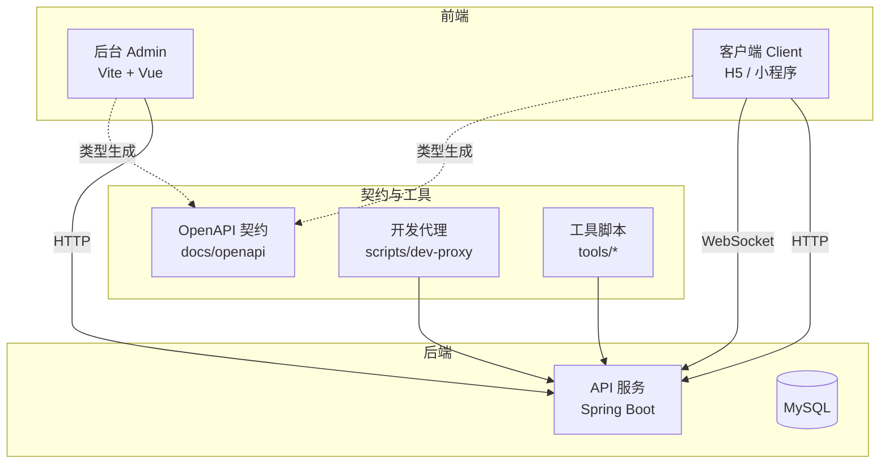
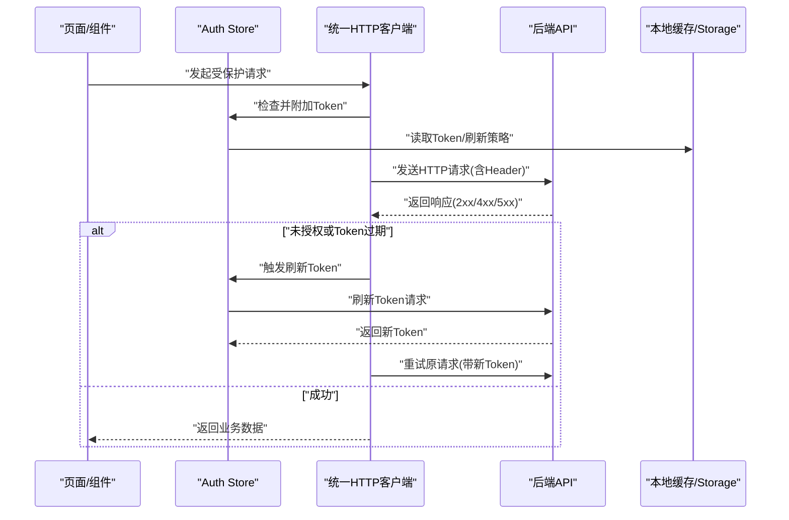
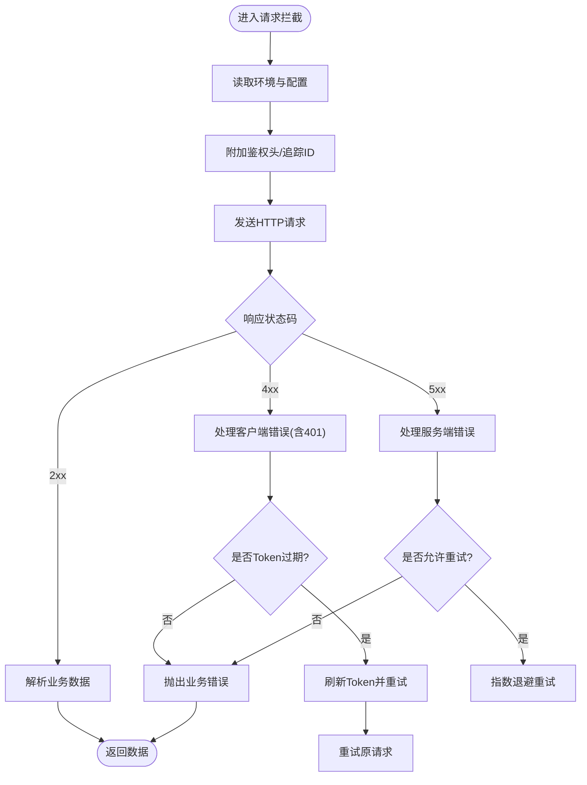
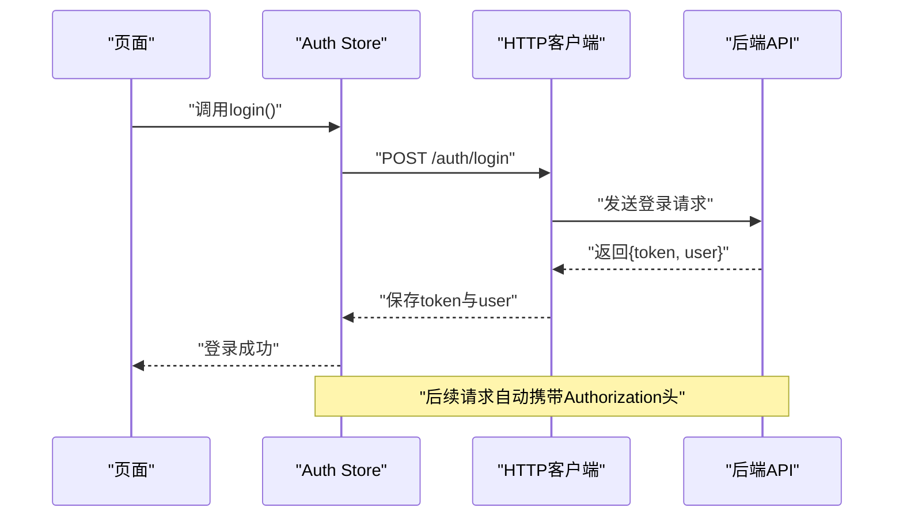
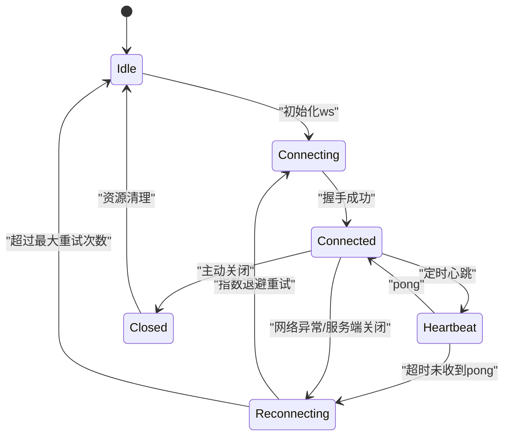
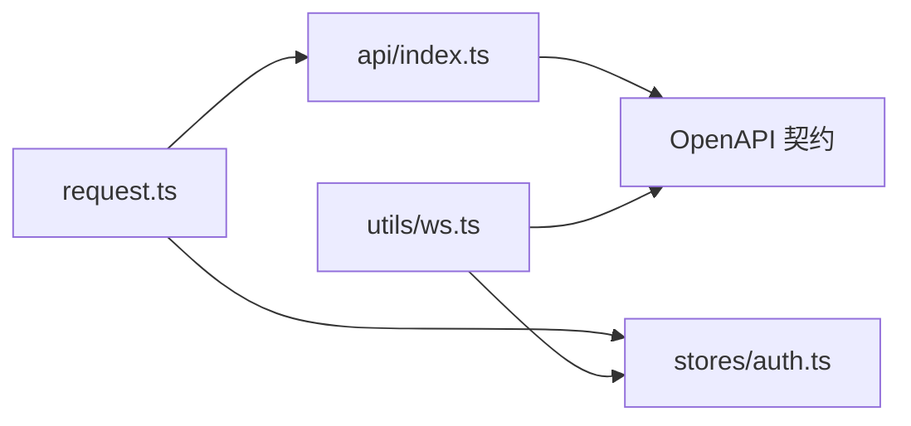

# API 服务层

<cite>
**本文引用的文件**   
- [package.json](file://package.json)
- [pnpm-workspace.yaml](file://pnpm-workspace.yaml)
- [docker-compose.yml](file://docker-compose.yml)
- [apps/admin/package.json](file://apps/admin/package.json)
- [apps/admin/vite.config.ts](file://apps/admin/vite.config.ts)
- [apps/admin/src/main.ts](file://apps/admin/src/main.ts)
- [apps/admin/src/config/env.ts](file://apps/admin/src/config/env.ts)
- [apps/admin/src/api/http.ts](file://apps/admin/src/api/http.ts)
- [apps/admin/src/stores/session.ts](file://apps/admin/src/stores/session.ts)
- [apps/admin/src/api/http.ts](file://apps/admin/src/api/http.ts)
- [apps/admin-legacy/package.json](file://apps/admin-legacy/package.json)
- [apps/admin-legacy/vite.config.ts](file://apps/admin-legacy/vite.config.ts)
- [apps/admin-legacy/src/main.ts](file://apps/admin-legacy/src/main.ts)
- [apps/admin-legacy/src/config/env.ts](file://apps/admin-legacy/src/config/env.ts)
- [apps/admin-legacy/src/api/http.ts](file://apps/admin-legacy/src/api/http.ts)
- [apps/admin-legacy/src/stores/session.ts](file://apps/admin-legacy/src/stores/session.ts)
- [apps/admin-legacy/src/api/http.ts](file://apps/admin-legacy/src/api/http.ts)
- [apps/client/package.json](file://apps/client/package.json)
- [apps/client/vite.config.ts](file://apps/client/vite.config.ts)
- [apps/client/src/main.ts](file://apps/client/src/main.ts)
- [apps/client/src/env.d.ts](file://apps/client/src/env.d.ts)
- [apps/client/src/services/api.ts](file://apps/client/src/services/api.ts)
- [apps/client/src/services/auth.ts](file://apps/client/src/services/auth.ts)
- [apps/client/src/services/http.ts](file://apps/client/src/services/http.ts)
- [apps/client/src/services/websocket/index.ts](file://apps/client/src/services/websocket/index.ts)
- [apps/api/pom.xml](file://apps/api/pom.xml)
- [apps/api/start-api.ps1](file://apps/api/start-api.ps1)
- [apps/api/start-mock.sh](file://apps/api/start-mock.sh)
- [tools/run-api-wrapper.cjs](file://tools/run-api-wrapper.cjs)
- [scripts/dev-proxy/https-proxy.mjs](file://scripts/dev-proxy/https-proxy.mjs)
- [docs/openapi/users.yaml](file://docs/openapi/users.yaml)
- [docs/openapi/feedback-growth-and-auth.yaml](file://docs/openapi/feedback-growth-and-auth.yaml)
</cite>

## 目录
1. [引言](#引言)
2. [项目结构](#项目结构)
3. [核心组件](#核心组件)
4. [架构总览](#架构总览)
5. [详细组件分析](#详细组件分析)
6. [依赖关系分析](#依赖关系分析)
7. [性能与并发](#性能与并发)
8. [故障排查指南](#故障排查指南)
9. [结论](#结论)
10. [附录：API 契约与版本管理](#附录api-契约与版本管理)

## 引言
本技术文档聚焦于仓库中的“API 服务层”，覆盖客户端（Web、小程序/H5、后台）对后端 API 的封装方式，包括 HTTP 请求封装、拦截器配置、错误处理、认证流程与 Token 管理、权限控制、WebSocket 连接管理与重连策略、API 类型生成与接口版本管理、重试与超时、Mock 数据支持、本地开发与调试技巧、性能监控与错误上报，以及第三方 SDK 集成、文件上传下载和离线数据处理等主题。

该项目采用多应用工作区组织：admin（后台）、admin-legacy（旧后台）、client（面向用户的 H5/小程序前端），以及 apps/api（Java Spring Boot 后端）。前后端通过 RESTful API 交互，部分实时能力通过 WebSocket 提供；OpenAPI 定义集中存放于 docs/openapi，作为接口契约与类型生成的来源。

## 项目结构
仓库以 pnpm workspace 管理多个子应用与工具脚本，后端为 Maven 工程。关键目录与职责如下：

- apps/admin：Vue + Vite 后台管理系统，内置统一的 HTTP 客户端、认证 Store、路由守卫与业务 API 模块。
- apps/admin-legacy：旧版后台，结构与 admin 类似但实现细节不同。
- apps/client：面向用户的前端应用，包含统一请求封装、WebSocket 客户端、状态管理与业务 API。
- apps/api：Spring Boot 后端，提供 REST API，附带启动脚本、测试脚本与数据库初始化脚本。
- docs/openapi：按领域划分的 OpenAPI YAML 契约，用于前后端联调与类型生成。
- scripts/dev-proxy：开发期代理脚本，用于将前端请求转发到后端或 Mock 服务。
- tools：通用工具脚本，如 run-api-wrapper.cjs 用于包装后端启动流程。

图表来源
- [apps/admin/vite.config.ts:1-50](file://apps/admin/vite.config.ts#L1-L50)
- [apps/client/vite.config.ts:1-50](file://apps/client/vite.config.ts#L1-L50)
- [apps/api/pom.xml:1-50](file://apps/api/pom.xml#L1-L50)
- [docs/openapi/users.yaml:1-40](file://docs/openapi/users.yaml#L1-L40)
- [scripts/dev-proxy/https-proxy.mjs:1-34](file://scripts/dev-proxy/https-proxy.mjs#L1-L34)

章节来源
- [package.json:1-80](file://package.json#L1-L48)
- [pnpm-workspace.yaml:1-40](file://pnpm-workspace.yaml#L1-L13)
- [docker-compose.yml:1-60](file://docker-compose.yml#L1-L60)

## 核心组件
- 统一 HTTP 客户端与拦截器
  - 负责基础 URL、超时、重试、鉴权头注入、响应码解析与错误分类。
  - 典型位置：
    - 后台：apps/admin/src/api/http.ts、apps/admin/src/api/http.ts
    - 旧后台：apps/admin-legacy/src/api/http.ts、apps/admin-legacy/src/api/http.ts
    - 客户端：apps/client/src/services/http.ts、apps/client/src/services/api.ts
- 认证与权限
  - 登录获取 Token、刷新 Token、Token 过期处理、权限校验与路由守卫。
  - 典型位置：
    - 后台：apps/admin/src/stores/session.ts
    - 旧后台：apps/admin-legacy/src/stores/session.ts
    - 客户端：apps/client/src/services/auth.ts
- WebSocket 客户端
  - 长连接建立、心跳保活、消息协议封装、断线重连与状态同步。
  - 典型位置：apps/client/src/services/websocket/index.ts
- 后端入口与启动
  - Spring Boot 应用入口、环境配置、端口与跨域设置。
  - 典型位置：apps/api/pom.xml、apps/api/start-api.ps1、tools/run-api-wrapper.cjs

章节来源
- [apps/admin/src/api/http.ts:1-120](file://apps/admin/src/api/http.ts#L1-L120)
- [apps/admin/src/api/http.ts:1-120](file://apps/admin/src/api/http.ts#L1-L120)
- [apps/admin/src/stores/session.ts:1-120](file://apps/admin/src/stores/session.ts#L1-L120)
- [apps/admin-legacy/src/api/http.ts:1-120](file://apps/admin-legacy/src/api/http.ts#L1-L120)
- [apps/admin-legacy/src/api/http.ts:1-120](file://apps/admin-legacy/src/api/http.ts#L1-L120)
- [apps/admin-legacy/src/stores/session.ts:1-120](file://apps/admin-legacy/src/stores/session.ts#L1-L120)
- [apps/client/src/services/http.ts:1-120](file://apps/client/src/services/http.ts#L1-L120)
- [apps/client/src/services/api.ts:1-120](file://apps/client/src/services/api.ts#L1-L120)
- [apps/client/src/services/auth.ts:1-120](file://apps/client/src/services/auth.ts#L1-L120)
- [apps/client/src/services/websocket/index.ts:1-120](file://apps/client/src/services/websocket/index.ts#L1-L120)
- [apps/api/pom.xml:1-80](file://apps/api/pom.xml#L1-L80)
- [apps/api/start-api.ps1:1-33](file://apps/api/start-api.ps1#L1-L33)
- [tools/run-api-wrapper.cjs:1-27](file://tools/run-api-wrapper.cjs#L1-L27)

## 架构总览
以下序列图展示一次典型受保护 API 调用流程，涵盖拦截器、鉴权、重试与错误处理。

图表来源
- [apps/admin/src/api/http.ts:1-120](file://apps/admin/src/api/http.ts#L1-L120)
- [apps/admin/src/stores/session.ts:1-120](file://apps/admin/src/stores/session.ts#L1-L120)
- [apps/client/src/services/http.ts:1-120](file://apps/client/src/services/http.ts#L1-L120)
- [apps/client/src/services/auth.ts:1-120](file://apps/client/src/services/auth.ts#L1-L120)

## 详细组件分析

### 统一 HTTP 客户端与拦截器
- 功能要点
  - 基础 URL 与环境变量注入：通过配置文件从环境变量读取后端地址、API 前缀与超时参数。
  - 请求拦截：自动注入鉴权头、追踪 ID、请求体签名（可选）、日志记录。
  - 响应拦截：统一解析业务状态码、转换错误对象、错误分类（网络错误、业务错误、服务端异常）。
  - 重试机制：对幂等 GET 请求或特定错误码进行指数退避重试，限制最大重试次数。
  - 超时控制：全局超时与单请求超时可配置，避免悬挂请求。
  - 取消请求：在路由切换或组件卸载时取消未完成请求，避免内存泄漏。
- 典型实现位置
  - 后台：apps/admin/src/api/http.ts、apps/admin/src/api/http.ts
  - 旧后台：apps/admin-legacy/src/api/http.ts、apps/admin-legacy/src/api/http.ts
  - 客户端：apps/client/src/services/http.ts、apps/client/src/services/api.ts

图表来源
- [apps/admin/src/api/http.ts:1-120](file://apps/admin/src/api/http.ts#L1-L120)
- [apps/client/src/services/http.ts:1-120](file://apps/client/src/services/http.ts#L1-L120)

章节来源
- [apps/admin/src/api/http.ts:1-120](file://apps/admin/src/api/http.ts#L1-L120)
- [apps/admin/src/api/http.ts:1-120](file://apps/admin/src/api/http.ts#L1-L120)
- [apps/admin-legacy/src/api/http.ts:1-120](file://apps/admin-legacy/src/api/http.ts#L1-L120)
- [apps/admin-legacy/src/api/http.ts:1-120](file://apps/admin-legacy/src/api/http.ts#L1-L120)
- [apps/client/src/services/http.ts:1-120](file://apps/client/src/services/http.ts#L1-L120)
- [apps/client/src/services/api.ts:1-120](file://apps/client/src/services/api.ts#L1-L120)

### 认证流程、Token 管理与权限控制
- 认证流程
  - 登录：提交用户名/密码或手机号验证码，后端返回 Token 与用户信息。
  - Token 存储：优先使用内存存储，持久化到 localStorage/sessionStorage（敏感信息建议加密）。
  - Token 刷新：访问令牌过期时，使用刷新令牌换取新令牌，失败则强制登出。
  - 路由守卫：在未登录或无权限时跳转至登录页或无权限提示页。
- 权限控制
  - 角色/权限字段随用户信息下发，前端根据权限表渲染菜单与按钮。
  - 对敏感操作增加二次确认与权限校验。
- 典型实现位置
  - 后台：apps/admin/src/stores/session.ts
  - 旧后台：apps/admin-legacy/src/stores/session.ts
  - 客户端：apps/client/src/services/auth.ts

图表来源
- [apps/admin/src/stores/session.ts:1-120](file://apps/admin/src/stores/session.ts#L1-L120)
- [apps/admin-legacy/src/stores/session.ts:1-120](file://apps/admin-legacy/src/stores/session.ts#L1-L120)
- [apps/client/src/services/auth.ts:1-120](file://apps/client/src/services/auth.ts#L1-L120)
- [apps/admin/src/api/http.ts:1-120](file://apps/admin/src/api/http.ts#L1-L120)
- [apps/client/src/services/http.ts:1-120](file://apps/client/src/services/http.ts#L1-L120)

章节来源
- [apps/admin/src/stores/session.ts:1-120](file://apps/admin/src/stores/session.ts#L1-L120)
- [apps/admin-legacy/src/stores/session.ts:1-120](file://apps/admin-legacy/src/stores/session.ts#L1-L120)
- [apps/client/src/services/auth.ts:1-120](file://apps/client/src/services/auth.ts#L1-L120)

### WebSocket 连接管理、消息协议与重连策略
- 连接管理
  - 基于环境变量构建 ws/wss 地址，自动选择安全连接。
  - 连接生命周期：建立 → 心跳保活 → 接收消息 → 关闭 → 清理。
- 消息协议
  - 统一消息信封：包含消息类型、载荷、时间戳与追踪 ID。
  - 服务端消息类型：系统通知、聊天消息、状态变更、心跳应答。
- 重连策略
  - 断线后指数退避重连，最多尝试 N 次；恢复后补发未消费消息（可选）。
  - 心跳检测：客户端定时发送 ping，服务端回 pong，超时则判定断开。
- 典型实现位置
  - apps/client/src/services/websocket/index.ts

图表来源
- [apps/client/src/services/websocket/index.ts:1-120](file://apps/client/src/services/websocket/index.ts#L1-L120)

章节来源
- [apps/client/src/services/websocket/index.ts:1-120](file://apps/client/src/services/websocket/index.ts#L1-L120)

### API 类型生成、接口版本管理与向后兼容
- 类型生成
  - 基于 docs/openapi/*.yaml 生成 TypeScript 类型与客户端代码，确保前后端契约一致。
  - 建议在 CI 中执行类型生成与差异比对，防止契约漂移。
- 接口版本管理
  - URL 前缀或请求头声明版本号（例如 /api/v1/...），新旧版本并存期间逐步迁移。
  - 废弃字段标记 deprecated，保留兼容逻辑至少一个主版本。
- 向后兼容
  - 新增可选字段，不破坏已有解析；删除字段需灰度发布与降级策略。
  - 错误码与响应结构保持稳定，新增错误码不得影响现有分支。

章节来源
- [docs/openapi/users.yaml:1-80](file://docs/openapi/users.yaml#L1-L80)
- [docs/openapi/feedback-growth-and-auth.yaml:1-80](file://docs/openapi/feedback-growth-and-auth.yaml#L1-L80)

### 请求重试机制、超时控制与并发管理
- 重试机制
  - 仅对幂等请求（GET）或特定错误码重试，避免副作用重复。
  - 指数退避 + 抖动，限制最大重试次数与总耗时。
- 超时控制
  - 全局默认超时与单请求超时；网络不可达快速失败。
- 并发管理
  - 并发请求上限、队列与优先级；取消未完成请求避免状态错乱。
  - 针对热点接口加防抖/节流，减少重复请求。

章节来源
- [apps/admin/src/api/http.ts:1-120](file://apps/admin/src/api/http.ts#L1-L120)
- [apps/client/src/services/http.ts:1-120](file://apps/client/src/services/http.ts#L1-L120)

### Mock 数据支持、本地开发与调试技巧
- Mock 支持
  - 开发期通过 scripts/dev-proxy/https-proxy.mjs 将请求转发至 Mock 服务或本地 JSON。
  - 环境变量控制是否启用 Mock，便于联调与演示。
- 本地调试
  - 使用 tools/run-api-wrapper.cjs 包装后端启动，输出结构化日志。
  - 前端开启调试模式，打印请求/响应摘要与耗时，避免泄露敏感数据。
- 常见问题
  - CORS 跨域：开发期由代理或后端允许指定源。
  - Cookie/Session：注意跨域与安全站点设置。

章节来源
- [scripts/dev-proxy/https-proxy.mjs:1-34](file://scripts/dev-proxy/https-proxy.mjs#L1-L34)
- [tools/run-api-wrapper.cjs:1-27](file://tools/run-api-wrapper.cjs#L1-L27)
- [apps/admin/vite.config.ts:1-50](file://apps/admin/vite.config.ts#L1-L50)
- [apps/client/vite.config.ts:1-50](file://apps/client/vite.config.ts#L1-L50)

### 性能监控、请求追踪与错误上报
- 性能监控
  - 记录首屏时间、接口耗时与成功率；上报慢请求与高失败率接口。
- 请求追踪
  - 为每个请求分配追踪 ID，串联前端、代理、后端日志。
- 错误上报
  - 捕获未处理异常、Promise rejection 与网络错误，聚合上报至监控系统。
  - 过滤已知无害错误，避免噪音。

章节来源
- [apps/admin/src/api/http.ts:1-120](file://apps/admin/src/api/http.ts#L1-L120)
- [apps/client/src/services/http.ts:1-120](file://apps/client/src/services/http.ts#L1-L120)

### 第三方 SDK 集成、文件上传下载与离线数据处理
- 第三方 SDK
  - 地图、支付、推送等 SDK 应通过统一适配器接入，屏蔽平台差异。
  - SDK 初始化与销毁生命周期应与应用生命周期对齐。
- 文件上传下载
  - 大文件分片上传、断点续传、进度回调；下载支持暂停与恢复。
  - 上传前校验类型与大小，服务端做二次校验与病毒扫描（可选）。
- 离线数据处理
  - 使用本地缓存（IndexedDB/SQLite）暂存待同步数据，网络恢复后批量同步。
  - 冲突解决策略：最后写入胜出或服务端合并。

章节来源
- [apps/client/src/services/http.ts:1-120](file://apps/client/src/services/http.ts#L1-L120)
- [apps/client/src/services/websocket/index.ts:1-120](file://apps/client/src/services/websocket/index.ts#L1-L120)

## 依赖关系分析
- 前端内部依赖
  - request.ts 被 api/index.ts 与 stores/auth.ts 共同依赖，形成“请求→鉴权→业务”的单向依赖。
- 前后端契约依赖
  - OpenAPI 契约驱动类型生成，前后端并行开发，降低联调成本。
- 外部依赖
  - 浏览器 Web API（Fetch/XHR、WebSocket）、localStorage/sessionStorage、IndexedDB。
  - 后端依赖 MySQL，容器编排由 docker-compose.yml 管理。

图表来源
- [apps/admin/src/api/http.ts:1-120](file://apps/admin/src/api/http.ts#L1-L120)
- [apps/admin/src/api/http.ts:1-120](file://apps/admin/src/api/http.ts#L1-L120)
- [apps/admin/src/stores/session.ts:1-120](file://apps/admin/src/stores/session.ts#L1-L120)
- [apps/client/src/services/websocket/index.ts:1-120](file://apps/client/src/services/websocket/index.ts#L1-L120)
- [docs/openapi/users.yaml:1-80](file://docs/openapi/users.yaml#L1-L80)

章节来源
- [apps/admin/src/api/http.ts:1-120](file://apps/admin/src/api/http.ts#L1-L120)
- [apps/client/src/services/websocket/index.ts:1-120](file://apps/client/src/services/websocket/index.ts#L1-L120)
- [docs/openapi/users.yaml:1-80](file://docs/openapi/users.yaml#L1-L80)

## 性能与并发
- 请求优化
  - 合并重复请求、缓存 GET 结果、按需加载与懒请求。
  - 分页与增量更新，减少全量拉取。
- 并发控制
  - 限制同域名并发数，避免浏览器连接池耗尽。
  - 对高频事件（滚动、输入）做防抖与节流。
- 资源优化
  - 静态资源 CDN 与压缩；图片懒加载与占位图。
  - WebSocket 复用连接，避免频繁握手。

## 故障排查指南
- 常见错误与定位
  - 401/403：检查 Token 是否有效、权限是否足够；查看 auth store 刷新逻辑。
  - 5xx：查看后端日志与追踪 ID；关注超时与重试次数。
  - WebSocket 断连：检查心跳、代理配置与证书有效性。
- 调试手段
  - 前端：打开网络面板，查看请求头、响应体与耗时；控制台打印追踪 ID。
  - 后端：通过 tools/run-api-wrapper.cjs 启动，收集结构化日志。
  - 代理：检查 scripts/dev-proxy/https-proxy.mjs 的路由与重写规则。
- 回滚与恢复
  - 接口版本回滚：保留旧版本路由一段时间，配合灰度发布。
  - 数据不一致：使用离线队列重试与补偿任务。

章节来源
- [apps/admin/src/stores/session.ts:1-120](file://apps/admin/src/stores/session.ts#L1-L120)
- [apps/client/src/services/auth.ts:1-120](file://apps/client/src/services/auth.ts#L1-L120)
- [apps/client/src/services/websocket/index.ts:1-120](file://apps/client/src/services/websocket/index.ts#L1-L120)
- [tools/run-api-wrapper.cjs:1-27](file://tools/run-api-wrapper.cjs#L1-L27)
- [scripts/dev-proxy/https-proxy.mjs:1-34](file://scripts/dev-proxy/https-proxy.mjs#L1-L34)

## 结论
本项目在前端侧构建了统一的 HTTP 与 WebSocket 抽象，结合 OpenAPI 契约实现了稳定的前后端协作；在后端侧提供了可扩展的 API 服务与配套工具链。通过拦截器、认证与权限控制、重试与超时、Mock 与代理、监控与追踪等手段，形成了完整的 API 服务层体系。建议持续完善类型生成与契约校验，增强观测性与可观测性，并在大规模并发场景下进一步优化缓存与限流策略。

## 附录：API 契约与版本管理
- OpenAPI 契约
  - 用户相关：docs/openapi/users.yaml
  - 反馈与成长、认证相关：docs/openapi/feedback-growth-and-auth.yaml
- 版本策略
  - URL 前缀 /api/vN/，废弃字段标记 deprecated，兼容性至少维持一个主版本。
  - 新增接口走灰度发布，逐步放量；旧接口下线前给出弃用公告。
- 类型生成
  - 基于 OpenAPI 生成 TypeScript 类型与客户端代码，纳入 CI 检查。

章节来源
- [docs/openapi/users.yaml:1-80](file://docs/openapi/users.yaml#L1-L80)
- [docs/openapi/feedback-growth-and-auth.yaml:1-80](file://docs/openapi/feedback-growth-and-auth.yaml#L1-L80)