# HTTP 客户端与拦截器

<cite>
**本文引用的文件**   
- [apps/client/src/services/http.ts](file://apps/client/src/services/http.ts)
- [apps/client/src/config/api.ts](file://apps/client/src/config/api.ts)
- [apps/client/src/constants/api.ts](file://apps/client/src/constants/api.ts)
- [apps/client/src/services/api-error.ts](file://apps/client/src/services/api-error.ts)
- [apps/client/src/services/sentry.ts](file://apps/client/src/services/sentry.ts)
- [apps/client/src/utils/error-toast.ts](file://apps/client/src/utils/error-toast.ts)
- [apps/client/src/config/env.ts](file://apps/client/src/config/env.ts)
</cite>

## 目录

1. [引言](#引言)
2. [项目结构定位](#项目结构定位)
3. [核心组件总览](#核心组件总览)
4. [架构总览](#架构总览)
5. [详细组件分析](#详细组件分析)
6. [依赖关系分析](#依赖关系分析)
7. [性能与并发特性](#性能与并发特性)
8. [错误分类与统一处理](#错误分类与统一处理)
9. [Mock 模式、调试与监控](#mock-模式调试与监控)
10. [常见问题排查指南](#常见问题排查指南)
11. [结论](#结论)

## 引言

本文面向使用前端 HTTP 客户端的开发者，系统性梳理基于 `uni.request` 的封装实现，重点说明：

- 请求/响应拦截器的注册与执行链；
- Token 管理接口 `getToken` / `setToken` / `clearTokens`；
- 401 自动刷新与重试策略；
- 错误分类体系（network / auth / business）、`EnhancedApiError` 异常模型和统一错误处理逻辑；
- API 路径归一化 `normalizeApiPath`、超时控制、重试次数配置；
- Sentry 集成、请求追踪与性能监控；
- Mock 模式、本地调试技巧；
- 文件上传下载、请求去重、缓存策略等高级能力。

该子系统位于 `apps/client/src/services/http.ts`，是应用所有业务服务（登录、消息、圈子、VIP、聊天、附近等）发起网络请求的共同基础设施。

## 项目结构定位

HTTP 客户端不是孤立模块，它围绕以下文件协作：

| 文件 | 职责 |
|---|---|
| [apps/client/src/services/http.ts](file://apps/client/src/services/http.ts) | 基于 `uni.request` 的增强请求函数、拦截器链、Token 管理、401 刷新、路径归一化、超时工具 |
| [apps/client/src/config/api.ts](file://apps/client/src/config/api.ts) | HTTP 协议层聚合配置对象 `API_CONFIG`，集中定义超时、重试、鉴权头、默认请求头等 |
| [apps/client/src/constants/api.ts](file://apps/client/src/constants/api.ts) | HTTP 常量真相源：默认超时、重试次数、状态码、AI 相关错误码等 |
| [apps/client/src/services/api-error.ts](file://apps/client/src/services/api-error.ts) | 后端错误体到 `AppApiError` 的统一转换与兜底文案 |
| [apps/client/src/services/sentry.ts](file://apps/client/src/services/sentry.ts) | Sentry 初始化、异常上报、Breadcrumb 记录 |
| [apps/client/src/utils/error-toast.ts](file://apps/client/src/utils/error-toast.ts) | 面向 UI 的错误提示工具，复用 `EnhancedApiError` 的分类 |
| [apps/client/src/config/env.ts](file://apps/client/src/config/env.ts) | 环境变量、API 基础地址、Mock 模式判断 |

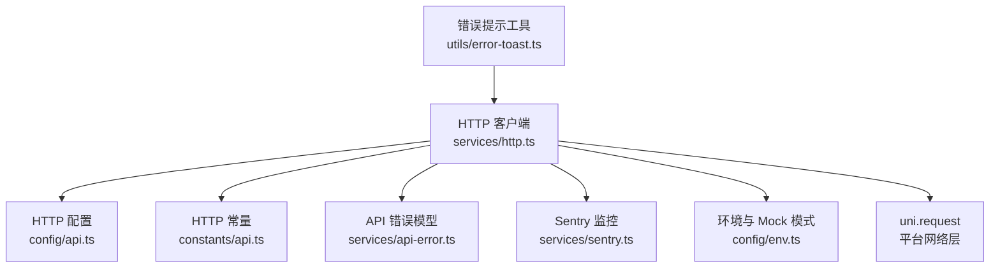

**图表来源**
- [apps/client/src/services/http.ts:1-40](file://apps/client/src/services/http.ts#L1-L40)
- [apps/client/src/config/api.ts:1-126](file://apps/client/src/config/api.ts#L1-L126)
- [apps/client/src/constants/api.ts:1-81](file://apps/client/src/constants/api.ts#L1-L81)
- [apps/client/src/services/api-error.ts:1-164](file://apps/client/src/services/api-error.ts#L1-L164)
- [apps/client/src/services/sentry.ts:1-200](file://apps/client/src/services/sentry.ts#L1-L200)
- [apps/client/src/config/env.ts:1-250](file://apps/client/src/config/env.ts#L1-L250)
- [apps/client/src/utils/error-toast.ts:1-199](file://apps/client/src/utils/error-toast.ts#L1-L199)

**章节来源**
- [apps/client/src/services/http.ts:1-977](file://apps/client/src/services/http.ts#L1-L977)
- [apps/client/src/config/api.ts:1-126](file://apps/client/src/config/api.ts#L1-L126)
- [apps/client/src/constants/api.ts:1-81](file://apps/client/src/constants/api.ts#L1-L81)
- [apps/client/src/services/api-error.ts:1-164](file://apps/client/src/services/api-error.ts#L1-L164)
- [apps/client/src/services/sentry.ts:1-200](file://apps/client/src/services/sentry.ts#L1-L200)
- [apps/client/src/config/env.ts:1-250](file://apps/client/src/config/env.ts#L1-L250)
- [apps/client/src/utils/error-toast.ts:1-199](file://apps/client/src/utils/error-toast.ts#L1-L199)

## 核心组件总览

### 对外暴露的主要能力

| 能力 | 导出项 | 用途 |
|---|---|---|
| 增强请求函数 | `request` | 调用方唯一推荐的 HTTP 入口 |
| 请求拦截器注册 | `addRequestInterceptor` | 在发送前修改 `UniApp.RequestOptions` |
| 响应拦截器注册 | `addResponseInterceptor` | 在收到响应后统一处理信封、错误码等 |
| Token 管理 | `getToken`、`setToken`、`setRefreshToken`、`clearTokens` | 读写认证令牌 |
| 登录跳转取消 | `cancelLoginRedirect` | 页面卸载或重新登录时清理延迟跳转 |
| 路径归一化 | `normalizeApiPath` | 补齐 `/v1` 前缀 |
| 通用超时包装 | `withTimeout` | 为非 `uni.request` Promise 提供超时控制 |
| 幂等键哈希 | `hashString` | 生成稳定幂等键签名 |

### 内部关键状态

| 状态变量 | 作用 |
|---|---|
| `requestInterceptors` | 按注册顺序执行的请求拦截器列表 |
| `responseInterceptors` | 按注册顺序执行的响应拦截器列表 |
| `isRedirecting` | 防止重复跳转到登录页 |
| `loginRedirectTimer` | 保存延迟跳转定时器引用，支持取消 |
| `refreshPromise` | 并发 401 共享的刷新 Token Promise |
| `REFRESH_TIMEOUT_MS` | 刷新请求专用超时（8 秒） |

**章节来源**
- [apps/client/src/services/http.ts:48-65](file://apps/client/src/services/http.ts#L48-L65)
- [apps/client/src/services/http.ts:120-145](file://apps/client/src/services/http.ts#L120-L145)
- [apps/client/src/services/http.ts:360-430](file://apps/client/src/services/http.ts#L360-L430)
- [apps/client/src/services/http.ts:800-977](file://apps/client/src/services/http.ts#L800-L977)

## 架构总览

HTTP 客户端的整体流程可理解为“请求进入 → 拦截器链 → 底层网络 → 响应拦截器链 → 错误分类 → 重试/401 刷新 → 返回数据”。

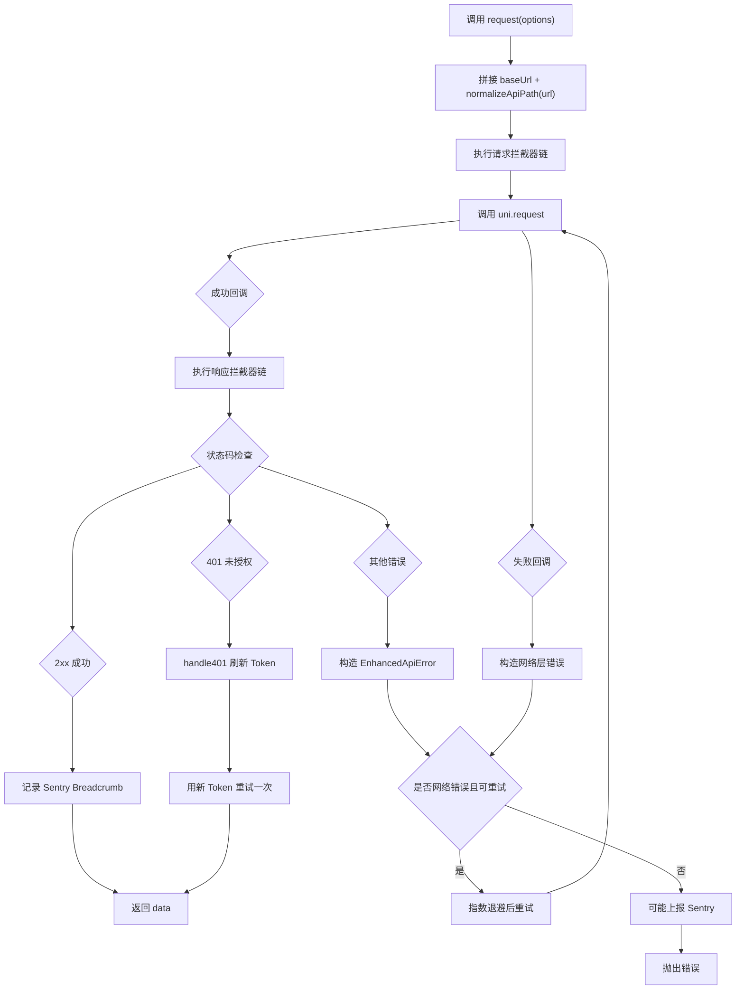

**图表来源**
- [apps/client/src/services/http.ts:800-977](file://apps/client/src/services/http.ts#L800-L977)
- [apps/client/src/services/http.ts:520-750](file://apps/client/src/services/http.ts#L520-L750)
- [apps/client/src/services/sentry.ts:1-200](file://apps/client/src/services/sentry.ts#L1-L200)

## 详细组件分析

### 路径归一化：`normalizeApiPath`

`normalizeApiPath` 解决历史调用点路径不统一的问题。后端 REST 控制器统一挂在 `/api/v1` 前缀下，但前端既有已带 `/v1` 的路径，也有不带前缀的路径。

规则如下：

| 输入路径 | 输出路径 | 说明 |
|---|---|---|
| `http://...` | 原样返回 | 外部绝对 URL |
| `https://...` | 原样返回 | 外部绝对 URL |
| `//...` | 原样返回 | 协议相对 URL |
| `/v1/auth/me` | `/v1/auth/me` | 已带 `/v1` 前缀，直接透传 |
| `/auth/me` | `/v1/auth/me` | 以 `/` 开头，补齐 `/v1` |
| `auth/me` | `/v1/auth/me` | 无前导斜杠也补齐 |

这个函数在最终构造 URL 时调用：

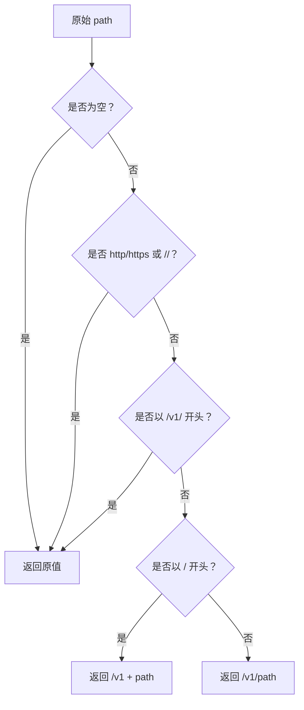

**图表来源**
- [apps/client/src/services/http.ts:48-65](file://apps/client/src/services/http.ts#L48-L65)

实际使用时，外层 `request` 会把 `appEnv.apiBaseUrl` 与归一化后的路径拼接，例如：

- 开发环境 `apiBaseUrl` 可能是后端代理地址；
- 生产环境必须显式配置 `VITE_API_BASE_URL`，否则会抛错阻止启动。

**章节来源**
- [apps/client/src/services/http.ts:48-65](file://apps/client/src/services/http.ts#L48-L65)
- [apps/client/src/services/http.ts:816-823](file://apps/client/src/services/http.ts#L816-L823)
- [apps/client/src/config/env.ts:180-250](file://apps/client/src/config/env.ts#L180-L250)

### 请求拦截器链

请求拦截器是一个按注册顺序执行的函数数组，每个拦截器接收 `UniApp.RequestOptions`，并可返回修改后的配置。

系统内置两个默认请求拦截器：

1. **JWT Token 自动附加**  
   - 从 `STORAGE_KEYS.AUTH_TOKEN` 读取 Token；
   - 若存在，写入 `Authorization: Bearer <token>`；
   - 可通过 `skipAuth` 选项跳过后续刷新流程（注意：该拦截器仍会尝试附加 Token，刷新行为由 `doRequest` 中的 `skipAuth` 分支控制）。

2. **写操作幂等键自动附加**  
   - 对 `POST` / `PUT` / `DELETE` / `PATCH` 请求自动设置 `Idempotency-Key`；
   - 如果调用方已手动设置该头，则保留业务语义（如签到固定 key）；
   - 幂等键生成逻辑为：`idem-{method}-{hashString(method + url + body)}`；
   - 使用 FNV-1a 风格的哈希，保证相同方法、URL、body 的请求产生相同 key。

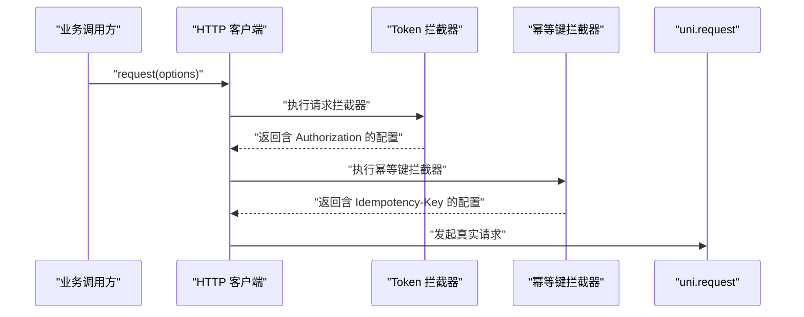

**图表来源**
- [apps/client/src/services/http.ts:212-290](file://apps/client/src/services/http.ts#L212-L290)
- [apps/client/src/services/http.ts:800-850](file://apps/client/src/services/http.ts#L800-L850)

**章节来源**
- [apps/client/src/services/http.ts:120-145](file://apps/client/src/services/http.ts#L120-L145)
- [apps/client/src/services/http.ts:212-290](file://apps/client/src/services/http.ts#L212-L290)
- [apps/client/src/services/http.ts:800-850](file://apps/client/src/services/http.ts#L800-L850)

### 响应拦截器链

响应拦截器用于统一处理非 2xx 错误、标准化错误码、解包后端 `ApiResponse` 信封。

系统内置两个默认响应拦截器：

| 拦截器 | 行为 |
|---|---|
| 错误码规范化拦截器 | 对非 2xx 响应，确保 `error` 字段是非空字符串，并确保 `code` 字段为数字 |
| ApiResponse 信封解包拦截器 | 对 2xx 且形如 `{ code: 0, message, data }` 的响应，将 `response.data` 替换为内层 `data` |

错误码映射规则：

| HTTP 状态码 | 标准化 error |
|---|---|
| 400 | `bad_request` |
| 401 | `unauthorized` |
| 403 | `forbidden` |
| 404 | `not_found` |
| 5xx | `server_error` |
| 其他 | `request_error` |

信封解包的安全边界：

- 仅对 2xx 生效；
- 仅当 `code` 是数字 `0`，且同时存在 `message` 和 `data` 字段时才解包；
- 扁平响应（如用户信息、数组）不会被误解包。

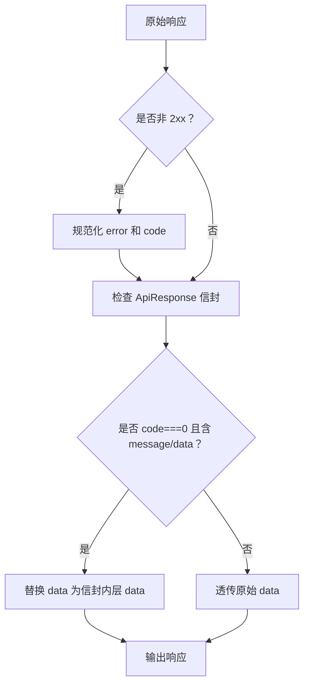

**图表来源**
- [apps/client/src/services/http.ts:290-360](file://apps/client/src/services/http.ts#L290-L360)

**章节来源**
- [apps/client/src/services/http.ts:290-360](file://apps/client/src/services/http.ts#L290-L360)

### Token 管理：`getToken` / `setToken` / `clearTokens`

#### `getToken`

- 从本地存储读取 `STORAGE_KEYS.AUTH_TOKEN`；
- 读取失败时返回空字符串；
- 这是 Token 附加到请求头的来源。

#### `setToken`

除了写入访问 Token，还执行一系列副作用：

1. 清除 `isRedirecting`，允许新的 401 刷新流程继续；
2. 取消待执行的登录跳转定时器，避免恢复会话后仍跳转；
3. 失效媒体 Token 缓存，防止跨账号数据泄漏；
4. 清空 TTL 缓存，防止不同账号共享缓存数据；
5. 捕获存储异常并静默忽略。

#### `clearTokens`

登出时调用，删除访问 Token 和刷新 Token，并失效媒体 Token 缓存。

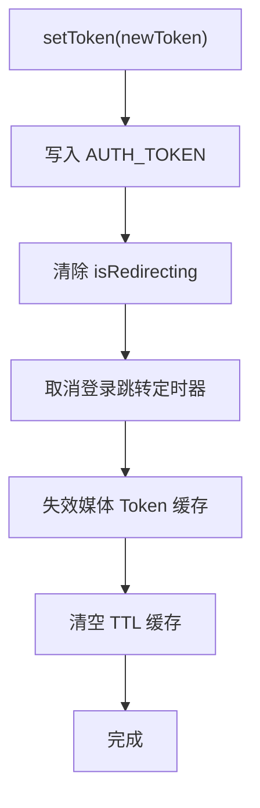

**图表来源**
- [apps/client/src/services/http.ts:150-200](file://apps/client/src/services/http.ts#L150-L200)

**章节来源**
- [apps/client/src/services/http.ts:150-200](file://apps/client/src/services/http.ts#L150-L200)

### 401 自动刷新与重试策略

401 处理分为两条线：

1. **当前请求的 401 重试**：最多重试一次；
2. **全局 Token 刷新**：并发 401 共享同一个刷新 Promise。

#### 关键约束

| 配置 | 含义 |
|---|---|
| `MAX_401_RETRY_COUNT = 1` | 单个请求最多因 401 重试一次 |
| `REFRESH_TIMEOUT_MS = 8000` | 刷新请求超时 8 秒，避免刷新接口无响应导致阻塞 |
| `isRedirecting` | 正在跳转登录时，新的 401 直接拒绝 |
| `refreshPromise` | 并发 401 共享的刷新 Promise |

#### 刷新流程

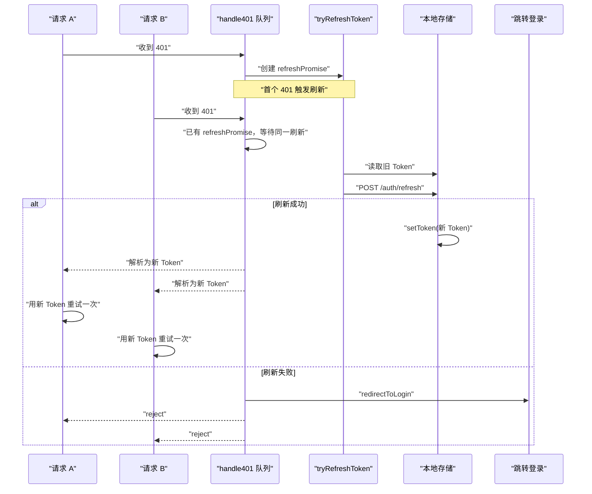

**图表来源**
- [apps/client/src/services/http.ts:360-530](file://apps/client/src/services/http.ts#L360-L530)
- [apps/client/src/services/http.ts:520-750](file://apps/client/src/services/http.ts#L520-L750)

#### 重要行为细节

- 刷新请求通过 `Authorization` 头携带旧 Token，不再使用请求体；
- 刷新请求自身也携带幂等键，因为后端强制要求写操作有 `Idempotency-Key`；
- 刷新成功后，`setToken` 会清理跳转状态和缓存；
- 刷新失败后，`redirectToLogin` 会区分游客与已登录用户，分别展示“请先登录”或“登录已过期”；
- `retry401Count` 限制单个请求最多重试一次，避免“刷新后仍然 401”的死循环。

**章节来源**
- [apps/client/src/services/http.ts:360-530](file://apps/client/src/services/http.ts#L360-L530)
- [apps/client/src/services/http.ts:520-750](file://apps/client/src/services/http.ts#L520-L750)

### 请求函数 `request`：超时、重试与 AbortSignal

`request` 是对外主入口，负责：

1. 拼接 `baseUrl + normalizeApiPath(url)`；
2. 设置默认 `Content-Type`；
3. 执行请求拦截器链；
4. 计算最大重试次数；
5. 调用内部 `doRequest`；
6. 对网络层错误进行指数退避重试；
7. 成功时记录 Sentry Breadcrumb；
8. 失败时根据 `reportError` 和状态码决定是否上报 Sentry。

#### 重试策略

| 场景 | 是否重试 |
|---|---|
| 网络层错误（status=0） | 默认重试 1 次，指数退避 |
| 401 | 不走网络层重试，走 401 刷新流程 |
| 403 / 4xx / 5xx | 不重试，直接构造业务或认证错误 |
| `noRetry=true` | 不重试 |
| `signal.aborted` | 立即终止重试循环 |

#### 指数退避公式

延迟时间 = `DEFAULT_RETRY_DELAY_MS × 2^attempt`，即：

- 第 1 次重试：500ms；
- 第 2 次重试：1000ms；
- 第 3 次重试：2000ms；
- 依此类推。

#### AbortSignal 支持

`RequestOptions.signal` 支持 `AbortController`：

- 传入已 aborted 的 signal 时，立即拒绝请求；
- 请求 settle（成功、失败、401 重试结束）后，监听器会被移除，避免内存泄漏；
- 兼容 `addEventListener` 和 `onabort` 两种 API。

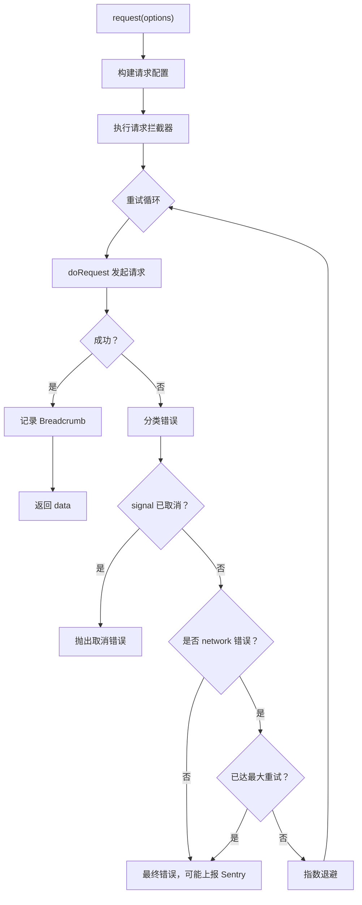

**图表来源**
- [apps/client/src/services/http.ts:800-977](file://apps/client/src/services/http.ts#L800-L977)

**章节来源**
- [apps/client/src/services/http.ts:800-977](file://apps/client/src/services/http.ts#L800-L977)

### 通用超时工具：`withTimeout`

`withTimeout` 不仅适用于 `uni.request`，还可包裹任意 Promise，例如 AI 生成、文件上传、长轮询等异步操作。

行为：

- 在 `timeoutMs` 内未完成，reject 一个 `EnhancedApiError`（category=network）；
- 超时后会调用内部 `AbortController.abort()`，并清理外部 signal 监听器；
- 支持外部传入 `AbortSignal`，任一 abort 即触发整体取消；
- 目标 Promise settle 后，定时器、监听器都会清理。

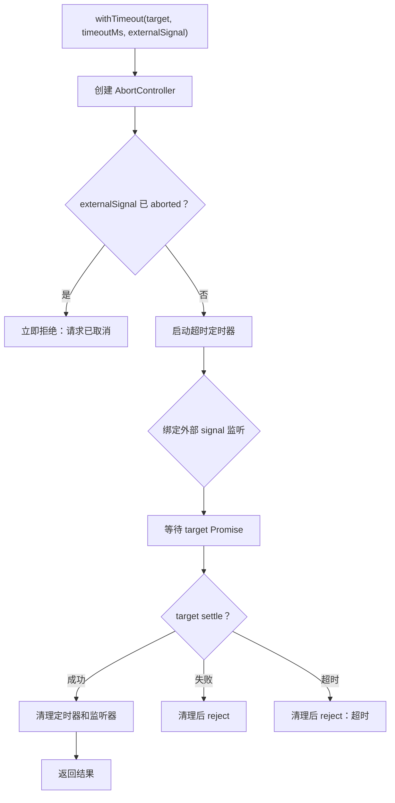

**图表来源**
- [apps/client/src/services/http.ts:930-977](file://apps/client/src/services/http.ts#L930-L977)

**章节来源**
- [apps/client/src/services/http.ts:900-977](file://apps/client/src/services/http.ts#L900-L977)

## 依赖关系分析

### 模块依赖图

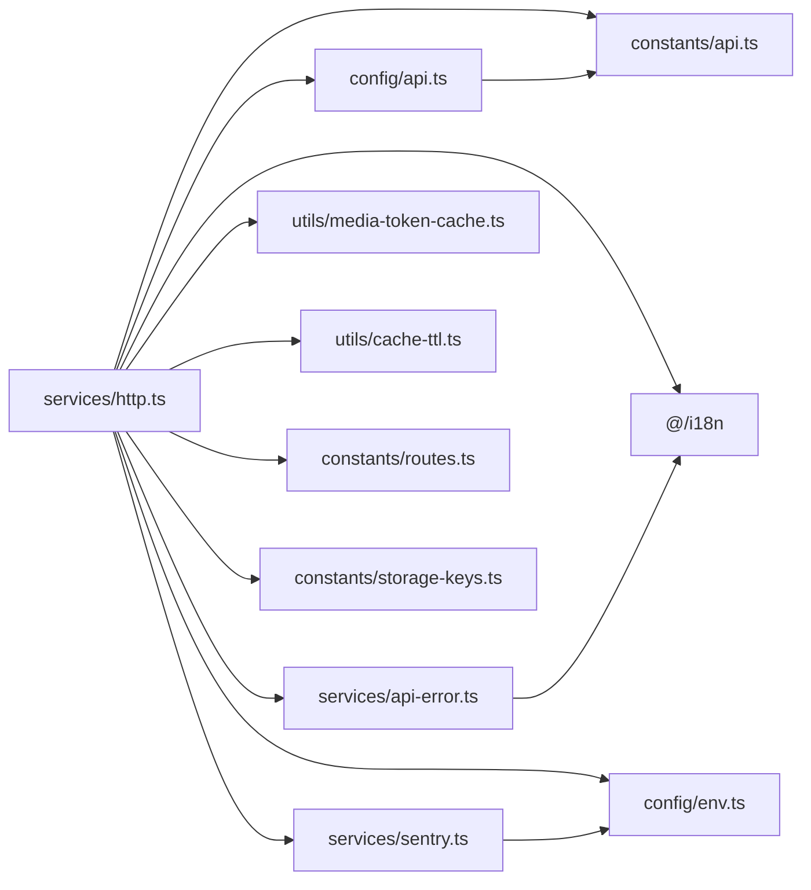

**图表来源**
- [apps/client/src/services/http.ts:1-20](file://apps/client/src/services/http.ts#L1-L20)
- [apps/client/src/config/api.ts:1-126](file://apps/client/src/config/api.ts#L1-L126)
- [apps/client/src/services/sentry.ts:1-60](file://apps/client/src/services/sentry.ts#L1-L60)
- [apps/client/src/services/api-error.ts:1-40](file://apps/client/src/services/api-error.ts#L1-L40)

### 耦合与内聚分析

- **高内聚**：HTTP 客户端集中管理请求生命周期、拦截器、Token、401 刷新、错误分类；
- **低耦合**：业务服务只依赖 `request` 和少量工具函数，不需要直接处理 `uni.request`；
- **依赖方向清晰**：HTTP 客户端依赖配置、常量、错误模型、Sentry、环境变量，但不被这些模块反向依赖；
- **循环依赖防护**：媒体 Token 缓存通过独立模块引入，避免 `http -> media -> http` 循环；
- **Sentry 条件编译**：仅在 H5 端加载 `@sentry/vue`，小程序端降级。

**章节来源**
- [apps/client/src/services/http.ts:1-20](file://apps/client/src/services/http.ts#L1-L20)
- [apps/client/src/services/sentry.ts:1-60](file://apps/client/src/services/sentry.ts#L1-L60)
- [apps/client/src/config/api.ts:1-126](file://apps/client/src/config/api.ts#L1-L126)

## 性能与并发特性

### 并发安全机制

| 风险 | 实现方案 |
|---|---|
| 多个 401 同时触发刷新 | `refreshPromise` 共享，所有并发请求等待同一刷新 Promise |
| 重复跳转登录页 | `isRedirecting` 标志 + `cancelLoginRedirect` |
| 刷新接口无响应导致永久阻塞 | `REFRESH_TIMEOUT_MS = 8000`，刷新请求自带超时 |
| 401 刷新后仍 401 死循环 | `retry401Count >= MAX_401_RETRY_COUNT` 时直接跳转登录 |
| AbortSignal 监听器累积泄漏 | 请求 settle 后移除监听器 |
| 外部 signal 复用导致多次 reject | `withTimeout` 中清理外部 signal 监听器 |
| 闭包 resolve 重赋值导致无限递归 | 保存 `originalResolve` / `originalReject` |

### 重试与退避

- 默认网络层重试次数为 1；
- 指数退避起始值为 500ms，基数为 2；
- 仅对 category=network 的错误重试；
- 401 不属于网络层错误，不会走指数退避重试，而是走刷新流程；
- 登录等敏感接口建议设置 `noRetry=true`，避免错误密码导致重试放大。

### 超时分层

| 场景 | 超时策略 |
|---|---|
| 普通接口 | `DEFAULT_TIMEOUT_MS = 10000` |
| AI 接口 | `AI_API_TIMEOUT_MS = 30000` |
| 文件上传 | `API_TIMEOUT.UPLOAD_MS` |
| 长轮询 | `API_TIMEOUT.LONG_POLL_MS` |
| Token 刷新 | `REFRESH_TIMEOUT_MS = 8000` |
| 任意 Promise | `withTimeout(timeoutMs)` |

### 幂等性

写操作自动附带 `Idempotency-Key`，后端通过 `@Idempotent` 注解对相同 key 的去重请求只执行一次。这对双击提交、弱网重试、用户快速重复点击非常关键。

**章节来源**
- [apps/client/src/services/http.ts:212-290](file://apps/client/src/services/http.ts#L212-L290)
- [apps/client/src/services/http.ts:360-530](file://apps/client/src/services/http.ts#L360-L530)
- [apps/client/src/services/http.ts:800-977](file://apps/client/src/services/http.ts#L800-L977)
- [apps/client/src/constants/api.ts:1-81](file://apps/client/src/constants/api.ts#L1-L81)
- [apps/client/src/config/api.ts:1-126](file://apps/client/src/config/api.ts#L1-L126)

## 错误分类与统一处理

### 错误分类体系

HTTP 层将错误分为三类：

| 分类 | 触发条件 | 典型表现 |
|---|---|---|
| `network` | status=0，或超时、断网、取消 | 网络不可用、请求超时、AbortSignal 取消 |
| `auth` | status=401 或 403 | Token 过期、权限不足 |
| `business` | 其他 HTTP 状态码 | 后端返回的业务异常 |

### `AppApiError` 与 `EnhancedApiError`

`AppApiError` 继承自原生 `Error`，包含：

- `status`：HTTP 状态码；
- `error`：错误码字符串；
- `message`：用户可读文案；
- `details`：可选详情。

`EnhancedApiError` 在此基础上增加 `category` 字段，用于上层 UI 和业务逻辑按分类处理。

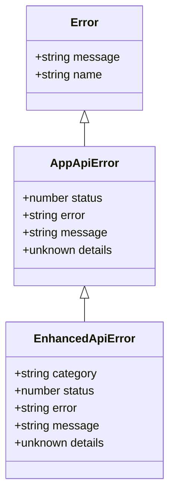

**图表来源**
- [apps/client/src/services/api-error.ts:1-80](file://apps/client/src/services/api-error.ts#L1-L80)
- [apps/client/src/services/http.ts:70-95](file://apps/client/src/services/http.ts#L70-L95)

### 统一错误处理流程

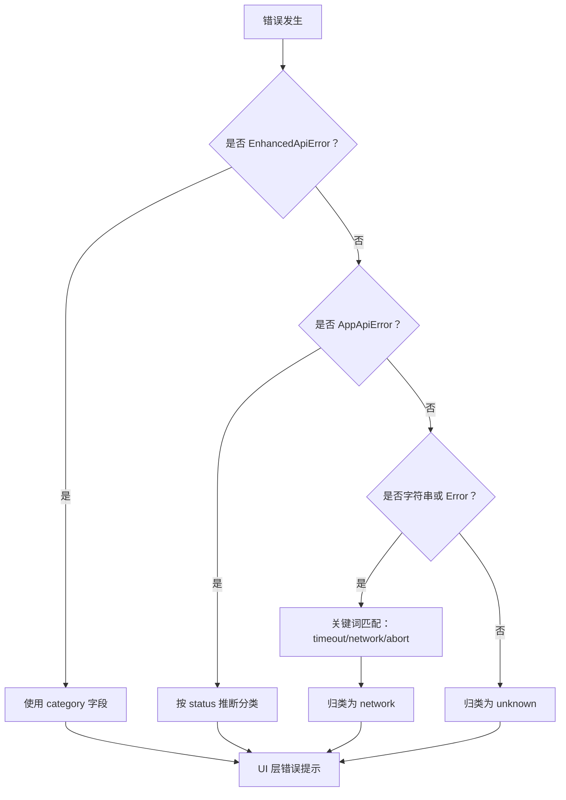

**图表来源**
- [apps/client/src/utils/error-toast.ts:1-199](file://apps/client/src/utils/error-toast.ts#L1-L199)
- [apps/client/src/services/http.ts:70-95](file://apps/client/src/services/http.ts#L70-L95)
- [apps/client/src/services/api-error.ts:80-164](file://apps/client/src/services/api-error.ts#L80-L164)

### 错误文案优先级

UI 层错误提示遵循以下优先级：

1. 业务错误优先使用后端返回的 `message`；
2. 网络错误和认证错误优先使用分类默认文案，避免暴露技术细节；
3. 调用方可提供 fallback 文案；
4. 最终回退到 i18n 默认文案。

**章节来源**
- [apps/client/src/services/http.ts:70-95](file://apps/client/src/services/http.ts#L70-L95)
- [apps/client/src/services/api-error.ts:1-164](file://apps/client/src/services/api-error.ts#L1-L164)
- [apps/client/src/utils/error-toast.ts:1-199](file://apps/client/src/utils/error-toast.ts#L1-L199)

## Mock 模式、调试与监控

### Mock 模式支持

Mock 模式由环境变量 `VITE_API_MODE` 控制：

| 值 | 行为 |
|---|---|
| `real` | 真实后端接口 |
| `mock` | 本地 mock 数据 |
| 未配置 + 开发环境 | 默认 `mock` |
| 未配置 + 生产环境 | 默认 `real` |

API 基础地址由 `clientEnv.apiBaseUrl` 提供，开发环境可通过 `getDevApiBaseUrl()` 回退，生产环境必须显式配置 `VITE_API_BASE_URL`。

### 本地调试技巧

| 问题 | 排查手段 |
|---|---|
| 请求 404 | 检查 `apiBaseUrl` 和 `normalizeApiPath` 是否正确拼接 `/v1` |
| 401 频繁跳转 | 检查 `refreshPromise` 是否被阻塞，确认刷新接口是否可达 |
| 重复跳转登录 | 检查 `isRedirecting` 是否在 `setToken` 中被重置 |
| 请求不重试 | 检查是否设置了 `noRetry=true` 或 `reportError=false` |
| 超时过早 | 检查是否使用了默认超时而非 `getApiTimeout("upload"|"ai"|"longPoll")` |
| 幂等键不稳定 | 检查 `hashString` 是否被业务覆盖，确认相同 body 能生成相同 key |
| Sentry 未上报 | 检查 `VITE_SENTRY_DSN` 是否配置，H5 端是否成功初始化 |

### Sentry 集成

Sentry 在 H5 环境通过 `@sentry/vue` 初始化，并启用浏览器追踪集成采集路由切换、HTTP 请求等性能数据。采样率为 20%。

在 HTTP 层：

- 成功请求记录 `http` breadcrumb，附带真实状态码；
- 最终失败时上报异常，包含 `source=http`、`http_url`、`http_status`；
- 401 错误通常不上报，因为属于认证状态机的一部分；
- 调用方可通过 `reportError=false` 抑制预期业务状态的告警噪音。

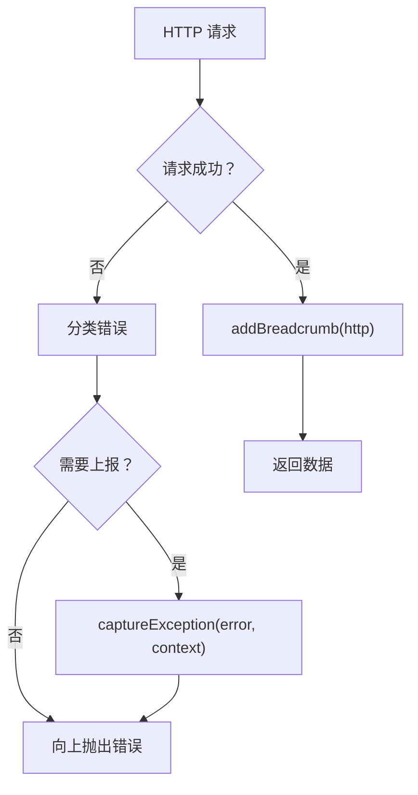

**图表来源**
- [apps/client/src/services/sentry.ts:1-200](file://apps/client/src/services/sentry.ts#L1-L200)
- [apps/client/src/services/http.ts:800-977](file://apps/client/src/services/http.ts#L800-L977)

**章节来源**
- [apps/client/src/config/env.ts:1-250](file://apps/client/src/config/env.ts#L1-L250)
- [apps/client/src/services/sentry.ts:1-200](file://apps/client/src/services/sentry.ts#L1-L200)
- [apps/client/src/services/http.ts:800-977](file://apps/client/src/services/http.ts#L800-L977)

## 常见问题排查指南

### 1. 为什么我的请求路径变成了 `/api/xxx` 而不是 `/v1/xxx`？

可能原因：

- 没有使用 `normalizeApiPath`；
- 调用方直接拼接了错误的 baseUrl；
- 环境变量 `VITE_API_BASE_URL` 指向了不含 `/api/v1` 的后端地址。

修复建议：始终通过 `request` 发起请求，不要绕过路径归一化。

**章节来源**
- [apps/client/src/services/http.ts:48-65](file://apps/client/src/services/http.ts#L48-L65)
- [apps/client/src/services/http.ts:816-823](file://apps/client/src/services/http.ts#L816-L823)
- [apps/client/src/config/env.ts:180-250](file://apps/client/src/config/env.ts#L180-L250)

### 2. 为什么 401 后没有自动刷新 Token？

可能原因：

- `getToken()` 返回空字符串，说明本地没有 Token；
- `skipAuth=true`，跳过刷新流程；
- `skipAuthRefresh=true`，上游服务 401 不应触发登录跳转；
- 刷新接口返回非 200；
- 刷新请求被 `REFRESH_TIMEOUT_MS` 超时阻断。

**章节来源**
- [apps/client/src/services/http.ts:360-530](file://apps/client/src/services/http.ts#L360-L530)
- [apps/client/src/services/http.ts:520-750](file://apps/client/src/services/http.ts#L520-L750)

### 3. 为什么写操作反复被拒绝缺少 `Idempotency-Key`？

可能原因：

- 调用方没有使用 `request`；
- 调用方手动覆盖了 `header`，丢失了拦截器设置的 `Idempotency-Key`；
- 业务侧故意保留自定义 key，但重复点击产生了不同 body，导致 key 不同。

**章节来源**
- [apps/client/src/services/http.ts:254-290](file://apps/client/src/services/http.ts#L254-L290)

### 4. 为什么网络错误没有重试？

可能原因：

- 设置了 `noRetry=true`；
- 错误不是 network 分类，而是 auth/business；
- 已达到最大重试次数；
- `signal.aborted` 已触发，立即终止重试。

**章节来源**
- [apps/client/src/services/http.ts:800-977](file://apps/client/src/services/http.ts#L800-L977)

### 5. 为什么 Sentry 没有上报异常？

可能原因：

- H5 端未配置 `VITE_SENTRY_DSN`；
- Sentry 初始化失败；
- 小程序端不支持 `@sentry/vue`，已降级；
- 401 错误被有意跳过上报；
- 调用方设置了 `reportError=false`。

**章节来源**
- [apps/client/src/services/sentry.ts:1-200](file://apps/client/src/services/sentry.ts#L1-L200)
- [apps/client/src/services/http.ts:800-977](file://apps/client/src/services/http.ts#L800-L977)

## 结论

HTTP 客户端与拦截器子系统围绕 `uni.request` 构建了类型安全、可观测、可重试、可取消的前端网络层。其核心价值在于：

- 统一路径归一化，消除 `/v1` 前缀的历史债务；
- 通过拦截器链分离 Token 注入、幂等键生成、错误规范化、信封解包；
- 用 Promise 队列模式解决 401 并发刷新问题；
- 用 `EnhancedApiError` 和分类体系统一错误表达；
- 用 Sentry 与 Breadcrumb 打通异常定位链路；
- 用环境变量驱动 Mock 模式、超时策略和监控开关。

对于新增接口，推荐做法是：

1. 使用 `request<TResponse, TBody>` 发起请求；
2. 通过 `API_CONFIG` 或 `getApiTimeout` 选择合适超时；
3. 对写操作保持默认幂等键，除非业务需要固定 key；
4. 对上游服务 401 使用 `skipAuthRefresh=true`；
5. 对预期业务状态使用 `reportError=false`；
6. 对 UI 错误提示使用 `error-toast` 提供的分类工具。