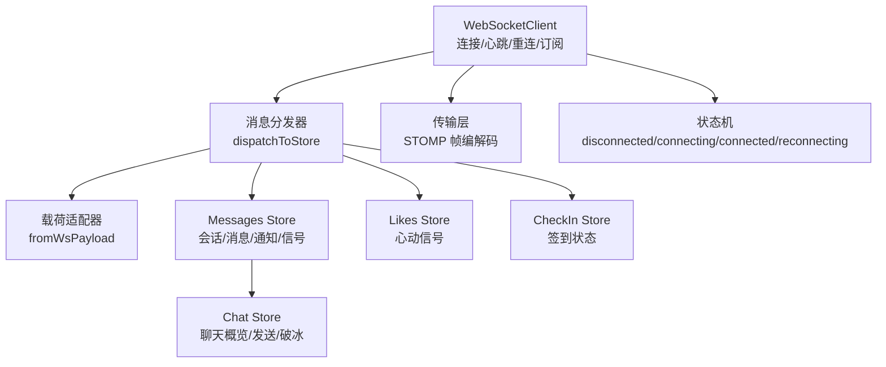
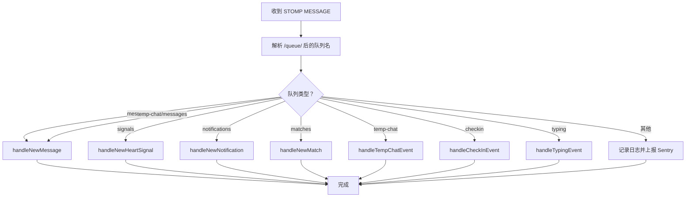
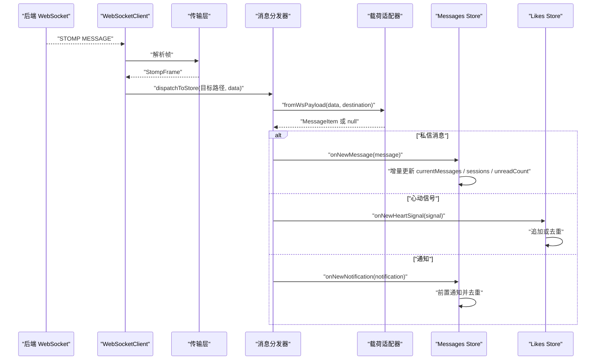
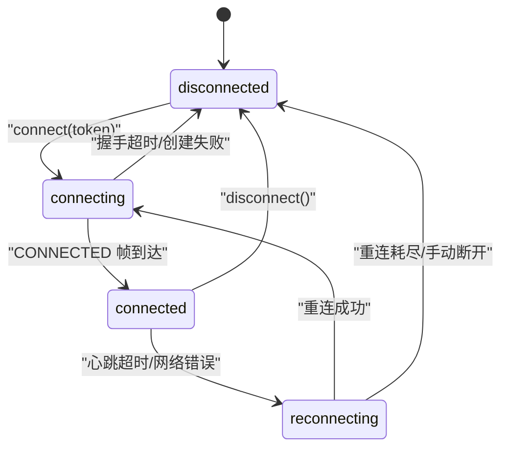
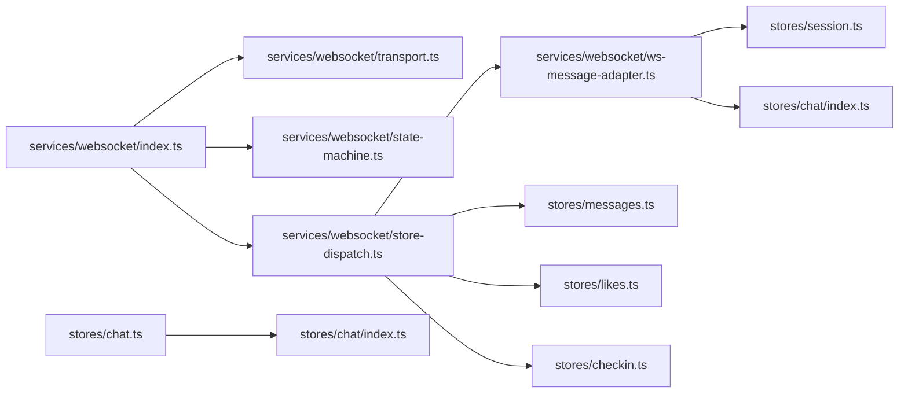

# Pinia Store 集成与消息分发

<cite>
**本文引用的文件**   
- [apps/client/src/services/websocket/index.ts](file://apps/client/src/services/websocket/index.ts)
- [apps/client/src/services/websocket/store-dispatch.ts](file://apps/client/src/services/websocket/store-dispatch.ts)
- [apps/client/src/services/websocket/ws-message-adapter.ts](file://apps/client/src/services/websocket/ws-message-adapter.ts)
- [apps/client/src/services/websocket/transport.ts](file://apps/client/src/services/websocket/transport.ts)
- [apps/client/src/services/websocket/state-machine.ts](file://apps/client/src/services/websocket/state-machine.ts)
- [apps/client/src/stores/messages.ts](file://apps/client/src/stores/messages.ts)
- [apps/client/src/stores/chat.ts](file://apps/client/src/stores/chat.ts)
- [apps/client/src/stores/chat/index.ts](file://apps/client/src/stores/chat/index.ts)
- [apps/client/src/stores/chat/types.ts](file://apps/client/src/stores/chat/types.ts)
- [apps/client/src/tests/ws-store-dispatch.spec.ts](file://apps/client/src/tests/ws-store-dispatch.spec.ts)
</cite>

## 目录

1. [引言](#引言)
2. [项目结构](#项目结构)
3. [核心组件](#核心组件)
4. [架构总览](#架构总览)
5. [详细组件分析](#详细组件分析)
6. [依赖关系分析](#依赖关系分析)
7. [性能与一致性](#性能与一致性)
8. [故障排查](#故障排查)
9. [结论](#结论)

## 引言

本文件面向 WebSocket 与 Pinia Store 的集成实现，重点解释以下能力：

- **WebSocket 客户端**如何基于 uni-app 的 `connectSocket` 构建简化版 STOMP 通信。
- **消息分发器**如何把后端推送路径映射到 Pinia Store 的方法或状态字段。
- **Chat Store**与 **Messages Store**的状态结构、增量更新策略和错误处理。
- **实时消息**如何完成载荷适配、类型守卫、去重、未读计数和 typing 状态同步。
- **连接生命周期**中的心跳、重连、订阅、超时、资源清理与内存泄漏防护。
- **测试用例**对队列路由、载荷形状、Sentry 上报等行为的验证契约。

该文档既适合熟悉前端状态管理的开发者阅读，也适合需要理解“实时消息如何进入界面”的产品和技术负责人参考。

## 项目结构

与本次目标直接相关的代码集中在两个子系统中：

| 子系统 | 主要职责 | 关键文件 |
|---|---|---|
| WebSocket 层 | 连接管理、STOMP 帧编解码、心跳、重连、频道订阅、消息分发入口 | `services/websocket/index.ts`、`transport.ts`、`state-machine.ts`、`store-dispatch.ts`、`ws-message-adapter.ts` |
| Pinia Store 层 | 会话列表、消息缓存、心动信号、通知、typing 状态、聊天概览与发送流程 | `stores/messages.ts`、`stores/chat.ts`、`stores/chat/index.ts`、`stores/chat/types.ts` |
| 测试契约 | 验证 WebSocket 到 Store 的分发行为、正则修复、载荷适配、异常上报 | `tests/ws-store-dispatch.spec.ts` |

**图示来源**
- [apps/client/src/services/websocket/index.ts:201-550](file://apps/client/src/services/websocket/index.ts#L201-L550)
- [apps/client/src/services/websocket/store-dispatch.ts:1-120](file://apps/client/src/services/websocket/store-dispatch.ts#L1-L120)
- [apps/client/src/services/websocket/ws-message-adapter.ts:1-114](file://apps/client/src/services/websocket/ws-message-adapter.ts#L1-L114)
- [apps/client/src/services/websocket/transport.ts:1-200](file://apps/client/src/services/websocket/transport.ts#L1-L200)
- [apps/client/src/services/websocket/state-machine.ts:1-121](file://apps/client/src/services/websocket/state-machine.ts#L1-L121)
- [apps/client/src/stores/messages.ts:200-855](file://apps/client/src/stores/messages.ts#L200-L855)
- [apps/client/src/stores/chat/index.ts:1-131](file://apps/client/src/stores/chat/index.ts#L1-L131)

**章节来源**
- [apps/client/src/services/websocket/index.ts:1-100](file://apps/client/src/services/websocket/index.ts#L1-L100)
- [apps/client/src/stores/messages.ts:1-200](file://apps/client/src/stores/messages.ts#L1-L200)
- [apps/client/src/stores/chat/index.ts:1-40](file://apps/client/src/stores/chat/index.ts#L1-L40)

## 核心组件

### WebSocket 客户端

`WebSocketClient` 是实时通道的入口。它负责：

1. 建立 WebSocket 连接并构造 URL。
2. 通过子协议传递认证 token，避免 token 出现在 URL 查询参数中。
3. 发送 STOMP CONNECT 帧并完成握手。
4. 维护连接状态机、心跳管理器、重连管理器和频道订阅表。
5. 将接收到的 STOMP MESSAGE 帧交给消息分发器。
6. 在断开、错误、超时等路径上执行清理和降级。

其关键设计点包括：

- 连接状态由 `ConnectionStateMachine` 统一管理，外部只能观察状态变更，不能随意修改。
- 重连不是简单重试，而是配合最大次数、退避、手动关闭标记和防重入标志。
- 订阅信息在重连后重新发起，保证 `/user/{userId}/queue/messages` 等私有频道恢复。
- 心跳收到 pong 时重置超时定时器，避免误判断线。
- DISCONNECT 帧发出后延迟关闭底层连接，给服务端留出正常下线感知窗口。

**章节来源**
- [apps/client/src/services/websocket/index.ts:101-200](file://apps/client/src/services/websocket/index.ts#L101-L200)
- [apps/client/src/services/websocket/index.ts:201-360](file://apps/client/src/services/websocket/index.ts#L201-L360)
- [apps/client/src/services/websocket/index.ts:360-550](file://apps/client/src/services/websocket/index.ts#L360-L550)
- [apps/client/src/services/websocket/state-machine.ts:1-121](file://apps/client/src/services/websocket/state-machine.ts#L1-L121)

### 消息分发器

消息分发器的核心是 `dispatchToStore`。它从 STOMP 消息的目标路径中提取队列类型，然后调用对应的处理器函数：

| 队列类型 | 含义 | 处理方式 |
|---|---|---|
| `messages` | 私信消息 | 经载荷适配器转换为 `MessageItem`，再调用 `useMessagesStore.onNewMessage` 或回退追加逻辑 |
| `temp-chat/messages` | 临时会话私信 | 同样走私信消息处理路径，但 sessionId 可能为空 |
| `signals` | 心动信号 | 写入 Likes Store，同时尝试写入 Messages Store 的心动信号列表 |
| `notifications` | 系统通知 | 插入通知列表头部并按 id 去重 |
| `matches` | 匹配成功事件 | 生成一条本地通知，按 matchId 去重 |
| `temp-chat` | 临时会话创建/关闭事件 | 刷新会话列表 |
| `checkin` | 签到事件 | 刷新签到状态 |
| `typing` | 对方正在输入事件 | 更新 typing 映射 |
| 其他 | 未知队列 | 开发环境告警 + Sentry 上报 |

**图示来源**
- [apps/client/src/services/websocket/store-dispatch.ts:1-120](file://apps/client/src/services/websocket/store-dispatch.ts#L1-L120)
- [apps/client/src/services/websocket/store-dispatch.ts:120-443](file://apps/client/src/services/websocket/store-dispatch.ts#L120-L443)

**章节来源**
- [apps/client/src/services/websocket/store-dispatch.ts:1-120](file://apps/client/src/services/websocket/store-dispatch.ts#L1-L120)
- [apps/client/src/tests/ws-store-dispatch.spec.ts:1-146](file://apps/client/src/tests/ws-store-dispatch.spec.ts#L1-L146)

### 载荷适配器

`fromWsPayload` 解决的是后端 WebSocket 载荷与前端内部数据结构不一致的问题。后端推送的私信消息可能是 `MessageView` 形状，而前端内部使用 `MessageItem`；临时会话消息又可能是接近 `MessageItem` 的形状但没有 `sessionId`。

适配器承担三个职责：

1. 把后端字段映射为前端字段。
2. 统一 `kind` 值，兼容 `voice`、`emoji`、`activity`、`image`、`text`。
3. 解析引用回复上下文，使临时会话与私信共享同一套引用渲染逻辑。

对于无法识别的载荷，适配器返回空值，由调用方丢弃，不污染 Store。

**章节来源**
- [apps/client/src/services/websocket/ws-message-adapter.ts:1-114](file://apps/client/src/services/websocket/ws-message-adapter.ts#L1-L114)
- [apps/client/src/stores/messages.ts:200-563](file://apps/client/src/stores/messages.ts#L200-L563)

### Messages Store

`useMessagesStore` 是消息中心的核心 Pinia Store，管理：

- 会话列表 `sessions`
- 当前会话消息 `currentMessages`
- 心动信号 `heartSignals`
- 系统通知 `notifications`
- 互动事件 `interactionEvents`
- 分页游标 `messagePage`、`interactionEventPage`
- 是否正在查看某会话 `activeSessionId`
- typing 状态映射 `typingMap`
- 首页聚合数据 `dashboard`

它的异步操作包括：

- `bootstrap`：首屏聚合拉取会话、官方号关系仪表盘、心动信号和通知。
- `fetchSessions`：加载会话列表，合并官方号与会话数据。
- `fetchSessionMessages`：加载当前会话消息，并发送已读回执。
- `fetchOlderMessages`：正序分页加载更早历史。
- `fetchHeartSignals`、`fetchNotifications`、`loadInteractionEvents`：加载辅助数据。

Store 内还定义了 getter，例如：

- `pageLoading`：任一聚合动作加载中即为 loading。
- `totalUnreadCount`：排除免打扰会话后的总未读数。
- `filteredNotifications`：按社交信号或内容信号筛选通知。

**章节来源**
- [apps/client/src/stores/messages.ts:1-200](file://apps/client/src/stores/messages.ts#L1-L200)
- [apps/client/src/stores/messages.ts:200-563](file://apps/client/src/stores/messages.ts#L200-L563)
- [apps/client/src/stores/messages.ts:564-855](file://apps/client/src/stores/messages.ts#L564-L855)

### Chat Store

`useChatStore` 是聊天页的专用 Store，管理：

- 聊天概览 `overview`、`overviewView`
- 活跃会话 `activeSession`
- 破冰话题列表 `icebreakerTopics` 和结构化项 `icebreakerItems`
- 各模块 loading 状态
- 错误消息
- 消息投递状态映射 `messageDeliveryStatus`

它通过 re-export 保持旧导入路径兼容，并将实际 action 拆分到 `actions/session`、`actions/messaging`、`actions/exchange`、`actions/icebreakers` 等文件中。这种拆分让单一文件不再承担全部逻辑，便于单元测试和维护。

**章节来源**
- [apps/client/src/stores/chat.ts:1-18](file://apps/client/src/stores/chat.ts#L1-L18)
- [apps/client/src/stores/chat/index.ts:1-131](file://apps/client/src/stores/chat/index.ts#L1-L131)
- [apps/client/src/stores/chat/types.ts:1-86](file://apps/client/src/stores/chat/types.ts#L1-L86)

## 架构总览

下面展示一次完整的 WebSocket 实时消息如何进入 Pinia Store 并更新界面状态。

**图示来源**
- [apps/client/src/services/websocket/index.ts:360-550](file://apps/client/src/services/websocket/index.ts#L360-L550)
- [apps/client/src/services/websocket/store-dispatch.ts:1-120](file://apps/client/src/services/websocket/store-dispatch.ts#L1-L120)
- [apps/client/src/services/websocket/ws-message-adapter.ts:1-114](file://apps/client/src/services/websocket/ws-message-adapter.ts#L1-L114)
- [apps/client/src/stores/messages.ts:564-855](file://apps/client/src/stores/messages.ts#L564-L855)

## 详细组件分析

### WebSocket 连接与状态机

`ConnectionStateMachine` 只暴露状态读取、设置、回调注册和移除方法。它不关心业务语义，因此可以安全地被 WebSocket 客户端复用。

关键行为：

- 初始状态为 `disconnected`。
- `setState` 仅在状态真正变化时触发回调。
- 回调异常不会中断后续回调执行。
- `isConnected` 仅判断底层连接是否为 connected；是否完成 STOMP 握手由业务层额外维护。
- `reset` 不清理回调，因为状态机实例在客户端单例中长期存在。

**图示来源**
- [apps/client/src/services/websocket/state-machine.ts:1-121](file://apps/client/src/services/websocket/state-machine.ts#L1-L121)
- [apps/client/src/services/websocket/index.ts:201-360](file://apps/client/src/services/websocket/index.ts#L201-L360)

**章节来源**
- [apps/client/src/services/websocket/state-machine.ts:1-121](file://apps/client/src/services/websocket/state-machine.ts#L1-L121)
- [apps/client/src/services/websocket/index.ts:201-360](file://apps/client/src/services/websocket/index.ts#L201-L360)

### STOMP 帧编解码与心跳

传输层提供纯函数：

- `buildFrame`：构造命令、头部、体部的完整 STOMP 帧。
- `parseFrames`：按 NULL 字符分割帧，解析头部和体部。
- `isPongMessage`：识别后端心跳 pong 响应。
- `buildWsUrl`：构造 WebSocket URL，不再附带 token 查询参数。
- `buildProtocols`：构造子协议，用于 HTTP 握手阶段认证。

心跳机制确保：

- 客户端定期发送 ping。
- 服务器回复 pong。
- 如果长时间没有有效消息，客户端重置心跳超时并触发重连。

**章节来源**
- [apps/client/src/services/websocket/transport.ts:1-200](file://apps/client/src/services/websocket/transport.ts#L1-L200)
- [apps/client/src/services/websocket/index.ts:360-550](file://apps/client/src/services/websocket/index.ts#L360-L550)

### 消息分发与类型推断

消息分发器采用“路径路由 + 类型守卫 + 适配器转换”的组合：

1. **路径路由**：正则匹配 `/queue/` 后面的队列名，支持含短横线和斜杠的路径，如 `temp-chat/messages`。
2. **类型守卫**：使用 `isMessageItem`、`isHeartSignal`、`isSystemNotification` 等守卫拒绝非法载荷。
3. **适配器转换**：real 模式后端载荷先经 `fromWsPayload` 转为内部结构，再进行守卫校验。
4. **Store 接口探测**：优先调用 Store 上的 `onNewMessage`、`onNewHeartSignal`、`onNewNotification`；若不存在则回退为直接数组操作。

这种设计避免了强耦合：分发器不依赖具体 Store 实现细节，只约定“存在某个方法就调用”。

**章节来源**
- [apps/client/src/services/websocket/store-dispatch.ts:1-200](file://apps/client/src/services/websocket/store-dispatch.ts#L1-L200)
- [apps/client/src/tests/ws-store-dispatch.spec.ts:1-146](file://apps/client/src/tests/ws-store-dispatch.spec.ts#L1-L146)

### Messages Store 的实时更新逻辑

当 `handleNewMessage` 收到新私信时：

1. 通过 `fromWsPayload` 把后端载荷转成 `MessageItem`。
2. 如果无法归因到 `sessionId`，静默忽略（临时会话未读以服务端为准）。
3. 调用 `useMessagesStore.onNewMessage`；如果该方法不存在，则直接追加到 `currentMessages`。
4. 回退路径会查找对应会话，更新最后消息预览、发送时间和未读计数。

对于心动信号：

- 优先调用 `useLikesStore.onNewHeartSignal`。
- 同时尝试将信号写入 `messagesStore.heartSignals`，并按 id 去重。

对于通知：

- 优先调用 `useMessagesStore.onNewNotification`。
- 回退路径在通知数组头部插入，并按 id 去重。

对于匹配事件：

- 构造一条本地通知，标题和内容来自 i18n。
- 按 `matchId` 去重，防止重复推送产生重复通知。

对于 typing 事件：

- 写入 `messagesStore.typingMap`。
- Store 侧另有自动复位逻辑，避免“对方正在输入”长期显示。

**章节来源**
- [apps/client/src/services/websocket/store-dispatch.ts:200-443](file://apps/client/src/services/websocket/store-dispatch.ts#L200-L443)
- [apps/client/src/stores/messages.ts:564-855](file://apps/client/src/stores/messages.ts#L564-L855)

### Chat Store 的状态结构与职责

Chat Store 的职责更偏向“聊天页交互”，而不是通用消息通道：

| 状态字段 | 作用 |
|---|---|
| `loadingOverview` | 聊天概览加载中 |
| `loadingSession` | 会话详情加载中 |
| `errorMessage` | 最近一次业务错误提示 |
| `overview` | 原始 API 响应 |
| `overviewView` | 视图模型化的聊天概览 |
| `activeSession` | 当前活跃会话视图 |
| `icebreakerTopics` | 文本类破冰话题 |
| `icebreakerItems` | 结构化破冰话题 |
| `loadingIcebreakers` | 破冰话题加载中 |
| `messageDeliveryStatus` | 消息发送状态映射，持久化到本地存储 |

Chat Store 的 action 被拆分为：

- 会话生命周期：加载概览、从推荐/匹配/信号启动会话、加载会话、置顶、结束会话。
- 消息发送：发送文本、发送语音、设置消息投递状态。
- 联系方式交换：接受或拒绝交换。
- 破冰话题：加载、发送、获取破冰话题。

**章节来源**
- [apps/client/src/stores/chat/index.ts:1-131](file://apps/client/src/stores/chat/index.ts#L1-L131)
- [apps/client/src/stores/chat/types.ts:1-86](file://apps/client/src/stores/chat/types.ts#L1-L86)

## 依赖关系分析

**图示来源**
- [apps/client/src/services/websocket/index.ts:1-100](file://apps/client/src/services/websocket/index.ts#L1-L100)
- [apps/client/src/services/websocket/store-dispatch.ts:1-60](file://apps/client/src/services/websocket/store-dispatch.ts#L1-L60)
- [apps/client/src/services/websocket/ws-message-adapter.ts:1-40](file://apps/client/src/services/websocket/ws-message-adapter.ts#L1-L40)
- [apps/client/src/stores/chat.ts:1-18](file://apps/client/src/stores/chat.ts#L1-L18)
- [apps/client/src/stores/chat/index.ts:1-40](file://apps/client/src/stores/chat/index.ts#L1-L40)

**章节来源**
- [apps/client/src/services/websocket/index.ts:1-100](file://apps/client/src/services/websocket/index.ts#L1-L100)
- [apps/client/src/services/websocket/store-dispatch.ts:1-60](file://apps/client/src/services/websocket/store-dispatch.ts#L1-L60)
- [apps/client/src/stores/chat.ts:1-18](file://apps/client/src/stores/chat.ts#L1-L18)

## 性能与一致性

### 增量更新

实时消息不是整页重建，而是增量更新：

- 新私信追加到 `currentMessages` 或调用 Store 的 `onNewMessage`。
- 会话列表中的最后消息预览、发送时间和未读计数局部更新。
- 心动信号和通知按 id 去重。
- typing 状态按 `sessionId` 映射更新。

这减少了 Vue/Pinia 的 diff 压力，也避免不必要的重渲染。

### 冲突解决与数据一致性

代码中存在多处竞态和一致性保护：

1. **请求令牌模式**：`fetchSessions`、`fetchSessionMessages` 等异步操作使用递增 token，只有最新请求的结果才允许更新状态。
2. **已读节流**：连续收到多条消息时，显式已读回执节流，避免频繁请求后端。
3. **关系快照保留**：dashboard 与会话列表并发拉取时，按 id 合并关系快照，避免后者覆盖前者。
4. **official 会话合并**：官方号会话与普通会话按 id 合并排序，避免后端响应顺序导致列表组成抖动。
5. **心跳超时保护**：CONNECT 握手超时、心跳无响应时主动清理并重连，避免状态机永久卡住。

### 消息去重

去重策略分场景：

| 场景 | 去重键 | 说明 |
|---|---|---|
| 心动信号 | signal.id | 避免重复推送 |
| 系统通知 | notification.id | 避免重复插入 |
| 匹配事件 | matchId | 避免重复生成本地通知 |
| 临时会话消息 | sessionId + activeSession 兜底 | 无法归因时静默忽略 |
| 心跳重连 | 重连次数 + 防重入标志 | 避免 error/close 双触发消耗重连次数 |

### 性能优化技巧

- 首屏 bootstrap 使用 TTL 缓存和 stale-while-revalidate，减少重复请求。
- 官方号消息流按账号维度做 60 秒缓存，消除 N+1 重复拉取。
- WebSocket 日志收敛到开发环境输出，生产环境静默。
- 订阅回调按 subId 精确移除，避免回调泄漏。
- 心跳、重连、定时器引用集中保存，统一清理。

**章节来源**
- [apps/client/src/stores/messages.ts:564-855](file://apps/client/src/stores/messages.ts#L564-L855)
- [apps/client/src/services/websocket/index.ts:201-550](file://apps/client/src/services/websocket/index.ts#L201-L550)
- [apps/client/src/services/websocket/store-dispatch.ts:200-443](file://apps/client/src/services/websocket/store-dispatch.ts#L200-L443)

## 故障排查

### 实时消息未显示或未读红点不增加

可能原因：

1. 后端推送的是 real 模式 `MessageView` 载荷，但未通过 `fromWsPayload` 转换。
2. 消息无法归因到 `sessionId`，尤其是临时会话 peer 消息且当前不在会话页。
3. 队列路径正则不匹配，例如包含短横线或斜杠的 `temp-chat/messages`。
4. 类型守卫拒绝非法载荷。
5. Store 中没有 `onNewMessage` 方法，回退路径没有正确更新会话未读计数。

建议排查步骤：

- 检查 WebSocket 目标路径是否命中 `/queue/` 分支。
- 检查 `fromWsPayload` 是否能识别载荷形状。
- 检查 `isMessageItem` 守卫是否通过。
- 确认 `useMessagesStore.sessions` 中是否存在对应会话。
- 查看 Sentry 上报的“非法私信消息数据”日志。

**章节来源**
- [apps/client/src/services/websocket/store-dispatch.ts:1-200](file://apps/client/src/services/websocket/store-dispatch.ts#L1-L200)
- [apps/client/src/services/websocket/ws-message-adapter.ts:1-114](file://apps/client/src/services/websocket/ws-message-adapter.ts#L1-L114)
- [apps/client/src/tests/ws-store-dispatch.spec.ts:1-146](file://apps/client/src/tests/ws-store-dispatch.spec.ts#L1-L146)

### WebSocket 连接频繁重连或卡住

可能原因：

1. CONNECT 握手超时，10 秒内未收到 CONNECTED 帧。
2. 心跳超时未收到 pong。
3. 重连次数耗尽。
4. 手动关闭后又快速重连，旧定时器干扰。
5. 平台 error/close 事件先后触发，导致重连逻辑重复执行。

建议排查步骤：

- 检查连接状态机状态。
- 检查是否调用了 `disconnect` 或 `connect` 多次。
- 检查心跳是否正常。
- 检查 Sentry 或开发控制台中的 WebSocket 日志。
- 确认是否使用了正确的 token，并通过子协议和 Authorization header 传递。

**章节来源**
- [apps/client/src/services/websocket/index.ts:201-550](file://apps/client/src/services/websocket/index.ts#L201-L550)
- [apps/client/src/services/websocket/state-machine.ts:1-121](file://apps/client/src/services/websocket/state-machine.ts#L1-L121)

### 状态不同步或页面停在加载中

可能原因：

1. 多个异步请求并发，旧请求覆盖了新请求结果。
2. dashboard 与会话列表并发拉取，关系快照丢失。
3. official 会话和普通会话排序合并逻辑不稳定。
4. bootstrap 的错误分支设置了 errorMessage，但没有清除 loading。

建议排查步骤：

- 检查各异步 action 的请求令牌是否正确比较。
- 检查 finally 分支是否只在当前 token 有效时清 loading。
- 检查 merge 逻辑是否按 id 合并而非整表覆盖。
- 检查 mock 模式与 real 模式的行为差异。

**章节来源**
- [apps/client/src/stores/messages.ts:564-855](file://apps/client/src/stores/messages.ts#L564-L855)

### 内存泄漏防护与资源清理

WebSocket 层的关键清理点：

- 订阅取消时从 `subscriptions`、`pendingSubscriptions`、`channelCallbacks`、`subIdCallbacks` 中移除。
- disconnect 时清理定时器、重置 STOMP 会话就绪标志。
- 心跳管理器、重连管理器、状态机回调由外部管理生命周期。
- 连接关闭前显式关闭旧 socket task，避免小程序并发 socket 任务上限耗尽。

Pinia Store 层的关键清理点：

- typing 自动复位定时器按 `sessionId` 管理，避免残留。
- 请求令牌只比较数值，不持有 Promise 引用，避免内存堆积。
- 消息状态映射通过本地存储持久化，但不无限增长；应由发送逻辑控制 sendId 生命周期。

**章节来源**
- [apps/client/src/services/websocket/index.ts:201-550](file://apps/client/src/services/websocket/index.ts#L201-L550)
- [apps/client/src/stores/messages.ts:200-563](file://apps/client/src/stores/messages.ts#L200-L563)

## 结论

这套 WebSocket 与 Pinia Store 的集成方案以“分层解耦”为核心：

- **WebSocket 层**专注连接、协议、心跳、重连和订阅。
- **消息分发器**专注路径路由、类型校验和 Store 方法调度。
- **载荷适配器**专注前后端数据结构差异。
- **Messages Store**专注消息、会话、通知、信号、typing 和一致性。
- **Chat Store**专注聊天页交互、消息发送和破冰话题。

它通过类型守卫、请求令牌、去重、TTL 缓存、心跳超时、重连限制和 Sentry 上报，构建了相对稳健的实时通信体验。未来若后端契约继续演进，建议优先扩展载荷适配器和分发器，而不是直接侵入 Store 实现，以保持边界清晰和可测试性。