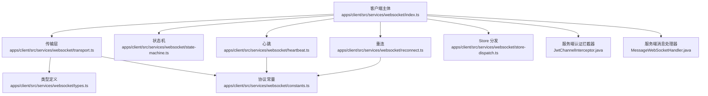
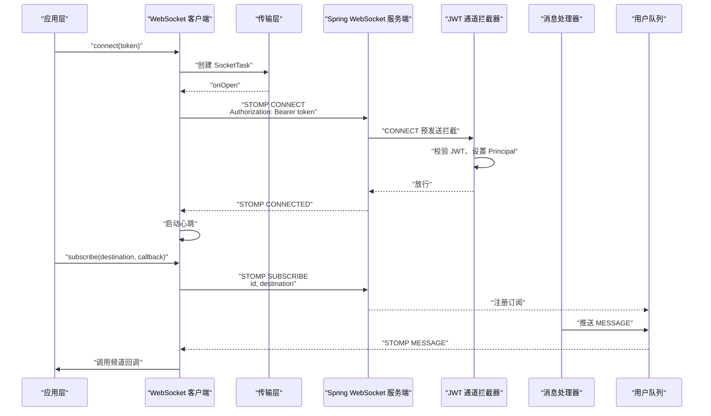
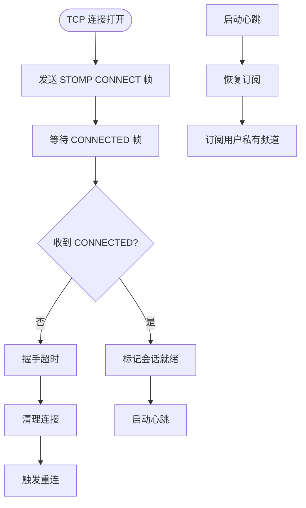
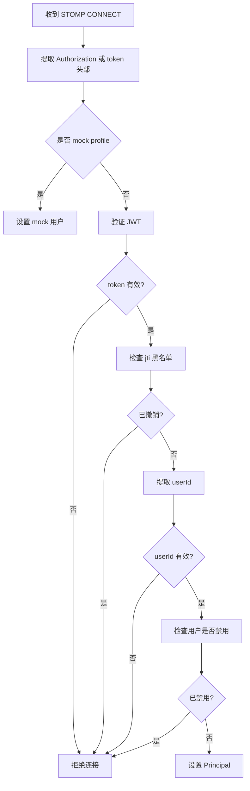
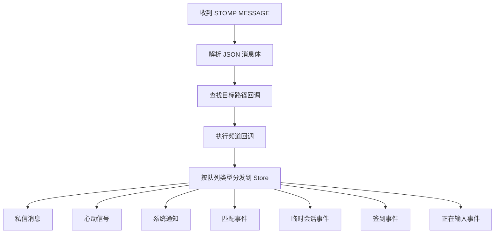
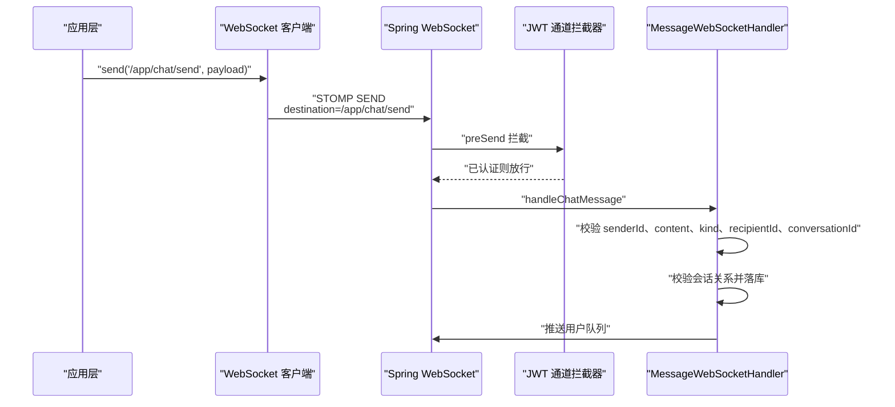
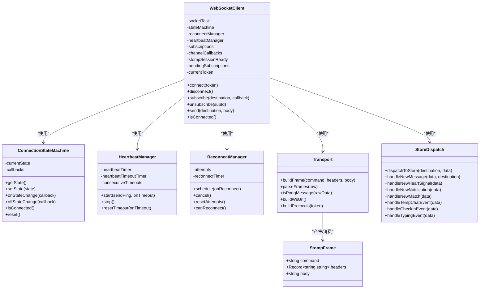

# STOMP 协议编解码

<cite>
**本文引用的文件**   
- [apps/client/src/services/websocket.ts](file://apps/client/src/services/websocket.ts)
- [apps/client/src/services/websocket/index.ts](file://apps/client/src/services/websocket/index.ts)
- [apps/client/src/services/websocket/transport.ts](file://apps/client/src/services/websocket/transport.ts)
- [apps/client/src/services/websocket/types.ts](file://apps/client/src/services/websocket/types.ts)
- [apps/client/src/services/websocket/constants.ts](file://apps/client/src/services/websocket/constants.ts)
- [apps/client/src/services/websocket/state-machine.ts](file://apps/client/src/services/websocket/state-machine.ts)
- [apps/client/src/services/websocket/heartbeat.ts](file://apps/client/src/services/websocket/heartbeat.ts)
- [apps/client/src/services/websocket/reconnect.ts](file://apps/client/src/services/websocket/reconnect.ts)
- [apps/client/src/services/websocket/store-dispatch.ts](file://apps/client/src/services/websocket/store-dispatch.ts)
- [apps/api/src/main/java/com/campuslove/api/chat/MessageWebSocketHandler.java](file://apps/api/src/main/java/com/campuslove/api/chat/MessageWebSocketHandler.java)
- [apps/api/src/main/java/com/campuslove/api/config/JwtChannelInterceptor.java](file://apps/api/src/main/java/com/campuslove/api/config/JwtChannelInterceptor.java)
</cite>

## 目录

1. [引言](#引言)
2. [项目结构](#项目结构)
3. [核心组件](#核心组件)
4. [架构总览](#架构总览)
5. [详细组件分析](#详细组件分析)
6. [依赖关系分析](#依赖关系分析)
7. [性能与内存管理](#性能与内存管理)
8. [协议兼容性、扩展点与自定义帧](#协议兼容性扩展点与自定义帧)
9. [调试、报文分析与故障诊断](#调试报文分析与故障诊断)
10. [结论](#结论)

## 引言

本项目实现了一个面向微信小程序和 H5 的简化版 STOMP 客户端，并与 Spring WebSocket + STOMP 后端通信。由于 uni-app 不支持 SockJS 和原生 STOMP 库，代码通过原始 WebSocket 文本帧手动构建和解析 STOMP 帧；同时由 Spring `ChannelInterceptor` 在 CONNECT 阶段校验 JWT，并在 SUBSCRIBE 阶段限制订阅路径。

该文档聚焦以下目标：

- 说明简化的 STOMP 帧格式、头部编码与消息体处理。
- 解释 CONNECT/CONNECTED、SUBSCRIBE/SUBSCRIBED、MESSAGE、SEND、DISCONNECT 等关键帧语义。
- 梳理主题订阅、消息分发和目标地址解析机制。
- 说明认证流程中 Authorization、token、client-id 等安全参数的处理方式。
- 分析序列化、反序列化、心跳、重连和错误处理。
- 讨论协议版本兼容性、扩展点和自定义帧支持。
- 提供协议调试、报文分析和排障方法。

## 项目结构

STOMP 相关逻辑主要分布在两类位置：

| 层次 | 模块 | 职责 |
|---|---|---|
| 客户端入口 | `apps/client/src/services/websocket.ts` | 向后兼容导出 WebSocket 客户端子模块 |
| 客户端主体 | `apps/client/src/services/websocket/index.ts` | WebSocket 连接生命周期、STOMP 握手、订阅、发送、重连、心跳、消息分发调度 |
| 传输层 | `apps/client/src/services/websocket/transport.ts` | 纯函数式 STOMP 帧构建、解析、pong 识别、URL 和子协议构造 |
| 类型契约 | `apps/client/src/services/websocket/types.ts` | `StompFrame`、连接状态、回调签名 |
| 协议常量 | `apps/client/src/services/websocket/constants.ts` | NULL 分隔符、换行符、STOMP 版本、心跳间隔、重连参数 |
| 状态机 | `apps/client/src/services/websocket/state-machine.ts` | 连接状态存储与变更回调 |
| 心跳 | `apps/client/src/services/websocket/heartbeat.ts` | ping 定时发送、超时检测、连续超时容错 |
| 重连 | `apps/client/src/services/websocket/reconnect.ts` | 指数退避重连、次数上限、耗尽回调 |
| Store 分发 | `apps/client/src/services/websocket/store-dispatch.ts` | 按队列类型将 MESSAGE 路由到 Pinia Store |
| 服务端处理器 | `apps/api/src/main/java/.../chat/MessageWebSocketHandler.java` | 接收 `/app/chat/send`、鉴权、校验、落库、推送 |
| 服务端拦截器 | `apps/api/src/main/java/.../config/JwtChannelInterceptor.java` | CONNECT 认证、SUBSCRIBE 路径权限校验 |



**图示来源**  
- [apps/client/src/services/websocket/index.ts:1-120](file://apps/client/src/services/websocket/index.ts#L1-L120)  
- [apps/client/src/services/websocket/transport.ts:1-80](file://apps/client/src/services/websocket/transport.ts#L1-L80)  
- [apps/client/src/services/websocket/constants.ts:1-78](file://apps/client/src/services/websocket/constants.ts#L1-L78)  
- [apps/api/src/main/java/com/campuslove/api/config/JwtChannelInterceptor.java:1-60](file://apps/api/src/main/java/com/campuslove/api/config/JwtChannelInterceptor.java#L1-L60)  
- [apps/api/src/main/java/com/campuslove/api/chat/MessageWebSocketHandler.java:1-60](file://apps/api/src/main/java/com/campuslove/api/chat/MessageWebSocketHandler.java#L1-L60)

**章节来源**  
- [apps/client/src/services/websocket.ts:1-19](file://apps/client/src/services/websocket.ts#L1-L19)  
- [apps/client/src/services/websocket/index.ts:1-120](file://apps/client/src/services/websocket/index.ts#L1-L120)

## 核心组件

### STOMP 帧数据模型

客户端使用统一的 `StompFrame` 表示 STOMP 帧：

| 字段 | 含义 | 行为 |
|---|---|---|
| `command` | STOMP 命令 | 例如 `CONNECT`、`CONNECTED`、`SUBSCRIBE`、`MESSAGE`、`SEND`、`UNSUBSCRIBE`、`RECEIPT`、`ERROR`、`DISCONNECT` |
| `headers` | 头部键值对 | 由字符串解析为对象，用于携带 `destination`、`id`、`content-type`、`Authorization`、`accept-version` 等 |
| `body` | 消息体 | 通常为 JSON 字符串；MESSAGE 和 SEND 使用；CONNECTED、CONNECT、DISCONNECT 可为空 |

该模型位于类型文件中，被 transport、index、store-dispatch 等多个模块共享，是 STOMP 编解码的契约层。

**章节来源**  
- [apps/client/src/services/websocket/types.ts:1-56](file://apps/client/src/services/websocket/types.ts#L1-L56)

### 协议常量

协议常量集中维护以下内容：

| 常量 | 值或用途 | 作用 |
|---|---|---|
| `FRAME_NULL_CHAR` | `\x00` | STOMP 帧结束标记 |
| `LINE_BREAK` | `\n` | STOMP 头部与帧体之间的换行分隔 |
| `STOMP_VERSION` | `1.2` | 客户端声明的 STOMP 协议版本 |
| `HEARTBEAT_INTERVAL_MS` | `30000` | 心跳间隔毫秒数 |
| `HEARTBEAT_TIMEOUT_MS` | `10000` | 心跳超时阈值 |
| `HEARTBEAT_CONSECUTIVE_TIMEOUT_LIMIT` | `2` | 连续超时才判定断线 |
| `MAX_RECONNECT_ATTEMPTS` | `6` | 最大自动重连次数 |
| `RECONNECT_BACKOFF_MS` | `1000` | 指数退避基础间隔 |
| `RECONNECT_MAX_INTERVAL_MS` | `30000` | 重连间隔上限 |
| `SUBSCRIPTION_ID_PREFIX` | `sub-` | 客户端生成的订阅 ID 前缀 |
| `HEARTBEAT_PING_PAYLOAD` / `HEARTBEAT_PONG_PAYLOAD_*` | JSON ping/pong 文本 | 心跳负载 |

**章节来源**  
- [apps/client/src/services/websocket/constants.ts:1-78](file://apps/client/src/services/websocket/constants.ts#L1-L78)

### 连接状态机

连接状态分为四种：

| 状态 | 含义 |
|---|---|
| `disconnected` | 未连接或已断开 |
| `connecting` | TCP 连接建立后、尚未收到 CONNECTED |
| `connected` | 底层连接可用且 STOMP 会话就绪 |
| `reconnecting` | 断线后进入自动重连流程 |

状态机只负责保存当前状态、通知监听者、判断是否连接以及重置初始状态。业务逻辑（如 CONNECT、CONNECTED、重连）集中在 `WebSocketClient` 中。

**章节来源**  
- [apps/client/src/services/websocket/state-machine.ts:1-121](file://apps/client/src/services/websocket/state-machine.ts#L1-L121)

## 架构总览

整个 STOMP 通信链路可分为四层：

1. **应用层调用**：业务代码通过 `wsClient.connect(token)`、`subscribe(destination, callback)`、`send(destination, body)`、`disconnect()` 操作。
2. **STOMP 客户端层**：负责帧组装、协议握手、心跳、重连、订阅管理和消息分发。
3. **传输层**：通过 uni-app 的 `SocketTask` 发送和接收原始文本帧。
4. **服务端层**：Spring WebSocket 端点、JWT 认证拦截器、STOMP 通道拦截器、消息处理器和推送队列。



**图示来源**  
- [apps/client/src/services/websocket/index.ts:201-360](file://apps/client/src/services/websocket/index.ts#L201-L360)  
- [apps/client/src/services/websocket/index.ts:520-689](file://apps/client/src/services/websocket/index.ts#L520-L689)  
- [apps/api/src/main/java/com/campuslove/api/config/JwtChannelInterceptor.java:120-200](file://apps/api/src/main/java/com/campuslove/api/config/JwtChannelInterceptor.java#L120-L200)  
- [apps/api/src/main/java/com/campuslove/api/chat/MessageWebSocketHandler.java:100-180](file://apps/api/src/main/java/com/campuslove/api/chat/MessageWebSocketHandler.java#L100-L180)

**章节来源**  
- [apps/client/src/services/websocket/index.ts:1-120](file://apps/client/src/services/websocket/index.ts#L1-L120)

## 详细组件分析

### STOMP 帧编解码

#### 帧格式定义

客户端遵循标准 STOMP 文本帧格式：

```
COMMAND\n
header1:value1\n
header2:value2\n
\n
body\x00
```

其中：

- 首行是命令。
- 后续行是头部，以冒号分隔键值。
- 空行分隔头部和消息体。
- 消息体以 NULL 字符结尾。
- 多个帧可通过 NULL 字符拼接在一起接收。

#### 帧构建

`buildFrame(command, headers, body)` 负责：

1. 写入命令和换行。
2. 遍历头部，对反斜杠、冒号、换行进行转义。
3. 写入空行。
4. 附加消息体。
5. 追加 NULL 结束符。

这保证了客户端发出的帧能被 Spring STOMP 正确解析。

#### 帧解析

`parseFrames(raw)` 负责：

1. 按 NULL 字符拆分原始文本。
2. 跳过空片段。
3. 按换行拆行。
4. 第一行作为命令。
5. 中间非空行解析为头部。
6. 空行之后的所有行合并为 body。
7. 捕获异常并记录原始数据，避免单个坏帧导致整批数据丢失。

#### pong 识别

心跳响应不是 STOMP 帧，而是 JSON 文本。`isPongMessage(rawData)` 支持：

- 紧凑格式 `{"type":"pong"}`
- 带空格格式 `{"type": "pong"}`
- 通过 `JSON.parse` 容忍额外空格

**章节来源**  
- [apps/client/src/services/websocket/transport.ts:1-160](file://apps/client/src/services/websocket/transport.ts#L1-L160)  
- [apps/client/src/services/websocket/types.ts:1-56](file://apps/client/src/services/websocket/types.ts#L1-L56)  
- [apps/client/src/services/websocket/constants.ts:1-78](file://apps/client/src/services/websocket/constants.ts#L1-L78)

### 连接与会话建立

#### WebSocket URL 与子协议

`buildWsUrl()` 从应用 API 基址派生 WebSocket 地址，移除 REST 的 `/api` 后缀，最终连接到 `/ws/websocket`。

`buildProtocols(token)` 通过 WebSocket 子协议头传递 `bearer.${token}`，用于 HTTP 握手阶段的早期认证。

#### CONNECT 帧

TCP 连接成功后，客户端发送 STOMP CONNECT 帧，包含：

| 头部 | 值 | 作用 |
|---|---|---|
| `accept-version` | `1.2` | 声明 STOMP 协议版本 |
| `heart-beat` | `interval,interval` | 协商心跳间隔 |
| `Authorization` | `Bearer ${token}` | STOMP 会话级认证令牌 |

CONNECT 帧发送后启动 10 秒握手超时定时器；若未收到 CONNECTED，则清理连接并重连。

#### CONNECTED 帧

收到 CONNECTED 后：

1. 标记 STOMP 会话就绪。
2. 重置重连计数。
3. 切换状态为 `connected`。
4. 清除 CONNECT 握手超时定时器。
5. 启动心跳。
6. 恢复活跃订阅。
7. 订阅用户私有频道。



**图示来源**  
- [apps/client/src/services/websocket/index.ts:520-689](file://apps/client/src/services/websocket/index.ts#L520-L689)

**章节来源**  
- [apps/client/src/services/websocket/transport.ts:160-275](file://apps/client/src/services/websocket/transport.ts#L160-L275)  
- [apps/client/src/services/websocket/index.ts:201-360](file://apps/client/src/services/websocket/index.ts#L201-L360)

### 认证流程与安全参数

#### 认证参数来源

当前实现中，安全参数主要来自以下位置：

| 参数 | 来源 | 说明 |
|---|---|---|
| `Authorization` | STOMP CONNECT 帧头部 | 携带 `Bearer ${token}` |
| `token` | STOMP CONNECT 帧原生头部 | 后备方案，兼容无 Bearer 前缀的直接 token |
| `client-id` | 未在客户端显式构建 | 当前实现未主动设置该头 |
| `login` / `passcode` | 未在客户端显式构建 | 当前实现未使用该传统 STOMP 登录方式 |

客户端不再通过 URL 查询参数传递 token，以避免日志、Referer 和历史泄露风险。

#### 服务端认证逻辑

`JwtChannelInterceptor.handleConnect()` 执行以下检查：

1. 优先从 `Authorization` 提取 token。
2. 回退到原生 `token` 头部。
3. mock profile 下允许绕过真实 JWT 校验。
4. 正常模式必须提供有效 token。
5. 校验 token 有效性、jti 黑名单和用户禁用状态。
6. 认证成功后将用户 ID 写入 STOMP header 的 Principal。



**图示来源**  
- [apps/api/src/main/java/com/campuslove/api/config/JwtChannelInterceptor.java:120-200](file://apps/api/src/main/java/com/campuslove/api/config/JwtChannelInterceptor.java#L120-L200)

**章节来源**  
- [apps/client/src/services/websocket/index.ts:520-600](file://apps/client/src/services/websocket/index.ts#L520-L600)  
- [apps/api/src/main/java/com/campuslove/api/config/JwtChannelInterceptor.java:1-200](file://apps/api/src/main/java/com/campuslove/api/config/JwtChannelInterceptor.java#L1-L200)

### 订阅与消息路由

#### 订阅建立

`subscribe(destination, callback)` 的行为：

1. 生成形如 `sub-{序号}` 的订阅 ID。
2. 保存订阅映射：订阅 ID → 目标路径。
3. 保存频道回调映射：目标路径 → 回调列表。
4. 保存订阅 ID → 回调映射，用于精确取消。
5. 若已连接，立即发送 STOMP SUBSCRIBE 帧。
6. 返回订阅 ID。

取消订阅时，会删除本地映射，并在连接状态下发送 UNSUBSCRIBE 帧。

#### 消息分发

收到 STOMP MESSAGE 帧后：

1. 从 `destination` 头部读取目标路径。
2. 尝试将 `body` 解析为 JSON。
3. 根据目标路径查找注册的频道回调。
4. 逐个执行回调，捕获回调异常。
5. 同时调用 `dispatchToStore` 做 Store 级别分发。

Store 分发按队列名匹配：

| 队列类型 | 行为 |
|---|---|
| `messages` | 私信消息，转换载荷并更新消息 Store |
| `temp-chat/messages` | 临时会话私信，收敛到消息处理 |
| `signals` | 心动信号 |
| `notifications` | 系统通知 |
| `matches` | 匹配成功事件 |
| `temp-chat` | 临时会话事件，刷新会话列表 |
| `checkin` | 签到事件，刷新签到状态 |
| `typing` | 对方正在输入事件 |
| 其他 | 开发环境告警并上报 Sentry |



**图示来源**  
- [apps/client/src/services/websocket/index.ts:600-689](file://apps/client/src/services/websocket/index.ts#L600-L689)  
- [apps/client/src/services/websocket/store-dispatch.ts:1-120](file://apps/client/src/services/websocket/store-dispatch.ts#L1-L120)

**章节来源**  
- [apps/client/src/services/websocket/index.ts:360-520](file://apps/client/src/services/websocket/index.ts#L360-L520)  
- [apps/client/src/services/websocket/store-dispatch.ts:1-200](file://apps/client/src/services/websocket/store-dispatch.ts#L1-L200)

### 消息发送与目标地址

客户端 `send(destination, body)` 发送 STOMP SEND 帧：

| 字段 | 值 |
|---|---|
| `command` | `SEND` |
| `destination` | 业务目标路径，例如 `/app/chat/send` |
| `content-type` | `application/json` |
| `body` | `JSON.stringify(body)` |

服务端 `MessageWebSocketHandler.handleChatMessage` 监听 `/app/chat/send`，从 STOMP 认证用户获取 senderId，不信任客户端 payload 中的发送者。

校验包括：

- content 长度不超过 5000。
- kind 长度不超过 32。
- senderId 不能为空。
- recipientId 不能为空。
- 发送者不能等于接收者。
- conversationId 必须存在。
- senderId/recipientId 必须可解析为数字。
- 临时聊天会话需要校验双方关系并落库。
- 私信会话复用私有消息服务落库。



**图示来源**  
- [apps/client/src/services/websocket/index.ts:420-520](file://apps/client/src/services/websocket/index.ts#L420-L520)  
- [apps/api/src/main/java/com/campuslove/api/chat/MessageWebSocketHandler.java:100-200](file://apps/api/src/main/java/com/campuslove/api/chat/MessageWebSocketHandler.java#L100-L200)

**章节来源**  
- [apps/client/src/services/websocket/index.ts:420-520](file://apps/client/src/services/websocket/index.ts#L420-L520)  
- [apps/api/src/main/java/com/campuslove/api/chat/MessageWebSocketHandler.java:60-200](file://apps/api/src/main/java/com/campuslove/api/chat/MessageWebSocketHandler.java#L60-L200)

### 心跳与保活

心跳机制采用独立 JSON ping/pong 协议，而非空 STOMP 帧：

- 客户端每 30 秒发送 `{type:"ping"}`。
- 每次收到任何服务器消息时重置心跳超时。
- 若在 10 秒内未收到服务器消息，累计一次超时。
- 连续 2 次超时后触发断线重连。
- 心跳停止时会清理定时器并清零连续超时计数。

这种设计避免了后端无法识别旧实现中空行心跳的问题。

**章节来源**  
- [apps/client/src/services/websocket/heartbeat.ts:1-154](file://apps/client/src/services/websocket/heartbeat.ts#L1-L154)  
- [apps/client/src/services/websocket/constants.ts:1-78](file://apps/client/src/services/websocket/constants.ts#L1-L78)  
- [apps/client/src/services/websocket/transport.ts:100-160](file://apps/client/src/services/websocket/transport.ts#L100-L160)

### 重连机制

重连采用指数退避策略：

| 尝试次数 | 延迟 |
|---:|---:|
| 1 | 1000ms |
| 2 | 2000ms |
| 3 | 4000ms |
| 4 | 8000ms |
| 5 | 16000ms |
| 6 | 30000ms |
| 超过 6 | 停止重连 |

当达到最大次数时，业务层可监听 `onExhausted` 回调，输出降级提示并引导手动重试。

重连触发场景包括：

- CONNECT 握手超时。
- 心跳连续超时。
- 底层连接关闭。
- 底层连接错误。
- 某些严重解析或状态异常。

**章节来源**  
- [apps/client/src/services/websocket/reconnect.ts:1-176](file://apps/client/src/services/websocket/reconnect.ts#L1-L176)  
- [apps/client/src/services/websocket/index.ts:689-1021](file://apps/client/src/services/websocket/index.ts#L689-L1021)

## 依赖关系分析



**图示来源**  
- [apps/client/src/services/websocket/types.ts:1-56](file://apps/client/src/services/websocket/types.ts#L1-L56)  
- [apps/client/src/services/websocket/index.ts:1-200](file://apps/client/src/services/websocket/index.ts#L1-L200)  
- [apps/client/src/services/websocket/transport.ts:1-160](file://apps/client/src/services/websocket/transport.ts#L1-L160)  
- [apps/client/src/services/websocket/store-dispatch.ts:1-120](file://apps/client/src/services/websocket/store-dispatch.ts#L1-L120)

**章节来源**  
- [apps/client/src/services/websocket/index.ts:1-200](file://apps/client/src/services/websocket/index.ts#L1-L200)

## 性能与内存管理

### 序列化与反序列化

- 发送消息时使用 `JSON.stringify` 将对象序列化为 JSON 字符串。
- 接收 MESSAGE 时先解析 JSON，再交给频道回调和 Store 分发。
- `parseFrames` 对每个分片分别解析，失败时仅记录警告，不会中断其余帧解析。
- heartbeat 的 ping/pong 使用预定义的 JSON 字符串常量，减少运行时分配。

优化建议：

- 对高频小消息，考虑复用缓冲区和字符串构建器，但需平衡可读性和跨平台兼容性。
- 对超大消息，应在业务层继续校验 body 大小，因为当前服务端仅对 `/app/chat/send` 的 content/kind 做长度限制。
- 对于重复解析相同结构的 MESSAGE，可在上层 store 或适配器层缓存解析结果。

### 内存管理

关键内存管理点：

| 区域 | 风险 | 已有措施 |
|---|---|---|
| 订阅回调 | 同一 destination 多次订阅可能导致回调泄漏 | 按 subId 精确移除回调 |
| pendingSubscriptions | 重连后重新订阅 | 保留活跃订阅信息 |
| channelCallbacks | 多订阅共用同一 destination | 回调列表清空后删除键 |
| 定时器 | 心跳、重连、握手超时可能泄漏 | disconnect、cleanup、stop 时清理 |
| SocketTask | 小程序并发 socket 任务有限 | 重连前关闭旧 task |
| 重连次数 | 频繁错误导致快速耗尽 | 指数退避 + 最大次数 |

### 错误处理

客户端错误处理覆盖：

- CONNECT 发送失败：记录错误并触发重连。
- CONNECT 握手超时：清理连接并重连。
- 心跳超时：连续超时后重连。
- 连接关闭：区分手动关闭和非手动关闭。
- 连接错误：同步状态机并触发重连。
- 帧解析异常：记录原始数据并跳过坏帧。
- 频道回调异常：捕获并记录，不影响其他回调。
- Store 分发异常：记录并上报。

服务端错误处理覆盖：

- CONNECT 缺少 token、无效 token、已撤销 token、禁用用户：抛出 `MessageDeliveryException`。
- SUBSCRIBE 未认证或路径非法：拒绝订阅。
- SEND 缺少必要字段或字段超长：记录日志并丢弃。
- 会话关系不匹配：拒绝转发。

**章节来源**  
- [apps/client/src/services/websocket/transport.ts:1-160](file://apps/client/src/services/websocket/transport.ts#L1-L160)  
- [apps/client/src/services/websocket/heartbeat.ts:1-154](file://apps/client/src/services/websocket/heartbeat.ts#L1-L154)  
- [apps/client/src/services/websocket/reconnect.ts:1-176](file://apps/client/src/services/websocket/reconnect.ts#L1-L176)  
- [apps/client/src/services/websocket/index.ts:360-1021](file://apps/client/src/services/websocket/index.ts#L360-L1021)  
- [apps/api/src/main/java/com/campuslove/api/config/JwtChannelInterceptor.java:120-307](file://apps/api/src/main/java/com/campuslove/api/config/JwtChannelInterceptor.java#L120-L307)  
- [apps/api/src/main/java/com/campuslove/api/chat/MessageWebSocketHandler.java:100-200](file://apps/api/src/main/java/com/campuslove/api/chat/MessageWebSocketHandler.java#L100-L200)

## 协议兼容性、扩展点与自定义帧

### 协议版本

客户端声明 STOMP 版本为 `1.2`，并使用标准头部：

- `accept-version`
- `heart-beat`
- `destination`
- `id`
- `content-type`
- `Authorization`

这些属于 STOMP 规范常见头部，兼容性较好。

### 已知简化点

当前实现并非完整 STOMP 客户端，而是面向本项目的简化实现：

- 未使用 SockJS。
- 未使用第三方 STOMP 库。
- 心跳使用 JSON ping/pong，而不是空 STOMP 帧。
- 未显式设置 `client-id`。
- 未使用 `login` / `passcode` 等传统 STOMP 登录头。
- 未知命令默认忽略，而不是报错。

### 扩展点设计

可扩展方向：

| 扩展点 | 现状 | 建议 |
|---|---|---|
| 自定义帧类型 | 未知命令直接忽略 | 增加扩展钩子，记录并上报未知命令 |
| `client-id` | 未设置 | 若后端要求 STOMP client-id，可在 CONNECT 中添加 |
| `login/passcode` | 未使用 | 若需要兼容老客户端，可增加 fallback 登录头 |
| 回执确认 | 已预留 receipt 字段，但 DISCONNECT 使用 receipt 后未见 RECEIPT 处理分支 | 如需严格 ACK，应完善 RECEIPT 处理 |
| 批量订阅 | 逐条订阅 | 可考虑批量订阅以减少往返，但需评估兼容性 |
| 压缩 | 未启用 | 可考虑 gzip 或 msgpack，但需两端一致 |
| 流式帧解析 | 基于 split(NULL) | 对极大消息可改用流式解析器降低峰值内存 |

### 自定义帧类型支持

当前 `handleStompFrame` 只处理 CONNECTED、MESSAGE、RECEIPT、ERROR 和默认分支。若要支持自定义帧：

1. 在服务端将自定义命令发送到客户端。
2. 在客户端新增对应 case。
3. 在 `dispatchToStore` 中增加队列路由。
4. 在 Store 分发中增加处理函数。
5. 增加测试用例，覆盖合法和非法负载。

**章节来源**  
- [apps/client/src/services/websocket/constants.ts:1-78](file://apps/client/src/services/websocket/constants.ts#L1-L78)  
- [apps/client/src/services/websocket/index.ts:600-689](file://apps/client/src/services/websocket/index.ts#L600-L689)  
- [apps/client/src/services/websocket/store-dispatch.ts:1-120](file://apps/client/src/services/websocket/store-dispatch.ts#L1-L120)

## 调试、报文分析与故障诊断

### 调试开关

- 客户端 wsTrace：仅在开发环境输出 WebSocket 连接、断开、订阅等状态日志。
- 心跳调试：开发环境输出心跳超时和重连提示。
- Store 分发：开发环境输出未知队列类型和非法数据警告。
- Sentry 上报：infra R2-00127 将未知队列类型、非法消息数据上报，便于发现前后端契约漂移。

### 常见故障与排查步骤

| 现象 | 可能原因 | 排查方法 |
|---|---|---|
| 连接后立即断开 | CONNECT 握手超时 | 检查 Authorization 头、服务端 JwtChannelInterceptor 日志 |
| 能建连但收不到消息 | 未订阅或订阅路径不匹配 | 检查 subscribe 目标路径和后端推送队列 |
| 心跳误判断线 | 网络抖动或服务端长时间静默 | 查看连续超时计数和 HEARTBEAT_CONSECUTIVE_TIMEOUT_LIMIT |
| 重连过快 | 固定短间隔重连 | 确认已使用指数退避策略 |
| 订阅回调泄漏 | 取消订阅未精确移除 | 检查 unsubscribe 是否按 subId 移除 |
| 消息未更新 UI | Store 分发失败或载荷形状不符 | 检查 dispatchToStore 和 fromWsPayload 适配 |
| 登录后仍无法发消息 | CONNECT 认证失败 | 检查 Authorization 是否为 `Bearer ${token}` |
| 被禁用户仍可连接 | 服务端禁用检查缺失 | 确认 JwtChannelInterceptor 已启用用户禁用检查 |
| 小程序实时通道全部失败 | 超出并发 socket 任务上限 | 检查是否重用或关闭旧 SocketTask |

### 报文分析方法

推荐观察以下报文序列：

1. WebSocket 子协议请求：`Sec-WebSocket-Protocol: bearer.${token}`。
2. STOMP CONNECT：`Authorization: Bearer ${token}`。
3. STOMP CONNECTED：确认会话建立。
4. STOMP SUBSCRIBE：确认订阅 id 和 destination。
5. STOMP MESSAGE：确认 destination、content-type、body。
6. STOMP DISCONNECT：确认正常下线。
7. JSON pong：确认心跳响应。

如果报文出现在抓包工具中但业务未生效，应重点检查：

- `parseFrames` 是否正确分割 NULL 字符。
- `isPongMessage` 是否把心跳误当作普通消息。
- `destination` 是否匹配客户端订阅路径。
- 服务端是否真正向 `/user/{userId}/queue/xxx` 推送。
- Store 分发是否识别该队列类型。

**章节来源**  
- [apps/client/src/services/websocket/index.ts:1-120](file://apps/client/src/services/websocket/index.ts#L1-L120)  
- [apps/client/src/services/websocket/store-dispatch.ts:1-120](file://apps/client/src/services/websocket/store-dispatch.ts#L1-L120)  
- [apps/client/src/services/websocket/transport.ts:100-160](file://apps/client/src/services/websocket/transport.ts#L100-L160)

## 结论

该项目实现了一个精简但实用的 STOMP 客户端，围绕 Spring WebSocket 的 `/ws/websocket` 端点完成握手、认证、心跳、重连、订阅和消息分发。其核心特点是：

- 手动构建和解析 STOMP 帧，适配 uni-app 环境。
- 使用 Authorization Bearer token 进行 STOMP 会话认证。
- 使用 JSON ping/pong 实现心跳保活。
- 使用指数退避策略提升弱网稳定性。
- 将 MESSAGE 路由到具体频道回调和 Pinia Store。
- 在服务端通过拦截器限制 CONNECT 和 SUBSCRIBE 的安全边界。
- 通过 Store 分发统一处理私信、心动信号、通知、匹配、临时会话、签到和 typing 事件。

未来若需要更完整的 STOMP 能力，可逐步补充 `client-id`、`login/passcode`、RECEIPT 回执、压缩、流式解析和扩展帧钩子。但在当前业务范围内，现有实现已经覆盖了 WebSocket 实时消息的核心链路。