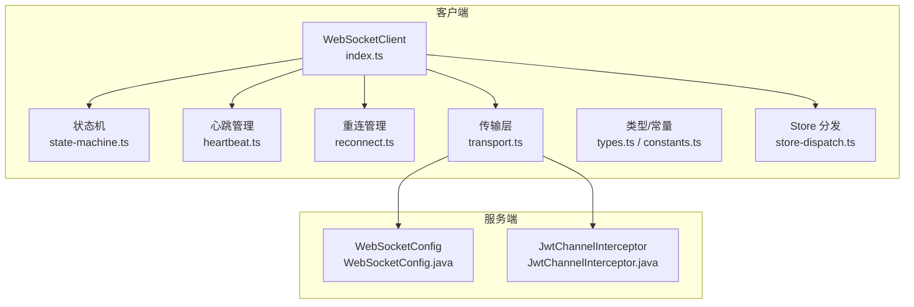
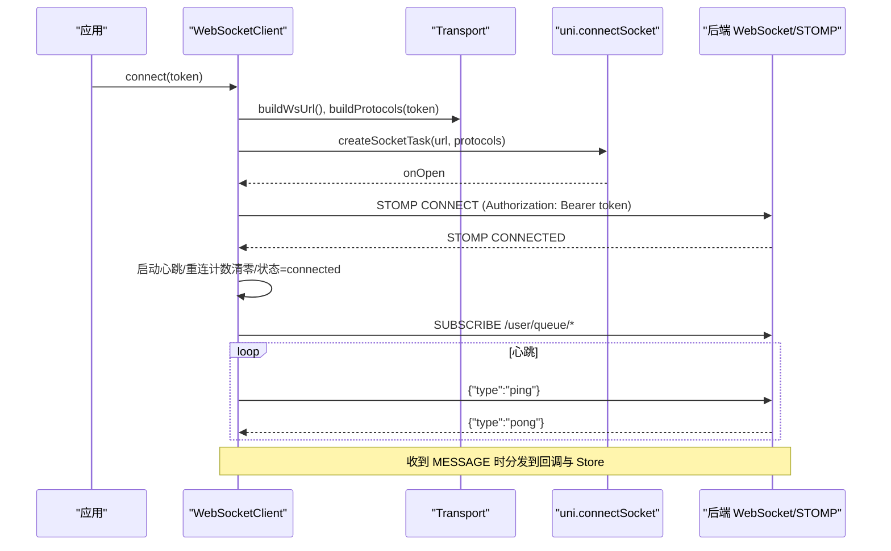
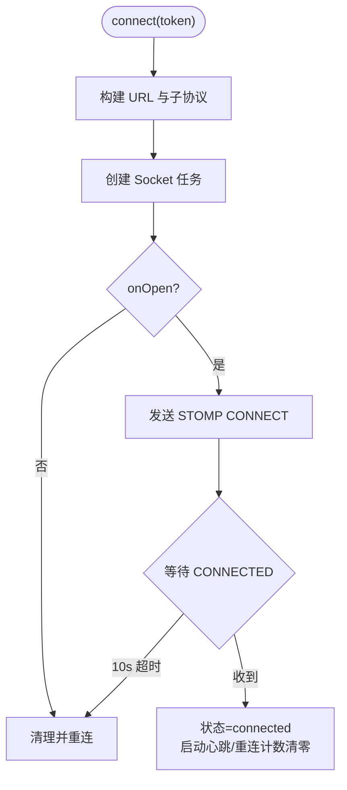
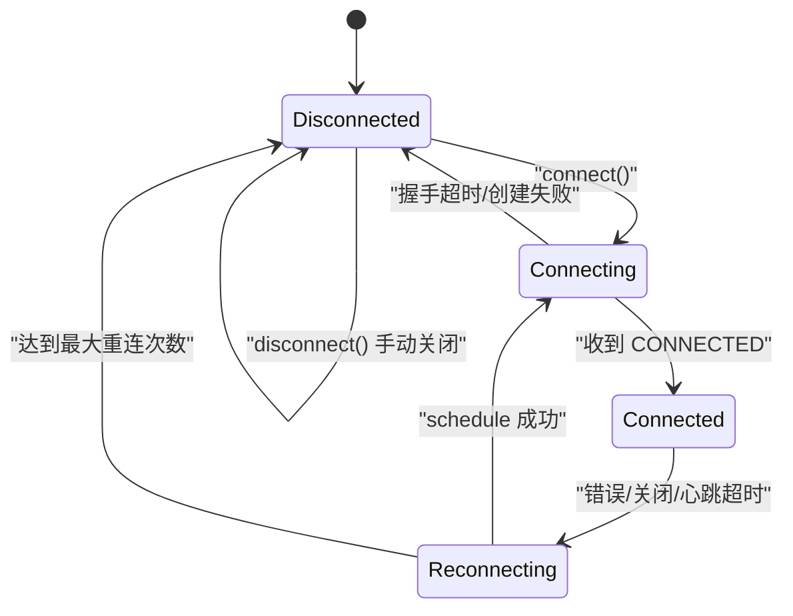
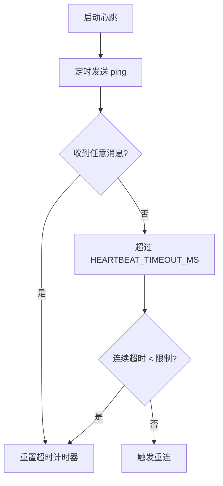
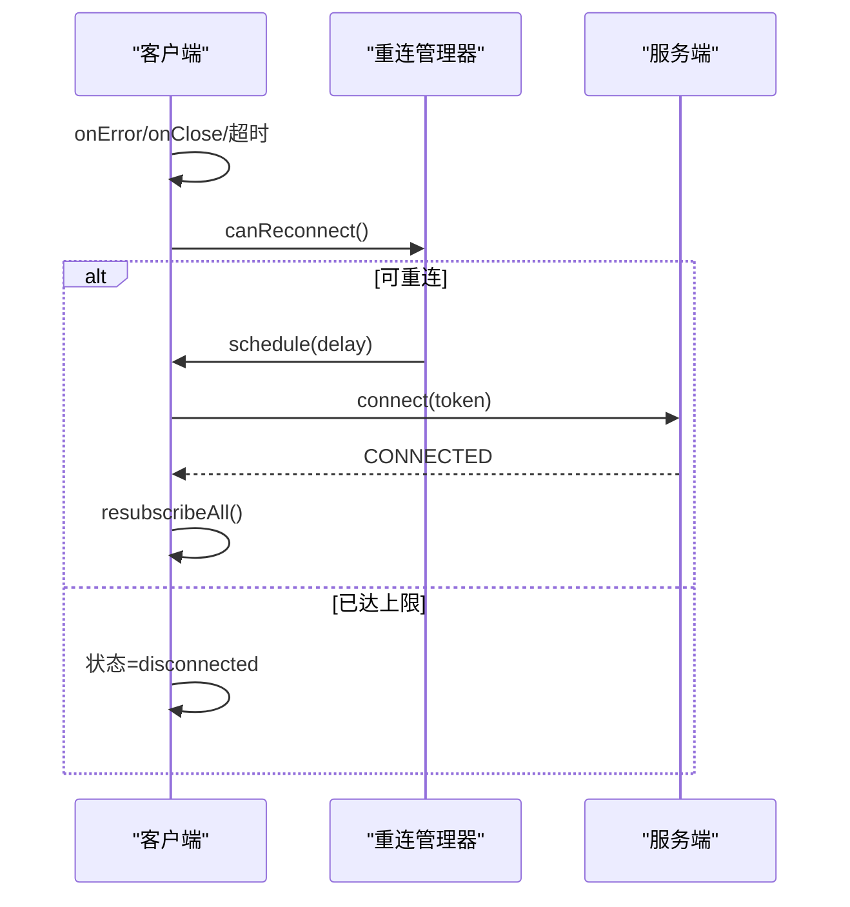
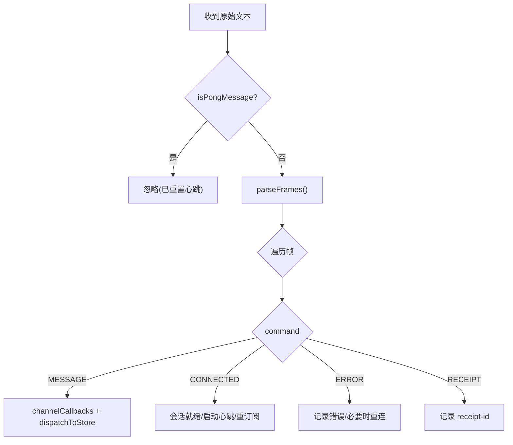
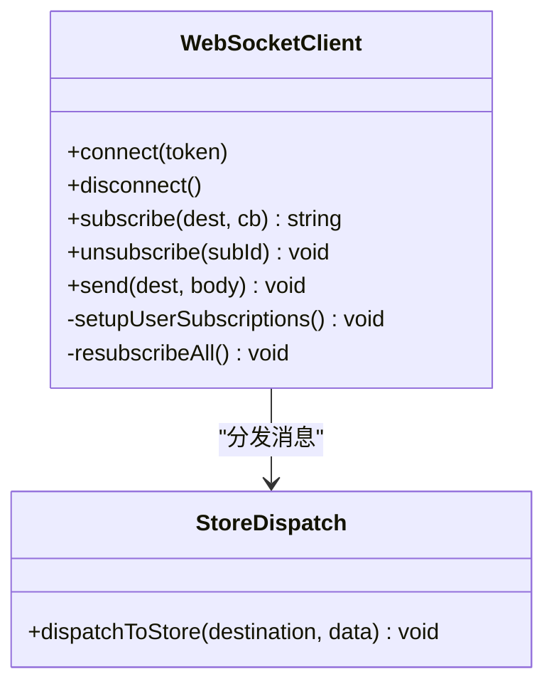
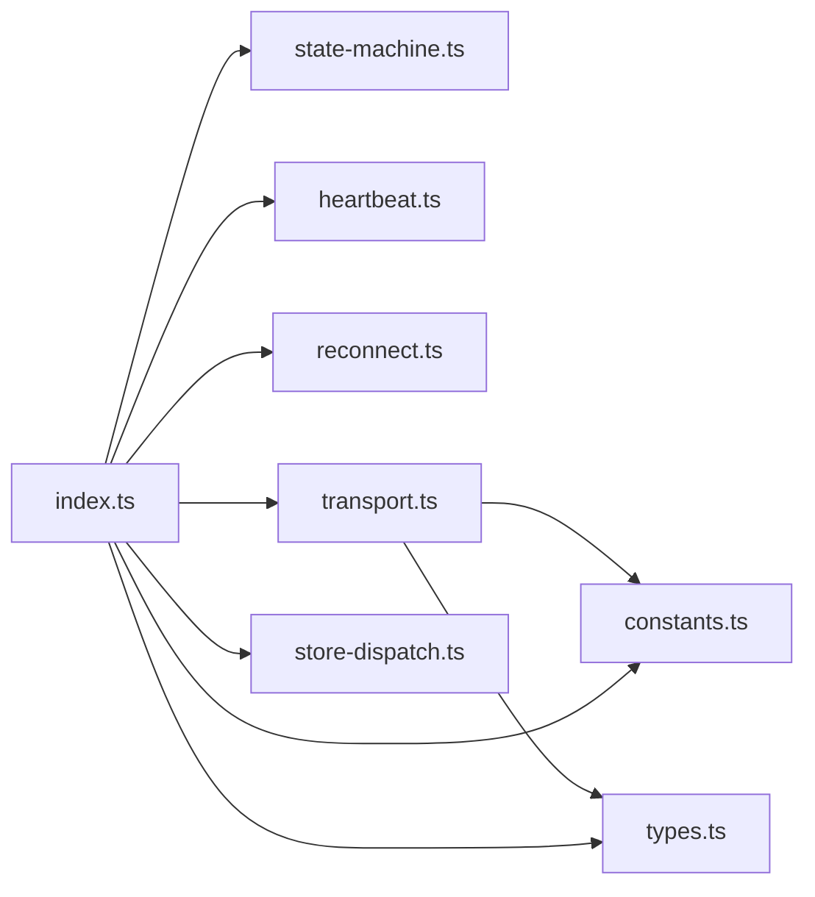

# WebSocket 实时通信

<cite>
**本文引用的文件**
- [apps/client/src/services/websocket.ts](file://apps/client/src/services/websocket.ts)
- [apps/client/src/services/websocket/index.ts](file://apps/client/src/services/websocket/index.ts)
- [apps/client/src/services/websocket/types.ts](file://apps/client/src/services/websocket/types.ts)
- [apps/client/src/services/websocket/constants.ts](file://apps/client/src/services/websocket/constants.ts)
- [apps/client/src/services/websocket/transport.ts](file://apps/client/src/services/websocket/transport.ts)
- [apps/client/src/services/websocket/state-machine.ts](file://apps/client/src/services/websocket/state-machine.ts)
- [apps/client/src/services/websocket/heartbeat.ts](file://apps/client/src/services/websocket/heartbeat.ts)
- [apps/client/src/services/websocket/reconnect.ts](file://apps/client/src/services/websocket/reconnect.ts)
- [apps/client/src/services/websocket/store-dispatch.ts](file://apps/client/src/services/websocket/store-dispatch.ts)
- [apps/api/src/main/java/com/campuslove/api/config/WebSocketConfig.java](file://apps/api/src/main/java/com/campuslove/api/config/WebSocketConfig.java)
- [apps/api/src/main/java/com/campuslove/api/config/JwtChannelInterceptor.java](file://apps/api/src/main/java/com/campuslove/api/config/JwtChannelInterceptor.java)
</cite>

## 目录
1. [简介](#简介)
2. [项目结构](#项目结构)
3. [核心组件](#核心组件)
4. [架构总览](#架构总览)
5. [详细组件分析](#详细组件分析)
6. [依赖关系分析](#依赖关系分析)
7. [性能与资源管理](#性能与资源管理)
8. [故障诊断与排错](#故障诊断与排错)
9. [结论](#结论)
10. [附录：开发调试与监控](#附录开发调试与监控)

## 简介
本技术文档面向基于 uni.connectSocket 实现的 STOMP 简化版 WebSocket 客户端，覆盖连接建立、认证流程（子协议 + STOMP CONNECT）、心跳检测、自动重连、断线恢复、STOMP 帧编解码、消息订阅分发、Pinia Store 集成、连接池与内存防护、生产监控等。目标读者既包括前端开发者，也包括后端联调工程师与运维人员。

## 项目结构
WebSocket 客户端模块按职责拆分，单一职责清晰，便于测试与维护：
- types.ts：类型契约（StompFrame、WsConnectionState、回调签名）
- constants.ts：协议常量（版本、分隔符、心跳间隔、重连策略参数）
- transport.ts：纯函数实现（STOMP 帧构建/解析、URL/子协议构造、isPongMessage）
- state-machine.ts：连接状态机（状态存储与回调分发）
- heartbeat.ts：心跳管理器（ping/pong 与超时检测）
- reconnect.ts：重连管理器（次数计数与退避调度）
- store-dispatch.ts：Pinia Store 消息分发
- index.ts：WebSocketClient 主体（组装以上模块，暴露 connect/disconnect/subscribe/send 等 API）
- websocket.ts：向后兼容 re-export，保持外部 import 路径不变

**图表来源**
- [apps/client/src/services/websocket/index.ts:1-120](file://apps/client/src/services/websocket/index.ts#L1-L120)
- [apps/client/src/services/websocket/transport.ts:1-120](file://apps/client/src/services/websocket/transport.ts#L1-L120)
- [apps/api/src/main/java/com/campuslove/api/config/WebSocketConfig.java](file://apps/api/src/main/java/com/campuslove/api/config/WebSocketConfig.java)
- [apps/api/src/main/java/com/campuslove/api/config/JwtChannelInterceptor.java](file://apps/api/src/main/java/com/campuslove/api/config/JwtChannelInterceptor.java)

**章节来源**
- [apps/client/src/services/websocket.ts:1-19](file://apps/client/src/services/websocket.ts#L1-L19)
- [apps/client/src/services/websocket/index.ts:1-120](file://apps/client/src/services/websocket/index.ts#L1-L120)

## 核心组件
- WebSocketClient（index.ts）：对外 API（connect/disconnect/subscribe/send/isConnected/onStateChange），内部编排状态机、心跳、重连、STOMP 帧处理、用户频道订阅与 Pinia 集成。
- 状态机（state-machine.ts）：维护 WsConnectionState（disconnected/connecting/connected/reconnecting），提供 on/off 状态变更监听。
- 心跳（heartbeat.ts）：周期性发送 ping，接收 pong 或任意消息重置超时；连续超时达到阈值触发断线重连。
- 重连（reconnect.ts）：指数退避（1s/2s/4s/8s/16s/30s 上限），最多 N 次尝试，耗尽后停止自动重连。
- 传输（transport.ts）：buildFrame/parseFrames 严格遵循 STOMP 1.2 帧格式；buildWsUrl/buildProtocols 构造 URL 与子协议；isPongMessage 识别 JSON pong。
- Store 分发（store-dispatch.ts）：将 MESSAGE 帧按 destination 路由到对应 Store 更新逻辑。
- 类型与常量（types.ts / constants.ts）：集中定义 StompFrame、WsConnectionState、协议常量与重连/心跳参数。

**章节来源**
- [apps/client/src/services/websocket/types.ts:1-56](file://apps/client/src/services/websocket/types.ts#L1-L56)
- [apps/client/src/services/websocket/constants.ts:1-78](file://apps/client/src/services/websocket/constants.ts#L1-L78)
- [apps/client/src/services/websocket/transport.ts:1-200](file://apps/client/src/services/websocket/transport.ts#L1-L200)
- [apps/client/src/services/websocket/index.ts:120-1021](file://apps/client/src/services/websocket/index.ts#L120-L1021)

## 架构总览
整体交互时序如下：
- 客户端调用 connect(token)
- 通过 buildWsUrl()/buildProtocols() 建立 TCP 连接，并携带子协议 bearer.${token}
- 连接打开后发送 STOMP CONNECT，Authorization: Bearer ${token}
- 收到 CONNECTED 后启动心跳，完成用户频道订阅，进入 connected
- 收到 MESSAGE 时解析并分发到 channelCallbacks 与 Store
- 异常/错误/关闭事件触发重连（指数退避）

**图表来源**
- [apps/client/src/services/websocket/index.ts:120-260](file://apps/client/src/services/websocket/index.ts#L120-L260)
- [apps/client/src/services/websocket/transport.ts:120-275](file://apps/client/src/services/websocket/transport.ts#L120-L275)
- [apps/api/src/main/java/com/campuslove/api/config/WebSocketConfig.java](file://apps/api/src/main/java/com/campuslove/api/config/WebSocketConfig.java)
- [apps/api/src/main/java/com/campuslove/api/config/JwtChannelInterceptor.java](file://apps/api/src/main/java/com/campuslove/api/config/JwtChannelInterceptor.java)

## 详细组件分析

### 连接建立与认证流程
- 子协议认证：通过 Sec-WebSocket-Protocol 头传递 bearer.${token}，用于 HTTP 握手阶段校验（后端 JwtHandshakeInterceptor/JwtChannelInterceptor 参与）。
- STOMP 会话认证：CONNECT 帧中 Authorization: Bearer ${token}，用于会话级鉴权。
- 安全要点：不再使用 URL 查询参数传递 token，避免日志/Referer/历史泄露。
- 握手超时保护：TCP 建立后 10s 内未收到 CONNECTED 帧则判定失败并触发重连。

**图表来源**
- [apps/client/src/services/websocket/index.ts:120-220](file://apps/client/src/services/websocket/index.ts#L120-L220)
- [apps/client/src/services/websocket/transport.ts:160-275](file://apps/client/src/services/websocket/transport.ts#L160-L275)

**章节来源**
- [apps/client/src/services/websocket/index.ts:120-260](file://apps/client/src/services/websocket/index.ts#L120-L260)
- [apps/client/src/services/websocket/transport.ts:120-275](file://apps/client/src/services/websocket/transport.ts#L120-L275)

### 连接状态机设计
- 状态枚举：disconnected / connecting / connected / reconnecting
- 流转规则：
  - 连接发起 → connecting
  - CONNECTED 到达 → connected
  - 错误/关闭/握手超时 → disconnected → reconnecting（若允许重连）
  - 手动 disconnect → disconnected（不触发自动重连）
- 防重入：error/close 可能先后触发，重连前设置标志位避免重复消耗退避进度。

**图表来源**
- [apps/client/src/services/websocket/index.ts:220-420](file://apps/client/src/services/websocket/index.ts#L220-L420)
- [apps/client/src/services/websocket/state-machine.ts](file://apps/client/src/services/websocket/state-machine.ts)

**章节来源**
- [apps/client/src/services/websocket/index.ts:220-420](file://apps/client/src/services/websocket/index.ts#L220-L420)

### 心跳检测机制（ping/pong）
- 发送：周期性发送 {type:"ping"}
- 接收：任何消息（含 pong）均重置心跳超时定时器
- 超时：连续 N 个窗口无消息（默认 2 次）判定断线，触发重连
- 兼容：后端回复可能是紧凑/带空格 JSON，isPongMessage 支持多种格式

**图表来源**
- [apps/client/src/services/websocket/heartbeat.ts](file://apps/client/src/services/websocket/heartbeat.ts)
- [apps/client/src/services/websocket/constants.ts:40-78](file://apps/client/src/services/websocket/constants.ts#L40-L78)
- [apps/client/src/services/websocket/index.ts:520-620](file://apps/client/src/services/websocket/index.ts#L520-L620)

**章节来源**
- [apps/client/src/services/websocket/constants.ts:40-78](file://apps/client/src/services/websocket/constants.ts#L40-L78)
- [apps/client/src/services/websocket/index.ts:500-620](file://apps/client/src/services/websocket/index.ts#L500-L620)

### 自动重连与断线恢复
- 策略：指数退避（1s→2s→4s→8s→16s→30s 上限），最多 6 次
- 触发点：onError/onClose/握手超时/心跳超时/STOMP ERROR（非 401）
- 恢复：重连成功后重新订阅所有 pendingSubscriptions，并重新订阅用户私有频道（去重）
- 防抖：reconnectScheduled 标志避免 error→close 重复消耗

**图表来源**
- [apps/client/src/services/websocket/reconnect.ts](file://apps/client/src/services/websocket/reconnect.ts)
- [apps/client/src/services/websocket/index.ts:700-860](file://apps/client/src/services/websocket/index.ts#L700-L860)

**章节来源**
- [apps/client/src/services/websocket/index.ts:700-860](file://apps/client/src/services/websocket/index.ts#L700-L860)

### STOMP 帧编解码与消息分发
- 编码：buildFrame(command, headers, body)，遵循 STOMP 1.2 转义规则（\、:、换行）
- 解码：parseFrames(raw) 按 NULL 字符分割，逐帧解析命令/头/体
- 分发：MESSAGE 帧根据 destination 调用 channelCallbacks，同时 dispatchToStore(destination, data)
- 订阅：SUBSCRIBE/UNSUBSCRIBE 帧由 subscribe/unsubscribe 发送，重连后 resubscribeAll 恢复

**图表来源**
- [apps/client/src/services/websocket/transport.ts:1-120](file://apps/client/src/services/websocket/transport.ts#L1-L120)
- [apps/client/src/services/websocket/index.ts:560-740](file://apps/client/src/services/websocket/index.ts#L560-L740)

**章节来源**
- [apps/client/src/services/websocket/transport.ts:1-120](file://apps/client/src/services/websocket/transport.ts#L1-L120)
- [apps/client/src/services/websocket/index.ts:560-740](file://apps/client/src/services/websocket/index.ts#L560-L740)

### 消息订阅与 Pinia Store 集成
- 订阅入口：subscribe(destination, callback) 保存 pendingSubscriptions 与 channelCallbacks，连接后发送 SUBSCRIBE
- 用户私有频道：/user/queue/messages、signals、notifications、matches、temp-chat、temp-chat/messages、checkin、typing（去重避免重复订阅）
- 分发：dispatchToStore 将数据写入对应 Store，业务层监听响应式数据变化

**图表来源**
- [apps/client/src/services/websocket/index.ts:300-520](file://apps/client/src/services/websocket/index.ts#L300-L520)
- [apps/client/src/services/websocket/store-dispatch.ts](file://apps/client/src/services/websocket/store-dispatch.ts)

**章节来源**
- [apps/client/src/services/websocket/index.ts:300-520](file://apps/client/src/services/websocket/index.ts#L300-L520)
- [apps/client/src/services/websocket/store-dispatch.ts](file://apps/client/src/services/websocket/store-dispatch.ts)

### 子协议认证、Token 安全与会话管理
- 握手阶段：Sec-WebSocket-Protocol: bearer.${token}
- 会话阶段：CONNECT 帧 Authorization: Bearer ${token}
- 安全：移除 URL 查询参数中的 token，避免泄露
- 会话失效：STOMP ERROR 包含 Unauthorized/401 时停止重连并断开

**章节来源**
- [apps/client/src/services/websocket/index.ts:120-220](file://apps/client/src/services/websocket/index.ts#L120-L220)
- [apps/client/src/services/websocket/index.ts:740-820](file://apps/client/src/services/websocket/index.ts#L740-L820)

## 依赖关系分析
- 模块耦合：
  - index.ts 强依赖 state-machine/heartbeat/reconnect/transport/store-dispatch
  - transport.ts 为纯函数，无运行时状态，易于单元测试
  - constants.ts/types.ts 被多模块共享，作为契约层
- 外部依赖：
  - uni.connectSocket（小程序/H5 统一抽象）
  - 后端 Spring WebSocket + STOMP（端点 /ws，子协议 bearer.*，拦截器 JwtChannelInterceptor）

**图表来源**
- [apps/client/src/services/websocket/index.ts:1-120](file://apps/client/src/services/websocket/index.ts#L1-L120)
- [apps/client/src/services/websocket/transport.ts:1-60](file://apps/client/src/services/websocket/transport.ts#L1-L60)

**章节来源**
- [apps/client/src/services/websocket/index.ts:1-120](file://apps/client/src/services/websocket/index.ts#L1-L120)

## 性能与资源管理
- 内存泄漏防护：
  - unsubscribe 精确移除 subId 对应回调，避免同一 destination 多订阅的回调残留
  - cleanup 统一取消心跳/重连/延迟关闭定时器，防止残留影响新连接
- 并发限制：
  - 微信小程序 socket 任务有上限（默认 5），重连前显式关闭旧 task，避免“exceed max task count”
- 网络优化：
  - 指数退避降低弱网下重连风暴
  - 心跳连续超时容错，减少抖动导致的频繁重连
- 日志控制：
  - wsTrace 仅开发环境输出，生产静默，避免噪音与敏感信息泄露

[本节为通用性能建议，无需特定源码引用]

## 故障诊断与排错
- 常见问题定位：
  - 无法 CONNECTED：检查握手超时（10s）、子协议/Authorization 是否正确
  - 频繁重连：检查心跳是否收到 pong/任意消息；查看 HEARTBEAT_TIMEOUT_MS 与连续超时限制
  - 消息丢失：确认 subscribe 是否成功、pendingSubscriptions 是否保留、resubscribeAll 是否执行
  - 认证失败：STOMP ERROR 含 Unauthorized/401 会停止重连，需刷新 token 后重新 connect
- 关键日志位置：
  - wsTrace 输出连接/订阅/心跳等行为（仅 dev）
  - console.error 输出发送失败/错误帧
- 排查步骤建议：
  - 打印 wsClient.getConnectionState() 观察状态机
  - 在 onStateChange 中记录状态切换时间戳
  - 使用浏览器/小程序开发者工具抓包验证 STOMP 帧

**章节来源**
- [apps/client/src/services/websocket/index.ts:520-740](file://apps/client/src/services/websocket/index.ts#L520-L740)

## 结论
该 WebSocket 客户端以模块化方式实现了稳定可靠的 STOMP 简化协议通信，具备完善的连接生命周期管理、心跳保活、指数退避重连、消息订阅与 Store 集成。通过子协议与 CONNECT 帧双重认证保障安全性，结合严格的资源清理与日志控制，满足小程序与 H5 跨端一致性与生产可用性要求。

## 附录：开发调试与监控
- 开发调试
  - 启用开发模式后，wsTrace 会在控制台输出连接/订阅/心跳等过程日志
  - 在 onStateChange 中记录状态切换，辅助定位状态不一致问题
  - 使用抓包工具验证 STOMP 帧格式与顺序
- 生产监控
  - 统计重连次数与耗时（可在 reconnect 回调中上报埋点）
  - 监控心跳超时率与连续超时次数
  - 关注 STOMP ERROR 中 message/body，聚合常见错误码
- 运维建议
  - 配置合理的 HEARTBEAT_INTERVAL_MS 与 HEARTBEAT_TIMEOUT_MS
  - 评估 MAX_RECONNECT_ATTEMPTS 与退避上限以适应不同网络环境
  - 确保后端 /ws 端点与拦截器配置与客户端一致

[本节为通用指导，无需特定源码引用]