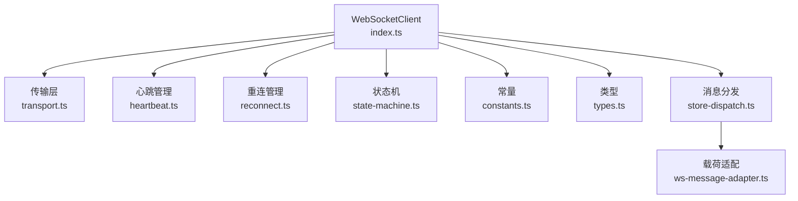
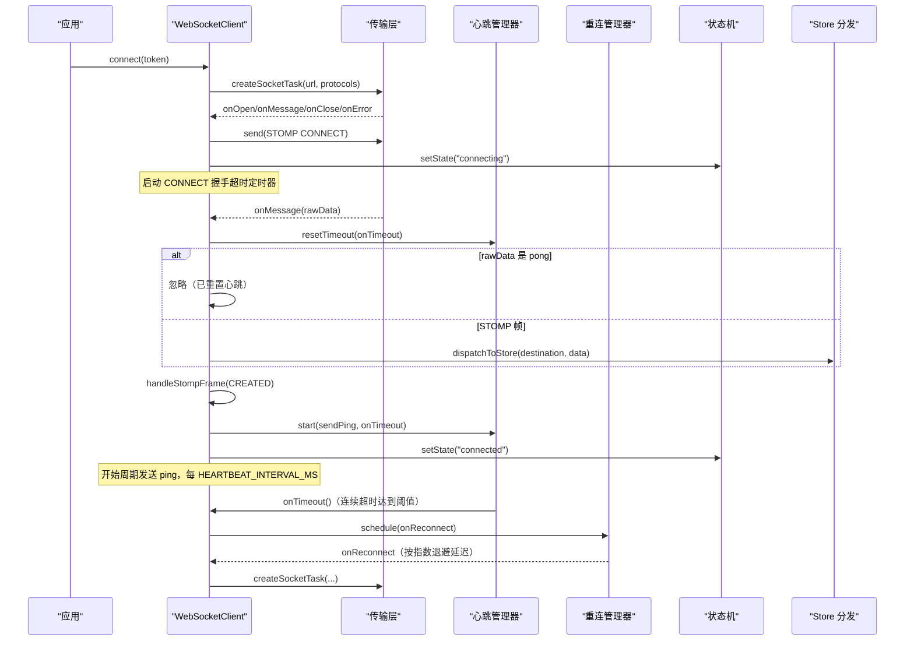
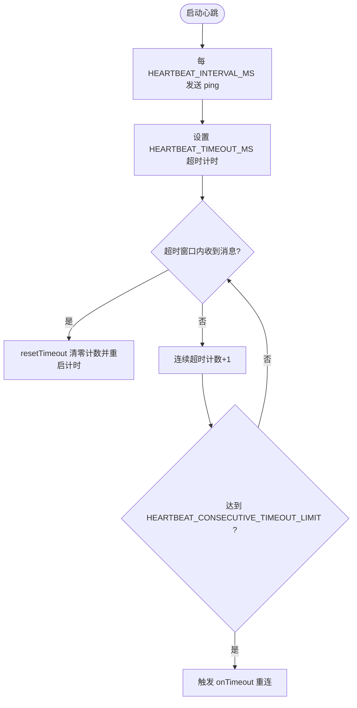
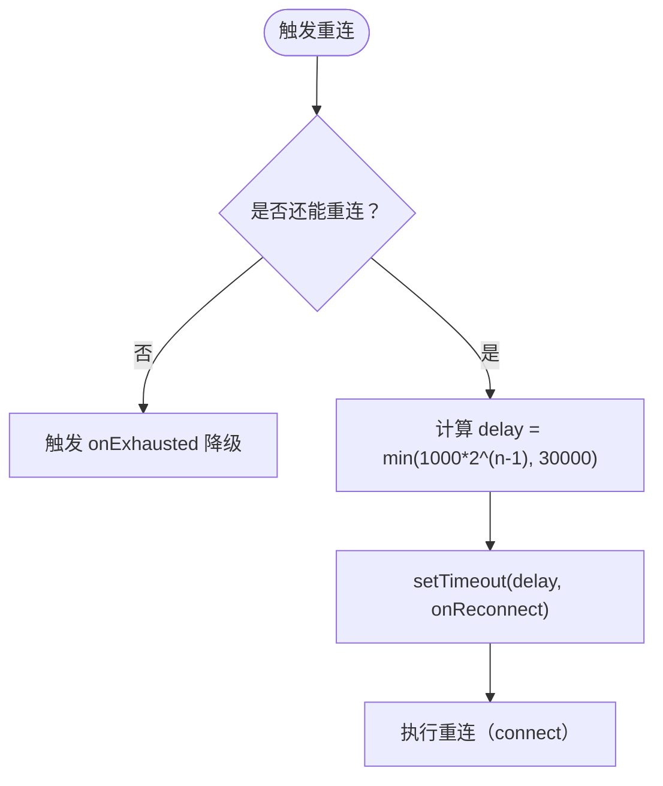
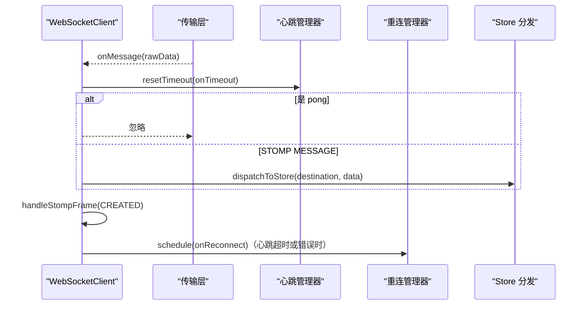
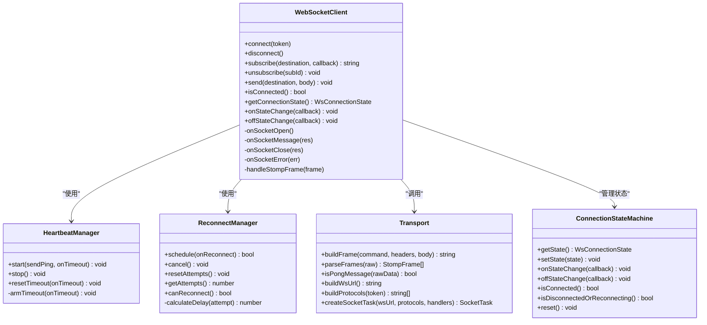

# 心跳检测与自动重连

<cite>
**本文引用的文件**
- [apps/client/src/services/websocket/index.ts](file://apps/client/src/services/websocket/index.ts)
- [apps/client/src/services/websocket/heartbeat.ts](file://apps/client/src/services/websocket/heartbeat.ts)
- [apps/client/src/services/websocket/reconnect.ts](file://apps/client/src/services/websocket/reconnect.ts)
- [apps/client/src/services/websocket/transport.ts](file://apps/client/src/services/websocket/transport.ts)
- [apps/client/src/services/websocket/constants.ts](file://apps/client/src/services/websocket/constants.ts)
- [apps/client/src/services/websocket/types.ts](file://apps/client/src/services/websocket/types.ts)
- [apps/client/src/services/websocket/state-machine.ts](file://apps/client/src/services/websocket/state-machine.ts)
- [apps/client/src/services/websocket/ws-message-adapter.ts](file://apps/client/src/services/websocket/ws-message-adapter.ts)
- [apps/client/src/services/websocket/store-dispatch.ts](file://apps/client/src/services/websocket/store-dispatch.ts)
- [apps/client/src/tests/websocket.spec.ts](file://apps/client/src/tests/websocket.spec.ts)
</cite>

## 目录
1. [简介](#简介)
2. [项目结构](#项目结构)
3. [核心组件](#核心组件)
4. [架构总览](#架构总览)
5. [详细组件分析](#详细组件分析)
6. [依赖关系分析](#依赖关系分析)
7. [性能考量](#性能考量)
8. [故障排查指南](#故障排查指南)
9. [结论](#结论)
10. [附录：配置与指标](#附录：配置与指标)

## 简介
本技术文档聚焦客户端 WebSocket 的心跳检测与自动重连机制，系统性说明心跳协议、定时器与超时处理、重连策略（指数退避、最大次数控制）、断线恢复（连接状态同步、消息队列处理、数据一致性）、网络异常与服务不可用处理、优雅降级、监控指标与优化建议，以及常见问题排查方法。所有实现细节均基于仓库中的 WebSocket 客户端代码进行分析与提炼。

## 项目结构
WebSocket 功能集中在 apps/client/src/services/websocket 目录下，采用分层模块化设计：
- index.ts：WebSocket 客户端主体，编排连接、心跳、重连、订阅、消息分发等流程
- transport.ts：STOMP 帧编解码、WebSocket 连接创建与事件封装（纯函数）
- heartbeat.ts：心跳管理器（ping/pong、超时检测、连续超时容错）
- reconnect.ts：重连管理器（指数退避、次数限制、定时调度）
- constants.ts：协议常量（心跳间隔/超时、重连参数、帧分隔符等）
- types.ts：类型定义（StompFrame、连接状态、回调签名）
- state-machine.ts：连接状态机（disconnected/connecting/connected/reconnecting）
- ws-message-adapter.ts：外部 WS 载荷到内部 MessageItem 的适配转换
- store-dispatch.ts：将 STOMP MESSAGE 分发到 Pinia Store（私信、信号、通知、匹配、临时会话、签到等）

图表来源
- [apps/client/src/services/websocket/index.ts:1-200](file://apps/client/src/services/websocket/index.ts#L1-L200)
- [apps/client/src/services/websocket/transport.ts:1-200](file://apps/client/src/services/websocket/transport.ts#L1-L200)
- [apps/client/src/services/websocket/heartbeat.ts:1-154](file://apps/client/src/services/websocket/heartbeat.ts#L1-L154)
- [apps/client/src/services/websocket/reconnect.ts:1-176](file://apps/client/src/services/websocket/reconnect.ts#L1-L176)
- [apps/client/src/services/websocket/constants.ts:1-78](file://apps/client/src/services/websocket/constants.ts#L1-L78)
- [apps/client/src/services/websocket/types.ts:1-56](file://apps/client/src/services/websocket/types.ts#L1-L56)
- [apps/client/src/services/websocket/state-machine.ts:1-121](file://apps/client/src/services/websocket/state-machine.ts#L1-L121)
- [apps/client/src/services/websocket/ws-message-adapter.ts:1-114](file://apps/client/src/services/websocket/ws-message-adapter.ts#L1-L114)
- [apps/client/src/services/websocket/store-dispatch.ts:1-200](file://apps/client/src/services/websocket/store-dispatch.ts#L1-L200)

章节来源
- [apps/client/src/services/websocket/index.ts:1-200](file://apps/client/src/services/websocket/index.ts#L1-L200)
- [apps/client/src/services/websocket/transport.ts:1-200](file://apps/client/src/services/websocket/transport.ts#L1-L200)
- [apps/client/src/services/websocket/constants.ts:1-78](file://apps/client/src/services/websocket/constants.ts#L1-L78)

## 核心组件
- 心跳管理器（HeartbeatManager）：周期性发送 ping，设置超时检测，支持连续超时容错与重置；收到服务器消息（含 pong）时清零计数并重启超时计时。
- 重连管理器（ReconnectManager）：指数退避算法计算重连延迟，限制最大重连次数，提供取消与重置能力，并在次数耗尽时触发降级回调。
- 传输层（transport.ts）：构建 STOMP 帧、解析帧、识别 pong 心跳响应、创建 uni.connectSocket 任务及注册事件。
- 状态机（ConnectionStateMachine）：统一管理连接状态，仅在实际变更时触发回调，提供 isDisconnectedOrReconnecting 判断。
- 客户端主体（WebSocketClient in index.ts）：协调 connect/disconnect、心跳启动与停止、重连调度、STOMP 握手与超时、订阅与消息分发。
- 消息适配与分发（ws-message-adapter.ts + store-dispatch.ts）：将后端推送的多种载荷转换为内部 MessageItem 形状并分发到对应 Store。

章节来源
- [apps/client/src/services/websocket/heartbeat.ts:1-154](file://apps/client/src/services/websocket/heartbeat.ts#L1-L154)
- [apps/client/src/services/websocket/reconnect.ts:1-176](file://apps/client/src/services/websocket/reconnect.ts#L1-L176)
- [apps/client/src/services/websocket/transport.ts:1-200](file://apps/client/src/services/websocket/transport.ts#L1-L200)
- [apps/client/src/services/websocket/state-machine.ts:1-121](file://apps/client/src/services/websocket/state-machine.ts#L1-L121)
- [apps/client/src/services/websocket/index.ts:201-600](file://apps/client/src/services/websocket/index.ts#L201-L600)
- [apps/client/src/services/websocket/ws-message-adapter.ts:1-114](file://apps/client/src/services/websocket/ws-message-adapter.ts#L1-L114)
- [apps/client/src/services/websocket/store-dispatch.ts:1-200](file://apps/client/src/services/websocket/store-dispatch.ts#L1-L200)

## 架构总览
下图展示了客户端 WebSocket 从建立连接到心跳检测、消息接收、重连调度的完整时序。

图表来源
- [apps/client/src/services/websocket/index.ts:201-600](file://apps/client/src/services/websocket/index.ts#L201-L600)
- [apps/client/src/services/websocket/transport.ts:201-275](file://apps/client/src/services/websocket/transport.ts#L201-L275)
- [apps/client/src/services/websocket/heartbeat.ts:1-154](file://apps/client/src/services/websocket/heartbeat.ts#L1-L154)
- [apps/client/src/services/websocket/reconnect.ts:1-176](file://apps/client/src/services/websocket/reconnect.ts#L1-L176)
- [apps/client/src/services/websocket/state-machine.ts:1-121](file://apps/client/src/services/websocket/state-machine.ts#L1-L121)
- [apps/client/src/services/websocket/store-dispatch.ts:1-200](file://apps/client/src/services/websocket/store-dispatch.ts#L1-L200)

## 详细组件分析

### 心跳检测（ping/pong、定时器与超时）
- 协议与负载
  - 客户端周期性发送 JSON ping 帧（HEARTBEAT_PING_PAYLOAD），后端回复 JSON pong（HEARTBEAT_PONG_PAYLOAD_COMPACT/SPACED）。
  - transport.ts 的 isPongMessage 支持紧凑与空格格式，并可容忍 JSON 解析差异。
- 定时器与超时
  - heartbeat.ts 的 HeartbeatManager.start 使用 setInterval 周期发送 ping，每次发送后通过 armTimeout 设置超时检测。
  - 若 HEARTBEAT_TIMEOUT_MS 内未收到任何服务器消息（包含 pong），则增加连续超时计数；达到 HEARTBEAT_CONSECUTIVE_TIMEOUT_LIMIT 才触发 onTimeout（断线重连）。
  - 收到任意服务器消息（包括 pong）调用 resetTimeout，清零连续超时计数并重启超时计时。
- 配置项
  - 心跳间隔：HEARTBEAT_INTERVAL_MS（默认 30000ms）
  - 心跳超时：HEARTBEAT_TIMEOUT_MS（默认 10000ms）
  - 连续超时容错：HEARTBEAT_CONSECUTIVE_TIMEOUT_LIMIT（默认 2）
- 在 index.ts 中，onSocketMessage 统一先调用 heartbeatManager.resetTimeout，再区分处理 pong 与 STOMP 帧。

图表来源
- [apps/client/src/services/websocket/heartbeat.ts:1-154](file://apps/client/src/services/websocket/heartbeat.ts#L1-L154)
- [apps/client/src/services/websocket/constants.ts:1-78](file://apps/client/src/services/websocket/constants.ts#L1-L78)
- [apps/client/src/services/websocket/index.ts:201-600](file://apps/client/src/services/websocket/index.ts#L201-L600)

章节来源
- [apps/client/src/services/websocket/heartbeat.ts:1-154](file://apps/client/src/services/websocket/heartbeat.ts#L1-L154)
- [apps/client/src/services/websocket/constants.ts:1-78](file://apps/client/src/services/websocket/constants.ts#L1-L78)
- [apps/client/src/services/websocket/index.ts:201-600](file://apps/client/src/services/websocket/index.ts#L201-L600)

### 自动重连策略（指数退避、最大次数、间隔计算）
- 指数退避算法
  - reconnect.ts 的 calculateDelay 使用公式：delay = min(RECONNECT_BACKOFF_MS * 2^(attempt-1), RECONNECT_MAX_INTERVAL_MS)
  - 序列：1s → 2s → 4s → 8s → 16s → 30s（上限），达到上限后保持 30s。
- 次数限制与降级
  - MAX_RECONNECT_ATTEMPTS = 6；超过后不再安排重连，触发 onExhausted 回调（业务层可输出提示或引导手动重试）。
- 调度与清理
  - schedule 安排下一次重连；cancel 取消挂起任务；resetAttempts 在成功重连后重置计数。
- 防重入保护
  - index.ts 使用 reconnectScheduled 标志避免 error 与 close 重复触发导致 attempts 翻倍消耗。

图表来源
- [apps/client/src/services/websocket/reconnect.ts:1-176](file://apps/client/src/services/websocket/reconnect.ts#L1-L176)
- [apps/client/src/services/websocket/constants.ts:1-78](file://apps/client/src/services/websocket/constants.ts#L1-L78)
- [apps/client/src/services/websocket/index.ts:201-600](file://apps/client/src/services/websocket/index.ts#L201-L600)

章节来源
- [apps/client/src/services/websocket/reconnect.ts:1-176](file://apps/client/src/services/websocket/reconnect.ts#L1-L176)
- [apps/client/src/services/websocket/constants.ts:1-78](file://apps/client/src/services/websocket/constants.ts#L1-L78)
- [apps/client/src/services/websocket/index.ts:201-600](file://apps/client/src/services/websocket/index.ts#L201-L600)

### 断线恢复逻辑（状态同步、消息队列、数据一致性）
- 连接状态同步
  - index.ts 在 onSocketClose/onSocketError 中显式同步状态机为 disconnected，再进入重连流程；CONNECT 握手失败或超时时也清理并重连。
  - state-machine.ts 仅在状态实际变更时通知监听者，避免重复触发。
- 消息队列处理
  - store-dispatch.ts 根据 destination 路径匹配队列类型并分发到对应 Store（私信、心动信号、通知、匹配、临时会话、签到、typing）。
  - ws-message-adapter.ts 将后端不同载荷形状（私信 MessageView、临时会话 ChatMessageView、mock）转换为内部 MessageItem，确保后续守卫与 UI 一致。
- 数据一致性保证
  - 对未知队列类型或非法数据进行上报（Sentry）并记录日志，避免静默丢弃导致的数据不一致。
  - 临时会话消息若无 sessionId 且不在会话页，属于预期降级，由服务端未读计数兜底，进入会话时全量刷新。

图表来源
- [apps/client/src/services/websocket/index.ts:201-600](file://apps/client/src/services/websocket/index.ts#L201-L600)
- [apps/client/src/services/websocket/store-dispatch.ts:1-200](file://apps/client/src/services/websocket/store-dispatch.ts#L1-L200)
- [apps/client/src/services/websocket/ws-message-adapter.ts:1-114](file://apps/client/src/services/websocket/ws-message-adapter.ts#L1-L114)

章节来源
- [apps/client/src/services/websocket/index.ts:201-600](file://apps/client/src/services/websocket/index.ts#L201-L600)
- [apps/client/src/services/websocket/store-dispatch.ts:1-200](file://apps/client/src/services/websocket/store-dispatch.ts#L1-L200)
- [apps/client/src/services/websocket/ws-message-adapter.ts:1-114](file://apps/client/src/services/websocket/ws-message-adapter.ts#L1-L114)

### 网络异常检测、服务不可用处理与优雅降级
- 网络异常检测
  - onError/onClose 统一同步状态机为 disconnected，并触发重连（非 manualClose 场景）。
  - CONNECT 握手超时（10s 未收到 CONNECTED）触发重连，避免状态机永久卡在 connecting。
- 服务不可用处理
  - 重连次数耗尽时调用 onExhausted 进行最终降级提示，业务方可引导用户手动重试。
- 优雅降级
  - 断开时发送 DISCONNECT 帧并延迟关闭（300ms），给服务端正常下线感知留出时间。
  - 小程序环境注意并发 socket task 上限，重连前关闭旧 task 避免“exceed max task count”。

章节来源
- [apps/client/src/services/websocket/index.ts:201-600](file://apps/client/src/services/websocket/index.ts#L201-L600)
- [apps/client/src/services/websocket/reconnect.ts:1-176](file://apps/client/src/services/websocket/reconnect.ts#L1-L176)

### 监控指标与统计信息
- 心跳相关
  - 连续超时计数：HeartbeatManager.consecutiveTimeouts（调试日志可见）
  - 超时次数阈值：HEARTBEAT_CONSECUTIVE_TIMEOUT_LIMIT
- 重连相关
  - 当前尝试次数：ReconnectManager.attempts（可通过 getAttempts 获取）
  - 最大次数：MAX_RECONNECT_ATTEMPTS
  - 退避间隔：RECONNECT_BACKOFF_MS 与 RECONNECT_MAX_INTERVAL_MS
- 连接状态
  - ConnectionStateMachine.currentState（disconnected/connecting/connected/reconnecting）
- 建议在业务层通过 onStateChange 上报自定义埋点（如连接态切换次数、重连耗时分布、超时次数），便于生产观测。

章节来源
- [apps/client/src/services/websocket/heartbeat.ts:1-154](file://apps/client/src/services/websocket/heartbeat.ts#L1-L154)
- [apps/client/src/services/websocket/reconnect.ts:1-176](file://apps/client/src/services/websocket/reconnect.ts#L1-L176)
- [apps/client/src/services/websocket/state-machine.ts:1-121](file://apps/client/src/services/websocket/state-machine.ts#L1-L121)

## 依赖关系分析

图表来源
- [apps/client/src/services/websocket/index.ts:201-600](file://apps/client/src/services/websocket/index.ts#L201-L600)
- [apps/client/src/services/websocket/heartbeat.ts:1-154](file://apps/client/src/services/websocket/heartbeat.ts#L1-L154)
- [apps/client/src/services/websocket/reconnect.ts:1-176](file://apps/client/src/services/websocket/reconnect.ts#L1-L176)
- [apps/client/src/services/websocket/transport.ts:1-200](file://apps/client/src/services/websocket/transport.ts#L1-L200)
- [apps/client/src/services/websocket/state-machine.ts:1-121](file://apps/client/src/services/websocket/state-machine.ts#L1-L121)

章节来源
- [apps/client/src/services/websocket/index.ts:201-600](file://apps/client/src/services/websocket/index.ts#L201-L600)
- [apps/client/src/services/websocket/transport.ts:1-200](file://apps/client/src/services/websocket/transport.ts#L1-L200)
- [apps/client/src/services/websocket/state-machine.ts:1-121](file://apps/client/src/services/websocket/state-machine.ts#L1-L121)

## 性能考量
- 心跳频率与超时
  - 较大 HEARTBEAT_INTERVAL_MS 降低带宽与电量消耗，但会延长断线检测时间；结合 HEARTBEAT_CONSECUTIVE_TIMEOUT_LIMIT=2 提升弱网鲁棒性。
- 重连退避
  - 指数退避有效减少频繁重连带来的资源浪费，同时在网络恢复后快速重连；上限 30s 平衡及时性与稳定性。
- 小程序并发限制
  - 重连前关闭旧 socket task，避免“exceed max task count”影响其他实时通道。
- 消息处理
  - 优先识别 pong，避免误解析；未知队列/非法数据上报 Sentry，减少静默丢失。

[本节为通用指导，不直接分析具体文件]

## 故障排查指南
- 连接无法建立
  - 检查 URL 是否正确（不应带 token 查询参数），子协议是否携带 bearer.{token}，STOMP CONNECT 是否包含 Authorization header。
  - 参考测试用例验证 URL 与协议传递方式。
- 心跳失效导致频繁重连
  - 确认后端是否返回标准 pong JSON；检查 resetTimeout 是否在收到消息时被调用。
  - 关注连续超时计数与阈值；弱网环境下适当调整 HEARTBEAT_CONSECUTIVE_TIMEOUT_LIMIT。
- 重连次数耗尽
  - 查看 onExhausted 回调是否被触发；业务层应给出降级提示或引导手动重试。
- 消息丢失或未读红点不更新
  - 检查 ws-message-adapter 转换逻辑与 store-dispatch 的路径匹配；临时会话无 sessionId 属预期降级，进入会话时全量刷新。
- 状态不一致
  - 确认状态机 setState 在所有错误/关闭路径中被调用；避免重复触发重连导致 attempts 翻倍。

章节来源
- [apps/client/src/tests/websocket.spec.ts:1-200](file://apps/client/src/tests/websocket.spec.ts#L1-L200)
- [apps/client/src/services/websocket/index.ts:201-600](file://apps/client/src/services/websocket/index.ts#L201-L600)
- [apps/client/src/services/websocket/ws-message-adapter.ts:1-114](file://apps/client/src/services/websocket/ws-message-adapter.ts#L1-L114)
- [apps/client/src/services/websocket/store-dispatch.ts:1-200](file://apps/client/src/services/websocket/store-dispatch.ts#L1-L200)

## 结论
该 WebSocket 客户端实现了健壮的心跳检测与自动重连机制：以 JSON ping/pong 协议为核心，结合连续超时容错与指数退避重连策略，保障在弱网与服务抖动下的稳定性；通过状态机与消息适配/分发确保连接状态与数据一致性；并通过降级提示与上报机制提升可观测性与用户体验。建议在生产环境中补充自定义埋点（连接态切换、重连耗时、超时次数）以便持续优化。

[本节为总结，不直接分析具体文件]

## 附录：配置与指标
- 心跳配置
  - 心跳间隔：HEARTBEAT_INTERVAL_MS（默认 30000ms）
  - 心跳超时：HEARTBEAT_TIMEOUT_MS（默认 10000ms）
  - 连续超时容错：HEARTBEAT_CONSECUTIVE_TIMEOUT_LIMIT（默认 2）
- 重连配置
  - 最大重连次数：MAX_RECONNECT_ATTEMPTS（默认 6）
  - 基础退避间隔：RECONNECT_BACKOFF_MS（默认 1000ms）
  - 重连间隔上限：RECONNECT_MAX_INTERVAL_MS（默认 30000ms）
- 监控指标（建议）
  - 连接状态切换次数与持续时间
  - 心跳连续超时次数与占比
  - 重连次数、平均/最大延迟、成功率
  - 消息分发失败率（未知队列/非法数据）

章节来源
- [apps/client/src/services/websocket/constants.ts:1-78](file://apps/client/src/services/websocket/constants.ts#L1-L78)
- [apps/client/src/services/websocket/heartbeat.ts:1-154](file://apps/client/src/services/websocket/heartbeat.ts#L1-L154)
- [apps/client/src/services/websocket/reconnect.ts:1-176](file://apps/client/src/services/websocket/reconnect.ts#L1-L176)
- [apps/client/src/services/websocket/store-dispatch.ts:1-200](file://apps/client/src/services/websocket/store-dispatch.ts#L1-L200)