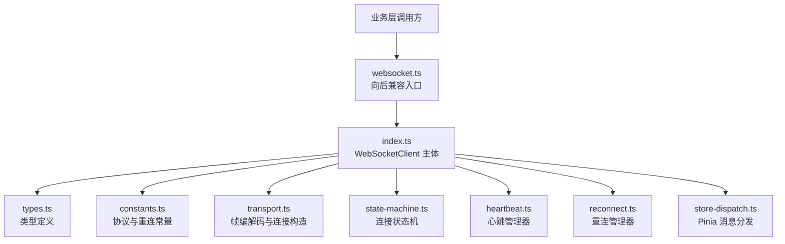
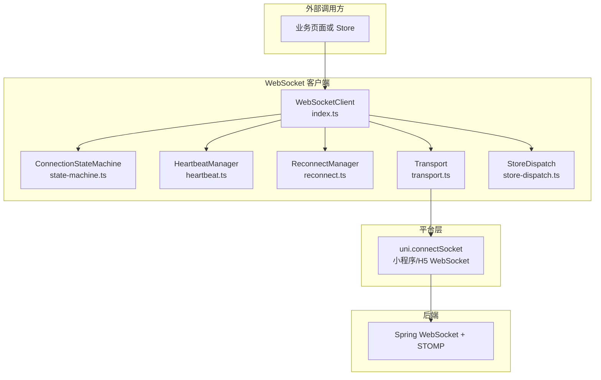
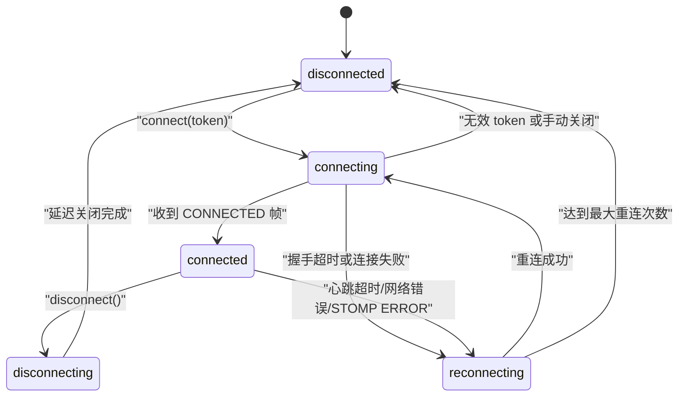
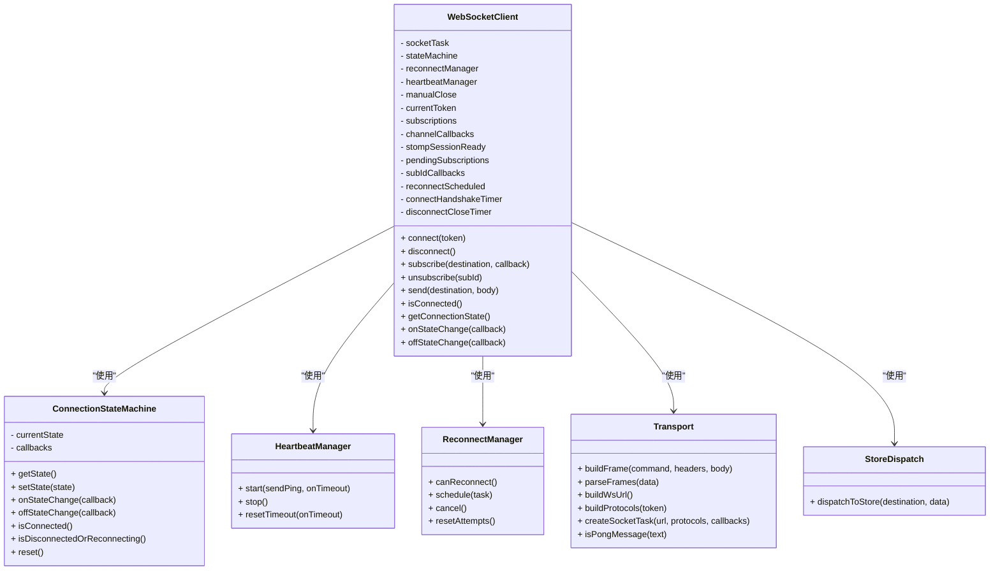

# 连接管理与状态机

<cite>
**本文引用的文件**   
- [apps/client/src/services/websocket.ts](file://apps/client/src/services/websocket.ts)
- [apps/client/src/services/websocket/index.ts](file://apps/client/src/services/websocket/index.ts)
- [apps/client/src/services/websocket/state-machine.ts](file://apps/client/src/services/websocket/state-machine.ts)
- [apps/client/src/services/websocket/types.ts](file://apps/client/src/services/websocket/types.ts)
- [apps/client/src/services/websocket/constants.ts](file://apps/client/src/services/websocket/constants.ts)
- [apps/client/src/services/websocket/transport.ts](file://apps/client/src/services/websocket/transport.ts)
- [apps/client/src/services/websocket/heartbeat.ts](file://apps/client/src/services/websocket/heartbeat.ts)
- [apps/client/src/services/websocket/reconnect.ts](file://apps/client/src/services/websocket/reconnect.ts)
- [apps/client/src/services/websocket/store-dispatch.ts](file://apps/client/src/services/websocket/store-dispatch.ts)
</cite>

## 目录

1. [引言](#引言)
2. [项目结构](#项目结构)
3. [核心组件](#核心组件)
4. [架构总览](#架构总览)
5. [详细组件分析](#详细组件分析)
6. [依赖关系分析](#依赖关系分析)
7. [性能与资源特性](#性能与资源特性)
8. [故障诊断与排错](#故障诊断与排错)
9. [结论](#结论)
10. [附录：API 与状态说明](#附录api-与状态说明)

## 引言

本文围绕客户端 WebSocket 连接管理与连接状态机展开，重点解释基于 `uni.connectSocket` 的连接建立流程、STOMP 简化协议握手、心跳保活、指数退避重连、订阅生命周期管理，以及 `disconnected`、`connecting`、`connected`、`reconnecting` 四种状态的精确定义和流转规则。文档同时覆盖连接池概念、多连接管理方式、资源清理策略、状态监控接口、调试日志输出、异常处理方案，以及常见连接问题的诊断方法。

该实现位于前端客户端模块中，对外通过单例 `wsClient` 暴露统一接口；内部将连接构造、帧编解码、状态机、心跳、重连、Pinia Store 消息分发拆分为独立子模块，便于维护、测试和扩展。

## 项目结构

WebSocket 相关代码集中在 `apps/client/src/services/websocket/` 目录下，采用“功能拆分 + 入口 re-export”的组织方式：

- `websocket.ts`：向后兼容的 re-export 入口，使旧路径 `@/services/websocket` 继续可用。
- `index.ts`：`WebSocketClient` 主体实现，封装 `uni.connectSocket`、STOMP 会话、心跳、重连、订阅、消息分发等完整生命周期。
- `state-machine.ts`：连接状态机，集中维护 `WsConnectionState` 及状态变更回调。
- `types.ts`：STOMP 帧、连接状态枚举、回调类型等共享类型。
- `constants.ts`：协议常量、重连参数、心跳参数、帧分隔符等。
- `transport.ts`：STOMP 帧构建与解析、WebSocket URL 构建、`createSocketTask` 包装。
- `heartbeat.ts`：心跳发送与超时检测管理器。
- `reconnect.ts`：重连次数计数、定时器调度、指数退避延迟计算。
- `store-dispatch.ts`：将 STOMP 消息路由到 Pinia Store。

**图表来源**   
- [apps/client/src/services/websocket.ts:1-19](file://apps/client/src/services/websocket.ts#L1-L19)
- [apps/client/src/services/websocket/index.ts:1-60](file://apps/client/src/services/websocket/index.ts#L1-L60)
- [apps/client/src/services/websocket/state-machine.ts:1-20](file://apps/client/src/services/websocket/state-machine.ts#L1-L20)
- [apps/client/src/services/websocket/types.ts:1-20](file://apps/client/src/services/websocket/types.ts#L1-L20)
- [apps/client/src/services/websocket/constants.ts:1-20](file://apps/client/src/services/websocket/constants.ts#L1-L20)

**章节来源**   
- [apps/client/src/services/websocket.ts:1-19](file://apps/client/src/services/websocket.ts#L1-L19)
- [apps/client/src/services/websocket/index.ts:1-60](file://apps/client/src/services/websocket/index.ts#L1-L60)

## 核心组件

### WebSocketClient

`WebSocketClient` 是 WebSocket 连接管理的核心类，负责：

- 使用 `uni.connectSocket` 建立底层 TCP/WebSocket 连接。
- 通过 `transport.ts` 构建 WebSocket URL 与子协议头，携带认证 token。
- 发送 STOMP CONNECT 帧完成会话握手。
- 启动心跳，检测服务端 pong 响应。
- 管理用户频道订阅、取消订阅、消息分发。
- 处理连接打开、关闭、错误事件。
- 协调状态机、心跳管理器、重连管理器。
- 提供 `connect`、`disconnect`、`subscribe`、`unsubscribe`、`send`、`isConnected`、`getConnectionState`、`onStateChange`、`offStateChange` 等公共 API。

关键职责边界：

| 职责 | 对应组件或字段 |
|---|---|
| 底层连接 | `socketTask`、`transport.createSocketTask` |
| 连接状态 | `stateMachine` |
| 自动重连 | `reconnectManager` |
| 心跳保活 | `heartbeatManager` |
| 订阅映射 | `subscriptions`、`pendingSubscriptions`、`channelCallbacks`、`subIdCallbacks` |
| STOMP 会话就绪 | `stompSessionReady` |
| 手动关闭标志 | `manualClose` |
| 当前 token | `currentToken` |
| 握手超时 | `connectHandshakeTimer` |
| 延迟关闭定时器 | `disconnectCloseTimer` |

**章节来源**   
- [apps/client/src/services/websocket/index.ts:60-120](file://apps/client/src/services/websocket/index.ts#L60-L120)
- [apps/client/src/services/websocket/index.ts:120-200](file://apps/client/src/services/websocket/index.ts#L120-L200)

### ConnectionStateMachine

状态机只负责状态存储和回调分发，不持有业务逻辑。它维护当前连接状态，并在状态实际变化时触发已注册的监听器。它还提供判断方法：

- `getState()`：获取当前状态。
- `setState(state)`：设置新状态并通知监听者。
- `onStateChange(callback)` / `offStateChange(callback)`：注册和移除状态监听。
- `isConnected()`：判断是否为 `connected`。
- `isDisconnectedOrReconnecting()`：判断是否为 `disconnected` 或 `reconnecting`。
- `reset()`：重置为初始 `disconnected` 状态。

该设计把“状态是什么”和“状态变化后做什么”解耦：状态机只回答前者，`WebSocketClient` 决定后者。

**章节来源**   
- [apps/client/src/services/websocket/state-machine.ts:1-121](file://apps/client/src/services/websocket/state-machine.ts#L1-L121)
- [apps/client/src/services/websocket/types.ts:35-56](file://apps/client/src/services/websocket/types.ts#L35-L56)

### 其他子模块

| 模块 | 作用 |
|---|---|
| `transport.ts` | 构建 STOMP 帧、解析 STOMP 帧、构建 WebSocket URL、封装 `uni.connectSocket` 的 socket task 创建。 |
| `heartbeat.ts` | 定时发送 ping、检测超时、支持连续超时容错。 |
| `reconnect.ts` | 记录重连尝试次数、调度下一次重连、计算指数退避延迟。 |
| `store-dispatch.ts` | 根据目标路径将消息分发给 Pinia Store。 |
| `constants.ts` | 集中维护 STOMP 版本、心跳间隔、重连次数、退避间隔、帧分隔符等。 |
| `types.ts` | 定义 `StompFrame`、`WsConnectionState`、`ConnectionStateCallback`、`MessageCallback`。 |

**章节来源**   
- [apps/client/src/services/websocket/transport.ts](file://apps/client/src/services/websocket/transport.ts)
- [apps/client/src/services/websocket/heartbeat.ts](file://apps/client/src/services/websocket/heartbeat.ts)
- [apps/client/src/services/websocket/reconnect.ts](file://apps/client/src/services/websocket/reconnect.ts)
- [apps/client/src/services/websocket/store-dispatch.ts](file://apps/client/src/services/websocket/store-dispatch.ts)
- [apps/client/src/services/websocket/constants.ts:1-78](file://apps/client/src/services/websocket/constants.ts#L1-L78)
- [apps/client/src/services/websocket/types.ts:1-56](file://apps/client/src/services/websocket/types.ts#L1-L56)

## 架构总览

从外部视角看，`WebSocketClient` 是一个连接管理器；从内部视角看，它是一个协调器，组合了传输层、状态机、心跳、重连和消息分发。

**图表来源**   
- [apps/client/src/services/websocket/index.ts:1-60](file://apps/client/src/services/websocket/index.ts#L1-L60)
- [apps/client/src/services/websocket/state-machine.ts:1-20](file://apps/client/src/services/websocket/state-machine.ts#L1-L20)
- [apps/client/src/services/websocket/transport.ts](file://apps/client/src/services/websocket/transport.ts)

## 详细组件分析

### 基于 uni.connectSocket 的连接建立过程

#### 连接参数配置

连接建立由 `WebSocketClient.connect(token)` 驱动，主要步骤包括：

1. 校验当前状态：若已是 `connected` 或 `connecting`，跳过重复连接。
2. 校验 token：token 为空时直接拒绝连接。
3. 标记 `manualClose = false`，重置 `stompSessionReady`。
4. 设置状态为 `connecting`。
5. 关闭旧的 `socketTask`，避免微信小程序并发 socket 任务数超限。
6. 通过 `buildWsUrl()` 构建 WebSocket URL。
7. 通过 `buildProtocols(token)` 构建子协议头，用于 HTTP 握手阶段传递 bearer token。
8. 调用 `createSocketTask(wsUrl, protocols, callbacks)` 创建底层连接。
9. 注册 `onOpen`、`onMessage`、`onClose`、`onError` 回调。

认证 token 的安全传递方式：

- HTTP 握手阶段：通过 `Sec-WebSocket-Protocol` 子协议头传递 `bearer.${token}`。
- STOMP 会话阶段：通过 CONNECT 帧的 `Authorization` header 传递 `Bearer ${token}`。
- 不再使用 URL 查询参数 `?token=xxx`，避免 token 泄漏到日志、Referer 或浏览器历史。

#### 超时处理

连接建立存在两类超时保护：

| 场景 | 超时机制 | 行为 |
|---|---|---|
| CONNECT 握手 | `CONNECT_HANDSHAKE_TIMEOUT_MS = 10000` | TCP 建立后 10 秒未收到 CONNECTED 帧，视为握手失败，清理并重连。 |
| 心跳 | `HEARTBEAT_INTERVAL_MS = 30000`，`HEARTBEAT_TIMEOUT_MS = 10000` | 心跳间隔 30 秒，超时 10 秒未收到消息则触发重连；配合连续超时容错降低弱网抖动误判。 |

CONNECT 握手超时会清除 `connectHandshakeTimer`，并将 `stompSessionReady` 置为 `false`，然后执行清理并进入重连流程。

#### 错误捕获机制

错误捕获分为三层：

1. **平台层错误**：`onError` 中记录错误日志，同步状态机为 `disconnected`，若非手动关闭则触发重连。
2. **会话层错误**：STOMP ERROR 帧中若包含 `Unauthorized` 或 `401`，停止重连并主动断开；其他错误触发清理和重连。
3. **业务层回调错误**：频道消息回调执行异常会被捕获并记录日志，不影响其他回调。

**章节来源**   
- [apps/client/src/services/websocket/index.ts:120-200](file://apps/client/src/services/websocket/index.ts#L120-L200)
- [apps/client/src/services/websocket/index.ts:200-260](file://apps/client/src/services/websocket/index.ts#L200-L260)
- [apps/client/src/services/websocket/index.ts:520-600](file://apps/client/src/services/websocket/index.ts#L520-L600)
- [apps/client/src/services/websocket/constants.ts:20-78](file://apps/client/src/services/websocket/constants.ts#L20-L78)

### 连接状态机设计

#### 四种状态精确定义

| 状态 | 含义 | 典型触发条件 |
|---|---|---|
| `disconnected` | 未连接，无活跃会话 | 初始化、主动断开、握手失败、重连次数耗尽、认证失败后断开。 |
| `connecting` | 正在建立 TCP/WebSocket 连接 | 调用 `connect(token)`，准备发送 STOMP CONNECT 帧。 |
| `connected` | STOMP 会话已建立，心跳正常，可收发业务消息 | 收到 CONNECTED 帧，心跳启动，订阅恢复。 |
| `reconnecting` | 已断开，正在按重连策略等待下次尝试 | 非手动关闭的断线、错误、握手超时，且仍允许重连。 |

#### 状态流转图

注意：图中 `disconnecting` 表示“准备断开”的过程，实际状态机中最终落点为 `disconnected`。`WebSocketClient.disconnect()` 会先发送 DISCONNECT 帧，再延迟关闭底层连接，最后将状态设置为 `disconnected`。

**图表来源**   
- [apps/client/src/services/websocket/state-machine.ts:1-121](file://apps/client/src/services/websocket/state-machine.ts#L1-L121)
- [apps/client/src/services/websocket/index.ts:200-260](file://apps/client/src/services/websocket/index.ts#L200-L260)
- [apps/client/src/services/websocket/index.ts:950-1021](file://apps/client/src/services/websocket/index.ts#L950-L1021)

#### 状态转换触发事件和处理逻辑

| 触发事件 | 处理逻辑 | 状态变化 |
|---|---|---|
| `connect(token)` | 校验 token、关闭旧 socket、构建 URL 和协议、创建 socket task | `disconnected` → `connecting` |
| `onOpen` | 发送 STOMP CONNECT 帧，启动握手超时定时器 | 保持 `connecting` |
| `CONNECTED` | 标记会话就绪，重置重连计数，启动心跳，恢复订阅 | `connecting` → `connected` |
| `onMessage` | 解析 STOMP 帧或 pong，重置心跳超时 | 不直接改变状态，但影响心跳健康 |
| `onClose` | 清理心跳和重连定时器，若非手动关闭则触发重连 | `connected` → `disconnected` → 可能进入 `reconnecting` |
| `onError` | 记录错误，同步状态为 `disconnected`，若非手动关闭则触发重连 | `connected` → `disconnected` → 可能进入 `reconnecting` |
| `handleReconnect` | 检查是否允许重连，调度下次重连 | `disconnected` → `reconnecting` → `connecting` |
| `disconnect()` | 发送 DISCONNECT 帧，清理状态，延迟关闭连接 | 任意状态 → `disconnected` |

**章节来源**   
- [apps/client/src/services/websocket/index.ts:200-260](file://apps/client/src/services/websocket/index.ts#L200-L260)
- [apps/client/src/services/websocket/index.ts:520-600](file://apps/client/src/services/websocket/index.ts#L520-L600)
- [apps/client/src/services/websocket/index.ts:950-1021](file://apps/client/src/services/websocket/index.ts#L950-L1021)

### 连接生命周期管理

#### 初始化

初始化阶段的关键操作：

- 创建 `WebSocketClient` 单例。
- 创建 `ConnectionStateMachine`，初始状态为 `disconnected`。
- 创建 `ReconnectManager`，配置重连耗尽回调。
- 创建 `HeartbeatManager`，默认未启动。
- 清空 socket task、订阅映射、回调映射。
- 重置 `stompSessionReady` 和 `manualClose`。

#### 建立

建立阶段的关键操作：

- 调用 `connect(token)`。
- 构建 WebSocket URL 和子协议。
- 调用 `createSocketTask` 建立底层连接。
- 在 `onOpen` 中发送 STOMP CONNECT 帧。
- 启动 CONNECT 握手超时定时器。
- 收到 CONNECTED 后启动心跳，恢复订阅。

#### 维护

维护阶段的关键操作：

- 心跳定时发送 ping。
- 收到任何消息或 pong 时重置心跳超时。
- 接收 MESSAGE 帧，解析并按目标路径分发到频道回调和 Pinia Store。
- 接收 RECEIPT 帧，记录确认。
- 接收 ERROR 帧，区分认证错误和其他错误。

#### 关闭

关闭阶段的关键操作：

- 调用 `disconnect()`。
- 若 STOMP 会话已建立，发送 DISCONNECT 帧。
- 清理心跳、重连、握手超时、延迟关闭定时器。
- 延迟 300ms 后关闭底层 socket。
- 设置状态为 `disconnected`。

**章节来源**   
- [apps/client/src/services/websocket/index.ts:120-200](file://apps/client/src/services/websocket/index.ts#L120-L200)
- [apps/client/src/services/websocket/index.ts:200-260](file://apps/client/src/services/websocket/index.ts#L200-L260)
- [apps/client/src/services/websocket/index.ts:520-600](file://apps/client/src/services/websocket/index.ts#L520-L600)
- [apps/client/src/services/websocket/index.ts:950-1021](file://apps/client/src/services/websocket/index.ts#L950-L1021)

### 连接池与多连接管理

当前实现的连接模型是**单连接单实例**：

- 全局导出一个 `wsClient` 单例。
- 每个进程内只有一个 `WebSocketClient`。
- 每个 `WebSocketClient` 维护一个 `socketTask`。
- 不是传统意义上的“连接池”，而是“连接复用 + 重连替换”。

多连接管理体现在以下方面：

1. **旧连接替换**：每次 `connect` 前都会尝试关闭旧 `socketTask`，避免微信小程序 socket 任务数累积。
2. **多订阅**：一个连接上可以订阅多个频道，通过 `subscriptions`、`pendingSubscriptions`、`channelCallbacks`、`subIdCallbacks` 管理。
3. **多回调**：同一频道可以有多个回调，但取消订阅时按 `subId` 精确移除，避免回调泄漏。
4. **多用户频道**：连接建立后自动订阅私信、心动信号、通知、匹配、临时聊天、签到、输入状态等用户私有频道。

如果需要真正的连接池（例如按用户、按房间、按优先级建立多个连接），应扩展 `WebSocketClient` 或新增连接工厂，而不是让单例承担多连接职责。

**章节来源**   
- [apps/client/src/services/websocket/index.ts:60-120](file://apps/client/src/services/websocket/index.ts#L60-L120)
- [apps/client/src/services/websocket/index.ts:260-400](file://apps/client/src/services/websocket/index.ts#L260-L400)
- [apps/client/src/services/websocket/index.ts:800-900](file://apps/client/src/services/websocket/index.ts#L800-L900)

### 资源清理策略

清理发生在多处：

| 清理时机 | 清理内容 |
|---|---|
| `cleanup()` | 停止心跳、取消重连定时器、清除 CONNECT 握手超时、取消延迟关闭定时器。 |
| `closeSocket()` | 关闭 `socketTask`，并将其置空。 |
| `disconnect()` | 发送 DISCONNECT 帧，清理状态，延迟关闭连接。 |
| `onStompConnected()` | 恢复订阅，但不破坏 `pendingSubscriptions`，以便重连后重播。 |
| `unsubscribe()` | 移除订阅映射、频道回调、`subId` 到回调映射。 |
| `onSocketClose()` / `onSocketError()` | 清理心跳和重连，防止残留定时器叠加。 |

特别重要的修复点：

- DISCONNECT 帧发出后延迟 300ms 才关闭底层连接，避免帧被截断。
- CONNECT 握手超时定时器引用保存在 `connectHandshakeTimer`，避免状态机永久卡住。
- 延迟关闭定时器引用保存在 `disconnectCloseTimer`，避免快速重连或再次断开时误关新连接。
- 重连防重入标志 `reconnectScheduled` 避免 error 和 close 先后触发导致重连次数翻倍消耗。

**章节来源**   
- [apps/client/src/services/websocket/index.ts:200-260](file://apps/client/src/services/websocket/index.ts#L200-L260)
- [apps/client/src/services/websocket/index.ts:900-1021](file://apps/client/src/services/websocket/index.ts#L900-L1021)

### 状态监控接口

可用的状态监控接口如下：

| 接口 | 用途 | 返回值或行为 |
|---|---|---|
| `wsClient.getConnectionState()` | 获取当前连接状态 | `WsConnectionState` |
| `wsClient.isConnected()` | 判断连接是否可用 | 要求状态为 `connected` 且 STOMP 会话就绪 |
| `wsClient.onStateChange(callback)` | 订阅状态变化 | 状态变化时调用回调 |
| `wsClient.offStateChange(callback)` | 取消状态变化订阅 | 移除指定回调 |

建议业务层同时关注：

- 连接状态：`disconnected`、`connecting`、`connected`、`reconnecting`。
- STOMP 会话就绪：仅当 `isConnected()` 返回 true 时才认为可发消息。
- 重连耗尽：重连管理器耗尽次数后会输出降级提示，业务方可据此提示用户重试。

**章节来源**   
- [apps/client/src/services/websocket/index.ts:260-320](file://apps/client/src/services/websocket/index.ts#L260-L320)
- [apps/client/src/services/websocket/state-machine.ts:1-121](file://apps/client/src/services/websocket/state-machine.ts#L1-L121)
- [apps/client/src/services/websocket/types.ts:35-56](file://apps/client/src/services/websocket/types.ts#L35-L56)

### 调试日志输出

日志出口：

- `wsTrace(...args)`：开发环境输出 `[WebSocket]` 前缀信息日志，生产环境静默。
- `console.error`：错误类日志全环境输出。
- `console.warn`：消息解析失败等警告日志。
- `console.log`：发送消息失败等具体错误信息。

调试建议：

- 在开发环境开启日志，观察连接、握手、心跳、订阅、重连全过程。
- 生产环境保留错误日志，避免信息类噪音干扰问题定位。
- 对频繁重连问题，优先查看 `onError`、`onClose`、STOMP ERROR 帧、心跳超时日志。

**章节来源**   
- [apps/client/src/services/websocket/index.ts:60-120](file://apps/client/src/services/websocket/index.ts#L60-L120)
- [apps/client/src/services/websocket/index.ts:520-600](file://apps/client/src/services/websocket/index.ts#L520-L600)

### 异常处理方案

异常分类与处理策略：

| 异常类型 | 示例 | 处理策略 |
|---|---|---|
| 平台连接错误 | `onError` | 记录错误，同步状态为 `disconnected`，若非手动关闭则重连。 |
| 连接关闭 | `onClose` | 清理资源，若非手动关闭则重连。 |
| STOMP 认证错误 | ERROR 帧包含 `Unauthorized` 或 `401` | 标记手动关闭，停止自动重连，主动断开。 |
| STOMP 其他错误 | ERROR 帧不包含认证失败信息 | 清理心跳和重连，尝试重连。 |
| CONNECT 握手超时 | 10 秒未收到 CONNECTED | 清理并重连。 |
| 心跳超时 | 连续超时超过容错阈值 | 清理并重连。 |
| 订阅回调异常 | 业务回调抛错 | 捕获并记录，不影响其他回调。 |
| 消息解析异常 | JSON 解析失败 | 记录警告，跳过该条消息。 |

**章节来源**   
- [apps/client/src/services/websocket/index.ts:520-600](file://apps/client/src/services/websocket/index.ts#L520-L600)
- [apps/client/src/services/websocket/index.ts:600-750](file://apps/client/src/services/websocket/index.ts#L600-L750)

## 依赖关系分析

**图表来源**   
- [apps/client/src/services/websocket/index.ts:60-120](file://apps/client/src/services/websocket/index.ts#L60-L120)
- [apps/client/src/services/websocket/state-machine.ts:1-121](file://apps/client/src/services/websocket/state-machine.ts#L1-L121)
- [apps/client/src/services/websocket/transport.ts](file://apps/client/src/services/websocket/transport.ts)
- [apps/client/src/services/websocket/store-dispatch.ts](file://apps/client/src/services/websocket/store-dispatch.ts)

**章节来源**   
- [apps/client/src/services/websocket/index.ts:60-120](file://apps/client/src/services/websocket/index.ts#L60-L120)
- [apps/client/src/services/websocket/state-machine.ts:1-121](file://apps/client/src/services/websocket/state-machine.ts#L1-L121)

## 性能与资源特性

### 重连策略

重连采用指数退避：

- 基础间隔：1 秒。
- 退避序列：1s → 2s → 4s → 8s → 16s → 30s。
- 最大间隔：30 秒。
- 最大尝试次数：6 次。
- 耗尽后状态回到 `disconnected`，业务方可手动调用 `connect(token)` 重试。

这种策略适合弱网环境：既避免频繁重连浪费电量和服务端资源，又能在服务端恢复后尽快重连。

### 心跳策略

- 心跳间隔：30 秒。
- 心跳超时：10 秒。
- 连续超时容错：至少 2 个心跳窗口未收到消息才判定断线。
- ping 负载：标准 JSON `{ type: "ping" }`。
- pong 响应：JSON `{ type: "pong" }`。

心跳不仅用于保活，也作为“连接存活”的信号源：收到任何消息或 pong 都会重置心跳超时。

### 连接数量限制

微信小程序默认并发 socket 任务上限为 5。实现中每次 `connect` 前显式关闭旧 `socketTask`，避免失败任务累积导致后续实时通道全部失败。

### 内存与回调泄漏防护

- 取消订阅时按 `subId` 精确移除回调，避免同一 destination 多次订阅导致回调残留。
- 重连后保留 `pendingSubscriptions`，避免重连丢失用户订阅。
- `setupUserSubscriptions` 对自动订阅频道去重，避免重复订阅造成消息重复分发。

**章节来源**   
- [apps/client/src/services/websocket/constants.ts:20-78](file://apps/client/src/services/websocket/constants.ts#L20-L78)
- [apps/client/src/services/websocket/index.ts:200-260](file://apps/client/src/services/websocket/index.ts#L200-L260)
- [apps/client/src/services/websocket/index.ts:260-400](file://apps/client/src/services/websocket/index.ts#L260-L400)
- [apps/client/src/services/websocket/index.ts:800-900](file://apps/client/src/services/websocket/index.ts#L800-L900)

## 故障诊断与排错

### 常见问题与解决方案

| 问题现象 | 可能原因 | 诊断方法 | 解决方案 |
|---|---|---|---|
| 连接一直停留在 `connecting` | CONNECT 握手超时、服务端未返回 CONNECTED | 查看 CONNECT 握手超时日志、后端 STOMP 日志 | 检查后端 STOMP 配置、认证拦截器、防火墙、代理。 |
| 连接很快断开并反复重连 | 心跳超时、网络不稳定、服务端主动关闭 | 查看心跳超时、心跳间隔、onClose 日志 | 调整心跳参数、检查服务端心跳配置、优化网络。 |
| 认证成功但无法收消息 | 订阅未生效或目标路径不匹配 | 查看 SUBSCRIBE 帧、RECEIPT、MESSAGE 分发日志 | 检查 `setupUserSubscriptions` 中的频道列表是否与后端一致。 |
| 同一消息被多次分发 | 重复订阅或回调泄漏 | 查看订阅 ID、频道回调数量 | 确认去重逻辑是否生效，检查 `isDestinationSubscribed` 和 `subIdCallbacks`。 |
| 重连次数耗尽后不再自动重连 | 已达最大重连次数 | 查看重连耗尽提示 | 业务层监听状态变化后手动调用 `connect(token)`。 |
| 断开后立即重新连接但连接被关闭 | 延迟关闭定时器残留 | 查看 disconnect 和 closeSocket 调用顺序 | 确认 `disconnectCloseTimer` 引用是否正确清理。 |
| 认证失败后仍在重连 | 未识别 401 或未设置手动关闭 | 查看 STOMP ERROR 帧内容 | 确保错误中包含 `Unauthorized` 或 `401`，并正确设置 `manualClose`。 |
| 小程序端报 socket 任务过多 | 旧 socket task 未关闭 | 查看连接重建日志 | 确认 `connect` 前是否关闭旧 task，避免累积。 |

### 诊断建议

1. **优先确认状态**：调用 `getConnectionState()` 和 `isConnected()`，确认当前处于哪个状态。
2. **确认 STOMP 会话**：只有 `isConnected()` 为 true 才认为会话可用。
3. **查看握手阶段**：确认 CONNECT 帧是否发送、CONNECTED 是否收到。
4. **查看心跳阶段**：确认 ping 是否发送、pong 是否收到、超时是否触发。
5. **查看订阅阶段**：确认 SUBSCRIBE 是否发送、RECEIPT 是否收到、MESSAGE 是否分发。
6. **查看重连阶段**：确认重连次数、退避间隔、是否因 token 无效跳过重连。
7. **查看错误阶段**：区分平台错误、STOMP 错误、业务回调错误。

**章节来源**   
- [apps/client/src/services/websocket/index.ts:520-600](file://apps/client/src/services/websocket/index.ts#L520-L600)
- [apps/client/src/services/websocket/index.ts:600-750](file://apps/client/src/services/websocket/index.ts#L600-L750)
- [apps/client/src/services/websocket/index.ts:800-900](file://apps/client/src/services/websocket/index.ts#L800-L900)
- [apps/client/src/services/websocket/index.ts:950-1021](file://apps/client/src/services/websocket/index.ts#L950-L1021)

## 结论

该 WebSocket 连接管理实现以 `WebSocketClient` 为核心，围绕 `uni.connectSocket` 构建了一个具备 STOMP 简化协议、心跳保活、指数退避重连、订阅管理和状态机控制的完整连接生命周期。其优势在于：

- 状态机与业务逻辑解耦，状态一致性更好。
- 连接建立、握手、心跳、重连、订阅、消息分发职责清晰。
- 针对小程序平台做了 socket 任务上限、token 安全传递、延迟关闭等适配。
- 对常见 P0/P1 问题进行了修复，包括握手超时、回调泄漏、重复订阅、重连防重入等。

如需进一步扩展，建议：

- 明确是否需要多连接池，避免单例承担过多连接维度。
- 将重连策略、心跳参数、握手超时等可配置化。
- 增加连接指标上报，便于监控连接健康度。
- 补充端到端自动化测试，覆盖连接、断线、重连、认证失败、订阅恢复等场景。

## 附录：API 与状态说明

### WebSocketClient 公共 API

| 方法 | 参数 | 返回值 | 说明 |
|---|---|---|---|
| `connect(token)` | `string` | `void` | 建立 WebSocket 连接并发送 STOMP CONNECT 帧。 |
| `disconnect()` | 无 | `void` | 发送 DISCONNECT 帧，延迟关闭连接，清理资源。 |
| `subscribe(destination, callback)` | `string`, `MessageCallback` | `string` | 订阅频道，返回订阅 ID。 |
| `unsubscribe(subId)` | `string` | `void` | 取消订阅，移除回调和映射。 |
| `send(destination, body)` | `string`, `Record<string, unknown>` | `void` | 发送 STOMP SEND 帧。 |
| `isConnected()` | 无 | `boolean` | 判断连接是否可用。 |
| `getConnectionState()` | 无 | `WsConnectionState` | 获取当前连接状态。 |
| `onStateChange(callback)` | `ConnectionStateCallback` | `void` | 注册状态变化监听。 |
| `offStateChange(callback)` | `ConnectionStateCallback` | `void` | 移除状态变化监听。 |

### 连接状态枚举

| 值 | 含义 |
|---|---|
| `disconnected` | 未连接 |
| `connecting` | 正在连接 |
| `connected` | 已连接 |
| `reconnecting` | 正在重连 |

### 类型定义

| 类型 | 说明 |
|---|---|
| `StompFrame` | STOMP 帧结构，包含命令、头部、正文。 |
| `WsConnectionState` | 连接状态枚举。 |
| `ConnectionStateCallback` | 连接状态变更回调。 |
| `MessageCallback` | 通用消息回调。 |

**章节来源**   
- [apps/client/src/services/websocket/index.ts:260-400](file://apps/client/src/services/websocket/index.ts#L260-L400)
- [apps/client/src/services/websocket/types.ts:1-56](file://apps/client/src/services/websocket/types.ts#L1-L56)