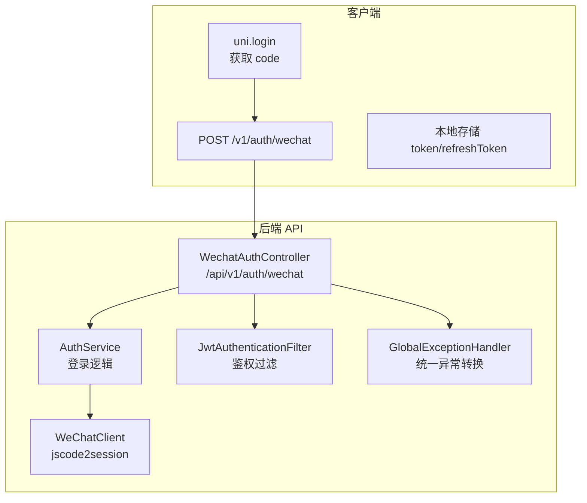
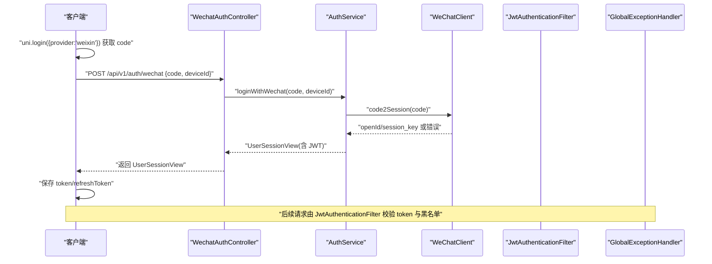
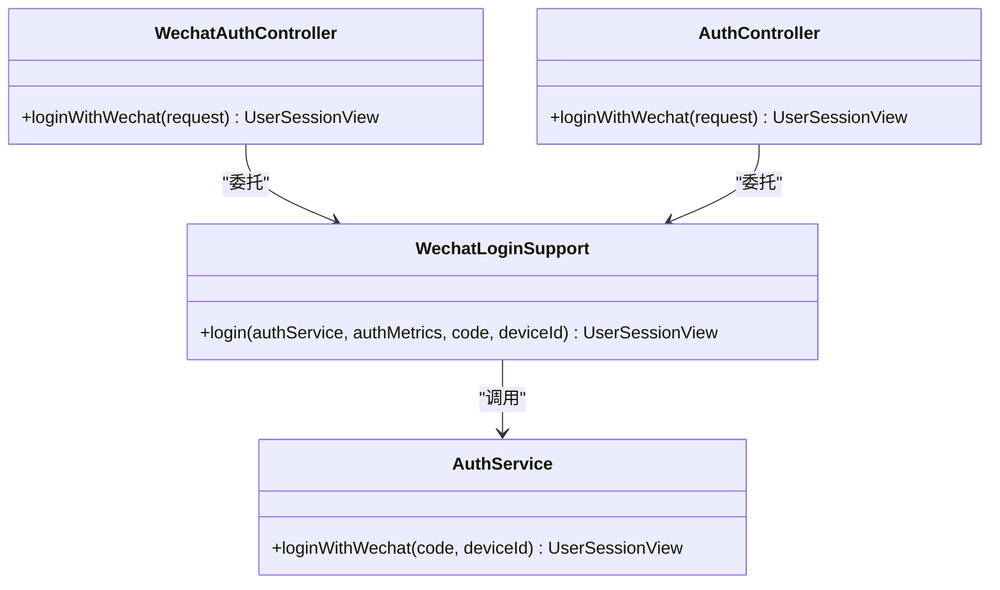
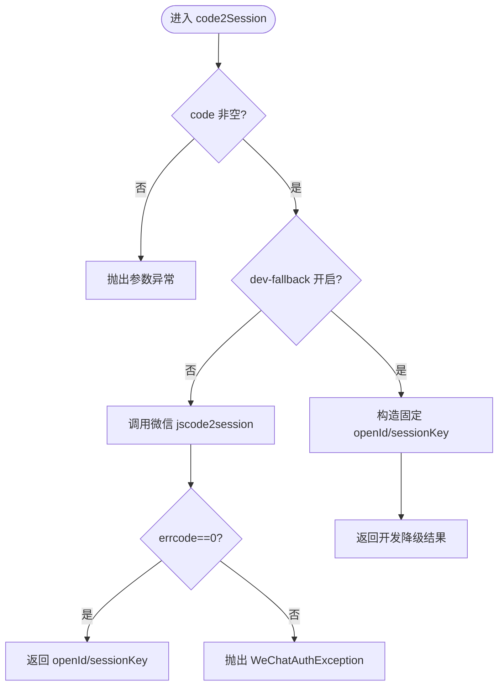
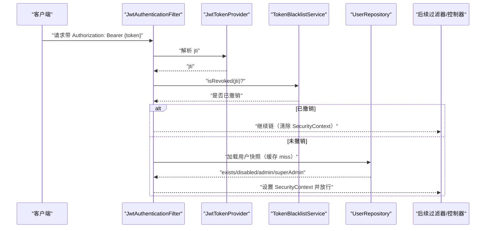
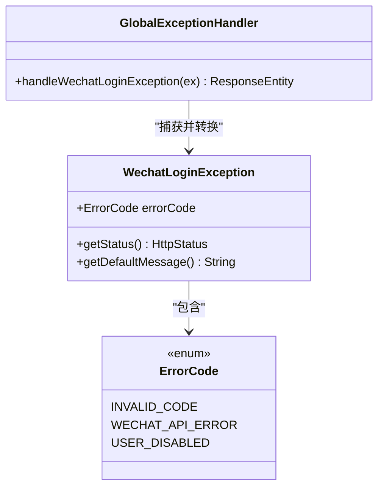
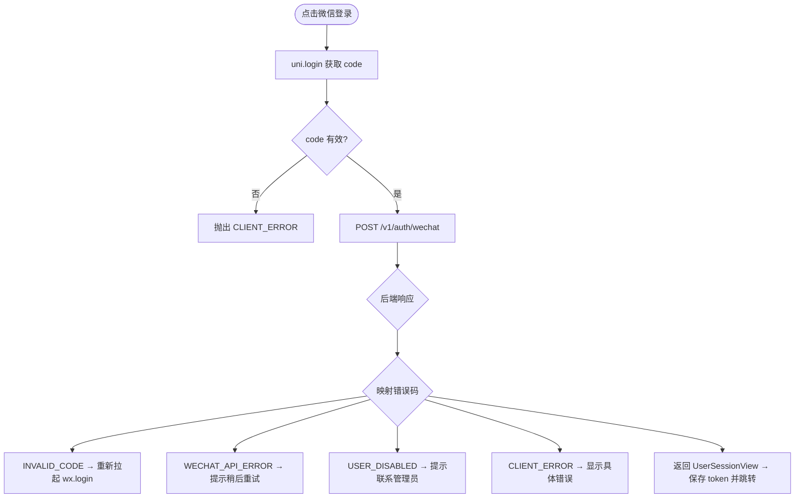
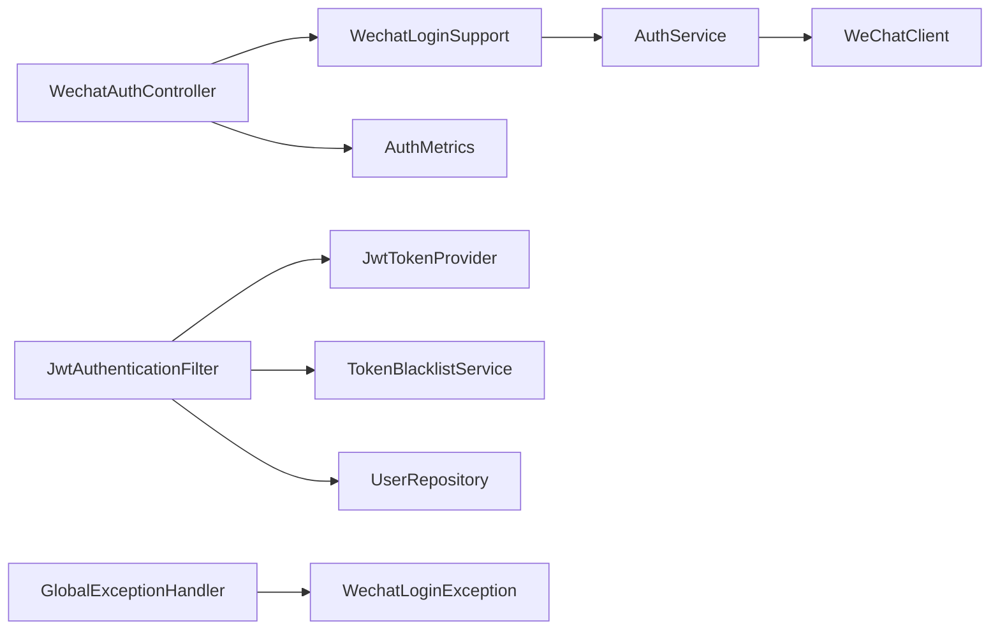

# 认证服务

<cite>
**本文引用的文件列表**
- [WechatLoginException.java](file://apps/api/src/main/java/com/campuslove/api/auth/WechatLoginException.java)
- [WechatAuthController.java](file://apps/api/src/main/java/com/campuslove/api/auth/WechatAuthController.java)
- [AuthController.java](file://apps/api/src/main/java/com/campuslove/api/auth/AuthController.java)
- [WechatLoginSupport.java](file://apps/api/src/main/java/com/campuslove/api/auth/WechatLoginSupport.java)
- [JwtAuthenticationFilter.java](file://apps/api/src/main/java/com/campuslove/api/config/JwtAuthenticationFilter.java)
- [GlobalExceptionHandler.java](file://apps/api/src/main/java/com/campuslove/api/config/GlobalExceptionHandler.java)
- [WeChatClient.java](file://apps/api/src/main/java/com/campuslove/api/auth/WeChatClient.java)
- [auth.ts](file://apps/client/src/services/auth.ts)
- [session.ts](file://apps/client/src/stores/session.ts)
- [apps/client/src/pages/login/index.vue](file://apps/client/src/pages/login/index.vue)
- [SecurityConfig.java](file://apps/api/src/main/java/com/campuslove/api/config/SecurityConfig.java)
- [WechatAuthControllerTest.java](file://apps/api/src/test/java/com/campuslove/api/auth/WechatAuthControllerTest.java)
</cite>

## 目录
1. [简介](#简介)
2. [项目结构](#项目结构)
3. [核心组件](#核心组件)
4. [架构总览](#架构总览)
5. [详细组件分析](#详细组件分析)
6. [依赖关系分析](#依赖关系分析)
7. [性能考量](#性能考量)
8. [故障排查指南](#故障排查指南)
9. [结论](#结论)
10. [附录](#附录)

## 简介
本技术文档围绕微信登录端到端流程展开，覆盖客户端 uni.login → 后端验证 → JWT 签发 → Token 存储的完整链路；系统化说明 WechatLoginError 异常体系与业务错误码映射（INVALID_CODE、WECHAT_API_ERROR、USER_DISABLED、CLIENT_ERROR）；阐述登录状态管理、权限控制与会话持久化机制；解释 CSRF 防护设计、安全最佳实践与敏感信息保护；补充登录超时处理、用户拒绝授权处理与错误提示策略；提供第三方登录扩展点、多端适配方案与测试用例参考；并涵盖登出清理、Token 刷新与安全审计等高级功能。

## 项目结构
本项目采用前后端分离的 Monorepo 组织方式：
- 前端（小程序/H5）位于 apps/client，负责调用 uni.login 获取 code，提交到后端 /api/v1/auth/wechat，并维护本地会话与 Token。
- 后端（Spring Boot）位于 apps/api，提供认证控制器、JWT 过滤器、全局异常处理器以及微信客户端等组件。
- 配置与拦截器集中在 config 包，统一安全策略与异常转换。
- 测试集中在 test 目录，覆盖关键登录路径与异常分支。

**图表来源**
- [WechatAuthController.java:1-97](file://apps/api/src/main/java/com/campuslove/api/auth/WechatAuthController.java#L1-L97)
- [WeChatClient.java:1-200](file://apps/api/src/main/java/com/campuslove/api/auth/WeChatClient.java#L1-L200)
- [JwtAuthenticationFilter.java:1-200](file://apps/api/src/main/java/com/campuslove/api/config/JwtAuthenticationFilter.java#L1-L200)
- [GlobalExceptionHandler.java:1-200](file://apps/api/src/main/java/com/campuslove/api/config/GlobalExceptionHandler.java#L1-L200)

**章节来源**
- [WechatAuthController.java:1-97](file://apps/api/src/main/java/com/campuslove/api/auth/WechatAuthController.java#L1-L97)
- [auth.ts:1-200](file://apps/client/src/services/auth.ts#L1-L200)

## 核心组件
- 微信登录控制器：对外暴露 /api/v1/auth/wechat 与兼容旧路径 /api/v1/auth/wechat-login，统一委托共享实现进行指标记录与异常传播。
- 微信客户端：封装 jscode2session 调用，集成熔断、重试、限流与生产环境 dev-fallback 校验。
- JWT 认证过滤器：从 Authorization 头或媒体查询参数提取 token，校验黑名单与用户状态，注入 SecurityContext。
- 全局异常处理器：将 WechatLoginException 等业务异常转换为标准 JSON 错误响应，含 HTTP 状态码与业务错误码。
- 客户端认证服务：封装 uni.login 获取 code、超时处理、错误分类与本地 Token 存取。
- 会话 Store：维护登录态、资料完善度、缓存清理、Sentry 上下文更新等。

**章节来源**
- [WechatAuthController.java:1-97](file://apps/api/src/main/java/com/campuslove/api/auth/WechatAuthController.java#L1-L97)
- [WeChatClient.java:1-200](file://apps/api/src/main/java/com/campuslove/api/auth/WeChatClient.java#L1-L200)
- [JwtAuthenticationFilter.java:1-200](file://apps/api/src/main/java/com/campuslove/api/config/JwtAuthenticationFilter.java#L1-L200)
- [GlobalExceptionHandler.java:1-200](file://apps/api/src/main/java/com/campuslove/api/config/GlobalExceptionHandler.java#L1-L200)
- [auth.ts:1-200](file://apps/client/src/services/auth.ts#L1-L200)
- [session.ts:1-200](file://apps/client/src/stores/session.ts#L1-L200)

## 架构总览
微信登录端到端时序如下：

**图表来源**
- [WechatAuthController.java:1-97](file://apps/api/src/main/java/com/campuslove/api/auth/WechatAuthController.java#L1-L97)
- [WeChatClient.java:1-200](file://apps/api/src/main/java/com/campuslove/api/auth/WeChatClient.java#L1-L200)
- [JwtAuthenticationFilter.java:1-200](file://apps/api/src/main/java/com/campuslove/api/config/JwtAuthenticationFilter.java#L1-L200)
- [GlobalExceptionHandler.java:1-200](file://apps/api/src/main/java/com/campuslove/api/config/GlobalExceptionHandler.java#L1-L200)

## 详细组件分析

### 微信登录控制器与共享实现
- 控制器职责：接收微信临时 code，委托 AuthService 完成 code2session、用户查找/创建、JWT 签发，返回 UserSessionView。
- 共享实现：WechatLoginSupport 收敛两个端点（推荐路径与旧路径别名），统一记录成功/失败指标，避免双实现漂移。
- 速率限制：@RateLimit(capacity=10, refillTokens=0.1, key="#request.remoteAddr") 按 IP 限流，防爆破。

**图表来源**
- [WechatAuthController.java:1-97](file://apps/api/src/main/java/com/campuslove/api/auth/WechatAuthController.java#L1-L97)
- [AuthController.java:1-200](file://apps/api/src/main/java/com/campuslove/api/auth/AuthController.java#L1-L200)
- [WechatLoginSupport.java:1-66](file://apps/api/src/main/java/com/campuslove/api/auth/WechatLoginSupport.java#L1-L66)

**章节来源**
- [WechatAuthController.java:1-97](file://apps/api/src/main/java/com/campuslove/api/auth/WechatAuthController.java#L1-L97)
- [WechatLoginSupport.java:1-66](file://apps/api/src/main/java/com/campuslove/api/auth/WechatLoginSupport.java#L1-L66)

### 微信客户端与韧性策略
- 调用微信 jscode2session 接口，使用 RestClient 以 URI 变量传递 appid/appSecret/code，避免字符串拼接注入风险。
- 韧性：CircuitBreaker 熔断 30s、Retry 指数退避、RateLimiter QPS 限制；熔断/重试耗尽时 fallback 返回 null，由上层转换为 WECHAT_API_ERROR。
- 生产环境强校验：dev-fallback 在生产 profile 下禁止开启，防止凭据缺失时伪造 openid。

**图表来源**
- [WeChatClient.java:1-200](file://apps/api/src/main/java/com/campuslove/api/auth/WeChatClient.java#L1-L200)

**章节来源**
- [WeChatClient.java:1-200](file://apps/api/src/main/java/com/campuslove/api/auth/WeChatClient.java#L1-L200)

### JWT 认证过滤器与会话持久化
- 认证流程：从 Authorization 头提取 Bearer token，解析 jti 并检查黑名单；若已撤销则清空 SecurityContext 并放行至 Entry Point 返回 401。
- 媒体代理支持：/api/v1/media/** 允许 ?token= 查询参数携带短期媒体令牌，降低 URL 泄露风险。
- 用户快照缓存：Caffeine 缓存用户角色/禁用状态 60s，减少 DB 压力。
- 会话持久化（前端）：客户端登录成功后通过 http 服务的 setToken/setRefreshToken 写入本地存储，store 在冷启动恢复后自动导航主界面。

**图表来源**
- [JwtAuthenticationFilter.java:1-200](file://apps/api/src/main/java/com/campuslove/api/config/JwtAuthenticationFilter.java#L1-L200)

**章节来源**
- [JwtAuthenticationFilter.java:1-200](file://apps/api/src/main/java/com/campuslove/api/config/JwtAuthenticationFilter.java#L1-L200)
- [session.ts:1-200](file://apps/client/src/stores/session.ts#L1-L200)

### 全局异常处理器与错误码映射
- WechatLoginException 定义业务错误码及默认消息：
  - INVALID_CODE → 401 Unauthorized
  - WECHAT_API_ERROR → 502 Bad Gateway
  - USER_DISABLED → 403 Forbidden
- GlobalExceptionHandler 将异常转换为标准 JSON 错误体：{error, message, status, code?}，并在生产环境脱敏堆栈。
- 客户端将后端错误映射为 WechatLoginError，便于 UI 分支处理。

**图表来源**
- [WechatLoginException.java:1-101](file://apps/api/src/main/java/com/campuslove/api/auth/WechatLoginException.java#L1-L101)
- [GlobalExceptionHandler.java:1-200](file://apps/api/src/main/java/com/campuslove/api/config/GlobalExceptionHandler.java#L1-L200)

**章节来源**
- [WechatLoginException.java:1-101](file://apps/api/src/main/java/com/campuslove/api/auth/WechatLoginException.java#L1-L101)
- [GlobalExceptionHandler.java:1-200](file://apps/api/src/main/java/com/campuslove/api/config/GlobalExceptionHandler.java#L1-L200)

### 客户端登录流程与错误处理
- 获取 code：uni.login(provider:"weixin")，设置 15 秒超时；无 code 或 fail 时抛出 CLIENT_ERROR。
- 发送登录请求：POST /v1/auth/wechat，后端返回 UserSessionView。
- 错误映射：根据后端返回的 code/status 映射为 INVALID_CODE/WECHAT_API_ERROR/USER_DISABLED/CLIENT_ERROR。
- 本地存储：setToken/setRefreshToken 持久化；store 监听登录态变化并导航主界面。

**图表来源**
- [auth.ts:1-200](file://apps/client/src/services/auth.ts#L1-L200)
- [apps/client/src/pages/login/index.vue:1-200](file://apps/client/src/pages/login/index.vue#L1-L200)

**章节来源**
- [auth.ts:1-200](file://apps/client/src/services/auth.ts#L1-L200)
- [apps/client/src/pages/login/index.vue:1-200](file://apps/client/src/pages/login/index.vue#L1-L200)

## 依赖关系分析
- 控制器依赖 AuthService 与 AuthMetrics，统一通过 WechatLoginSupport 委托。
- AuthService 依赖 WeChatClient 调用微信 API，并受 Resilience4j 注解保护。
- JwtAuthenticationFilter 依赖 JwtTokenProvider、TokenBlacklistService、UserRepository，实现鉴权与黑名单校验。
- GlobalExceptionHandler 集中处理业务异常与通用异常，输出标准化错误响应。

**图表来源**
- [WechatAuthController.java:1-97](file://apps/api/src/main/java/com/campuslove/api/auth/WechatAuthController.java#L1-L97)
- [WechatLoginSupport.java:1-66](file://apps/api/src/main/java/com/campuslove/api/auth/WechatLoginSupport.java#L1-L66)
- [WeChatClient.java:1-200](file://apps/api/src/main/java/com/campuslove/api/auth/WeChatClient.java#L1-L200)
- [JwtAuthenticationFilter.java:1-200](file://apps/api/src/main/java/com/campuslove/api/config/JwtAuthenticationFilter.java#L1-L200)
- [GlobalExceptionHandler.java:1-200](file://apps/api/src/main/java/com/campuslove/api/config/GlobalExceptionHandler.java#L1-L200)

**章节来源**
- [WechatAuthController.java:1-97](file://apps/api/src/main/java/com/campuslove/api/auth/WechatAuthController.java#L1-L97)
- [JwtAuthenticationFilter.java:1-200](file://apps/api/src/main/java/com/campuslove/api/config/JwtAuthenticationFilter.java#L1-L200)

## 性能考量
- 微信 API 调用：Resilience4j 熔断/重试/限流，避免雪崩与 QPS 超限。
- 用户快照缓存：Caffeine 缓存 60s，减少每请求一次 DB 往返。
- 登录接口限流：按 IP 限速，防止爆破。
- 媒体令牌短 TTL：降低 URL 泄露窗口与冒用范围。

[本节为通用性能讨论，无需特定文件引用]

## 故障排查指南
- 登录失败定位：
  - 检查 uni.login 是否超时或用户拒绝授权（CLIENT_ERROR）。
  - 检查后端返回的错误码：INVALID_CODE（401）、WECHAT_API_ERROR（502）、USER_DISABLED（403）。
  - 查看 GlobalExceptionHandler 输出的标准错误体，确认 message 与 code。
- 微信 API 异常：
  - 检查 WeChatClient 的 errcode 与 errmsg，确认网络或配置问题。
  - 确认 dev-fallback 在生产环境关闭。
- 认证失败：
  - 检查 Authorization 头是否正确携带 Bearer token。
  - 检查 jti 是否在黑名单中（用户已登出）。
  - 检查用户是否被禁用或角色变更。

**章节来源**
- [auth.ts:1-200](file://apps/client/src/services/auth.ts#L1-L200)
- [GlobalExceptionHandler.java:1-200](file://apps/api/src/main/java/com/campuslove/api/config/GlobalExceptionHandler.java#L1-L200)
- [WeChatClient.java:1-200](file://apps/api/src/main/java/com/campuslove/api/auth/WeChatClient.java#L1-L200)
- [JwtAuthenticationFilter.java:1-200](file://apps/api/src/main/java/com/campuslove/api/config/JwtAuthenticationFilter.java#L1-L200)

## 结论
本认证服务实现了完整的微信登录端到端流程，具备清晰的异常体系、健壮的韧性策略与统一的错误响应格式。通过 JWT 过滤器与黑名单机制保障会话安全，前端侧提供完善的超时与错误提示策略。建议在生产环境中严格配置微信凭据与 Profile，启用媒体令牌严格模式，并持续监控登录指标与异常分布。

[本节为总结性内容，无需特定文件引用]

## 附录

### CSRF 防护设计
- 后端 Spring Security 禁用 CSRF，因应用为无状态 JWT REST API，不使用 Cookie 会话，天然免疫 CSRF。
- 未来若引入 Cookie 会话或表单提交，需重新启用 CSRF 防护。

**章节来源**
- [SecurityConfig.java:77-82](file://apps/api/src/main/java/com/campuslove/api/config/SecurityConfig.java#L77-L82)

### 安全最佳实践与敏感信息保护
- 微信 code 与敏感字段使用掩码日志（SensitiveDataMasker）。
- 生产环境脱敏：GlobalExceptionHandler 不返回堆栈与内部异常细节。
- 媒体令牌短 TTL 与严格模式：降低 URL 泄露风险。
- 用户快照缓存：避免频繁查库导致敏感信息暴露面扩大。

**章节来源**
- [WeChatClient.java:1-200](file://apps/api/src/main/java/com/campuslove/api/auth/WeChatClient.java#L1-L200)
- [GlobalExceptionHandler.java:1-200](file://apps/api/src/main/java/com/campuslove/api/config/GlobalExceptionHandler.java#L1-L200)
- [JwtAuthenticationFilter.java:1-200](file://apps/api/src/main/java/com/campuslove/api/config/JwtAuthenticationFilter.java#L1-L200)

### 登录超时处理、用户拒绝授权与错误提示策略
- 客户端 uni.login 设置 15 秒超时，超时或 fail 时抛出 CLIENT_ERROR 并提示具体原因。
- 后端根据错误码返回对应 HTTP 状态码与友好消息，前端统一映射为 WechatLoginError。

**章节来源**
- [auth.ts:1-200](file://apps/client/src/services/auth.ts#L1-L200)
- [WechatLoginException.java:1-101](file://apps/api/src/main/java/com/campuslove/api/auth/WechatLoginException.java#L1-L101)

### 第三方登录扩展点
- 控制器预留 third-party/bindings 等子端点，可通过 @PreAuthorize 实现细粒度鉴权。
- 可基于现有 AuthService 抽象扩展其他第三方登录（如手机号、邮箱、OAuth2）。

**章节来源**
- [JwtAuthenticationFilter.java:1-200](file://apps/api/src/main/java/com/campuslove/api/config/JwtAuthenticationFilter.java#L1-L200)
- [AuthController.java:1-200](file://apps/api/src/main/java/com/campuslove/api/auth/AuthController.java#L1-L200)

### 多端适配方案
- 客户端通过 services/http 统一存取 Token，适配小程序与 H5。
- 媒体端点支持 ?token= 查询参数，适配 <image src> 直接请求场景。

**章节来源**
- [JwtAuthenticationFilter.java:1-200](file://apps/api/src/main/java/com/campuslove/api/config/JwtAuthenticationFilter.java#L1-L200)
- [session.ts:1-200](file://apps/client/src/stores/session.ts#L1-L200)

### 测试用例参考
- 单元测试覆盖登录成功、INVALID_CODE、WECHAT_API_ERROR、USER_DISABLED、null userId 等场景。
- 验证指标记录与异常传播正确性。

**章节来源**
- [WechatAuthControllerTest.java:1-200](file://apps/api/src/test/java/com/campuslove/api/auth/WechatAuthControllerTest.java#L1-L200)

### 登出清理、Token 刷新与安全审计
- 登出清理：Token 黑名单机制（Redis 或本地降级），JTI 撤销后拒绝认证。
- Token 刷新：/api/v1/auth/refresh 支持幂等刷新，带限流。
- 安全审计：登录成功/失败指标记录，Sentry 上下文关联用户身份。

**章节来源**
- [JwtAuthenticationFilter.java:1-200](file://apps/api/src/main/java/com/campuslove/api/config/JwtAuthenticationFilter.java#L1-L200)
- [AuthController.java:1-200](file://apps/api/src/main/java/com/campuslove/api/auth/AuthController.java#L1-L200)
- [session.ts:1-200](file://apps/client/src/stores/session.ts#L1-L200)