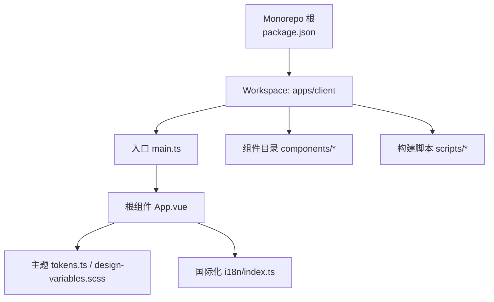
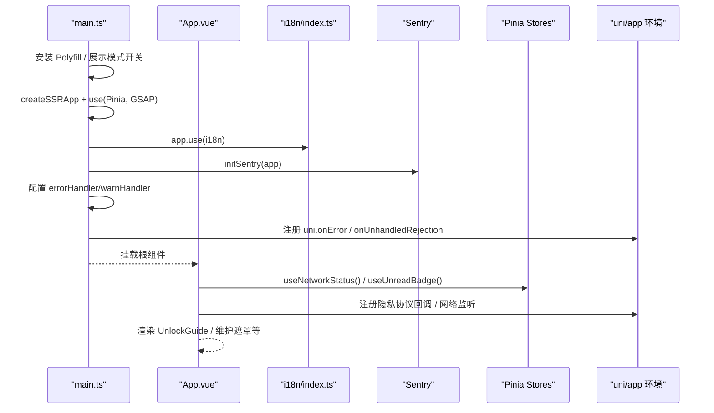
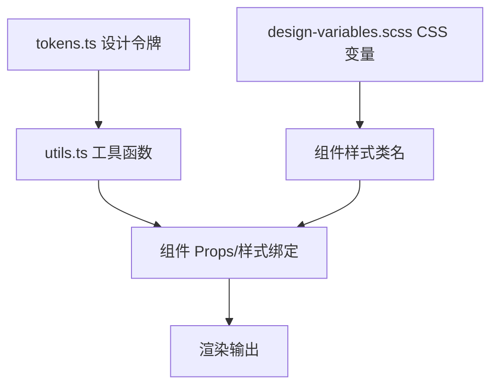
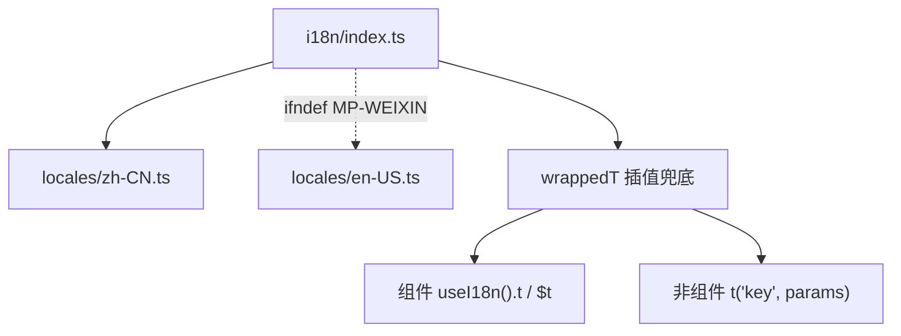
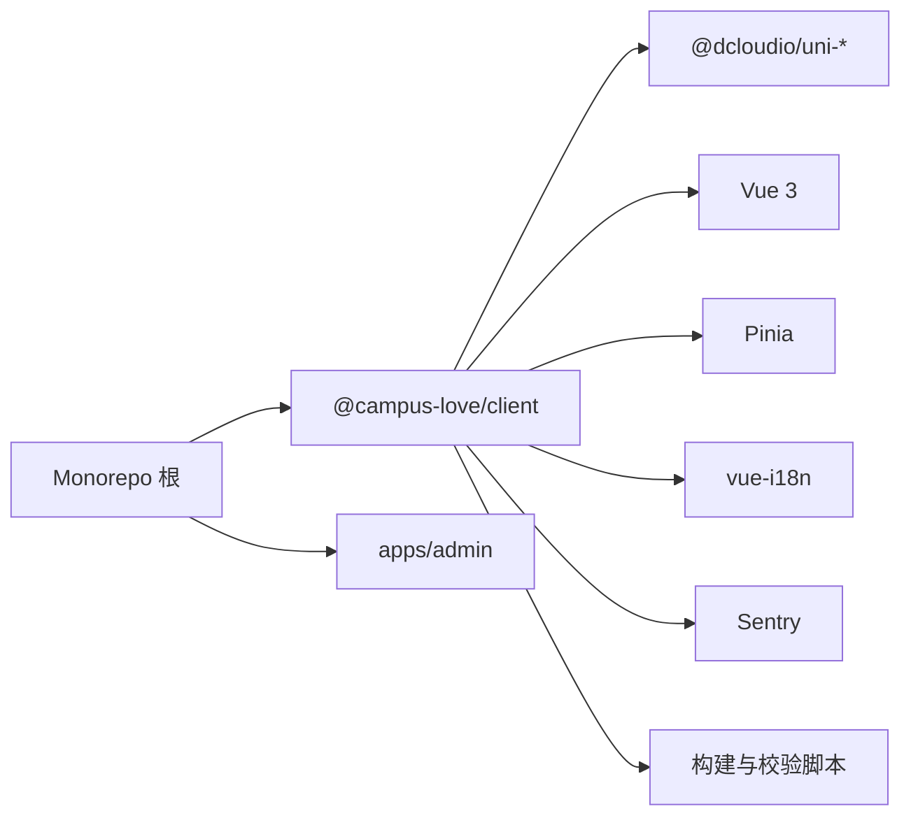

# UI 组件库

<cite>
**本文引用的文件**
- [package.json](file://package.json)
- [pnpm-workspace.yaml](file://pnpm-workspace.yaml)
- [apps/client/package.json](file://apps/client/package.json)
- [start-showcase.bat](file://start-showcase.bat)
- [apps/client/src/main.ts](file://apps/client/src/main.ts)
- [apps/client/src/App.vue](file://apps/client/src/App.vue)
- [apps/client/src/theme/tokens.ts](file://apps/client/src/theme/tokens.ts)
- [apps/client/src/theme/design-variables.scss](file://apps/client/src/theme/design-variables.scss)
- [apps/client/src/theme/utils.ts](file://apps/client/src/theme/utils.ts)
- [apps/client/src/i18n/index.ts](file://apps/client/src/i18n/index.ts)
</cite>

## 目录
1. [简介](#简介)
2. [项目结构](#项目结构)
3. [核心组件](#核心组件)
4. [架构总览](#架构总览)
5. [详细组件分析](#详细组件分析)
6. [依赖关系分析](#依赖关系分析)
7. [性能与优化](#性能与优化)
8. [故障排查指南](#故障排查指南)
9. [结论](#结论)
10. [附录：发布、版本与依赖管理](#附录发布版本与依赖管理)

## 简介
本仓库采用 Monorepo 组织，前端应用位于 apps/client（基于 Uni-app/Vue3），包含小程序与 H5 双端能力；同时提供 admin 后台。UI 组件库以“通用组件 + 业务组件 + 页面组件”分层构建，依托设计令牌（tokens）与 SCSS 变量实现主题定制与一致性视觉。文档面向开发者，说明设计规范、命名约定、目录组织、属性/事件/插槽契约、样式系统、主题与响应式、性能优化、测试策略、国际化与无障碍、跨平台兼容、以及发布与版本管理方案。

## 项目结构
- Monorepo 根通过 pnpm workspaces 聚合 apps/*，统一脚本与工具链。
- 客户端应用 apps/client 使用 uni-app + Vue3，提供 dev/build 多目标脚本（H5、mp-weixin），并集成 Storybook、Vitest、Lighthouse 等质量工具。
- 主题体系集中在 theme/ 目录，JS tokens 与 SCSS 变量双源对齐，确保运行时与编译期一致。
- 国际化由 vue-i18n 驱动，默认 zh-CN，并按平台条件编译裁剪包体积。
- 入口初始化在 main.ts，全局错误监控、i18n、Sentry、Polyfill 均在应用启动阶段完成；App.vue 负责全局网络、未读红点、隐私协议与展示模式等全局逻辑。

**图表来源**
- [package.json:1-48](file://package.json#L1-L48)
- [apps/client/package.json:1-104](file://apps/client/package.json#L1-L104)

**章节来源**
- [package.json:1-48](file://package.json#L1-L48)
- [pnpm-workspace.yaml:1-13](file://pnpm-workspace.yaml#L1-L13)
- [apps/client/package.json:1-104](file://apps/client/package.json#L1-L104)

## 核心组件
- 通用组件：Avatar、Card、Ripple、Toast、EmptyState、SafeImage、BottomSheet、GlobalPublishFab、ShareCard、VerificationBadge、HeartParticles、LegalTextPage 等，聚焦可复用交互与基础视觉。
- 业务组件：HomeHeader、CommunityFeed、TodayRecommendationCard、MatchCard、ChatBubble、EmojiPanel、PostCard、ActivityCard、ChannelTabs、TopicSelector、FilterDrawer、CardSwiper、AdvancedFilter、PublicProfile、MyProfile、MyStory、SetupProgress、UnlockGuideModal/Overlay 等，承载具体页面片段与业务交互。
- 布局组件：AppShell、TabBar、ProfileShell，负责整体骨架与导航容器。

命名与组织建议
- 通用组件放在 common/，业务组件按领域分目录（如 home、match、village、chat、discover、profile），布局组件放 layout/。
- 组件文件命名采用 PascalCase 的 .vue 文件名；TS/JS 辅助模块采用 kebab-case。
- 对外暴露 props/events/slots 时，使用清晰的类型定义与 JSDoc 注释，便于 Storybook 生成文档。

**章节来源**
- [apps/client/src/components/common/Card.vue](file://apps/client/src/components/common/Card.vue)
- [apps/client/src/components/layout/AppShell.vue](file://apps/client/src/components/layout/AppShell.vue)
- [apps/client/src/components/home/HomeHeader.vue](file://apps/client/src/components/home/HomeHeader.vue)

## 架构总览
应用启动流程（简化）
- main.ts：安装 Polyfill、应用展示模式开关、创建 Vue 实例与 Pinia、注册 i18n/Sentry、配置全局错误处理器、注册小程序全局错误监听。
- App.vue：初始化网络状态、未读红点、隐私协议授权、维护模式、解锁引导弹窗、全局导航与演示入口等。

**图表来源**
- [apps/client/src/main.ts:1-122](file://apps/client/src/main.ts#L1-L122)
- [apps/client/src/App.vue:1-200](file://apps/client/src/App.vue#L1-L200)
- [apps/client/src/i18n/index.ts:1-119](file://apps/client/src/i18n/index.ts#L1-L119)

**章节来源**
- [apps/client/src/main.ts:1-122](file://apps/client/src/main.ts#L1-L122)
- [apps/client/src/App.vue:1-200](file://apps/client/src/App.vue#L1-L200)

## 详细组件分析

### 主题与样式系统
- 设计令牌（tokens.ts）集中管理颜色、渐变、阴影、圆角、间距等，供 JS 侧动态取值与组件 API 使用。
- SCSS 变量（design-variables.scss）映射为 CSS 自定义属性，保证编译期与设计一致；与 tokens.ts 双源同步，避免漂移。
- 工具函数（utils.ts）提供 rpx、getColor、getRadius、getSpacing、getGradient、classNames 等便捷方法，提升组件内样式调用的一致性与可维护性。

**图表来源**
- [apps/client/src/theme/tokens.ts:1-200](file://apps/client/src/theme/tokens.ts#L1-L200)
- [apps/client/src/theme/design-variables.scss:1-200](file://apps/client/src/theme/design-variables.scss#L1-L200)
- [apps/client/src/theme/utils.ts:1-51](file://apps/client/src/theme/utils.ts#L1-L51)

**章节来源**
- [apps/client/src/theme/tokens.ts:1-200](file://apps/client/src/theme/tokens.ts#L1-L200)
- [apps/client/src/theme/design-variables.scss:1-200](file://apps/client/src/theme/design-variables.scss#L1-L200)
- [apps/client/src/theme/utils.ts:1-51](file://apps/client/src/theme/utils.ts#L1-L51)

### 国际化与多语言
- 通过 vue-i18n 配置默认 zh-CN，并在 mp-weixin 构建中剔除 en-US 以减小主包体积。
- 包装 t() 对小程序端被剥离的运行时插值做兜底，确保 {param} 占位符正常替换。
- 非组件场景可通过导出 t 获取翻译能力，组件内优先 useI18n().t。

**图表来源**
- [apps/client/src/i18n/index.ts:1-119](file://apps/client/src/i18n/index.ts#L1-L119)

**章节来源**
- [apps/client/src/i18n/index.ts:1-119](file://apps/client/src/i18n/index.ts#L1-L119)

### 组件属性接口、事件与插槽规范
- 属性（Props）：统一使用 TypeScript 类型描述，遵循语义化命名（如 variant、size、disabled、loading）。
- 事件（Events）：使用 v-model 或 emit('update:modelValue') 双向绑定；操作型事件用动词命名（如 onClick、onConfirm、onDismiss）。
- 插槽（Slots）：提供具名插槽与作用域插槽，便于外层注入内容（如 header、footer、action）。
- 示例参考：
  - Avatar：头像展示、尺寸、加载态、占位图、点击行为。
  - Card：卡片容器、变体、阴影、点击反馈、内容插槽。
  - Toast：消息提示、位置、时长、关闭回调。
  - BottomSheet：底部抽屉、标题、内容、关闭按钮、手势滑动。
  - SafeImage：图片安全加载、占位、降级、懒加载。

（以上组件可在 apps/client/src/components/common 与业务目录下找到对应实现，按需查阅。）

**章节来源**
- [apps/client/src/components/common/Card.vue](file://apps/client/src/components/common/Card.vue)
- [apps/client/src/components/common/Avatar.vue](file://apps/client/src/components/common/Avatar.vue)
- [apps/client/src/components/common/Toast.vue](file://apps/client/src/components/common/Toast.vue)
- [apps/client/src/components/common/BottomSheet.vue](file://apps/client/src/components/common/BottomSheet.vue)
- [apps/client/src/components/common/SafeImage.vue](file://apps/client/src/components/common/SafeImage.vue)

### 响应式设计与移动端适配
- 使用 rpx 单位与主题工具函数统一间距与字号，保证在不同屏幕密度下的一致性。
- 通过主题 token 的颜色层级与对比度，满足可读性与无障碍要求。
- 组件内部采用弹性布局与媒体查询（如需）处理横竖屏与不同视口。

**章节来源**
- [apps/client/src/theme/utils.ts:1-51](file://apps/client/src/theme/utils.ts#L1-L51)
- [apps/client/src/theme/design-variables.scss:1-200](file://apps/client/src/theme/design-variables.scss#L1-L200)

### 组件测试策略
- 单元测试：Vitest + @vue/test-utils，覆盖组件渲染、交互与边界条件。
- 端到端：Playwright（见 package.json 中的 test:e2e），用于关键用户流程验证。
- 故事集：Storybook（scripts 中提供 storybook 命令），用于可视化用例与回归截图。
- 契约与结构测试：根脚本 test:prototype、test:structure 保障接口契约与目录规范。

**章节来源**
- [apps/client/package.json:1-104](file://apps/client/package.json#L1-L104)
- [package.json:1-48](file://package.json#L1-L48)

### 无障碍访问（a11y）
- 语义化标签与 aria-* 属性配合键盘可达性。
- 颜色对比度遵循 WCAG 标准，借助 tokens 的文本色与背景色组合。
- 文案与提示使用 i18n 支持多语言，保证可理解性。

**章节来源**
- [apps/client/src/theme/tokens.ts:1-200](file://apps/client/src/theme/tokens.ts#L1-L200)
- [apps/client/src/i18n/index.ts:1-119](file://apps/client/src/i18n/index.ts#L1-L119)

### 跨平台兼容性
- Polyfill：AbortController、URLSearchParams 在 mp-weixin 环境补齐。
- 条件编译：根据平台引入资源与功能（如 en-US 在小程序端剔除）。
- 微信隐私协议：onNeedPrivacyAuthorization 注册与防重入处理，确保合规。

**章节来源**
- [apps/client/src/main.ts:1-122](file://apps/client/src/main.ts#L1-L122)
- [apps/client/src/App.vue:1-200](file://apps/client/src/App.vue#L1-L200)
- [apps/client/src/i18n/index.ts:1-119](file://apps/client/src/i18n/index.ts#L1-L119)

## 依赖关系分析
- Monorepo 顶层通过 pnpm workspace 管理 apps/client 与 apps/admin，统一脚本与工具。
- apps/client 依赖 uni-app 生态（@dcloudio/*）、Vue3、Pinia、GSAP、Sentry、vue-i18n 等。
- 构建脚本与校验工具：prepare-static、verify-package-size、check-project-rules、inject-wx-appid、strip-mock-for-mp 等，保障构建产物质量与合规。

**图表来源**
- [package.json:1-48](file://package.json#L1-L48)
- [apps/client/package.json:1-104](file://apps/client/package.json#L1-L104)

**章节来源**
- [package.json:1-48](file://package.json#L1-L48)
- [pnpm-workspace.yaml:1-13](file://pnpm-workspace.yaml#L1-L13)
- [apps/client/package.json:1-104](file://apps/client/package.json#L1-L104)

## 性能与优化
- 构建期裁剪：mp-weixin 剔除 en-US 语言包，减少主包体积；SVG 转 PNG 流程降低小程序渲染开销。
- 运行时优化：
  - 懒加载：头像框注册表在启动期强制引用以避免模块未定义问题；页面级与列表项使用懒加载与虚拟滚动（结合组件能力与数据分页）。
  - 网络状态与未读红点：useNetworkStatus 与 useUnreadBadge 在 App 层统一订阅，避免重复监听。
  - 错误上报：统一错误处理与 Sentry 集成，快速定位性能瓶颈与异常。
- 体验优化：展示模式（Showcase）一键开启全功能演示；维护模式遮罩保护用户体验。

**章节来源**
- [apps/client/package.json:1-104](file://apps/client/package.json#L1-L104)
- [start-showcase.bat:1-71](file://start-showcase.bat#L1-L71)
- [apps/client/src/App.vue:1-200](file://apps/client/src/App.vue#L1-L200)
- [apps/client/src/main.ts:1-122](file://apps/client/src/main.ts#L1-L122)

## 故障排查指南
- 隐私协议弹窗叠弹：已加 pending 标志防止并发触发，若仍出现需检查调用方是否重复触发敏感 API。
- 全局错误重复上报：uni.onError 与 Vue errorHandler 已在 main.ts 与 App.vue 分别注册，注意不要重复添加监听器。
- 构建失败或包体积超标：使用 verify-package-size、check-project-rules 等脚本定位问题；必要时启用 --allow-mock 临时跳过严格检查。
- 小程序样式差异：确认 SVG 转 PNG 流程执行；核对 statusbar 与 tabbar 一致性检查脚本结果。

**章节来源**
- [apps/client/src/App.vue:1-200](file://apps/client/src/App.vue#L1-L200)
- [apps/client/src/main.ts:1-122](file://apps/client/src/main.ts#L1-L122)
- [apps/client/package.json:1-104](file://apps/client/package.json#L1-L104)

## 结论
该 UI 组件库以设计令牌为核心，结合 SCSS 变量与工具函数，实现了统一的视觉与主题体系；通过 i18n、Sentry、Polyfill 与构建脚本，保证了多端一致性与可维护性。组件按通用/业务/布局分层，配合完善的测试与发布流程，适合持续迭代与规模化协作。

## 附录：发布、版本与依赖管理
- 版本管理：Monorepo 根 package.json 统一管理版本号与工作区；各子应用独立维护自身版本与依赖。
- 依赖管理：pnpm workspace 锁定依赖树；overrides 固定插件版本以保证构建稳定。
- 发布流程：
  - 开发：dev:h5、dev:mp-weixin 快速迭代。
  - 构建：build:mp-weixin、build:h5；showcase 模式通过 start-showcase.bat 一键启动后端 mock 并构建展示包。
  - 质量门禁：typecheck、lint、lighthouse、verify-package-size、check-project-rules、inject-wx-appid、strip-mock-for-mp。
  - 测试：unit（Vitest）、e2e（Playwright）、a11y（Playwright grep）、contract/structure（根脚本）。
- 文档生成：Storybook 用于组件可视化与用例文档；OpenAPI 生成类型定义（generate:openapi）。

**章节来源**
- [package.json:1-48](file://package.json#L1-L48)
- [pnpm-workspace.yaml:1-13](file://pnpm-workspace.yaml#L1-L13)
- [apps/client/package.json:1-104](file://apps/client/package.json#L1-L104)
- [start-showcase.bat:1-71](file://start-showcase.bat#L1-L71)