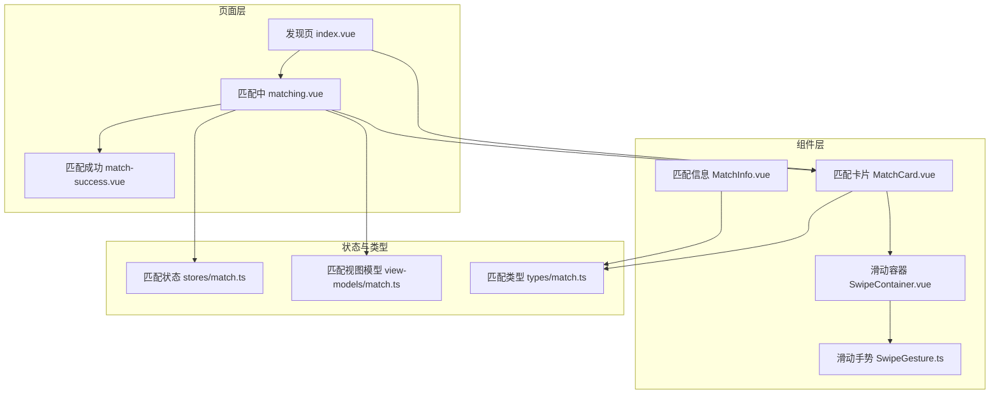
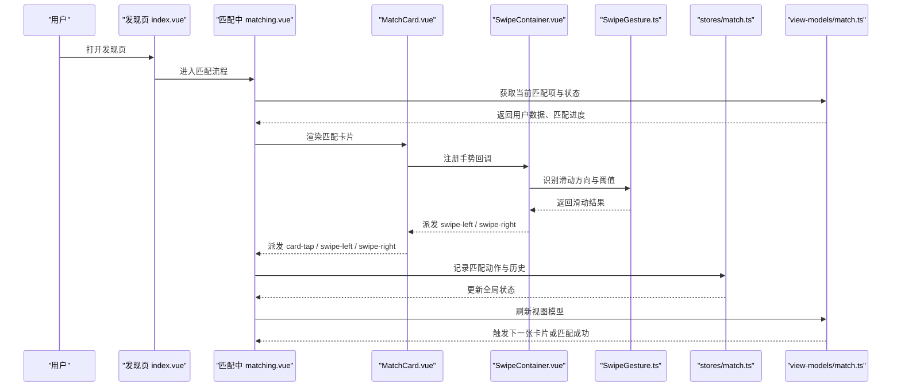
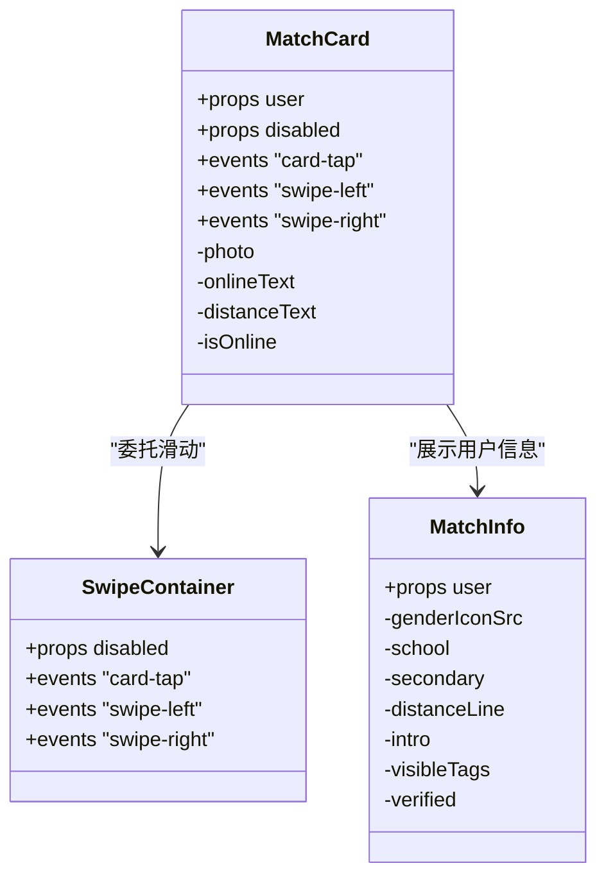
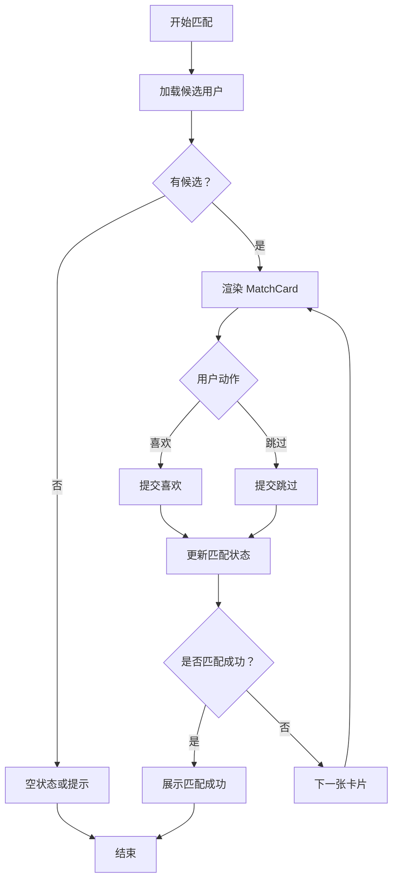
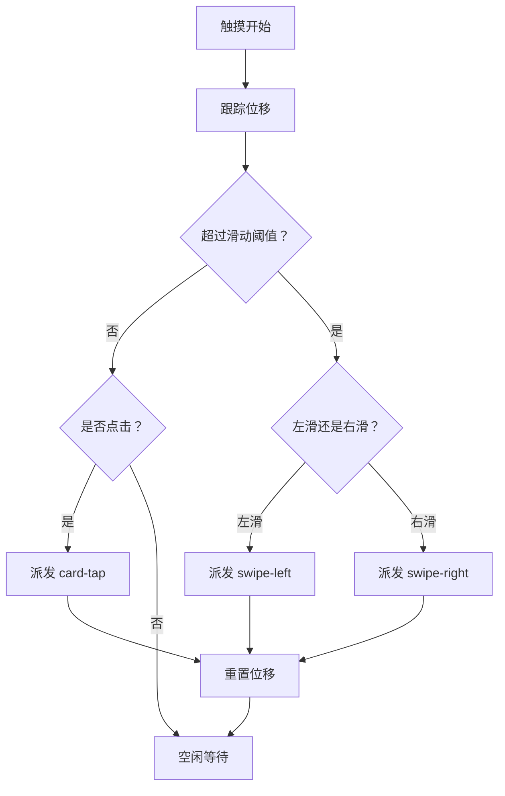
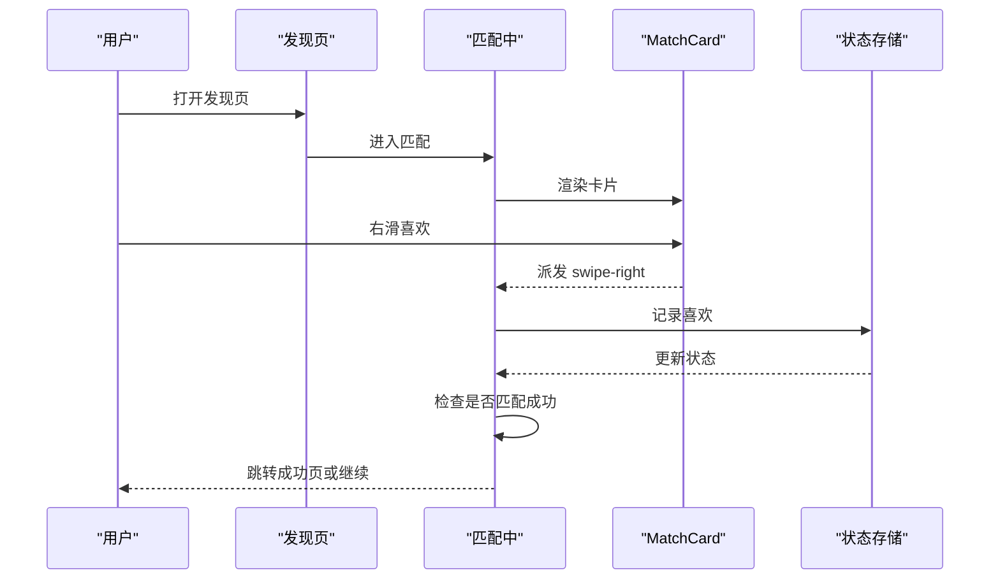

# 匹配组件

<cite>
**本文引用的文件**   
- [MatchCard.vue](file://apps/client/src/components/match/MatchCard.vue)
- [MatchInfo.vue](file://apps/client/src/components/match/MatchInfo.vue)
- [SwipeContainer.vue](file://apps/client/src/components/common/swipe/SwipeContainer.vue)
- [SwipeGesture.ts](file://apps/client/src/components/common/swipe/SwipeGesture.ts)
- [matching.vue](file://apps/client/src/subpackages/discover-extra/discover/matching.vue)
- [match-success.vue](file://apps/client/src/subpackages/discover-extra/discover/match-success.vue)
- [index.vue（发现页）](file://apps/client/src/pages/discover/index.vue)
- [match.ts（状态存储）](file://apps/client/src/stores/match.ts)
- [match.ts（视图模型）](file://apps/client/src/view-models/match.ts)
- [match.ts（类型定义）](file://apps/client/src/types/match.ts)
- [MatchActions.spec.ts](file://apps/client/src/tests/components/MatchActions.spec.ts)
- [MatchCard.spec.ts](file://apps/client/src/tests/components/MatchCard.spec.ts)
- [match.spec.ts](file://apps/client/src/tests/stores/match.spec.ts)
</cite>

## 目录
1. [引言](#引言)
2. [项目结构与定位](#项目结构与定位)
3. [核心组件总览](#核心组件总览)
4. [架构与数据流](#架构与数据流)
5. [详细组件分析](#详细组件分析)
6. [匹配算法调用与结果展示](#匹配算法调用与结果展示)
7. [滑动交互、手势处理与动画](#滑动交互手势处理与动画)
8. [权限控制、状态同步与实时反馈](#权限控制状态同步与实时反馈)
9. [历史管理、缓存策略与性能优化](#历史管理缓存策略与性能优化)
10. [完整使用示例](#完整使用示例)
11. [故障排查指南](#故障排查指南)
12. [结论](#结论)

## 引言
本文聚焦“匹配”能力的前端实现，围绕以下目标展开：
- 深入解释 MatchCard 匹配卡片和 MatchActions 匹配操作按钮两个核心组件。
- 说明匹配卡片的滑动交互逻辑、手势处理和动画效果。
- 文档化匹配算法的调用方式、匹配结果展示和用户操作流程。
- 说明匹配动作的权限控制、状态同步和实时反馈机制。
- 总结匹配历史管理、缓存策略和性能优化方案。
- 提供匹配流程的完整示例和异常处理指导。

本说明既面向前端开发者，也面向测试、产品与运维人员；非代码读者可优先阅读“架构与数据流”“完整使用示例”和“故障排查指南”。

## 项目结构与定位
匹配相关代码主要位于客户端应用 `apps/client` 下，分为三类：
- 组件层：匹配卡片、匹配信息、通用滑动容器等 UI 组件。
- 页面层：发现页入口、匹配中页面、匹配成功页面。
- 状态与类型层：Pinia Store、视图模型、类型定义与测试。

**图表来源**
- [index.vue（发现页）:25-372](file://apps/client/src/pages/discover/index.vue#L25-L372)
- [matching.vue](file://apps/client/src/subpackages/discover-extra/discover/matching.vue)
- [match-success.vue](file://apps/client/src/subpackages/discover-extra/discover/match-success.vue)
- [MatchCard.vue:1-290](file://apps/client/src/components/match/MatchCard.vue#L1-L290)
- [SwipeContainer.vue](file://apps/client/src/components/common/swipe/SwipeContainer.vue)
- [SwipeGesture.ts](file://apps/client/src/components/common/swipe/SwipeGesture.ts)
- [match.ts（状态存储）](file://apps/client/src/stores/match.ts)
- [match.ts（视图模型）](file://apps/client/src/view-models/match.ts)
- [match.ts（类型定义）](file://apps/client/src/types/match.ts)

**章节来源**
- [index.vue（发现页）:25-372](file://apps/client/src/pages/discover/index.vue#L25-L372)
- [matching.vue](file://apps/client/src/subpackages/discover-extra/discover/matching.vue)
- [MatchCard.vue:1-290](file://apps/client/src/components/match/MatchCard.vue#L1-L290)
- [match.ts（状态存储）](file://apps/client/src/stores/match.ts)
- [match.ts（视图模型）](file://apps/client/src/view-models/match.ts)
- [match.ts（类型定义）](file://apps/client/src/types/match.ts)

## 核心组件总览
- MatchCard 匹配卡片：负责渲染单个匹配对象的用户照片、在线状态、距离标签、匹配度徽章以及基础信息。它不直接实现滑动逻辑，而是委托给 SwipeContainer。
- MatchInfo 匹配信息：负责姓名、年龄、性别、学校/学院、距离与活跃时间、兴趣标签、个性签名等展示细节。
- SwipeContainer 滑动容器：提供左滑、右滑、点击等手势抽象，并向外部暴露标准化事件。
- SwipeGesture 滑动手势：封装底层手势识别与位移计算，供 SwipeContainer 复用。
- MatchActions 匹配操作按钮：由发现页或匹配中页面引入，用于触发喜欢、跳过、查看资料等操作；其具体实现位于组件目录，并由测试覆盖行为契约。

**章节来源**
- [MatchCard.vue:1-290](file://apps/client/src/components/match/MatchCard.vue#L1-L290)
- [MatchInfo.vue:1-245](file://apps/client/src/components/match/MatchInfo.vue#L1-L245)
- [SwipeContainer.vue](file://apps/client/src/components/common/swipe/SwipeContainer.vue)
- [SwipeGesture.ts](file://apps/client/src/components/common/swipe/SwipeGesture.ts)
- [MatchActions.spec.ts](file://apps/client/src/tests/components/MatchActions.spec.ts)

## 架构与数据流
匹配流程通常从发现页进入匹配中页面，再由匹配中页面驱动 MatchCard 展示候选用户，并通过 MatchActions 提交用户决策。

**图表来源**
- [index.vue（发现页）:25-372](file://apps/client/src/pages/discover/index.vue#L25-L372)
- [matching.vue](file://apps/client/src/subpackages/discover-extra/discover/matching.vue)
- [MatchCard.vue:1-290](file://apps/client/src/components/match/MatchCard.vue#L1-L290)
- [SwipeContainer.vue](file://apps/client/src/components/common/swipe/SwipeContainer.vue)
- [SwipeGesture.ts](file://apps/client/src/components/common/swipe/SwipeGesture.ts)
- [match.ts（状态存储）](file://apps/client/src/stores/match.ts)
- [match.ts（视图模型）](file://apps/client/src/view-models/match.ts)

## 详细组件分析

### MatchCard 匹配卡片
MatchCard 是一个受控展示组件，主要职责包括：
- 接收 `user: MatchCardUser` 与可选 `disabled` 属性。
- 通过 `emit` 对外暴露三个事件：`card-tap`、`swipe-left`、`swipe-right`。
- 将照片、距离、在线状态、匹配度徽章、基础信息分别交由插槽与子组件渲染。
- 默认照片为空时回退到匹配主视觉图。
- 对距离文本进行单位补全与同校文案判断。
- 在线状态根据后端状态字段与 i18n 文案动态显示。
- 匹配度徽章以圆形渐变背景加内圈阴影呈现百分比与标签。

**图表来源**
- [MatchCard.vue:1-290](file://apps/client/src/components/match/MatchCard.vue#L1-L290)
- [MatchInfo.vue:1-245](file://apps/client/src/components/match/MatchInfo.vue#L1-L245)
- [SwipeContainer.vue](file://apps/client/src/components/common/swipe/SwipeContainer.vue)

关键实现要点：
- 事件命名采用 `card-tap` 而非原生 `tap`，避免微信小程序端单次点击双通道重复触发。
- 无照片用户的卡片兜底使用匹配主视觉图，减少空白感。
- 距离文本支持纯数字自动补单位，同时保留已有单位或非数值文案。
- 在线状态兼容多种后端字段与文案键，统一走 i18n。
- 匹配度徽章放弃不稳定 `conic-gradient`，改用双层圆环布局。

**章节来源**
- [MatchCard.vue:1-290](file://apps/client/src/components/match/MatchCard.vue#L1-L290)
- [MatchCard.spec.ts](file://apps/client/src/tests/components/MatchCard.spec.ts)

### MatchInfo 匹配信息
MatchInfo 专注于用户基础信息的可读性与一致性：
- 姓名与年龄同行展示。
- 性别图标按性别切换颜色。
- 学校与学院用分隔点连接。
- 距离与活跃时间拼接为一条信息行。
- 兴趣标签最多显示前四项，其余隐藏。
- 个性签名使用引号条与两行截断。
- 已验证用户展示验证徽章。

**章节来源**
- [MatchInfo.vue:1-245](file://apps/client/src/components/match/MatchInfo.vue#L1-L245)

### SwipeContainer 与 SwipeGesture
SwipeContainer 是匹配卡片的滑动能力提供者：
- 接收 `disabled` 控制是否允许滑动。
- 将底层手势识别委托给 SwipeGesture。
- 对外统一派发 `card-tap`、`swipe-left`、`swipe-right`。
- 屏蔽原生冒泡干扰，确保上层业务只关心语义事件。

SwipeGesture 负责：
- 识别触摸起始、移动、结束。
- 计算横向位移与速度。
- 判定左滑、右滑阈值与方向。
- 在小程序端保持手势稳定性。

**章节来源**
- [SwipeContainer.vue](file://apps/client/src/components/common/swipe/SwipeContainer.vue)
- [SwipeGesture.ts](file://apps/client/src/components/common/swipe/SwipeGesture.ts)

### MatchActions 匹配操作按钮
MatchActions 由发现页引入，并在匹配流程中提供“喜欢”“跳过”“查看详情”等动作入口。其行为契约由测试用例约束：
- 动作按钮需根据用户登录状态与匹配阶段启用或禁用。
- 点击后应触发对应事件并更新匹配状态。
- 在微信小程序环境下需避免误触与重复触发。

由于该组件的具体源码未在检索结果中直接列出，本文以测试文件和页面引用作为契约依据；实际实现应遵循上述行为约定并与匹配状态库同步。

**章节来源**
- [index.vue（发现页）:25-372](file://apps/client/src/pages/discover/index.vue#L25-L372)
- [MatchActions.spec.ts](file://apps/client/src/tests/components/MatchActions.spec.ts)

## 匹配算法调用与结果展示
匹配算法调用通常发生在匹配中页面：
- 从视图模型读取当前候选用户与匹配进度。
- 调用服务层接口获取推荐列表或匹配请求结果。
- 将结果写入状态存储，供卡片渲染与动作提交使用。
- 当匹配命中时，跳转至匹配成功页面。

**图表来源**
- [matching.vue](file://apps/client/src/subpackages/discover-extra/discover/matching.vue)
- [match-success.vue](file://apps/client/src/subpackages/discover-extra/discover/match-success.vue)
- [match.ts（视图模型）](file://apps/client/src/view-models/match.ts)
- [match.ts（状态存储）](file://apps/client/src/stores/match.ts)

**章节来源**
- [matching.vue](file://apps/client/src/subpackages/discover-extra/discover/matching.vue)
- [match-success.vue](file://apps/client/src/subpackages/discover-extra/discover/match-success.vue)
- [match.ts（视图模型）](file://apps/client/src/view-models/match.ts)
- [match.ts（状态存储）](file://apps/client/src/stores/match.ts)

## 滑动交互、手势处理与动画
MatchCard 的滑动体验由 SwipeContainer 与 SwipeGesture 共同保障：
- 用户触摸卡片后，SwipeGesture 跟踪位移与速度。
- 达到左滑或右滑阈值时，SwipeContainer 向 MatchCard 派发对应事件。
- MatchCard 仅负责转发事件给父级匹配流程，不自行保存动作。
- 卡片点击通过 `card-tap` 上报，避免与原生 `tap` 冲突。

**图表来源**
- [SwipeContainer.vue](file://apps/client/src/components/common/swipe/SwipeContainer.vue)
- [SwipeGesture.ts](file://apps/client/src/components/common/swipe/SwipeGesture.ts)
- [MatchCard.vue:1-290](file://apps/client/src/components/match/MatchCard.vue#L1-L290)

动画与视觉方面：
- 卡片底部渐隐遮罩提升文字可读性。
- 距离胶囊与在线胶囊使用白底与品牌色文字，保证对比度。
- 匹配度徽章采用渐变圆环与内圈阴影，避免平台内联样式兼容性风险。
- 照片未就位时使用页面背景色占位，减少闪烁。

**章节来源**
- [MatchCard.vue:1-290](file://apps/client/src/components/match/MatchCard.vue#L1-L290)
- [SwipeContainer.vue](file://apps/client/src/components/common/swipe/SwipeContainer.vue)
- [SwipeGesture.ts](file://apps/client/src/components/common/swipe/SwipeGesture.ts)

## 权限控制、状态同步与实时反馈
- 权限控制：MatchActions 的动作按钮应根据用户登录状态、匹配阶段与业务规则启用或禁用。未登录或匹配失败时应阻止危险动作。
- 状态同步：所有匹配动作最终写入 `stores/match.ts`，并由 `view-models/match.ts` 转换为视图所需结构，确保 UI 与数据一致。
- 实时反馈：滑动与点击事件应立即反映到状态变化，例如已喜欢用户不再出现、匹配进度递增、匹配成功页面立即跳转。

建议的状态字段：
- 当前用户 ID。
- 当前候选列表与索引。
- 已喜欢、已跳过集合。
- 匹配中标志与错误码。
- 最近一次匹配结果。

**章节来源**
- [match.ts（状态存储）](file://apps/client/src/stores/match.ts)
- [match.ts（视图模型）](file://apps/client/src/view-models/match.ts)
- [MatchActions.spec.ts](file://apps/client/src/tests/components/MatchActions.spec.ts)

## 历史管理、缓存策略与性能优化
历史管理：
- 每次匹配动作应追加历史记录，包含动作类型、候选用户 ID、时间戳与结果。
- 历史数据可用于统计、回访与异常诊断。

缓存策略：
- 对候选用户列表进行短期缓存，减少重复请求。
- 图片资源通过 SafeImage 组件懒加载与降级，避免首屏阻塞。
- 对频繁读写的状态字段使用轻量结构，避免深拷贝开销。

性能优化：
- 卡片渲染尽量使用计算属性与插槽，减少不必要的重渲染。
- 滑动阈值与动画参数集中配置，便于调优。
- 在小程序端避免不稳定样式特性，如内联复杂渐变。

**章节来源**
- [MatchCard.vue:1-290](file://apps/client/src/components/match/MatchCard.vue#L1-L290)
- [match.ts（状态存储）](file://apps/client/src/stores/match.ts)
- [match.spec.ts](file://apps/client/src/tests/stores/match.spec.ts)

## 完整使用示例
以下是一个典型的用户操作流程：
1. 用户打开发现页，进入匹配流程。
2. 匹配中页面加载候选用户，渲染 MatchCard。
3. 用户左滑表示跳过，右滑表示喜欢。
4. 系统记录动作并更新状态。
5. 若匹配成功，跳转至匹配成功页面。
6. 若没有更多候选，回到空状态或提示重试。

**图表来源**
- [index.vue（发现页）:25-372](file://apps/client/src/pages/discover/index.vue#L25-L372)
- [matching.vue](file://apps/client/src/subpackages/discover-extra/discover/matching.vue)
- [match-success.vue](file://apps/client/src/subpackages/discover-extra/discover/match-success.vue)
- [MatchCard.vue:1-290](file://apps/client/src/components/match/MatchCard.vue#L1-L290)
- [match.ts（状态存储）](file://apps/client/src/stores/match.ts)

## 故障排查指南
常见问题与处理建议：
- 点击事件重复触发：确认使用的是 `card-tap` 而非原生 `tap`；检查微信小程序端冒泡链路。
- 滑动无响应：检查 `disabled` 属性、手势阈值与平台兼容性。
- 匹配度徽章模糊或样式异常：确认未使用不稳定内联渐变，改用双层圆环布局。
- 距离文案单位缺失：检查距离文本是否为纯数字，并确保自动补单位逻辑生效。
- 在线状态显示异常：核对后端状态字段与 i18n 键值映射。
- 匹配成功未跳转：检查状态库中的匹配结果标志与视图模型刷新逻辑。
- 历史未记录：确认动作事件正确触发并写入状态存储。

**章节来源**
- [MatchCard.vue:1-290](file://apps/client/src/components/match/MatchCard.vue#L1-L290)
- [MatchInfo.vue:1-245](file://apps/client/src/components/match/MatchInfo.vue#L1-L245)
- [match.spec.ts](file://apps/client/src/tests/stores/match.spec.ts)
- [MatchCard.spec.ts](file://apps/client/src/tests/components/MatchCard.spec.ts)
- [MatchActions.spec.ts](file://apps/client/src/tests/components/MatchActions.spec.ts)

## 结论
匹配组件以 MatchCard 和 MatchActions 为核心，配合 SwipeContainer 与 SwipeGesture 提供稳定滑动体验，并通过状态存储与视图模型统一管理匹配流程。组件设计注重跨平台兼容、可读性与可测试性；在图片展示、在线状态、距离文案与徽章渲染等方面做了大量细节优化。建议在后续迭代中继续完善 MatchActions 的实现契约、增强错误边界与埋点统计，以便更好地支撑匹配业务的扩展与诊断。