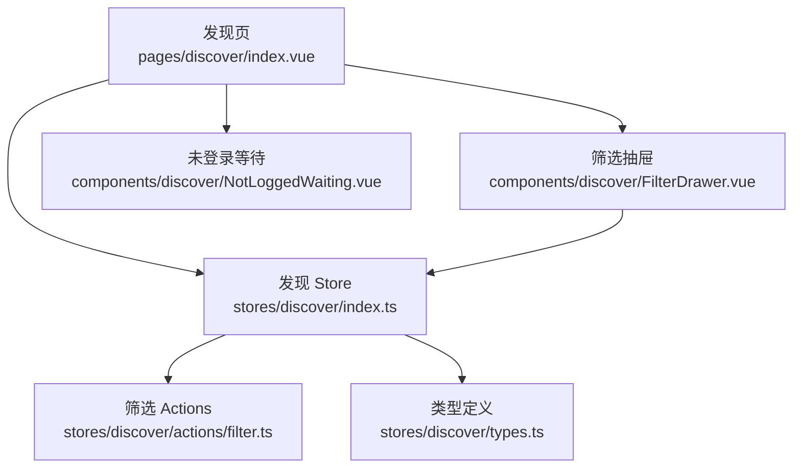
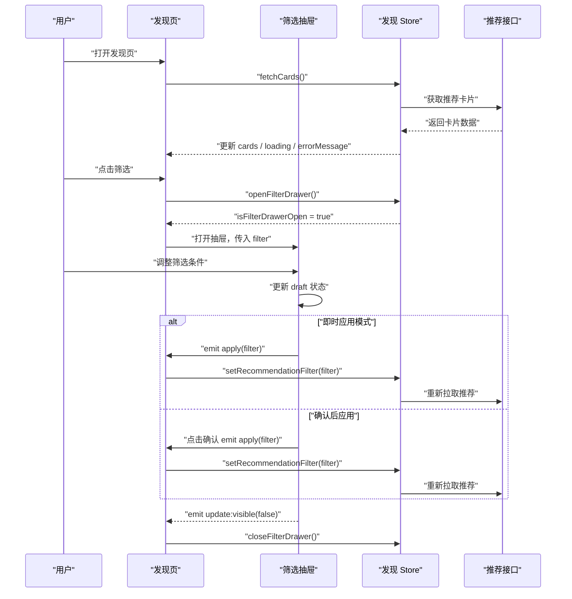
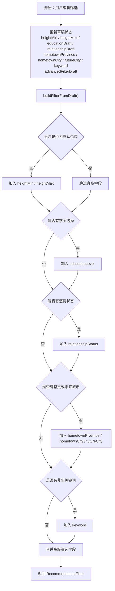
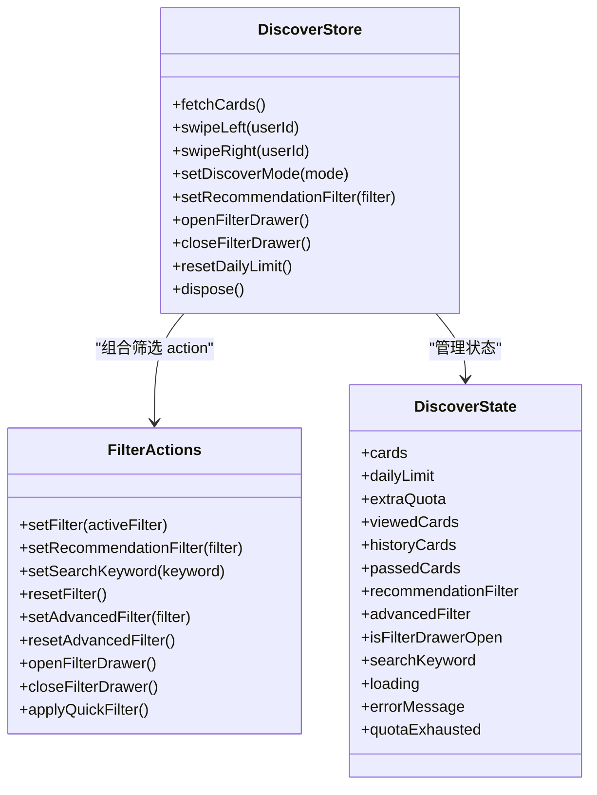
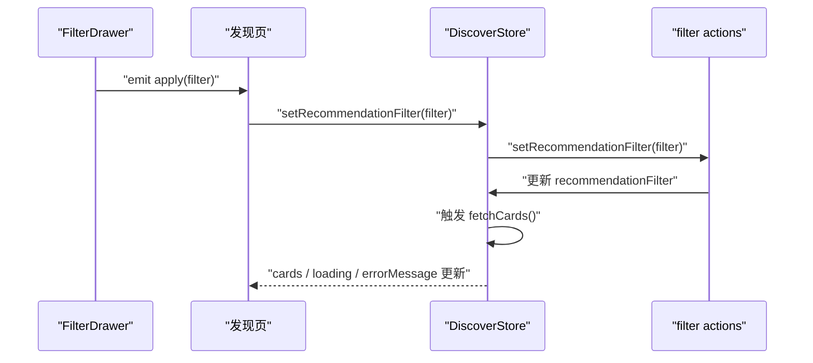
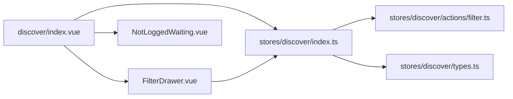

# 发现页组件

<cite>
**本文引用的文件**   
- [FilterDrawer.vue](file://apps/client/src/components/discover/FilterDrawer.vue)
- [NotLoggedWaiting.vue](file://apps/client/src/components/discover/NotLoggedWaiting.vue)
- [apps/client/src/pages/discover/index.vue](file://apps/client/src/pages/discover/index.vue)
- [apps/client/src/stores/discover/index.ts](file://apps/client/src/stores/discover/index.ts)
- [apps/client/src/stores/discover/actions/filter.ts](file://apps/client/src/stores/discover/actions/filter.ts)
- [apps/client/src/stores/discover/types.ts](file://apps/client/src/stores/discover/types.ts)
</cite>

## 目录

1. [引言](#引言)
2. [项目结构定位](#项目结构定位)
3. [核心组件总览](#核心组件总览)
4. [架构与数据流](#架构与数据流)
5. [筛选抽屉 FilterDrawer 详解](#筛选抽屉-filterdrawer-详解)
6. [未登录等待 NotLoggedWaiting 详解](#未登录等待-notloggedwaiting-详解)
7. [状态管理与权限校验](#状态管理与权限校验)
8. [依赖关系分析](#依赖关系分析)
9. [性能与可扩展性](#性能与可扩展性)
10. [集成示例与扩展指南](#集成示例与扩展指南)
11. [故障排查](#故障排查)
12. [结论](#结论)

## 引言

本文面向“寻觅/发现”页面的前端实现，重点解释两个关键用户界面组件：

- **FilterDrawer 筛选抽屉**：承载基础筛选（身高、学历、感情状态、籍贯、未来城市、关键词）和高级筛选（性别、年龄、学校、距离、兴趣、在线状态），并负责把用户编辑的临时筛选条件构建为后端可消费的 `RecommendationFilter`。
- **NotLoggedWaiting 未登录等待组件**：在用户未登录时展示登录引导、功能解锁提示和头像环动画，承担“登录墙”入口。

文档会说明：

- 筛选条件如何从用户交互进入组件内部草稿状态；
- 草稿如何合并为最终筛选参数；
- 父页面如何接收筛选结果并触发推荐列表刷新；
- 未登录用户的引导流程、跳转逻辑与权限门控；
- 组件状态管理、事件契约、错误处理和性能优化点；
- 如何扩展新的筛选维度，以及如何复用该模式。

## 项目结构定位

发现页相关代码集中在 `apps/client` 子应用中：

| 层级 | 路径 | 职责 |
|---|---|---|
| 页面层 | `apps/client/src/pages/discover/index.vue` | 发现页主容器，负责加载卡片、切换推荐/附近模式、打开筛选抽屉、处理登录和匹配跳转 |
| 组件层 | `apps/client/src/components/discover/FilterDrawer.vue` | 筛选抽屉 UI 和筛选草稿状态 |
| 组件层 | `apps/client/src/components/discover/NotLoggedWaiting.vue` | 未登录等待页 UI 和登录引导 |
| 状态层 | `apps/client/src/stores/discover/index.ts` | Pinia store 主体，聚合卡片、滑动、配额、筛选等状态 |
| 动作层 | `apps/client/src/stores/discover/actions/filter.ts` | 筛选相关 action，如设置筛选、重置筛选、打开关闭抽屉等 |
| 类型层 | `apps/client/src/stores/discover/types.ts` | 发现域类型定义 |

**图表来源**   
- [apps/client/src/pages/discover/index.vue:1-300](file://apps/client/src/pages/discover/index.vue#L1-L300)
- [FilterDrawer.vue:1-200](file://apps/client/src/components/discover/FilterDrawer.vue#L1-L200)
- [NotLoggedWaiting.vue:1-200](file://apps/client/src/components/discover/NotLoggedWaiting.vue#L1-L200)
- [apps/client/src/stores/discover/index.ts:1-200](file://apps/client/src/stores/discover/index.ts#L1-L200)

**章节来源**   
- [apps/client/src/pages/discover/index.vue:1-300](file://apps/client/src/pages/discover/index.vue#L1-L300)
- [FilterDrawer.vue:1-200](file://apps/client/src/components/discover/FilterDrawer.vue#L1-L200)
- [NotLoggedWaiting.vue:1-200](file://apps/client/src/components/discover/NotLoggedWaiting.vue#L1-L200)
- [apps/client/src/stores/discover/index.ts:1-200](file://apps/client/src/stores/discover/index.ts#L1-L200)

## 核心组件总览

### FilterDrawer 筛选抽屉

FilterDrawer 是一个全屏弹窗式筛选抽屉，主要职责包括：

1. **接收父组件传入的当前筛选条件**，并在抽屉打开时拷贝到本地草稿状态。
2. **维护基础筛选草稿**：身高范围、学历多选、感情状态单选、籍贯省市、未来城市、关键词。
3. **维护高级筛选草稿**：性别、年龄区间、学校、最大距离、兴趣、是否仅在线。
4. **提供确认和重置按钮**：确认时构建完整 `RecommendationFilter` 并通过 `apply` 事件通知父组件；重置时清空草稿并通过 `reset` 事件通知父组件。
5. **支持即时应用模式**：当 `immediateApply` 为真时，部分筛选项变更会通过防抖后直接触发 `apply`，让推荐列表实时响应。
6. **兼容微信小程序与 H5**：使用 `uni-app` 生态的 picker、slider、hover-class 等能力，避免不支持的 CSS 特性。

关键外部契约：

| 属性或事件 | 方向 | 含义 |
|---|---:|---|
| `visible` | 输入 | 控制抽屉显隐 |
| `filter` | 输入 | 当前已应用的推荐筛选条件 |
| `immediateApply` | 输入 | 是否开启即时应用筛选 |
| `update:visible` | 输出 | 抽屉关闭时发出 |
| `apply` | 输出 | 用户点击确认时发出，携带最终筛选对象 |
| `reset` | 输出 | 用户点击重置时发出 |

### NotLoggedWaiting 未登录等待组件

NotLoggedWaiting 是未登录态下的“登录墙”组件，主要职责包括：

1. **展示欢迎文案**：主标题、副标题、解锁提示。
2. **展示头像环**：用数学角度计算 6 个头像节点在圆形轨道上的位置。
3. **展示功能图标行**：精确匹配、聊天互动、校园趣遇、关系成长。
4. **提供三个操作按钮**：微信一键登录、手机号登录、稍后再看。
5. **不渲染虚假计数**：根据项目裁定，未登录态没有语义正确的“附近有 N 人”数据源，因此副标题保持静态文案。

关键外部契约：

| 事件 | 含义 |
|---|---|
| `goLogin` | 跳转到微信登录流程 |
| `goPhoneLogin` | 跳转到手机号登录流程 |

**章节来源**   
- [FilterDrawer.vue:1-200](file://apps/client/src/components/discover/FilterDrawer.vue#L1-L200)
- [NotLoggedWaiting.vue:1-200](file://apps/client/src/components/discover/NotLoggedWaiting.vue#L1-L200)

## 架构与数据流

### 发现页整体流程

发现页作为容器，连接用户交互、筛选抽屉、推荐卡片和 store：

**图表来源**   
- [apps/client/src/pages/discover/index.vue:1-300](file://apps/client/src/pages/discover/index.vue#L1-L300)
- [FilterDrawer.vue:200-600](file://apps/client/src/components/discover/FilterDrawer.vue#L200-L600)
- [apps/client/src/stores/discover/index.ts:1-200](file://apps/client/src/stores/discover/index.ts#L1-L200)

### 筛选参数构建流程

FilterDrawer 不会直接修改后端字段，而是先维护本地草稿，再在确认或即时应用时构建最终筛选对象：

**图表来源**   
- [FilterDrawer.vue:400-600](file://apps/client/src/components/discover/FilterDrawer.vue#L400-L600)

**章节来源**   
- [apps/client/src/pages/discover/index.vue:1-300](file://apps/client/src/pages/discover/index.vue#L1-L300)
- [FilterDrawer.vue:200-600](file://apps/client/src/components/discover/FilterDrawer.vue#L200-L600)
- [apps/client/src/stores/discover/index.ts:1-200](file://apps/client/src/stores/discover/index.ts#L1-L200)

## 筛选抽屉 FilterDrawer 详解

### 组件属性与事件契约

FilterDrawer 通过 Vue 3 `<script setup>` 声明属性、事件和本地状态。它不是全局 store，而是一个受控组件：

- `visible`：由父组件双向绑定，控制抽屉显示。
- `filter`：当前已生效的筛选条件，用于初始化草稿。
- `immediateApply`：可选开关，决定是否在用户编辑过程中就触发筛选刷新。
- `apply`：提交最终筛选条件。
- `reset`：请求重置所有筛选。
- `update:visible`：关闭抽屉。

这种设计使 FilterDrawer 可以嵌入不同宿主页面，而不必关心推荐列表如何刷新。

### 基础筛选草稿

基础筛选字段以独立 `ref` 保存：

| 草稿字段 | 类型 | 默认行为 |
|---|---|---|
| `heightMinDraft` | 数字 | 默认最小值 |
| `heightMaxDraft` | 数字 | 默认最大值 |
| `educationDraft` | 字符串数组 | 空数组表示不限 |
| `relationshipDraft` | 字符串数组 | 最多一个值，再次点击可取消 |
| `hometownProvinceDraft` | 字符串 | 空字符串表示未选 |
| `hometownCityDraft` | 字符串 | 空字符串表示未选 |
| `futureCityDraft` | 字符串 | 空字符串表示未选 |
| `keywordDraft` | 字符串 | 空字符串表示无关键词 |

这些字段在抽屉打开时从 `props.filter` 同步，但抽屉关闭时不会自动清空，以便下次打开时保留上次编辑痕迹。

### 高级筛选草稿

高级筛选字段集中保存在 `advancedFilterDraft` 中，包括：

- `gender`
- `ageMin`
- `ageMax`
- `schools`
- `distanceMax`
- `interests`
- `onlineOnly`

高级筛选由 `AdvancedFilter.vue` 组件维护，FilterDrawer 只负责将其与基础筛选草稿合并。

### 身高滑块互斥约束

身高滑块实现了一个简单的互斥规则：

- 下限不能大于等于上限；
- 上限不能小于等于下限；
- 步长由常量控制；
- 在移动端触发轻触觉反馈。

这保证了用户不会构造出无效的身高区间。

### 籍贯与未来城市 Picker

籍贯使用多列 picker：

- 第一列为省份；
- 第二列为对应省份的城市；
- 省份变化时，城市列重置为该省第一个城市；
- 未来城市是所有城市的去重平铺列表。

Picker 的索引状态与文本显示状态分开维护，避免索引与文本不一致。

### 关键词防抖

关键词输入使用 300ms 防抖，避免每次按键都触发筛选刷新。同时：

- 组件卸载时会清理定时器，防止内存泄漏；
- 在 `immediateApply` 模式下，防抖结束后调用 `emit("apply", buildFilterFromDraft())`，让父组件立即应用新筛选；
- 清除关键词也会触发防抖刷新。

### 确认与重置逻辑

确认时，FilterDrawer 执行以下流程：

1. 从草稿构建最终 `RecommendationFilter`；
2. 忽略默认值和不存在的字段；
3. 合并基础筛选和高级筛选；
4. 发出 `apply` 事件；
5. 关闭抽屉。

重置时，它会清空基础筛选草稿和高级筛选草稿，然后发出 `reset` 事件。

**章节来源**   
- [FilterDrawer.vue:1-200](file://apps/client/src/components/discover/FilterDrawer.vue#L1-L200)
- [FilterDrawer.vue:200-400](file://apps/client/src/components/discover/FilterDrawer.vue#L200-L400)
- [FilterDrawer.vue:400-600](file://apps/client/src/components/discover/FilterDrawer.vue#L400-L600)

## 未登录等待 NotLoggedWaiting 详解

### 组件职责

NotLoggedWaiting 不是业务数据组件，而是权限引导组件。它假设调用方已经判断用户未登录，并主动渲染该组件来替代正常内容。

组件包含：

- 主标题和副标题；
- 虚线轨道 + 6 个头像节点；
- “登录后即可解锁全部功能”的提示；
- 四个功能图标；
- 三个操作按钮。

### 头像环布局算法

头像环不使用整张背景图，而是用 6 个独立头像节点配合数学计算定位：

- 容器是正方形；
- 半径使用百分比表达，保证横竖方向一致；
- 每个节点的角度按均分圆周计算；
- 中心放置吉祥物头像；
- 每个头像节点带一个心形角标。

这种实现便于替换素材、添加角标，并避免整图无法修改的问题。

### 登录引导流程

| 操作 | 行为 |
|---|---|
| 点击微信登录 | 发出 `goLogin` 事件，由父组件跳转到微信登录 |
| 点击手机号登录 | 发出 `goPhoneLogin` 事件，由父组件跳转到手机号登录 |
| 点击稍后再看 | 返回首页，避免用户停留在不可交互页面 |
| 点击整个英雄区域 | 组件注释说明应可跳转登录，具体路由由父组件或导航工具决定 |

### 未登录计数策略

组件明确不渲染“附近有 N 人”之类的动态计数。原因包括：

- 未登录态没有语义正确的真实人数来源；
- 推荐列表初始为空；
- 后端对游客返回结果有上限截断；
- 未登录用户通常没有定位信息，“附近”语义不成立；
- 项目裁定要求“取不到真值就不渲染”，避免伪造社交证明。

**章节来源**   
- [NotLoggedWaiting.vue:1-200](file://apps/client/src/components/discover/NotLoggedWaiting.vue#L1-L200)

## 状态管理与权限校验

### 发现 Store 的角色

发现 Store 是页面级状态中心，负责：

- 推荐卡片列表；
- 每日配额；
- 滑动结果；
- 历史卡片；
- 筛选条件；
- 搜索关键词；
- 筛选抽屉显隐；
- 高级筛选条件；
- 在线状态映射。

**图表来源**   
- [apps/client/src/stores/discover/index.ts:1-200](file://apps/client/src/stores/discover/index.ts#L1-L200)
- [apps/client/src/stores/discover/actions/filter.ts](file://apps/client/src/stores/discover/actions/filter.ts)

### 权限校验与登录引导

发现页对敏感操作做了前置检查：

1. **是否需要登录**：如果未登录，提示“需要登录”，并阻止后续操作。
2. **实名认证门控**：喜欢和超级喜欢需要实名认证。
3. **每日配额门控**：额度用尽时不再允许进入匹配流程。
4. **打招呼频控**：同一目标最多发送一定次数，超出后提示等待。

未登录用户进入发现页时，仍可能加载 mock 预览数据，但真正匹配、喜欢、打招呼等操作会被拦截并引导登录。

### 筛选状态与页面联动

筛选状态存储在 `discoverStore.recommendationFilter` 中。FilterDrawer 提交的筛选结果通过父页面调用 `setRecommendationFilter` 写入 store，随后触发推荐数据刷新。

**图表来源**   
- [FilterDrawer.vue:400-600](file://apps/client/src/components/discover/FilterDrawer.vue#L400-L600)
- [apps/client/src/pages/discover/index.vue:1-300](file://apps/client/src/pages/discover/index.vue#L1-L300)
- [apps/client/src/stores/discover/index.ts:1-200](file://apps/client/src/stores/discover/index.ts#L1-L200)
- [apps/client/src/stores/discover/actions/filter.ts](file://apps/client/src/stores/discover/actions/filter.ts)

**章节来源**   
- [apps/client/src/pages/discover/index.vue:1-300](file://apps/client/src/pages/discover/index.vue#L1-L300)
- [apps/client/src/stores/discover/index.ts:1-200](file://apps/client/src/stores/discover/index.ts#L1-L200)

## 依赖关系分析

### 组件间依赖

### 筛选数据依赖

筛选数据依赖多个层面：

| 依赖项 | 作用 |
|---|---|
| `RecommendationFilter` 类型 | 定义后端期望的筛选字段结构 |
| `PROVINCE_LIST` 与 `PROVINCE_CITY_MAP` | 提供籍贯和城市数据 |
| `IMAGE_PATHS` | 提供图标和头像资源路径 |
| `useI18n` | 提供多语言文案 |
| `lightHaptic` | 提供轻触觉反馈 |
| `openAppPath` / `ROUTES` | 提供页面跳转能力 |

### 潜在耦合点

1. **FilterDrawer 与后端筛选字段强耦合**：新增筛选字段需要在类型、草稿、同步、构建函数多处维护。
2. **籍贯数据静态化**：目前依赖本地省份城市映射，若后端提供运行时筛选选项，需替换数据来源。
3. **store 拆分后引用分散**：action 被拆到 `actions/filter.ts` 等文件，调试时需要跨文件追踪。

**章节来源**   
- [FilterDrawer.vue:1-200](file://apps/client/src/components/discover/FilterDrawer.vue#L1-L200)
- [apps/client/src/pages/discover/index.vue:1-300](file://apps/client/src/pages/discover/index.vue#L1-L300)
- [apps/client/src/stores/discover/index.ts:1-200](file://apps/client/src/stores/discover/index.ts#L1-L200)

## 性能与可扩展性

### 性能要点

1. **关键词防抖**：避免每次输入都发起网络请求。
2. **定时器清理**：组件卸载时清理防抖定时器，防止内存泄漏。
3. **watch 属性路径监听**：仅在必要字段变化时同步草稿，避免 deep watch 全量遍历。
4. **就近本地过滤**：附近模式使用本地过滤和排序，无需额外网络请求。
5. **缓存 TTL**：发现数据有 30 秒缓存窗口，减少重复请求。
6. **配额提前检查**：在写存储前检查每日限额，避免无效操作。

### 可扩展性建议

#### 新增基础筛选字段

若要新增一个基础筛选字段，通常需要修改：

1. 草稿 `ref`；
2. `syncDraftFromProps` 中的同步逻辑；
3. `buildFilterFromDraft` 中的构建逻辑；
4. `handleReset` 中的重置逻辑；
5. 模板中的 UI 控件；
6. 后端类型和接口支持。

#### 新增高级筛选字段

高级筛选字段相对容易扩展，因为已有 `advancedFilterDraft` 和合并逻辑。但仍需：

1. 在 `AdvancedFilter.vue` 中增加输入控件；
2. 在 `buildFilterFromDraft` 中合并新字段；
3. 在 store 和后端类型中添加字段；
4. 在后端推荐接口中实现过滤逻辑。

#### 条件组合逻辑

当前筛选采用“字段叠加”方式：

- 身高、学历、感情状态、籍贯、未来城市、关键词共同作用于推荐结果；
- 高级筛选字段与基础筛选字段并列；
- 未设置的字段不会写入最终筛选对象，从而退化为“不限”。

这种设计简单直观，适合大多数推荐场景。

**章节来源**   
- [FilterDrawer.vue:200-600](file://apps/client/src/components/discover/FilterDrawer.vue#L200-L600)
- [apps/client/src/pages/discover/index.vue:1-300](file://apps/client/src/pages/discover/index.vue#L1-L300)
- [apps/client/src/stores/discover/index.ts:1-200](file://apps/client/src/stores/discover/index.ts#L1-L200)

## 集成示例与扩展指南

### 在发现页中使用 FilterDrawer

发现页已经内置了 FilterDrawer 的集成逻辑，典型用法如下：

1. 引入 FilterDrawer 组件。
2. 将 `discoverStore.isFilterDrawerOpen` 绑定到 `visible`。
3. 将 `discoverStore.recommendationFilter` 绑定到 `filter`。
4. 监听 `apply` 事件，调用 `discoverStore.setRecommendationFilter`。
5. 监听 `reset` 事件，调用 `discoverStore.resetFilter`。
6. 监听 `update:visible`，关闭抽屉。

如果需要即时应用筛选，可以将 `immediateApply` 设为真，但要注意这会提高请求频率。

### 自定义筛选规则

如果需要在客户端对推荐结果做额外过滤，建议在 `discover/index.vue` 或 store 的筛选 action 中处理，而不是在 FilterDrawer 中硬编码业务规则。原因是：

- FilterDrawer 应专注于“收集用户意图”；
- 实际过滤和请求应由 store 或页面逻辑驱动；
- 这样更容易测试、扩展和复用。

### 接入 NotLoggedWaiting

在未登录场景中，父组件应先判断登录状态，再决定是否渲染 NotLoggedWaiting。典型流程：

1. 检查 `sessionStore.isLoggedIn`。
2. 如果未登录，渲染 NotLoggedWaiting。
3. 监听 `goLogin` 和 `goPhoneLogin`，跳转到对应登录页。
4. 点击“稍后再看”时返回首页。

不建议在未登录时强行加载真实推荐列表，除非是明确的预览模式。

**章节来源**   
- [apps/client/src/pages/discover/index.vue:1-300](file://apps/client/src/pages/discover/index.vue#L1-L300)
- [FilterDrawer.vue:1-200](file://apps/client/src/components/discover/FilterDrawer.vue#L1-L200)
- [NotLoggedWaiting.vue:1-200](file://apps/client/src/components/discover/NotLoggedWaiting.vue#L1-L200)

## 故障排查

### 筛选结果不刷新

常见原因：

- 没有监听 FilterDrawer 的 `apply` 事件；
- 没有在 `apply` 回调中调用 `setRecommendationFilter`；
- `immediateApply` 为假，但用户期待输入即刷新；
- store 的 `fetchCards` 被缓存短路；
- 后端接口未实现新筛选字段。

排查步骤：

1. 确认 FilterDrawer 发出 `apply` 事件；
2. 确认父页面监听到事件；
3. 确认 store 更新了 `recommendationFilter`；
4. 确认 `fetchCards` 被调用；
5. 检查网络请求和后端日志。

### 身高滑块异常

如果身高下限或上限出现异常值，检查：

- 是否在滑块事件中直接赋值而未做互斥校验；
- 默认范围是否与后端期望一致；
- 是否清除了草稿但未重置 picker 索引。

### 关键词频繁请求

如果输入关键词导致过多请求：

- 确认启用了防抖；
- 确认组件卸载时清理了定时器；
- 确认没有在外层再包一层实时触发逻辑；
- 确认 `immediateApply` 并非总是为真。

### 未登录页无法跳转

如果点击登录按钮无反应：

- 确认父组件监听 `goLogin` 和 `goPhoneLogin`；
- 确认路由配置正确；
- 确认 `openAppPath` 能解析目标路径；
- 检查小程序或 H5 平台的跳转限制。

**章节来源**   
- [FilterDrawer.vue:200-600](file://apps/client/src/components/discover/FilterDrawer.vue#L200-L600)
- [NotLoggedWaiting.vue:1-200](file://apps/client/src/components/discover/NotLoggedWaiting.vue#L1-L200)
- [apps/client/src/pages/discover/index.vue:1-300](file://apps/client/src/pages/discover/index.vue#L1-L300)

## 结论

发现页的两个核心组件分别承担了“筛选意图收集”和“未登录引导”的职责：

- **FilterDrawer** 通过草稿状态、字段校验、防抖和合并逻辑，把用户交互转化为稳定的 `RecommendationFilter`；
- **NotLoggedWaiting** 在不暴露虚假数据的前提下，清晰引导用户完成登录；
- **DiscoverStore** 作为单一状态源，统一协调卡片、筛选、配额和页面状态；
- **发现页** 作为容器，负责路由跳转、权限门控和生命周期管理。

扩展该模块时，建议遵循现有边界：组件负责 UI 和局部状态，store 负责业务状态和数据流，页面负责权限和路由。这样既能保持可维护性，又能支撑更多筛选维度和用户体验优化。