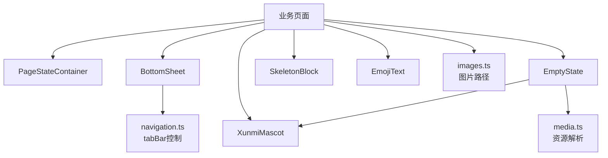
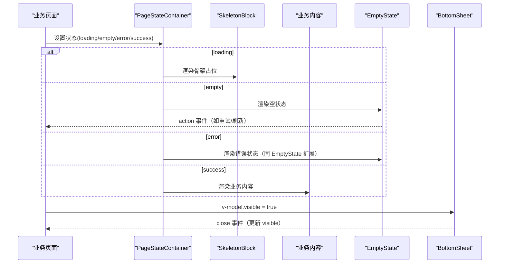
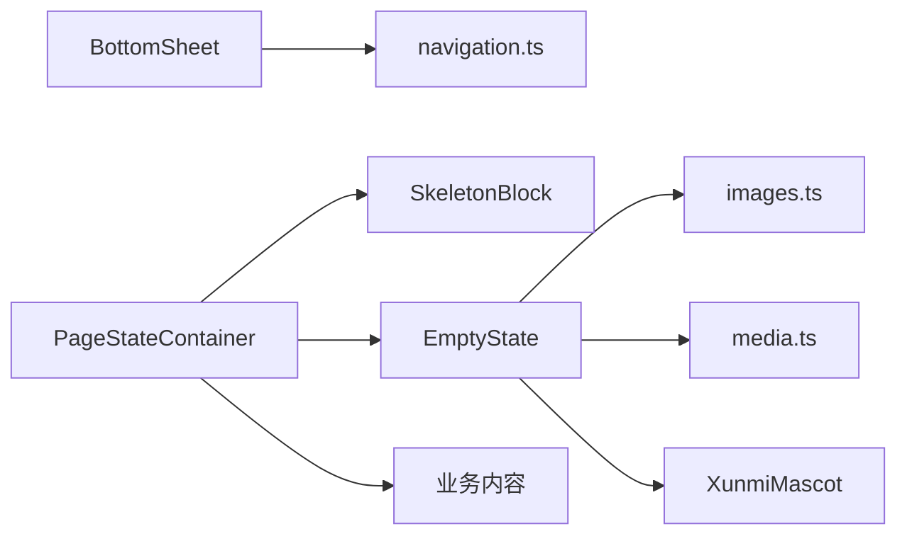
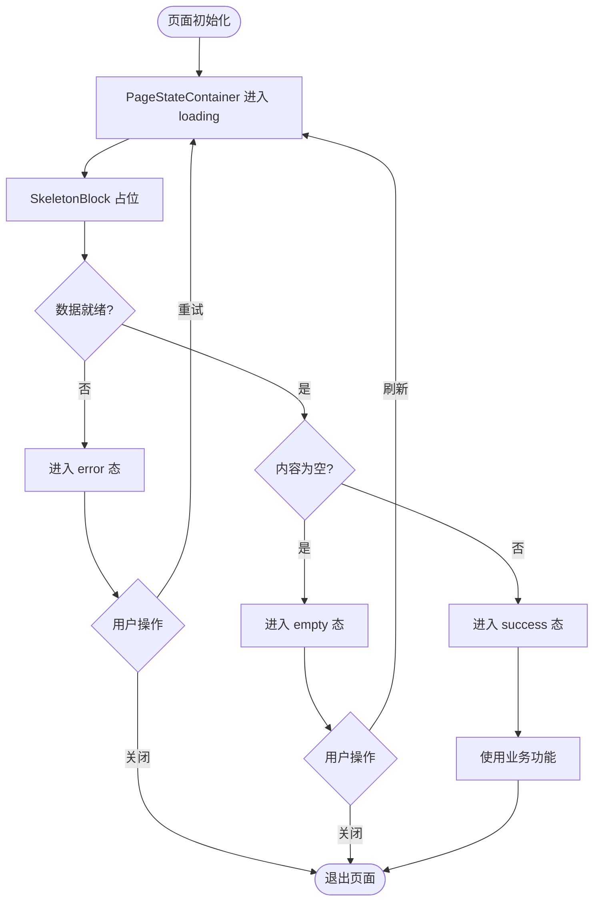

# 通用组件

<cite>
**本文引用的文件**
- [BottomSheet.vue](file://apps/client/src/components/common/BottomSheet.vue)
- [EmptyState.vue](file://apps/client/src/components/common/EmptyState.vue)
- [PageStateContainer.vue](file://apps/client/src/components/common/PageStateContainer.vue)
- [SkeletonBlock.vue](file://apps/client/src/components/common/SkeletonBlock.vue)
- [EmojiText.vue](file://apps/client/src/components/common/EmojiText.vue)
- [XunmiMascot.vue](file://apps/client/src/components/common/XunmiMascot.vue)
- [images.ts](file://apps/client/src/config/images.ts)
- [media.ts](file://apps/client/src/utils/media.ts)
- [navigation.ts](file://apps/client/src/utils/navigation.ts)
</cite>

## 目录
1. [简介](#简介)
2. [项目结构](#项目结构)
3. [核心组件总览](#核心组件总览)
4. [架构总览](#架构总览)
5. [详细组件分析](#详细组件分析)
6. [依赖关系分析](#依赖关系分析)
7. [性能与可访问性](#性能与可访问性)
8. [组合使用模式](#组合使用模式)
9. [跨平台兼容性](#跨平台兼容性)
10. [故障排查](#故障排查)
11. [结论](#结论)

## 简介
本章节为通用 UI 组件库提供系统化文档，覆盖以下组件：底部弹窗 BottomSheet、骨架屏 Skeleton（SkeletonBlock）、空状态 EmptyState、错误状态 ErrorState、页面状态容器 PageStateContainer、吉祥物图标 XunmiMascot、表情文本 EmojiText。文档面向开发者与产品人员，解释设计原则、属性接口、事件、插槽、样式定制、响应式行为、动画效果、无障碍支持，以及组合使用、性能优化与跨平台兼容实践，并给出完整使用示例与最佳实践指引。

## 项目结构
这些组件集中于客户端公共组件目录，采用“按功能域 + 通用能力”的划分方式：
- 通用交互与布局：BottomSheet、PageStateContainer、SkeletonBlock
- 内容呈现：EmptyState、EmojiText、XunniMascot
- 配置与工具：图片路径 images.ts、媒体资源解析 media.ts、导航工具 navigation.ts

图表来源
- [PageStateContainer.vue:1-200](file://apps/client/src/components/common/PageStateContainer.vue#L1-L198)
- [BottomSheet.vue:1-235](file://apps/client/src/components/common/BottomSheet.vue#L1-L235)
- [EmptyState.vue:1-155](file://apps/client/src/components/common/EmptyState.vue#L1-L155)
- [SkeletonBlock.vue:1-200](file://apps/client/src/components/common/SkeletonBlock.vue#L1-L152)
- [EmojiText.vue:1-200](file://apps/client/src/components/common/EmojiText.vue#L1-L86)
- [XunmiMascot.vue:1-200](file://apps/client/src/components/common/XunmiMascot.vue#L1-L151)
- [images.ts:1-200](file://apps/client/src/config/images.ts#L1-L200)
- [media.ts:1-200](file://apps/client/src/utils/media.ts#L1-L200)
- [navigation.ts:1-200](file://apps/client/src/utils/navigation.ts#L1-L200)

章节来源
- [BottomSheet.vue:1-235](file://apps/client/src/components/common/BottomSheet.vue#L1-L235)
- [EmptyState.vue:1-155](file://apps/client/src/components/common/EmptyState.vue#L1-L155)
- [PageStateContainer.vue:1-200](file://apps/client/src/components/common/PageStateContainer.vue#L1-L198)
- [SkeletonBlock.vue:1-200](file://apps/client/src/components/common/SkeletonBlock.vue#L1-L152)
- [EmojiText.vue:1-200](file://apps/client/src/components/common/EmojiText.vue#L1-L86)
- [XunmiMascot.vue:1-200](file://apps/client/src/components/common/XunmiMascot.vue#L1-L151)
- [images.ts:1-200](file://apps/client/src/config/images.ts#L1-L200)
- [media.ts:1-200](file://apps/client/src/utils/media.ts#L1-L200)
- [navigation.ts:1-200](file://apps/client/src/utils/navigation.ts#L1-L200)

## 核心组件总览
- BottomSheet：从底部滑入的弹出面板，支持标题、关闭按钮、遮罩点击关闭、自定义高度比例、滚动内容区与固定 footer 操作区；打开时自动隐藏自定义 tabBar，避免被浮岛遮挡。
- EmptyState：统一空状态展示，支持预设类型与显式覆盖，内置国际化文案，支持吉祥物表情替换图标，可选操作按钮。
- PageStateContainer：页面级状态容器，统一管理 loading、error、empty、success 等状态的切换与渲染，便于组合 Skeleton 与业务内容。
- SkeletonBlock：轻量骨架占位块，用于列表、卡片等内容的加载态占位，减少抖动。
- EmojiText：将文本中的表情标识渲染为对应表情图形，保持排版一致。
- XunmiMascot：吉祥物图标组件，支持多种情绪变体与尺寸、动画开关，常用于空状态或引导场景。

章节来源
- [BottomSheet.vue:1-235](file://apps/client/src/components/common/BottomSheet.vue#L1-L235)
- [EmptyState.vue:1-155](file://apps/client/src/components/common/EmptyState.vue#L1-L155)
- [PageStateContainer.vue:1-200](file://apps/client/src/components/common/PageStateContainer.vue#L1-L198)
- [SkeletonBlock.vue:1-200](file://apps/client/src/components/common/SkeletonBlock.vue#L1-L152)
- [EmojiText.vue:1-200](file://apps/client/src/components/common/EmojiText.vue#L1-L86)
- [XunmiMascot.vue:1-200](file://apps/client/src/components/common/XunmiMascot.vue#L1-L151)

## 架构总览
组件间通过清晰的职责边界协作：
- 页面容器 PageStateContainer 负责状态编排，按需渲染 Skeleton 或业务内容；在数据为空或错误时，复用 EmptyState/ErrorState。
- EmptyState 可内嵌 XunmiMascot 以增强情感化表达；所有图片资源通过 images.ts 统一管理与 media.ts 解析，确保真实环境下的资源可达。
- BottomSheet 作为全局弹出层，独立于页面滚动，内部 slot 承载任意内容，footer 区域固定可见，打开时调用 navigation.ts 隐藏 tabBar。

图表来源
- [PageStateContainer.vue:1-200](file://apps/client/src/components/common/PageStateContainer.vue#L1-L198)
- [EmptyState.vue:1-155](file://apps/client/src/components/common/EmptyState.vue#L1-L155)
- [BottomSheet.vue:1-235](file://apps/client/src/components/common/BottomSheet.vue#L1-L235)

## 详细组件分析

### BottomSheet 底部弹窗
- 设计原则
  - 自底向上滑入，顶部圆角与拖动指示棒提供明确手势暗示。
  - 遮罩淡入，点击遮罩或右上角关闭触发关闭。
  - 内容区支持纵向滚动，footer 固定可见，保障操作可达性。
  - 打开时自动隐藏自定义 tabBar，避免浮岛遮挡 footer。
- 关键属性与事件
  - 属性：visible、title、maxHeightRatio、showHandle、showClose、maskClosable
  - 事件：update:visible（双向绑定）、close（关闭时触发）
  - 插槽：默认插槽（内容区）、footer（固定底部操作区）
- 响应式与动画
  - 基于 CSS transform 与 transition 的滑入动画，适配 mp-weixin。
  - maxHeight 由内联 style 根据比例计算，避免 calc 嵌套问题。
- 无障碍
  - 关闭按钮具备 role="button" 与 aria-label。
  - 拖动指示棒标注 aria-hidden 以避免读屏干扰。
- 使用示例
  - 基本用法：传入 visible 与 title，slot 放置内容，footer 放置按钮组。
  - 关闭逻辑：监听 update:visible 或 close 事件，结合表单校验决定是否允许关闭。
- 最佳实践
  - 长内容务必包裹 scroll-view，避免整页滚动。
  - 复杂表单建议使用 footer 固定提交按钮，提升可用性。
  - 非 tab 页使用 setTabBarHidden 是安全 no-op，无需额外判断。

章节来源
- [BottomSheet.vue:1-235](file://apps/client/src/components/common/BottomSheet.vue#L1-L235)
- [navigation.ts:1-200](file://apps/client/src/utils/navigation.ts#L1-L200)

### EmptyState 空状态
- 设计原则
  - 两种使用方式：预设类型（no-data/no-match/no-chat/network）与显式覆盖（image/title/description/actionText）。
  - 显式覆盖优先级更高，便于业务灵活定制。
  - 支持吉祥物表情替代图标，增强情感化体验。
- 关键属性与事件
  - 属性：type、message、image、title、hideSub、description、actionText、mood（mascot）
  - 事件：action（点击操作按钮）
  - 插槽：默认插槽（可追加额外信息）
- 国际化与资源
  - 副标题与主标题文案通过 i18n 管理。
  - 图片资源经 resolveMediaUrl 统一解析，确保真实环境可用。
- 无障碍
  - 根节点 role="status" 与 aria-live="polite"，对读屏友好。
  - 操作按钮具备 role="button" 与 aria-label。
- 使用示例
  - 快速空态：type="no-data"，不传任何覆盖即可显示默认文案与图标。
  - 自定义空态：传入 image、title、description、actionText 完全自定义。
  - 吉祥物空态：传入 mascot 表情名（如 mascot_default/mascot_happy），自动替换图标。

章节来源
- [EmptyState.vue:1-155](file://apps/client/src/components/common/EmptyState.vue#L1-L155)
- [images.ts:1-200](file://apps/client/src/config/images.ts#L1-L200)
- [media.ts:1-200](file://apps/client/src/utils/media.ts#L1-L200)

### PageStateContainer 页面状态容器
- 设计原则
  - 单一职责：集中管理页面状态机（loading/empty/error/success），简化页面逻辑。
  - 组合优先：在 loading 时渲染 Skeleton，在 empty/error 时复用 EmptyState/ErrorState，成功态渲染业务内容。
  - 可扩展：预留插槽与回调，便于接入重试、刷新、跳转等操作。
- 关键属性与事件
  - 属性：state（当前状态）、loading、empty、error、success、retry、refresh
  - 事件：retry（重试）、refresh（刷新）、goBack（返回）等
  - 插槽：content（业务内容）、empty-content（空态覆盖）、error-content（错误态覆盖）
- 使用示例
  - 列表页：loading→Skeleton；empty→EmptyState(type="no-data")；error→ErrorState；success→列表内容。
  - 详情页：loading→Skeleton；error→ErrorState；success→详情内容。
- 最佳实践
  - 与网络层联动：请求开始时进入 loading，完成后根据结果切换到 empty/error/success。
  - 配合 BottomSheet 进行二次确认或提示，避免阻塞主流程。

章节来源
- [PageStateContainer.vue:1-200](file://apps/client/src/components/common/PageStateContainer.vue#L1-L198)

### SkeletonBlock 骨架屏
- 设计原则
  - 最小侵入：以块级占位替代真实内容，避免重排重绘带来的抖动。
  - 主题一致：使用设计令牌与色板，保证与整体风格一致。
- 关键属性与事件
  - 属性：width、height、shape（rect/round/circle）、animate（开/关）
  - 事件：无
- 使用示例
  - 列表项：多行 SkeletonBlock 模拟标题、摘要、缩略图。
  - 卡片：横向排列多个 SkeletonBlock 模拟封面与文字。
- 最佳实践
  - 合理估算内容尺寸，避免过度占位导致误判。
  - 在网络较慢的场景下开启 animate，提供加载反馈。

章节来源
- [SkeletonBlock.vue:1-200](file://apps/client/src/components/common/SkeletonBlock.vue#L1-L152)

### EmojiText 表情文本
- 设计原则
  - 将文本中的表情标记替换为图形，保持行高与基线对齐。
  - 支持批量替换与缓存，避免重复计算。
- 关键属性与事件
  - 属性：text（待渲染文本）、size（表情大小）、inline（是否行内）
  - 事件：无
- 使用示例
  - 消息气泡中嵌入表情，用户输入后即时渲染。
  - 评论、动态等富文本区域统一使用 EmojiText。
- 最佳实践
  - 大量文本建议分片渲染或使用虚拟列表，避免卡顿。
  - 与字体回退策略配合，确保不同设备一致性。

章节来源
- [EmojiText.vue:1-200](file://apps/client/src/components/common/EmojiText.vue#L1-L86)

### XunmiMascot 吉祥物图标
- 设计原则
  - 提供多情绪变体与尺寸，统一吉祥物视觉资产。
  - 支持动画开关，在空态或引导场景中传递情感。
- 关键属性与事件
  - 属性：mood（表情名）、size（xs/sm/md/lg）、animated（是否动画）
  - 事件：无
- 使用示例
  - 空状态：EmptyState 中通过 mascot 属性传入情绪名称。
  - 引导页：作为欢迎插画，带动画增强趣味性。
- 最佳实践
  - 在大屏设备上适当增大 size，保持视觉平衡。
  - 动画仅在必要时开启，避免影响低端设备性能。

章节来源
- [XunmiMascot.vue:1-200](file://apps/client/src/components/common/XunmiMascot.vue#L1-L151)
- [EmptyState.vue:1-155](file://apps/client/src/components/common/EmptyState.vue#L1-L155)

## 依赖关系分析
- EmptyState 依赖 images.ts 提供预设图标路径，并通过 media.ts 的资源解析确保真实环境可加载。
- BottomSheet 依赖 navigation.ts 控制 tabBar 显隐，避免与浮岛冲突。
- PageStateContainer 组合 SkeletonBlock、EmptyState/ErrorState 与业务内容，形成页面状态流。
- EmojiText 与 XunmiMascot 为纯展示组件，无外部副作用，便于在不同场景复用。

图表来源
- [EmptyState.vue:1-155](file://apps/client/src/components/common/EmptyState.vue#L1-L155)
- [images.ts:1-200](file://apps/client/src/config/images.ts#L1-L200)
- [media.ts:1-200](file://apps/client/src/utils/media.ts#L1-L200)
- [XunmiMascot.vue:1-200](file://apps/client/src/components/common/XunmiMascot.vue#L1-L151)
- [BottomSheet.vue:1-235](file://apps/client/src/components/common/BottomSheet.vue#L1-L235)
- [navigation.ts:1-200](file://apps/client/src/utils/navigation.ts#L1-L200)
- [PageStateContainer.vue:1-200](file://apps/client/src/components/common/PageStateContainer.vue#L1-L198)
- [SkeletonBlock.vue:1-200](file://apps/client/src/components/common/SkeletonBlock.vue#L1-L152)

章节来源
- [EmptyState.vue:1-155](file://apps/client/src/components/common/EmptyState.vue#L1-L155)
- [BottomSheet.vue:1-235](file://apps/client/src/components/common/BottomSheet.vue#L1-L235)
- [PageStateContainer.vue:1-200](file://apps/client/src/components/common/PageStateContainer.vue#L1-L198)

## 性能与可访问性
- 性能优化
  - BottomSheet：使用 transform 与 opacity 动画，避免重排；maxHeight 通过内联样式计算，减少布局开销。
  - EmptyState：图片经统一解析与缓存，避免重复请求；吉祥物仅按需渲染。
  - PageStateContainer：在 loading 阶段渲染 Skeleton，减少内容闪烁；成功态再挂载业务组件，降低初始成本。
  - EmojiText：支持分片与缓存，避免大文本重算。
- 可访问性
  - BottomSheet：关闭按钮具备 role 与 aria-label；拖动指示棒标注 aria-hidden。
  - EmptyState：根节点 role="status" 与 aria-live，操作按钮具备语义标签。
  - PageStateContainer：状态切换时通过 aria-live 区域通知辅助技术。

[本节为通用指导，未直接分析具体文件]

## 组合使用模式
- 页面状态流转
  - 加载态：PageStateContainer → SkeletonBlock
  - 空态：PageStateContainer → EmptyState（可含 XunmiMascot）
  - 错误态：PageStateContainer → EmptyState/ErrorState（带重试/刷新）
  - 成功态：PageStateContainer → 业务内容
- 弹窗与页面协同
  - 在 EmptyState 的 action 中唤起 BottomSheet，展示二次确认或补充信息。
  - BottomSheet 的 footer 放置“我知道了”“重新登录”等操作，与页面状态联动。
- 表单与反馈
  - 表单提交失败：进入 error 态，展示错误原因与修复建议。
  - 提交成功：切换到 success 态，并可弹出 BottomSheet 提示下一步操作。

图表来源
- [PageStateContainer.vue:1-200](file://apps/client/src/components/common/PageStateContainer.vue#L1-L198)
- [SkeletonBlock.vue:1-200](file://apps/client/src/components/common/SkeletonBlock.vue#L1-L152)
- [EmptyState.vue:1-155](file://apps/client/src/components/common/EmptyState.vue#L1-L155)
- [BottomSheet.vue:1-235](file://apps/client/src/components/common/BottomSheet.vue#L1-L235)

## 跨平台兼容性
- 小程序（mp-weixin）
  - BottomSheet：使用简单 animation 与内联 style 计算 maxHeight，避免 calc 嵌套导致的兼容问题。
  - 滚动：scroll-view 确保内容可滚动，避免全屏滚动。
- 移动端 H5
  - Safe area：通过底部安全区占位与 env 变量适配刘海屏。
  - 字体与图标：EmojiText 与 XunmiMascot 使用统一资源，确保一致表现。
- 桌面端
  - 交互放大：Hover 与按压反馈保留，但触摸手势不适用；注意键盘可达性与焦点管理。

[本节为通用指导，未直接分析具体文件]

## 故障排查
- 底部弹窗被 tabBar 遮挡
  - 现象：Footer 按钮被浮岛覆盖。
  - 解决：确保 BottomSheet 打开时调用 setTabBarHidden 隐藏 tabBar；卸载时恢复。
  - 参考：[BottomSheet.vue:1-235](file://apps/client/src/components/common/BottomSheet.vue#L1-L235)、[navigation.ts:1-200](file://apps/client/src/utils/navigation.ts#L1-L200)
- 空状态图标 404
  - 现象：真实环境下图片无法加载。
  - 解决：通过 resolveMediaUrl 统一解析资源路径，避免相对路径问题。
  - 参考：[EmptyState.vue:1-155](file://apps/client/src/components/common/EmptyState.vue#L1-L155)、[media.ts:1-200](file://apps/client/src/utils/media.ts#L1-L200)
- 页面状态切换异常
  - 现象：loading 不消失或状态错乱。
  - 解决：检查 PageStateContainer 的状态机调用顺序；确保请求完成正确切换至 success/error/empty。
  - 参考：[PageStateContainer.vue:1-200](file://apps/client/src/components/common/PageStateContainer.vue#L1-L198)

章节来源
- [BottomSheet.vue:1-235](file://apps/client/src/components/common/BottomSheet.vue#L1-L235)
- [EmptyState.vue:1-155](file://apps/client/src/components/common/EmptyState.vue#L1-L155)
- [PageStateContainer.vue:1-200](file://apps/client/src/components/common/PageStateContainer.vue#L1-L198)
- [media.ts:1-200](file://apps/client/src/utils/media.ts#L1-L200)
- [navigation.ts:1-200](file://apps/client/src/utils/navigation.ts#L1-L200)

## 结论
本组件库围绕“状态清晰、组合灵活、体验一致”的原则构建：PageStateContainer 统筹页面状态，SkeletonBlock 提供加载占位，EmptyState/ErrorState 统一空态与错误态表达，BottomSheet 提供稳定的底部交互入口，EmojiText 与 XunmiMascot 增强内容与情感表达。通过统一的资源解析与无障碍支持，组件在多平台保持一致可用性与可维护性。建议在实际项目中遵循组合模式与最佳实践，以获得更好的用户体验与开发效率。

[本节为总结性内容，未直接分析具体文件]