# 首页组件

<cite>
**本文引用的文件**   
- [apps/client/src/pages/home/index.vue](file://apps/client/src/pages/home/index.vue)
- [apps/client/src/components/home/HomeHeader.vue](file://apps/client/src/components/home/HomeHeader.vue)
- [apps/client/src/components/home/TodayRecommendationCard.vue](file://apps/client/src/components/home/TodayRecommendationCard.vue)
- [apps/client/src/components/home/TodayLoveProgress.vue](file://apps/client/src/components/home/TodayLoveProgress.vue)
- [apps/client/src/components/home/RelationActivity.vue](file://apps/client/src/components/home/RelationActivity.vue)
- [apps/client/src/components/home/InterestRecommendation.vue](file://apps/client/src/components/home/InterestRecommendation.vue)
- [apps/client/src/components/home/NearbyPeople.vue](file://apps/client/src/components/home/NearbyPeople.vue)
- [apps/client/src/components/home/CommunityFeed.vue](file://apps/client/src/components/home/CommunityFeed.vue)
- [apps/client/src/components/home/InviteBanner.vue](file://apps/client/src/components/home/InviteBanner.vue)
- [apps/client/src/view-models/home-dashboard.ts](file://apps/client/src/view-models/home-dashboard.ts)
- [apps/client/src/stores/home.ts](file://apps/client/src/stores/home.ts)
</cite>

## 目录

1. [简介](#简介)
2. [项目结构](#项目结构)
3. [核心组件总览](#核心组件总览)
4. [架构与数据流](#架构与数据流)
5. [组件详细分析](#组件详细分析)
6. [依赖关系分析](#依赖关系分析)
7. [性能、懒加载与图片优化](#性能懒加载与图片优化)
8. [用户交互与错误处理](#用户交互与错误处理)
9. [集成示例与扩展指南](#集成示例与扩展指南)
10. [故障排查](#故障排查)
11. [结论](#结论)

## 简介

首页是“今日恋爱”入口页面，负责聚合后端首页仪表盘接口返回的 Feed 数据，并编排多个业务子组件：头部信息、今日推荐卡片、恋爱进度、关系动态、兴趣推荐、附近的人、社区动态和邀请横幅。页面本身不直接调用各业务 API，而是通过 Pinia store 统一拉取 `homeDashboard`，再经 view model 转为 UI 友好的数据结构。

该文档面向两类读者：

- 前端开发者：需要了解每个组件的数据来源、事件模型、状态管理和边界行为。
- 产品或测试人员：需要理解首页的数据更新时机、懒加载策略、空态/骨架态、错误提示以及跳转逻辑。

## 项目结构

首页相关代码集中在以下两个位置：

- 页面容器：`apps/client/src/pages/home/index.vue`
- 业务子组件：`apps/client/src/components/home/*`
- 视图模型：`apps/client/src/view-models/home-dashboard.ts`
- 首页状态管理：`apps/client/src/stores/home.ts`

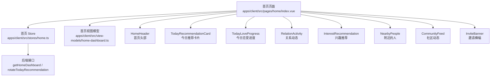

**图表来源**

- [apps/client/src/pages/home/index.vue:1-60](file://apps/client/src/pages/home/index.vue#L1-L60)
- [apps/client/src/stores/home.ts:1-117](file://apps/client/src/stores/home.ts#L1-L117)
- [apps/client/src/view-models/home-dashboard.ts:1-128](file://apps/client/src/view-models/home-dashboard.ts#L1-L128)

**章节来源**

- [apps/client/src/pages/home/index.vue:1-60](file://apps/client/src/pages/home/index.vue#L1-L60)
- [apps/client/src/stores/home.ts:1-117](file://apps/client/src/stores/home.ts#L1-L117)
- [apps/client/src/view-models/home-dashboard.ts:1-128](file://apps/client/src/view-models/home-dashboard.ts#L1-L128)

## 核心组件总览

| 组件 | 主要职责 | 输入数据 | 输出事件 | 关键状态 |
|---|---|---|---|---|
| `HomeHeader` | 显示标题、定位、通知角标和本人头像入口 | `subtitle`、`school`、`locationText` | `schoolTap`、`searchTap`、`notifyTap` | 通知未读数、本人昵称、本人头像 |
| `TodayRecommendationCard` | 展示当前推荐人、合拍度、标签、距离和喜欢操作 | `item`、`loading`、`likeLoading` | `view`、`like`、`rotate` | 主图加载失败标记 |
| `TodayLoveProgress` | 展示恋爱任务进度条和四个步骤 | `completed`、`total`、`steps` | `step` | 无本地可写状态 |
| `RelationActivity` | 展示喜欢、悄悄话、访客、新匹配四项关系数据 | `data`、`loading` | `all`、`liked-by`、`whispers`、`visitors`、`matches` | 无本地可写状态 |
| `InterestRecommendation` | 横向滚动兴趣圈推荐 | `items`、`loading` | `more`、`join`、`select` | 无本地可写状态 |
| `NearbyPeople` | 横向滚动附近的人 | `items`、`loading` | `more`、`select` | 无本地可写状态 |
| `CommunityFeed` | 横向滚动社区帖子，支持关注作者 | `items`、`loading`、`error` | `more`、`select`、`openAuthor`、`retry` | 已关注作者集合、请求中作者集合、图片失败键集合 |
| `InviteBanner` | 邀请好友横幅入口 | 无业务 props | `invite` | 无本地状态 |

这些组件共同构成首页内容区。首页页面负责：

1. 从 store 读取 `homeFeed` 和 `loading`。
2. 用 `toHomeViewModel` 转换为 `HomeViewModel`。
3. 向子组件传递只读数据。
4. 收集子组件事件，执行导航、点赞、换推荐人、刷新等动作。

**章节来源**

- [apps/client/src/components/home/HomeHeader.vue:1-60](file://apps/client/src/components/home/HomeHeader.vue#L1-L60)
- [apps/client/src/components/home/TodayRecommendationCard.vue:1-40](file://apps/client/src/components/home/TodayRecommendationCard.vue#L1-L40)
- [apps/client/src/components/home/TodayLoveProgress.vue:1-40](file://apps/client/src/components/home/TodayLoveProgress.vue#L1-L40)
- [apps/client/src/components/home/RelationActivity.vue:1-25](file://apps/client/src/components/home/RelationActivity.vue#L1-L25)
- [apps/client/src/components/home/InterestRecommendation.vue:1-30](file://apps/client/src/components/home/InterestRecommendation.vue#L1-L30)
- [apps/client/src/components/home/NearbyPeople.vue:1-20](file://apps/client/src/components/home/NearbyPeople.vue#L1-L20)
- [apps/client/src/components/home/CommunityFeed.vue:1-60](file://apps/client/src/components/home/CommunityFeed.vue#L1-L60)
- [apps/client/src/components/home/InviteBanner.vue:1-20](file://apps/client/src/components/home/InviteBanner.vue#L1-L20)

## 架构与数据流

首页采用“页面编排 + store 数据 + view model 适配 + 子组件纯展示”的分层模式。

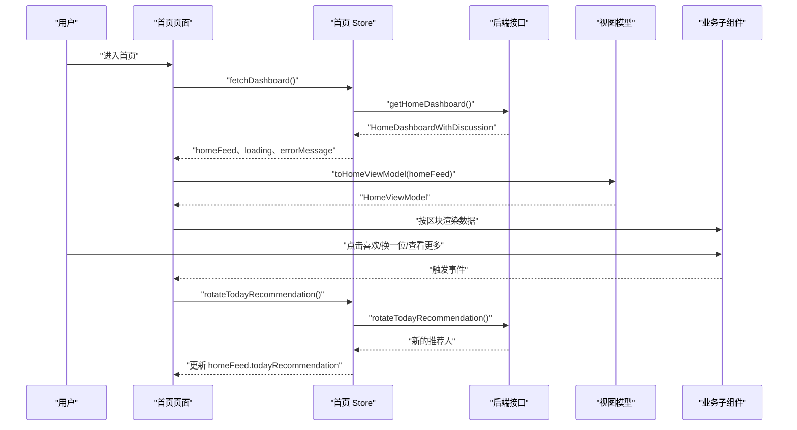

**图表来源**

- [apps/client/src/pages/home/index.vue:60-160](file://apps/client/src/pages/home/index.vue#L60-L160)
- [apps/client/src/stores/home.ts:40-117](file://apps/client/src/stores/home.ts#L40-L117)
- [apps/client/src/view-models/home-dashboard.ts:90-128](file://apps/client/src/view-models/home-dashboard.ts#L90-L128)

### 数据模型关系

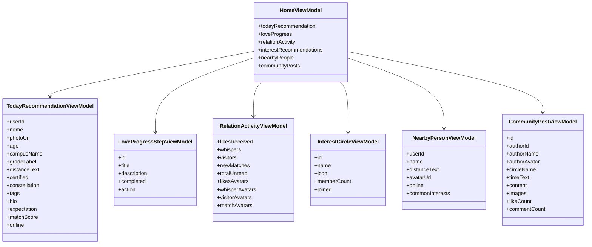

**图表来源**

- [apps/client/src/view-models/home-dashboard.ts:1-128](file://apps/client/src/view-models/home-dashboard.ts#L1-L128)

**章节来源**

- [apps/client/src/pages/home/index.vue:60-160](file://apps/client/src/pages/home/index.vue#L60-L160)
- [apps/client/src/stores/home.ts:40-117](file://apps/client/src/stores/home.ts#L40-L117)
- [apps/client/src/view-models/home-dashboard.ts:1-128](file://apps/client/src/view-models/home-dashboard.ts#L1-L128)

## 组件详细分析

### 首页头部 `HomeHeader`

`HomeHeader` 是首页最顶部的信息栏，承担三个职责：

1. 显示页面标题和副标题。
2. 显示定位文案和通知按钮。
3. 提供本人头像入口，跳转到个人资料页。

它不从首页 feed 中读取本人信息，而是使用独立数据源：

- 通知未读数来自消息 store。
- 本人昵称和头像来自会话 store 和资料 store。
- 定位文案优先使用传入的 `locationText`，否则回退到 `school`。

通知角标遵循“真实未读数驱动，零时隐藏”的规则；超过 99 时显示为“99+”。本人头像缺失时回退到默认头像资源。

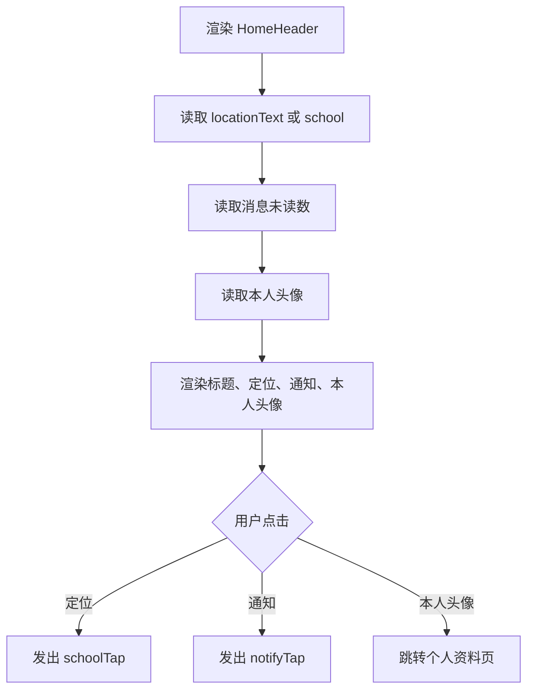

**图表来源**

- [apps/client/src/components/home/HomeHeader.vue:1-60](file://apps/client/src/components/home/HomeHeader.vue#L1-L60)
- [apps/client/src/components/home/HomeHeader.vue:60-120](file://apps/client/src/components/home/HomeHeader.vue#L60-L120)

**章节来源**

- [apps/client/src/components/home/HomeHeader.vue:1-120](file://apps/client/src/components/home/HomeHeader.vue#L1-L120)

### 今日推荐卡片 `TodayRecommendationCard`

该组件展示一个推荐人卡片，包括照片、姓名、年龄、学校、年级、标签、个人简介、期望、距离、认证信息和合拍度徽章。

关键行为：

- 主图加载失败时切换到占位图，避免永久灰底。
- 元信息行和距离行使用数组拼接，防止字段缺失时出现多余分隔符。
- 整张卡片主体可点击，查看用户主页。
- “喜欢”按钮带 loading 状态。
- “换一位”由父页面统一防重入控制。

图片使用懒加载，减少首屏卡顿；失败分支保证有终态。

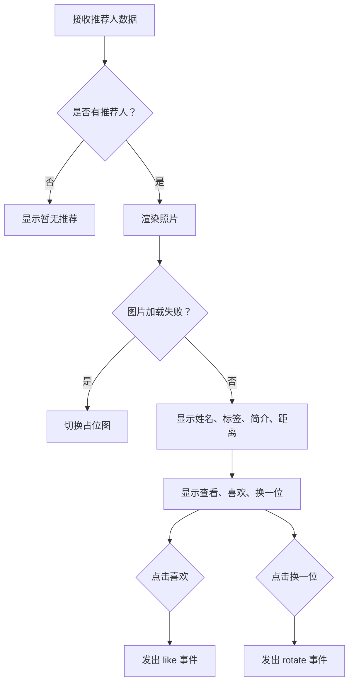

**图表来源**

- [apps/client/src/components/home/TodayRecommendationCard.vue:1-120](file://apps/client/src/components/home/TodayRecommendationCard.vue#L1-L120)

**章节来源**

- [apps/client/src/components/home/TodayRecommendationCard.vue:1-120](file://apps/client/src/components/home/TodayRecommendationCard.vue#L1-L120)

### 今日恋爱进度 `TodayLoveProgress`

该组件展示恋爱任务的进度条和四个步骤：完善资料、认识新人、回复悄悄话、参与兴趣互动。

它的核心逻辑是：

- 根据步骤 id 选择背景色、图标、完成态图标和待办文案。
- 步骤标题优先使用国际化文案，避免后端状态标签污染标题。
- 步骤描述优先使用已完成鼓励文案，其次使用后端个性化描述，最后回退国际化描述。
- 进度条宽度由 `completed / total` 计算。
- 点击步骤触发 `step` 事件，由父页面决定跳转目标。

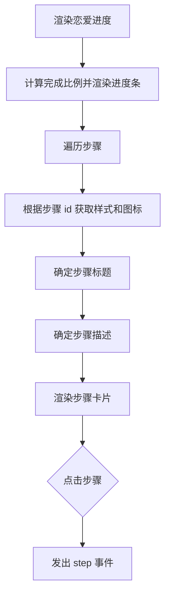

**图表来源**

- [apps/client/src/components/home/TodayLoveProgress.vue:1-120](file://apps/client/src/components/home/TodayLoveProgress.vue#L1-L120)

**章节来源**

- [apps/client/src/components/home/TodayLoveProgress.vue:1-120](file://apps/client/src/components/home/TodayLoveProgress.vue#L1-L120)

### 关系活动 `RelationActivity`

关系活动以四宫格形式展示：

- 人喜欢了你
- 条悄悄话
- 人看过你
- 个新匹配

每个格子包含吉祥物图标、数值、文字说明和最多三个头像缩略图。组件本身不负责请求数据，只负责把 `RelationActivityViewModel` 渲染成网格。

关键点：

- 四个格子都有 hover 按下态，增强可感知性。
- 图标使用吉祥物不同姿态区分，颜色仅作辅助。
- 图片设置 `pointer-events="none"`，确保点击落到外层格子。
- 加载期间显示骨架占位。

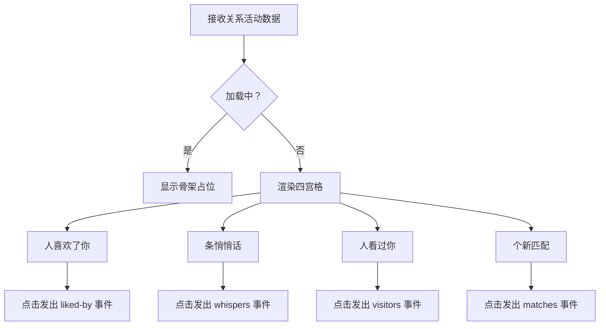

**图表来源**

- [apps/client/src/components/home/RelationActivity.vue:1-120](file://apps/client/src/components/home/RelationActivity.vue#L1-L120)

**章节来源**

- [apps/client/src/components/home/RelationActivity.vue:1-120](file://apps/client/src/components/home/RelationActivity.vue#L1-L120)

### 兴趣推荐 `InterestRecommendation`

兴趣推荐是一个横向滚动的兴趣圈列表。每个卡片包含封面、名称、成员数和加入按钮。

封面来源规则较复杂：

1. 如果后端返回的是上传媒体路径或媒体鉴权代理地址，则直接使用。
2. 如果是包内静态资源，排除字形图标命名空间和 `.svg` 文件，其余封面资源放行。
3. 其他情况（例如 emoji）回退到统一的圈名映射。

这解决了后端返回 emoji 或 mock 返回 svg 路径时的破图问题。

成员数格式化规则：

- 一万及以上使用“万”单位。
- 一千及以上使用千分位数字。
- 小于一千直接显示数字。

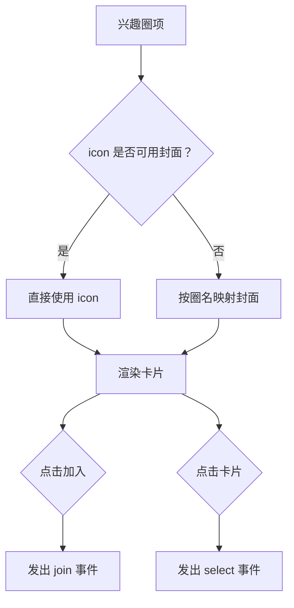

**图表来源**

- [apps/client/src/components/home/InterestRecommendation.vue:1-120](file://apps/client/src/components/home/InterestRecommendation.vue#L1-L120)

**章节来源**

- [apps/client/src/components/home/InterestRecommendation.vue:1-120](file://apps/client/src/components/home/InterestRecommendation.vue#L1-L120)

### 附近的人 `NearbyPeople`

附近的人是一个横向头像列表，用于快速预览可匹配的用户。

重点特性：

- 加载中且无数据时显示横排头像骨架。
- 加载完成仍无人时显示空态块。
- 头像加载失败时回退到默认头像。
- 头像使用外层固定圆形容器 + 内层按宽缩放方式，避免半身人像被中心裁切导致脸出画。
- 在线状态用小圆点标识。
- 底部显示真实人数，而不是保底伪造人数。

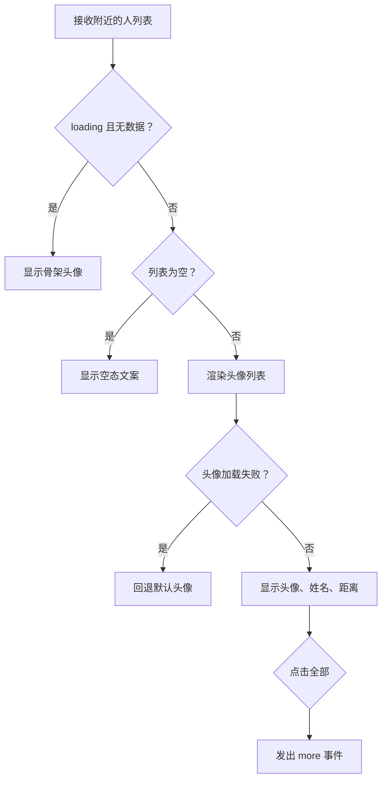

**图表来源**

- [apps/client/src/components/home/NearbyPeople.vue:1-120](file://apps/client/src/components/home/NearbyPeople.vue#L1-L120)

**章节来源**

- [apps/client/src/components/home/NearbyPeople.vue:1-120](file://apps/client/src/components/home/NearbyPeople.vue#L1-L120)

### 社区动态 `CommunityFeed`

社区动态是首页中复杂度最高的子组件之一，负责横向展示帖子，并维护作者关注状态。

它接受三个 props：

- `items`：帖子列表。
- `loading`：加载中的骨架态。
- `error`：加载失败的错误信息。

它暴露四个事件：

- `more`：查看更多。
- `select`：打开帖子详情。
- `openAuthor`：打开作者主页。
- `retry`：重试加载。

关注逻辑特点：

- 挂载时尝试从服务端获取当前用户的关注列表，初始化已关注状态。
- 本地维护 `followedIds` 和 `followPendingIds`。
- 未登录时引导登录。
- 重复请求有 pending 守卫。
- 成功时立即乐观更新本地状态。
- 失败时提示错误，但不会中断渲染。
- 图片加载失败会记录 key，并在换批数据或重试时清理失败记录。

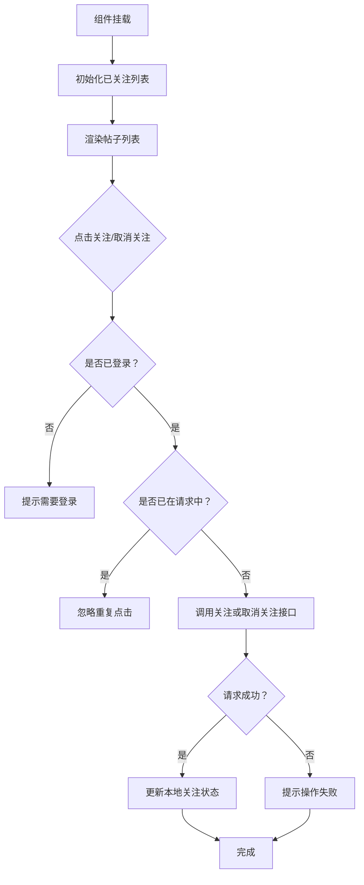

**图表来源**

- [apps/client/src/components/home/CommunityFeed.vue:60-160](file://apps/client/src/components/home/CommunityFeed.vue#L60-L160)

**章节来源**

- [apps/client/src/components/home/CommunityFeed.vue:1-160](file://apps/client/src/components/home/CommunityFeed.vue#L1-L160)

### 邀请横幅 `InviteBanner`

邀请横幅是最简单的装饰型入口组件。它不包含业务数据，只负责：

- 显示邀请标题和副标题。
- 使用国际化文案。
- 点击后发出 `invite` 事件。
- 装饰元素不参与点击热区。

样式上采用浅粉渐变背景和深粉强调按钮，避免高饱和渐变与页面主色冲突。

**章节来源**

- [apps/client/src/components/home/InviteBanner.vue:1-117](file://apps/client/src/components/home/InviteBanner.vue#L1-L117)

## 依赖关系分析

### 首页页面依赖

首页页面依赖：

- Pinia stores：首页 store、消息 store、圈子 store、会话 store。
- 导航工具：`openAppPath`、`switchTabWithQuery`、路由常量。
- 地理位置工具：获取定位、构建定位文本、上报坐标。
- 图片资源：`IMAGE_PATHS`、`resolveMediaUrl`。
- 国际化：`useI18n`。
- 所有子组件。

### Store 依赖

首页 store 依赖：

- `clientApi.getHomeDashboard`：拉取首页仪表盘。
- `clientApi.rotateTodayRecommendation`：换一位推荐人。
- 类型定义：`HomeDashboardWithDiscussion`。

### View Model 依赖

view model 负责：

- 将后端 `HomeFeedView` 转换为前端 `HomeViewModel`。
- 将 ISO 时间转换为相对时间。
- 对社区帖子头像做默认值兜底。
- 对附近的人按 `userId` 去重。

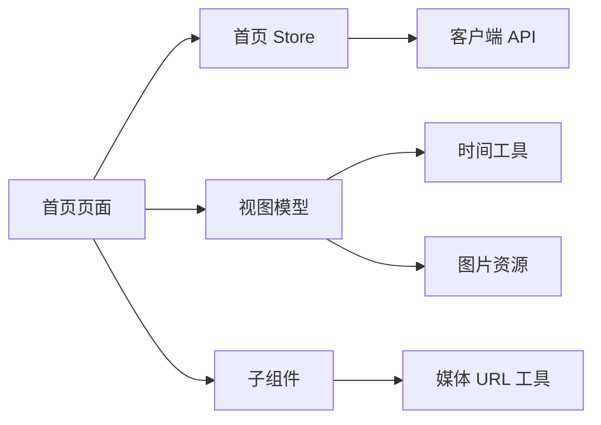

**图表来源**

- [apps/client/src/pages/home/index.vue:1-60](file://apps/client/src/pages/home/index.vue#L1-L60)
- [apps/client/src/stores/home.ts:1-40](file://apps/client/src/stores/home.ts#L1-L40)
- [apps/client/src/view-models/home-dashboard.ts:1-40](file://apps/client/src/view-models/home-dashboard.ts#L1-L40)

**章节来源**

- [apps/client/src/pages/home/index.vue:1-60](file://apps/client/src/pages/home/index.vue#L1-L60)
- [apps/client/src/stores/home.ts:1-40](file://apps/client/src/stores/home.ts#L1-L40)
- [apps/client/src/view-models/home-dashboard.ts:1-40](file://apps/client/src/view-models/home-dashboard.ts#L1-L40)

## 性能、懒加载与图片优化

### 懒加载策略

- 今日推荐卡片的主图使用懒加载，降低首屏图片渲染压力。
- 社区动态的作者头像关闭懒加载，因为头像尺寸较小且需要尽快填充布局。
- 兴趣推荐和社区动态都使用横向滚动容器，避免一次性渲染超出视口的大量大图。

### 图片优化

- 所有图片路径经过 `resolveMediaUrl` 处理，兼容本地资源和网络资源。
- 图片加载失败有明确终态：
  - 今日推荐卡片切换占位图。
  - 附近的人回退默认头像。
  - 社区动态使用 SafeImage 兜底默认头像。
  - 兴趣推荐对不可用封面回退圈名映射。
- 装饰性图片禁用点击热区，避免误触。

### 骨架态与空态

- 首页整体首次加载期间，兴趣推荐、关系活动和社区动态分别显示骨架占位。
- 附近的人在“加载中且无数据”时显示横排头像骨架。
- 各模块在加载完成后仍为空时，显示语义化空态文案，而不是空白横滑区域。

### 防重入与竞态保护

- 首页 Feed 刷新有 loading 守卫。
- 未登录模式下不发送受保护的首页接口请求。
- 换一位推荐人有全局 loading 标志，防止并发请求覆盖状态。
- 喜欢操作有 loading 标志。
- 首页 store 的 `fetchDashboard` 使用递增 token 防止旧请求覆盖新请求结果。
- 社区关注操作有 pending 集合防止重复请求。

**章节来源**

- [apps/client/src/components/home/TodayRecommendationCard.vue:1-120](file://apps/client/src/components/home/TodayRecommendationCard.vue#L1-L120)
- [apps/client/src/components/home/NearbyPeople.vue:1-120](file://apps/client/src/components/home/NearbyPeople.vue#L1-L120)
- [apps/client/src/components/home/InterestRecommendation.vue:1-120](file://apps/client/src/components/home/InterestRecommendation.vue#L1-L120)
- [apps/client/src/components/home/CommunityFeed.vue:60-160](file://apps/client/src/components/home/CommunityFeed.vue#L60-L160)
- [apps/client/src/stores/home.ts:40-117](file://apps/client/src/stores/home.ts#L40-L117)

## 用户交互与错误处理

### 用户交互逻辑

| 交互 | 组件 | 行为 |
|---|---|---|
| 点击通知 | `HomeHeader` | 发出 `notifyTap`，由父页面决定跳转 |
| 点击定位 | `HomeHeader` | 发出 `schoolTap` |
| 点击本人头像 | `HomeHeader` | 跳转个人资料页 |
| 点击推荐人卡片 | `TodayRecommendationCard` | 发出 `view` |
| 点击喜欢 | `TodayRecommendationCard` | 发出 `like`，父页面调用点赞接口 |
| 点击换一位 | `TodayRecommendationCard` | 发出 `rotate`，父页面调用轮换接口 |
| 点击恋爱步骤 | `TodayLoveProgress` | 发出 `step`，父页面根据 action 跳转 |
| 点击关系格子 | `RelationActivity` | 发出对应事件，如 `liked-by`、`whispers` |
| 点击兴趣圈 | `InterestRecommendation` | 发出 `select` 或 `join` |
| 点击附近的人 | `NearbyPeople` | 发出 `select` |
| 点击社区帖子 | `CommunityFeed` | 发出 `select` |
| 点击作者 | `CommunityFeed` | 发出 `openAuthor` |
| 点击关注作者 | `CommunityFeed` | 调用关注或取消关注接口 |
| 点击邀请横幅 | `InviteBanner` | 发出 `invite` |

### 数据更新机制

首页数据更新主要有三种时机：

1. **onShow**：进入页面时判断是否陈旧，必要时重新拉取首页 Feed。
2. **下拉刷新**：强制刷新并停止下拉动画。
3. **登录态变化**：登录后若没有首页数据，自动补拉。

位置初始化每次进入页面都会执行；坐标上报内部节流。

### 错误处理模式

- 首页 store 捕获异常并写入 `errorMessage`，同时保留 loading 最终清理。
- 旧请求结果被 token 丢弃，避免竞态导致的状态错乱。
- 用户操作失败统一使用 toast 提示。
- 社区动态支持错误态和重试。
- 图片加载失败不会阻断渲染，而是降级到占位或默认头像。
- 初始化关注列表失败静默降级，不影响后续关注操作。

**章节来源**

- [apps/client/src/pages/home/index.vue:60-200](file://apps/client/src/pages/home/index.vue#L60-L200)
- [apps/client/src/components/home/CommunityFeed.vue:60-160](file://apps/client/src/components/home/CommunityFeed.vue#L60-L160)
- [apps/client/src/stores/home.ts:40-117](file://apps/client/src/stores/home.ts#L40-L117)

## 集成示例与扩展指南

### 如何在首页中使用这些组件

首页已经完成了标准集成方式：

1. 引入子组件。
2. 从 `homeStore.homeFeed` 读取数据。
3. 通过 `toHomeViewModel` 生成 `HomeViewModel`。
4. 将 `HomeViewModel` 的各个字段作为 props 传给对应组件。
5. 在页面层处理组件事件，执行导航和业务操作。

新增一个首页子组件时，建议遵循以下约定：

- 使用只读 props 接收数据。
- 使用 `defineEmits` 声明事件。
- 不直接调用后端 API。
- 图片和媒体路径统一走 `resolveMediaUrl`。
- 国际化文案使用 `useI18n`。
- 骨架态和空态保持与其他模块一致。

### 自定义扩展建议

#### 扩展数据字段

如果需要新增首页字段：

1. 在后端扩展 `HomeFeedView`。
2. 在 `HomeViewModel` 中添加对应字段。
3. 在 `toHomeViewModel` 中映射数据。
4. 新建或扩展现有子组件消费该字段。
5. 在首页页面中将字段透传到子组件。

#### 扩展用户交互

对于需要调接口的交互，应放在首页页面层：

- 子组件只发出事件。
- 父组件负责登录校验、loading 控制和错误提示。
- 成功后通过更新 store 或局部状态刷新 UI。

#### 扩展图片资源

新增首页图片时应：

- 放入 `IMAGE_PATHS`。
- 模板中通过 `resolveMediaUrl(IMAGE_PATHS.xxx)` 引用。
- 装饰性图片禁用点击热区。
- 业务图片增加加载失败兜底。

**章节来源**

- [apps/client/src/pages/home/index.vue:1-60](file://apps/client/src/pages/home/index.vue#L1-L60)
- [apps/client/src/view-models/home-dashboard.ts:90-128](file://apps/client/src/view-models/home-dashboard.ts#L90-L128)

## 故障排查

### 首页数据不更新

常见问题：

- 未登录状态下，real 模式不会发送受保护的首页接口请求。
- 30 秒内重复进入页面不会重复刷新。
- 已有数据且有错误时，才会触发重新加载。
- 登录态变化后会补拉首页数据。

排查顺序：

1. 检查是否已登录。
2. 检查 `homeStore.loading` 是否阻止了重复请求。
3. 检查最后一次拉取时间戳是否未超过 30 秒。
4. 检查下拉刷新是否正确触发 `fetchDashboard`。

**章节来源**

- [apps/client/src/pages/home/index.vue:80-140](file://apps/client/src/pages/home/index.vue#L80-L140)
- [apps/client/src/stores/home.ts:40-117](file://apps/client/src/stores/home.ts#L40-L117)

### 推荐人图片加载失败

现象：

- 主图显示灰色或破图。

原因：

- 后端图片 URL 失效。
- 媒体路径未被正确解析。
- 图片资源不存在。

修复：

- 确认 `photoUrl` 非空。
- 确认使用 `resolveMediaUrl`。
- 确认错误分支设置了 `photoFailed = true`。
- 确认 fallback 使用了占位图。

**章节来源**

- [apps/client/src/components/home/TodayRecommendationCard.vue:1-80](file://apps/client/src/components/home/TodayRecommendationCard.vue#L1-L80)

### 兴趣推荐封面不显示

现象：

- 封面显示为灰框、emoji、svg 或空白。

原因：

- 后端返回的是 emoji。
- mock 返回的是 svg 路径。
- 路径被当作封面直传，但实际不是有效图片。

修复：

- 使用 `isUsableCover` 判断是否为真封面。
- 非封面回退到 `circleCover(name)`。
- 排除 `/static/assets/icons` 和 `/static/assets/svg-spec`。
- 排除 `.svg` 资源。

**章节来源**

- [apps/client/src/components/home/InterestRecommendation.vue:1-120](file://apps/client/src/components/home/InterestRecommendation.vue#L1-L120)

### 附近的人头像被裁掉脸

现象：

- 头像显示下半身或身体，看不到脸。

原因：

- 原实现使用 `aspectFill` 并居中裁切，半身人像的脸位于上方。

修复：

- 外层容器固定圆形裁剪。
- 内层图片使用 `widthFix` 并按顶部对齐。
- 头像加载失败回退默认头像。

**章节来源**

- [apps/client/src/components/home/NearbyPeople.vue:1-120](file://apps/client/src/components/home/NearbyPeople.vue#L1-L120)

### 社区动态关注状态不一致

现象：

- 离开首页后再回来，关注状态重置。
- 重复点击关注发起多次请求。

原因：

- 关注状态原本只在组件本地维护。
- 缺少服务端初始化。
- 缺少 pending 守卫。

修复：

- 挂载时拉取我的关注列表初始化状态。
- 使用 `followedIds` 和 `followPendingIds`。
- 失败时静默降级。
- 重试时清空失败图片记录。

**章节来源**

- [apps/client/src/components/home/CommunityFeed.vue:60-160](file://apps/client/src/components/home/CommunityFeed.vue#L60-L160)

## 结论

首页组件体系采用清晰的分层设计：页面负责编排和交互，store 负责数据拉取和竞态保护，view model 负责数据结构适配，子组件负责纯展示和轻量本地状态。这种结构使每个组件职责单一，便于测试、维护和扩展。

关键设计优点包括：

- 数据流单向：后端 → store → view model → 子组件。
- 事件向上冒泡：子组件只 emit，父组件执行业务逻辑。
- 图片资源统一处理，失败有终态。
- 骨架态和空态覆盖完整加载链路。
- 防重入和竞态保护贯穿首页核心交互。
- 国际化、无障碍标签和可访问性逐步补齐。

未来扩展时，应继续遵循现有约定：子组件保持无副作用、props 单向流动、事件语义清晰、错误可观测、图片可降级。这样首页才能在业务增长过程中保持稳定。