# 客户端应用（Uni-app）

<cite>
**本文引用的文件**   
- [apps/client/package.json](file://apps/client/package.json)
- [apps/client/tsconfig.json](file://apps/client/tsconfig.json)
- [apps/client/vite.config.ts](file://apps/client/vite.config.ts)
- [apps/client/index.html](file://apps/client/index.html)
- [apps/client/main.ts](file://apps/client/main.ts)
- [apps/client/src/main.ts](file://apps/client/src/main.ts)
- [apps/client/src/App.vue](file://apps/client/src/App.vue)
</cite>

## 目录
1. [引言](#引言)
2. [项目结构](#项目结构)
3. [核心组件](#核心组件)
4. [架构总览](#架构总览)
5. [详细组件分析](#详细组件分析)
6. [依赖与平台关系分析](#依赖与平台关系分析)
7. [性能与分包优化](#性能与分包优化)
8. [样式系统与设计令牌](#样式系统与设计令牌)
9. [跨平台适配指南](#跨平台适配指南)
10. [状态管理与持久化策略](#状态管理与持久化策略)
11. [组件设计规范与最佳实践](#组件设计规范与最佳实践)
12. [常见问题与排错](#常见问题与排错)
13. [结论](#结论)

## 引言
本技术文档面向 Uni-app 客户端应用，目标是为开发者提供从工程结构、构建配置到运行时行为的完整说明。重点覆盖：
- Uni-app + Vue 3 Composition API + TypeScript 的集成方式
- 应用生命周期、全局错误处理、网络状态监听和路由配置
- Pinia 状态管理架构、模块化设计与状态持久化思路
- 组件规范、样式系统和主题定制方案
- 分包策略、代码分割与性能优化
- 微信小程序 API 适配、H5 兼容性处理与跨平台差异解决方案
- 组件开发指南、最佳实践与常见陷阱避免

## 项目结构
客户端子工程位于 `apps/client`，是一个基于 uni-app 3.x 的多端前端应用，同时支持 H5 与微信小程序。根级 monorepo 通过 pnpm workspace 将 `apps/client` 纳入统一工作区。

关键入口与配置文件：
- 应用入口脚本：`apps/client/main.ts` 导出 `createApp`，实际创建逻辑在 `apps/client/src/main.ts`
- 根视图：`apps/client/src/App.vue`
- 页面容器模板：`apps/client/index.html`
- 构建与脚本定义：`apps/client/package.json`
- Vite 构建配置：`apps/client/vite.config.ts`
- TypeScript 配置：`apps/client/tsconfig.json`

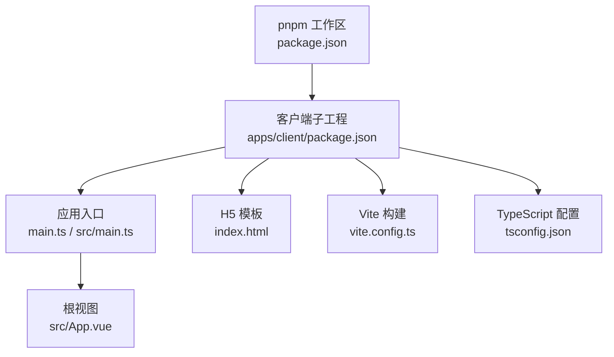

**图表来源**  
- [apps/client/package.json:1-104](file://apps/client/package.json#L1-L104)  
- [apps/client/main.ts:1-1](file://apps/client/main.ts#L1-L1)  
- [apps/client/src/main.ts:1-122](file://apps/client/src/main.ts#L1-L122)  
- [apps/client/src/App.vue:1-200](file://apps/client/src/App.vue#L1-L200)  
- [apps/client/index.html:1-33](file://apps/client/index.html#L1-L33)  
- [apps/client/vite.config.ts:1-240](file://apps/client/vite.config.ts#L1-L240)  
- [apps/client/tsconfig.json:1-26](file://apps/client/tsconfig.json#L1-L26)

**章节来源**  
- [apps/client/package.json:1-104](file://apps/client/package.json#L1-L104)  
- [apps/client/main.ts:1-1](file://apps/client/main.ts#L1-L1)  
- [apps/client/src/main.ts:1-122](file://apps/client/src/main.ts#L1-L122)  
- [apps/client/index.html:1-33](file://apps/client/index.html#L1-L33)  
- [apps/client/vite.config.ts:1-240](file://apps/client/vite.config.ts#L1-L240)  
- [apps/client/tsconfig.json:1-26](file://apps/client/tsconfig.json#L1-L26)

## 核心组件
本节聚焦客户端启动链中的关键模块：应用创建器、根视图、环境注入与构建配置。

- 应用创建器 `src/main.ts`
  - 负责安装 polyfill、初始化 Pinia、注册 GSAP 插件、挂载国际化与 Sentry、设置 Vue 全局错误处理器与警告处理器、注册小程序全局错误监听。
  - 暴露 `createApp()` 供外部测试或二次封装使用。
- 根视图 `src/App.vue`
  - 管理小程序生命周期 `onLaunch`、`onShow`、`onMounted`。
  - 负责隐私协议授权回调、维护模式遮罩、解锁引导弹窗、网络状态监听、未读消息红点同步、后台配置刷新等。
- 构建配置 `vite.config.ts`
  - 根据平台动态调整 ES 目标。
  - 通过 `define` 注入环境变量到 `process.env.*`。
  - 实现 H5 manualChunks 分包策略、Sentry/GSAP/VueUse 生态拆分。
  - 修补 uni-h5-vue 的 `updateSlots` 兼容问题并移除别名解析弃用字段。
- 模板 `index.html`
  - 声明 viewport、主题色、favicon、描述信息。
  - 预加载关键资源占位符，由 uni-app 构建时填充。
- TypeScript 配置 `tsconfig.json`
  - 继承基础严格选项，启用 `@dcloudio/types` 与 Vite 客户端类型。
  - 配置 `@/*` 路径别名，限定编译范围。

**章节来源**  
- [apps/client/src/main.ts:1-122](file://apps/client/src/main.ts#L1-L122)  
- [apps/client/src/App.vue:1-200](file://apps/client/src/App.vue#L1-L200)  
- [apps/client/vite.config.ts:1-240](file://apps/client/vite.config.ts#L1-L240)  
- [apps/client/index.html:1-33](file://apps/client/index.html#L1-L33)  
- [apps/client/tsconfig.json:1-26](file://apps/client/tsconfig.json#L1-L26)

## 架构总览
下图展示客户端应用从模板到运行时的整体流程：H5 模板加载主脚本，uni-app 引导构建产物，应用入口创建 Vue 实例、Pinia、i18n 与 Sentry，根视图接管小程序生命周期，并通过 store 与 composables 协调业务能力。

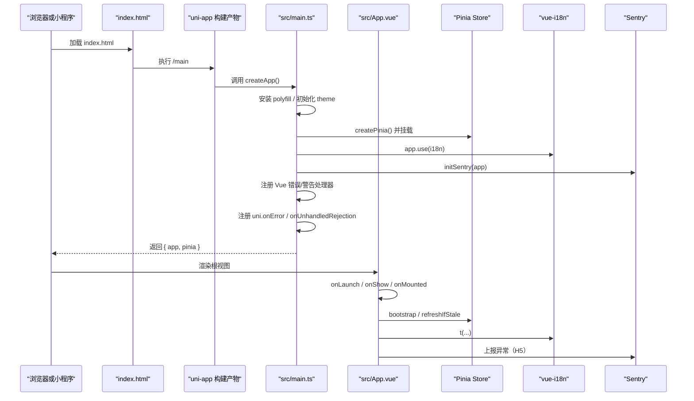

**图表来源**  
- [apps/client/index.html:1-33](file://apps/client/index.html#L1-L33)  
- [apps/client/src/main.ts:1-122](file://apps/client/src/main.ts#L1-L122)  
- [apps/client/src/App.vue:1-200](file://apps/client/src/App.vue#L1-L200)

## 详细组件分析

### 应用启动与生命周期
应用启动链的关键阶段如下：

1. **Polyfill 与展示模式注入**
   - 在 `src/main.ts` 中优先安装 `AbortController` 与 `URLSearchParams` polyfill，确保 mp-weixin 基础库缺失原生实现时仍可运行。
   - 可选的展示模式会在 mount 前开启全功能开关，便于演示场景。
2. **应用实例创建**
   - 使用 `createSSRApp` 创建 Vue 实例，随后创建 Pinia 实例并初始化主题 store。
   - 挂载 i18n、GSAP 插件，再初始化 Sentry。
3. **全局错误处理**
   - 设置 `app.config.errorHandler` 与 `warnHandler`，统一通过 `reportGlobalError` 上报。
   - 注册 `uni.onError` 与 `uni.onUnhandledRejection`，形成小程序运行时与 Vue 运行时的双重兜底。
4. **根视图生命周期**
   - `onLaunch`：注册微信隐私协议授权回调、导航拦截器、会话 bootstrap、资料拉取；失败统一上报。
   - `onShow`：按 TTL 刷新后台配置，异常上报。
   - `onMounted`：标记应用就绪，允许渲染含事件处理器的全局弹窗。

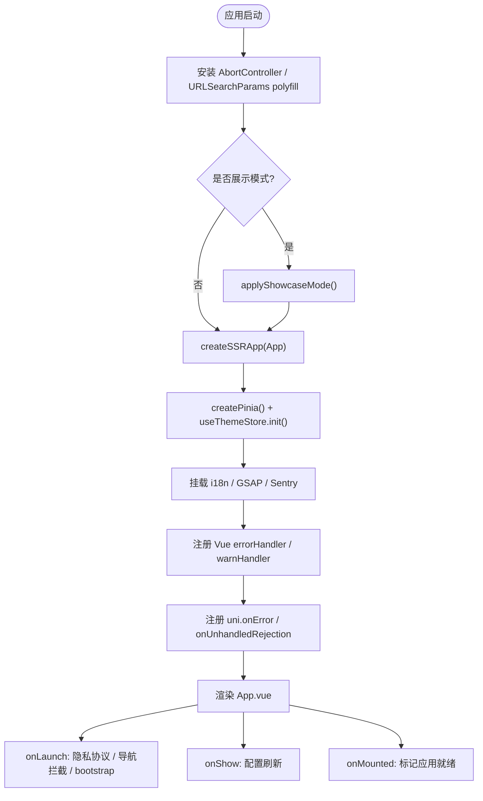

**图表来源**  
- [apps/client/src/main.ts:1-122](file://apps/client/src/main.ts#L1-L122)  
- [apps/client/src/App.vue:1-200](file://apps/client/src/App.vue#L1-L200)

**章节来源**  
- [apps/client/src/main.ts:1-122](file://apps/client/src/main.ts#L1-L122)  
- [apps/client/src/App.vue:1-200](file://apps/client/src/App.vue#L1-L200)

### 全局错误处理
全局错误处理分为三层：
- **Vue 层**：通过 `app.config.errorHandler` 捕获组件内部异常，通过 `warnHandler` 输出开发警告。
- **小程序层**：通过 `uni.onError` 捕获脚本/API 错误，通过 `uni.onUnhandledRejection` 捕获未处理的 Promise rejection。
- **上报通道**：统一调用 `reportGlobalError`，在 H5 端可对接 Sentry，在小程序端走独立上报通道。

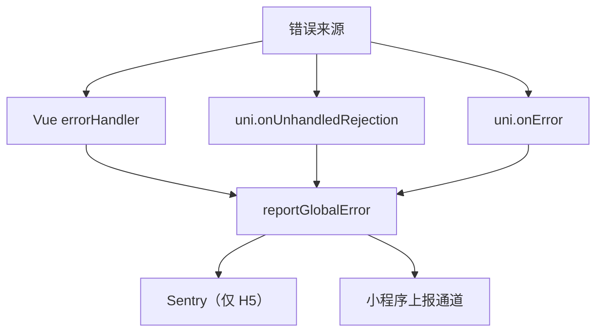

**图表来源**  
- [apps/client/src/main.ts:1-122](file://apps/client/src/main.ts#L1-L122)

**章节来源**  
- [apps/client/src/main.ts:1-122](file://apps/client/src/main.ts#L1-L122)

### 网络状态监听与未读消息红点
- **网络状态**：通过组合式函数 `useNetworkStatus` 监听 `uni.onNetworkStatusChange`，在网络断开/恢复时提示用户。
- **未读消息红点**：通过 `useUnreadBadge` 监听消息 store 的未读数变化，自动更新 TabBar 红点。

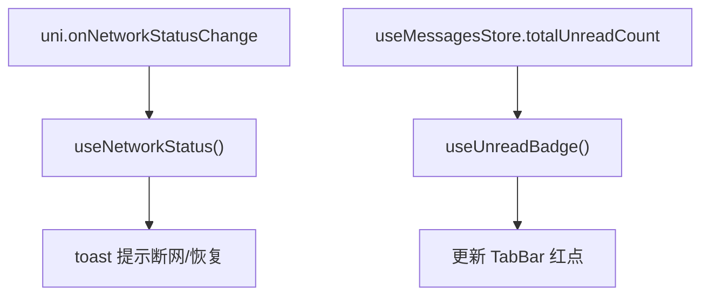

**图表来源**  
- [apps/client/src/App.vue:1-200](file://apps/client/src/App.vue#L1-L200)

**章节来源**  
- [apps/client/src/App.vue:1-200](file://apps/client/src/App.vue#L1-L200)

### 隐私协议与小程序安全合规
在 `onLaunch` 中，针对微信小程序的隐私合规要求，应用注册了 `wx.onNeedPrivacyAuthorization` 回调，实现：
- 首次敏感 API 调用前弹出隐私协议确认。
- 支持“查看协议”跳转微信托管隐私页。
- 防重入机制避免并发触发导致弹窗叠加。
- 兼容 H5/APP 端无 wx 对象的情况。

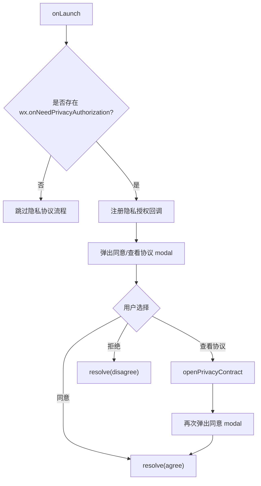

**图表来源**  
- [apps/client/src/App.vue:1-200](file://apps/client/src/App.vue#L1-L200)

**章节来源**  
- [apps/client/src/App.vue:1-200](file://apps/client/src/App.vue#L1-L200)

### 路由与页面组织
该应用采用 uni-app 的页面驱动模式，由框架根据页面配置文件自动组织路由。根视图不直接渲染页面内容，而是作为全局容器承载弹窗、维护遮罩与主题相关的全局 UI。

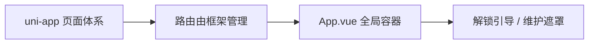

[本图为概念性图示，不对应具体源码文件，故不提供图表来源]

## 依赖与平台关系分析
客户端依赖包括：
- **运行时依赖**：Vue 3、Pinia、vue-i18n、@vueuse/core、GSAP、Sentry 系列包、uni-app 多端运行时。
- **构建依赖**：@dcloudio/vite-plugin-uni、@vitejs/plugin-vue、Vite、TypeScript、sass、vitest、playwright（E2E）。

平台相关特性：
- H5：ES 目标至少为 es2020，保留 `import.meta` 语法，启用 manualChunks 分包。
- 微信小程序：ES 目标降级为 es2018，以兼容基础库不支持 optional catch binding。
- 类型支持：通过 `@dcloudio/types` 提供 uni-app API 的类型定义。

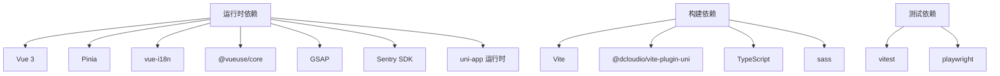

**图表来源**  
- [apps/client/package.json:1-104](file://apps/client/package.json#L1-L104)

**章节来源**  
- [apps/client/package.json:1-104](file://apps/client/package.json#L1-L104)

## 性能与分包优化
Vite 构建配置实现了多项性能优化：

- **ES 目标差异化**
  - mp-weixin：es2018，避免 optional catch binding 不被基础库支持的问题。
  - H5：es2020+，保留 import.meta 以支持 HMR 与构建产物。
- **环境变量注入**
  - 通过 `loadEnv` 加载 `.env.[mode]` 中以 `VITE_` 开头的变量，并以 `define` 替换为 `process.env.*` 常量，避免在小程序生产包中使用 `import.meta`。
- **H5 手动分包**
  - vue-vendor：Vue 核心生态（vue、vue-i18n、pinia）
  - sentry：Sentry SDK
  - gsap：动画库
  - vueuse：组合式工具库
  - 其他第三方依赖归入默认 vendor chunk
- **压缩与 SourceMap**
  - 使用 esbuild 压缩，关闭 gzip 大小报告加速构建。
  - 开发模式生成 sourcemap，生产模式生成 hidden sourcemap 用于 Sentry 上传。
- **CSS 代码分割**
  - 启用 `cssCodeSplit`，避免单个超大 CSS 文件。

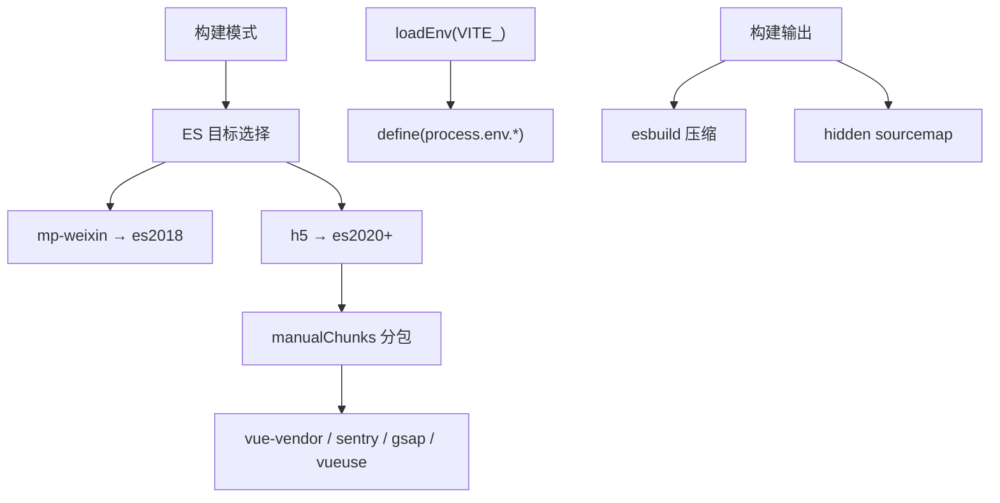

**图表来源**  
- [apps/client/vite.config.ts:1-240](file://apps/client/vite.config.ts#L1-L240)

**章节来源**  
- [apps/client/vite.config.ts:1-240](file://apps/client/vite.config.ts#L1-L240)

## 样式系统与设计令牌
样式系统围绕 SCSS 与 CSS 自定义属性构建，强调设计令牌、语义别名与深色模式适配：

- 设计变量入口：`theme/design-variables.scss`
- 全局工具类：`theme/global.scss`
- 设计令牌聚合：`styles/tokens.scss`，提供 kebab-case 命名与 dark mode 覆盖
- 无障碍工具类：`styles/a11y.scss`
- 共享 Mixins：`styles/_mixins.scss`
- 组件级共享样式：`styles/_components.scss`
- 全局动画：`theme/animations.scss`
- 图片渲染基线：`styles/_image-base.scss`
- 页面背景统一：`page` 背景使用 `--c-bg-page`，避免渐变导致的视觉断层

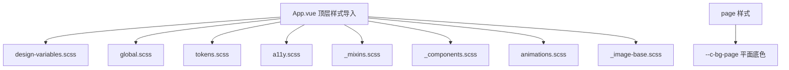

**图表来源**  
- [apps/client/src/App.vue:200-450](file://apps/client/src/App.vue#L200-L450)

**章节来源**  
- [apps/client/src/App.vue:200-450](file://apps/client/src/App.vue#L200-L450)

## 跨平台适配指南
客户端在不同平台的适配要点如下：

- **微信小程序**
  - 使用 `uni.onError` 与 `uni.onUnhandledRejection` 进行全局错误监控。
  - 需要隐私协议授权回调，避免敏感 API 被拒。
  - 对 `AbortController` 与 `URLSearchParams` 提供 polyfill。
  - 构建目标 es2018，避免 optional catch binding。
- **H5**
  - 构建目标 es2020+，保留 `import.meta` 以支持 HMR。
  - 通过 Sentry SDK 收集错误与回放。
  - 手动分包以提升首屏加载速度。
- **通用**
  - 所有平台通过 `@dcloudio/types` 获得 uni-app API 类型。
  - 使用 `process.env.*` 读取构建期注入的环境变量，避免 `import.meta` 在小程序端的兼容性问题。

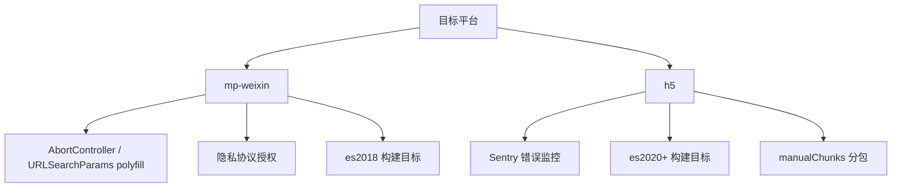

**图表来源**  
- [apps/client/src/main.ts:1-122](file://apps/client/src/main.ts#L1-L122)  
- [apps/client/vite.config.ts:1-240](file://apps/client/vite.config.ts#L1-L240)

**章节来源**  
- [apps/client/src/main.ts:1-122](file://apps/client/src/main.ts#L1-L122)  
- [apps/client/vite.config.ts:1-240](file://apps/client/vite.config.ts#L1-L240)

## 状态管理与持久化策略
客户端使用 Pinia 进行状态管理，并在应用启动时初始化主题、会话与配置等关键 store：

- **初始化顺序**
  - 先创建 Pinia 实例，再初始化主题 store，最后挂载到 Vue 应用。
  - 在 `onLaunch` 中执行会话 bootstrap，必要时拉取个人资料。
  - 在 `onShow` 中刷新后台配置，实现维护模式与功能开关的即时生效。
- **持久化思路**
  - 主题选择与设备暗色模式通过主题 store 初始化时恢复。
  - 会话与配置通常结合本地存储与后端数据源，store 负责拉取、缓存与刷新。
- **模块化设计**
  - 不同领域状态分属不同 store（如 session、profile、app-config、unlock-guide），通过组合式函数与 composables 消费。

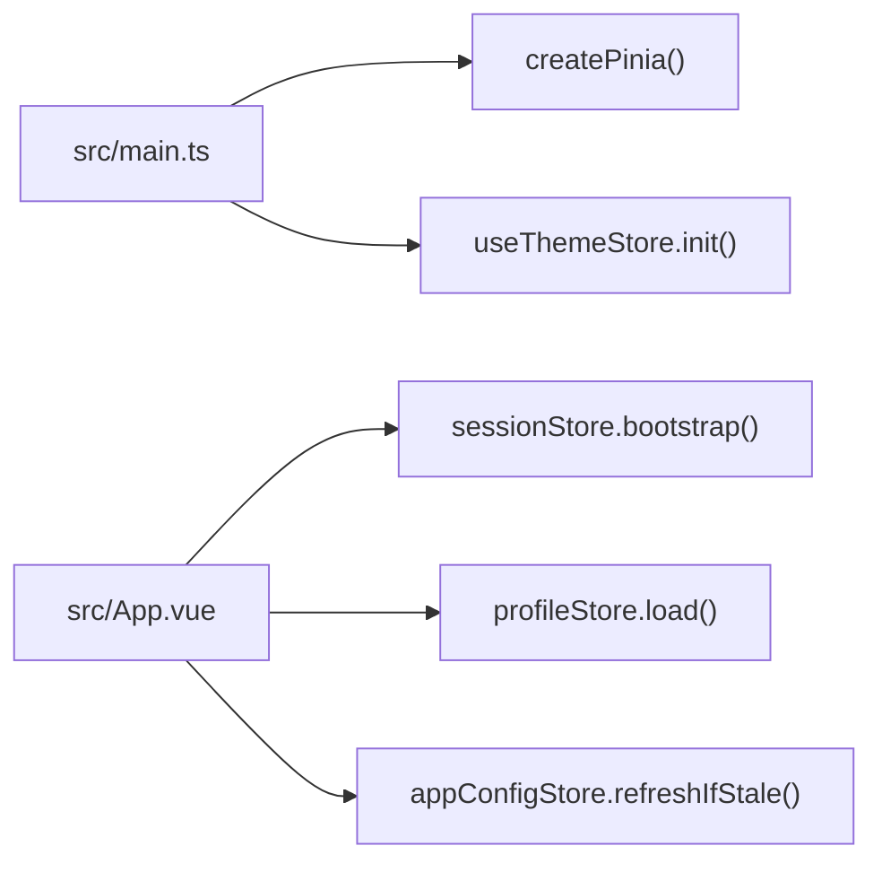

**图表来源**  
- [apps/client/src/main.ts:1-122](file://apps/client/src/main.ts#L1-L122)  
- [apps/client/src/App.vue:1-200](file://apps/client/src/App.vue#L1-L200)

**章节来源**  
- [apps/client/src/main.ts:1-122](file://apps/client/src/main.ts#L1-L122)  
- [apps/client/src/App.vue:1-200](file://apps/client/src/App.vue#L1-L200)

## 组件设计规范与最佳实践
基于当前代码结构与注释，可总结以下规范：

- **生命周期使用**
  - 小程序侧优先使用 uni-app 提供的 `onLaunch`、`onShow`、`onMounted`，避免在 $scope 未就绪时渲染带事件处理器的组件。
- **错误处理**
  - 所有异常统一通过 `reportGlobalError` 上报，保持监控出口一致。
  - 在 `try-catch` 包裹关键启动逻辑，失败时仍继续应用启动并记录错误。
- **样式组织**
  - 使用 SCSS 与设计令牌，避免重复定义基础样式；通过 `page` 级别统一背景与字体。
- **构建与打包**
  - H5 端启用 manualChunks，合理拆分第三方依赖；小程序端遵循 uni-app 自动依赖分析。
- **平台兼容**
  - 对缺失的原生 API 提供 polyfill；对 wx 对象存在性做运行时判断。
- **组件开发建议**
  - 组件内尽量使用 Composition API，配合 Pinia store 与 composables。
  - 避免在组件内直接操作小程序原生对象，统一通过 uni-app API 或适配层访问。
  - 对动画与交互使用 GSAP 或 CSS 动画，注意性能与帧率。

[本节为通用规范总结，不直接分析具体源码文件，故不提供章节来源]

## 常见问题与排错
常见问题及对应解决思路：

- **H5 页面空白或 Vue 运行时插槽报错**
  - 原因：uni-h5-vue 的 `updateSlots` 赋值 non-writable 属性导致 TypeError。
  - 解决：Vite 插件在 transform 阶段修补该行为。
- **环境变量在小程序生产包中不可用**
  - 原因：直接使用 `import.meta.env.*` 在小程序端有兼容风险。
  - 解决：通过 Vite `define` 注入为 `process.env.*` 常量。
- **小程序基础库不支持 optional catch binding**
  - 原因：ES2019 语法不被基础库支持。
  - 解决：mp-weixin 构建目标设为 es2018。
- **隐私协议弹窗叠弹导致点击失效**
  - 原因：并发触发隐私回调。
  - 解决：引入 pending 标志，已有弹窗时拒绝本次触发。
- **全局错误重复上报**
  - 原因：多处重复注册错误监听。
  - 解决：在 `main.ts` 集中注册，App.vue 不再重复监听。

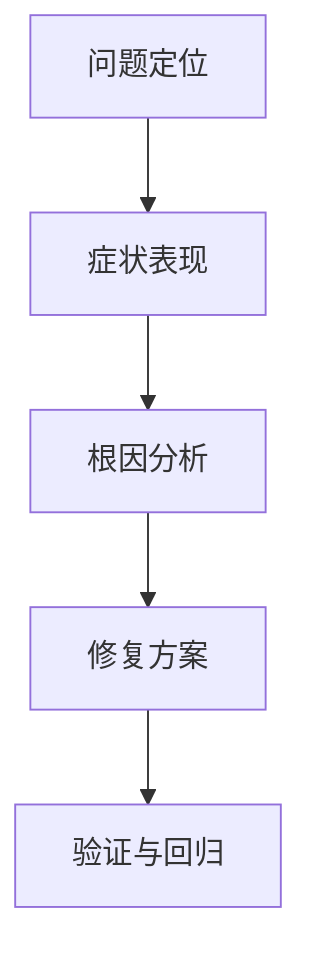

[本图为概念性图示，不对应具体源码文件，故不提供图表来源]

**章节来源**  
- [apps/client/vite.config.ts:1-240](file://apps/client/vite.config.ts#L1-L240)  
- [apps/client/src/main.ts:1-122](file://apps/client/src/main.ts#L1-L122)  
- [apps/client/src/App.vue:1-200](file://apps/client/src/App.vue#L1-L200)

## 结论
该 Uni-app 客户端工程通过成熟的构建与运行时配置，实现了在多端环境下的一致体验：
- 使用 Vue 3 Composition API 与 Pinia 管理状态，结合 i18n 与 Sentry 完成国际化与错误监控。
- 通过 Vite 构建配置实现平台差异化 ES 目标、环境变量注入与 H5 分包优化。
- 在小程序端做好隐私合规、polyfill 与全局错误监听，保障稳定性与合规性。
- 样式系统以设计令牌为核心，统一主题与深色模式，提升可维护性与一致性。

建议在后续迭代中继续遵循本文档中的规范与最佳实践，保持代码质量、性能与跨平台兼容性。