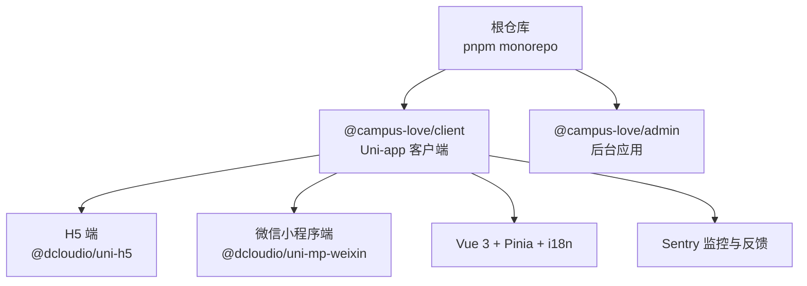
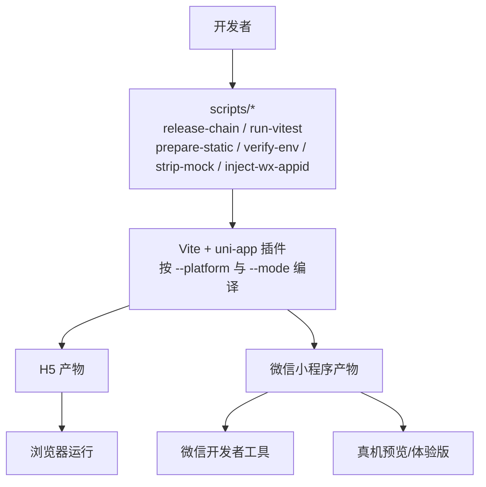
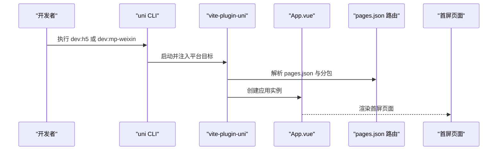
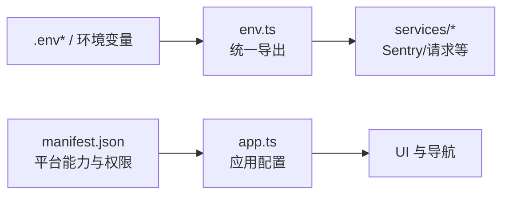
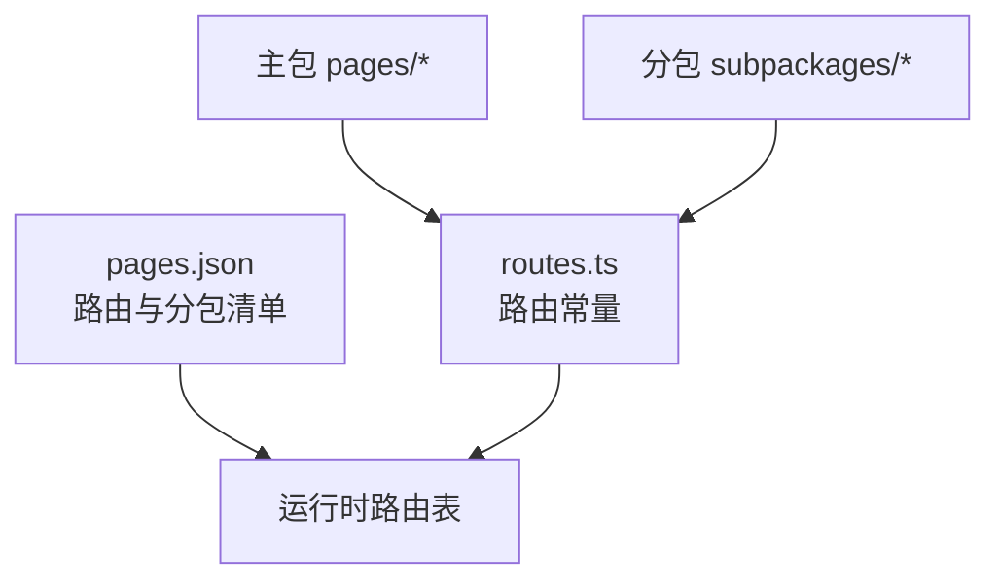
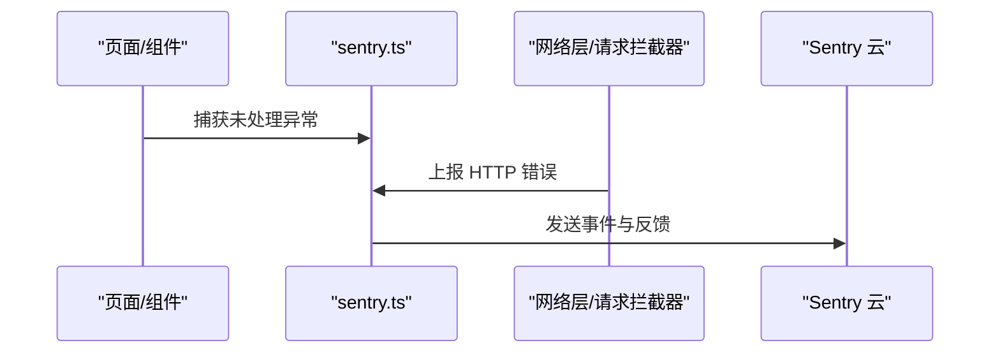
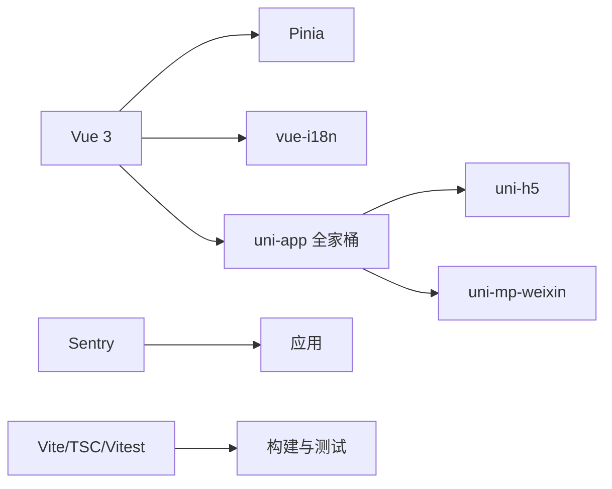
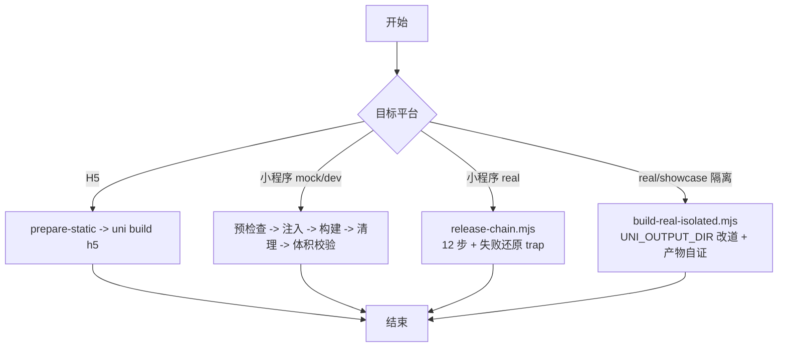
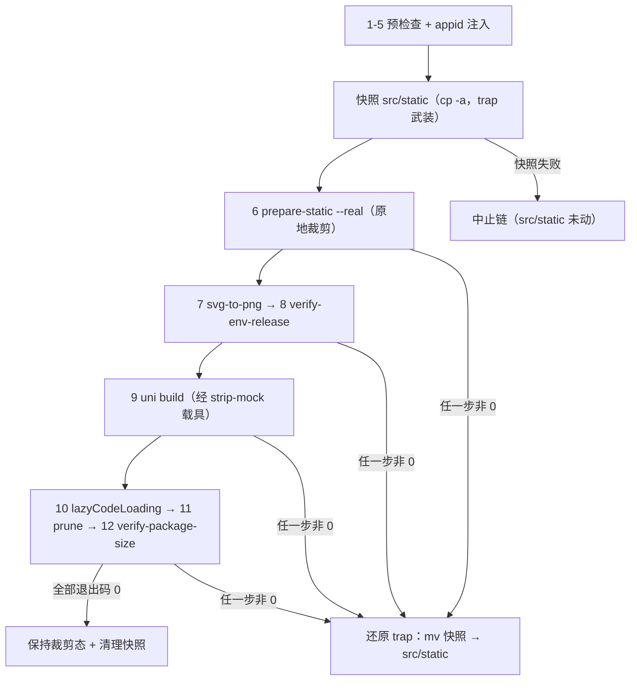

# 应用架构

<cite>
**本文引用的文件**   
- [package.json](file://package.json)
- [pnpm-workspace.yaml](file://pnpm-workspace.yaml)
- [apps/client/package.json](file://apps/client/package.json)
- [apps/client/src/manifest.json](file://apps/client/src/manifest.json)
- [apps/client/src/pages.json](file://apps/client/src/pages.json)
- [apps/client/src/App.vue](file://apps/client/src/App.vue)
- [apps/client/src/config/app.ts](file://apps/client/src/config/app.ts)
- [apps/client/src/config/env.ts](file://apps/client/src/config/env.ts)
- [apps/client/src/constants/routes.ts](file://apps/client/src/constants/routes.ts)
- [apps/client/src/services/sentry.ts](file://apps/client/src/services/sentry.ts)
- [apps/client/vitest.config.ts](file://apps/client/vitest.config.ts)
- [apps/client/scripts/release-chain.mjs](file://apps/client/scripts/release-chain.mjs)
- [apps/client/scripts/build-real-isolated.mjs](file://apps/client/scripts/build-real-isolated.mjs)
- [apps/client/scripts/strip-mock-for-mp.mjs](file://apps/client/scripts/strip-mock-for-mp.mjs)
- [apps/client/scripts/add-lazy-code-loading.mjs](file://apps/client/scripts/add-lazy-code-loading.mjs)
- [apps/client/scripts/run-vitest.mjs](file://apps/client/scripts/run-vitest.mjs)
- [build-mp-weixin.bat](file://build-mp-weixin.bat)
- [start-showcase.bat](file://start-showcase.bat)
</cite>

## 目录
1. [引言](#引言)
2. [项目结构](#项目结构)
3. [核心组件](#核心组件)
4. [架构总览](#架构总览)
5. [详细组件分析](#详细组件分析)
6. [依赖关系分析](#依赖关系分析)
7. [性能与体积优化](#性能与体积优化)
   - [按需注入与主包减负](#按需注入与主包减负)
8. [构建、环境与多端适配](#构建环境与多端适配)
   - [构建命令与工作流](#构建命令与工作流)
   - [正式包发布链与失败还原](#正式包发布链与失败还原)
   - [隔离构建载具与产物目录](#隔离构建载具与产物目录)
   - [环境变量管理](#环境变量管理)
   - [多端差异处理](#多端差异处理)
9. [开发工作流与测试](#开发工作流与测试)
   - [本地开发](#本地开发)
   - [启动脚本与Node版本闸](#启动脚本与node版本闸)
   - [单测与覆盖率](#单测与覆盖率)
   - [端到端测试与可视化](#端到端测试与可视化)
10. [故障排查指南](#故障排查指南)
11. [结论](#结论)

## 引言
本技术文档面向 Uni-app 客户端应用，目标是系统性说明该项目的整体架构、Vue 3 + TypeScript 集成方案、启动流程、全局配置、生命周期管理、错误处理机制、分包策略、路由组织、构建与环境变量管理、多端差异处理、性能优化、调试技巧以及开发与跨平台测试方法。读者无需深入源码即可掌握运行方式、扩展点与常见问题定位路径。

## 项目结构
仓库采用 pnpm monorepo，根 package.json 通过 workspaces 声明 apps/client 和 apps/admin 两个子应用；client 子应用是 Uni-app 客户端，使用 @dcloudio/uni-* 全家桶（uni-app、uni-h5、uni-mp-weixin）和 Vite 插件驱动。

**图表来源**
- [package.json:1-20](file://package.json#L1-L20)
- [pnpm-workspace.yaml:1-13](file://pnpm-workspace.yaml#L1-L13)
- [apps/client/package.json:1-40](file://apps/client/package.json#L1-L40)

**章节来源**
- [package.json:1-48](file://package.json#L1-L48)
- [pnpm-workspace.yaml:1-13](file://pnpm-workspace.yaml#L1-L13)
- [apps/client/package.json:1-104](file://apps/client/package.json#L1-L104)

## 核心组件
- 应用入口与页面注册：由 uni-app 在运行时解析 src/pages.json 进行页面与分包注册，src/App.vue 作为应用根组件承载全局样式、主题、导航与生命周期钩子。
- 全局配置：src/manifest.json 定义应用名、版本、平台能力（小程序权限、H5 标题等），src/config/app.ts 提供应用级常量与行为开关。
- 环境变量：src/config/env.ts 统一暴露运行时环境变量，结合 scripts 中的 prepare-static.mjs 与 verify-env-release.mjs 完成开发/发布环境切换。
- 路由与导航：src/constants/routes.ts 集中维护业务路由常量，配合 pages.json 实现多端一致的路由映射；自定义 TabBar 逻辑位于 custom-tab-bar 相关脚本与 composables/useTabBar.ts。
- 错误与可观测性：src/services/sentry.ts 封装 Sentry 初始化、事件上报与用户反馈；结合 Vitest 单测与 Playwright E2E 覆盖关键链路。
- 发布与测试编排：`build:mp-weixin:real` 已收敛为 `node scripts/release-chain.mjs`（显式步骤表 + 失败即还原），`test`/`test:unit`/`test:coverage`/`test:watch` 收敛为 `node scripts/run-vitest.mjs` 载具（Node 版本自愈），两者都取代了 package.json 中原来的 `&&` 长串。

**章节来源**
- [apps/client/src/App.vue](file://apps/client/src/App.vue)
- [apps/client/src/manifest.json:1-92](file://apps/client/src/manifest.json#L1-L92)
- [apps/client/src/config/app.ts](file://apps/client/src/config/app.ts)
- [apps/client/src/config/env.ts](file://apps/client/src/config/env.ts)
- [apps/client/src/constants/routes.ts](file://apps/client/src/constants/routes.ts)
- [apps/client/src/services/sentry.ts](file://apps/client/src/services/sentry.ts)
- [apps/client/package.json:29](file://apps/client/package.json#L29)
- [apps/client/package.json:40-43](file://apps/client/package.json#L40-L43)

## 架构总览
Uni-app 客户端以 Vite 为构建器，通过 @dcloudio/vite-plugin-uni 将 Vue 3 组件编译到各目标平台。应用层采用模块化目录组织：pages 与 subpackages 分别承担主包与分包页面；services 提供网络与第三方服务；config 集中管理与平台无关的全局配置；utils/composables 提供通用能力。

**图表来源**
- [apps/client/package.json:12-39](file://apps/client/package.json#L12-L39)
- [apps/client/scripts/release-chain.mjs:38-51](file://apps/client/scripts/release-chain.mjs#L38-L51)

**章节来源**
- [apps/client/package.json:12-39](file://apps/client/package.json#L12-L39)

## 详细组件分析

### 应用启动与生命周期
- 启动顺序：Vite 启动 → uni-app 插件加载 → 解析 manifest.json 与 pages.json → 渲染 App.vue → 挂载首个页面。
- 生命周期：App.vue 中可使用 uni-app 提供的 onLaunch/onShow/onHide 等钩子；页面级使用 onLoad/onShow 等；Pinia store 负责跨页面状态，i18n 提供多语言。
- 条件编译：通过 #ifdef/ifndef 控制不同平台的代码分支，确保小程序与 H5 的差异仅在必要时存在。

**图表来源**
- [apps/client/package.json:12-20](file://apps/client/package.json#L12-L20)
- [apps/client/src/pages.json](file://apps/client/src/pages.json)
- [apps/client/src/App.vue](file://apps/client/src/App.vue)

**章节来源**
- [apps/client/package.json:12-20](file://apps/client/package.json#L12-L20)
- [apps/client/src/App.vue](file://apps/client/src/App.vue)
- [apps/client/src/pages.json](file://apps/client/src/pages.json)

### 全局配置与环境变量
- manifest.json：集中声明应用元信息、小程序权限、H5 标题、平台 setting 等；其中包含小程序 appid 与隐私弹窗开关等关键项。
- env.ts：统一导出运行时环境变量，便于在不同 mode（development/real/mp-weixin 等）下读取对应值。
- app.ts：应用级常量、功能开关与默认配置，供各模块共享。

**图表来源**
- [apps/client/src/config/env.ts](file://apps/client/src/config/env.ts)
- [apps/client/src/config/app.ts](file://apps/client/src/config/app.ts)
- [apps/client/src/manifest.json:1-92](file://apps/client/src/manifest.json#L1-L92)

**章节来源**
- [apps/client/src/config/env.ts](file://apps/client/src/config/env.ts)
- [apps/client/src/config/app.ts](file://apps/client/src/config/app.ts)
- [apps/client/src/manifest.json:1-92](file://apps/client/src/manifest.json#L1-L92)

### 分包策略与路由组织
- 主包：src/pages 放置高频访问的核心页面，减少首次加载时间。
- 分包：src/subpackages 按业务域拆分（如 circles、profile-extra、discover-extra、setup 等），按需加载，降低主包体积。
- 路由：pages.json 声明所有页面与 tabBar；constants/routes.ts 维护业务路由常量，避免硬编码字符串导致的不一致。

**图表来源**
- [apps/client/src/pages.json](file://apps/client/src/pages.json)
- [apps/client/src/constants/routes.ts](file://apps/client/src/constants/routes.ts)

**章节来源**
- [apps/client/src/pages.json](file://apps/client/src/pages.json)
- [apps/client/src/constants/routes.ts](file://apps/client/src/constants/routes.ts)

### 错误处理与可观测性
- Sentry 集成：services/sentry.ts 负责初始化 SDK、捕获异常、上报用户反馈与回放；结合条件编译在生产构建启用。
- 日志与诊断：通过环境变量控制日志级别与上报开关；在开发模式输出更详细的错误堆栈，生产模式仅上报必要信息。

**图表来源**
- [apps/client/src/services/sentry.ts](file://apps/client/src/services/sentry.ts)

**章节来源**
- [apps/client/src/services/sentry.ts](file://apps/client/src/services/sentry.ts)

## 依赖关系分析
- 运行时依赖：vue、pinia、vue-i18n、@vueuse/core、gsap、uni-ui 等；Sentry 系列用于监控与反馈。
- 平台依赖：@dcloudio/uni-h5、@dcloudio/uni-mp-weixin 与对应的 vite 插件，保证 H5 与小程序双端构建。
- 构建依赖：vite、typescript、sass、vitest、playwright 等。

**图表来源**
- [apps/client/package.json:41-104](file://apps/client/package.json#L41-L104)

**章节来源**
- [apps/client/package.json:41-104](file://apps/client/package.json#L41-L104)

## 性能与体积优化
- 分包与懒加载：将非首屏业务放入 subpackages，利用 uni-app 自动懒加载机制，缩短首屏时间。
- 静态资源预处理：scripts/profile-svg-to-png.mjs 将 SVG 转为 PNG 以适配小程序限制；scripts/prune-unreferenced-static.mjs 清理未引用静态资源。
- 构建时校验：check-mp-image-styles.mjs、check-statusbar-offset.mjs、check-tabbar-consistency.mjs 等脚本在构建前检查潜在问题，避免上线后回滚。
- 运行时优化：合理使用缓存、图片压缩、按需引入库、减少不必要的 re-render。

### 按需注入与主包减负
- 源码声明：`src/pages.json` 根节点写有 `"lazyCodeLoading": "requiredComponents"`（微信基础库 ≥2.11.1 才生效），并配有取值说明注释。
- 为什么不生效：当前 uni alpha 的产物 app.json 字段白名单只含 `preloadRule/workers/plugins/entryPagePath`，不会把 `lazyCodeLoading` 透传出去，因此构建后需要显式补写。
- 补写脚本改的是哪个产物的哪个字段：`scripts/add-lazy-code-loading.mjs` 默认读取并回写 `apps/client/dist/build/mp-weixin/app.json` 的**根级 `lazyCodeLoading` 字段**（第一个位置参数可覆盖产物目录）。
- 安全前置校验：若产物 app.json 的全局 `usingComponents` 非空，按需注入会漏掉全局组件，脚本直接 `exit 1` 要求人工评估，而不是静默写入。
- 幂等与不覆盖：值已是 `requiredComponents` 时打印「uni 已透传，幂等跳过」并以 0 退出；已存在其他取值时报错退出，不覆盖。
- 链上位置：位于 release 链的 `uni build`（第 9 步）之后、`prune-unreferenced-static`（第 11 步）与 `verify-package-size`（第 12 步）之前，保证体积门禁量到的就是最终产物。
- 已知口径差异：隔离出口 `build:mp-weixin:real:isolated` 的步骤表（preSteps / FULL_CHAIN）不含该脚本，故 `dist/build/mp-weixin-real` 产物不会被补写此字段。

**章节来源**
- [apps/client/package.json:12-39](file://apps/client/package.json#L12-L39)
- [apps/client/src/pages.json:35-40](file://apps/client/src/pages.json#L35-L40)
- [apps/client/scripts/add-lazy-code-loading.mjs:1-56](file://apps/client/scripts/add-lazy-code-loading.mjs#L1-L56)
- [apps/client/scripts/add-lazy-code-loading.mjs:25-26](file://apps/client/scripts/add-lazy-code-loading.mjs#L25-L26)
- [apps/client/scripts/add-lazy-code-loading.mjs:36-52](file://apps/client/scripts/add-lazy-code-loading.mjs#L36-L52)
- [apps/client/scripts/release-chain.mjs:47-50](file://apps/client/scripts/release-chain.mjs#L47-L50)
- [apps/client/scripts/build-real-isolated.mjs:65-74](file://apps/client/scripts/build-real-isolated.mjs#L65-L74)

## 构建、环境与多端适配

### 构建命令与工作流
- H5 开发/构建：dev:h5/build:h5 调用 prepare-static.mjs 准备静态资源，再通过 uni CLI 以 platform=h5 构建；real 模式会额外执行 verify-env-release.mjs 验证发布环境变量。
- 微信小程序开发/构建：dev:mp-weixin/build:mp-weixin 链式调用图像样式检查、SVG 转 PNG、appid 注入、mock 剥离、体积校验等脚本；showcase 与 mock 模式支持演示与单元测试场景。
- 正式包（real）：`build:mp-weixin:real` 现在只有一行 `node scripts/release-chain.mjs`，链内容以脚本里的显式步骤表为准，不再散落在 package.json 的 `&&` 串里。
- 隔离出口：`build:mp-weixin:real:isolated`、`build:mp-weixin:real:isolated:full`、`build:mp-weixin:showcase:isolated` 都指向同一个载具 `scripts/build-real-isolated.mjs`（`--band` 决定档位），用于把产物写进独立目录而不覆盖共享目录。
- 类型检查：typecheck 使用 vue-tsc 做严格类型检查，保障 TS 质量。

**图表来源**
- [apps/client/package.json:12-39](file://apps/client/package.json#L12-L39)
- [apps/client/scripts/release-chain.mjs:38-51](file://apps/client/scripts/release-chain.mjs#L38-L51)

**章节来源**
- [apps/client/package.json:12-39](file://apps/client/package.json#L12-L39)
- [apps/client/package.json:25-32](file://apps/client/package.json#L25-L32)

### 正式包发布链与失败还原
`scripts/release-chain.mjs` 把原来的 `&&` 长串收编为显式步骤表 `const STEPS = [...]`（实测共 12 步，头注释明确标注「顺序敏感，勿乱动」）。每个步骤都以 `apps/client` 为 cwd、用 `spawnSync(process.execPath, …)` 启动；`args[0]` 与原来一样相对 `apps/client/` 解析，因此 `../../scripts/` 指向仓库根 `scripts/`。

| 序号 | 步骤名 | 实际命令（相对 apps/client） | snapshotBefore |
| --- | --- | --- | --- |
| 1 | check-mp-image-styles | scripts/check-mp-image-styles.mjs --strict | false |
| 2 | check-statusbar-offset | scripts/check-statusbar-offset.mjs | false |
| 3 | check-tabbar-consistency | scripts/check-tabbar-consistency.mjs | false |
| 4 | check-project-rules | scripts/check-project-rules.mjs | false |
| 5 | inject-wx-appid | scripts/inject-wx-appid.mjs | false |
| 6 | prepare-static --real | scripts/prepare-static.mjs --real | true |
| 7 | profile-svg-to-png | scripts/profile-svg-to-png.mjs | false |
| 8 | verify-env-release | ../../scripts/verify-env-release.mjs | false |
| 9 | uni build (via strip-mock) | scripts/strip-mock-for-mp.mjs "uni build --platform mp-weixin --mode real" | false |
| 10 | add-lazy-code-loading | scripts/add-lazy-code-loading.mjs | false |
| 11 | prune-unreferenced-static | scripts/prune-unreferenced-static.mjs | false |
| 12 | verify-package-size | ../../scripts/verify-package-size.mjs | false |

失败处理与还原机制：
- 为什么需要还原：`prepare-static --real` 会把 `src/static` 原地换成裁剪态（完整集合另存于 `static-local-backup/full-static`），历史上链中它之后的任何一步失败（实测是 verify-env-release 挡住非 HTTPS 的 `.env.real`）都会让约 1241 个跟踪文件在 git 里摆成「被删除」，需人工按具名路径 checkout。
- 快照：只有第 6 步带 `snapshotBefore: true`。执行前用系统命令 `cp -a` 把 `src/static` 整体复制到 `apps/client/static_release_guard_<pid>_<timestamp>`；`src/static` 不存在时跳过快照、trap 不武装并打警告；`cp` 非 0 退出时删除半成品快照目录并中止整条链（此时 `src/static` 未被触碰）。
- 失败判定：步骤无法启动 → exitCode=1；子进程退出码非 0 → exitCode 直接沿用该退出码；两种情况都立即 break，不再执行后续步骤。
- 还原：快照可用时打印「触发失败还原 trap」，并把快照搬回 `src/static`，序列与 prepare-static 的 atomicPromote 一致：`mv src/static → src/static.bak.<ts>` → `mv 快照 → src/static` → `rm -rf .bak`；还原自身失败时把 `.bak` 再搬回 `src/static` 并 `exit 1`，同时打印裁剪态的保留路径。文件搬运全部走 spawnSync 的 cp/mv/rm，不经过被 NODE_OPTIONS shim 拦截的 fs API，因此还原是字节级的、不依赖 git 状态、也不碰用户既有脏改动。
- 成功路径：保持裁剪态（发布形态的预期中间产物）、清理快照目录、打印「real 发布链全部通过」，进程以累计 exitCode 退出。
- 不在链内：`add-error-a11y.mjs`、`add-input-aria-label.mjs`、`add-list-roles.mjs` 三个脚本文件确实存在于 `apps/client/scripts`（git 已跟踪），但它们既不在 STEPS 中，也没有被 package.json 任何 script 引用；它们是对源码批量补无障碍属性的一次性工具，描述发布链时不要把它们算作链上步骤。

**图表来源**
- [apps/client/scripts/release-chain.mjs:38-51](file://apps/client/scripts/release-chain.mjs#L38-L51)
- [apps/client/scripts/release-chain.mjs:107-145](file://apps/client/scripts/release-chain.mjs#L107-L145)

**章节来源**
- [apps/client/scripts/release-chain.mjs:1-24](file://apps/client/scripts/release-chain.mjs#L1-L24)
- [apps/client/scripts/release-chain.mjs:38-51](file://apps/client/scripts/release-chain.mjs#L38-L51)
- [apps/client/scripts/release-chain.mjs:54-56](file://apps/client/scripts/release-chain.mjs#L54-L56)
- [apps/client/scripts/release-chain.mjs:59-101](file://apps/client/scripts/release-chain.mjs#L59-L101)
- [apps/client/scripts/release-chain.mjs:107-145](file://apps/client/scripts/release-chain.mjs#L107-L145)
- [apps/client/scripts/release-chain.mjs:148-153](file://apps/client/scripts/release-chain.mjs#L148-L153)
- [apps/client/package.json:29](file://apps/client/package.json#L29)
- [apps/client/scripts/strip-mock-for-mp.mjs:10-15](file://apps/client/scripts/strip-mock-for-mp.mjs#L10-L15)

### 隔离构建载具与产物目录
- 单一载具、档位表驱动：`scripts/build-real-isolated.mjs` 内 `BANDS = { real, showcase }`，`--band`（默认 real）决定喂给 uni 的 `--mode`、独立输出目录 `dist/build/mp-weixin-<档>`、是否走 strip-mock、前置步骤与产物自证判点；新增一档应在 BANDS 加行而不是抄脚本。
- 为什么需要它：uni 的输出目录只能靠 `UNI_OUTPUT_DIR` 改道，而 Windows 上 npm/pnpm 脚本链无法给子进程注入该变量；直接跑非 mock 档会把产物原地覆盖进共享目录 `dist/build/mp-weixin`，毁掉 mock 轮的 before/after 配对证据。
- 硬闸：`--out` 指向或落在 mock 共享目录内（Windows 路径大小写不敏感）时直接 FAIL 退出；`--self-test` 在本文件的临时复制件上验证这道闸是承重的（删掉闸体负例即转红）。
- 前后指纹：构建前后读取共享目录 `config/env.js` 的 `size:mtimeMs`，一旦变化即判「mock 共享产物被动过，本轮证据链作废」。
- 产物自证：从隔离产物的 `config/env.js` 解析 `MODE / VITE_API_MODE / VITE_API_BASE_URL`（展示档另判 `VITE_SHOWCASE_MODE` 与 `config/feature-flags.js` 初值），逐项对齐档位默认期望，末尾输出 `G7_RESULT=PASS/FAIL`（展示档为 `SHOWCASE_RESULT`）。
- 与 release 链的差别：载具只跑「可安全改道」的最小子集——`prepare-static` 用 `--dev`（不做 src/static 原地裁剪，因此不需要还原 trap），`--full-chain` 才追加 7 步预检查；写死共享目录的 prune-unreferenced-static、verify-package-size、verify-build-features 不在其步骤表内。
- 环境要求：主版本 <18 时直接打印 FAIL，并提示 PATH 上的 node 常是 v16、会把该门禁记成假 FAIL（与下一节 bat 的版本闸同源）。

**章节来源**
- [apps/client/scripts/build-real-isolated.mjs:14-36](file://apps/client/scripts/build-real-isolated.mjs#L14-L36)
- [apps/client/scripts/build-real-isolated.mjs:65-121](file://apps/client/scripts/build-real-isolated.mjs#L65-L121)
- [apps/client/scripts/build-real-isolated.mjs:133-138](file://apps/client/scripts/build-real-isolated.mjs#L133-L138)
- [apps/client/scripts/build-real-isolated.mjs:146-184](file://apps/client/scripts/build-real-isolated.mjs#L146-L184)
- [apps/client/scripts/build-real-isolated.mjs:206-279](file://apps/client/scripts/build-real-isolated.mjs#L206-L279)
- [apps/client/package.json:28-32](file://apps/client/package.json#L28-L32)

### 环境变量管理
- 环境变量入口：env.ts 统一导出，配合 .env.* 文件与 prepare-static.mjs 的 mode 参数，区分 development、real、mp-weixin 等环境。
- 安全与校验：verify-env-release.mjs 在发布构建中校验关键变量是否齐全，防止遗漏导致的线上问题。

**章节来源**
- [apps/client/src/config/env.ts](file://apps/client/src/config/env.ts)
- [apps/client/package.json:12-20](file://apps/client/package.json#L12-L20)

### 多端差异处理
- 小程序特有配置：manifest.json 中 mp-weixin 段设置权限、暗色模式、主题位置等；requiredPrivateInfos 与 permission.scope.userLocation 声明定位能力。
- H5 特有配置：manifest.json 中 h5 段设置浏览器标题；可通过条件编译隔离 DOM/Browser API 调用。
- 条件编译：使用 #ifdef/ifndef 包裹平台特定逻辑，保证同一份源码在多端正确运行。
- 路由的条件编译（pages.json）：主包 `pages` 数组内有两处编译期裁剪——`dev/index` 由 `// #ifdef DEV` 包裹，`showcase/index`（全功能展示页）由 `// #ifdef SHOWCASE` 包裹；两处都各带一段 `/* */` 说明注释（showcase 的是 284-290 行的块注释，紧接 291-295 行的 `#ifdef … #endif`）。正式包（real/mock）构建不定义这两个符号 → 路由条目在编译期被整体剔除。
- 符号从哪来：`DEV` 与 `SHOWCASE` 都由 package.json 的 `uni-app.scripts` 自定义平台载具注入（`dev-debug` 的 `define.DEV=true`、`mp-weixin-showcase` 的 `define.SHOWCASE=true` + `env.UNI_PLATFORM=mp-weixin`），必须用 `-p` 形式激活：`dev:mp-weixin:debug` 走 `uni -p dev-debug`，`build:mp-weixin:showcase` 走 `uni build -p mp-weixin-showcase --mode mp-weixin-showcase`，隔离载具的 showcase 档同样用 `uniCustomPlatform` 构造该命令。
- 与单测的相互作用：Vitest 不经过 uni 预处理器，而 pages.json 的条件编译块按惯例允许「块尾带逗号」，所以 `vitest.config.ts` 的 `jsonc-strip` 插件在剥注释后还会移除 `}`/`]` 前的尾逗号（与 uni 解析器容错口径对齐），否则 `vite:json` 严格解析会让 import pages.json 的套件当场报错；`.vue` 里的 `<!-- #ifdef … -->` 另由 `uni-conditional-strip` 插件在编译前剥离标记（保留内部内容，测试环境按 H5-like 处理）。

**章节来源**
- [apps/client/src/manifest.json:30-92](file://apps/client/src/manifest.json#L30-L92)
- [apps/client/src/pages.json:278-295](file://apps/client/src/pages.json#L278-L295)
- [apps/client/package.json:23-27](file://apps/client/package.json#L23-L27)
- [apps/client/package.json:55-76](file://apps/client/package.json#L55-L76)
- [apps/client/scripts/build-real-isolated.mjs:117-121](file://apps/client/scripts/build-real-isolated.mjs#L117-L121)
- [apps/client/vitest.config.ts:6-33](file://apps/client/vitest.config.ts#L6-L33)
- [apps/client/vitest.config.ts:35-62](file://apps/client/vitest.config.ts#L35-L62)

## 开发工作流与测试

### 本地开发
- H5 开发：client:dev:h5 或 client:dev:h5:real，支持实时热重载与真实后端联调。
- 小程序开发：client:dev:mp-weixin 或 debug 模式，便于在微信开发者工具中调试。

**章节来源**
- [apps/client/package.json:12-20](file://apps/client/package.json#L12-L20)
- [package.json:12-13](file://package.json#L12-L13)

### 启动脚本与Node版本闸
- 客户端的两个双击入口都在仓库根：`build-mp-weixin.bat`（正式包）与 `start-showcase.bat`（全功能展示包）；`apps/api` 与 `tools` 下的 bat 属于后端/工具启动，不参与客户端发布链。
- Node 版本闸先于所有构建步骤（Step 0），两支缺一不可：
  - 逃生门：`if defined NODE22_DIR` 时把该目录前置到 PATH（`set "PATH=!NODE22_DIR!;!PATH!"`，块内必须用延迟展开，否则变量未定义时也会执行 set）。
  - 拦截：`node -v` 探测主版本；探测不出纯数字主版本即报错退出；主版本 `LSS 20` 直接 `[ERROR] PATH 上的 Node 版本过低` 并 `exit /b 1`，错误信息同时给出「升级 Node」与「set NODE22_DIR 指向 Node 20+ 安装目录」两条修复路径。动机是 PATH 首位常是微信开发者工具自带的 node v16，会把整条构建/测试链崩成假红。
- 过闸之后：检查 pnpm → 必要时 `pnpm install --frozen-lockfile` → 设置了 `WX_APPID` 时执行 `node scripts\inject-wx-appid.mjs` → 调用隔离出口编译（正式包 `build:mp-weixin:real:isolated`，输出 `apps/client/dist/build/mp-weixin-real`；展示包先 `pnpm api:dev` 起 mock 后端，再 `build:mp-weixin:showcase:isolated`，输出 `dist/build/mp-weixin-showcase`）。也就是说 bat 走的是隔离载具，而不是 `build:mp-weixin:real` 那条 release 链。
- 交互判断：末尾用 `echo %CMDCMDLINE% | findstr /i "%~nx0"` 判断是否双击运行，只在双击时 `pause` 保留窗口。

**章节来源**
- [build-mp-weixin.bat:32-57](file://build-mp-weixin.bat#L32-L57)
- [build-mp-weixin.bat:60-109](file://build-mp-weixin.bat#L60-L109)
- [start-showcase.bat:18-44](file://start-showcase.bat#L18-L44)
- [start-showcase.bat:51-82](file://start-showcase.bat#L51-L82)
- [apps/client/package.json:28-32](file://apps/client/package.json#L28-L32)

### 单测与覆盖率
- 框架：Vitest + jsdom + @vue/test-utils，配置文件 vitest.config.ts。
- 命令：test/test:unit/test:coverage/test:watch 分别对应运行、单元、覆盖率与监听模式，四条命令都不直接调 vitest，而是经 `node scripts/run-vitest.mjs` 载具启动。
- 载具动机（实测）：pnpm 在 Windows 上按 cmd.exe 的 PATH 解析 `node`，本机首选命中微信开发者工具自带的 v16.13.1；而 vitest 2.1.9 依赖的 tinypool@1.1.1（engines `^18.0.0 || >=20.0.0`）在 Node 16 下启动即崩（`node:events` 不提供 `EventEmitterAsyncResource` 导出），失败早于任何测试文件加载。
- 选 node 规则：当前 node 落在 `[18, 23)` 就直接用（CI 等标准环境零行为变化）；否则遍历 PATH 各目录的 `node.exe`/`node`，取主版本最高且达标的一个重跑 vitest，并在输出顶部警告实际用的是哪个；环境变量 `CLIENT_TEST_NODE` 显式指定时优先级最高；找不到达标 node 则回退当前 node，保留 vitest 原始报错便于诊断。仓库根 engines 同样是 `>=18.0.0 <23.0.0`。
- CLI 解析：用 `createRequire` 从 apps/client/package.json 解析 `vitest` 入口，向上最多 6 层找 `name === "vitest"` 的包根并取其 `bin.vitest`（对 pnpm 符号链接透明），兜底路径 `node_modules/vitest/vitest.mjs`；解析不到就退出码 1 并提示先 `pnpm install`。运行方式是 `spawn(选定的 node, [vitestCli, ...原始参数])`，stdio inherit、沿用 env/cwd，并把子进程退出码原样透传。
- 自检参数：`node scripts/run-vitest.mjs --print-node` / `--print-cli` 只以 JSON 打印当前 node、选定 node 与解析出的 vitest CLI 后退出，不进入测试；脚本自身只用稳定 API，以便在旧 node（含 16.x）上也能跑。
- 运行配置：environment 为 jsdom，include `src/tests/**/*.spec.ts`，setupFiles `src/tests/setup.ts`，alias `@` 指向 src。
- 覆盖率：provider `v8`，reporter `text/text-summary/html/lcov`，输出目录 `coverage`；统计范围为 `src/**/*.ts` 与 `src/**/*.vue`，并排除测试自身、`*.d.ts`、`src/types`、入口 `src/main.ts`、`src/services/generated`、`src/services/mocks`、`*.types.ts`、`*.constants.ts` 与 `src/config`。
- 阈值（实测在 vitest.config.ts:115-120）：statements 80、branches 75、functions 80、lines 80。配置注释记录了口径来源（P7 把 lines/functions/statements 由 70 提到 80、branches 由 65 提到 75，与后端 JaCoCo 80% 对齐），并明确「阈值是目标值：不满足时记录差距而不降低阈值」。

**章节来源**
- [apps/client/package.json:40-43](file://apps/client/package.json#L40-L43)
- [apps/client/scripts/run-vitest.mjs:1-27](file://apps/client/scripts/run-vitest.mjs#L1-L27)
- [apps/client/scripts/run-vitest.mjs:34-45](file://apps/client/scripts/run-vitest.mjs#L34-L45)
- [apps/client/scripts/run-vitest.mjs:56-107](file://apps/client/scripts/run-vitest.mjs#L56-L107)
- [apps/client/scripts/run-vitest.mjs:110-140](file://apps/client/scripts/run-vitest.mjs#L110-L140)
- [apps/client/scripts/run-vitest.mjs:142-200](file://apps/client/scripts/run-vitest.mjs#L142-L200)
- [apps/client/vitest.config.ts:76-121](file://apps/client/vitest.config.ts#L76-L121)
- [apps/client/vitest.config.ts:110-120](file://apps/client/vitest.config.ts#L110-L120)
- [package.json:43-46](file://package.json#L43-L46)

### 端到端测试与可视化
- 自动化：Playwright 提供 e2e/a11y 测试，支持 UI 模式与 grep 筛选。
- 截图与审计：scripts 目录下大量 mp-shoot-* 与 feedback-* 脚本辅助截图、验证与回归。

**章节来源**
- [apps/client/package.json:21-31](file://apps/client/package.json#L21-L31)

## 故障排查指南
- 小程序权限缺失：若出现定位失败，检查 manifest.json 中 mp-weixin.requiredPrivateInfos 与 permission.scope.userLocation 是否已声明。
- 打包体积超标：使用 verify-package-size.mjs 与 prune-unreferenced-static.mjs 定位冗余资源；确认 SVG 是否已转 PNG。
- 环境变量遗漏：发布构建失败时优先运行 verify-env-release.mjs 检查必填变量。
- 路由不一致：通过 check-routes.cjs 或 pages.json 与 routes.ts 比对，确保路由常量与页面声明一致。
- 构建阶段报错：依次执行 pre-check 脚本（image/tabbar/statusbar/project-rules）定位规范问题。
- 发布链跑完 src/static「少了一批文件」：这是预期——第 6 步 `prepare-static --real` 会把 src/static 换成裁剪态，完整集合在 `static-local-backup/full-static`；若链中某步失败，脚本会自动把快照搬回 src/static（打印「已把 src/static 还原为构建前快照」）。若打印的是「快照不可用，无法自动还原」，才需要人工核对 `apps/client/src/static`。
- 单测/构建一启动就报 `The requested module 'node:events' does not provide an export named 'EventEmitterAsyncResource'`：PATH 首位是 v16 类老 node 造成的假红。单测侧 run-vitest.mjs 会自动挑选达标的 node 重跑（也可设 `CLIENT_TEST_NODE`）；bat 侧先 `set NODE22_DIR=<Node 20+ 安装目录>` 再重跑即可走逃生门。
- 想确认用的是哪个 node / 哪个 vitest CLI：`node scripts/run-vitest.mjs --print-node` 与 `--print-cli`（只打印不跑测试）。
- 展示包没有 showcase 页：SHOWCASE 符号未激活。必须用 `-p mp-weixin-showcase` 的载具（`build:mp-weixin:showcase` 或 `build-real-isolated.mjs --band showcase`）；用 `--platform mp-weixin` 构建时 pages.json 里的 showcase 路由会被编译期剔除。
- 产物 app.json 没有 lazyCodeLoading：说明该产物走的是隔离出口（其步骤表不含 add-lazy-code-loading），或该脚本因全局 `usingComponents` 非空而拒绝写入并退出；只有走完 release 链的 `dist/build/mp-weixin` 才会被补写。

**章节来源**
- [apps/client/src/manifest.json:1-92](file://apps/client/src/manifest.json#L1-L92)
- [apps/client/package.json:12-39](file://apps/client/package.json#L12-L39)
- [apps/client/scripts/release-chain.mjs:107-153](file://apps/client/scripts/release-chain.mjs#L107-L153)
- [apps/client/scripts/run-vitest.mjs:1-27](file://apps/client/scripts/run-vitest.mjs#L1-L27)
- [build-mp-weixin.bat:32-57](file://build-mp-weixin.bat#L32-L57)
- [apps/client/src/pages.json:284-295](file://apps/client/src/pages.json#L284-L295)
- [apps/client/scripts/add-lazy-code-loading.mjs:28-52](file://apps/client/scripts/add-lazy-code-loading.mjs#L28-L52)

## 结论
该 Uni-app 客户端采用标准的 Vue 3 + TypeScript 技术栈，依托 uni-app 生态实现 H5 与微信小程序双端构建。通过严格的分包策略、集中的路由与配置管理、完善的构建脚本链与测试体系，项目可维护性、可观测性与性能方面具备良好基础。建议继续坚持“分包优先、脚本前置校验、环境变量集中管理”的实践，并在新增业务时遵循现有目录与命名约定，以保证长期演进的一致性。建议在新增业务时遵循现有目录与命名约定，以保证长期演进的一致性。近期把「顺序」与「环境」两处易碎点收进代码的做法值得延续：real 发布链收编为 `release-chain.mjs` 的显式步骤表并配「失败即还原」快照 trap，单测收编为 `run-vitest.mjs` 的 Node 版本自愈载具，启动 bat 前置 Node 20 版本闸并留 `NODE22_DIR` 逃生门，展示页路由靠 `#ifdef SHOWCASE` 在编译期剔除——这些都让构建结果不再依赖操作者的机器状态与手工步骤顺序。