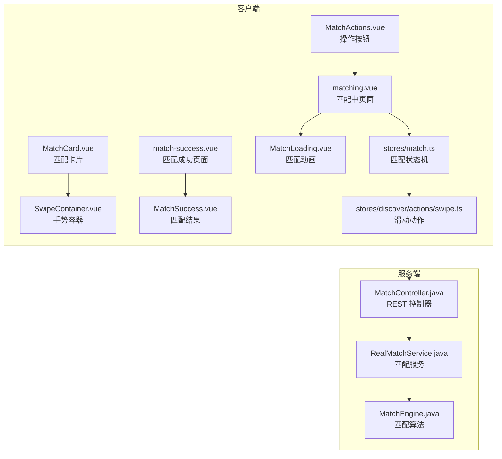
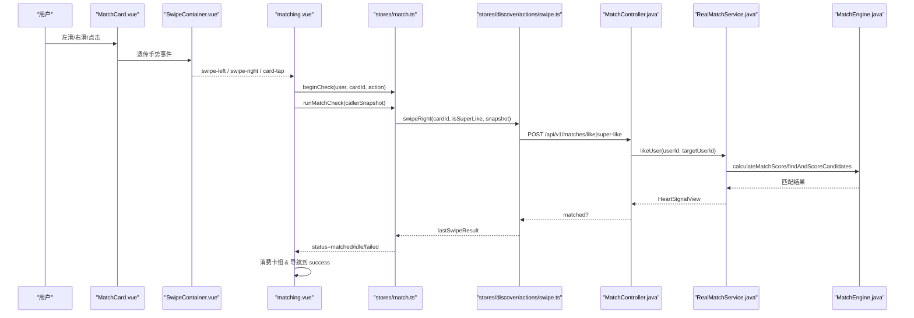
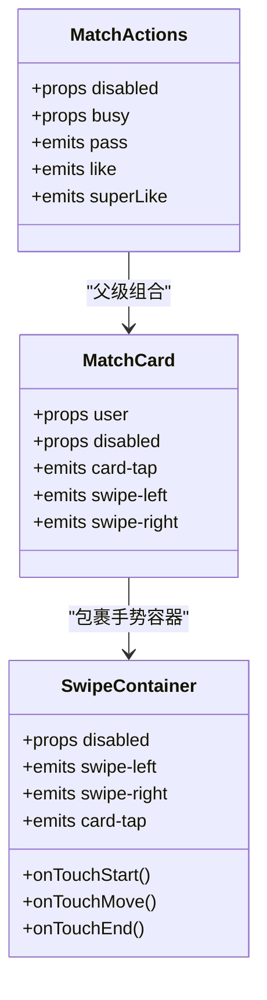
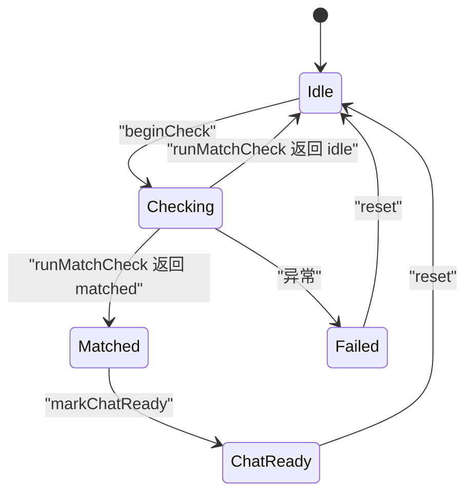
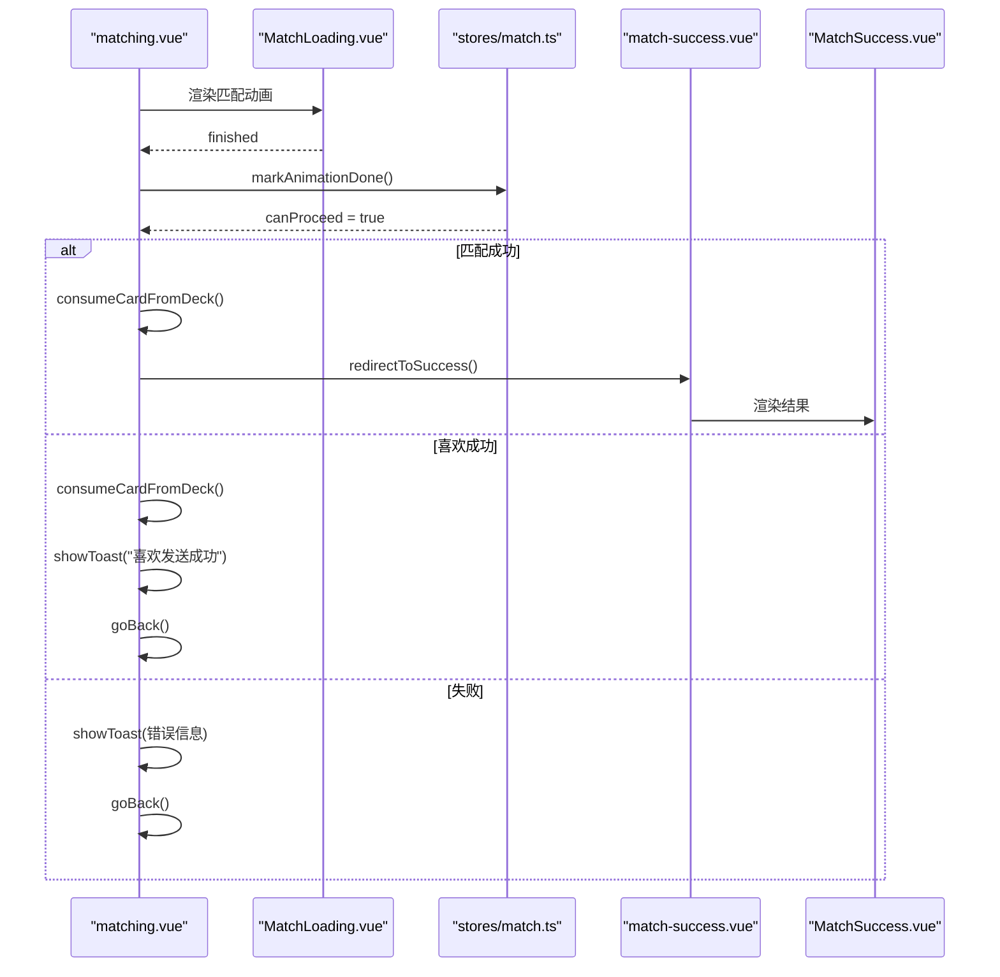
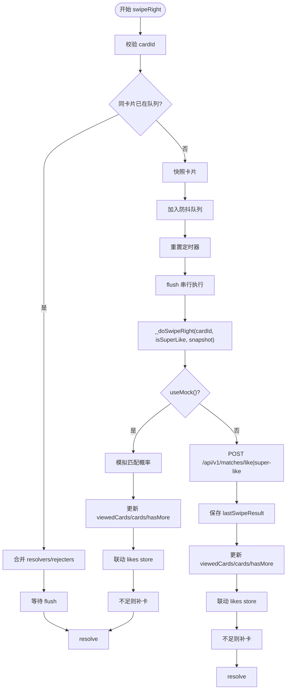
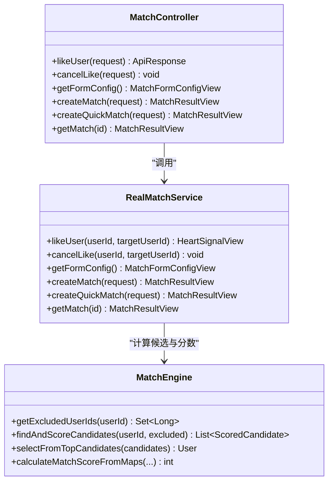
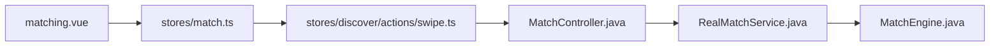

# 匹配系统

<cite>
**本文引用的文件**   
- [matching.vue](file://apps/client/src/subpackages/discover-extra/discover/matching.vue)
- [match-success.vue](file://apps/client/src/subpackages/discover-extra/discover/match-success.vue)
- [MatchCard.vue](file://apps/client/src/components/match/MatchCard.vue)
- [MatchActions.vue](file://apps/client/src/components/match/MatchActions.vue)
- [SwipeContainer.vue](file://apps/client/src/components/common/swipe/SwipeContainer.vue)
- [MatchLoading.vue](file://apps/client/src/components/match/MatchLoading.vue)
- [MatchSuccess.vue](file://apps/client/src/components/match/MatchSuccess.vue)
- [match.ts（客户端 Pinia Store）](file://apps/client/src/stores/match.ts)
- [swipe.ts（滑动动作）](file://apps/client/src/stores/discover/actions/swipe.ts)
- [match.ts（类型定义）](file://apps/client/src/types/match.ts)
- [MatchController.java](file://apps/api/src/main/java/com/campuslove/api/match/MatchController.java)
- [RealMatchService.java](file://apps/api/src/main/java/com/campuslove/api/match/RealMatchService.java)
- [MatchEngine.java](file://apps/api/src/main/java/com/campuslove/api/match/MatchEngine.java)
</cite>

## 目录
1. [引言](#引言)
2. [项目结构](#项目结构)
3. [核心组件](#核心组件)
4. [架构总览](#架构总览)
5. [详细组件分析](#详细组件分析)
6. [依赖关系分析](#依赖关系分析)
7. [性能与体验优化](#性能与体验优化)
8. [故障排查指南](#故障排查指南)
9. [结论](#结论)

## 引言
本技术文档面向“寻觅匹配”子系统，覆盖滑动卡片界面、手势识别、动画过渡、匹配算法、用户交互状态流转、数据缓存与同步、历史记录与喜欢列表管理，以及推荐成功率优化与第三方集成点。前端基于 Vue 与 uni-app 构建，使用 Pinia 维护匹配状态；后端采用 Spring Boot REST API，提供匹配控制、服务编排与算法引擎。

## 项目结构
匹配系统横跨客户端与服务端两个主要层次：

- 客户端
  - 页面层：`matching.vue`（匹配中）、`match-success.vue`（匹配成功）。
  - 组件层：`MatchCard.vue`（卡片展示）、`SwipeContainer.vue`（手势容器）、`MatchLoading.vue`（匹配动画）、`MatchSuccess.vue`（结果展示）、`MatchActions.vue`（操作按钮）。
  - 状态层：`stores/match.ts`（匹配状态机）、`stores/discover/actions/swipe.ts`（滑动逻辑）。
  - 类型层：`types/match.ts`（匹配卡模型与状态枚举）。
- 服务端
  - 控制器：`MatchController.java`（REST 接口、限流、埋点）。
  - 服务层：`RealMatchService.java`（流程编排、策略与记录）。
  - 算法层：`MatchEngine.java`（候选排除、评分、Top-N 随机选择）。

**图表来源**
- [matching.vue:1-200](file://apps/client/src/subpackages/discover-extra/discover/matching.vue#L1-L200)
- [match-success.vue:1-200](file://apps/client/src/subpackages/discover-extra/discover/match-success.vue#L1-L200)
- [MatchCard.vue:1-200](file://apps/client/src/components/match/MatchCard.vue#L1-L200)
- [SwipeContainer.vue:1-91](file://apps/client/src/components/common/swipe/SwipeContainer.vue#L1-L91)
- [MatchLoading.vue:1-200](file://apps/client/src/components/match/MatchLoading.vue#L1-L200)
- [MatchSuccess.vue:1-200](file://apps/client/src/components/match/MatchSuccess.vue#L1-L200)
- [MatchActions.vue:1-140](file://apps/client/src/components/match/MatchActions.vue#L1-L140)
- [match.ts（客户端 Pinia Store）:1-112](file://apps/client/src/stores/match.ts#L1-L112)
- [swipe.ts（滑动动作）:1-432](file://apps/client/src/stores/discover/actions/swipe.ts#L1-L432)
- [MatchController.java:1-200](file://apps/api/src/main/java/com/campuslove/api/match/MatchController.java#L1-L200)
- [RealMatchService.java:1-200](file://apps/api/src/main/java/com/campuslove/api/match/RealMatchService.java#L1-L200)
- [MatchEngine.java:1-200](file://apps/api/src/main/java/com/campuslove/api/match/MatchEngine.java#L1-L200)

**章节来源**
- [matching.vue:1-200](file://apps/client/src/subpackages/discover-extra/discover/matching.vue#L1-L200)
- [match-success.vue:1-200](file://apps/client/src/subpackages/discover-extra/discover/match-success.vue#L1-L200)
- [MatchCard.vue:1-200](file://apps/client/src/components/match/MatchCard.vue#L1-L200)
- [SwipeContainer.vue:1-91](file://apps/client/src/components/common/swipe/SwipeContainer.vue#L1-L91)
- [MatchLoading.vue:1-200](file://apps/client/src/components/match/MatchLoading.vue#L1-L200)
- [MatchSuccess.vue:1-200](file://apps/client/src/components/match/MatchSuccess.vue#L1-L200)
- [MatchActions.vue:1-140](file://apps/client/src/components/match/MatchActions.vue#L1-L140)
- [match.ts（客户端 Pinia Store）:1-112](file://apps/client/src/stores/match.ts#L1-L112)
- [swipe.ts（滑动动作）:1-432](file://apps/client/src/stores/discover/actions/swipe.ts#L1-L432)
- [MatchController.java:1-200](file://apps/api/src/main/java/com/campuslove/api/match/MatchController.java#L1-L200)
- [RealMatchService.java:1-200](file://apps/api/src/main/java/com/campuslove/api/match/RealMatchService.java#L1-L200)
- [MatchEngine.java:1-200](file://apps/api/src/main/java/com/campuslove/api/match/MatchEngine.java#L1-L200)

## 核心组件
- 匹配状态机（Pinia）
  - 维护 `status`、`matchedUser`、`pendingAction`、`pendingCardId`、`animationDone`、`lastError`、`canProceed`。
  - 关键方法：`beginCheck`、`runMatchCheck`、`markAnimationDone`、`setMatchedUser`、`markChatReady`、`reset`。
- 滑动动作
  - 左滑不感兴趣：本地或后端 pass，更新已查看历史，必要时自动补卡。
  - 右滑喜欢：防抖队列 + 幂等执行，调用后端 like/super-like，更新历史与喜欢列表，匹配成功时联动“喜欢我的”。
- 匹配页面
  - URL 直达支持：通过 query 参数初始化匹配上下文，并等待对方资料加载完成后再启动状态机。
  - 未登录保护：返回时若 token 缺失，直接跳转登录引导。
- 匹配成功页
  - 双头像渲染统一走媒体解析器，失败回退默认头像。
  - 支持聊天入口与继续探索。

**章节来源**
- [match.ts（客户端 Pinia Store）:1-112](file://apps/client/src/stores/match.ts#L1-L112)
- [swipe.ts（滑动动作）:1-432](file://apps/client/src/stores/discover/actions/swipe.ts#L1-L432)
- [matching.vue:1-200](file://apps/client/src/subpackages/discover-extra/discover/matching.vue#L1-L200)
- [match-success.vue:1-200](file://apps/client/src/subpackages/discover-extra/discover/match-success.vue#L1-L200)

## 架构总览
客户端与服务端的交互围绕“滑动 → 喜欢/跳过 → 匹配检查 → 结果展示”展开。

**图表来源**
- [MatchCard.vue:1-200](file://apps/client/src/components/match/MatchCard.vue#L1-L200)
- [SwipeContainer.vue:1-91](file://apps/client/src/components/common/swipe/SwipeContainer.vue#L1-L91)
- [matching.vue:1-200](file://apps/client/src/subpackages/discover-extra/discover/matching.vue#L1-L200)
- [match.ts（客户端 Pinia Store）:1-112](file://apps/client/src/stores/match.ts#L1-L112)
- [swipe.ts（滑动动作）:1-432](file://apps/client/src/stores/discover/actions/swipe.ts#L1-L432)
- [MatchController.java:1-200](file://apps/api/src/main/java/com/campuslove/api/match/MatchController.java#L1-L200)
- [RealMatchService.java:1-200](file://apps/api/src/main/java/com/campuslove/api/match/RealMatchService.java#L1-L200)
- [MatchEngine.java:1-200](file://apps/api/src/main/java/com/campuslove/api/match/MatchEngine.java#L1-L200)

## 详细组件分析

### 滑动卡片与手势识别
- 卡片展示
  - `MatchCard.vue` 负责照片、距离胶囊、在线状态、匹配度徽章与信息区渲染。图片资源统一通过 `SafeImage` 与配置路径加载，无照片时使用主视觉兜底。
- 手势容器
  - `SwipeContainer.vue` 封装触摸事件，使用 `useSwipeGesture` 判定拖拽、飞出方向与点击，对外暴露 `swipe-left`、`swipe-right`、`card-tap`。为避免 mp-weixin 原生 tap 冒泡与自定义事件重复触发，事件名改为 `card-tap`，并用 `catchtap` 阻断原生冒泡。
- 操作按钮
  - `MatchActions.vue` 提供跳过、超级喜欢、喜欢三个按钮，禁用态与忙态由父组件控制，点击后发出对应事件。

**图表来源**
- [MatchCard.vue:1-200](file://apps/client/src/components/match/MatchCard.vue#L1-L200)
- [SwipeContainer.vue:1-91](file://apps/client/src/components/common/swipe/SwipeContainer.vue#L1-L91)
- [MatchActions.vue:1-140](file://apps/client/src/components/match/MatchActions.vue#L1-L140)

**章节来源**
- [MatchCard.vue:1-200](file://apps/client/src/components/match/MatchCard.vue#L1-L200)
- [SwipeContainer.vue:1-91](file://apps/client/src/components/common/swipe/SwipeContainer.vue#L1-L91)
- [MatchActions.vue:1-140](file://apps/client/src/components/match/MatchActions.vue#L1-L140)

### 匹配状态机与页面流程
- 状态定义
  - `idle`：空闲。
  - `checking`：正在检查匹配。
  - `matched`：匹配成功。
  - `failed`：匹配失败。
  - `chat_ready`：可进入聊天。
- 关键行为
  - `beginCheck`：保存待确认的卡片与动作，重置动画与错误。
  - `runMatchCheck`：调用 discover store 的 `swipeRight`，根据 `lastSwipeResult.matched` 决定 `matched` 或 `idle`。
  - `markAnimationDone`：动画完成后解锁下一步。
  - `markChatReady`：从 `matched` 转为可聊天状态。
- 页面联动
  - `matching.vue` 监听状态变化：匹配成功则消费卡组并跳转到成功页；喜欢成功提示后返回；失败提示后返回。
  - URL 直达：若携带 `cardId/action/userId`，先拉取对方资料填充 `matchedUser`，再启动状态机。

**图表来源**
- [match.ts（客户端 Pinia Store）:1-112](file://apps/client/src/stores/match.ts#L1-L112)
- [matching.vue:1-200](file://apps/client/src/subpackages/discover-extra/discover/matching.vue#L1-L200)

**章节来源**
- [match.ts（客户端 Pinia Store）:1-112](file://apps/client/src/stores/match.ts#L1-L112)
- [matching.vue:1-200](file://apps/client/src/subpackages/discover-extra/discover/matching.vue#L1-L200)

### 匹配动画与结果展示
- 匹配中动画
  - `MatchLoading.vue` 显示双头像、涟漪、轨道旋转、装饰爱心，进度条为纯视觉律动（indeterminate），避免虚假百分比。提供“跳过”能力：未播完即快进，播完后返回。
  - 动画结束后 emit `finished`，由页面设置 `animationDone=true`，从而允许继续跳转。
- 匹配成功页
  - `match-success.vue` 作为页面壳，负责导航、菜单安全区注入、头像加载失败回退、URL 参数优先原则。
  - `MatchSuccess.vue` 展示标题、双头像、匹配理由与分数、CTA（立即聊天、继续探索、分享）。

**图表来源**
- [MatchLoading.vue:1-200](file://apps/client/src/components/match/MatchLoading.vue#L1-L200)
- [matching.vue:1-200](file://apps/client/src/subpackages/discover-extra/discover/matching.vue#L1-L200)
- [match-success.vue:1-200](file://apps/client/src/subpackages/discover-extra/discover/match-success.vue#L1-L200)
- [MatchSuccess.vue:1-200](file://apps/client/src/components/match/MatchSuccess.vue#L1-L200)
- [match.ts（客户端 Pinia Store）:1-112](file://apps/client/src/stores/match.ts#L1-L112)

**章节来源**
- [MatchLoading.vue:1-200](file://apps/client/src/components/match/MatchLoading.vue#L1-L200)
- [match-success.vue:1-200](file://apps/client/src/subpackages/discover-extra/discover/match-success.vue#L1-L200)
- [MatchSuccess.vue:1-200](file://apps/client/src/components/match/MatchSuccess.vue#L1-L200)
- [matching.vue:1-200](file://apps/client/src/subpackages/discover-extra/discover/matching.vue#L1-L200)

### 滑动动作与防抖队列
- 左滑
  - 游客模式仅本地处理，不调后端 pass；真实用户调用后端 pass 接口，更新已查看历史，必要时自动补卡。
- 右滑
  - 防抖窗口内同一卡片多次触发合并为一条幂等任务；不同卡片各自排队。
  - flush 阶段串行执行 `_doSwipeRight`，避免并发状态竞争。
  - 快照优先：入队时保存卡片快照，执行时若卡片已被移除，按快照继续，不再误报“卡片不存在”。
  - Mock 模式：按配置概率模拟匹配，并联动 likes store。
  - Real 模式：调用 `likeUserApi`，失败直接抛错，由上层展示错误并保留卡片供重试。

**图表来源**
- [swipe.ts（滑动动作）:1-432](file://apps/client/src/stores/discover/actions/swipe.ts#L1-L432)

**章节来源**
- [swipe.ts（滑动动作）:1-432](file://apps/client/src/stores/discover/actions/swipe.ts#L1-L432)

### 匹配算法与服务端实现
- 控制器
  - `/api/v1/matches/like`、`/api/v1/matches/super-like` 等接口受认证与限流保护，记录滑动指标与匹配成功指标。
- 服务层
  - 编排创建匹配、取消喜欢、查询详情等流程；双向喜欢成功后自动创建私信会话。
- 算法引擎
  - 排除集合：自己、已喜欢、已有活跃心动信号、已 pass。
  - 候选评分：同校区、同城、兴趣标签重叠、日程时间窗重叠。
  - Top-N 随机：前 5 个高分候选中随机选取，兼顾质量与多样性。
  - 批量预加载：对候选三类档案进行投影批量读取，消除 N+1 查询。

**图表来源**
- [MatchController.java:1-200](file://apps/api/src/main/java/com/campuslove/api/match/MatchController.java#L1-L200)
- [RealMatchService.java:1-200](file://apps/api/src/main/java/com/campuslove/api/match/RealMatchService.java#L1-L200)
- [MatchEngine.java:1-200](file://apps/api/src/main/java/com/campuslove/api/match/MatchEngine.java#L1-L200)

**章节来源**
- [MatchController.java:1-200](file://apps/api/src/main/java/com/campuslove/api/match/MatchController.java#L1-L200)
- [RealMatchService.java:1-200](file://apps/api/src/main/java/com/campuslove/api/match/RealMatchService.java#L1-L200)
- [MatchEngine.java:1-200](file://apps/api/src/main/java/com/campuslove/api/match/MatchEngine.java#L1-L200)

## 依赖关系分析
- 客户端内部依赖
  - `matching.vue` 依赖 `stores/match.ts` 与 `stores/discover/actions/swipe.ts`。
  - `MatchCard.vue` 依赖 `SwipeContainer.vue` 与 `SafeImage`。
  - `match-success.vue` 依赖 `MatchSuccess.vue`、媒体解析器与导航常量。
- 客户端与服务端依赖
  - 滑动动作通过 HTTP 调用 `/api/v1/matches/like|super-like`。
  - 匹配成功与否由服务端返回结果驱动。
- 服务端内部依赖
  - `MatchController` 依赖 `RealMatchService` 与监控指标。
  - `RealMatchService` 依赖 `MatchEngine`、仓库与消息通道。
  - `MatchEngine` 依赖多类 Repository 做候选筛选与评分。

**图表来源**
- [matching.vue:1-200](file://apps/client/src/subpackages/discover-extra/discover/matching.vue#L1-L200)
- [match.ts（客户端 Pinia Store）:1-112](file://apps/client/src/stores/match.ts#L1-L112)
- [swipe.ts（滑动动作）:1-432](file://apps/client/src/stores/discover/actions/swipe.ts#L1-L432)
- [MatchController.java:1-200](file://apps/api/src/main/java/com/campuslove/api/match/MatchController.java#L1-L200)
- [RealMatchService.java:1-200](file://apps/api/src/main/java/com/campuslove/api/match/RealMatchService.java#L1-L200)
- [MatchEngine.java:1-200](file://apps/api/src/main/java/com/campuslove/api/match/MatchEngine.java#L1-L200)

**章节来源**
- [matching.vue:1-200](file://apps/client/src/subpackages/discover-extra/discover/matching.vue#L1-L200)
- [match.ts（客户端 Pinia Store）:1-112](file://apps/client/src/stores/match.ts#L1-L112)
- [swipe.ts（滑动动作）:1-432](file://apps/client/src/stores/discover/actions/swipe.ts#L1-L432)
- [MatchController.java:1-200](file://apps/api/src/main/java/com/campuslove/api/match/MatchController.java#L1-L200)
- [RealMatchService.java:1-200](file://apps/api/src/main/java/com/campuslove/api/match/RealMatchService.java#L1-L200)
- [MatchEngine.java:1-200](file://apps/api/src/main/java/com/campuslove/api/match/MatchEngine.java#L1-L200)

## 性能与体验优化
- 图片懒加载与兜底
  - 卡片照片在 `MatchCard.vue` 中显式关闭懒加载以保证首帧完整，同时使用 SafeImage 与默认素材兜底。
  - 成功页头像错误时回退默认头像，避免空白圆。
- 预加载策略
  - URL 直达分支提前拉取对方资料并缓存为 `directCardSnapshot`，确保 `runMatchCheck` 能消费不在 deck 中的卡片。
  - 匹配成功页在未命中 store 时通过 userId 回查资料，避免白屏。
- 内存与状态管理
  - 匹配状态机集中管理，页面卸载时清理 pending 状态，防止跨页残留导致误判。
  - 卡片消费幂等：若卡片已被 `runMatchCheck` 消费，再次消费直接返回，避免重复请求与错误上报。
- 网络与限流
  - 后端 like 接口具备速率限制（桶容量 60，每秒补充 2 令牌），降低刷量风险。
  - 滑动动作防抖队列串行 flush，避免并发状态竞争。
- 动画与可访问性
  - 匹配动画提供超时 fallback（2600ms），保证弱设备或动画失败仍可继续流程。
  - 按钮添加 aria-label 与 hover 反馈，提升无障碍与触控体验。

[本节为通用优化建议汇总，不直接分析具体代码行]

## 故障排查指南
- 常见问题
  - “卡片不存在或已被处理”：通常因卡片被 `runMatchCheck` 消费后二次消费。应检查 `consumeCardFromDeck` 的幂等逻辑与 try/catch 是否吞掉错误。
  - 匹配成功但聊天跳错人：检查 `match-success.vue` 中对 `query.userId` 与 store 残留对象的优先级判断。
  - 未登录返回落点不确定：检查 `goBack` 中 token 判断，确保未登录时强制跳转登录引导而非内容页。
  - 喜欢/超赞失败提示文案模糊：检查 `_doSwipeRight` 的错误透传逻辑，确保具体 message 上抛。
  - 头像加载失败：确认媒体解析器 `resolveMediaUrl` 是否被用于所有头像字段。
- 定位步骤
  - 查看 `matchStore.lastError` 与 `discoverStore.errorMessage`。
  - 检查 `lastSwipeResult` 是否为空或与预期不一致。
  - 核对后端接口日志与限流计数。
  - 验证 URL 直达分支是否等待 `directProfileReady` 后再启动状态机。

**章节来源**
- [matching.vue:201-303](file://apps/client/src/subpackages/discover-extra/discover/matching.vue#L201-L303)
- [match-success.vue:1-200](file://apps/client/src/subpackages/discover-extra/discover/match-success.vue#L1-L200)
- [swipe.ts（滑动动作）:1-432](file://apps/client/src/stores/discover/actions/swipe.ts#L1-L432)
- [match.ts（客户端 Pinia Store）:1-112](file://apps/client/src/stores/match.ts#L1-L112)

## 结论
匹配系统以清晰的前后端分层与职责划分实现滑动匹配体验：前端通过手势容器与状态机串联卡片浏览、喜欢/跳过、匹配动画与结果展示；服务端通过控制器、服务与算法引擎完成候选筛选、评分与匹配结果生成。系统在防抖队列、幂等消费、URL 直达、媒体解析与限流等方面具备较完善的健壮性与可扩展性。后续可在推荐算法维度继续优化权重与特征工程，并在数据分析层面扩展埋点与指标看板，以提升匹配成功率与用户体验。