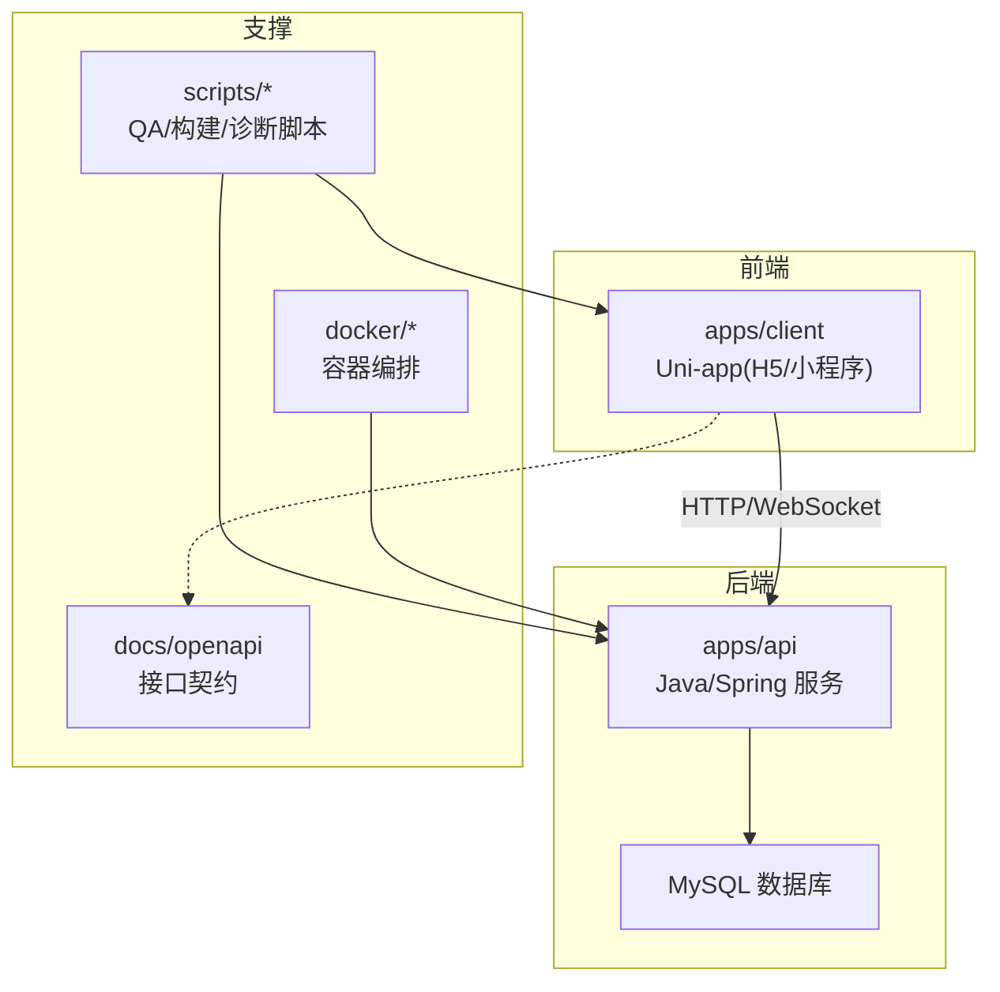
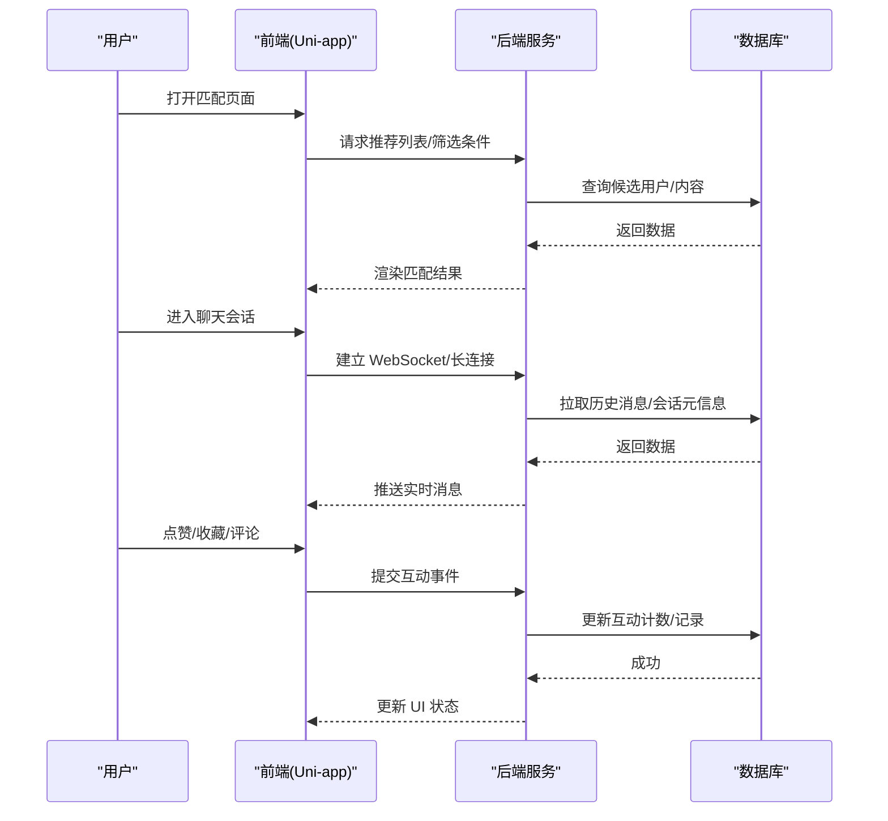
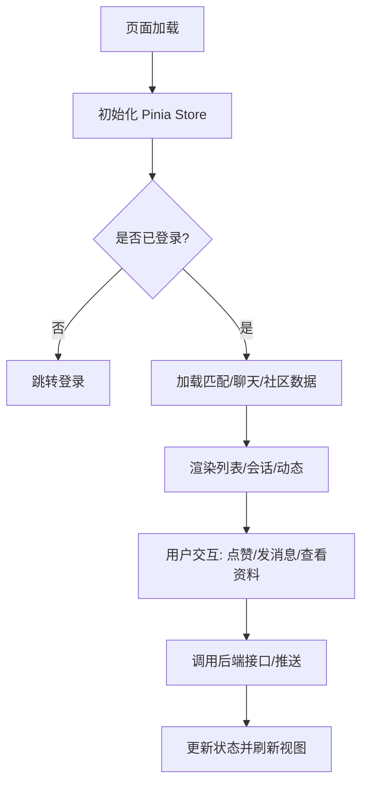
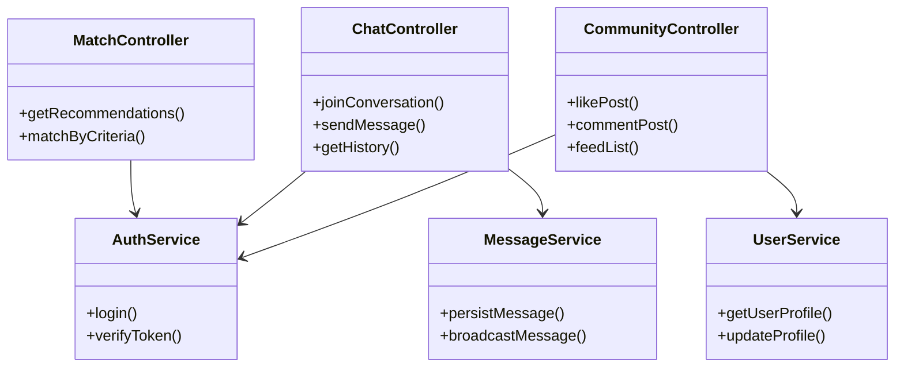
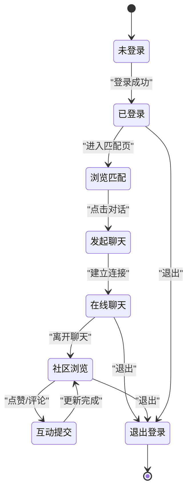
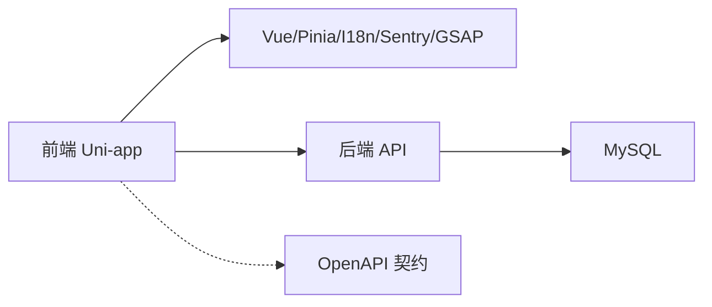

# 核心功能模块

<cite>
**本文引用的文件**   
- [apps/client/package.json](file://apps/client/package.json)
- [apps/client/main.ts](file://apps/client/main.ts)
- [package.json](file://package.json)
- [docker-compose.yml](file://docker-compose.yml)
- [.github/pull_request_template.md](file://.github/pull_request_template.md)
</cite>

## 目录
1. [引言](#引言)
2. [项目结构](#项目结构)
3. [核心组件](#核心组件)
4. [架构总览](#架构总览)
5. [详细组件分析](#详细组件分析)
6. [依赖关系分析](#依赖关系分析)
7. [性能与可扩展性](#性能与可扩展性)
8. [故障排查指南](#故障排查指南)
9. [结论](#结论)
10. [附录](#附录)

## 引言
本技术文档围绕“匹配系统、聊天功能、社区互动”等核心业务，给出从系统架构到组件交互、状态流转、数据同步、异常处理与用户体验优化的综合说明。由于当前仓库快照未包含客户端与服务端的具体实现源码（仅保留应用描述、脚本与配置），本文在严格依据已有证据的前提下：
- 明确现有仓库中可确认的技术栈与运行边界；
- 以概念图展示匹配、聊天、社区互动的典型业务流程；
- 给出面向实现的扩展点、测试策略与优化建议；
- 提供排障清单与回归门禁参考。

## 项目结构
仓库采用多应用与工具脚本并存的组织方式：
- apps/client：Uni-app 前端工程（H5/微信小程序）入口与应用脚本；
- apps/api：后端服务工程（含 Maven、脚本与数据库初始化）；
- scripts：大量 QA/运维/构建辅助脚本；
- docs/openapi：OpenAPI 接口定义；
- docker：容器化相关配置；
- .github/workflows：持续集成流水线；
- database：数据库种子与迁移脚本。

**图示来源**
- [apps/client/package.json:1-104](file://apps/client/package.json#L1-L104)
- [docker-compose.yml](file://docker-compose.yml)

**章节来源**
- [apps/client/package.json:1-104](file://apps/client/package.json#L1-L104)
- [docker-compose.yml](file://docker-compose.yml)

## 核心组件
基于当前可确认的信息，核心组件包括：
- 前端应用（Uni-app）：负责用户界面、路由、状态管理、与后端通信；
- 后端服务（Spring/Java）：提供 REST/WS 接口、业务逻辑、数据持久化；
- 接口契约（OpenAPI）：前后端协作的接口规范；
- 构建与测试脚本：统一构建、打包、E2E 测试、质量门禁；
- 容器与部署：Docker 编排与发布流程。

关键可确认事实：
- 前端使用 Vue3 + Pinia + Vue I18n，支持 H5 与微信小程序双端构建；
- 前端脚本提供 unit/e2e/a11y 测试命令；
- 前端包名标识为 @campus-love/client，说明其为工作区中的子应用；
- 根 package.json 与工作区配置存在，便于统一依赖管理与脚本编排。

**章节来源**
- [apps/client/package.json:1-104](file://apps/client/package.json#L1-L104)
- [package.json](file://package.json)

## 架构总览
下图给出一个概念性端到端流程，覆盖匹配、聊天与社区互动的常见链路。该图为概念示意，不绑定具体源码实现。

[本图为概念流程图，无特定源码映射，故不提供“图示来源”]

## 详细组件分析

### 前端应用（Uni-app）
- 技术栈：Vue 3、Pinia、Vue I18n、Vitest、Storybook；
- 平台：H5 与微信小程序双端构建；
- 能力：单元测试、端到端测试、无障碍测试、契约校验；
- 构建产物：通过 prepare-static 脚本准备静态资源，再执行 uni build。

建议的前端职责划分：
- 路由与页面：匹配页、聊天页、社区动态页、个人中心；
- 状态层：Pinia Store 管理登录态、匹配缓存、聊天会话、通知；
- 网络层：封装 HTTP/WebSocket 请求、重试与错误提示；
- 本地存储：敏感信息加密存储、离线缓存与一致性策略；
- 国际化：i18n 文案与多语言切换；
- 监控：Sentry 上报错误与回放。

[本图为概念流程图，无特定源码映射，故不提供“图示来源”]

**章节来源**
- [apps/client/package.json:1-104](file://apps/client/package.json#L1-L104)

### 后端服务（Java/Spring）
- 工程形态：Maven 项目，包含测试目录与启动脚本；
- 能力：REST/WS 接口、鉴权、权限控制、消息队列（可选）、缓存与数据库访问；
- 数据：MySQL 为主库，Flyway 管理迁移，Seed 脚本填充演示数据。

建议的后端职责划分：
- 控制器层：匹配推荐、聊天消息、社区互动（点赞/收藏/评论）；
- 服务层：业务规则验证、去重、限流、审计日志；
- 数据层：ORM/DAO、读写分离与分库分表预留；
- 基础设施：鉴权、网关、日志、指标、告警；
- 异步：消息队列用于通知、增量索引、延迟任务。

[本图为概念类图，用于说明职责划分，不绑定具体源码，故不提供“图示来源”]

### 接口契约（OpenAPI）
- 契约位置：docs/openapi/*.yaml；
- 作用：定义用户、反馈增长、通知、点赞、官方账号、推荐、圈子、私信等接口；
- 生成类型：前端可通过 generate:openapi 命令生成 TypeScript 类型。

建议：
- 所有新增接口必须补充 OpenAPI 文档；
- 变更需通过 CI 契约校验；
- 前端优先消费生成类型，减少手写不一致。

**章节来源**
- [apps/client/package.json:1-104](file://apps/client/package.json#L1-L104)

### 状态管理与事件总线
- 状态管理：Pinia 作为单一可信源，管理用户、匹配、聊天、通知等全局状态；
- 事件总线：可在组件间使用轻量事件机制或 Pinia 订阅模式进行解耦；
- 跨页面共享：URL 参数 + Pinia + 本地存储三层协同，确保断网/刷新后仍可恢复。

建议：
- 将易变数据放内存，将必要数据落盘；
- 对写操作做幂等与乐观更新；
- 失败回滚与用户可见的错误提示。

[本节为通用设计建议，不涉及具体源码，故不提供“章节来源”]

### 用户交互流程与状态流转
以下以“匹配→聊天→社区互动”为主线，描述典型状态流转。

[本图为概念状态图，不绑定具体源码，故不提供“图示来源”]

## 依赖关系分析
- 前端依赖：Vue、Pinia、I18n、Sentry、GSAP、Vitest、Storybook；
- 工程依赖：pnpm workspace 统一管理；
- 运行时依赖：后端服务、数据库、对象存储（图片/视频）。

**图示来源**
- [apps/client/package.json:1-104](file://apps/client/package.json#L1-L104)

**章节来源**
- [apps/client/package.json:1-104](file://apps/client/package.json#L1-L104)

## 性能与可扩展性
- 前端性能
  - 首屏优化：按需加载路由与组件，静态资源 CDN；
  - 列表渲染：虚拟滚动、分页懒加载、骨架屏；
  - 图片优化：WebP/AVIF、懒加载、缩略图；
  - 动画与交互：合理使用 GSAP，避免主线程阻塞；
  - 监控埋点：Sentry 错误与性能指标采集。
- 后端性能
  - 接口缓存：热点数据 Redis 缓存；
  - 数据库优化：读写分离、索引优化、慢查询治理；
  - 消息推送：WebSocket 集群、心跳保活、断线重连；
  - 异步任务：消息去重、批量写入、延迟任务。
- 可扩展性
  - 插件化：推荐算法、反垃圾审核、消息通道可插拔；
  - 灰度发布：按用户/地域/版本逐步放量；
  - 多环境：开发/预发/生产隔离，配置中心管理。

[本节为通用建议，不涉及具体源码，故不提供“章节来源”]

## 故障排查指南
- 常见问题定位
  - 登录态丢失：检查 Token 有效期与刷新逻辑；
  - 聊天消息不同步：检查 WS 心跳与重连、消息 ID 去重；
  - 匹配结果异常：核对筛选条件、排序权重、缓存一致性；
  - 社区互动延迟：检查异步任务堆积与下游依赖。
- 日志与监控
  - 前端：Sentry 捕获错误与回放；
  - 后端：结构化日志、TraceId 贯穿、关键指标上报；
  - 数据库：慢查询与锁等待告警。
- 回归与门禁
  - 单测覆盖率与契约校验；
  - E2E 关键路径用例；
  - 构建产物体积与依赖扫描。

**章节来源**
- [.github/pull_request_template.md](file://.github/pull_request_template.md)

## 结论
在当前仓库快照下，我们明确了前端 Uni-app 的技术栈与双端构建能力、后端 Java/Maven 工程形态以及 OpenAPI 契约驱动的开发方式。针对匹配、聊天与社区互动三大核心场景，本文给出了概念化的架构与流程、状态机与组件职责划分，并提供了性能优化与可扩展性建议。建议在后续迭代中补齐具体源码实现，并以 OpenAPI 与自动化测试为基线，保障功能正确性与交付质量。

## 附录
- 快速开始
  - 安装依赖：pnpm install；
  - 前端开发：pnpm dev:h5 或 pnpm dev:mp-weixin；
  - 构建产物：pnpm build:h5 或 pnpm build:mp-weixin；
  - 测试：pnpm test / pnpm test:e2e / pnpm test:a11y；
  - 契约生成：pnpm generate:openapi。

**章节来源**
- [apps/client/package.json:1-104](file://apps/client/package.json#L1-L104)
- [apps/client/main.ts:1-1](file://apps/client/main.ts#L1-L1)