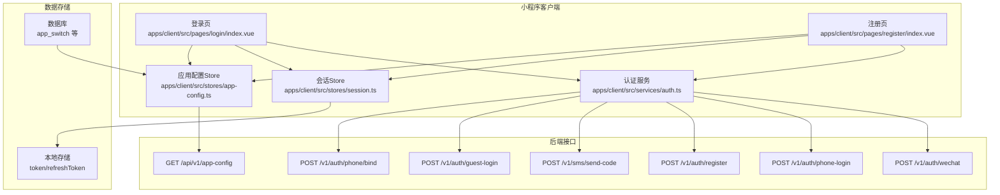
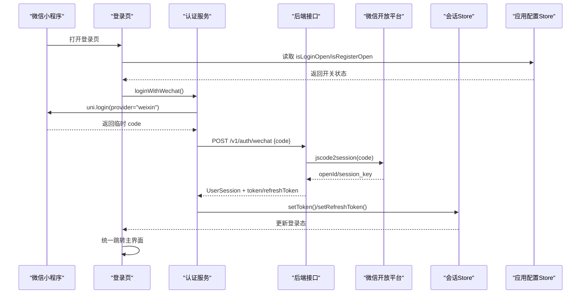
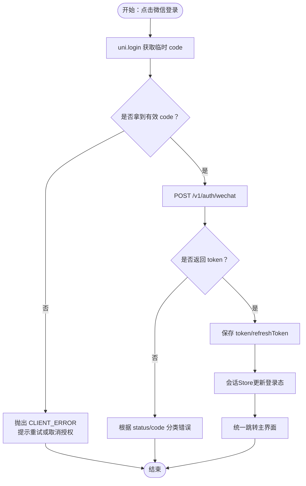
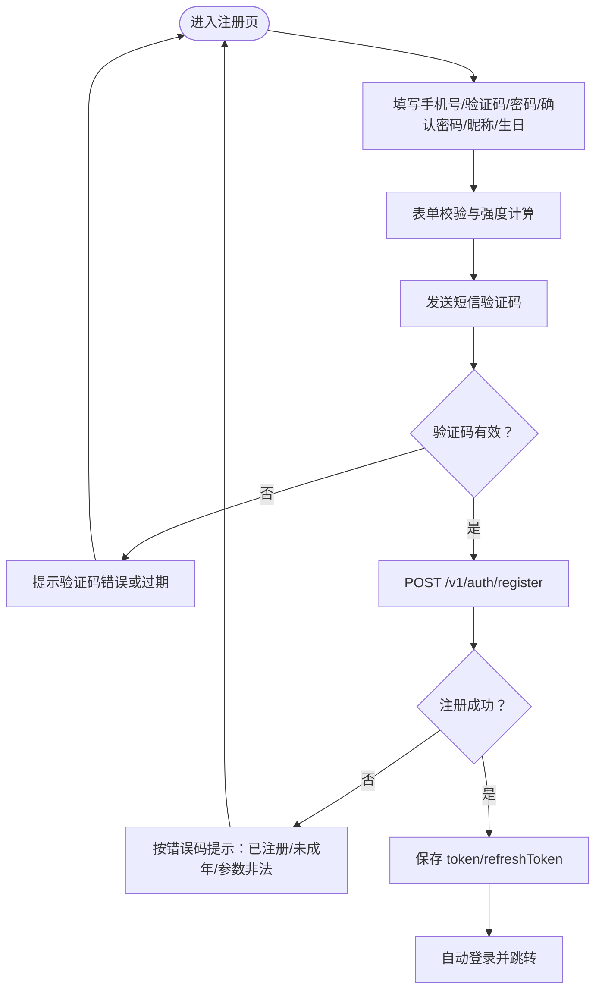
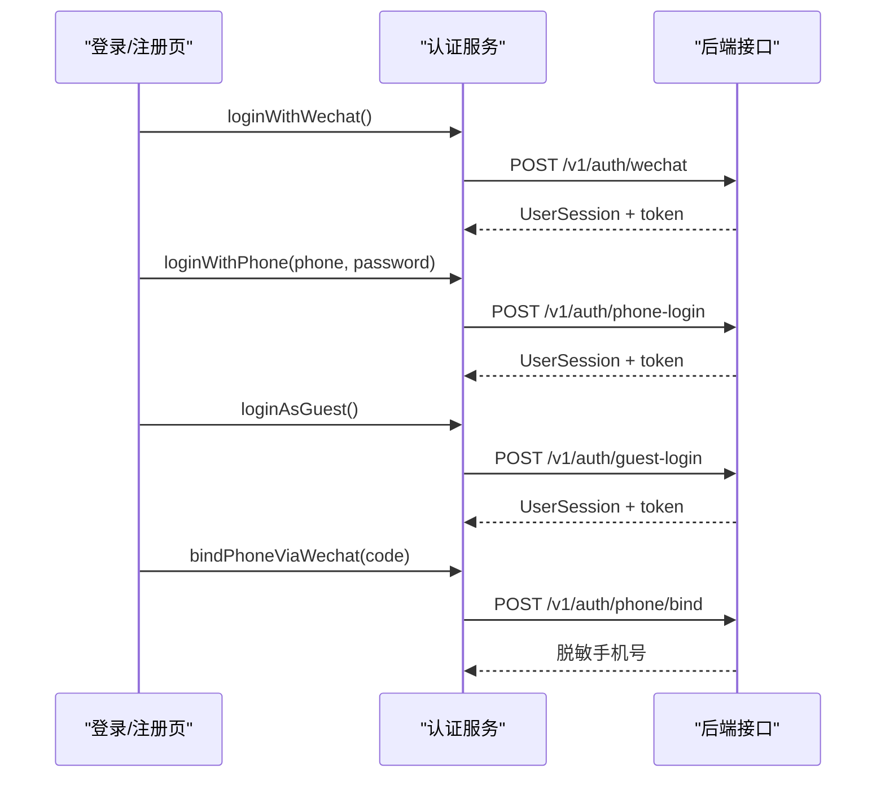
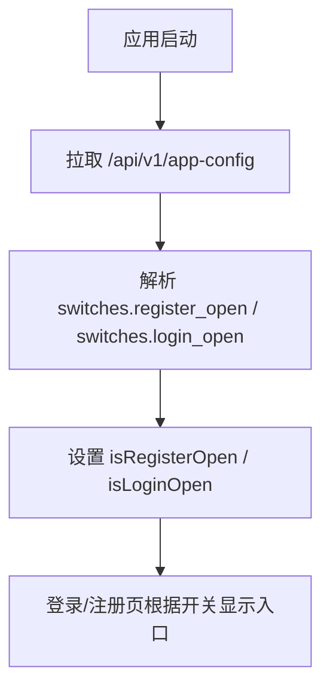
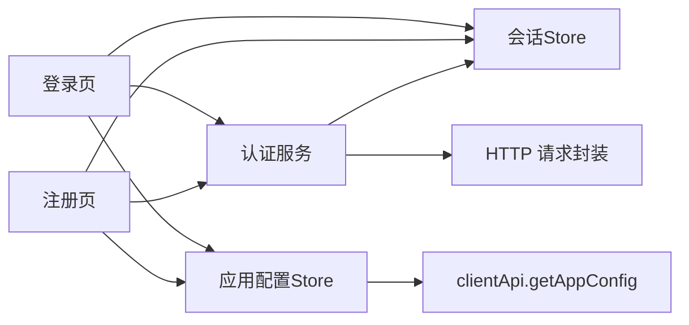

# 注册登录

<cite>
**本文引用的文件**   
- [apps/client/src/pages/login/index.vue](file://apps/client/src/pages/login/index.vue)
- [apps/client/src/pages/register/index.vue](file://apps/client/src/pages/register/index.vue)
- [apps/client/src/pages/register/success.vue](file://apps/client/src/pages/register/success.vue)
- [apps/client/src/services/auth.ts](file://apps/client/src/services/auth.ts)
- [apps/client/src/services/config.ts](file://apps/client/src/services/config.ts)
- [apps/client/src/stores/session.ts](file://apps/client/src/stores/session.ts)
- [apps/client/src/stores/app-config.ts](file://apps/client/src/stores/app-config.ts)
- [apps/client/src/App.vue](file://apps/client/src/App.vue)
- [apps/client/src/manifest.json](file://apps/client/src/manifest.json)
- [apps/client/src/i18n/locales/zh-CN.ts](file://apps/client/src/i18n/locales/zh-CN.ts)
- [apps/client/src/tests/components/register-index.spec.ts](file://apps/client/src/tests/components/register-index.spec.ts)
- [docs/wechat-submission-materials-checklist.md](file://docs/wechat-submission-materials-checklist.md)
- [apps/api/src/main/java/com/campuslove/api/auth/AuthController.java](file://apps/api/src/main/java/com/campuslove/api/auth/AuthController.java)
- [apps/api/src/main/java/com/campuslove/api/auth/AgreementConsentService.java](file://apps/api/src/main/java/com/campuslove/api/auth/AgreementConsentService.java)
- [database/flyway/sql/V2026.06.25.0005__create_admin_configs.sql](file://database/flyway/sql/V2026.06.25.0005__create_admin_configs.sql)
</cite>

## 目录
1. [引言](#引言)
2. [项目结构](#项目结构)
3. [核心组件](#核心组件)
4. [架构总览](#架构总览)
5. [详细组件分析](#详细组件分析)
6. [微信隐私授权与协议同意合规接线](#微信隐私授权与协议同意合规接线)
7. [依赖关系分析](#依赖关系分析)
8. [性能与体验优化](#性能与体验优化)
9. [安全机制](#安全机制)
10. [错误处理与排障](#错误处理与排障)
11. [结论](#结论)

## 引言
本技术文档聚焦于微信小程序端的注册与登录能力，覆盖以下主题：
- 微信小程序登录流程：wx.login 获取 code、后端换取 openId 并签发 JWT、前端令牌管理。
- 用户注册流程：手机号与验证码校验、昵称与出生日期收集、未成年人保护策略。
- 密码管理：强度计算、前后端一致性约束、后续可扩展的加密与重置入口说明。
- 第三方登录集成：微信一键登录、手机号+密码登录、体验账号快捷登录、微信手机号绑定。
- 功能开关控制：login_open 与 register_open 对登录/注册入口的影响。
- 微信隐私授权接线：manifest.json 的 `__usePrivacyCheck__` 与 App.vue 的 `wx.onNeedPrivacyAuthorization` 自有弹窗（见「微信隐私授权与协议同意合规接线」）。
- 注册页协议勾选与同意留痕：未预选勾选、`agreedLegalVersion` 的取值降级链与服务端契约边界。
- 安全与风控：防暴力破解、登录限制、异常检测与上报。
- 用户体验：自动登录、记住密码、快速切换账号、跳转一致性。
- 错误处理：网络异常、验证码过期、服务不可用等场景的提示与降级。

## 项目结构
与注册登录直接相关的前端代码位于小程序客户端应用内，关键文件包括：
- 登录页面：apps/client/src/pages/login/index.vue
- 注册页面：apps/client/src/pages/register/index.vue
- 认证服务封装：apps/client/src/services/auth.ts
- 会话状态管理：apps/client/src/stores/session.ts
- 应用配置与功能开关：apps/client/src/stores/app-config.ts
- 后台功能开关表结构与初始值：database/flyway/sql/V2026.06.25.0005__create_admin_configs.sql

图表来源
- [apps/client/src/pages/login/index.vue:1-200](file://apps/client/src/pages/login/index.vue#L1-L200)
- [apps/client/src/pages/register/index.vue:1-200](file://apps/client/src/pages/register/index.vue#L1-L200)
- [apps/client/src/services/auth.ts:1-200](file://apps/client/src/services/auth.ts#L1-L200)
- [apps/client/src/services/auth.ts:201-447](file://apps/client/src/services/auth.ts#L201-L447)
- [apps/client/src/stores/session.ts:1-200](file://apps/client/src/stores/session.ts#L1-L200)
- [apps/client/src/stores/app-config.ts:1-126](file://apps/client/src/stores/app-config.ts#L1-L126)
- [database/flyway/sql/V2026.06.25.0005__create_admin_configs.sql:44-103](file://database/flyway/sql/V2026.06.25.0005__create_admin_configs.sql#L44-L103)

章节来源
- [apps/client/src/pages/login/index.vue:1-200](file://apps/client/src/pages/login/index.vue#L1-L200)
- [apps/client/src/pages/register/index.vue:1-200](file://apps/client/src/pages/register/index.vue#L1-L200)
- [apps/client/src/services/auth.ts:1-200](file://apps/client/src/services/auth.ts#L1-L200)
- [apps/client/src/services/auth.ts:201-447](file://apps/client/src/services/auth.ts#L201-L447)
- [apps/client/src/stores/session.ts:1-200](file://apps/client/src/stores/session.ts#L1-L200)
- [apps/client/src/stores/app-config.ts:1-126](file://apps/client/src/stores/app-config.ts#L1-L126)
- [database/flyway/sql/V2026.06.25.0005__create_admin_configs.sql:44-103](file://database/flyway/sql/V2026.06.25.0005__create_admin_configs.sql#L44-L103)

## 核心组件
- 登录页（pages/login/index.vue）：提供手机号+验证码/密码登录、协议勾选、演示模式入口、统一导航逻辑、已登录自动跳转主界面。
- 注册页（pages/register/index.vue）：手机号、短信验证码、密码、确认密码、昵称、出生日期；含年龄预检与未成年人保护提示。
- 认证服务（services/auth.ts）：封装 wx.login、code 换 openId、JWT 存取、手机号登录、注册、短信发送、体验账号登录、微信手机号绑定。
- 会话 Store（stores/session.ts）：维护登录态、资料完善度、Mock 用户、冷启动引导、dev-user 演示入口等。
- 应用配置 Store（stores/app-config.ts）：拉取后端聚合配置，暴露 isLoginOpen/isRegisterOpen 等开关。
- 功能开关表（V2026.06.25.0005__create_admin_configs.sql）：定义 app_switch 表及 login_open/register_open 默认值。

章节来源
- [apps/client/src/pages/login/index.vue:1-200](file://apps/client/src/pages/login/index.vue#L1-L200)
- [apps/client/src/pages/register/index.vue:1-200](file://apps/client/src/pages/register/index.vue#L1-L200)
- [apps/client/src/services/auth.ts:1-200](file://apps/client/src/services/auth.ts#L1-L200)
- [apps/client/src/stores/session.ts:1-200](file://apps/client/src/stores/session.ts#L1-L200)
- [apps/client/src/stores/app-config.ts:1-126](file://apps/client/src/stores/app-config.ts#L1-L126)
- [database/flyway/sql/V2026.06.25.0005__create_admin_configs.sql:44-103](file://database/flyway/sql/V2026.06.25.0005__create_admin_configs.sql#L44-L103)

## 架构总览
登录与注册的整体调用链如下：
- 微信小程序通过 uni.login(provider="weixin") 获取临时 code。
- 客户端 POST /v1/auth/wechat 将 code 发送到后端；后端调用微信 jscode2session 换取 openId 并签发 JWT。
- 客户端保存 token 与 refreshToken 到本地存储，并通过会话 Store 更新全局登录态。
- 注册流程由注册页驱动，调用 /v1/auth/register 完成账号创建，成功后同样写入 JWT。
- 短信验证码通过 /v1/sms/send-code 发送；手机号+密码登录通过 /v1/auth/phone-login；体验账号通过 /v1/auth/guest-login。
- 功能开关 login_open/register_open 由后端 app_switch 表下发，客户端通过 /api/v1/app-config 获取后控制 UI 与业务分支。

图表来源
- [apps/client/src/pages/login/index.vue:1-200](file://apps/client/src/pages/login/index.vue#L1-L200)
- [apps/client/src/services/auth.ts:1-200](file://apps/client/src/services/auth.ts#L1-L200)
- [apps/client/src/stores/session.ts:1-200](file://apps/client/src/stores/session.ts#L1-L200)
- [apps/client/src/stores/app-config.ts:1-126](file://apps/client/src/stores/app-config.ts#L1-L126)

## 详细组件分析

### 微信小程序登录流程
- 获取临时 code：使用 uni.login(provider="weixin")，带超时控制与用户拒绝授权分支。
- 后端交换 openId 与签发 JWT：客户端 POST /v1/auth/wechat，后端负责与微信服务端交互、查找或创建用户、签发 JWT。
- 令牌管理：成功后调用 setToken/setRefreshToken 持久化，会话 Store 刷新登录态并触发页面自动跳转。
- 错误分类：INVALID_CODE（code 失效）、WECHAT_API_ERROR（微信 API 失败）、USER_DISABLED（账号禁用）、CLIENT_ERROR（客户端侧错误）。

图表来源
- [apps/client/src/services/auth.ts:1-200](file://apps/client/src/services/auth.ts#L1-L200)
- [apps/client/src/services/auth.ts:201-447](file://apps/client/src/services/auth.ts#L201-L447)
- [apps/client/src/pages/login/index.vue:1-200](file://apps/client/src/pages/login/index.vue#L1-L200)

章节来源
- [apps/client/src/services/auth.ts:1-200](file://apps/client/src/services/auth.ts#L1-L200)
- [apps/client/src/services/auth.ts:201-447](file://apps/client/src/services/auth.ts#L201-L447)
- [apps/client/src/pages/login/index.vue:1-200](file://apps/client/src/pages/login/index.vue#L1-L200)

### 用户注册流程
- 字段要求：手机号、短信验证码、密码、确认密码、昵称、出生日期；协议需主动勾选。
- 手机号验证：前端正则校验 11 位手机号，自动格式化展示。
- 验证码发送：调用 /v1/sms/send-code，支持频控与 mockCode（开发环境）。
- 密码强度：客户端计算弱/中/强三档，结合长度、字母、数字、符号/大小写组合。
- 未成年人保护：出生日期预检未满 18 岁则提示无法注册；后端 AgePolicy 兜底。
- 提交注册：POST /v1/auth/register，成功后写入 JWT，并自动登录。

图表来源
- [apps/client/src/pages/register/index.vue:1-200](file://apps/client/src/pages/register/index.vue#L1-L200)
- [apps/client/src/services/auth.ts:201-447](file://apps/client/src/services/auth.ts#L201-L447)

章节来源
- [apps/client/src/pages/register/index.vue:1-200](file://apps/client/src/pages/register/index.vue#L1-L200)
- [apps/client/src/services/auth.ts:201-447](file://apps/client/src/services/auth.ts#L201-L447)

### 密码管理
- 强度验证：注册页实现弱/中/强三档强度判定，依据长度、字母、数字、符号/大小写组合。
- 加密与存储：当前前端不实现密码加密，密码在注册时通过 HTTPS 传输至后端；具体后端加密策略不在本仓库前端代码范围内。
- 重置流程：前端未包含密码重置入口；如需增加，可在登录页添加“忘记密码”按钮，对接后端 /v1/auth/password-reset 或类似接口。
- 最佳实践建议：
  - 前端仅做强度与格式校验，真实安全性依赖后端哈希加盐存储。
  - 登录接口应启用速率限制与账户锁定策略。
  - 密码重置需配合邮箱或短信验证码进行身份核验。

章节来源
- [apps/client/src/pages/register/index.vue:1-200](file://apps/client/src/pages/register/index.vue#L1-L200)

### 第三方登录集成
- 微信一键登录：通过 uni.login(provider="weixin") 获取 code，再 POST /v1/auth/wechat 完成登录。
- 手机号+密码登录：调用 loginWithPhone(phone, password)，POST /v1/auth/phone-login。
- 体验账号快捷登录：调用 loginAsGuest()，POST /v1/auth/guest-login，用于演示与测试。
- 微信手机号绑定：已登录用户通过 bindPhoneViaWechat(code) 绑定手机号，POST /v1/auth/phone/bind。

图表来源
- [apps/client/src/services/auth.ts:201-447](file://apps/client/src/services/auth.ts#L201-L447)
- [apps/client/src/pages/login/index.vue:1-200](file://apps/client/src/pages/login/index.vue#L1-L200)

章节来源
- [apps/client/src/services/auth.ts:201-447](file://apps/client/src/services/auth.ts#L201-L447)
- [apps/client/src/pages/login/index.vue:1-200](file://apps/client/src/pages/login/index.vue#L1-L200)

### 功能开关控制：login_open 与 register_open
- 数据来源：后端 app_switch 表中的 switch_key 为 login_open 与 register_open。
- 客户端获取：应用配置 Store 拉取 GET /api/v1/app-config，暴露 isLoginOpen 与 isRegisterOpen。
- 行为影响：
  - isLoginOpen=false：隐藏登录入口，避免用户在无登录能力时使用。
  - isRegisterOpen=false：隐藏注册入口，仅允许已有账号登录。
  - 缺失或未加载时默认开放，保证正常登录不受影响。

图表来源
- [apps/client/src/stores/app-config.ts:1-126](file://apps/client/src/stores/app-config.ts#L1-L126)
- [database/flyway/sql/V2026.06.25.0005__create_admin_configs.sql:44-103](file://database/flyway/sql/V2026.06.25.0005__create_admin_configs.sql#L44-L103)

章节来源
- [apps/client/src/stores/app-config.ts:1-126](file://apps/client/src/stores/app-config.ts#L1-L126)
- [database/flyway/sql/V2026.06.25.0005__create_admin_configs.sql:44-103](file://database/flyway/sql/V2026.06.25.0005__create_admin_configs.sql#L44-L103)

## 依赖关系分析
- 登录页依赖：
  - services/auth.ts：微信登录、手机号登录、体验账号登录、微信手机号绑定。
  - stores/session.ts：登录态、自动跳转、演示入口。
  - stores/app-config.ts：isLoginOpen/isRegisterOpen。
- 注册页依赖：
  - services/auth.ts：注册、短信验证码发送。
  - stores/session.ts：注册成功后自动登录。
  - stores/app-config.ts：isRegisterOpen。
- 认证服务依赖：
  - http 层 request：统一请求封装、token 注入、错误上报控制。
  - stores/session.ts：setToken/setRefreshToken 持久化。
- 应用配置依赖：
  - api 层 clientApi.getAppConfig：拉取后端配置。
  - cache-ttl：TTL 缓存控制配置刷新频率。

图表来源
- [apps/client/src/pages/login/index.vue:1-200](file://apps/client/src/pages/login/index.vue#L1-L200)
- [apps/client/src/pages/register/index.vue:1-200](file://apps/client/src/pages/register/index.vue#L1-L200)
- [apps/client/src/services/auth.ts:1-200](file://apps/client/src/services/auth.ts#L1-L200)
- [apps/client/src/stores/session.ts:1-200](file://apps/client/src/stores/session.ts#L1-L200)
- [apps/client/src/stores/app-config.ts:1-126](file://apps/client/src/stores/app-config.ts#L1-L126)

章节来源
- [apps/client/src/pages/login/index.vue:1-200](file://apps/client/src/pages/login/index.vue#L1-L200)
- [apps/client/src/pages/register/index.vue:1-200](file://apps/client/src/pages/register/index.vue#L1-L200)
- [apps/client/src/services/auth.ts:1-200](file://apps/client/src/services/auth.ts#L1-L200)
- [apps/client/src/stores/session.ts:1-200](file://apps/client/src/stores/session.ts#L1-L200)
- [apps/client/src/stores/app-config.ts:1-126](file://apps/client/src/stores/app-config.ts#L1-L126)

## 性能与体验优化
- 自动登录：
  - 冷启动时若本地存在有效 token，会话恢复后自动进入主界面。
  - onShow 与 watch 登录态组合确保只触发一次导航，避免双 switchTab 竞争。
- 记住密码：
  - 当前登录页未实现本地记住密码；建议仅在受信任设备上开启，并与 token 生命周期联动。
- 快速切换账号：
  - 登出时应清理 TTL 缓存与 token，防止跨账号数据泄漏；会话 Store 已具备清空缓存的能力。
- 导航一致性：
  - 统一通过 navigateAfterLogin/loginSuccessNavigate 跳转，消费 LockScreen 待跳转路径，减少重复导航。
- 配置刷新：
  - 应用配置 Store 使用 TTL 缓存（30s），切前台时按需刷新，降低弱网卡顿。

章节来源
- [apps/client/src/pages/login/index.vue:1-200](file://apps/client/src/pages/login/index.vue#L1-L200)
- [apps/client/src/stores/session.ts:1-200](file://apps/client/src/stores/session.ts#L1-L200)
- [apps/client/src/stores/app-config.ts:1-126](file://apps/client/src/stores/app-config.ts#L1-L126)

## 安全机制
- 防暴力破解：
  - 短信验证码接口应实施频控（如 60s 内限一次、单号每日上限）。
  - 登录接口应限制同一账号/IP 的错误尝试次数，达到阈值后暂时锁定或触发验证码。
- 登录限制：
  - 微信登录 code 有效期短，后端应一次一验；前端在 INVALID_CODE 时重新拉起 wx.login。
  - 账号禁用（USER_DISABLED）时明确提示联系管理员。
- 异常检测与上报：
  - 登录失败、网络异常通过 Sentry 上报；预期业务拒绝（如 403 入口关闭）不重复上报。
  - 登录页记录面包屑，便于异常回溯。
- 令牌安全：
  - token/refreshToken 存入本地存储，建议使用加密存储方案（如 SecureStorage）。
  - 登出时清理 token 与 TTL 缓存，避免泄露。

章节来源
- [apps/client/src/services/auth.ts:1-200](file://apps/client/src/services/auth.ts#L1-L200)
- [apps/client/src/services/auth.ts:201-447](file://apps/client/src/services/auth.ts#L201-L447)
- [apps/client/src/pages/login/index.vue:1-200](file://apps/client/src/pages/login/index.vue#L1-L200)

## 错误处理与排障
- 网络异常：
  - request 层 noRetry=true 避免登录失败自动重试；捕获后向用户提示“稍后重试”。
- 验证码过期：
  - INVALID_CODE 对应 code 失效，前端应重新拉起 wx.login 或提示用户重试。
- 服务不可用：
  - WECHAT_API_ERROR 表示微信 API 调用失败，提示“微信服务暂时不可用，请稍后重试”。
- 账号禁用：
  - USER_DISABLED 表示账号被禁用，提示“账号已被禁用，请联系管理员”。
- 客户端侧错误：
  - CLIENT_ERROR 包括超时、用户拒绝授权、网络错误等，给出具体错误信息。
- 排障建议：
  - 检查 wx.login 是否返回有效 code。
  - 检查后端 /v1/auth/wechat 是否正常返回 token/refreshToken。
  - 检查本地存储中 token 是否有效且未被清理。
  - 检查功能开关 login_open/register_open 是否正确下发。

章节来源
- [apps/client/src/services/auth.ts:1-200](file://apps/client/src/services/auth.ts#L1-L200)
- [apps/client/src/services/auth.ts:201-447](file://apps/client/src/services/auth.ts#L201-L447)
- [apps/client/src/pages/login/index.vue:1-200](file://apps/client/src/pages/login/index.vue#L1-L200)

## 结论
该注册登录体系以微信小程序登录为核心，结合手机号+密码、体验账号与微信手机号绑定，形成多通道接入能力。前端通过认证服务统一封装后端接口，会话 Store 管理登录态，应用配置 Store 控制功能开关。密码强度在前端校验，实际安全性依赖后端加密与风控策略。功能开关 login_open/register_open 使运营可动态控制登录/注册入口。错误处理采用细粒度分类与 Sentry 上报，提升可观测性与用户体验。建议在后续迭代中补充密码重置、更严格的令牌加密存储与更完善的登录风控策略。