# 用户资料

<cite>
**本文引用的文件**   
- [docs/openapi/feedback-growth-and-auth.yaml](file://docs/openapi/feedback-growth-and-auth.yaml)
- [docs/openapi/users.yaml](file://docs/openapi/users.yaml)
- [package.json](file://package.json)
</cite>

## 目录
1. [引言](#引言)
2. [项目结构中的用户资料边界](#项目结构中的用户资料边界)
3. [核心能力总览](#核心能力总览)
4. [架构总览](#架构总览)
5. [详细组件分析](#详细组件分析)
6. [依赖关系分析](#依赖关系分析)
7. [性能与可用性考虑](#性能与可用性考虑)
8. [故障排查指南](#故障排查指南)
9. [结论](#结论)
10. [附录：接口清单与字段说明](#附录接口清单与字段说明)

## 引言
本技术文档围绕“用户资料”能力展开，覆盖用户在系统中的注册登录、微信授权、个人资料编辑、社交关注与在线状态、等级成长体系以及隐私与安全等主题。文档以现有 OpenAPI 契约为基础，结合仓库中的脚本与配置信息，给出可落地的实现建议、数据流图、错误处理策略和用户体验优化方案。对于仓库中尚未实现的领域（如头像上传、兴趣标签、等级成长、账户注销），本文明确区分“已有契约证据”和“扩展建议”，避免将规划性内容误述为已实现功能。

## 项目结构中的用户资料边界
从仓库结构看，用户资料相关能力主要由以下部分承载：
- OpenAPI 契约：定义认证、用户会话、个人档案、关注关系与在线状态等接口。
- 客户端代码生成与类型补全：通过根脚本命令生成 API 类型，辅助前端消费接口。
- 测试与审计脚本：包含登录流程、小程序资料页、行为截图等验证脚本，用于回归与验收。

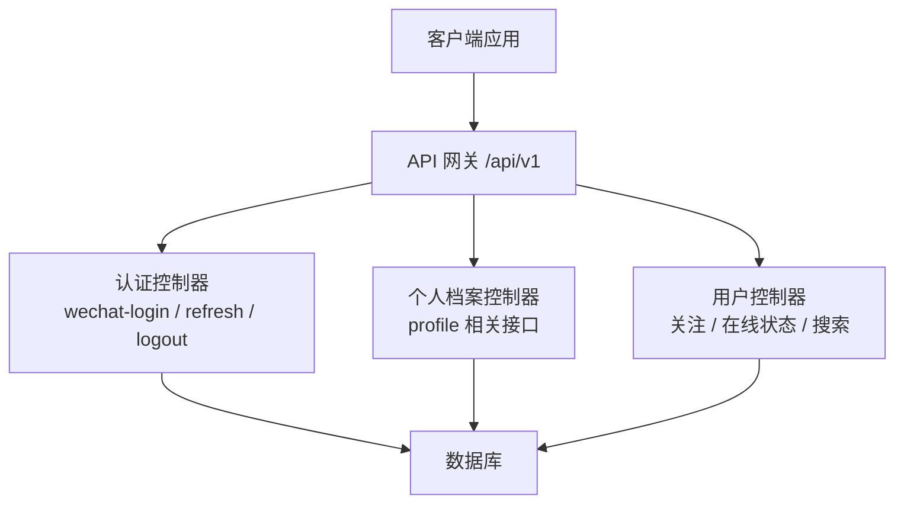

**图表来源**
- [docs/openapi/feedback-growth-and-auth.yaml:1-200](file://docs/openapi/feedback-growth-and-auth.yaml#L1-L200)
- [docs/openapi/users.yaml:1-120](file://docs/openapi/users.yaml#L1-L120)

**章节来源**
- [package.json:1-48](file://package.json#L1-L48)

## 核心能力总览
本节按“用户资料”目标拆解能力，并标注当前仓库证据：

| 能力域 | 已有契约证据 | 说明与建议 |
|---|---|---|
| 微信授权与登录 | `/auth/wechat-login`、`/auth/refresh`、`/auth/logout` | 使用微信登录码换取 JWT；支持刷新令牌与登出加入黑名单。 |
| 获取当前会话 | `/auth/me` | 校验 Bearer Token 后返回当前用户会话视图。 |
| 个人档案编辑 | `ProfileController` 暴露的 profile 相关路径 | 契约中标注存在基础信息、校园、日程、照片、视频等档案字段；具体字段以完整 YAML 为准。 |
| 关注关系 | `/users/{id}/follow`、`unfollow`、`followers`、`following`、`is-following` | 支持关注、取关、查询粉丝与关注列表、判断是否已关注。 |
| 在线状态 | `/users/{userId}/online-status`、批量查询 | 返回在线、离线或离开状态及最后心跳时间。 |
| 用户搜索 | `/search/users` | 按昵称或校园模糊搜索，支持分页。 |
| 等级与成长体系 | 未在 OpenAPI 中直接定义 | 建议基于反馈、互动、签到等行为累积经验值，设计等级阈值与成就解锁逻辑。 |
| 偏好设置 | 未独立定义 | 建议在 profile 扩展通知、隐私、主题等开关。 |
| 数据安全 | 鉴权通过 JWT + Redis 黑名单 | 建议补充敏感字段加密、备份恢复、账户注销等接口。 |
| 用户体验 | 表单校验、智能填充、错误提示 | 由客户端实现；服务端提供稳定错误码与消息。 |
| 行为分析 | 未独立定义 | 建议接入埋点与统计服务，沉淀活跃度、偏好与推荐信号。 |

**章节来源**
- [docs/openapi/feedback-growth-and-auth.yaml:1-200](file://docs/openapi/feedback-growth-and-auth.yaml#L1-L200)
- [docs/openapi/users.yaml:1-120](file://docs/openapi/users.yaml#L1-L120)

## 架构总览
下图展示用户资料相关的关键调用链：微信登录、会话刷新、个人档案读取与更新、关注关系与在线状态查询。

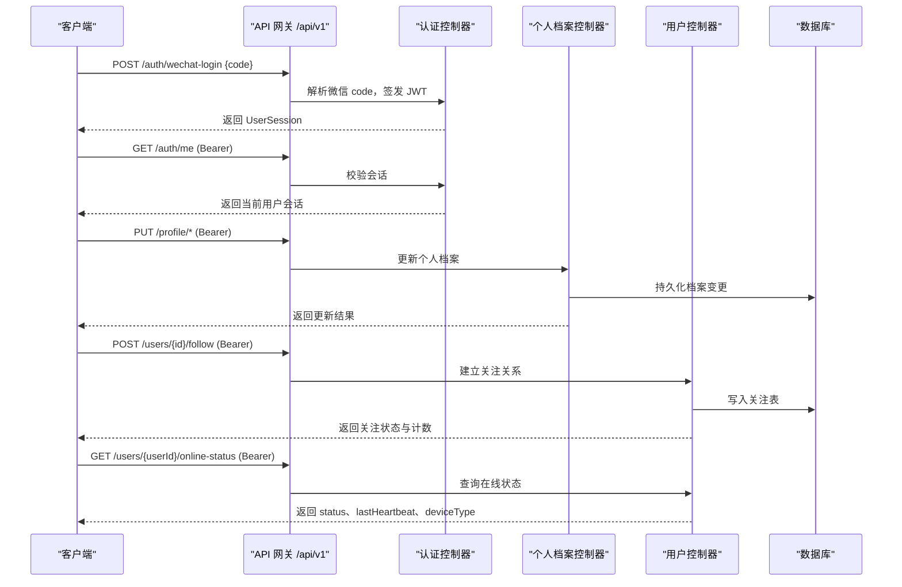

**图表来源**
- [docs/openapi/feedback-growth-and-auth.yaml:1-200](file://docs/openapi/feedback-growth-and-auth.yaml#L1-L200)
- [docs/openapi/users.yaml:1-200](file://docs/openapi/users.yaml#L1-L200)

## 详细组件分析

### 认证与会话组件
认证组件负责微信授权登录、JWT 签发与刷新、登出以及管理员登录。关键特性如下：
- 微信登录：接收微信登录 code，内部调用 code2session 获取 openId，然后签发 JWT。接口具备速率限制（IP 维度）。
- 会话刷新：校验现有 Bearer Token 并返回新的 JWT，同样具备速率限制。
- 登出：将当前 Bearer Token 加入 Redis 黑名单，使后续请求返回 401。
- 管理员登录：管理员用户名密码登录后返回 ADMIN 角色的 JWT。

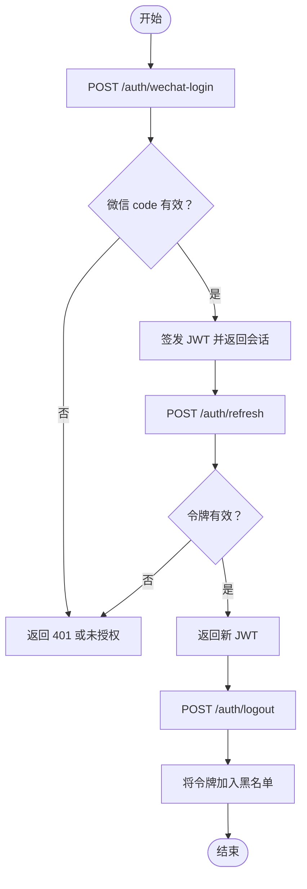

**图表来源**
- [docs/openapi/feedback-growth-and-auth.yaml:1-200](file://docs/openapi/feedback-growth-and-auth.yaml#L1-L200)

**章节来源**
- [docs/openapi/feedback-growth-and-auth.yaml:1-200](file://docs/openapi/feedback-growth-and-auth.yaml#L1-L200)

### 个人档案组件
个人档案组件由 `ProfileController` 暴露，契约中标注包含基础信息、校园、日程、照片、视频等档案字段。由于该 YAML 在开头片段被截断，具体字段名需以完整契约为准。建议扩展字段包括：
- 基本信息：昵称、性别、生日、所在城市。
- 头像：头像 URL（由上传服务返回）；若上传未实现，先使用静态资源地址。
- 兴趣爱好：标签数组，便于筛选与推荐。
- 隐私配置：公开范围、允许私信、显示在线状态等开关。
- 通知偏好：系统通知、活动提醒、推送渠道等。

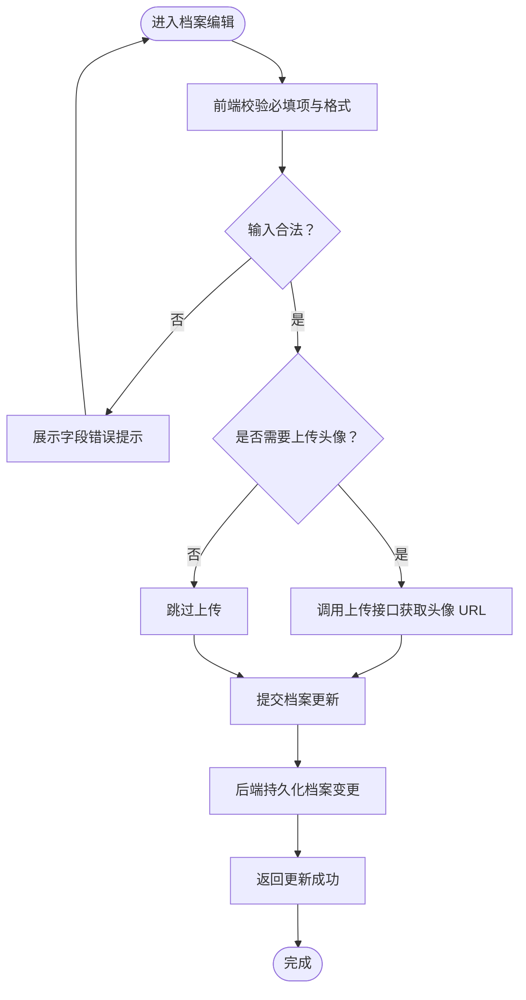

**图表来源**
- [docs/openapi/feedback-growth-and-auth.yaml:1-200](file://docs/openapi/feedback-growth-and-auth.yaml#L1-L200)

**章节来源**
- [docs/openapi/feedback-growth-and-auth.yaml:1-200](file://docs/openapi/feedback-growth-and-auth.yaml#L1-L200)

### 关注关系与在线状态组件
关注关系组件提供关注、取关、粉丝与关注列表、是否已关注等能力；在线状态组件提供单人与批量查询在线状态。

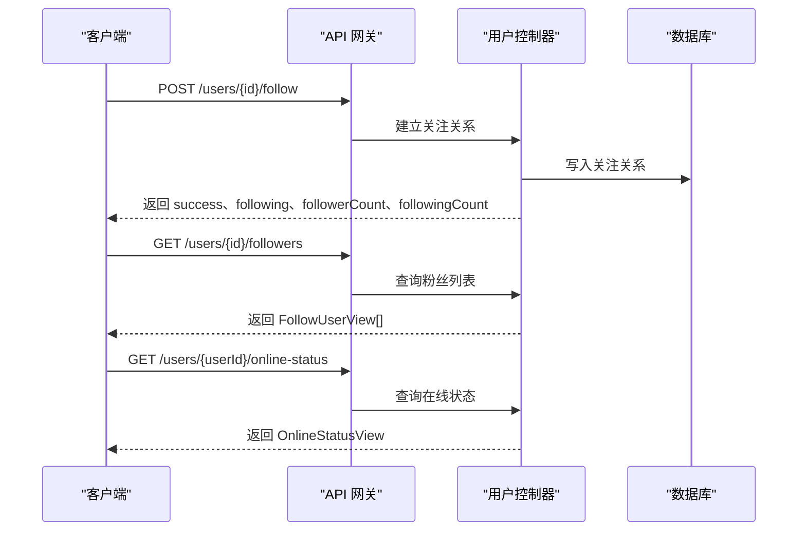

**图表来源**
- [docs/openapi/users.yaml:1-200](file://docs/openapi/users.yaml#L1-L200)

**章节来源**
- [docs/openapi/users.yaml:1-200](file://docs/openapi/users.yaml#L1-L200)

### 用户搜索组件
用户搜索支持按昵称或校园关键词检索，返回分页结果，便于发现页面或关注前预览。

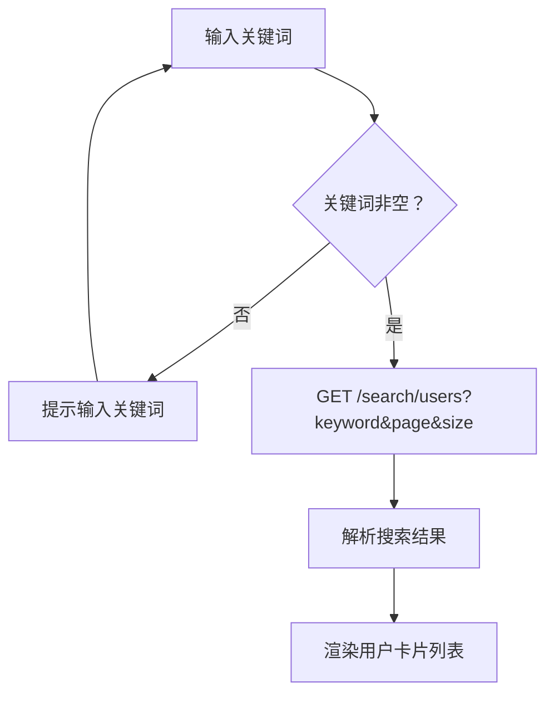

**图表来源**
- [docs/openapi/users.yaml:120-200](file://docs/openapi/users.yaml#L120-L200)

**章节来源**
- [docs/openapi/users.yaml:120-200](file://docs/openapi/users.yaml#L120-L200)

### 等级与成长体系（扩展建议）
仓库 OpenAPI 未直接定义等级与成长体系。建议如下：
- 经验值来源：签到、发帖、点赞、评论、聊天活跃、完善档案、首次绑定第三方账号等。
- 等级阈值：按经验值累计划分等级区间，例如 Lv1-Lv10。
- 成就解锁：达成条件（如连续签到、关注数达到阈值、完成档案）时发放徽章或称号。
- 数据存储：新增用户经验值表与成就记录表，与用户主表关联。
- 展示层：在个人中心展示等级进度条、成就徽章与最近成就。

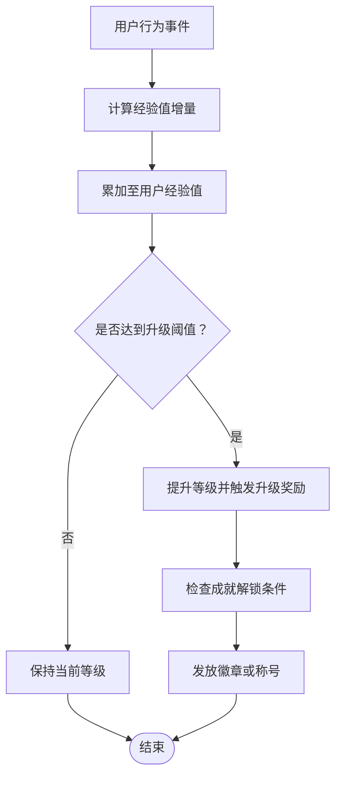

[此图为概念设计，不映射到具体源文件]

### 用户偏好设置（扩展建议）
建议将偏好设置整合进个人档案扩展字段：
- 通知配置：系统通知、活动提醒、私信提醒、推送渠道（站内信、短信、邮箱）。
- 隐私选项：是否公开生日、是否显示在线状态、是否允许陌生人私信。
- 主题定制：浅色/深色模式、语言、字体大小、动效开关。

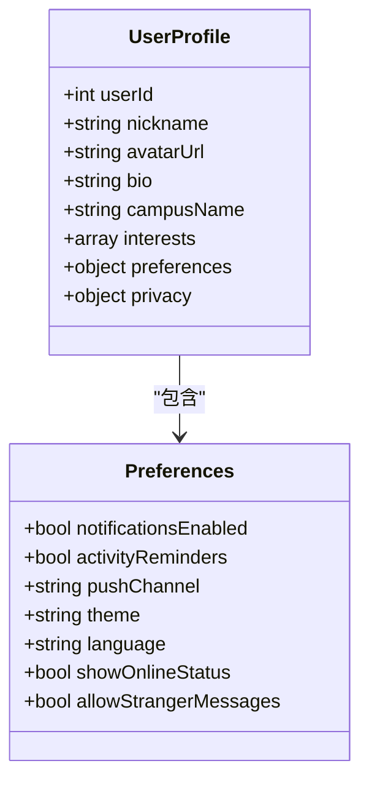

[此图为概念设计，不映射到具体源文件]

### 用户数据安全（扩展建议）
当前契约体现的安全要点：
- 鉴权：所有受保护接口需要有效的 JWT Bearer Token。
- 登出：令牌加入 Redis 黑名单，拒绝后续请求。
建议扩展：
- 信息加密：对敏感字段（如手机号、身份证）进行加密存储。
- 备份恢复：定期导出用户档案与偏好，支持用户自助下载与恢复。
- 账户注销：提供注销接口，删除或匿名化用户数据，解除第三方绑定。

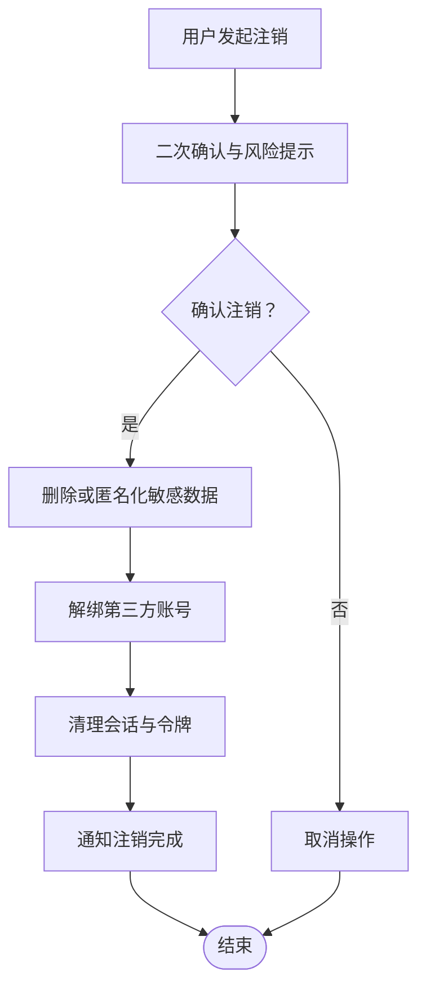

[此图为概念设计，不映射到具体源文件]

### 用户体验优化（客户端实现建议）
- 表单验证：必填项、格式校验、长度限制、唯一性校验（如昵称）。
- 智能填充：利用历史数据自动填充城市、校园等常用字段。
- 错误提示：统一错误码与人类可读消息，配合 Toast 或模态框提示。
- 加载状态：上传头像、保存档案时使用骨架屏与进度指示。
- 无障碍：确保表单控件具有语义标签与键盘导航支持。

[此节为通用指导，不引用具体源文件]

### 用户行为分析（扩展建议）
- 活跃度统计：日活、周活、月活，关注/被关注增长曲线。
- 偏好分析：兴趣标签分布、主题偏好、通知打开率。
- 个性化推荐：基于关注关系、兴趣标签与互动行为推荐内容与圈子。

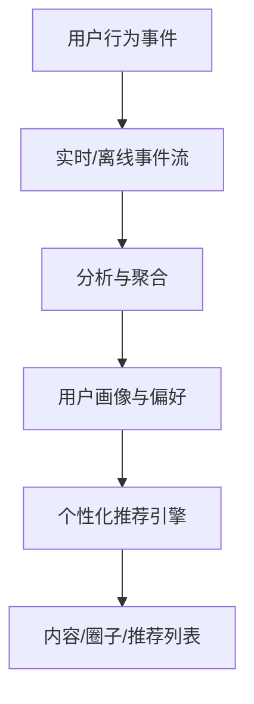

[此图为概念设计，不映射到具体源文件]

## 依赖关系分析
OpenAPI 契约定义了认证、个人档案、用户关注与在线状态等接口，客户端通过生成的 API 类型消费这些接口。根脚本提供 `generate:openapi` 与 `lint:openapi` 任务，保障类型与服务端契约一致。

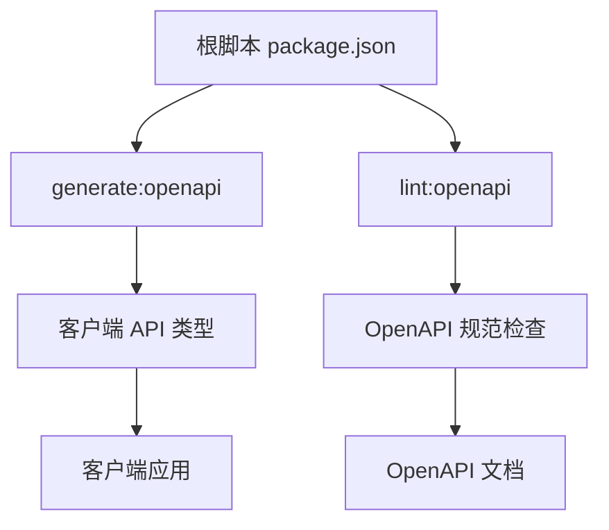

**图表来源**
- [package.json:1-48](file://package.json#L1-L48)

**章节来源**
- [package.json:1-48](file://package.json#L1-L48)

## 性能与可用性考虑
- 令牌刷新限流：防止频繁刷新造成后端压力，客户端应缓存令牌并在过期前主动刷新。
- 在线状态批量查询：一次最多 500 个用户 ID，适合列表页批量渲染。
- 关注关系幂等：重复关注不会产生重复关系，减少重试风险。
- 错误响应标准化：统一的 ApiError 结构便于前端统一处理。

[本节为通用指导，不引用具体源文件]

## 故障排查指南
常见问题与定位建议：
- 微信登录失败：检查 code 是否有效、网络连通性与微信侧接口返回；注意 IP 维度的速率限制。
- 会话刷新失败：确认 Bearer Token 有效且未登出；检查 Redis 黑名单是否误删。
- 个人档案保存失败：检查必填字段、图片 URL 合法性、权限与存储容量。
- 关注关系异常：核对目标用户是否存在、关注是否已存在、计数是否同步。
- 在线状态不一致：检查客户端心跳上报频率、批量查询参数是否超过上限。

**章节来源**
- [docs/openapi/feedback-growth-and-auth.yaml:1-200](file://docs/openapi/feedback-growth-and-auth.yaml#L1-L200)
- [docs/openapi/users.yaml:1-200](file://docs/openapi/users.yaml#L1-L200)

## 结论
当前仓库为用户资料提供了坚实的认证与会话基础，以及关注关系与在线状态的开放接口。个人档案的具体字段需在完整 OpenAPI 契约中确认；等级成长、偏好设置、数据安全与行为分析目前属于扩展方向。建议优先补齐头像上传、兴趣标签与隐私配置，再逐步引入等级与成就体系，并通过统一错误处理与体验优化提升整体质量。

## 附录：接口清单与字段说明

### 认证与会话
- `/auth/wechat-login`：微信登录码换会话。
- `/auth/refresh`：刷新 JWT。
- `/auth/logout`：登出并将令牌加入黑名单。
- `/auth/admin/login`：管理员登录。
- `/auth/admin/logout`：管理员登出。
- `/auth/me`：获取当前会话。

**章节来源**
- [docs/openapi/feedback-growth-and-auth.yaml:1-200](file://docs/openapi/feedback-growth-and-auth.yaml#L1-L200)

### 个人档案
- 由 `ProfileController` 提供的 profile 相关路径（具体字段见完整 YAML）。
- 建议扩展：头像、兴趣标签、隐私开关、通知偏好。

**章节来源**
- [docs/openapi/feedback-growth-and-auth.yaml:1-200](file://docs/openapi/feedback-growth-and-auth.yaml#L1-L200)

### 关注关系与在线状态
- `/users/{id}/follow`：关注用户。
- `/users/{id}/unfollow`：取消关注。
- `/users/{id}/followers`：粉丝列表。
- `/users/{id}/following`：关注列表。
- `/users/{id}/is-following`：是否已关注。
- `/users/{userId}/online-status`：在线状态。
- `/users/online-status/batch`：批量在线状态。
- `/search/users`：用户搜索。

**章节来源**
- [docs/openapi/users.yaml:1-200](file://docs/openapi/users.yaml#L1-L200)