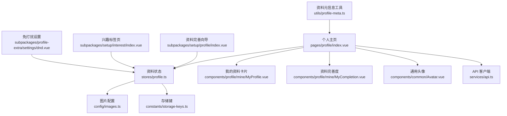
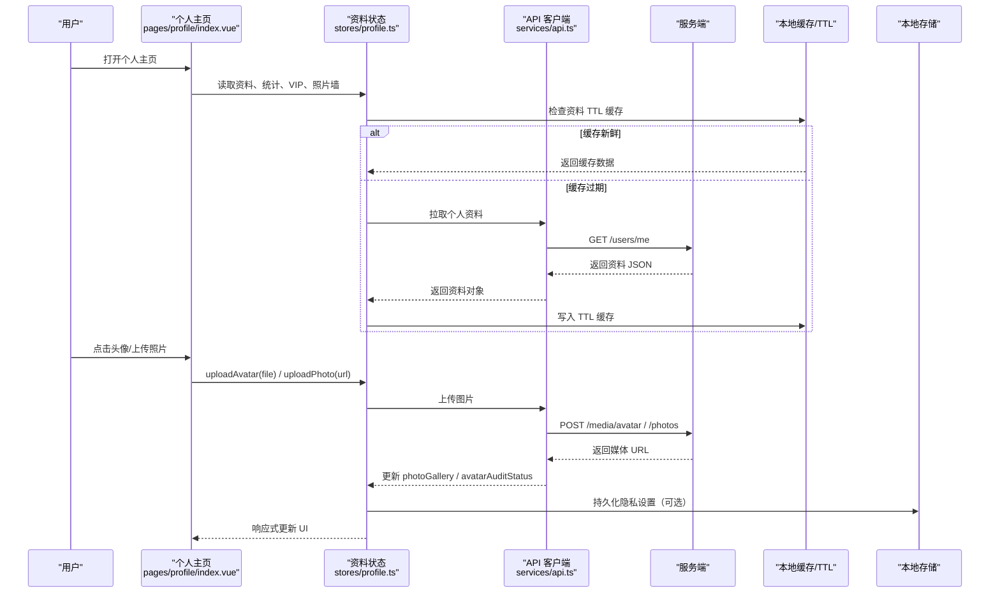
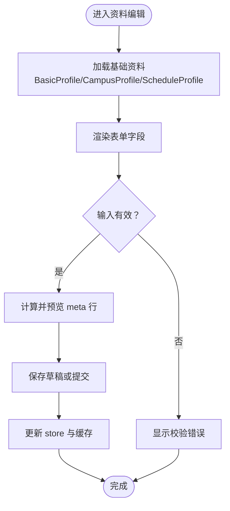
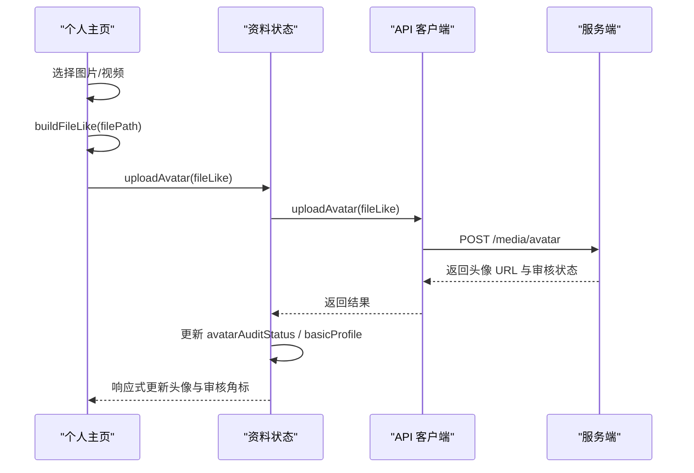
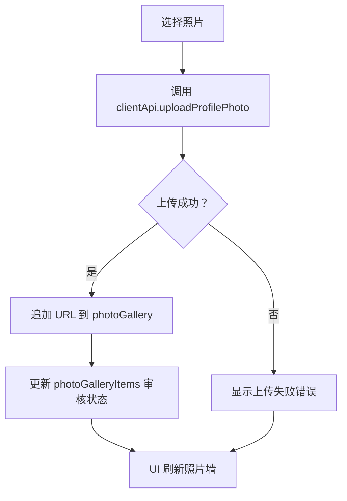
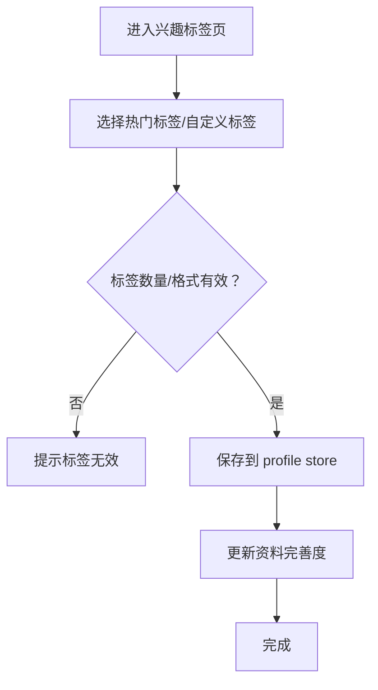
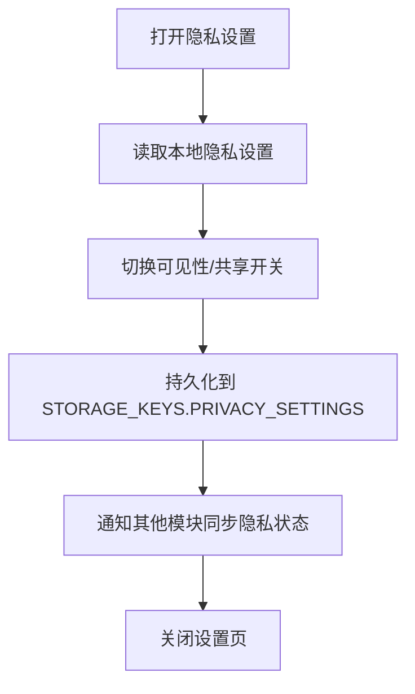
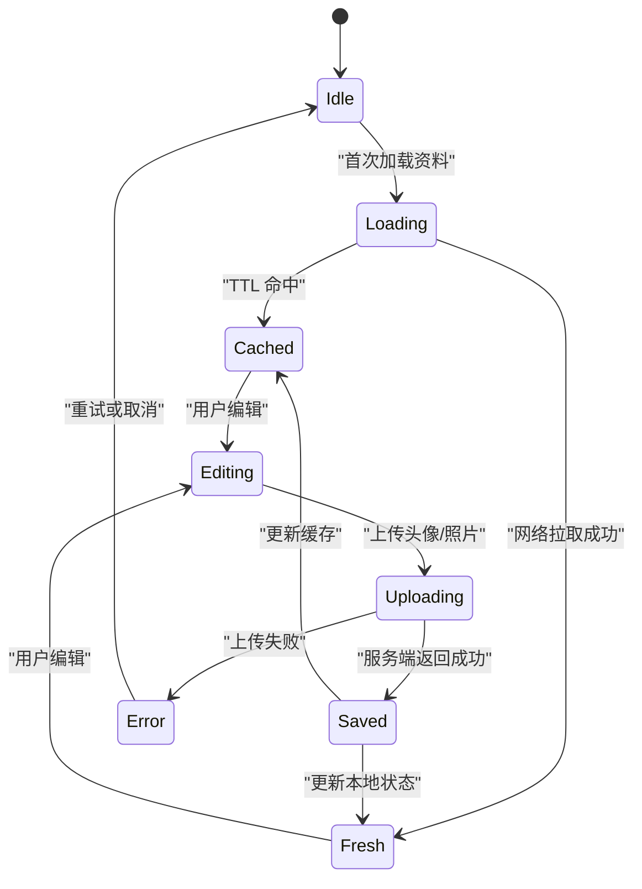
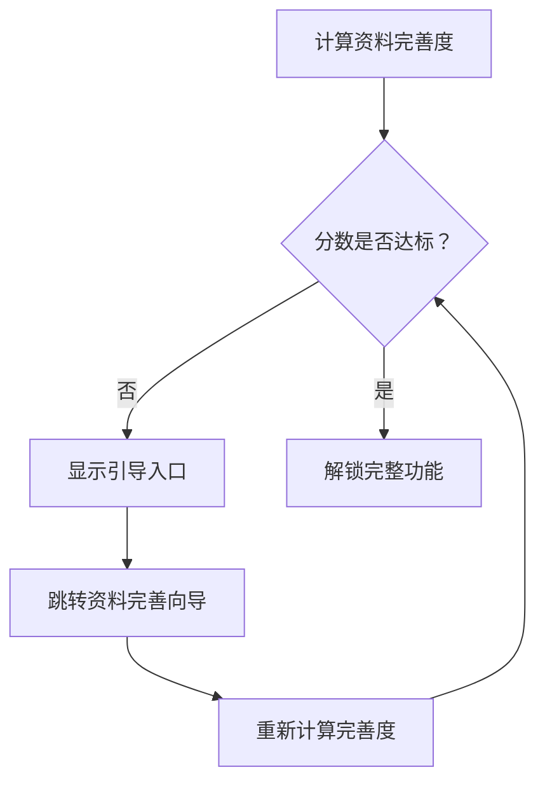
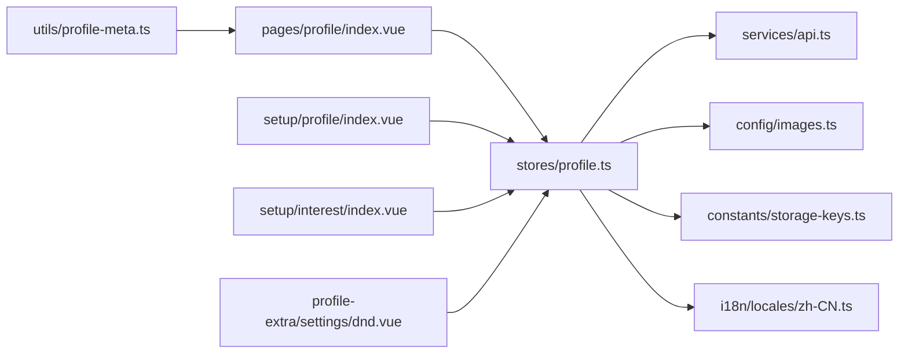

# 资料编辑

<cite>
**本文引用的文件**
- [apps/client/src/pages/profile/index.vue](file://apps/client/src/pages/profile/index.vue)
- [apps/client/src/stores/profile.ts](file://apps/client/src/stores/profile.ts)
- [apps/client/src/utils/profile-meta.ts](file://apps/client/src/utils/profile-meta.ts)
- [apps/client/src/components/profile/mine/MyProfile.vue](file://apps/client/src/components/profile/mine/MyProfile.vue)
- [apps/client/src/components/profile/mine/MyCompletion.vue](file://apps/client/src/components/profile/mine/MyCompletion.vue)
- [apps/client/src/components/common/Avatar.vue](file://apps/client/src/components/common/Avatar.vue)
- [apps/client/src/subpackages/setup/profile/index.vue](file://apps/client/src/subpackages/setup/profile/index.vue)
- [apps/client/src/subpackages/setup/interest/index.vue](file://apps/client/src/subpackages/setup/interest/index.vue)
- [apps/client/src/subpackages/profile-extra/settings/dnd.vue](file://apps/client/src/subpackages/profile-extra/settings/dnd.vue)
- [apps/client/src/services/api.ts](file://apps/client/src/services/api.ts)
- [apps/client/src/config/images.ts](file://apps/client/src/config/images.ts)
- [apps/client/src/constants/storage-keys.ts](file://apps/client/src/constants/storage-keys.ts)
- [apps/client/src/i18n/locales/zh-CN.ts](file://apps/client/src/i18n/locales/zh-CN.ts)
</cite>

## 目录
1. [引言](#引言)
2. [项目结构定位](#项目结构定位)
3. [核心组件与职责](#核心组件与职责)
4. [架构总览](#架构总览)
5. [详细功能分析](#详细功能分析)
6. [依赖关系分析](#依赖关系分析)
7. [性能与可靠性](#性能与可靠性)
8. [故障排查指南](#故障排查指南)
9. [结论](#结论)
10. [附录：表单字段与验证规则](#附录表单字段与验证规则)

## 引言
本技术文档围绕“资料编辑”能力展开，覆盖个人信息编辑界面、头像上传与审核、兴趣标签系统、隐私设置、数据同步机制、表单优化策略、数据验证规则，以及资料完善度计算和用户引导。文档以客户端小程序工程 `apps/client` 中的个人资料页面、状态管理、工具函数和相关子包为依据，帮助开发者理解现有实现边界，并为后续扩展提供可操作的方案建议。

## 项目结构定位
资料编辑功能主要分布在以下位置：
- 个人主页入口：`apps/client/src/pages/profile/index.vue`
- 个人资料状态与业务逻辑：`apps/client/src/stores/profile.ts`
- 资料元信息拼接工具：`apps/client/src/utils/profile-meta.ts`
- 我的资料卡片与完善度展示：`components/profile/mine/MyProfile.vue`、`components/profile/mine/MyCompletion.vue`
- 通用头像展示：`components/common/Avatar.vue`
- 注册后资料完善流程：`subpackages/setup/profile/index.vue`
- 兴趣标签选择页：`subpackages/setup/interest/index.vue`
- 免打扰等隐私相关设置页：`subpackages/profile-extra/settings/dnd.vue`
- 图片配置常量：`config/images.ts`
- 本地存储键定义：`constants/storage-keys.ts`
- 国际化文案：`i18n/locales/zh-CN.ts`

**图表来源**
- [apps/client/src/pages/profile/index.vue:1-120](file://apps/client/src/pages/profile/index.vue#L1-L120)
- [apps/client/src/stores/profile.ts:1-120](file://apps/client/src/stores/profile.ts#L1-L120)
- [apps/client/src/utils/profile-meta.ts:1-25](file://apps/client/src/utils/profile-meta.ts#L1-L25)

**章节来源**
- [apps/client/src/pages/profile/index.vue:1-200](file://apps/client/src/pages/profile/index.vue#L1-L200)
- [apps/client/src/stores/profile.ts:1-200](file://apps/client/src/stores/profile.ts#L1-L200)

## 核心组件与职责
- 个人主页 `pages/profile/index.vue`：聚合登录态、资料视图、头像框、背景图、照片墙、匹配次数、VIP 状态、社交进度、功能菜单；负责触发头像上传、照片墙上传删除、跳转资料编辑和隐私设置。
- 资料状态 `stores/profile.ts`：维护基本资料、校区资料、日程资料、统计、VIP、照片墙、审核状态、隐私开关、上传接口调用、TTL 缓存、错误消息 i18n。
- 资料元信息 `utils/profile-meta.ts`：统一生成“年龄 · 学校 · 城市”的显示顺序，避免后端原始字符串顺序不一致导致的展示问题。
- 我的资料卡片 `components/profile/mine/MyProfile.vue`：呈现昵称、签名、认证名牌、VIP、统计数据等只读信息。
- 资料完善度 `components/profile/mine/MyCompletion.vue`：展示资料完善度指标与引导入口。
- 通用头像 `components/common/Avatar.vue`：渲染用户头像，支持占位、加载失败回退、尺寸与圆角等视觉参数。
- 资料完善向导 `subpackages/setup/profile/index.vue`：引导用户补充基础资料项。
- 兴趣标签页 `subpackages/setup/interest/index.vue`：选择或自定义兴趣标签。
- 免打扰设置 `subpackages/profile-extra/settings/dnd.vue`：隐私类设置入口之一。
- API 客户端 `services/api.ts`：暴露上传头像、上传资料照片、删除资料照片等接口类型。
- 图片配置 `config/images.ts`：集中图片路径常量。
- 存储键 `constants/storage-keys.ts`：集中本地存储 key，如隐私设置持久化 key。
- 国际化 `i18n/locales/zh-CN.ts`：中文文案与错误提示。

**章节来源**
- [apps/client/src/pages/profile/index.vue:1-200](file://apps/client/src/pages/profile/index.vue#L1-L200)
- [apps/client/src/stores/profile.ts:1-200](file://apps/client/src/stores/profile.ts#L1-L200)
- [apps/client/src/utils/profile-meta.ts:1-25](file://apps/client/src/utils/profile-meta.ts#L1-L25)
- [apps/client/src/components/profile/mine/MyProfile.vue](file://apps/client/src/components/profile/mine/MyProfile.vue)
- [apps/client/src/components/profile/mine/MyCompletion.vue](file://apps/client/src/components/profile/mine/MyCompletion.vue)
- [apps/client/src/components/common/Avatar.vue](file://apps/client/src/components/common/Avatar.vue)
- [apps/client/src/subpackages/setup/profile/index.vue](file://apps/client/src/subpackages/setup/profile/index.vue)
- [apps/client/src/subpackages/setup/interest/index.vue](file://apps/client/src/subpackages/setup/interest/index.vue)
- [apps/client/src/subpackages/profile-extra/settings/dnd.vue](file://apps/client/src/subpackages/profile-extra/settings/dnd.vue)
- [apps/client/src/services/api.ts](file://apps/client/src/services/api.ts)
- [apps/client/src/config/images.ts](file://apps/client/src/config/images.ts)
- [apps/client/src/constants/storage-keys.ts](file://apps/client/src/constants/storage-keys.ts)
- [apps/client/src/i18n/locales/zh-CN.ts](file://apps/client/src/i18n/locales/zh-CN.ts)

## 架构总览
资料编辑采用“页面 → Store → API → 服务端”的分层模式，配合本地 TTL 缓存与持久化隐私设置，形成前端可观测、可测试、可扩展的资料编辑体系。

**图表来源**
- [apps/client/src/pages/profile/index.vue:1-200](file://apps/client/src/pages/profile/index.vue#L1-L200)
- [apps/client/src/stores/profile.ts:1-200](file://apps/client/src/stores/profile.ts#L1-L200)
- [apps/client/src/services/api.ts](file://apps/client/src/services/api.ts)

## 详细功能分析

### 个人信息编辑界面
- 入口由个人主页触发，通常通过功能菜单跳转到资料完善向导或独立编辑页。
- 基本信息包括昵称、签名、年级、代词、年龄、学校、城市等；校区资料包含校区名称、院系、认证状态；日程资料包含偏好区域、时间段、课程块。
- 资料元信息使用 `profileMetaLine` 统一输出“年龄 · 学校 · 城市”，确保前后端一致。

**图表来源**
- [apps/client/src/utils/profile-meta.ts:1-25](file://apps/client/src/utils/profile-meta.ts#L1-L25)
- [apps/client/src/subpackages/setup/profile/index.vue](file://apps/client/src/subpackages/setup/profile/index.vue)

**章节来源**
- [apps/client/src/utils/profile-meta.ts:1-25](file://apps/client/src/utils/profile-meta.ts#L1-L25)
- [apps/client/src/subpackages/setup/profile/index.vue](file://apps/client/src/subpackages/setup/profile/index.vue)

### 头像上传与审核
- 头像上传由 `uploadAvatar` 调用 `clientApi.uploadAvatar`，成功后更新头像审核状态与资料视图。
- 页面侧构建类 File 对象，兼容 H5 与 mp-weixin 的 `tempFiles` 差异。
- 上传过程中有上传中状态与进度文案控制蒙层显示。
- 审核状态来自 `avatarAuditStatus`，默认兜底为“已通过”。

**图表来源**
- [apps/client/src/pages/profile/index.vue:1-200](file://apps/client/src/pages/profile/index.vue#L1-L200)
- [apps/client/src/stores/profile.ts:700-720](file://apps/client/src/stores/profile.ts#L700-L720)
- [apps/client/src/services/api.ts](file://apps/client/src/services/api.ts)

**章节来源**
- [apps/client/src/pages/profile/index.vue:1-200](file://apps/client/src/pages/profile/index.vue#L1-L200)
- [apps/client/src/stores/profile.ts:700-720](file://apps/client/src/stores/profile.ts#L700-L720)

### 照片墙上传与删除
- 照片墙数组 `photoGallery` 为稠密数组，已上传照片按顺序排列。
- 上传成功后更新 `photoGallery` 与服务端记录；删除时从本地数组移除对应索引。
- 审核状态优先取后端返回的 `photoGalleryItems`，缺失时按 `photoGallery` 兜底组装“已通过”。

**图表来源**
- [apps/client/src/stores/profile.ts:820-878](file://apps/client/src/stores/profile.ts#L820-L878)
- [apps/client/src/stores/profile.ts:899-946](file://apps/client/src/stores/profile.ts#L899-L946)

**章节来源**
- [apps/client/src/stores/profile.ts:820-878](file://apps/client/src/stores/profile.ts#L820-L878)
- [apps/client/src/stores/profile.ts:899-946](file://apps/client/src/stores/profile.ts#L899-L946)

### 兴趣标签系统
- 兴趣标签选择位于资料完善流程的子包中，支持选择已有标签与自定义标签。
- 当前仓库证据未直接展示兴趣标签的状态模型与校验规则，但可确认其与资料完善向导协同工作，用于引导用户完善资料。
- 建议在 Store 中增加兴趣标签字段，并提供去重、长度限制、敏感词过滤等校验。

**图表来源**
- [apps/client/src/subpackages/setup/interest/index.vue](file://apps/client/src/subpackages/setup/interest/index.vue)
- [apps/client/src/subpackages/setup/profile/index.vue](file://apps/client/src/subpackages/setup/profile/index.vue)

**章节来源**
- [apps/client/src/subpackages/setup/interest/index.vue](file://apps/client/src/subpackages/setup/interest/index.vue)
- [apps/client/src/subpackages/setup/profile/index.vue](file://apps/client/src/subpackages/setup/profile/index.vue)

### 隐私设置功能
- 隐私设置涉及可见性控制、数据共享与黑名单管理。仓库证据显示存在隐私设置本地持久化 key 与 mock 隐私开关。
- 当前实现包括同校推荐权限与接收同校信息两个布尔开关，并持久化至本地存储。
- 黑名单管理与更细粒度可见性控制可在设置页扩展，并与 profile store 联动。

**图表来源**
- [apps/client/src/stores/profile.ts:1-120](file://apps/client/src/stores/profile.ts#L1-L120)
- [apps/client/src/constants/storage-keys.ts](file://apps/client/src/constants/storage-keys.ts)
- [apps/client/src/subpackages/profile-extra/settings/dnd.vue](file://apps/client/src/subpackages/profile-extra/settings/dnd.vue)

**章节来源**
- [apps/client/src/stores/profile.ts:1-120](file://apps/client/src/stores/profile.ts#L1-L120)
- [apps/client/src/constants/storage-keys.ts](file://apps/client/src/constants/storage-keys.ts)
- [apps/client/src/subpackages/profile-extra/settings/dnd.vue](file://apps/client/src/subpackages/profile-extra/settings/dnd.vue)

### 数据同步机制
- 资料数据使用 TTL 缓存（默认 60 秒），减少频繁切“我的”标签时的全量请求。
- 上传头像/照片后，store 更新本地 `photoGallery` 与审核状态，保证 UI 即时反馈。
- 隐私设置持久化到本地存储，并在读取失败时回退到默认值。

**图表来源**
- [apps/client/src/stores/profile.ts:1-120](file://apps/client/src/stores/profile.ts#L1-L120)
- [apps/client/src/stores/profile.ts:700-720](file://apps/client/src/stores/profile.ts#L700-L720)

**章节来源**
- [apps/client/src/stores/profile.ts:1-120](file://apps/client/src/stores/profile.ts#L1-L120)
- [apps/client/src/stores/profile.ts:700-720](file://apps/client/src/stores/profile.ts#L700-L720)

### 表单优化方案
- 智能填充：结合资料完善向导，根据已有字段自动补全常见项，减少重复输入。
- 自动完成：在兴趣标签、学校、城市等字段提供候选列表，提升输入效率。
- 错误提示：统一使用 i18n 文案，对格式、长度、业务规则进行即时提示。
- 实时预览：meta 行、头像、照片墙实时更新，增强用户感知。

[本节为概念性建议，不直接分析具体文件]

### 数据验证规则
- 格式检查：邮箱、手机号、链接等字段需正则校验。
- 长度限制：昵称、签名、兴趣标签文本长度需限制，防止过长导致 UI 溢出。
- 业务逻辑校验：年级、性别、学校与城市组合需符合业务约束；隐私开关变更需与后端保持一致。
- 审核语义：头像与照片墙上传后，审核状态需在前端显式处理“待审核”“拒绝”等分支。

[本节为通用规范建议，不直接分析具体文件]

### 资料完善度计算与用户引导
- 资料完善度由 `MyCompletion` 组件展示，驱动于 profile store 的数据完整性。
- 当资料未完善时，个人主页可能进入锁定或引导流程，提示用户补充关键信息。
- 建议在 store 中增加完善度计算函数，综合基础资料、校区资料、日程资料、兴趣标签、头像与照片墙完成度。

**图表来源**
- [apps/client/src/components/profile/mine/MyCompletion.vue](file://apps/client/src/components/profile/mine/MyCompletion.vue)
- [apps/client/src/pages/profile/index.vue:1-200](file://apps/client/src/pages/profile/index.vue#L1-L200)

**章节来源**
- [apps/client/src/components/profile/mine/MyCompletion.vue](file://apps/client/src/components/profile/mine/MyCompletion.vue)
- [apps/client/src/pages/profile/index.vue:1-200](file://apps/client/src/pages/profile/index.vue#L1-L200)

## 依赖关系分析
- 页面依赖 store 提供的资料、统计、VIP、照片墙、审核状态。
- Store 依赖 API 客户端、图片配置、存储键、会话状态、TTL 缓存、i18n。
- 工具函数被页面与组件复用，确保展示顺序一致。
- 子包（资料完善、兴趣标签、隐私设置）与 store 双向协作，形成端到端编辑闭环。

**图表来源**
- [apps/client/src/pages/profile/index.vue:1-200](file://apps/client/src/pages/profile/index.vue#L1-L200)
- [apps/client/src/stores/profile.ts:1-200](file://apps/client/src/stores/profile.ts#L1-L200)
- [apps/client/src/utils/profile-meta.ts:1-25](file://apps/client/src/utils/profile-meta.ts#L1-L25)

**章节来源**
- [apps/client/src/pages/profile/index.vue:1-200](file://apps/client/src/pages/profile/index.vue#L1-L200)
- [apps/client/src/stores/profile.ts:1-200](file://apps/client/src/stores/profile.ts#L1-L200)

## 性能与可靠性
- 使用 TTL 缓存降低资料拉取频率，避免每次切 tab 都发起多个请求。
- 上传头像/照片时保持 UI 反馈（上传中、进度文案、审核角标），提升用户体验。
- 隐私设置本地持久化，读取失败时回退默认值，提高鲁棒性。
- 建议增加上传重试、断点续传、图片压缩与裁剪，减少带宽占用与服务器压力。

[本节为通用优化建议，不直接分析具体文件]

## 故障排查指南
- 头像上传失败：检查 `uploadAvatar` 调用链、API 返回、错误消息 i18n 文案；确认 `avatarAuditStatus` 是否正确更新。
- 照片墙不刷新：确认 `photoGallery` 与 `photoGalleryItems` 同步逻辑，检查索引删除与审核状态组装。
- 资料元信息显示顺序异常：核对 `profileMetaLine` 与后端 `location` 字段格式，确保拆分与重排正确。
- 隐私设置未持久化：检查 `STORAGE_KEYS.PRIVACY_SETTINGS` 与本地存储读写逻辑，确认默认值回退。

**章节来源**
- [apps/client/src/stores/profile.ts:700-720](file://apps/client/src/stores/profile.ts#L700-L720)
- [apps/client/src/stores/profile.ts:820-878](file://apps/client/src/stores/profile.ts#L820-L878)
- [apps/client/src/stores/profile.ts:899-946](file://apps/client/src/stores/profile.ts#L899-L946)
- [apps/client/src/utils/profile-meta.ts:1-25](file://apps/client/src/utils/profile-meta.ts#L1-L25)
- [apps/client/src/constants/storage-keys.ts](file://apps/client/src/constants/storage-keys.ts)

## 结论
资料编辑功能以个人主页为入口，通过 store 统一管理资料状态、上传流程与隐私设置，结合 TTL 缓存与本地持久化，形成稳定可靠的前端体验。当前实现已覆盖头像上传、照片墙、资料元信息拼接与隐私开关；兴趣标签、隐私细分与黑名单管理等能力可在现有基础上扩展。建议进一步规范化表单验证、完善度计算与错误提示，以提升易用性与可维护性。

[本节为总结性内容，不直接分析具体文件]

## 附录：表单字段与验证规则
- 基础资料字段：昵称、签名、年级、代词、年龄、学校、城市。
- 校区资料字段：校区名称、院系、认证状态。
- 日程资料字段：偏好区域、时间段、课程块。
- 兴趣标签：标签集合，支持自定义与去重。
- 头像与照片：图片格式、大小限制，审核状态分支。
- 隐私设置：同校推荐、接收同校信息、黑名单（可扩展）。
- 完善度计算：基于必填字段、头像、照片墙、兴趣标签、认证状态的加权评分。

[本节为概念性规范，不直接分析具体文件]