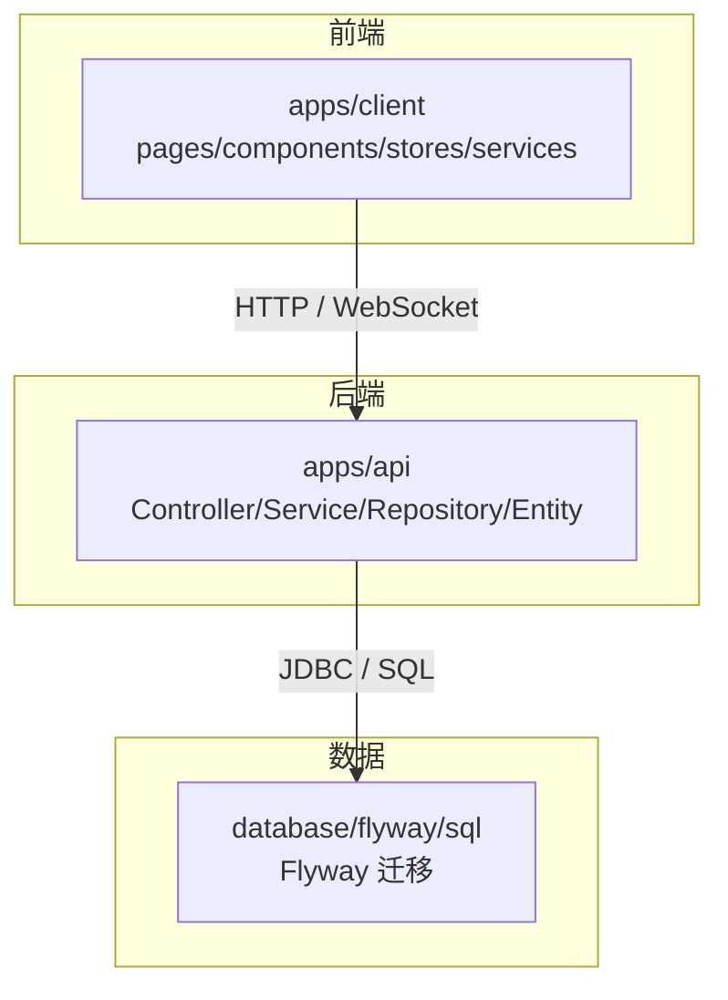
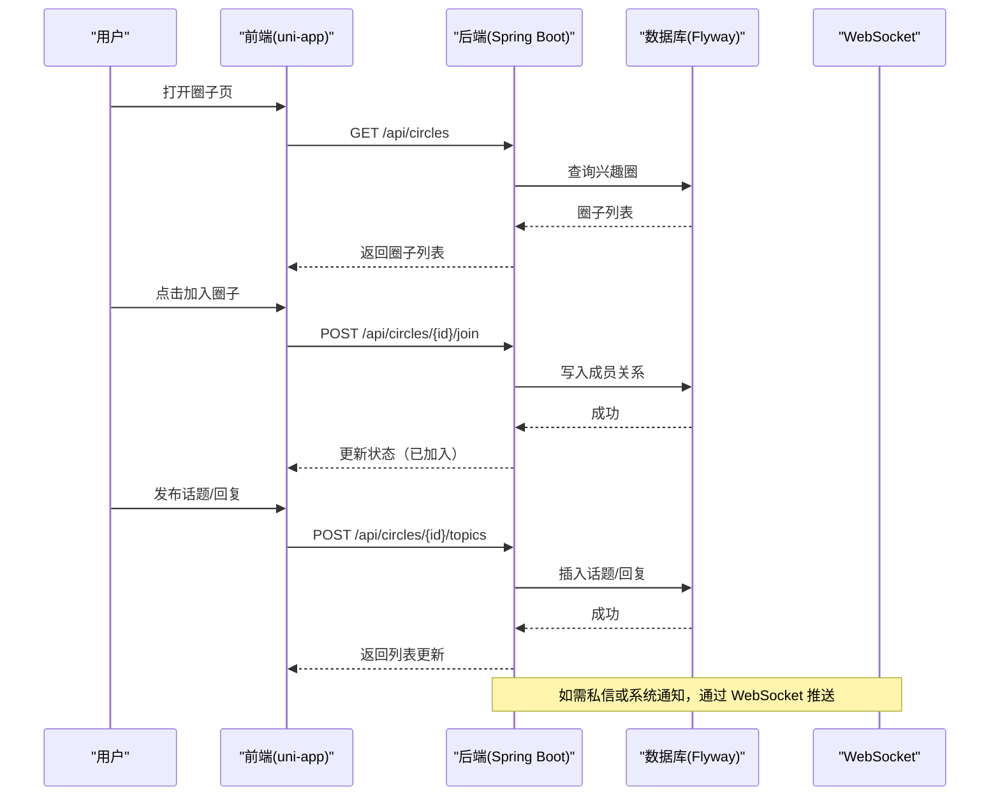
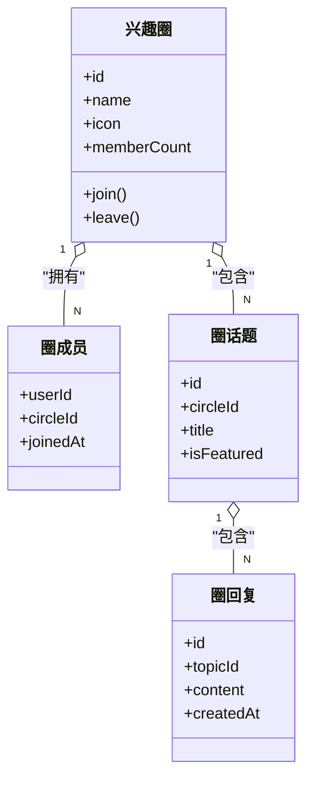
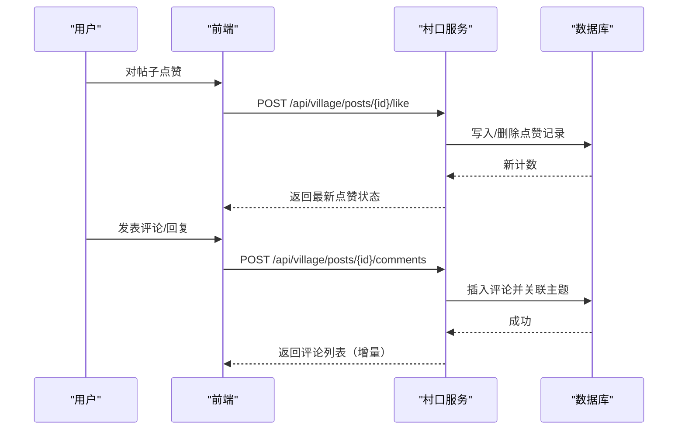
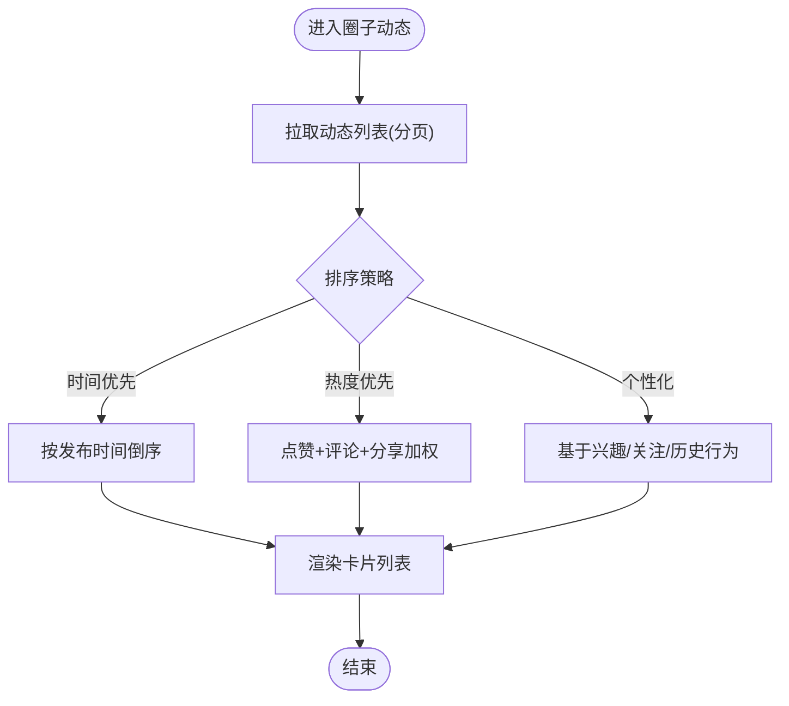
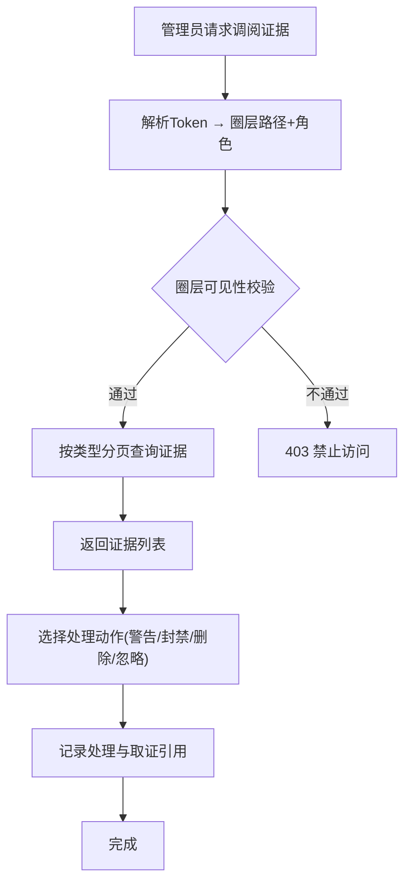
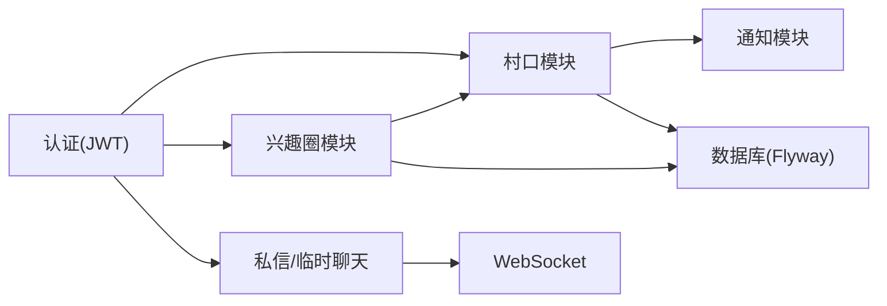

# 圈子互动

<cite>
**本文引用的文件**
- [详细设计文档](file://doc/detailed-design.md)
- [Phase 0 — 数据库任务清单](file://doc/tasks/phase-0-database.md)
- [Phase 1 — 村口模块任务清单](file://doc/tasks/phase-1-village.md)
- [Phase 2 — 兴趣圈模块任务清单](file://doc/tasks/phase-2-circles.md)
- [后台RBAC三级圈层规格](file://doc/后台RBAC三级圈层规格.md)
- [项目最终交付概览](file://doc/overview.md)
- [检查圈子数据（脚本A）](file://scripts/check-circles-data.cjs)
- [检查圈子数据（脚本B）](file://scripts/check-circle-data2.cjs)
- [检查圈子数据（脚本C）](file://scripts/check-circle-data3.cjs)
- [检查圈子导航与封面（脚本D）](file://scripts/check-circles-nav.cjs)
- [调试圈子封面（脚本E）](file://scripts/debug-circle-cover.cjs)
- [拍摄圈子页面截图（脚本F）](file://scripts/shot-circle-now.cjs)
</cite>

## 目录
1. [引言](#引言)
2. [项目结构](#项目结构)
3. [核心组件](#核心组件)
4. [架构总览](#架构总览)
5. [详细组件分析](#详细组件分析)
6. [依赖关系分析](#依赖关系分析)
7. [性能考量](#性能考量)
8. [故障排查指南](#故障排查指南)
9. [结论](#结论)
10. [附录](#附录)

## 引言
本技术文档围绕“圈子互动”能力，系统化梳理以下方面：
- 圈子概念设计：话题分类、成员管理与权限体系（含后台 RBAC 三级圈层）。
- 互动功能实现：点赞、评论、转发、收藏的数据模型与业务逻辑。
- 圈子动态流：时间线展示、热帖排序、个性化推荐。
- 社区治理：内容审核、用户举报、违规处理闭环。
- 数据统计：活跃度分析、用户画像、内容质量评估。
- 互动优化：即时通知、消息推送、社交分享。
- 用户体验：反馈机制、操作确认、错误提示。

## 项目结构
项目采用前后端分离的 Monorepo 结构：
- 前端 uni-app 应用位于 apps/client，包含页面、组件、状态管理、服务与组合式函数。
- 后端 Spring Boot 应用位于 apps/api，提供 REST 与 WebSocket 接口，分层为 Controller/Service/Repository/Entity，支持 Mock/Real 双模式。
- 数据库通过 Flyway 迁移版本化管理；测试与工具脚本分布在 tests、tools、scripts。

图表来源
- [详细设计文档:1-200](file://doc/detailed-design.md#L1-L200)

章节来源
- [详细设计文档:1-200](file://doc/detailed-design.md#L1-L200)
- [项目最终交付概览:1-47](file://doc/overview.md#L1-L47)

## 核心组件
- 兴趣圈与村口社区：
  - 兴趣圈：圈子列表、加入/退出、圈内话题与回复、精选话题在村口展示。
  - 村口：三标签（关注/同城/发现）、六分类筛选、帖子 CRUD、评论、点赞、关注作者、私信、分享。
- 数据与持久化：
  - 使用 JPA Entity + Repository 访问数据库；Flyway 维护表结构与版本演进。
- 认证与安全：
  - JWT 签发/刷新/黑名单；敏感词过滤；安全响应头；CORS 白名单；速率限制。
- 实时通信：
  - WebSocket 用于私信与临时聊天消息推送。

章节来源
- [Phase 1 — 村口模块任务清单:1-71](file://doc/tasks/phase-1-village.md#L1-L71)
- [Phase 2 — 兴趣圈模块任务清单:1-50](file://doc/tasks/phase-2-circles.md#L1-L50)
- [详细设计文档:201-505](file://doc/detailed-design.md#L201-L505)
- [Phase 0 — 数据库任务清单:1-57](file://doc/tasks/phase-0-database.md#L1-L57)

## 架构总览
兴趣圈与村口的整体交互流程如下：
- 客户端发起请求获取圈子列表、加入圈子、发布话题/回复、浏览帖子、评论/点赞/分享等。
- 后端按模块路由到 Service 层，调用 Repository 完成数据读写。
- 事件（如评论、点赞）触发通知写入与可能的推荐/热度计算。
- 通过 WebSocket 推送私信/临时聊天消息。

图表来源
- [详细设计文档:201-505](file://doc/detailed-design.md#L201-L505)
- [Phase 2 — 兴趣圈模块任务清单:1-50](file://doc/tasks/phase-2-circles.md#L1-L50)

章节来源
- [详细设计文档:201-505](file://doc/detailed-design.md#L201-L505)

## 详细组件分析

### 圈子概念与成员管理
- 圈子模型：兴趣圈实体承载名称、图标、简介、成员数等信息；成员关系通过圈成员表记录。
- 加入/退出：提供加入与退出的接口，确保成员集合一致性与幂等性。
- 精选话题：圈内的优质话题可在村口“兴趣圈”分类下展示，非圈成员可浏览但不可回复。

图表来源
- [Phase 2 — 兴趣圈模块任务清单:1-50](file://doc/tasks/phase-2-circles.md#L1-L50)
- [详细设计文档:201-505](file://doc/detailed-design.md#L201-L505)

章节来源
- [Phase 2 — 兴趣圈模块任务清单:1-50](file://doc/tasks/phase-2-circles.md#L1-L50)
- [详细设计文档:201-505](file://doc/detailed-design.md#L201-L505)

### 村口互动：点赞、评论、转发、收藏
- 帖子模型：帖子、分类、标签、分享计数、点赞、评论均独立实体，便于扩展与统计。
- 点赞：支持去重与取消，确保计数准确。
- 评论：支持回复层级，关联作者通知。
- 转发：记录分享次数，可用于热度排序。
- 收藏：可在用户维度建立收藏关系，便于个人空间聚合与推荐。

图表来源
- [Phase 1 — 村口模块任务清单:1-71](file://doc/tasks/phase-1-village.md#L1-L71)
- [详细设计文档:201-505](file://doc/detailed-design.md#L201-L505)

章节来源
- [Phase 1 — 村口模块任务清单:1-71](file://doc/tasks/phase-1-village.md#L1-L71)
- [详细设计文档:201-505](file://doc/detailed-design.md#L201-L505)

### 圈子动态流：时间线、热帖、个性化推荐
- 时间线：按发布时间倒序展示圈子内动态（话题+回复），支持分页加载。
- 热帖排序：基于点赞、评论、分享等多维指标加权排序，结合时间衰减策略。
- 个性化推荐：根据用户兴趣标签、关注关系与历史互动，将精选话题与高相关度内容推送到首页或圈子入口。

图表来源
- [Phase 2 — 兴趣圈模块任务清单:1-50](file://doc/tasks/phase-2-circles.md#L1-L50)
- [详细设计文档:201-505](file://doc/detailed-design.md#L201-L505)

章节来源
- [Phase 2 — 兴趣圈模块任务清单:1-50](file://doc/tasks/phase-2-circles.md#L1-L50)
- [详细设计文档:201-505](file://doc/detailed-design.md#L201-L505)

### 社区治理：内容审核、举报、违规处理
- 后台 RBAC 三级圈层：公司级（L1）、区域级（L2）、学校级（L3），通过圈层路径前缀匹配控制可见范围，越级拦截返回 403。
- 功能角色叠加：运营/审核/客服/风控等角色决定操作权限，与圈层正交。
- 举报调阅：按类型（聊天/图片/帖子/临时聊天）分页查看证据，支持取证留痕与处理动作（警告/封禁/删除/忽略）。
- 内容审核：对帖子、图片、聊天内容进行敏感词过滤与人工审核，未通过内容不可见或限流展示。

图表来源
- [后台RBAC三级圈层规格:1-166](file://doc/后台RBAC三级圈层规格.md#L1-L166)

章节来源
- [后台RBAC三级圈层规格:1-166](file://doc/后台RBAC三级圈层规格.md#L1-L166)

### 数据统计：活跃度、用户画像、内容质量
- 活跃度分析：统计圈子/帖子/评论的活跃趋势（日/周/月），结合在线状态与签到记录。
- 用户画像：基于资料完善度、兴趣标签、互动行为（点赞/评论/分享）构建画像，辅助推荐与运营。
- 内容质量评估：依据互动指标、审核结果、举报率、阅读时长（如有）综合评分，指导精选与降权。

章节来源
- [详细设计文档:201-505](file://doc/detailed-design.md#L201-L505)
- [Phase 1 — 村口模块任务清单:1-71](file://doc/tasks/phase-1-village.md#L1-L71)

### 互动优化：即时通知、消息推送、社交分享
- 即时通知：评论、点赞、关注、加入圈子等事件生成通知，支持标记已读与列表分页。
- 消息推送：通过 WebSocket 推送私信与临时聊天消息，保障低延迟体验。
- 社交分享：记录分享计数，提供分享入口，便于内容扩散与冷启动。

章节来源
- [详细设计文档:201-505](file://doc/detailed-design.md#L201-L505)
- [Phase 1 — 村口模块任务清单:1-71](file://doc/tasks/phase-1-village.md#L1-L71)

### 用户体验：反馈、确认、错误提示
- 反馈机制：提供工单提交与查询接口，便于收集问题与建议。
- 操作确认：加入/退出圈子、发帖、评论等关键操作需二次确认，避免误触。
- 错误提示：统一错误码与友好提示，网络异常时降级为缓存或空态展示。

章节来源
- [详细设计文档:201-505](file://doc/detailed-design.md#L201-L505)
- [Phase 1 — 村口模块任务清单:1-71](file://doc/tasks/phase-1-village.md#L1-L71)

## 依赖关系分析
- 模块耦合：
  - 村口与兴趣圈存在精选话题分流关系（村口展示兴趣圈精选话题）。
  - 通知与私信模块为各互动行为提供支撑。
- 外部依赖：
  - 微信登录与授权（JWT 签发/刷新）。
  - 数据库（Flyway 迁移）。
  - 可选 Redis（Token 黑名单与缓存）。

图表来源
- [详细设计文档:201-505](file://doc/detailed-design.md#L201-L505)

章节来源
- [详细设计文档:201-505](file://doc/detailed-design.md#L201-L505)

## 性能考量
- 数据库查询：
  - 使用分页与索引优化热门列表与动态流加载。
  - 避免 N+1 查询，合理使用 JOIN FETCH 或 EntityGraph。
- 缓存策略：
  - 热点圈子/帖子缓存（内存或 Redis），降低重复读取压力。
- 异步处理：
  - 通知写入、统计更新、敏感词过滤等可异步化，减少主链路耗时。
- 资源优化：
  - 图片压缩与懒加载，首屏仅加载必要资源。

[本节为通用指导，无需特定文件来源]

## 故障排查指南
- 前端自动化脚本验证：
  - 通过小程序自动化工具连接本地环境，注入 Token 后跳转到圈子页面，抓取 DOM 与页面数据进行断言。
  - 常用脚本包括：检查圈子数据、导航元素、封面图渲染、截图比对。
- 常见问题定位：
  - 页面为空态：检查是否传递 circleId、Token 是否正确存储、后端是否返回数据。
  - 数据不一致：对比数据库记录与前端展示，核对加入/退出状态与成员计数。
  - 封面图异常：检查图片 URL 与资源路径，确认静态资源加载正常。

章节来源
- [检查圈子数据（脚本A）:1-19](file://scripts/check-circles-data.cjs#L1-L19)
- [检查圈子数据（脚本B）:1-22](file://scripts/check-circle-data2.cjs#L1-L22)
- [检查圈子数据（脚本C）:1-18](file://scripts/check-circle-data3.cjs#L1-L18)
- [检查圈子导航与封面（脚本D）:1-29](file://scripts/check-circles-nav.cjs#L1-L29)
- [调试圈子封面（脚本E）:1-33](file://scripts/debug-circle-cover.cjs#L1-L33)
- [拍摄圈子页面截图（脚本F）:1-15](file://scripts/shot-circle-now.cjs#L1-L15)

## 结论
本项目在“圈子互动”方向上具备清晰的分层架构与完备的任务拆解：
- 兴趣圈与村口形成互补的内容生态，精选话题打通了圈内外流量。
- 互动能力覆盖点赞、评论、转发、收藏，并通过通知与推送提升参与感。
- 后台 RBAC 三级圈层与举报调阅形成社区治理闭环，保障内容健康。
- 数据统计与性能优化为长期运营与体验提升提供基础。
建议后续持续完善收藏能力、推荐算法与监控告警，以进一步提升互动效率与内容质量。

[本节为总结性内容，无需特定文件来源]

## 附录
- API 端点参考（部分）：
  - 兴趣圈：GET /api/circles、POST /api/circles/{id}/join、GET /api/circles/{id}/topics、POST /api/circles/{id}/topics
  - 村口：GET /api/village/posts、POST /api/village/posts、GET /api/village/posts/{id}、POST /api/village/posts/{id}/comments、POST /api/village/posts/{id}/like、POST /api/village/posts/{id}/share
  - 通知：GET /api/notifications、PUT /api/notifications/{id}/read
  - 私信/临时聊天：POST /api/chat/conversations/{id}/messages、POST /api/chat/temp/sessions、POST /api/chat/temp/exchange

章节来源
- [详细设计文档:201-505](file://doc/detailed-design.md#L201-L505)