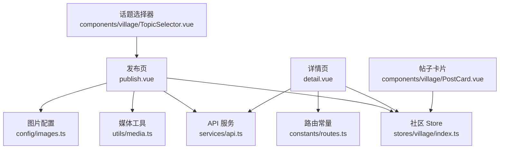
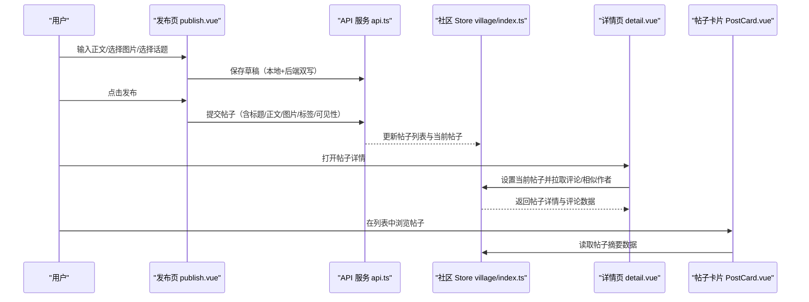
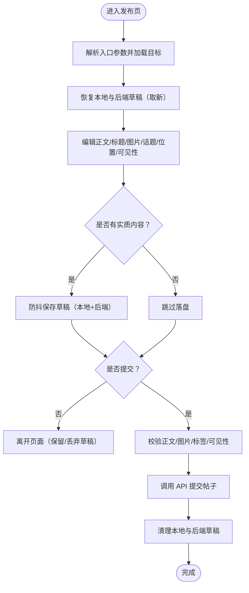
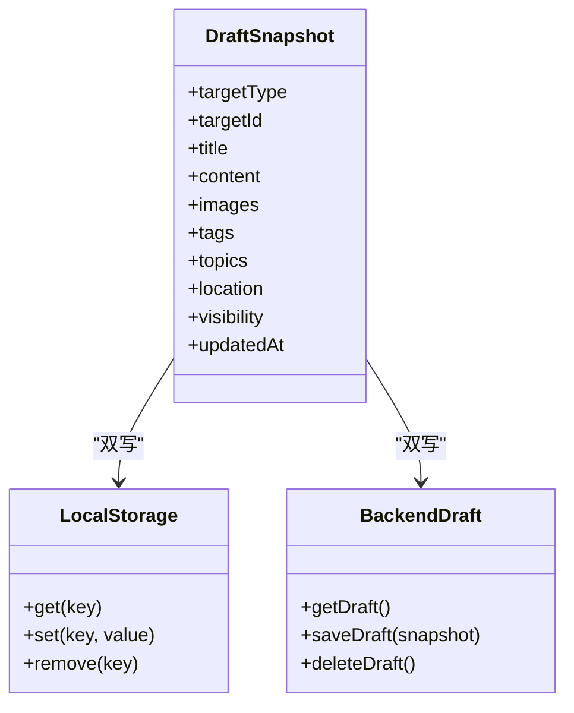
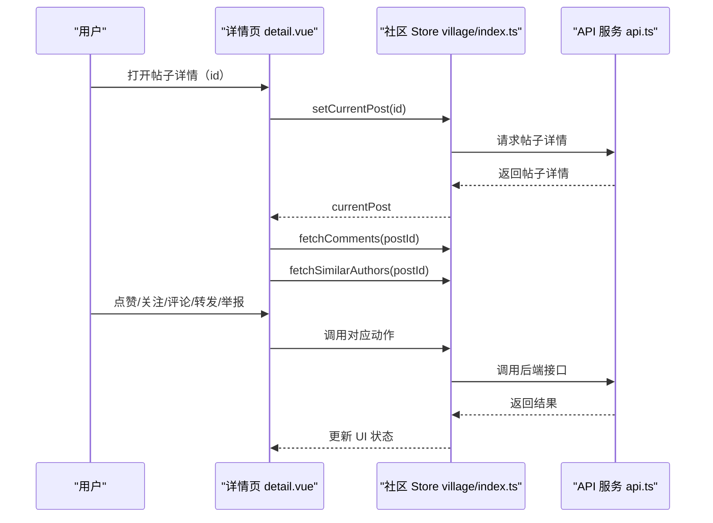
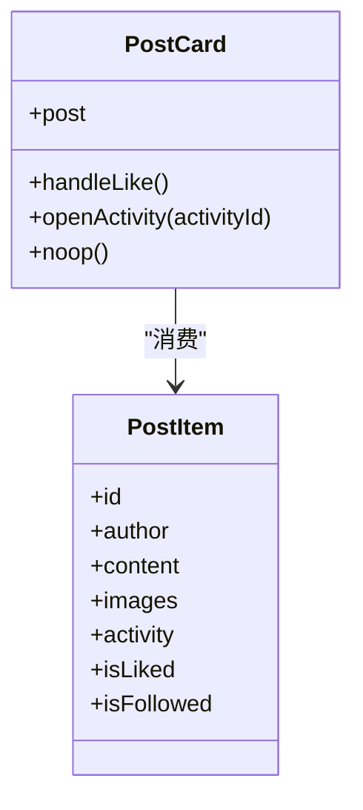
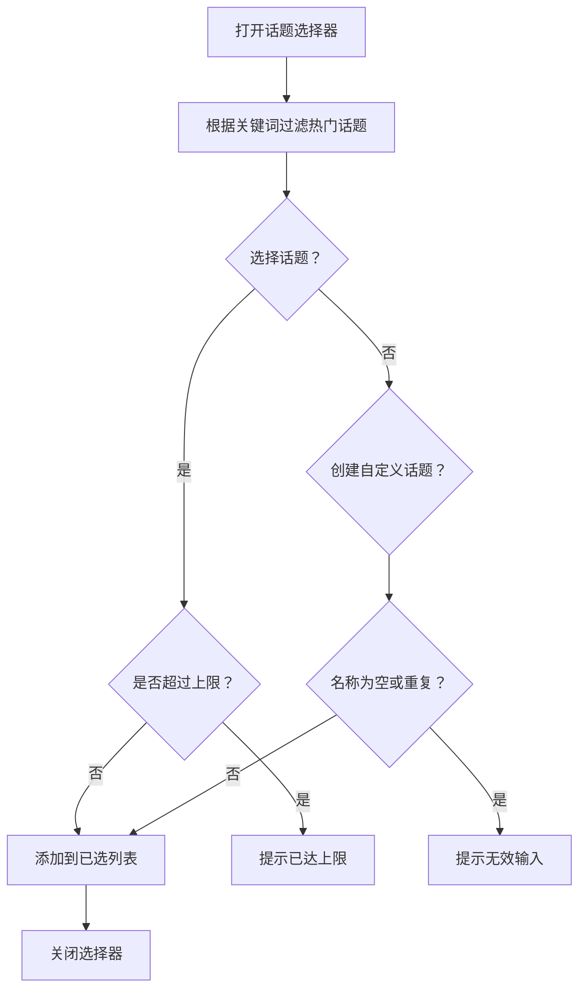
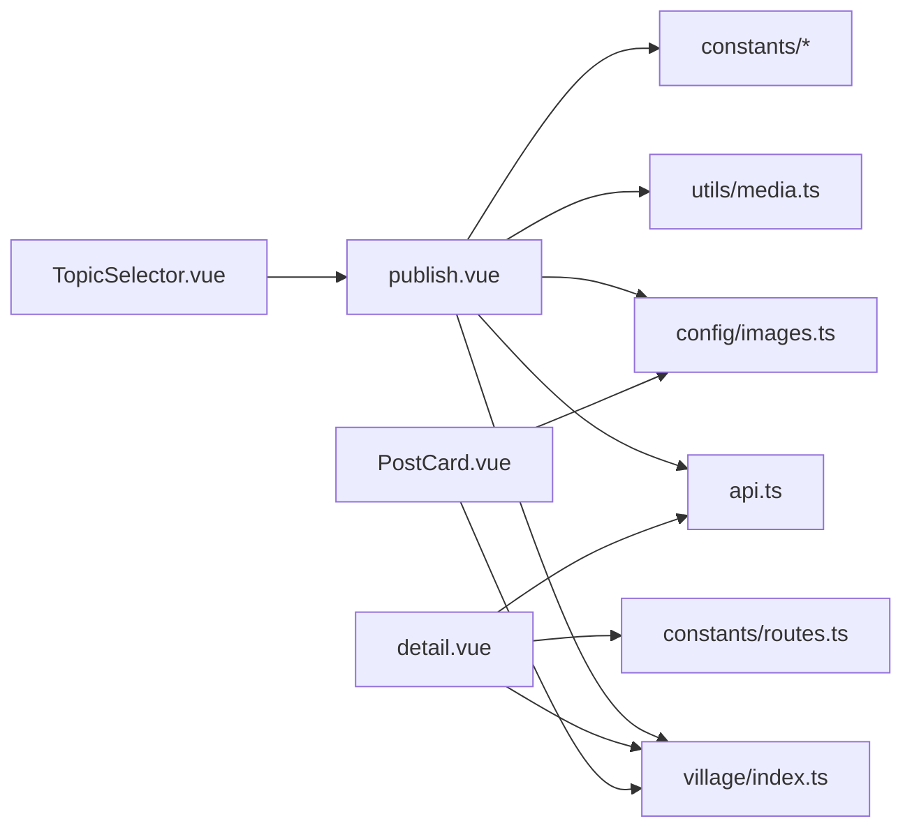

# 帖子管理

<cite>
**本文引用的文件**   
- [publish.vue](file://apps/client/src/subpackages/village/village/publish.vue)
- [detail.vue](file://apps/client/src/subpackages/village/village/detail.vue)
- [PostCard.vue](file://apps/client/src/components/village/PostCard.vue)
- [TopicSelector.vue](file://apps/client/src/components/village/TopicSelector.vue)
- [apps/client/src/stores/village/index.ts](file://apps/client/src/stores/village/index.ts)
- [api.ts](file://apps/client/src/services/api.ts)
- [media.ts](file://apps/client/src/utils/media.ts)
- [images.ts](file://apps/client/src/config/images.ts)
- [routes.ts](file://apps/client/src/constants/routes.ts)
- [storage-keys.ts](file://apps/client/src/constants/storage-keys.ts)
- [village.ts](file://apps/client/src/constants/village.ts)
</cite>

## 目录
1. [引言](#引言)
2. [项目结构](#项目结构)
3. [核心组件](#核心组件)
4. [架构总览](#架构总览)
5. [详细组件分析](#详细组件分析)
6. [依赖关系分析](#依赖关系分析)
7. [性能与内容优化](#性能与内容优化)
8. [故障排查指南](#故障排查指南)
9. [结论](#结论)

## 引言
本文面向“帖子管理”功能，围绕客户端侧的帖子发布器、帖子编辑器、帖子详情页、标签选择、搜索与筛选、权限控制、内容优化与安全检测等维度进行系统化技术文档整理。文档以现有代码为依据，重点说明：
- 帖子发布器的富文本编辑入口、图片插入与压缩、话题与标签选择、预览交互。
- 帖子编辑器的内容序列化、草稿本地与后端双写、版本合并与退出保护。
- 帖子详情页的内容解析、图片展示、评论分页、互动按钮与举报流程。
- 搜索与筛选的实现现状与扩展点。
- 可见性设置、作者权限、审核状态的控制方式。
- 图片压缩、缓存策略、SEO 优化建议。
- 敏感词过滤、版权检查、违规识别的安全能力与落地方案。

## 项目结构
帖子管理相关的前端实现集中在小程序客户端子应用 `apps/client` 中，核心文件包括：
- 发布页：`apps/client/src/subpackages/village/village/publish.vue`
- 详情页：`apps/client/src/subpackages/village/village/detail.vue`
- 帖子卡片：`apps/client/src/components/village/PostCard.vue`
- 话题选择器：`apps/client/src/components/village/TopicSelector.vue`
- 社区数据 Store：`apps/client/src/stores/village/index.ts`
- API 服务封装：`apps/client/src/services/api.ts`
- 媒体工具：`apps/client/src/utils/media.ts`
- 图片配置：`apps/client/src/config/images.ts`
- 路由常量：`apps/client/src/constants/routes.ts`
- 存储键常量：`apps/client/src/constants/storage-keys.ts`
- 帖子常量：`apps/client/src/constants/village.ts`

**图示来源**
- [publish.vue:1-120](file://apps/client/src/subpackages/village/village/publish.vue#L1-L120)
- [detail.vue:1-120](file://apps/client/src/subpackages/village/village/detail.vue#L1-L120)
- [PostCard.vue:1-60](file://apps/client/src/components/village/PostCard.vue#L1-L60)
- [TopicSelector.vue:1-60](file://apps/client/src/components/village/TopicSelector.vue#L1-L60)

**章节来源**
- [publish.vue:1-120](file://apps/client/src/subpackages/village/village/publish.vue#L1-L120)
- [detail.vue:1-120](file://apps/client/src/subpackages/village/village/detail.vue#L1-L120)
- [PostCard.vue:1-60](file://apps/client/src/components/village/PostCard.vue#L1-L60)
- [TopicSelector.vue:1-60](file://apps/client/src/components/village/TopicSelector.vue#L1-L60)

## 核心组件
- 发布器（publish.vue）：负责帖子目标选择（个人动态、校园圈、兴趣圈、日常）、正文输入、图片选择与压缩、话题与标签选择、位置信息、可见性设置、草稿保存与恢复、提交发布。
- 详情页（detail.vue）：负责帖子详情加载、内容渲染、图片全屏查看、评论列表与分页、楼中楼回复、点赞/关注/分享/举报、相似作者推荐、频道活动卡跳转。
- 帖子卡片（PostCard.vue）：用于列表或首页中的帖子摘要展示，包含作者信息、正文、九宫格图片、标签、活动卡内嵌和底部互动按钮。
- 话题选择器（TopicSelector.vue）：提供热门话题浏览、搜索、自定义创建、已选话题管理与上限控制。

**章节来源**
- [publish.vue:1-120](file://apps/client/src/subpackages/village/village/publish.vue#L1-L120)
- [detail.vue:1-120](file://apps/client/src/subpackages/village/village/detail.vue#L1-L120)
- [PostCard.vue:1-60](file://apps/client/src/components/village/PostCard.vue#L1-L60)
- [TopicSelector.vue:1-60](file://apps/client/src/components/village/TopicSelector.vue#L1-L60)

## 架构总览
帖子管理的整体数据流如下：用户通过发布页完成内容编辑并触发草稿保存；提交后由 API 服务调用后端接口持久化；详情页从 Store 获取当前帖子并拉取评论与相似作者；卡片组件仅消费 Store 的帖子数据进行展示。

**图示来源**
- [publish.vue:261-591](file://apps/client/src/subpackages/village/village/publish.vue#L261-L591)
- [detail.vue:727-1200](file://apps/client/src/subpackages/village/village/detail.vue#L727-L1200)
- [api.ts](file://apps/client/src/services/api.ts)
- [apps/client/src/stores/village/index.ts](file://apps/client/src/stores/village/index.ts)

## 详细组件分析

### 发布器（publish.vue）
发布器承担帖子创作的核心职责，涵盖以下关键能力：
- 目标选择与可见性联动：支持个人动态、校园圈、兴趣圈、日常四类目标；不同目标对应不同可见范围（公开、学校圈、兴趣圈、朋友可见），并在深链或草稿恢复时同步修正。
- 正文与长度校验：使用统一的字数上限常量，接近上限时给出警示提示，避免提交失败。
- 图片插入与压缩：调用媒体工具选择图片，执行压缩后再加入图片数组；限制最大图片数量；对隐私权限缺失做明确提示。
- 话题与标签选择：内置热门话题与自定义输入，统一以“#标签”形式并入正文与独立标签数组；限制最大标签数并提供重复拦截。
- 草稿机制：本地 storage 与后端 `/drafts/current` 双写；按更新时间戳取新；空快照不写入；页面卸载前询问保留草稿；提交成功后清理草稿。
- 退出保护：提交进行中禁止离页；未发布内容提示保留或丢弃。

**图示来源**
- [publish.vue:261-591](file://apps/client/src/subpackages/village/village/publish.vue#L261-L591)

**章节来源**
- [publish.vue:1-120](file://apps/client/src/subpackages/village/village/publish.vue#L1-L120)
- [publish.vue:261-591](file://apps/client/src/subpackages/village/village/publish.vue#L261-L591)
- [publish.vue:592-1146](file://apps/client/src/subpackages/village/village/publish.vue#L592-L1146)
- [village.ts](file://apps/client/src/constants/village.ts)
- [storage-keys.ts](file://apps/client/src/constants/storage-keys.ts)

### 编辑器核心技术：内容序列化、版本管理与草稿保存
- 内容序列化：发布器将正文、图片 URL、标签、话题、位置、可见性、目标类型与 ID 组装为草稿快照对象；正文中的“#标签”会被提取并与已选标签合并，同时受最大标签数限制。
- 版本管理：本地草稿与后端草稿均携带时间戳；恢复时按毫秒时间比较取新，避免旧草稿覆盖新编辑。
- 草稿保存：采用防抖定时器避免频繁写盘；首次保存立即落盘，后端双写延迟 2 秒；页面卸载时强制 flush，防止最后一段编辑丢失。
- 安全与健壮性：临时图片路径在跨进程失效，因此只持久化已上传的稳定 URL；后端草稿删除失败不会阻塞本地键清理；空快照不落盘以避免“幽灵草稿”。

**图示来源**
- [publish.vue:592-1146](file://apps/client/src/subpackages/village/village/publish.vue#L592-L1146)
- [api.ts](file://apps/client/src/services/api.ts)

**章节来源**
- [publish.vue:592-1146](file://apps/client/src/subpackages/village/village/publish.vue#L592-L1146)

### 帖子详情页（detail.vue）
详情页负责完整帖子的展示与互动：
- 帖子加载：优先使用列表缓存快速渲染，再替换为详情接口数据；无可用帖子时清空并提示错误态。
- 图片展示：支持点击图片进入全屏预览；图片加载失败时切换为占位元素；所有媒体 URL 经代理路径重写。
- 评论系统：支持最热/最新排序、分页加载更多、楼中楼回复、评论图片上传（最多 3 张）、表情面板与 @ 提及。
- 互动按钮：点赞、关注、转发、收藏、举报；点赞/关注失败时给出用户可见提示。
- 相似作者：展示相似作者列表并支持关注与私信跳转。
- 活动卡：内嵌活动链接跳转至活动详情页。

**图示来源**
- [detail.vue:727-1200](file://apps/client/src/subpackages/village/village/detail.vue#L727-L1200)

**章节来源**
- [detail.vue:1-260](file://apps/client/src/subpackages/village/village/detail.vue#L1-L260)
- [detail.vue:261-726](file://apps/client/src/subpackages/village/village/detail.vue#L261-L726)
- [detail.vue:727-1200](file://apps/client/src/subpackages/village/village/detail.vue#L727-L1200)

### 帖子卡片（PostCard.vue）
帖子卡片用于高效展示帖子摘要：
- 作者信息：头像、校友徽章、昵称、年龄·城市·学历、签名、关注按钮。
- 正文与图片：正文截断显示；图片区最多展示 9 张，超出显示“+N”；无图时使用占位图保证版面稳定。
- 活动卡内嵌：当帖子关联活动时直接内嵌 ActivityCard，点击跳转活动详情。
- 互动行为：点赞动画、收藏、分享、打开详情、打开作者主页、打开标签聚合页。

**图示来源**
- [PostCard.vue:1-220](file://apps/client/src/components/village/PostCard.vue#L1-L220)

**章节来源**
- [PostCard.vue:1-220](file://apps/client/src/components/village/PostCard.vue#L1-L220)

### 话题选择器（TopicSelector.vue）
话题选择器提供可复用话题管理能力：
- 热门话题：按使用次数倒序展示，支持搜索过滤。
- 自定义创建：输入名称后创建新话题，自动选中并清空输入。
- 已选管理：顶部展示已选话题 chip，支持移除与清空。
- 上限控制：最多选择固定数量的话题，超过上限时 toast 提示。

**图示来源**
- [TopicSelector.vue:1-220](file://apps/client/src/components/village/TopicSelector.vue#L1-L220)

**章节来源**
- [TopicSelector.vue:1-220](file://apps/client/src/components/village/TopicSelector.vue#L1-L220)

## 依赖关系分析
- 发布器依赖：
  - Store：圈子列表、社区帖子与评论、当前帖子、分类等。
  - API：草稿保存/获取/删除、帖子提交、图片上传。
  - 工具：隐私授权、图片选择与压缩、媒体 URL 解析、状态栏高度注入。
  - 常量：草稿存储键、图片上限、标签上限、标题长度限制、路由常量。
- 详情页依赖：
  - Store：当前帖子、评论、相似作者、分类。
  - API：评论分页、点赞、关注、转发、举报。
  - 工具：导航、触觉反馈、媒体 URL 解析。
  - 常量：路由常量、图片配置。
- 卡片组件依赖：
  - Store：帖子数据结构。
  - 工具：媒体 URL 解析、图片回退。
  - 常量：图片路径。
- 话题选择器依赖：
  - 配置：热门话题列表与最大选择数。
  - 工具：触觉反馈、国际化文案。

**图示来源**
- [publish.vue:1-120](file://apps/client/src/subpackages/village/village/publish.vue#L1-L120)
- [detail.vue:1-120](file://apps/client/src/subpackages/village/village/detail.vue#L1-L120)
- [PostCard.vue:1-60](file://apps/client/src/components/village/PostCard.vue#L1-L60)
- [TopicSelector.vue:1-60](file://apps/client/src/components/village/TopicSelector.vue#L1-L60)

**章节来源**
- [publish.vue:1-120](file://apps/client/src/subpackages/village/village/publish.vue#L1-L120)
- [detail.vue:1-120](file://apps/client/src/subpackages/village/village/detail.vue#L1-L120)
- [PostCard.vue:1-60](file://apps/client/src/components/village/PostCard.vue#L1-L60)
- [TopicSelector.vue:1-60](file://apps/client/src/components/village/TopicSelector.vue#L1-L60)

## 性能与内容优化
- 图片压缩：发布器在用户选择图片后调用压缩工具，减少上传体积并提升首屏加载速度。
- 媒体 URL 代理：详情页与卡片组件均通过媒体工具将用户上传图片 URL 重写为鉴权代理路径，保障资源访问安全与稳定性。
- 缓存策略：详情页首帧优先使用列表缓存的帖子摘要，减少白屏等待；评论分页加载避免一次性拉取大量数据。
- SEO 优化建议：
  - 标题与正文语义化：确保标题与正文包含有意义的关键词，便于搜索引擎索引。
  - 图片 alt 与描述：为图片补充可读描述，提高可访问性与 SEO。
  - 结构化数据：为帖子增加结构化元信息（如类别、发布时间、作者），提升搜索结果展示质量。
  - 标签与分类：合理使用标签与分类，增强内容可发现性。

[本节为通用指导，不直接分析具体文件]

## 故障排查指南
- 图片选择失败且提示隐私协议未声明：检查微信后台隐私指引是否已声明相册/相机权限；发布器会对特定错误码与消息进行明确提示。
- 草稿未保存或丢失：确认草稿防抖定时器是否被取消；检查本地 storage 与后端草稿双写逻辑；确认快照是否为空（空快照不落盘）。
- 帖子详情页无法加载：确认当前帖子是否存在；检查 Store 的 setCurrentPost 与 fetchComments 调用是否成功；无可用帖子时应提示错误态。
- 评论加载“幻影更多”：当服务端总数大于根评论数时，拉到空页会隐藏“加载更多”按钮；若出现异常，重置自愈标记并重新拉取。
- 点赞/关注失败：检查 Store 的动作实现与 API 响应；失败时会弹出用户可见提示。
- 标签重复或超限：话题选择器会在选择或创建时检查重复与上限，必要时给出 toast 提示。

**章节来源**
- [publish.vue:261-591](file://apps/client/src/subpackages/village/village/publish.vue#L261-L591)
- [publish.vue:592-1146](file://apps/client/src/subpackages/village/village/publish.vue#L592-L1146)
- [detail.vue:261-726](file://apps/client/src/subpackages/village/village/detail.vue#L261-L726)
- [TopicSelector.vue:1-220](file://apps/client/src/components/village/TopicSelector.vue#L1-L220)

## 结论
帖子管理功能在客户端侧形成了清晰的发布—详情—卡片—选择器分层架构。发布器负责内容创作与草稿双写，详情页负责内容解析与互动，卡片组件负责高效展示，话题选择器提供可复用的话题管理能力。通过媒体工具与 Store 的配合，系统在图片处理、缓存与数据一致性方面具备较好的健壮性。未来可在搜索与筛选、内容安全检测、SEO 与缓存优化方面进一步扩展，以提升用户体验与内容质量。

[本节为总结性内容，不直接分析具体文件]