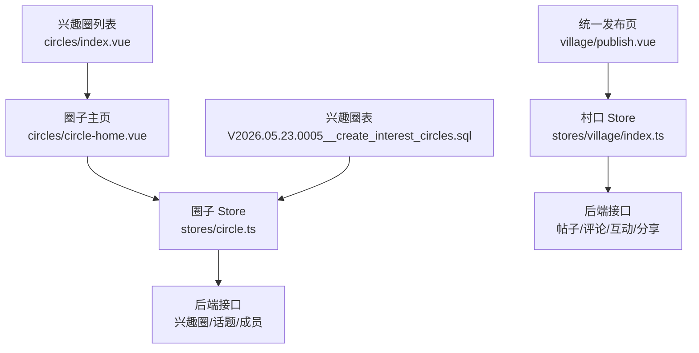
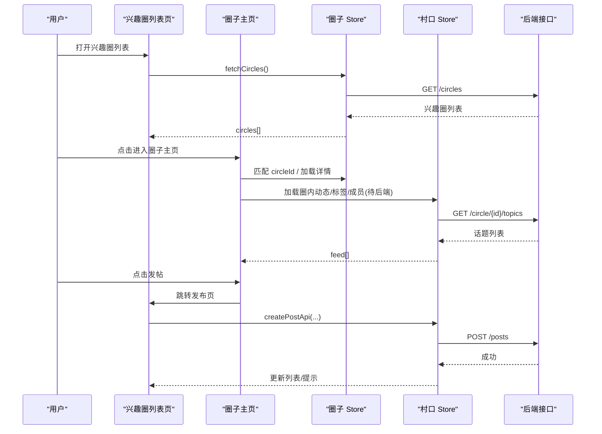
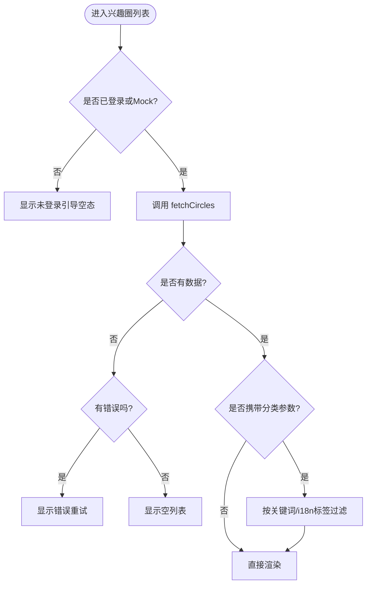
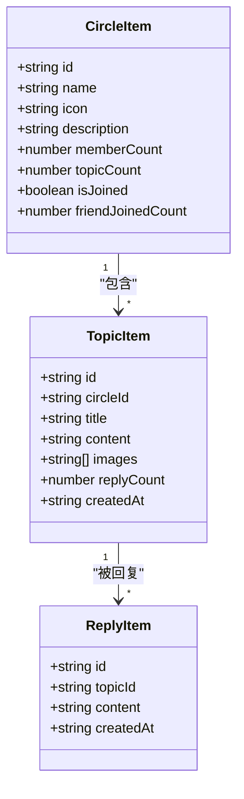
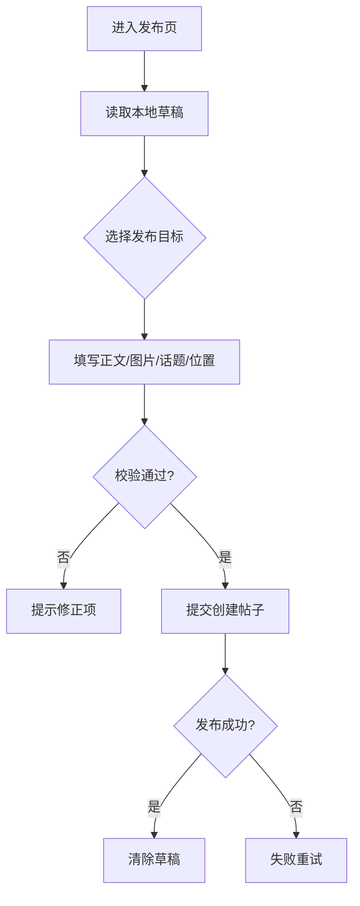
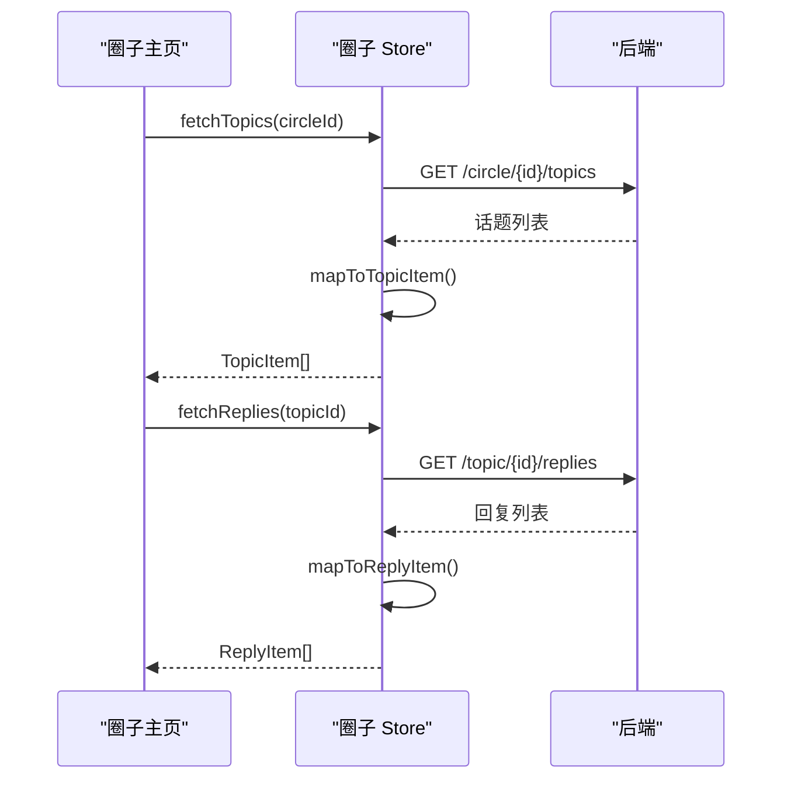
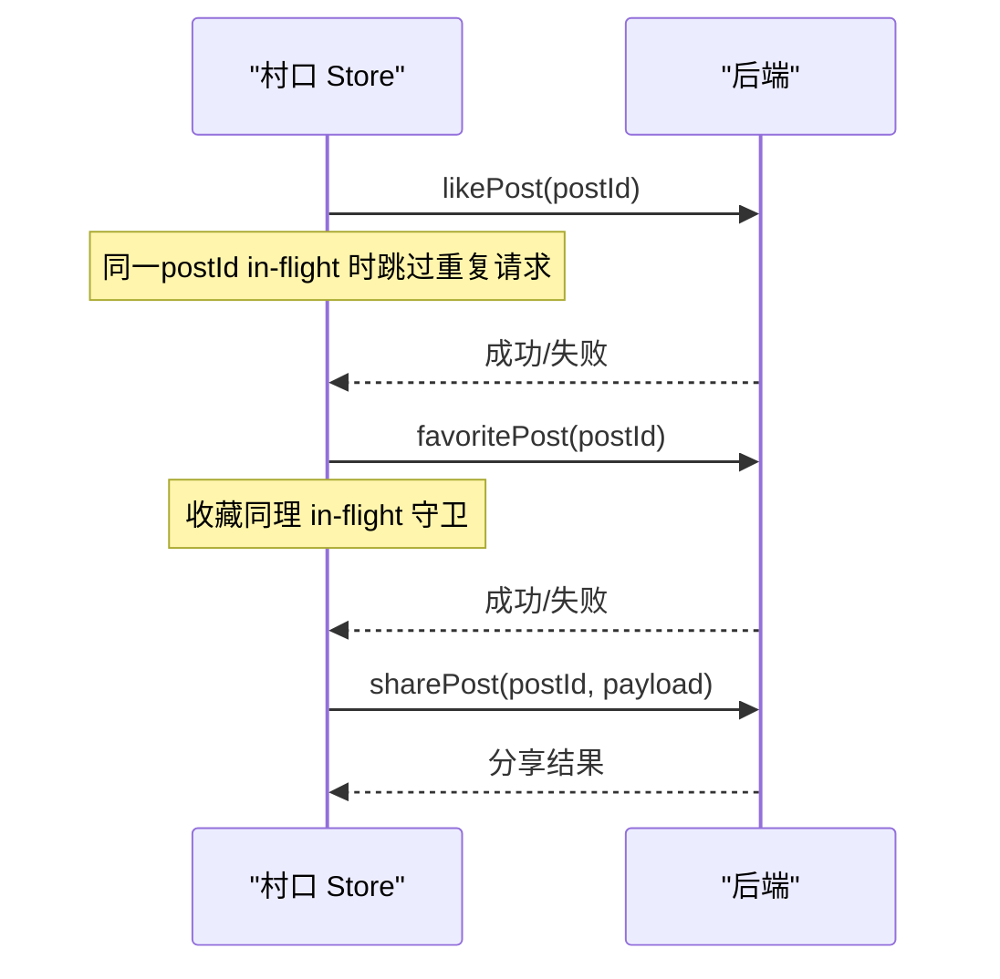
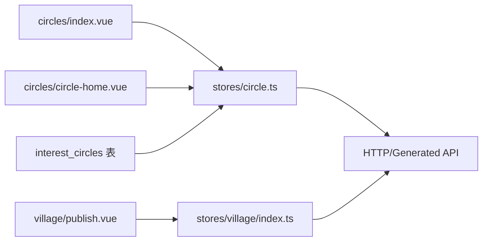

# 社区圈子

<cite>
**本文引用的文件**
- [apps/client/src/subpackages/circles/circles/index.vue](file://apps/client/src/subpackages/circles/circles/index.vue)
- [apps/client/src/subpackages/circles/circles/circle-home.vue](file://apps/client/src/subpackages/circles/circles/circle-home.vue)
- [apps/client/src/subpackages/village/village/publish.vue](file://apps/client/src/subpackages/village/village/publish.vue)
- [apps/client/src/stores/circle.ts](file://apps/client/src/stores/circle.ts)
- [apps/client/src/stores/village/index.ts](file://apps/client/src/stores/village/index.ts)
- [apps/client/src/stores/village.ts](file://apps/client/src/stores/village.ts)
- [database/flyway/sql/V2026.05.23.0005__create_interest_circles.sql](file://database/flyway/sql/V2026.05.23.0005__create_interest_circles.sql)
</cite>

## 目录
1. [简介](#简介)
2. [项目结构](#项目结构)
3. [核心组件](#核心组件)
4. [架构总览](#架构总览)
5. [详细组件分析](#详细组件分析)
6. [依赖关系分析](#依赖关系分析)
7. [性能优化方案](#性能优化方案)
8. [故障排查指南](#故障排查指南)
9. [结论](#结论)
10. [附录](#附录)

## 简介
本技术文档围绕“社区圈子”功能，系统性梳理帖子发布与管理、富文本与图片上传、标签体系、内容审核流程；深入解释圈子概念（话题分类、用户分组、权限控制）；文档化互动能力（点赞、评论、分享、收藏）；说明内容发现机制（热门排序、个性化推荐、时间线展示）；覆盖社区治理（举报处理、删除、禁言）；并给出性能优化（图片懒加载、虚拟滚动、缓存策略）与安全合规（敏感词过滤、AI审核、人工复核）方案。

## 项目结构
社区圈子能力在前端主要分布在：
- 兴趣圈列表与圈子主页：位于子包 circles
- 统一发布页：位于子包 village/publish
- 数据状态管理：stores/circle.ts、stores/village/index.ts
- 数据库迁移：interest_circles 相关建表语句

图示来源
- [apps/client/src/subpackages/circles/circles/index.vue:1-200](file://apps/client/src/subpackages/circles/circles/index.vue#L1-L200)
- [apps/client/src/subpackages/circles/circles/circle-home.vue:1-200](file://apps/client/src/subpackages/circles/circles/circle-home.vue#L1-L200)
- [apps/client/src/stores/circle.ts:1-200](file://apps/client/src/stores/circle.ts#L1-L200)
- [apps/client/src/stores/village/index.ts:1-150](file://apps/client/src/stores/village/index.ts#L1-L150)
- [database/flyway/sql/V2026.05.23.0005__create_interest_circles.sql:1-11](file://database/flyway/sql/V2026.05.23.0005__create_interest_circles.sql#L1-L11)

章节来源
- [apps/client/src/subpackages/circles/circles/index.vue:1-200](file://apps/client/src/subpackages/circles/circles/index.vue#L1-L200)
- [apps/client/src/subpackages/circles/circles/circle-home.vue:1-200](file://apps/client/src/subpackages/circles/circles/circle-home.vue#L1-L200)
- [apps/client/src/stores/circle.ts:1-200](file://apps/client/src/stores/circle.ts#L1-L200)
- [apps/client/src/stores/village/index.ts:1-150](file://apps/client/src/stores/village/index.ts#L1-L150)
- [database/flyway/sql/V2026.05.23.0005__create_interest_circles.sql:1-11](file://database/flyway/sql/V2026.05.23.0005__create_interest_circles.sql#L1-L11)

## 核心组件
- 兴趣圈列表页：支持按兴趣分类筛选、加入/退出圈子、进入圈子主页。未登录态提供引导，mock 模式本地渲染。
- 圈子主页：展示封面、信息卡、标签、多 Tab（动态/精华/活动/作品墙/成员）、置顶公告、动态 Feed、加入与发帖入口。
- 统一发布页：目标选择（通用/圈子/校园/好友）、正文输入、图片九宫格、话题/位置/可见性设置、草稿自动恢复与保存。
- 圈子 Store：拉取兴趣圈、话题列表与详情、回复、成员关系映射，以及媒体 URL 解析。
- 村口 Store：帖子列表、详情、评论、点赞/收藏幂等守卫、防抖评论发送、热门榜单与相似作者、分享等。

章节来源
- [apps/client/src/subpackages/circles/circles/index.vue:1-200](file://apps/client/src/subpackages/circles/circles/index.vue#L1-L200)
- [apps/client/src/subpackages/circles/circles/circle-home.vue:1-200](file://apps/client/src/subpackages/circles/circles/circle-home.vue#L1-L200)
- [apps/client/src/subpackages/village/village/publish.vue:1-100](file://apps/client/src/subpackages/village/village/publish.vue#L1-L100)
- [apps/client/src/stores/circle.ts:1-200](file://apps/client/src/stores/circle.ts#L1-L200)
- [apps/client/src/stores/village/index.ts:1-150](file://apps/client/src/stores/village/index.ts#L1-L150)

## 架构总览
前端采用 Vue + Pinia Store 组织业务状态，页面通过 store 调用 HTTP 服务访问后端接口；数据库层面通过 Flyway 迁移维护兴趣圈基础表结构。发布与互动链路在村口 Store 中集中实现，包含并发保护与防抖逻辑。

图示来源
- [apps/client/src/subpackages/circles/circles/index.vue:1-200](file://apps/client/src/subpackages/circles/circles/index.vue#L1-L200)
- [apps/client/src/subpackages/circles/circles/circle-home.vue:1-200](file://apps/client/src/subpackages/circles/circles/circle-home.vue#L1-L200)
- [apps/client/src/stores/circle.ts:1-200](file://apps/client/src/stores/circle.ts#L1-L200)
- [apps/client/src/stores/village/index.ts:1-150](file://apps/client/src/stores/village/index.ts#L1-L150)

## 详细组件分析

### 兴趣圈列表与筛选
- 支持从路由参数带入兴趣分类，页面级关键词匹配中文与 i18n 标签，无匹配时诚实展示空态。
- 未登录态不发受保护请求，避免冷启动 401；onShow 自愈补拉。
- 错误态统一映射为 loading/error/empty/content。

图示来源
- [apps/client/src/subpackages/circles/circles/index.vue:1-200](file://apps/client/src/subpackages/circles/circles/index.vue#L1-L200)

章节来源
- [apps/client/src/subpackages/circles/circles/index.vue:1-200](file://apps/client/src/subpackages/circles/circles/index.vue#L1-L200)

### 圈子主页与信息展示
- Hero 头图、信息卡、标签行、多 Tab、置顶公告、动态 Feed、加入按钮与发帖浮动按钮。
- real 模式下若未命中圈则标记未知圈，避免误用演示数据；mock 模式保持演示兜底。
- 封面统一走配置映射，确保图文一致。

图示来源
- [apps/client/src/stores/circle.ts:1-200](file://apps/client/src/stores/circle.ts#L1-L200)
- [apps/client/src/subpackages/circles/circles/circle-home.vue:1-200](file://apps/client/src/subpackages/circles/circles/circle-home.vue#L1-L200)

章节来源
- [apps/client/src/subpackages/circles/circles/circle-home.vue:1-200](file://apps/client/src/subpackages/circles/circles/circle-home.vue#L1-L200)
- [apps/client/src/stores/circle.ts:1-200](file://apps/client/src/stores/circle.ts#L1-L200)

### 统一发布页（富文本、图片、标签、可见性）
- 目标选择：通用/圈子/校园/好友，联动可见性。
- 正文输入与字数上限提示，接近上限时警示色。
- 图片九宫格选择与压缩；话题标签、当前位置城市；草稿本地存储与自动恢复。
- 提交前校验：标题长度、正文非空、图片数量限制、自定义标签数限制。

图示来源
- [apps/client/src/subpackages/village/village/publish.vue:1-100](file://apps/client/src/subpackages/village/village/publish.vue#L1-L100)

章节来源
- [apps/client/src/subpackages/village/village/publish.vue:1-100](file://apps/client/src/subpackages/village/village/publish.vue#L1-L100)

### 圈子 Store 数据流与类型映射
- 后端视图到前端模型的映射：CircleView→CircleItem、CircleTopicView→TopicItem/TopicDetail、CircleReplyView→ReplyItem。
- 媒体 URL 统一解析，头像与配图在 real 模式下鉴权加载。
- 成员关系：加入/退出、成员计数、朋友已加入计数。

图示来源
- [apps/client/src/stores/circle.ts:1-200](file://apps/client/src/stores/circle.ts#L1-L200)

章节来源
- [apps/client/src/stores/circle.ts:1-200](file://apps/client/src/stores/circle.ts#L1-L200)

### 村口 Store 互动与内容发现
- 列表拉取防竞态：AbortController 取消旧请求，避免新请求结果被旧响应覆盖。
- 评论防抖：按 postId 维度去重定时器，防止重复提交。
- 点赞/收藏幂等：in-flight 集合守卫，避免重复 toggle。
- 热门榜单、相似作者、分享等能力通过对应 API 暴露。

图示来源
- [apps/client/src/stores/village/index.ts:1-150](file://apps/client/src/stores/village/index.ts#L1-L150)

章节来源
- [apps/client/src/stores/village/index.ts:1-150](file://apps/client/src/stores/village/index.ts#L1-L150)

## 依赖关系分析
- 页面依赖 Store：circles/index.vue → stores/circle.ts；circles/circle-home.vue → stores/circle.ts；village/publish.vue → stores/village/index.ts。
- Store 依赖 HTTP 服务与类型生成：stores/circle.ts、stores/village/index.ts 通过 services/http 与 generated API types 进行通信。
- 数据库层：interest_circles 表由 Flyway 迁移创建，支撑兴趣圈基础数据结构。

图示来源
- [apps/client/src/subpackages/circles/circles/index.vue:1-200](file://apps/client/src/subpackages/circles/circles/index.vue#L1-L200)
- [apps/client/src/subpackages/circles/circles/circle-home.vue:1-200](file://apps/client/src/subpackages/circles/circles/circle-home.vue#L1-L200)
- [apps/client/src/subpackages/village/village/publish.vue:1-100](file://apps/client/src/subpackages/village/village/publish.vue#L1-L100)
- [apps/client/src/stores/circle.ts:1-200](file://apps/client/src/stores/circle.ts#L1-L200)
- [apps/client/src/stores/village/index.ts:1-150](file://apps/client/src/stores/village/index.ts#L1-L150)
- [database/flyway/sql/V2026.05.23.0005__create_interest_circles.sql:1-11](file://database/flyway/sql/V2026.05.23.0005__create_interest_circles.sql#L1-L11)

章节来源
- [apps/client/src/stores/circle.ts:1-200](file://apps/client/src/stores/circle.ts#L1-L200)
- [apps/client/src/stores/village/index.ts:1-150](file://apps/client/src/stores/village/index.ts#L1-L150)
- [database/flyway/sql/V2026.05.23.0005__create_interest_circles.sql:1-11](file://database/flyway/sql/V2026.05.23.0005__create_interest_circles.sql#L1-L11)

## 性能优化方案
- 图片懒加载：使用原生懒加载与媒体 URL 解析，减少首屏资源压力。
- 虚拟滚动：对长列表（如圈子动态、帖子列表）采用虚拟滚动，降低 DOM 节点数量。
- 缓存策略：
  - 列表数据短缓存：热点列表（如热门榜、圈子话题）短期内存缓存，配合版本号失效。
  - 图片缓存：CDN 缓存头 + 浏览器缓存，结合资源指纹。
  - 草稿缓存：发布页草稿落盘，避免丢失。
- 网络优化：AbortController 取消过期请求，避免覆盖；评论发送防抖，减少无效请求。

[本节为通用性能建议，不直接分析具体文件]

## 故障排查指南
- 未登录导致列表为空：检查 onShow 自愈逻辑与 token 就绪时机，确认 mock 模式可渲染本地数据。
- 未知圈子空态：real 模式下未命中圈应展示“不存在或已解散”，避免误用演示数据。
- 发布失败：校验标题长度、正文非空、图片数量限制、自定义标签数限制；查看本地草稿是否污染。
- 重复评论/点赞：确认评论防抖与点赞幂等守卫生效，避免并发重复提交。

章节来源
- [apps/client/src/subpackages/circles/circles/index.vue:1-200](file://apps/client/src/subpackages/circles/circles/index.vue#L1-L200)
- [apps/client/src/subpackages/circles/circles/circle-home.vue:1-200](file://apps/client/src/subpackages/circles/circles/circle-home.vue#L1-L200)
- [apps/client/src/subpackages/village/village/publish.vue:1-100](file://apps/client/src/subpackages/village/village/publish.vue#L1-L100)
- [apps/client/src/stores/village/index.ts:1-150](file://apps/client/src/stores/village/index.ts#L1-L150)

## 结论
社区圈子功能以清晰的模块划分与职责边界实现：兴趣圈列表与主页负责内容聚合与展示，统一发布页聚焦创作体验，Store 层承担数据流与并发防护。通过合理的分页、缓存与媒体处理策略，保障用户体验与系统稳定性。后续可在后端补齐更多字段（如圈子标签、公告、成员关系）以提升真实数据覆盖率。

[本节为总结，不直接分析具体文件]

## 附录
- 数据库迁移：interest_circles 表定义与字段扩展（例如 category），用于支撑兴趣圈分类与检索。
- 类型契约：后端 CircleView/CircleTopicView/CircleReplyView 与前端模型映射，保证前后端一致性。

章节来源
- [database/flyway/sql/V2026.05.23.0005__create_interest_circles.sql:1-11](file://database/flyway/sql/V2026.05.23.0005__create_interest_circles.sql#L1-L11)
- [apps/client/src/stores/circle.ts:1-200](file://apps/client/src/stores/circle.ts#L1-L200)