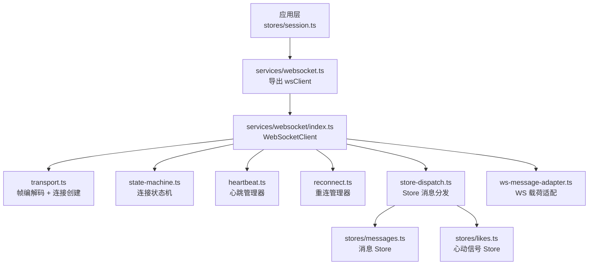
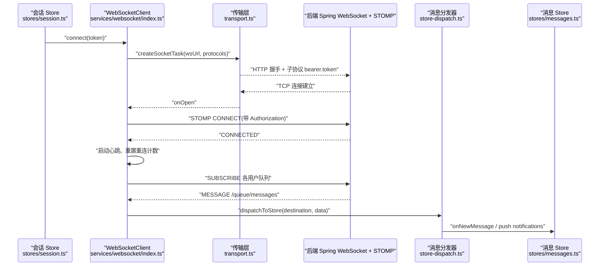
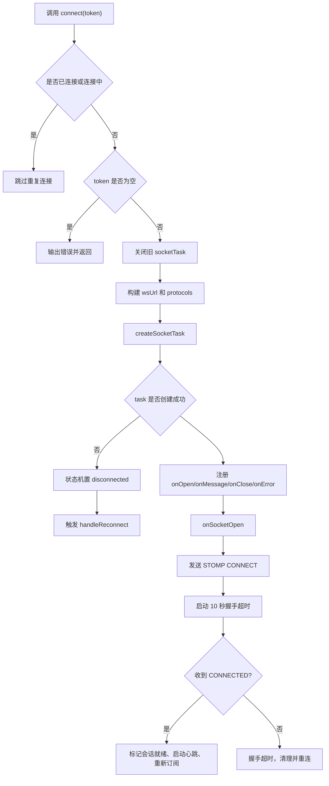
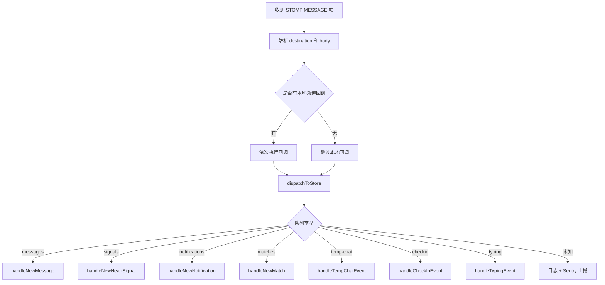
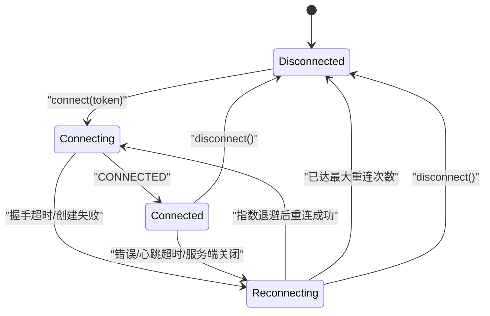
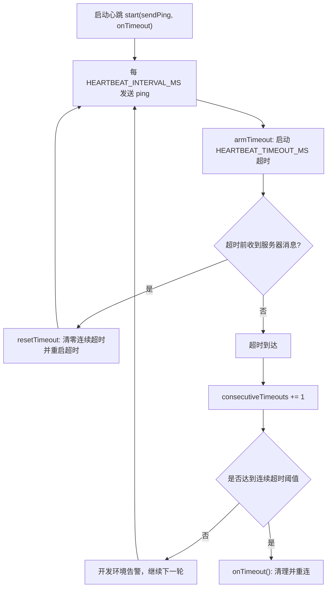
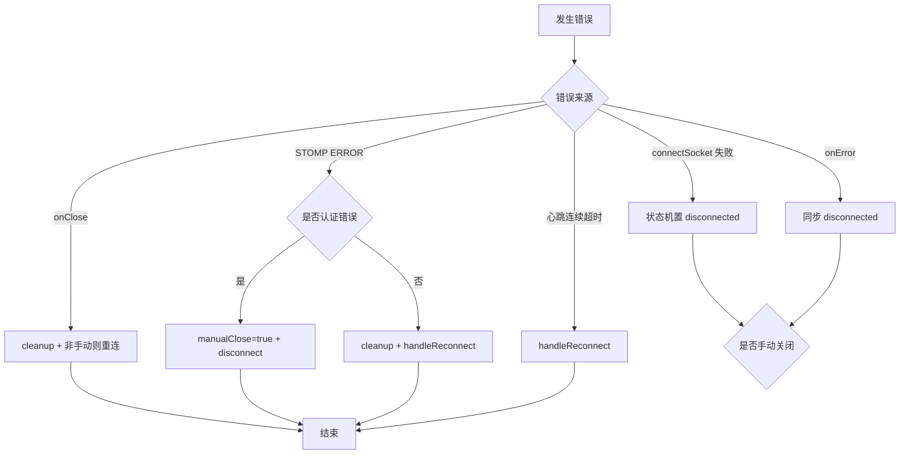
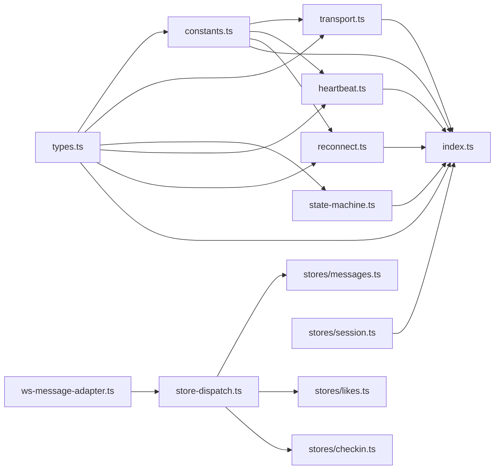
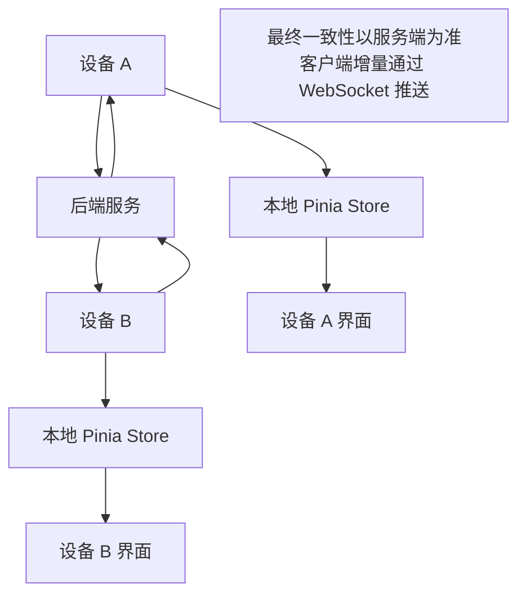

# WebSocket实时通信

<cite>
**本文引用的文件**   
- [apps/client/src/services/websocket/index.ts](file://apps/client/src/services/websocket/index.ts)
- [apps/client/src/services/websocket/transport.ts](file://apps/client/src/services/websocket/transport.ts)
- [apps/client/src/services/websocket/reconnect.ts](file://apps/client/src/services/websocket/reconnect.ts)
- [apps/client/src/services/websocket/heartbeat.ts](file://apps/client/src/services/websocket/heartbeat.ts)
- [apps/client/src/services/websocket/state-machine.ts](file://apps/client/src/services/websocket/state-machine.ts)
- [apps/client/src/services/websocket/types.ts](file://apps/client/src/services/websocket/types.ts)
- [apps/client/src/services/websocket/constants.ts](file://apps/client/src/services/websocket/constants.ts)
- [apps/client/src/services/websocket/ws-message-adapter.ts](file://apps/client/src/services/websocket/ws-message-adapter.ts)
- [apps/client/src/services/websocket/store-dispatch.ts](file://apps/client/src/services/websocket/store-dispatch.ts)
- [apps/client/src/services/websocket.ts](file://apps/client/src/services/websocket.ts)
- [apps/client/src/stores/messages.ts](file://apps/client/src/stores/messages.ts)
- [apps/client/src/stores/session.ts](file://apps/client/src/stores/session.ts)
</cite>

## 目录

1. [引言](#引言)
2. [项目结构](#项目结构)
3. [核心组件](#核心组件)
4. [架构总览](#架构总览)
5. [详细组件分析](#详细组件分析)
6. [依赖关系分析](#依赖关系分析)
7. [性能与监控指标](#性能与监控指标)
8. [调试与故障排查](#调试与故障排查)
9. [多端同步方案](#多端同步方案)
10. [结论](#结论)

## 引言

本项目中的 WebSocket 实时通信实现面向小程序（uni-app / 微信小程序）环境，基于原生 `uni.connectSocket()` 手动构建简化版 STOMP 协议帧，与后端 Spring WebSocket + STOMP 服务通信。整体设计把连接管理、STOMP 帧编解码、心跳检测、重连策略、消息订阅路由和 Pinia Store 分发拆成独立模块：

- **连接建立**：通过子协议头传递认证 token，再发送 STOMP CONNECT 帧完成会话级认证。
- **订阅管理**：用户私有频道（私信、心动信号、通知、匹配事件、临时会话事件、签到事件、正在输入等）在握手成功后自动订阅，并支持业务侧按目标路径注册回调。
- **消息路由**：收到 MESSAGE 帧后先走本地频道回调，再进入统一的分发器，按队列名写入对应 Pinia Store。
- **会话状态机**：维护 disconnected / connecting / connected / reconnecting 四种状态，所有状态变更都经状态机统一处理。
- **心跳机制**：周期性发送 JSON ping 帧 `{type:"ping"}`，识别服务端 pong 响应；连续超时达到阈值才触发断线重连。
- **重连机制**：采用指数退避，最大尝试次数固定，耗尽后停止自动重连，业务方可监听状态变化后引导用户重试。
- **消息适配层**：将后端推送的 MessageView、ChatMessageView 等外部载荷转换为前端内部 MessageItem，避免未读红点和新消息丢失。
- **错误处理**：认证失败直接断开不重连；其他错误清理定时器后进入重连流程。

该文档重点覆盖 STOMP 适配、连接状态机、心跳、重连、消息队列与路由、调试诊断，并在合适位置说明当前实现中与“多端同步”“性能监控”相关的现状与建议。

## 项目结构

WebSocket 相关代码集中在客户端应用的 `services/websocket` 目录，并通过根入口 `services/websocket.ts` 向后兼容旧 import 路径。核心文件职责如下：

| 文件 | 职责 |
|---|---|
| `index.ts` | WebSocketClient 主体：连接、订阅、发送、心跳启动、重连调度、生命周期清理 |
| `types.ts` | STOMP 帧结构、连接状态枚举、回调类型 |
| `constants.ts` | 帧分隔符、心跳参数、重连参数、STOMP 版本、订阅前缀 |
| `transport.ts` | STOMP 帧编解码、URL 构造、子协议构造、uni.connectSocket 封装 |
| `state-machine.ts` | 连接状态存储与状态变更回调分发 |
| `heartbeat.ts` | ping 定时发送、超时检测、连续超时计数 |
| `reconnect.ts` | 指数退避重连计时器、最大次数控制 |
| `store-dispatch.ts` | 按队列名分发到 messages、likes、checkin 等 Pinia Store |
| `ws-message-adapter.ts` | 后端 WS 载荷 → 前端 MessageItem 转换 |
| `websocket.ts` | 向后兼容 re-export，保持 `@/services/websocket` 导入路径不变 |

**图示来源**
- [apps/client/src/services/websocket/index.ts:1-1021](file://apps/client/src/services/websocket/index.ts#L1-L1021)
- [apps/client/src/services/websocket/transport.ts:1-275](file://apps/client/src/services/websocket/transport.ts#L1-L275)
- [apps/client/src/services/websocket/state-machine.ts:1-121](file://apps/client/src/services/websocket/state-machine.ts#L1-L121)
- [apps/client/src/services/websocket/heartbeat.ts:1-154](file://apps/client/src/services/websocket/heartbeat.ts#L1-L154)
- [apps/client/src/services/websocket/reconnect.ts:1-176](file://apps/client/src/services/websocket/reconnect.ts#L1-L176)
- [apps/client/src/services/websocket/store-dispatch.ts:1-443](file://apps/client/src/services/websocket/store-dispatch.ts#L1-L443)
- [apps/client/src/services/websocket/ws-message-adapter.ts:1-114](file://apps/client/src/services/websocket/ws-message-adapter.ts#L1-L114)
- [apps/client/src/services/websocket.ts:1-19](file://apps/client/src/services/websocket.ts#L1-L19)
- [apps/client/src/stores/messages.ts:1-260](file://apps/client/src/stores/messages.ts#L1-L260)
- [apps/client/src/stores/session.ts:1-220](file://apps/client/src/stores/session.ts#L1-L220)

**章节来源**
- [apps/client/src/services/websocket/index.ts:1-1021](file://apps/client/src/services/websocket/index.ts#L1-L1021)
- [apps/client/src/services/websocket.ts:1-19](file://apps/client/src/services/websocket.ts#L1-L19)

## 核心组件

### WebSocketClient：STOMP 简化客户端

`WebSocketClient` 是全局单例对外暴露的主要对象，提供以下能力：

- `connect(token)`：建立 WebSocket 连接，发送 STOMP CONNECT，等待 CONNECTED。
- `disconnect()`：发送 DISCONNECT，延迟关闭底层连接，清理状态。
- `subscribe(destination, callback)`：注册频道回调，必要时发送 SUBSCRIBE 帧。
- `unsubscribe(subId)`：按订阅 ID 精确取消订阅。
- `send(destination, body)`：发送 STOMP SEND 帧。
- `onStateChange / offStateChange`：监听连接状态变化。
- `isConnected() / getConnectionState()`：查询连接状态。

关键设计点：

1. **小程序并发 socket 任务上限**：重连前显式关闭旧 `socketTask`，避免触发 “exceed max task count”。
2. **Token 安全传递**：不再使用 URL 查询参数，改用子协议头 `bearer.${token}` 和 STOMP CONNECT 的 Authorization header。
3. **DISCONNECT 延迟关闭**：发出 DISCONNECT 帧后延迟 300ms 再调用底层 close，避免 TCP 直断导致服务端无法感知正常下线。
4. **CONNECT 握手超时**：TCP 建连后 10 秒内未收到 CONNECTED 帧，视为握手失败并触发重连。
5. **订阅去重**：重连时不会重复添加 pendingSubscriptions，避免同一频道被多次订阅和分发。
6. **重连防重入**：error 与 close 可能先后触发，用 `reconnectScheduled` 标志防止双倍消耗重连次数。

**章节来源**
- [apps/client/src/services/websocket/index.ts:100-220](file://apps/client/src/services/websocket/index.ts#L100-L220)
- [apps/client/src/services/websocket/index.ts:220-350](file://apps/client/src/services/websocket/index.ts#L220-L350)
- [apps/client/src/services/websocket/index.ts:350-450](file://apps/client/src/services/websocket/index.ts#L350-L450)
- [apps/client/src/services/websocket/index.ts:880-1021](file://apps/client/src/services/websocket/index.ts#L880-L1021)

### STOMP 帧编解码与传输层

`transport.ts` 提供无状态纯函数，负责协议细节与底层连接创建：

| 函数 | 作用 |
|---|---|
| `buildFrame(command, headers, body)` | 按 STOMP 规范拼接命令、转义后的头部、空行分隔和 NULL 结尾体 |
| `parseFrames(raw)` | 以 NULL 字符切分多个帧，解析命令、头部和体 |
| `isPongMessage(rawData)` | 识别 `{type:"pong"}` 心跳响应，避免误当作 STOMP 帧 |
| `buildWsUrl()` | 从 API 基础地址构造 `/ws/websocket`，移除 `/api` 后缀 |
| `buildProtocols(token)` | 返回子协议数组 `["bearer.${token}"]` |
| `createSocketTask(url, protocols, handlers)` | 封装 `uni.connectSocket()`，注册 onOpen/onMessage/onClose/onError |

STOMP 帧格式遵循标准约定：命令行、若干 `key:value` 头、空行、消息体、NULL 终止符。解析时容忍一次接收多个帧，并对空行、undefined 行做防御性校验。

**章节来源**
- [apps/client/src/services/websocket/transport.ts:1-200](file://apps/client/src/services/websocket/transport.ts#L1-L200)
- [apps/client/src/services/websocket/transport.ts:201-275](file://apps/client/src/services/websocket/transport.ts#L201-L275)

### 连接状态机

`ConnectionStateMachine` 是一个轻量状态容器，持有当前连接状态和状态变更回调列表：

| 方法 | 行为 |
|---|---|
| `getState()` | 返回当前状态 |
| `setState(state)` | 仅在状态实际变化时触发回调，捕获回调异常 |
| `onStateChange(callback)` | 注册监听 |
| `offStateChange(callback)` | 移除监听 |
| `isConnected()` | 判断是否为 connected |
| `isDisconnectedOrReconnecting()` | 判断是否处于 disconnected 或 reconnecting |
| `reset()` | 重置为 disconnected |

它不承载业务逻辑，只保证状态一致性。例如，原实现中连接错误时未同步 connectionState，导致外部读到不一致状态；修复后所有错误路径都先同步状态机，再由重连逻辑决定是否进入 reconnecting。

**章节来源**
- [apps/client/src/services/websocket/state-machine.ts:1-121](file://apps/client/src/services/websocket/state-machine.ts#L1-L121)
- [apps/client/src/services/websocket/types.ts:35-56](file://apps/client/src/services/websocket/types.ts#L35-L56)

### 心跳管理器

`HeartbeatManager` 维护两个定时器：

1. **ping 定时器**：每 `HEARTBEAT_INTERVAL_MS` 发送一次 `{type:"ping"}`。
2. **超时定时器**：每次发送 ping 后设置 `HEARTBEAT_TIMEOUT_MS` 超时；若在窗口内未收到任何服务器消息，则累加连续超时计数。

关键特性：

- 使用连续超时计数 `consecutiveTimeouts`，达到 `HEARTBEAT_CONSECUTIVE_TIMEOUT_LIMIT` 才判定断线重连。
- 收到任意服务器消息（包括 pong）时调用 `resetTimeout()`，清零计数并重新计时。
- `stop()` 清理两个定时器，并清零连续超时计数，避免下次启动沿用旧值。
- `buildPingPayload()` 返回标准 JSON ping 负载。

当前默认配置下，心跳间隔 30 秒、超时 10 秒、连续超时容错 2 次。这意味着弱网抖动不会因单次丢包立即断线，但长时间无响应最终会触发重连。

**章节来源**
- [apps/client/src/services/websocket/heartbeat.ts:1-154](file://apps/client/src/services/websocket/heartbeat.ts#L1-L154)
- [apps/client/src/services/websocket/constants.ts:39-78](file://apps/client/src/services/websocket/constants.ts#L39-L78)

### 重连管理器

`ReconnectManager` 集中管理重连次数和指数退避定时器：

| 方法 | 行为 |
|---|---|
| `getAttempts()` | 获取已尝试重连次数 |
| `canReconnect()` | 判断是否未达到最大次数 |
| `schedule(onReconnect)` | 安排下一次重连，返回是否成功安排 |
| `cancel()` | 取消挂起定时器，不清除 attempts |
| `resetAttempts()` | 重连成功后重置计数 |
| `reset()` | 完全重置，用于 dispose 场景 |

指数退避公式为：

> delay = min(RECONNECT_BACKOFF_MS × 2^(attempt-1), RECONNECT_MAX_INTERVAL_MS)

对应序列：1 秒 → 2 秒 → 4 秒 → 8 秒 → 16 秒 → 30 秒上限。最大尝试次数为 6 次；第 6 次仍失败后，调用 `onExhausted` 回调，由业务层输出降级提示并停止自动重连。

**章节来源**
- [apps/client/src/services/websocket/reconnect.ts:1-176](file://apps/client/src/services/websocket/reconnect.ts#L1-L176)
- [apps/client/src/services/websocket/constants.ts:21-38](file://apps/client/src/services/websocket/constants.ts#L21-L38)

### 消息适配器与 Store 分发

#### 消息载荷适配

`ws-message-adapter.ts` 解决后端 WS 推送载荷形状与前端内部 `MessageItem` 不一致的问题：

- **形态 A（私信）**：后端 `MessageView` 包含 `conversationId`、`senderId`、`messageKind`、`content`、`createdAt`、可选 `quoteContext`。
- **形态 B/C（临时会话或 mock）**：字段更接近 `MessageItem`，但可能缺少 `sessionId`。
- 适配层输出统一的 `MessageItem`，包含 `id`、`sessionId`、`sender`、`kind`、`body`、`sentAt`，并解析引用回复快照。

`mapWsKind` 将后端 messageKind 映射到前端 kind：voice、emoji、activity、image 回退 text。`resolveWsSessionId` 对临时会话消息做会话归因兜底：若当前停留在某临时会话页且为 peer 消息，则复用活跃会话 ID。

**章节来源**
- [apps/client/src/services/websocket/ws-message-adapter.ts:1-114](file://apps/client/src/services/websocket/ws-message-adapter.ts#L1-L114)
- [apps/client/src/stores/messages.ts:120-260](file://apps/client/src/stores/messages.ts#L120-L260)

#### Store 分发

`store-dispatch.ts` 根据 STOMP destination 中的队列名分发消息：

| 队列 | 处理器 | 效果 |
|---|---|---|
| `/queue/messages` | `handleNewMessage` | 更新会话消息、未读数、最后预览 |
| `/queue/temp-chat/messages` | `handleNewMessage` | 临时会话新消息也走消息处理 |
| `/queue/signals` | `handleNewHeartSignal` | 更新心动信号列表，同时去重写入 messagesStore |
| `/queue/notifications` | `handleNewNotification` | 新增系统通知 |
| `/queue/matches` | `handleNewMatch` | 生成匹配通知并按 matchId 去重 |
| `/queue/temp-chat` | `handleTempChatEvent` | 刷新会话列表 |
| `/queue/checkin` | `handleCheckInEvent` | 刷新签到状态 |
| `/queue/typing` | `handleTypingEvent` | 写入 typingMap，渲染“对方正在输入...” |

分发器还集成 Sentry 上报：未知队列类型、非法数据形状都会记录 source 和 payload，便于发现前后端契约漂移。

**章节来源**
- [apps/client/src/services/websocket/store-dispatch.ts:1-200](file://apps/client/src/services/websocket/store-dispatch.ts#L1-L200)
- [apps/client/src/services/websocket/store-dispatch.ts:201-443](file://apps/client/src/services/websocket/store-dispatch.ts#L201-L443)

## 架构总览

下图展示 WebSocket 实时通信从应用登录态到消息落库的整体流程：

**图示来源**
- [apps/client/src/services/websocket/index.ts:450-640](file://apps/client/src/services/websocket/index.ts#L450-L640)
- [apps/client/src/services/websocket/transport.ts:201-275](file://apps/client/src/services/websocket/transport.ts#L201-L275)
- [apps/client/src/services/websocket/store-dispatch.ts:1-120](file://apps/client/src/services/websocket/store-dispatch.ts#L1-L120)
- [apps/client/src/stores/session.ts:280-310](file://apps/client/src/stores/session.ts#L280-L310)

## 详细组件分析

### 连接建立与 STOMP 适配

连接建立分为两层认证：

1. **HTTP 握手阶段**：通过 `Sec-WebSocket-Protocol` 子协议头传递 `bearer.${token}`，由后端拦截器校验。
2. **STOMP 会话阶段**：发送 CONNECT 帧，Authorization header 携带 `Bearer ${token}`。

连接过程中存在三个关键保护：

- 若已处于 connected 或 connecting，重复 connect 会被跳过。
- 若 token 为空，直接报错不建连。
- 若 createSocketTask 返回 null，状态机先置为 disconnected，再进入重连。

握手成功后，客户端发送 CONNECT 帧并启动 10 秒超时定时器；收到 CONNECTED 帧后清除定时器、标记 stompSessionReady、重置重连计数、启动心跳，并重新订阅所有活跃频道和用户私有频道。

**图示来源**
- [apps/client/src/services/websocket/index.ts:201-320](file://apps/client/src/services/websocket/index.ts#L201-L320)
- [apps/client/src/services/websocket/index.ts:450-520](file://apps/client/src/services/websocket/index.ts#L450-L520)
- [apps/client/src/services/websocket/transport.ts:201-275](file://apps/client/src/services/websocket/transport.ts#L201-L275)

**章节来源**
- [apps/client/src/services/websocket/index.ts:201-320](file://apps/client/src/services/websocket/index.ts#L201-L320)
- [apps/client/src/services/websocket/index.ts:450-520](file://apps/client/src/services/websocket/index.ts#L450-L520)

### 订阅管理与消息路由

订阅分为两类：

1. **业务订阅**：通过 `subscribe(destination, callback)` 注册，返回 subId，用于精确取消。
2. **用户私有频道**：在 STOMP CONNECTED 后自动订阅，包括私信、心动信号、通知、匹配事件、临时会话事件、临时会话消息、签到事件和 typing 事件。

消息路由有两段：

- 第一段：按 destination 查找 channelCallbacks，逐个执行回调。
- 第二段：调用 `dispatchToStore`，按队列名分发到 Pinia Store。

对于临时会话消息，`dispatchToStore` 会把 `/queue/temp-chat/messages` 收敛到消息处理分支，修复了之前正则无法匹配含 `-` 和 `/` 的队列名的问题。

**图示来源**
- [apps/client/src/services/websocket/index.ts:640-720](file://apps/client/src/services/websocket/index.ts#L640-L720)
- [apps/client/src/services/websocket/store-dispatch.ts:1-120](file://apps/client/src/services/websocket/store-dispatch.ts#L1-L120)

**章节来源**
- [apps/client/src/services/websocket/index.ts:350-450](file://apps/client/src/services/websocket/index.ts#L350-L450)
- [apps/client/src/services/websocket/index.ts:640-720](file://apps/client/src/services/websocket/index.ts#L640-L720)
- [apps/client/src/services/websocket/store-dispatch.ts:1-120](file://apps/client/src/services/websocket/store-dispatch.ts#L1-L120)

### 会话状态机设计

连接状态机定义四种状态：

| 状态 | 含义 |
|---|---|
| disconnected | 未连接 |
| connecting | 正在建立 TCP 连接 |
| connected | STOMP 会话已建立，可收发业务消息 |
| reconnecting | 已断开，等待指数退避后重连 |

状态机本身不包含业务判断，但提供两个重要辅助方法：

- `isConnected()`：供 `WebSocketClient.isConnected()` 与状态机联合判断。
- `isDisconnectedOrReconnecting()`：用于错误路径中避免重复置位。

业务层通过 `onStateChange` 监听状态变化，例如在重连次数耗尽时显示“连接已断开，请检查网络后重试”。

**图示来源**
- [apps/client/src/services/websocket/state-machine.ts:1-121](file://apps/client/src/services/websocket/state-machine.ts#L1-L121)
- [apps/client/src/services/websocket/index.ts:880-1021](file://apps/client/src/services/websocket/index.ts#L880-L1021)

**章节来源**
- [apps/client/src/services/websocket/state-machine.ts:1-121](file://apps/client/src/services/websocket/state-machine.ts#L1-L121)
- [apps/client/src/services/websocket/index.ts:880-1021](file://apps/client/src/services/websocket/index.ts#L880-L1021)

### 心跳机制详解

心跳机制由 `HeartbeatManager` 和 `WebSocketClient.sendPing` 共同实现：

- 心跳间隔：`HEARTBEAT_INTERVAL_MS`。
- 心跳超时：`HEARTBEAT_TIMEOUT_MS`。
- 连续超时阈值：`HEARTBEAT_CONSECUTIVE_TIMEOUT_LIMIT`。
- Ping 负载：JSON 字符串 `{type:"ping"}`。
- Pong 识别：优先匹配紧凑格式和带空格格式的 JSON，再尝试 JSON.parse 识别 `type === "pong"`。

收到任意服务器消息时，`onSocketMessage` 会先调用 `heartbeatManager.resetTimeout()`，这样即使没有 pong，只要服务端持续推送业务消息，也不会误判心跳超时。

**图示来源**
- [apps/client/src/services/websocket/heartbeat.ts:1-154](file://apps/client/src/services/websocket/heartbeat.ts#L1-L154)
- [apps/client/src/services/websocket/index.ts:500-560](file://apps/client/src/services/websocket/index.ts#L500-L560)
- [apps/client/src/services/websocket/constants.ts:39-78](file://apps/client/src/services/websocket/constants.ts#L39-L78)

**章节来源**
- [apps/client/src/services/websocket/heartbeat.ts:1-154](file://apps/client/src/services/websocket/heartbeat.ts#L1-L154)
- [apps/client/src/services/websocket/index.ts:500-560](file://apps/client/src/services/websocket/index.ts#L500-L560)

### 消息队列设计与重试机制

当前实现中没有独立的“待发送消息队列”“重试队列”或“消息去重表”。消息发送主要通过 `WebSocketClient.send` 直接构造 STOMP SEND 帧并调用 `socketTask.send`：

- 若未连接或 socketTask 不存在，直接忽略。
- 发送成功回调为空实现。
- 发送失败会输出错误日志。
- 没有自动重试、失败重试队列或消息幂等去重。

因此，现有可靠性保障主要依赖：

1. **连接层**：重连后恢复通道。
2. **业务层**：需要发送的消息由 UI 或 store 触发，若失败应提示用户重试。
3. **服务端**：关键消息应由服务端保证持久化和至少一次投递语义。

如果后续需要增强可靠性，建议扩展：

- 增加待发送队列，保存 `destination`、`body`、`retryCount`、`lastAttemptAt`。
- 在连接 ready 后批量重放未确认消息。
- 对重复消息引入 idempotency key。
- 对发送失败进行有限重试，并接入错误上报。

**章节来源**
- [apps/client/src/services/websocket/index.ts:350-450](file://apps/client/src/services/websocket/index.ts#L350-L450)

### 错误处理流程

错误处理覆盖三层：

| 层级 | 错误类型 | 行为 |
|---|---|---|
| 传输层 | `uni.connectSocket` 失败 | 返回 null，由调用方置 disconnected 并触发重连 |
| 连接层 | onError / onClose | 同步状态机，若非手动关闭则触发重连 |
| STOMP 层 | ERROR 帧 | 认证错误直接 disconnect 不重连；其他错误清理后重连 |
| 心跳层 | 连续超时 | 触发 onTimeout，进入重连 |
| 分发层 | 非法数据 / 未知队列 | console.warn + Sentry 上报 |

认证失败的特殊处理很重要：当 STOMP ERROR 中包含 Unauthorized 或 401 时，客户端设置 `manualClose = true` 并调用 `disconnect()`，避免反复重连无效 token。

**图示来源**
- [apps/client/src/services/websocket/index.ts:520-640](file://apps/client/src/services/websocket/index.ts#L520-L640)
- [apps/client/src/services/websocket/index.ts:720-820](file://apps/client/src/services/websocket/index.ts#L720-L820)
- [apps/client/src/services/websocket/index.ts:880-960](file://apps/client/src/services/websocket/index.ts#L880-L960)

**章节来源**
- [apps/client/src/services/websocket/index.ts:520-640](file://apps/client/src/services/websocket/index.ts#L520-L640)
- [apps/client/src/services/websocket/index.ts:720-820](file://apps/client/src/services/websocket/index.ts#L720-L820)
- [apps/client/src/services/websocket/index.ts:880-960](file://apps/client/src/services/websocket/index.ts#L880-L960)

## 依赖关系分析

WebSocket 模块内部依赖关系清晰，耦合方向主要由上层业务指向基础设施：

**图示来源**
- [apps/client/src/services/websocket/types.ts:1-56](file://apps/client/src/services/websocket/types.ts#L1-L56)
- [apps/client/src/services/websocket/constants.ts:1-78](file://apps/client/src/services/websocket/constants.ts#L1-L78)
- [apps/client/src/services/websocket/index.ts:1-1021](file://apps/client/src/services/websocket/index.ts#L1-L1021)
- [apps/client/src/services/websocket/store-dispatch.ts:1-443](file://apps/client/src/services/websocket/store-dispatch.ts#L1-L443)
- [apps/client/src/stores/session.ts:1-220](file://apps/client/src/stores/session.ts#L1-L220)

**章节来源**
- [apps/client/src/services/websocket/index.ts:1-100](file://apps/client/src/services/websocket/index.ts#L1-L100)
- [apps/client/src/services/websocket/store-dispatch.ts:1-80](file://apps/client/src/services/websocket/store-dispatch.ts#L1-L80)

## 性能与监控指标

### 当前实现中的性能相关设计

仓库中的 WebSocket 实现在性能方面已有若干优化：

| 指标 | 当前实现 | 说明 |
|---|---|---|
| 连接质量 | 心跳 + 连续超时 | 每 30 秒 ping，连续 2 次超时才断线 |
| 重连频率 | 指数退避 | 1s → 2s → 4s → 8s → 16s → 30s |
| 重连次数上限 | 6 次 | 超过后停止自动重连 |
| 消息路由开销 | 双通道分发 | 先本地回调，再 Store 分发 |
| 消息适配 | 运行时转换 | 避免 WS 新消息被守卫拒绝 |
| 连接泄漏防护 | 旧 socketTask 关闭 | 避免小程序并发 socket 任务耗尽 |
| 握手超时 | 10 秒 | 防止永久卡在 connecting |

### 建议补充的监控指标

虽然当前实现没有统一的 metrics 采集模块，但可以在现有基础上扩展以下指标：

| 指标 | 建议采集方式 | 用途 |
|---|---|---|
| 连接成功率 | 统计 connect 成功/失败次数 | 评估网络与认证稳定性 |
| 平均握手耗时 | 记录 send CONNECT 到收到 CONNECTED 时间 | 定位握手慢 |
| 心跳往返延迟 | 记录 ping 发送时间与 pong 到达时间 | 评估链路质量 |
| 消息端到端延迟 | 记录客户端发送时间与远端到达时间（需服务端配合） | 评估 IM 实时性 |
| 消息丢失率 | 对比服务端分页游标与本地最新 id | 检测重连后补发是否完整 |
| 重连次数分布 | 统计每次重连 attempt 和延迟 | 观察弱网模式 |
| 错误分类占比 | 按认证失败、网络错误、STOMP ERROR、心跳超时分类 | 快速定位根因 |
| 订阅数与回调数 | 统计 active subscriptions 和 channelCallbacks 大小 | 防止内存泄漏 |

这些指标可以接入现有的 Sentry 上报通道，或单独封装一个轻量 monitoring 模块，在 dev 环境输出，在 prod 环境聚合上报。

**章节来源**
- [apps/client/src/services/websocket/constants.ts:1-78](file://apps/client/src/services/websocket/constants.ts#L1-L78)
- [apps/client/src/services/websocket/heartbeat.ts:1-154](file://apps/client/src/services/websocket/heartbeat.ts#L1-L154)
- [apps/client/src/services/websocket/reconnect.ts:1-176](file://apps/client/src/services/websocket/reconnect.ts#L1-L176)

## 调试与故障排查

### 开发环境日志

WebSocket 模块在开发环境输出较多调试信息：

- `[WebSocket]` 前缀的连接、订阅、心跳、错误日志。
- 重连计划打印当前 attempt 和延迟。
- 心跳超时打印连续超时计数。
- 未知队列类型打印 queueType 和 destination。

生产环境会将 `wsTrace` 静默，但保留 `console.error` 类错误日志。

### 常见故障与排查步骤

| 现象 | 可能原因 | 排查步骤 |
|---|---|---|
| 连接后立即断开 | token 无效、后端拦截器拒绝 | 检查子协议头、CONNECT Authorization、后端 JwtChannelInterceptor |
| 状态卡 in connecting | CONNECT 握手超时 | 查看 10 秒超时日志，检查后端 STOMP 握手 |
| 心跳频繁断线 | 弱网、代理丢弃空帧、后端未回复 pong | 检查 isPongMessage、后端心跳处理、连续超时阈值 |
| 新消息不显示 | 载荷形状不符、sessionId 缺失 | 查看 ws-message-adapter 转换结果和 dispatchToStore 日志 |
| 未读红点不增长 | 消息被 fromWsPayload 或 isMessageItem 拒绝 | 检查 conversationId/senderId/messageKind 是否存在 |
| 重连次数耗尽 | 网络长期不可用或 token 失效 | 监听 onStateChange，引导用户手动重试 |
| 订阅重复 | 重连后重复 subscribe | 检查 setupUserSubscriptions 的去重逻辑 |
| 心跳发送失败 | socketTask 已关闭或状态不对 | 检查 isConnected 和 socketTask 引用 |

### 推荐调试工具用法

- 使用 `wsClient.onStateChange` 打印状态流转，确认连接生命周期。
- 在 `dispatchToStore` 中观察 destination 和 payload，确认队列路由是否正确。
- 在 `fromWsPayload` 中打印外部载荷，确认后端契约是否与 MessageItem 一致。
- 在 `handleReconnect` 附近观察重连 attempt 和指数退避延迟。
- 利用 Sentry 上报的 `[WebSocket]` 异常，关注 source 为 `ws-store-dispatch` 的错误。

**章节来源**
- [apps/client/src/services/websocket/index.ts:1-100](file://apps/client/src/services/websocket/index.ts#L1-L100)
- [apps/client/src/services/websocket/index.ts:500-720](file://apps/client/src/services/websocket/index.ts#L500-L720)
- [apps/client/src/services/websocket/store-dispatch.ts:1-200](file://apps/client/src/services/websocket/store-dispatch.ts#L1-L200)
- [apps/client/src/services/websocket/ws-message-adapter.ts:1-114](file://apps/client/src/services/websocket/ws-message-adapter.ts#L1-L114)

## 多端同步方案

当前代码中的“多端”主要体现在两个层面：

1. **多设备一致性**：由后端作为权威数据源，客户端通过 REST 拉取会话、消息、通知，再通过 WebSocket 接收增量更新。
2. **多页面状态同步**：通过 Pinia Store（messages、likes、session 等）共享状态，WS 消息最终写入 store，UI 层响应 state 变化。

具体体现：

- `stores/session.ts` 在登录成功后调用 `wsClient.connect(token)`，登出时调用 `wsClient.disconnect()`。
- `stores/messages.ts` 定义 MessageItem、MessageSession、SystemNotification 等状态，并由 `store-dispatch.ts` 写入。
- 临时会话、签到、匹配等事件通过 WS 刷新对应 store，而不是仅靠 UI 局部状态。

当前实现并未维护“本地多端会话 ID 映射”“跨设备离线消息合并表”或“乐观更新冲突解决”等高级多端同步机制。若需要更强的多端一致性，建议：

- 以服务端消息游标为最终顺序依据。
- 客户端本地增量消息按服务端时间戳排序。
- 对乐观更新保留 idempotency key，服务端去重。
- 对离线期间的新增消息，重连后按游标补拉。
- 对冲突操作（如同时删除同一条消息）采用服务端裁决。

[本图为概念图，不直接映射具体源码文件]

**章节来源**
- [apps/client/src/stores/session.ts:280-310](file://apps/client/src/stores/session.ts#L280-L310)
- [apps/client/src/stores/messages.ts:120-260](file://apps/client/src/stores/messages.ts#L120-L260)
- [apps/client/src/services/websocket/store-dispatch.ts:1-200](file://apps/client/src/services/websocket/store-dispatch.ts#L1-L200)

## 结论

该项目的 WebSocket 实时通信实现围绕小程序环境做了务实适配：放弃 SockJS 和原生 STOMP 库，转而手动构建 STOMP 帧，并通过 uni-app 的 `uni.connectSocket()` 完成连接。整体架构清晰，职责拆分合理：

- `index.ts` 作为控制器协调连接、心跳、重连、订阅和分发。
- `transport.ts` 专注协议编码和连接创建。
- `state-machine.ts` 保证状态一致性。
- `heartbeat.ts` 和 `reconnect.ts` 分别承担心跳检测与指数退避重连。
- `store-dispatch.ts` 将 STOMP 消息转化为 Pinia Store 状态。
- `ws-message-adapter.ts` 弥合后端载荷与前端模型差异。

当前实现已经覆盖了连接建立、订阅管理、消息路由、心跳检测、错误处理和基本重连策略，能够支撑私信、心动信号、通知、匹配事件、临时会话、签到和 typing 等实时功能。

若未来需要进一步增强，建议优先补充：

1. 明确的性能监控指标采集。
2. 待发送消息队列与有限重试机制。
3. 更细粒度的错误分类上报。
4. 针对多端离线消息合并和冲突解决的策略。
5. 在测试用例中覆盖心跳超时、握手超时、重连耗尽、载荷形状漂移等边界场景。