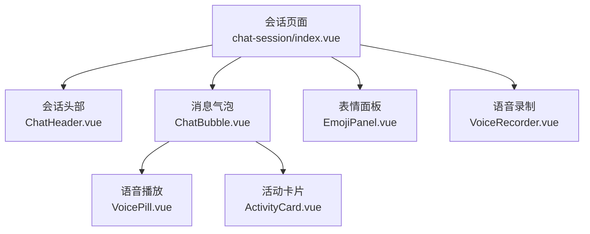
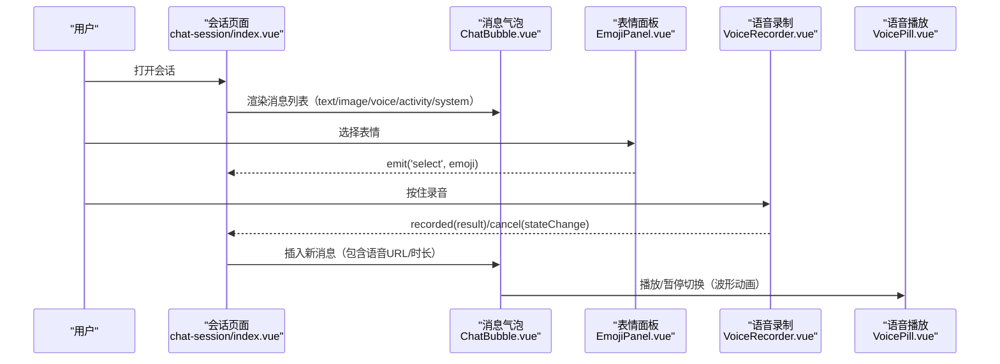
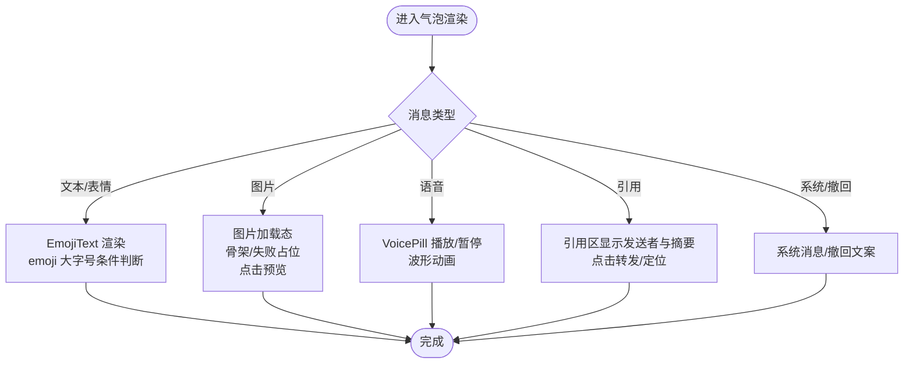
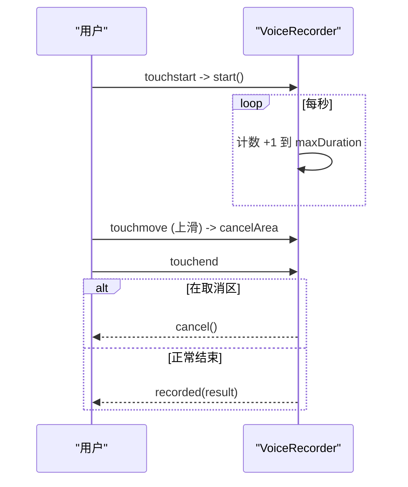
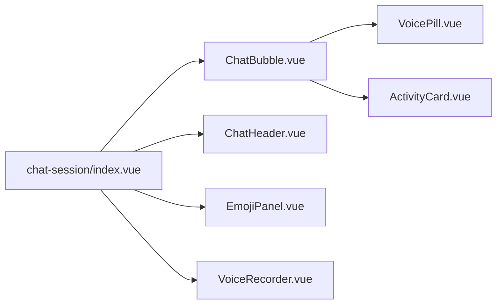

# 聊天界面组件

<cite>
**本文档引用的文件**
- [ChatBubble.vue](file://apps/client/src/components/chat/ChatBubble.vue)
- [EmojiPanel.vue](file://apps/client/src/components/chat/EmojiPanel.vue)
- [VoiceRecorder.vue](file://apps/client/src/components/chat/VoiceRecorder.vue)
- [VoicePill.vue](file://apps/client/src/components/chat/VoicePill.vue)
- [ActivityCard.vue](file://apps/client/src/components/chat/ActivityCard.vue)
- [ChatHeader.vue](file://apps/client/src/components/chat/ChatHeader.vue)
- [apps/client/src/subpackages/chat/chat-session/index.vue](file://apps/client/src/subpackages/chat/chat-session/index.vue)
</cite>

## 目录
1. [简介](#简介)
2. [项目结构](#项目结构)
3. [核心组件](#核心组件)
4. [架构总览](#架构总览)
5. [详细组件分析](#详细组件分析)
6. [依赖关系分析](#依赖关系分析)
7. [性能考虑](#性能考虑)
8. [故障排查指南](#故障排查指南)
9. [结论](#结论)
10. [附录](#附录)

## 简介
本技术文档围绕聊天界面组件展开，聚焦消息气泡、输入与表情面板、语音录制与播放、活动卡片等关键能力。文档从系统架构、组件职责、数据流、样式与可访问性、国际化配置以及响应式适配等多维度进行系统化说明，并提供可视化图示与排错指引，帮助开发者快速理解并扩展聊天模块。

## 项目结构
聊天功能由页面级会话容器与多个可复用组件构成：
- 会话页面：负责消息加载、状态管理、导航与事件协调
- 消息气泡：统一渲染文本、图片、语音、引用与系统消息
- 表情面板：提供常用表情选择与 SVG 渲染
- 语音录制：支持按住说话、上滑取消、时长限制与错误提示
- 语音播放：在气泡中展示播放态与波形动画
- 活动卡片：在消息流中嵌入可点击的活动信息卡片
- 会话头部：显示头像、昵称、在线状态与更多操作

图表来源
- [apps/client/src/subpackages/chat/chat-session/index.vue:1-120](file://apps/client/src/subpackages/chat/chat-session/index.vue#L1-L120)
- [ChatBubble.vue:1-200](file://apps/client/src/components/chat/ChatBubble.vue#L1-L200)
- [EmojiPanel.vue:1-114](file://apps/client/src/components/chat/EmojiPanel.vue#L1-L114)
- [VoiceRecorder.vue:1-200](file://apps/client/src/components/chat/VoiceRecorder.vue#L1-L200)
- [VoicePill.vue:1-188](file://apps/client/src/components/chat/VoicePill.vue#L1-L188)
- [ActivityCard.vue:1-142](file://apps/client/src/components/chat/ActivityCard.vue#L1-L142)
- [ChatHeader.vue:1-190](file://apps/client/src/components/chat/ChatHeader.vue#L1-L190)

章节来源
- [apps/client/src/subpackages/chat/chat-session/index.vue:1-120](file://apps/client/src/subpackages/chat/chat-session/index.vue#L1-L120)

## 核心组件
- 消息气泡（ChatBubble）：统一处理不同消息类型的渲染、引用块、送达状态、头像与对齐方式、无障碍标签与长按交互
- 表情面板（EmojiPanel）：8×4 表情网格，SVG 渲染，兼容降级为文本，emit 原始 Unicode 字符供上层消费
- 语音录制（VoiceRecorder）：按住录音、上滑取消、最长时长限制、权限与错误提示、振动反馈
- 语音播放（VoicePill）：播放/暂停切换、波形动画、过期态禁用、跨端音频上下文与 seek 恢复
- 活动卡片（ActivityCard）：消息内嵌卡片，含标题、描述、标签、元信息与跳转
- 会话头部（ChatHeader）：返回、头像（单击/双击）、在线状态、昵称与更多操作

章节来源
- [ChatBubble.vue:1-466](file://apps/client/src/components/chat/ChatBubble.vue#L1-L466)
- [EmojiPanel.vue:1-114](file://apps/client/src/components/chat/EmojiPanel.vue#L1-L114)
- [VoiceRecorder.vue:1-419](file://apps/client/src/components/chat/VoiceRecorder.vue#L1-L419)
- [VoicePill.vue:1-188](file://apps/client/src/components/chat/VoicePill.vue#L1-L188)
- [ActivityCard.vue:1-142](file://apps/client/src/components/chat/ActivityCard.vue#L1-L142)
- [ChatHeader.vue:1-190](file://apps/client/src/components/chat/ChatHeader.vue#L1-L190)

## 架构总览
会话页面作为编排层，组合各子组件完成完整聊天体验；消息类型通过 props 驱动气泡分支渲染；表情与语音以独立组件解耦；活动卡片作为富媒体消息嵌入。

图表来源
- [apps/client/src/subpackages/chat/chat-session/index.vue:1-120](file://apps/client/src/subpackages/chat/chat-session/index.vue#L1-L120)
- [ChatBubble.vue:1-200](file://apps/client/src/components/chat/ChatBubble.vue#L1-L200)
- [EmojiPanel.vue:1-114](file://apps/client/src/components/chat/EmojiPanel.vue#L1-L114)
- [VoiceRecorder.vue:1-200](file://apps/client/src/components/chat/VoiceRecorder.vue#L1-L200)
- [VoicePill.vue:1-188](file://apps/client/src/components/chat/VoicePill.vue#L1-L188)

## 详细组件分析

### 消息气泡（ChatBubble）
- 消息类型与渲染逻辑
  - 文本/表情：统一走 EmojiText，纯 emoji 时放大字号
  - 图片：宽度自适应，骨架占位与失败占位，点击全屏预览
  - 语音：透传 audioUrl 与 durationSeconds，交由 VoicePill 播放
  - 引用：显示引用发送者与摘要，点击触发回调
  - 系统/撤回：居中灰字或“已撤回”文案
- 布局与样式
  - 自己/对方/助手头像位置与行方向控制
  - 气泡圆角、背景色与阴影按发送者区分
  - 底部仅保留送达状态（时间由父页面承载）
- 交互与可访问性
  - 长按菜单（仅自己的未撤回消息）
  - 对方头像点击通过 emit 交由父页导航
  - ARIA 标签根据发送者与类型动态生成
  - mp-weixin 开启 virtualHost 修复宿主节点导致的对齐问题

图表来源
- [ChatBubble.vue:1-466](file://apps/client/src/components/chat/ChatBubble.vue#L1-L466)

章节来源
- [ChatBubble.vue:1-466](file://apps/client/src/components/chat/ChatBubble.vue#L1-L466)

### 表情面板（EmojiPanel）
- 32 个常用表情，采用 SVG 渲染，缺省时降级为系统文本
- emit 原始 Unicode 字符，保持与历史数据与 EmojiText 的兼容性
- 8 列网格布局，滚动区域与按压反馈

章节来源
- [EmojiPanel.vue:1-114](file://apps/client/src/components/chat/EmojiPanel.vue#L1-L114)

### 语音录制（VoiceRecorder）
- 按住开始录音，松开停止；上滑超过阈值进入取消区
- 最长时长限制（默认 60s），计时器每秒更新 UI
- 权限申请失败、录音过短、录音异常均有 toast 提示
- 振动反馈用于进入取消区与按钮按压
- 生命周期结束时清理定时器与销毁录音器

图表来源
- [VoiceRecorder.vue:1-419](file://apps/client/src/components/chat/VoiceRecorder.vue#L1-L419)

章节来源
- [VoiceRecorder.vue:1-419](file://apps/client/src/components/chat/VoiceRecorder.vue#L1-L419)

### 语音播放（VoicePill）
- 播放/暂停切换，波形动画指示当前播放状态
- 使用 InnerAudioContext 播放音频，记录 pausedAt 实现续播
- 无音频 URL 时模拟播放结束，避免状态不一致
- 过期态禁用且不可交互

章节来源
- [VoicePill.vue:1-188](file://apps/client/src/components/chat/VoicePill.vue#L1-L188)

### 活动卡片（ActivityCard）
- 消息内嵌卡片，展示标题、描述、标签、时间与参与人数
- 点击跳转到目标链接（targetUrl）
- 图片占位与视觉层次清晰

章节来源
- [ActivityCard.vue:1-142](file://apps/client/src/components/chat/ActivityCard.vue#L1-L142)

### 会话头部（ChatHeader）
- 返回、头像（单击弹出菜单、双击拍一拍）、在线状态、昵称与认识天数
- 安全区域顶部高度通过 JS 注入避免状态栏叠印
- 更多操作通过 emit 交由父页处理

章节来源
- [ChatHeader.vue:1-190](file://apps/client/src/components/chat/ChatHeader.vue#L1-L190)

## 依赖关系分析
- 会话页面依赖气泡、头部、表情面板、语音录制与活动卡片，负责状态编排与导航
- 气泡依赖语音播放与通用工具（媒体解析、emoji 映射）
- 语音录制依赖底层录音封装与触觉反馈
- 所有组件均使用 i18n 进行多语言文案输出

图表来源
- [apps/client/src/subpackages/chat/chat-session/index.vue:1-120](file://apps/client/src/subpackages/chat/chat-session/index.vue#L1-L120)
- [ChatBubble.vue:1-200](file://apps/client/src/components/chat/ChatBubble.vue#L1-L200)
- [EmojiPanel.vue:1-114](file://apps/client/src/components/chat/EmojiPanel.vue#L1-L114)
- [VoiceRecorder.vue:1-200](file://apps/client/src/components/chat/VoiceRecorder.vue#L1-L200)
- [VoicePill.vue:1-188](file://apps/client/src/components/chat/VoicePill.vue#L1-L188)
- [ActivityCard.vue:1-142](file://apps/client/src/components/chat/ActivityCard.vue#L1-L142)
- [ChatHeader.vue:1-190](file://apps/client/src/components/chat/ChatHeader.vue#L1-L190)

章节来源
- [apps/client/src/subpackages/chat/chat-session/index.vue:1-120](file://apps/client/src/subpackages/chat/chat-session/index.vue#L1-L120)

## 性能考虑
- 图片懒加载与骨架占位：减少首屏压力与提升感知速度
- 音频上下文复用与 seek 续播：避免重复加载与从头播放带来的卡顿
- 长列表渲染：建议在父页面结合虚拟滚动或分页加载策略（当前代码未显式实现）
- 样式变量集中：通过 CSS 变量统一管理尺寸与颜色，便于主题与平台适配

## 故障排查指南
- 图片加载失败
  - 现象：图片区域显示占位文案
  - 排查：检查媒体 URL 解析是否正确、网络状态与资源路径
  - 参考：[ChatBubble.vue:201-300](file://apps/client/src/components/chat/ChatBubble.vue#L201-L300)
- 语音无法播放或续播异常
  - 现象：暂停后重新播放从头开始或状态不更新
  - 排查：确认 audioUrl 透传、pausedAt 记录与 seek 调用时机
  - 参考：[VoicePill.vue:1-188](file://apps/client/src/components/chat/VoicePill.vue#L1-L188)
- 录音权限被拒绝或录音过短
  - 现象：toast 提示权限不足或时间太短
  - 排查：检查麦克风权限授权流程与最短时长判定
  - 参考：[VoiceRecorder.vue:1-200](file://apps/client/src/components/chat/VoiceRecorder.vue#L1-L200)
- 表情面板首次渲染不完整
  - 现象：SVG 未加载完成前出现空洞
  - 排查：确保 SVG 源存在并添加占位背景，延迟渲染或预加载
  - 参考：[EmojiPanel.vue:1-114](file://apps/client/src/components/chat/EmojiPanel.vue#L1-L114)

章节来源
- [ChatBubble.vue:201-300](file://apps/client/src/components/chat/ChatBubble.vue#L201-L300)
- [VoicePill.vue:1-188](file://apps/client/src/components/chat/VoicePill.vue#L1-L188)
- [VoiceRecorder.vue:1-200](file://apps/client/src/components/chat/VoiceRecorder.vue#L1-L200)
- [EmojiPanel.vue:1-114](file://apps/client/src/components/chat/EmojiPanel.vue#L1-L114)

## 结论
该聊天界面通过清晰的组件拆分与明确的数据流向，实现了多类型消息的统一渲染、丰富的富媒体支持与良好的交互体验。借助 i18n 与 CSS 变量，系统在国际化与主题化方面具备良好扩展性。建议在后续迭代中补充消息列表的虚拟化与更完善的上传进度与重试机制，以进一步提升大规模会话下的性能与稳定性。

## 附录
- 响应式设计建议
  - 使用 rpx 单位与 CSS 变量保证在不同屏幕尺寸下的比例一致
  - 表情面板与图片区域设置最大宽高，防止极端窄屏溢出
- 无障碍访问
  - 为气泡、按钮、图片与角色元素设置合适的 role 与 aria-label
  - 语音播放控件暴露 aria-pressed 与 aria-disabled 以表达状态
- 国际化配置
  - 所有用户可见文案通过 useI18n 的 t() 获取，新增文案需同步 i18n 资源
- 组件复用策略
  - 通过 props/emit 暴露最小接口，插槽与命名事件可用于定制行为
  - 将复杂逻辑下沉至 view-models 或 composables，保持 UI 组件简洁