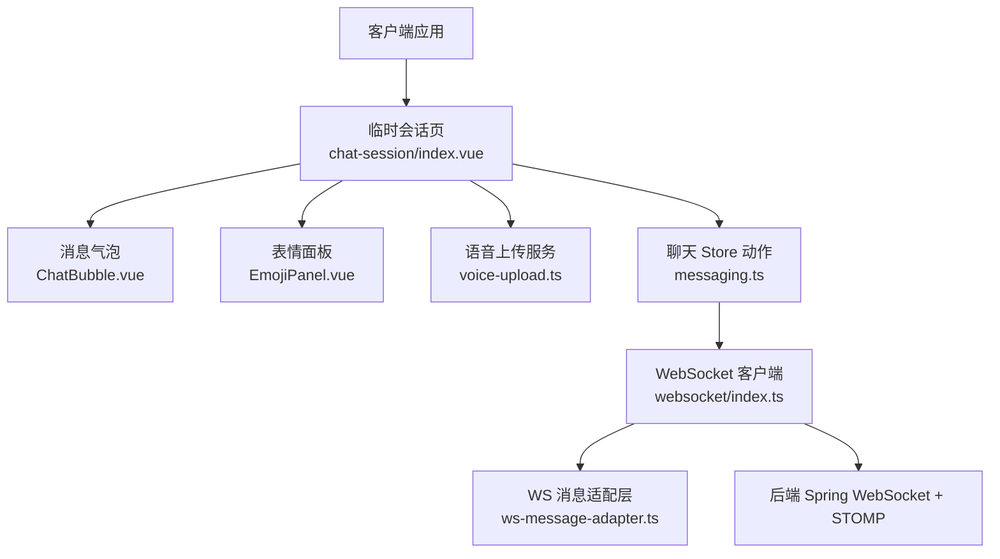
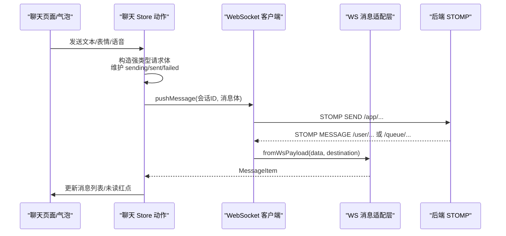
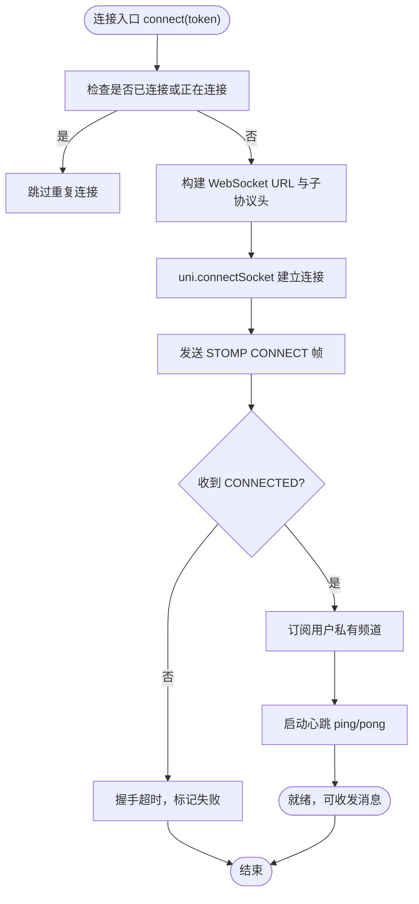
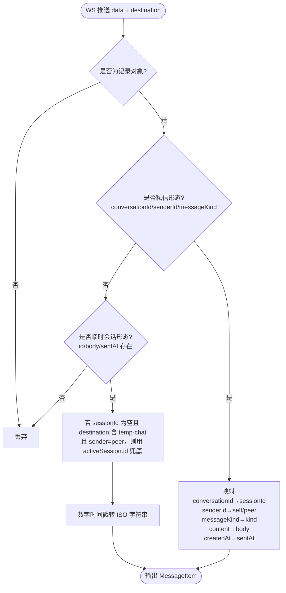
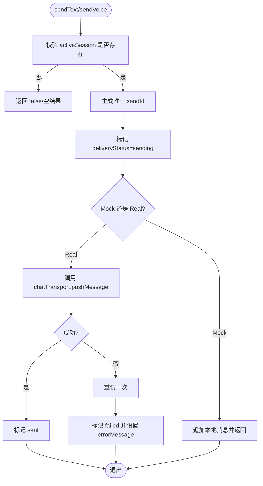
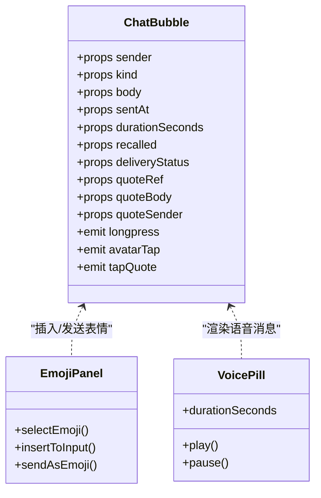
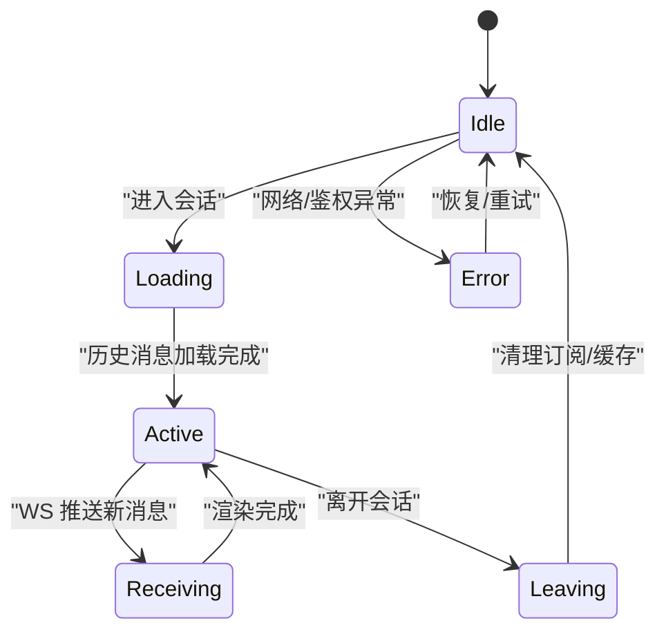
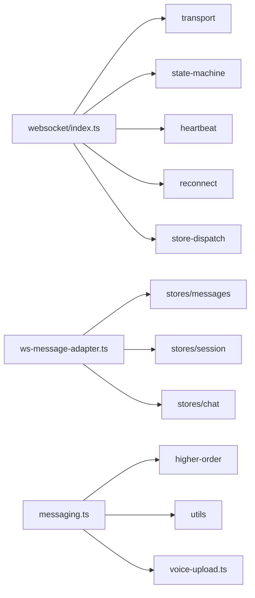
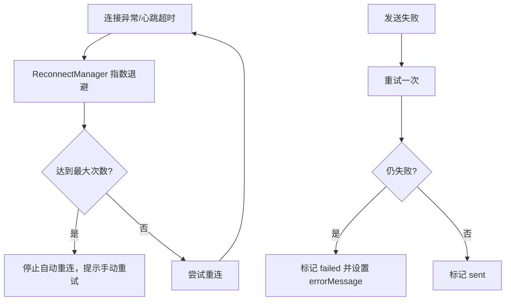

# 聊天系统

<cite>
**本文引用的文件**   
- [apps/client/src/services/websocket/index.ts](file://apps/client/src/services/websocket/index.ts)
- [apps/client/src/services/websocket/ws-message-adapter.ts](file://apps/client/src/services/websocket/ws-message-adapter.ts)
- [apps/client/src/stores/chat/actions/messaging.ts](file://apps/client/src/stores/chat/actions/messaging.ts)
- [apps/client/src/components/chat/ChatBubble.vue](file://apps/client/src/components/chat/ChatBubble.vue)
- [apps/client/src/subpackages/chat/chat-session/index.vue](file://apps/client/src/subpackages/chat/chat-session/index.vue)
- [apps/client/src/components/chat/EmojiPanel.vue](file://apps/client/src/components/chat/EmojiPanel.vue)
- [apps/client/src/services/voice-upload.ts](file://apps/client/src/services/voice-upload.ts)
</cite>

## 目录
1. [引言](#引言)
2. [项目结构](#项目结构)
3. [核心组件](#核心组件)
4. [架构总览](#架构总览)
5. [详细组件分析](#详细组件分析)
6. [依赖关系分析](#依赖关系分析)
7. [性能与体验优化](#性能与体验优化)
8. [安全机制](#安全机制)
9. [异常处理与故障恢复](#异常处理与故障恢复)
10. [结论](#结论)

## 引言
本技术文档聚焦于仓库中的临时匿名聊天能力，覆盖 WebSocket 连接管理、简化版 STOMP 消息协议、会话状态机、实时通信流程、聊天界面组件、多媒体消息渲染与存储、敏感词与安全控制、以及离线同步和异常恢复策略。读者无需深入源码即可理解整体设计；同时提供面向开发者的架构图、时序图与流程图，并附带关键实现路径以便进一步排查。

## 项目结构
聊天相关代码主要分布在客户端子应用 `apps/client` 中：
- 实时通信层：`services/websocket/*`，封装基于 uni-app 的 WebSocket 与简化 STOMP 帧。
- 聊天数据与动作：`stores/chat/actions/*`，维护会话、消息发送与投递状态。
- 聊天页面与视图模型：`subpackages/chat/chat-session/*`，承载临时会话页、类型定义、DTO 与 API 调用。
- 聊天 UI 组件：`components/chat/*`，包括气泡、表情面板、语音胶囊等。
- 媒体上传服务：`services/voice-upload.ts`，负责录音文件的真实上传与 URL 返回。

**图示来源**
- [apps/client/src/subpackages/chat/chat-session/index.vue](file://apps/client/src/subpackages/chat/chat-session/index.vue)
- [apps/client/src/components/chat/ChatBubble.vue](file://apps/client/src/components/chat/ChatBubble.vue)
- [apps/client/src/components/chat/EmojiPanel.vue](file://apps/client/src/components/chat/EmojiPanel.vue)
- [apps/client/src/services/voice-upload.ts](file://apps/client/src/services/voice-upload.ts)
- [apps/client/src/stores/chat/actions/messaging.ts](file://apps/client/src/stores/chat/actions/messaging.ts)
- [apps/client/src/services/websocket/index.ts](file://apps/client/src/services/websocket/index.ts)
- [apps/client/src/services/websocket/ws-message-adapter.ts](file://apps/client/src/services/websocket/ws-message-adapter.ts)

**章节来源**
- [apps/client/src/services/websocket/index.ts:1-120](file://apps/client/src/services/websocket/index.ts#L1-L120)
- [apps/client/src/stores/chat/actions/messaging.ts:1-60](file://apps/client/src/stores/chat/actions/messaging.ts#L1-L60)

## 核心组件
- WebSocket 客户端：实现连接、STOMP CONNECT/SUBSCRIBE/MESSAGE/DISCONNECT、心跳 ping/pong、自动重连、订阅映射与消息分发。
- 消息适配层：将后端 WS 推送载荷转换为前端内部 MessageItem，支持私信与临时会话两类形态，补齐 sessionId 与 kind 映射。
- 聊天 Store 动作：统一发送文本/表情/语音消息，维护本地投递状态（sending/sent/failed），并在失败时重试与提示。
- 聊天气泡组件：按 sender/kind/recalled/deliveryStatus 渲染文本、图片、语音、引用、撤回与送达状态。
- 表情面板：用于快速插入表情内容到输入框或作为 emoji 消息发送。
- 语音上传服务：在真实模式下先上传录音，再发送 voice 类型消息。

**章节来源**
- [apps/client/src/services/websocket/index.ts:1-200](file://apps/client/src/services/websocket/index.ts#L1-L200)
- [apps/client/src/services/websocket/ws-message-adapter.ts:1-114](file://apps/client/src/services/websocket/ws-message-adapter.ts#L1-L114)
- [apps/client/src/stores/chat/actions/messaging.ts:1-229](file://apps/client/src/stores/chat/actions/messaging.ts#L1-L229)
- [apps/client/src/components/chat/ChatBubble.vue:1-200](file://apps/client/src/components/chat/ChatBubble.vue#L1-L200)
- [apps/client/src/components/chat/EmojiPanel.vue](file://apps/client/src/components/chat/EmojiPanel.vue)
- [apps/client/src/services/voice-upload.ts](file://apps/client/src/services/voice-upload.ts)

## 架构总览
聊天系统采用“UI 组件 → Store 动作 → WebSocket 客户端 → 后端 STOMP”的分层结构。UI 负责展示与交互，Store 负责业务动作与状态，WebSocket 层负责长连接、协议帧与可靠性，适配层屏蔽后端消息形状差异。

**图示来源**
- [apps/client/src/stores/chat/actions/messaging.ts:60-170](file://apps/client/src/stores/chat/actions/messaging.ts#L60-L170)
- [apps/client/src/services/websocket/index.ts:120-200](file://apps/client/src/services/websocket/index.ts#L120-L200)
- [apps/client/src/services/websocket/ws-message-adapter.ts:1-114](file://apps/client/src/services/websocket/ws-message-adapter.ts#L1-L114)

## 详细组件分析

### WebSocket 客户端与 STOMP 简化协议
- 连接建立：基于 uni.connectSocket() 建立底层连接，HTTP 握手阶段通过子协议头传递 token，STOMP CONNECT 帧 Authorization 头再次认证。
- 协议帧：手动构建 STOMP 帧（CONNECT/SUBSCRIBE/SEND/DISCONNECT），使用 `\n\n` 分隔符，避免引入 SockJS/原生 STOMP 库。
- 订阅通道：用户私有队列 `/user/{userId}/queue/messages` 与临时会话队列 `/user/{userId}/queue/temp-chat/messages`，按 subId 精确映射回调。
- 心跳检测：独立 HeartbeatManager 发送 ping/pong，超时判定连接异常。
- 重连机制：ReconnectManager 指数退避，最大次数耗尽后停止自动重连，保留手动重试入口。
- 状态机：ConnectionStateMachine 维护 connecting/connected/disconnected 等状态，防止重复连接与握手卡死。

**图示来源**
- [apps/client/src/services/websocket/index.ts:1-200](file://apps/client/src/services/websocket/index.ts#L1-L200)

**章节来源**
- [apps/client/src/services/websocket/index.ts:1-200](file://apps/client/src/services/websocket/index.ts#L1-L200)

### 消息适配层：从 WS 载荷到 MessageItem
- 目的：解决后端 WS 推送的私信与临时会话消息形状与前端内部 MessageItem 不一致问题，避免新消息被丢弃或未读红点不更新。
- 私信形态：包含 conversationId/senderId/messageKind/content/createdAt，适配为 sessionId、sender、kind、body、sentAt。
- 临时会话形态：字段名接近 MessageItem，但可能缺失 sessionId；当目标路径含 temp-chat 且 sender=peer 时，以当前活跃会话 ID 兜底归因。
- kind 映射：后端 messageKind 大小写不敏感映射到前端 text/voice/emoji/image/activity，未知值回退 text。
- 引用上下文：复用 stores/messages 的 quoteContext 解析逻辑，保证 WS 推送与 GET 回包一致。

**图示来源**
- [apps/client/src/services/websocket/ws-message-adapter.ts:1-114](file://apps/client/src/services/websocket/ws-message-adapter.ts#L1-L114)

**章节来源**
- [apps/client/src/services/websocket/ws-message-adapter.ts:1-114](file://apps/client/src/services/websocket/ws-message-adapter.ts#L1-L114)

### 聊天 Store 消息发送动作
- 发送文本/表情：构造强类型 SendMessageRequest，立即创建本地 sendId 并标记 sending，Mock 模式直接追加消息，Real 模式调用 chatTransport.pushMessage 并带一次重试。
- 投递状态持久化：通过 deliveryStatus 映射表维护 sending/sent/failed，刷新或切换会话后可恢复展示。
- 失败处理：捕获错误设置 errorMessage，i18n 友好文案，并标记 failed，便于 UI 提示。
- 发送语音：真实模式下先调用 uploadVoiceFile 获取音频 URL，再以 kind=voice 发送；Mock/H5 降级为占位 body，保持流程完整。

**图示来源**
- [apps/client/src/stores/chat/actions/messaging.ts:60-229](file://apps/client/src/stores/chat/actions/messaging.ts#L60-L229)

**章节来源**
- [apps/client/src/stores/chat/actions/messaging.ts:1-229](file://apps/client/src/stores/chat/actions/messaging.ts#L1-L229)

### 聊天界面组件：消息气泡、表情面板与语音胶囊
- 消息气泡 ChatBubble：
  - 支持 sender=self/peer/assistant/system，kind=text/voice/emoji/image/activity/system。
  - 显示引用区、头像、语音时长、撤回状态、送达勾、长按操作、点击对方头像跳转。
  - 图片消息懒加载与骨架占位，失败回退文案；emoji 纯字形才放大字号。
- 表情面板 EmojiPanel：
  - 提供常用表情选择，插入输入框或直接发送 emoji 消息。
- 语音胶囊 VoicePill：
  - 显示语音时长与播放态，配合 VoiceMessageBubble 进行语音消息展示。

**图示来源**
- [apps/client/src/components/chat/ChatBubble.vue:1-200](file://apps/client/src/components/chat/ChatBubble.vue#L1-L200)
- [apps/client/src/components/chat/EmojiPanel.vue](file://apps/client/src/components/chat/EmojiPanel.vue)

**章节来源**
- [apps/client/src/components/chat/ChatBubble.vue:1-200](file://apps/client/src/components/chat/ChatBubble.vue#L1-L200)

### 临时匿名聊天会话页
- 会话生命周期：进入会话初始化 activeSession，加载历史消息，接收 WS 推送实时更新，离开会话清理订阅与缓存。
- 消息列表：按时间排序，显示时间条、未读红点、送达状态；对临时会话，服务端计数为主，进入会话时全量刷新。
- 输入与发送：绑定输入框与表情面板，发送时走 Store 动作，Mock/Real 双模式切换。

**图示来源**
- [apps/client/src/subpackages/chat/chat-session/index.vue](file://apps/client/src/subpackages/chat/chat-session/index.vue)

**章节来源**
- [apps/client/src/subpackages/chat/chat-session/index.vue](file://apps/client/src/subpackages/chat/chat-session/index.vue)

## 依赖关系分析
- WebSocket 客户端依赖：
  - 常量与传输：constants、transport（帧编解码、URL 构造、SocketTask）。
  - 状态机：state-machine。
  - 心跳与重连：heartbeat、reconnect。
  - Store 分发：store-dispatch（与 Pinia store 集成）。
- 消息适配层依赖：
  - stores/messages：parsePrivateQuoteContext、isMessageItem 守卫。
  - stores/session：useSessionStore 获取当前 userId。
  - stores/chat：useChatStore 获取 activeSession 用于临时会话 sessionId 兜底。
- Store 动作依赖：
  - higher-order：withMockMode、chatTransport。
  - utils：saveMessageStatus、withSendRetry。
  - services/voice-upload：真实模式语音上传。

**图示来源**
- [apps/client/src/services/websocket/index.ts:1-200](file://apps/client/src/services/websocket/index.ts#L1-L200)
- [apps/client/src/services/websocket/ws-message-adapter.ts:1-114](file://apps/client/src/services/websocket/ws-message-adapter.ts#L1-L114)
- [apps/client/src/stores/chat/actions/messaging.ts:1-229](file://apps/client/src/stores/chat/actions/messaging.ts#L1-L229)

**章节来源**
- [apps/client/src/services/websocket/index.ts:1-200](file://apps/client/src/services/websocket/index.ts#L1-L200)
- [apps/client/src/services/websocket/ws-message-adapter.ts:1-114](file://apps/client/src/services/websocket/ws-message-adapter.ts#L1-L114)
- [apps/client/src/stores/chat/actions/messaging.ts:1-229](file://apps/client/src/stores/chat/actions/messaging.ts#L1-L229)

## 性能与体验优化
- 消息分页加载：建议后端支持按时间游标或 id 分页，前端在进入会话时仅拉取最近 N 条，滚动到顶部再加载更多。
- 虚拟列表：对于长会话列表，可采用虚拟滚动减少 DOM 节点数量，降低渲染开销与内存占用。
- 离线消息同步：断线重连后优先拉取离线增量消息，再合并 WS 推送；对临时会话以服务端未读数为准，进入会话时全量刷新。
- 图片与媒体懒加载：气泡内图片 lazy-load，预加载下一张；视频与语音按需加载资源。
- 去抖与节流：输入框与搜索防抖，表情面板切换节流，避免频繁状态更新。
- 本地缓存策略：对会话元信息与头像等静态资源做短期缓存，减少重复请求。

[本节为通用优化建议，不直接分析具体文件]

## 安全机制
- Token 传递安全：
  - HTTP 握手阶段通过子协议头 Sec-WebSocket-Protocol 传递 bearer.token。
  - STOMP CONNECT 帧 Authorization 头传递 Bearer token。
  - 不再使用 URL 查询参数传 token，避免日志、Referer、浏览器历史泄漏。
- 敏感词过滤：建议在服务端进行敏感词过滤，前端不做信任性判断；如前端需展示过滤提示，应通过服务端返回标记字段。
- 用户权限控制：
  - 仅登录用户建立 WS 连接；临时会话允许匿名匹配后进入受控通道。
  - 私信与临时会话走不同队列，避免越权订阅。
- 消息加密：建议端到端加密由服务端代理加解密，或在上层 TLS 基础上对敏感字段额外签名；前端不直接暴露密钥。

**章节来源**
- [apps/client/src/services/websocket/index.ts:1-120](file://apps/client/src/services/websocket/index.ts#L1-L120)

## 异常处理与故障恢复
- 网络异常：
  - WebSocket 心跳超时触发重连；指数退避，达到最大次数后停止自动重连，等待手动 connect。
  - 连接关闭事件去重：避免 error 与 close 先后触发导致重连次数双倍消耗。
- 消息丢失：
  - 发送失败重试一次；失败后设置 errorMessage 并标记 failed，UI 可引导重试。
  - WS 新消息经适配层转换，确保未读红点与列表一致性。
- 会话恢复：
  - 离开会话前清理订阅与定时器；重新进入会话时重建订阅与加载历史。
  - 临时会话 sessionId 缺失时以 activeSession 兜底，避免消息无法归因。
- 握手超时：
  - CONNECT 握手 10 秒无响应即判定失败，避免状态机永久卡在 connecting。

**图示来源**
- [apps/client/src/services/websocket/index.ts:120-200](file://apps/client/src/services/websocket/index.ts#L120-L200)
- [apps/client/src/stores/chat/actions/messaging.ts:170-229](file://apps/client/src/stores/chat/actions/messaging.ts#L170-L229)

**章节来源**
- [apps/client/src/services/websocket/index.ts:120-200](file://apps/client/src/services/websocket/index.ts#L120-L200)
- [apps/client/src/stores/chat/actions/messaging.ts:170-229](file://apps/client/src/stores/chat/actions/messaging.ts#L170-L229)

## 结论
该聊天系统围绕临时匿名聊天场景，构建了清晰的客户端分层：UI 组件负责展示与交互，Store 动作负责消息发送与状态管理，WebSocket 层实现简化 STOMP 协议、心跳与重连，适配层屏蔽后端消息形状差异。系统在安全性（token 传递）、可靠性（心跳/重连/重试）与可维护性（模块化拆分、强类型约束）方面做了充分设计。后续可在消息分页、虚拟列表、媒体懒加载与服务端敏感词过滤等方面进一步增强体验与安全性。