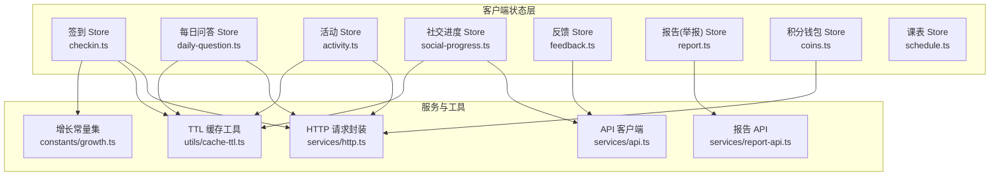
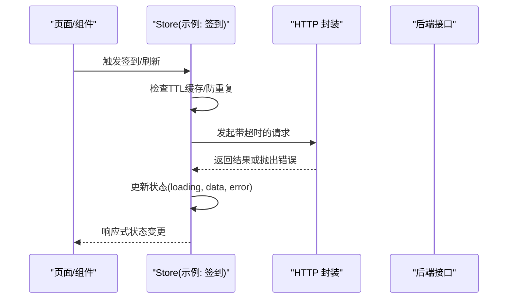
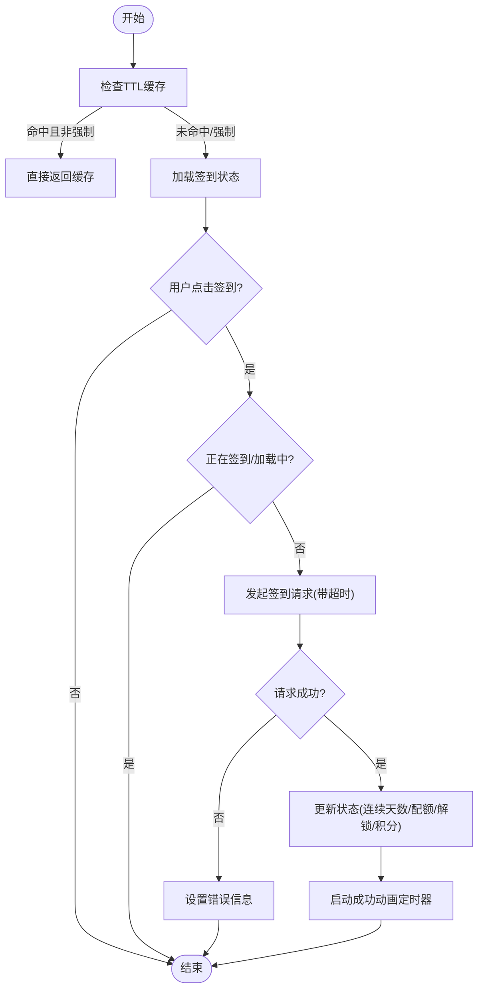
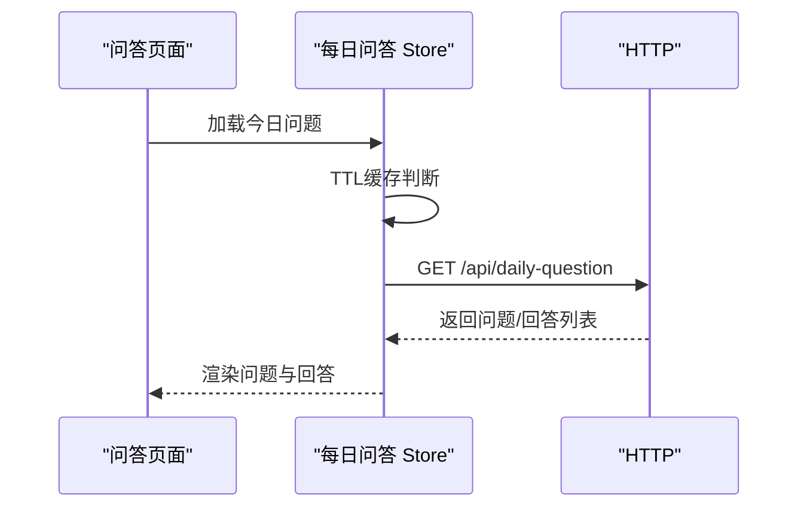
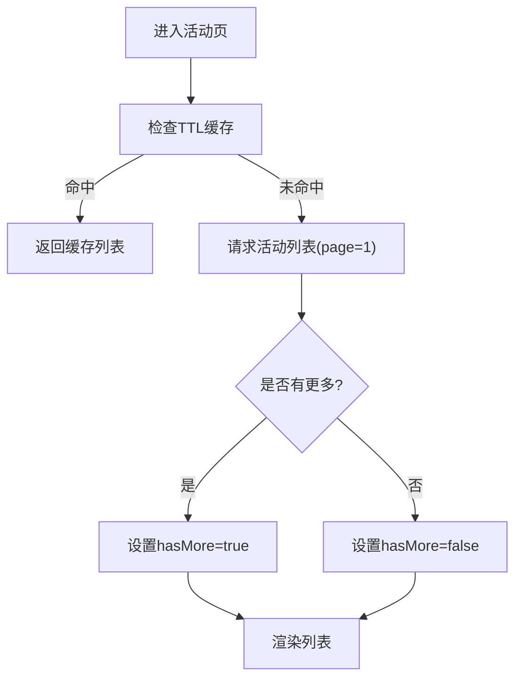
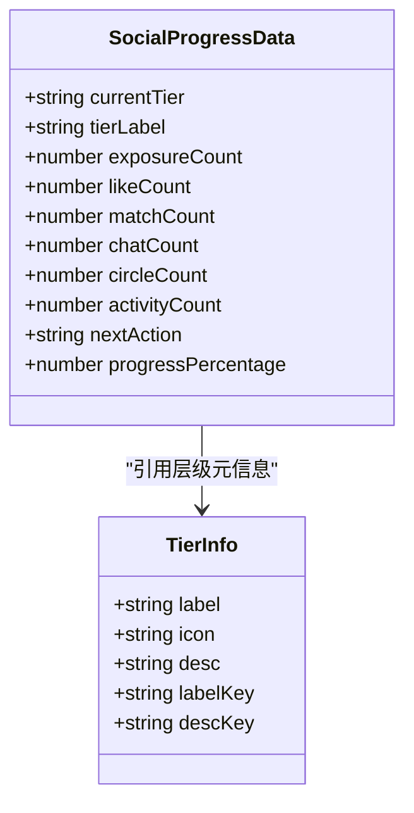
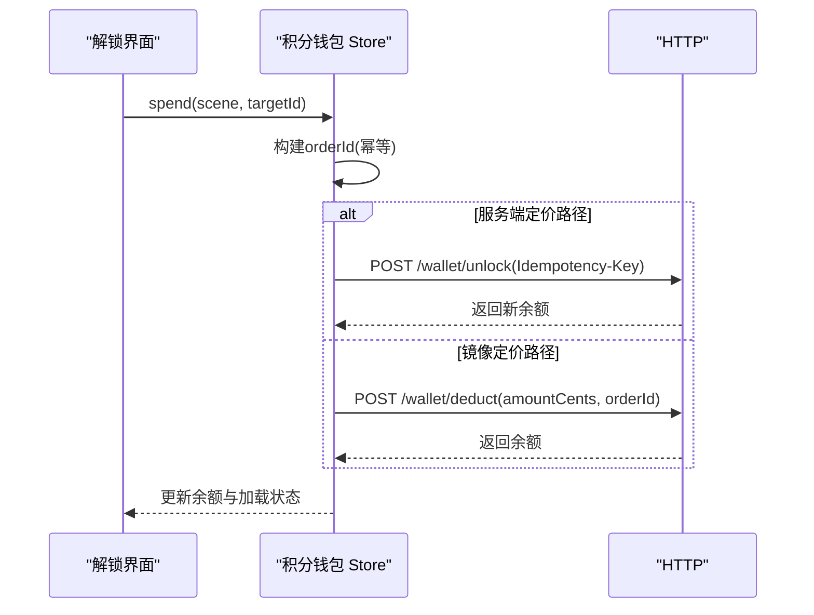
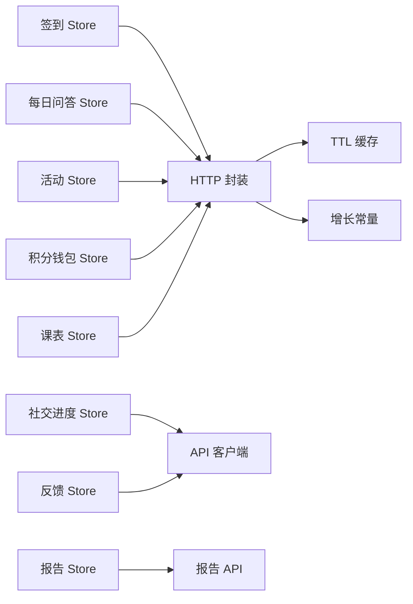

# 业务功能状态

<cite>
**本文引用的文件**   
- [apps/client/src/stores/checkin.ts](file://apps/client/src/stores/checkin.ts)
- [apps/client/src/stores/daily-question.ts](file://apps/client/src/stores/daily-question.ts)
- [apps/client/src/stores/activity.ts](file://apps/client/src/stores/activity.ts)
- [apps/client/src/stores/social-progress.ts](file://apps/client/src/stores/social-progress.ts)
- [apps/client/src/stores/feedback.ts](file://apps/client/src/stores/feedback.ts)
- [apps/client/src/stores/report.ts](file://apps/client/src/stores/report.ts)
- [apps/client/src/stores/coins.ts](file://apps/client/src/stores/coins.ts)
- [apps/client/src/stores/schedule.ts](file://apps/client/src/stores/schedule.ts)
- [apps/client/src/utils/cache-ttl.ts](file://apps/client/src/utils/cache-ttl.ts)
- [apps/client/src/constants/growth.ts](file://apps/client/src/constants/growth.ts)
- [apps/client/src/services/http.ts](file://apps/client/src/services/http.ts)
- [apps/client/src/services/api.ts](file://apps/client/src/services/api.ts)
- [apps/client/src/services/report-api.ts](file://apps/client/src/services/report-api.ts)
</cite>

## 目录
1. [简介](#简介)
2. [项目结构](#项目结构)
3. [核心组件](#核心组件)
4. [架构总览](#架构总览)
5. [详细组件分析](#详细组件分析)
6. [依赖关系分析](#依赖关系分析)
7. [性能与可配置性](#性能与可配置性)
8. [故障排查指南](#故障排查指南)
9. [结论](#结论)
10. [附录](#附录)

## 简介
本技术文档聚焦“业务功能的状态管理”，覆盖活动系统、签到机制、每日问答、社交进度追踪、报告（举报）生成、反馈收集、积分（钱包）系统、成就解锁与等级提升等场景。文档从状态模型、数据流、错误处理、性能优化、扩展点、审计与指标等方面，提供系统化说明，帮助读者快速理解并安全扩展各业务模块的状态设计与实现。

## 项目结构
围绕 Pinia Store 的模块化组织方式，业务状态按领域拆分：签到、每日问答、活动、社交进度、反馈、报告（举报）、积分钱包、课表等。各 Store 统一通过 HTTP 服务层访问后端 API，并使用本地缓存 TTL 控制拉取频率，保障多入口去重与刷新性能。

图表来源
- [apps/client/src/stores/checkin.ts:1-200](file://apps/client/src/stores/checkin.ts#L1-L200)
- [apps/client/src/stores/daily-question.ts:1-200](file://apps/client/src/stores/daily-question.ts#L1-L200)
- [apps/client/src/stores/activity.ts:1-200](file://apps/client/src/stores/activity.ts#L1-L200)
- [apps/client/src/stores/social-progress.ts:1-200](file://apps/client/src/stores/social-progress.ts#L1-L200)
- [apps/client/src/stores/feedback.ts:1-103](file://apps/client/src/stores/feedback.ts#L1-L103)
- [apps/client/src/stores/report.ts:1-67](file://apps/client/src/stores/report.ts#L1-L67)
- [apps/client/src/stores/coins.ts:1-200](file://apps/client/src/stores/coins.ts#L1-L200)
- [apps/client/src/stores/schedule.ts:1-200](file://apps/client/src/stores/schedule.ts#L1-L200)
- [apps/client/src/utils/cache-ttl.ts](file://apps/client/src/utils/cache-ttl.ts)
- [apps/client/src/constants/growth.ts](file://apps/client/src/constants/growth.ts)
- [apps/client/src/services/http.ts](file://apps/client/src/services/http.ts)
- [apps/client/src/services/api.ts](file://apps/client/src/services/api.ts)
- [apps/client/src/services/report-api.ts](file://apps/client/src/services/report-api.ts)

章节来源
- [apps/client/src/stores/checkin.ts:1-200](file://apps/client/src/stores/checkin.ts#L1-L200)
- [apps/client/src/stores/daily-question.ts:1-200](file://apps/client/src/stores/daily-question.ts#L1-L200)
- [apps/client/src/stores/activity.ts:1-200](file://apps/client/src/stores/activity.ts#L1-L200)
- [apps/client/src/stores/social-progress.ts:1-200](file://apps/client/src/stores/social-progress.ts#L1-L200)
- [apps/client/src/stores/feedback.ts:1-103](file://apps/client/src/stores/feedback.ts#L1-L103)
- [apps/client/src/stores/report.ts:1-67](file://apps/client/src/stores/report.ts#L1-L67)
- [apps/client/src/stores/coins.ts:1-200](file://apps/client/src/stores/coins.ts#L1-L200)
- [apps/client/src/stores/schedule.ts:1-200](file://apps/client/src/stores/schedule.ts#L1-L200)

## 核心组件
- 签到 Store：维护今日是否已签到、连续天数、额外推荐配额、热门话题/新用户解锁状态、积分余额与本次签到获得积分；支持补签次数统计与上限、防重复触发、超时与取消语义、成功动画定时器等。
- 每日问答 Store：管理今日问题、回答列表分页、是否已回答；具备 30s TTL 缓存、Mock/Real 双模式。
- 活动 Store：活动列表分页加载、报名/取消报名并发守卫、30s TTL 缓存、多入口去重。
- 社交进度 Store：六层升温路径（曝光→喜欢→匹配→沟通→圈子→线下），60s TTL 缓存，当前层级、百分比、下一步建议。
- 反馈 Store：问题反馈、建议、活动提案提交与列表加载，统一 try/catch 与 i18n 错误文案。
- 报告(举报) Store：包装举报 API，维持提交中标志与错误信息，便于后续扩展埋点与批量操作。
- 积分钱包 Store：余额查询、流水分页、解锁扣费（幂等 orderId）、定价镜像与服务端定价双路径。
- 课表 Store：课程/活动/自定义项的时间段重叠检测、空闲时段计算与增删。

章节来源
- [apps/client/src/stores/checkin.ts:1-200](file://apps/client/src/stores/checkin.ts#L1-L200)
- [apps/client/src/stores/daily-question.ts:1-200](file://apps/client/src/stores/daily-question.ts#L1-L200)
- [apps/client/src/stores/activity.ts:1-200](file://apps/client/src/stores/activity.ts#L1-L200)
- [apps/client/src/stores/social-progress.ts:1-200](file://apps/client/src/stores/social-progress.ts#L1-L200)
- [apps/client/src/stores/feedback.ts:1-103](file://apps/client/src/stores/feedback.ts#L1-L103)
- [apps/client/src/stores/report.ts:1-67](file://apps/client/src/stores/report.ts#L1-L67)
- [apps/client/src/stores/coins.ts:1-200](file://apps/client/src/stores/coins.ts#L1-L200)
- [apps/client/src/stores/schedule.ts:1-200](file://apps/client/src/stores/schedule.ts#L1-L200)

## 架构总览
所有业务 Store 遵循统一的职责边界：
- 状态定义：明确领域内关键状态字段与类型约束。
- 数据获取：优先使用 TTL 缓存减少重复请求；必要时强制刷新。
- 交互动作：封装为 actions，保证幂等与并发防护。
- 错误处理：try/catch + i18n 错误文案，暴露 loading/errorMessage 供 UI 展示。
- 外部集成：通过 services/http.ts、services/api.ts、services/report-api.ts 调用后端。

图表来源
- [apps/client/src/stores/checkin.ts:1-200](file://apps/client/src/stores/checkin.ts#L1-L200)
- [apps/client/src/services/http.ts](file://apps/client/src/services/http.ts)
- [apps/client/src/utils/cache-ttl.ts](file://apps/client/src/utils/cache-ttl.ts)

## 详细组件分析

### 签到系统（CheckIn）
- 状态要点
  - 今日签到状态、连续天数、额外推荐配额、热门话题/新用户解锁、积分余额与本次获得积分、补签计数与上限、加载与成功动画标记。
- 关键流程
  - 首次加载与刷新：30s TTL 缓存去重；force=true 时绕过缓存。
  - 签到动作：带超时的网络请求；失败时恢复状态；成功时设置 success 动画定时器并在卸载前清理。
  - 补签：本月已用次数与上限同步更新，防止重复触发。
- 并发与健壮性
  - withTimeout 委托 http.ts，支持 AbortController 信号以在超时/取消时跳过后续状态修改。
  - 成功动画定时器保存句柄，避免多次触发与卸载后修改。
- 数据契约
  - 对齐后端 CheckInStatusView/CheckInResultView，缺失可选字段时回退常量。

图表来源
- [apps/client/src/stores/checkin.ts:1-200](file://apps/client/src/stores/checkin.ts#L1-L200)
- [apps/client/src/services/http.ts](file://apps/client/src/services/http.ts)
- [apps/client/src/utils/cache-ttl.ts](file://apps/client/src/utils/cache-ttl.ts)
- [apps/client/src/constants/growth.ts](file://apps/client/src/constants/growth.ts)

章节来源
- [apps/client/src/stores/checkin.ts:1-200](file://apps/client/src/stores/checkin.ts#L1-L200)
- [apps/client/src/constants/growth.ts](file://apps/client/src/constants/growth.ts)
- [apps/client/src/services/http.ts](file://apps/client/src/services/http.ts)

### 每日问答（Daily Question）
- 状态要点
  - 今日问题对象（含分类、日期、回答数、是否已回答）、回答列表分页、加载与错误状态。
- 关键流程
  - 30s TTL 缓存降低重复请求；Mock/Real 双模式。
  - 回答列表分页：answerPage、answerHasMore。
  - 映射函数将后端视图转换为前端类型，确保类型安全。
- 数据契约
  - 对齐后端 DailyQuestionView/DailyAnswerView，缺失字段默认值处理。

图表来源
- [apps/client/src/stores/daily-question.ts:1-200](file://apps/client/src/stores/daily-question.ts#L1-L200)
- [apps/client/src/utils/cache-ttl.ts](file://apps/client/src/utils/cache-ttl.ts)

章节来源
- [apps/client/src/stores/daily-question.ts:1-200](file://apps/client/src/stores/daily-question.ts#L1-L200)

### 活动系统（Activity）
- 状态要点
  - 活动列表、分页、是否还有更多、加载与错误状态、报名中的活动 ID 集合（并发守卫）。
- 关键流程
  - fetchActivities：30s TTL 缓存，首次加载 page=1&pageSize，hasMore 判断一致。
  - 报名/取消报名：enrollingActivityIds 集合防止同一活动重复提交。
  - Mock 数据动态日期，避免过期显示。
- 数据契约
  - ActivityItem 包含状态枚举（open/ongoing/upcoming/ended/closed）、封面图、参与人数等。

图表来源
- [apps/client/src/stores/activity.ts:1-200](file://apps/client/src/stores/activity.ts#L1-L200)
- [apps/client/src/utils/cache-ttl.ts](file://apps/client/src/utils/cache-ttl.ts)

章节来源
- [apps/client/src/stores/activity.ts:1-200](file://apps/client/src/stores/activity.ts#L1-L200)

### 社交进度追踪（Social Progress）
- 状态要点
  - 当前层级标识、层级名称、六类行为计数（曝光/喜欢/匹配/聊天/圈子/活动）、下一步建议、进度百分比。
- 关键流程
  - 60s TTL 缓存；Mock/Real 双模式；fetchProgress 成功后刷新缓存时间戳。
  - TIER_META/TIER_ORDER 提供层级顺序与 i18n key，便于国际化与展示。
- 可视化
  - 步骤指示器基于层级索引与 isMaxLevel 计算。

图表来源
- [apps/client/src/stores/social-progress.ts:1-200](file://apps/client/src/stores/social-progress.ts#L1-L200)

章节来源
- [apps/client/src/stores/social-progress.ts:1-200](file://apps/client/src/stores/social-progress.ts#L1-L200)

### 反馈收集（Feedback）
- 状态要点
  - 反馈列表、加载标志、最近一次错误信息。
- 关键流程
  - load(type?)：加载列表；submitIssue/submitSuggestion/submitActivityProposal：提交并刷新列表；统一 try/catch 与 i18n 错误文案。
- 设计原则
  - 简单可靠，避免复杂状态机；错误不冒泡到调用方，UI 可直接读取 errorMessage。

章节来源
- [apps/client/src/stores/feedback.ts:1-103](file://apps/client/src/stores/feedback.ts#L1-L103)

### 报告生成（Report/举报）
- 状态要点
  - submitting、errorMessage。
- 关键流程
  - reportTarget(type, id, reason, description?)：包装 services/report-api.reportTarget，便于后续扩展（埋点、批量、重试）。
- 设计原则
  - 薄包装，保持职责单一，利于测试与扩展。

章节来源
- [apps/client/src/stores/report.ts:1-67](file://apps/client/src/stores/report.ts#L1-L67)

### 积分系统与奖励发放（Coins/Wallet）
- 状态要点
  - 余额（分）、是否已加载、加载标志；流水分页；解锁场景与金额镜像表。
- 关键流程
  - fetchBalance(forceRefresh)：实时余额查询。
  - spend(scene, targetId)：幂等 orderId = UNLOCK-{scene}-{targetId}；优先服务端定价路径 /wallet/unlock，否则走 /wallet/deduct 镜像定价。
  - buildUnlockOrderId：单一真相源，避免多入口生成不同幂等键导致双扣风险。
- 联动机制
  - 签到获得积分、解锁私信/访客/喜欢你/悄悄话扣费；积分变化影响可用额度与解锁能力。
- 数据契约
  - 金额单位分（cents），展示换算为元；相关类型 relatedType 用于流水记录。

图表来源
- [apps/client/src/stores/coins.ts:1-200](file://apps/client/src/stores/coins.ts#L1-L200)
- [apps/client/src/services/http.ts](file://apps/client/src/services/http.ts)

章节来源
- [apps/client/src/stores/coins.ts:1-200](file://apps/client/src/stores/coins.ts#L1-L200)

### 成就解锁与等级提升（概念性说明）
- 状态联动
  - 签到连续天数与解锁权益、社交进度层级推进、活动参与次数与圈子加入次数、问答回答数量均可作为成就条件。
- 实现建议
  - 在现有 Store 中增加成就条件判定逻辑（如 consecutiveDays>=X、matchCount>=Y），并通过事件或回调通知 UI 触发成就弹窗与奖励发放（积分/徽章/解锁权益）。
  - 与积分钱包联动：达成成就后发放积分或解锁额度，写入流水记录。

[本节为概念性说明，不直接分析具体文件]

### 课表与日程（Schedule）
- 状态要点
  - 课程/活动/自定义三类条目，共享时间字段；时间段配置与空闲检测。
- 关键流程
  - isOverlap 时间区间重叠检测；dayTimeSlots(dayOfWeek) 返回时段视图（isFree、item）。
  - addItem/removeItem 保证唯一 ID（随机后缀），避免同毫秒冲突。

章节来源
- [apps/client/src/stores/schedule.ts:1-200](file://apps/client/src/stores/schedule.ts#L1-L200)

## 依赖关系分析
- Store 之间松耦合：通过各自独立的 state/actions 管理领域状态，避免紧耦合。
- 共同依赖
  - services/http.ts：统一超时、错误封装、AbortController 支持。
  - utils/cache-ttl.ts：TTL 缓存键与新鲜度判断，多入口去重。
  - constants/growth.ts：增长相关常量（如签到积分、超时时间、默认补签上限等）。
  - services/api.ts：社交进度等特定 API 调用。
  - services/report-api.ts：举报专用 API。

图表来源
- [apps/client/src/stores/checkin.ts:1-200](file://apps/client/src/stores/checkin.ts#L1-L200)
- [apps/client/src/stores/daily-question.ts:1-200](file://apps/client/src/stores/daily-question.ts#L1-L200)
- [apps/client/src/stores/activity.ts:1-200](file://apps/client/src/stores/activity.ts#L1-L200)
- [apps/client/src/stores/social-progress.ts:1-200](file://apps/client/src/stores/social-progress.ts#L1-L200)
- [apps/client/src/stores/feedback.ts:1-103](file://apps/client/src/stores/feedback.ts#L1-L103)
- [apps/client/src/stores/report.ts:1-67](file://apps/client/src/stores/report.ts#L1-L67)
- [apps/client/src/stores/coins.ts:1-200](file://apps/client/src/stores/coins.ts#L1-L200)
- [apps/client/src/stores/schedule.ts:1-200](file://apps/client/src/stores/schedule.ts#L1-L200)
- [apps/client/src/utils/cache-ttl.ts](file://apps/client/src/utils/cache-ttl.ts)
- [apps/client/src/constants/growth.ts](file://apps/client/src/constants/growth.ts)
- [apps/client/src/services/http.ts](file://apps/client/src/services/http.ts)
- [apps/client/src/services/api.ts](file://apps/client/src/services/api.ts)
- [apps/client/src/services/report-api.ts](file://apps/client/src/services/report-api.ts)

章节来源
- [apps/client/src/stores/checkin.ts:1-200](file://apps/client/src/stores/checkin.ts#L1-L200)
- [apps/client/src/stores/activity.ts:1-200](file://apps/client/src/stores/activity.ts#L1-L200)
- [apps/client/src/stores/coins.ts:1-200](file://apps/client/src/stores/coins.ts#L1-L200)
- [apps/client/src/utils/cache-ttl.ts](file://apps/client/src/utils/cache-ttl.ts)
- [apps/client/src/constants/growth.ts](file://apps/client/src/constants/growth.ts)

## 性能与可配置性
- 性能优化
  - TTL 缓存：签到/问答/活动/社交进度均采用 30s~60s 新鲜度窗口，显著减少重复请求与渲染开销。
  - 超时与取消：withTimeout + AbortController，避免超时后继续执行状态修改。
  - 并发守卫：活动报名 enrollingActivityIds 集合、签到成功动画定时器句柄管理。
- 可配置化
  - growth 常量集中管理超时、默认补签上限、签到积分等，便于全局调整。
  - 解锁金额镜像表集中定义，避免分散硬编码。
  - 层级描述使用 i18n key，便于多语言切换。
- 扩展点
  - Store 内部保留 loading/errorMessage 标准字段，新增动作时可复用。
  - 报告 Store 作为薄包装，便于后续添加批量、重试、埋点。
  - 成就/等级可在现有 Store 上叠加条件判定与事件通知，无需重构。

[本节为通用指导，不直接分析具体文件]

## 故障排查指南
- 常见问题定位
  - 签到状态异常：检查 withTimeout 超时分支、AbortController 信号是否被正确 abort；确认 successAnimationTimer 是否正确清理。
  - 活动重复报名：确认 enrollingActivityIds 集合是否正确使用；检查 hasMore 与分页参数一致性。
  - 社交进度不更新：确认 TTL 缓存键与 force 参数；查看 fetchProgress 是否成功刷新缓存时间戳。
  - 反馈/报告提交失败：查看 errorMessage 与 i18n 文案；确认 API 调用是否抛出异常。
  - 积分扣费异常：核对 orderId 幂等键生成规则；区分服务端定价路径与镜像定价路径；检查余额不足与流水记录。
- 调试建议
  - 开启 Mock 模式验证 UI 状态流转。
  - 打印 store 状态快照（loading、errorMessage、data）。
  - 使用浏览器开发者工具观察网络请求与错误堆栈。

章节来源
- [apps/client/src/stores/checkin.ts:1-200](file://apps/client/src/stores/checkin.ts#L1-L200)
- [apps/client/src/stores/activity.ts:1-200](file://apps/client/src/stores/activity.ts#L1-L200)
- [apps/client/src/stores/social-progress.ts:1-200](file://apps/client/src/stores/social-progress.ts#L1-L200)
- [apps/client/src/stores/feedback.ts:1-103](file://apps/client/src/stores/feedback.ts#L1-L103)
- [apps/client/src/stores/report.ts:1-67](file://apps/client/src/stores/report.ts#L1-L67)
- [apps/client/src/stores/coins.ts:1-200](file://apps/client/src/stores/coins.ts#L1-L200)

## 结论
该状态管理体系以 Pinia Store 为核心，结合 TTL 缓存、超时控制、并发守卫与 i18n 错误处理，实现了签到、问答、活动、社交进度、反馈、报告、积分钱包等业务的稳定运行。通过常量集中、幂等键统一、薄包装策略与可扩展的事件/回调机制，系统在保持简洁的同时具备良好的可配置性与扩展性。建议在后续迭代中持续完善成就/等级判定、审计日志与业务指标统计，进一步提升系统的可观测性与运营能力。

## 附录
- 术语
  - TTL：生存时间（Time-To-Live），用于控制缓存新鲜度。
  - 幂等键：确保重复操作不会造成副作用（如重复扣费）。
  - 镜像定价：客户端侧的价格映射表，与服务端定价口径保持一致。
- 最佳实践
  - 所有异步动作包裹 try/catch，暴露 loading/errorMessage。
  - 使用 TTL 缓存减少重复请求，必要时支持强制刷新。
  - 对敏感操作（签到、报名、扣费）进行并发保护与超时控制。
  - 金额与定价集中管理，避免分散硬编码。
  - 通过 i18n 提供错误文案，提升用户体验。

[本节为通用指导，不直接分析具体文件]