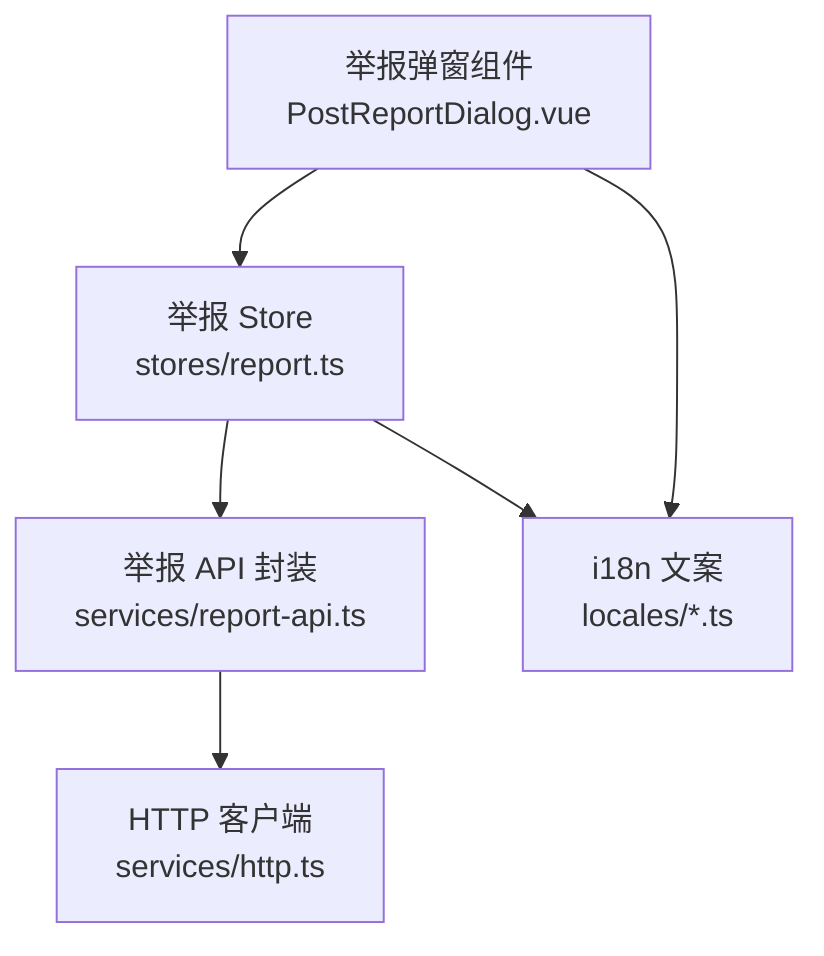
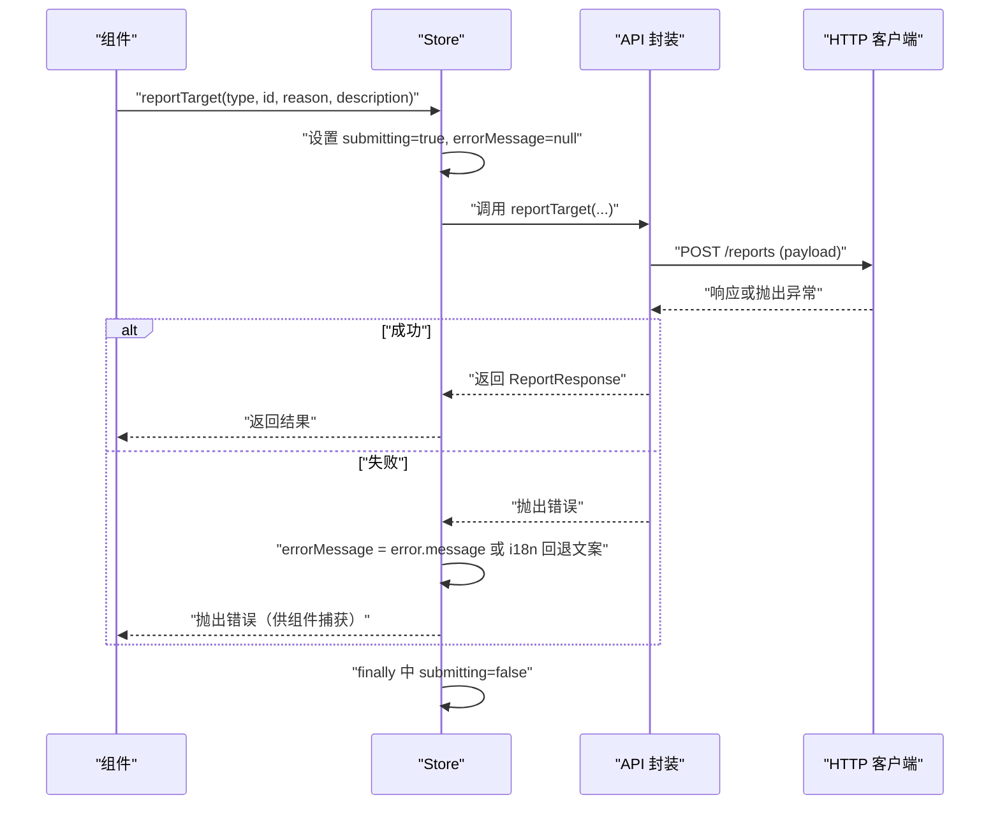
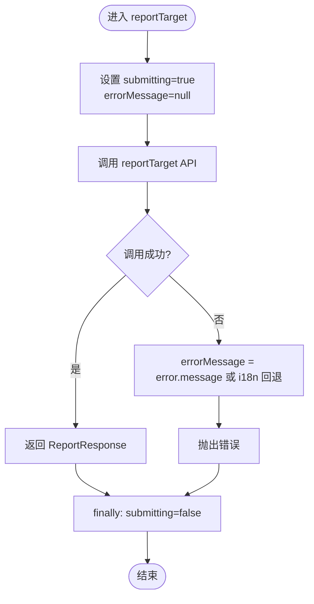
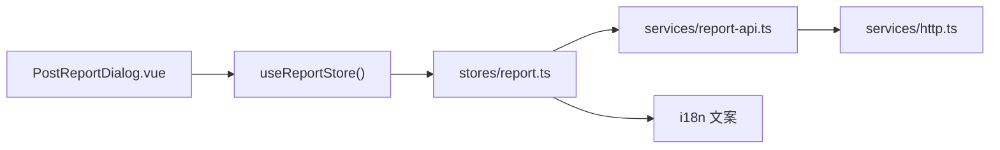

# 举报系统状态

<cite>
**本文引用的文件**
- [apps/client/src/stores/report.ts](file://apps/client/src/stores/report.ts)
- [apps/client/src/services/report-api.ts](file://apps/client/src/services/report-api.ts)
- [apps/client/src/components/social/PostReportDialog.vue](file://apps/client/src/components/social/PostReportDialog.vue)
- [apps/client/src/i18n/locales/zh-CN.ts](file://apps/client/src/i18n/locales/zh-CN.ts)
- [apps/client/src/i18n/locales/en-US.ts](file://apps/client/src/i18n/locales/en-US.ts)
- [apps/client/src/tests/stores/report.spec.ts](file://apps/client/src/tests/stores/report.spec.ts)
</cite>

## 目录
1. [简介](#简介)
2. [项目结构](#项目结构)
3. [核心组件](#核心组件)
4. [架构总览](#架构总览)
5. [详细组件分析](#详细组件分析)
6. [依赖关系分析](#依赖关系分析)
7. [性能考虑](#性能考虑)
8. [故障排查指南](#故障排查指南)
9. [结论](#结论)
10. [附录](#附录)

## 简介
本技术文档聚焦于举报系统的状态管理，围绕“组件 → store → service”的依赖方向原则，说明举报 Store 的轻量设计哲学与实现。重点覆盖：
- reportTarget action 的参数处理：举报目标类型 ReportTargetType、ID 标识、原因描述等。
- 提交态 submitting 与错误信息 errorMessage 的状态维护。
- 错误处理机制与 i18n 国际化展示。
- clearError 方法的用途与使用场景。
- 举报系统与业务组件解耦设计，便于扩展本地状态、批量举报、埋点统计。
- 测试策略与 Mock 数据支持。

## 项目结构
举报相关代码主要分布在以下位置：
- 状态层：Pinia store，封装提交流程与状态（submitting、errorMessage）。
- 服务层：HTTP API 封装，定义请求/响应结构与后端接口路径。
- 视图层：举报弹窗组件，负责用户交互、表单校验、调用 store 并反馈结果。
- 国际化：多语言文案，包括举报原因、提交成功/失败提示、store 级错误回退文案。
- 测试：针对 store 的行为与边界用例进行验证，Mock 服务层避免真实网络请求。

图表来源
- [apps/client/src/components/social/PostReportDialog.vue](file://apps/client/src/components/social/PostReportDialog.vue)
- [apps/client/src/stores/report.ts](file://apps/client/src/stores/report.ts)
- [apps/client/src/services/report-api.ts](file://apps/client/src/services/report-api.ts)

章节来源
- [apps/client/src/stores/report.ts](file://apps/client/src/stores/report.ts)
- [apps/client/src/services/report-api.ts](file://apps/client/src/services/report-api.ts)
- [apps/client/src/components/social/PostReportDialog.vue](file://apps/client/src/components/social/PostReportDialog.vue)

## 核心组件
- 举报 Store（Pinia）：提供 reportTarget action，封装服务调用，管理 submitting 与 errorMessage；提供 clearError 重置错误。
- 举报 API：定义 ReportTargetType、ReportRequest、ReportResponse，封装 POST /reports 的请求构建与发送。
- 举报弹窗组件：收集举报原因与描述，调用 store.reportTarget，处理成功/失败与关闭动画。
- 国际化：提供举报原因键值、提交提示与 store 级错误回退文案。

章节来源
- [apps/client/src/stores/report.ts](file://apps/client/src/stores/report.ts)
- [apps/client/src/services/report-api.ts](file://apps/client/src/services/report-api.ts)
- [apps/client/src/components/social/PostReportDialog.vue](file://apps/client/src/components/social/PostReportDialog.vue)
- [apps/client/src/i18n/locales/zh-CN.ts](file://apps/client/src/i18n/locales/zh-CN.ts)
- [apps/client/src/i18n/locales/en-US.ts](file://apps/client/src/i18n/locales/en-US.ts)

## 架构总览
举报流程遵循“组件 → store → service”的单向依赖：
- 组件只关心交互与 UI 反馈，不直接访问网络层。
- Store 集中管理提交状态与错误，屏蔽细节并保留扩展点。
- Service 仅负责构建请求与发送，保持纯函数式风格。

图表来源
- [apps/client/src/stores/report.ts](file://apps/client/src/stores/report.ts)
- [apps/client/src/services/report-api.ts](file://apps/client/src/services/report-api.ts)

## 详细组件分析

### 举报 Store（Pinia）
- 设计哲学：轻量薄包装，不引入复杂状态机，仅做必要转发与状态管理，便于后续扩展（如本地状态缓存、批量提交、埋点统计）。
- 状态字段：
  - submitting：最近一次提交是否进行中，用于 UI 禁用按钮与加载态。
  - errorMessage：最近一次错误信息，null 表示无错误。
- actions：
  - reportTarget(type, id, reason, description?)：
    - 进入时置 submitting=true，errorMessage=null。
    - 调用 services/report-api.reportTarget。
    - 成功则直接返回结果。
    - 失败时将 errorMessage 设置为 error.message；若非 Error 实例则使用 i18n 文案作为回退；最终抛出错误以便组件捕获。
    - finally 中确保 submitting=false。
  - clearError()：将 errorMessage 重置为 null，常用于用户重试前清理上一次错误。

图表来源
- [apps/client/src/stores/report.ts](file://apps/client/src/stores/report.ts)

章节来源
- [apps/client/src/stores/report.ts](file://apps/client/src/stores/report.ts)

### 举报 API（services/report-api.ts）
- 目标类型 ReportTargetType：当前定义为 "POST" | "COMMENT" | "USER" | "TOPIC"。
- 请求体 ReportRequest：包含 targetType、targetId、reason、description（可选）。
- 响应体 ReportResponse：包含 id、targetType、targetId、reporterId、reason、description、status、createdAt。
- 行为：构造 payload 并通过 request 发起 POST /reports。

注意：尽管枚举未包含 CHAT，但测试用例覆盖了 CHAT 类型传递至 API 的情形，体现 store 对类型透传的宽松性。

章节来源
- [apps/client/src/services/report-api.ts](file://apps/client/src/services/report-api.ts)
- [apps/client/src/tests/stores/report.spec.ts](file://apps/client/src/tests/stores/report.spec.ts)

### 举报弹窗组件（PostReportDialog.vue）
- 职责：
  - 收集举报原因（稳定的 key）与补充描述。
  - 调用 store.reportTarget("POST", postId, reasonKey, description)。
  - 成功：toast 提示、延迟关闭弹窗、触发 submitted 事件。
  - 失败：toast 提示错误，弹窗保持打开以便重试。
- 交互细节：
  - 提交中禁止关闭弹窗。
  - 使用 v-model:visible 双向绑定。
  - 清理定时器防止在已卸载组件上 emit 事件。
- 国际化：
  - 原因列表通过 i18n 键映射为用户可见文案。
  - 提交成功/失败使用 i18n 文案。

章节来源
- [apps/client/src/components/social/PostReportDialog.vue](file://apps/client/src/components/social/PostReportDialog.vue)
- [apps/client/src/i18n/locales/zh-CN.ts](file://apps/client/src/i18n/locales/zh-CN.ts)
- [apps/client/src/i18n/locales/en-US.ts](file://apps/client/src/i18n/locales/en-US.ts)

### 国际化与错误回退
- 举报原因：提供稳定 key（如 reasonSpam、reasonPorn 等），组件传入 key 而非显示标签，便于后端聚合与统计。
- 提交提示：postReport.submitSuccess、postReport.submitFailed。
- Store 级错误回退：storeErrors.report.submitFailed，当 API 抛出的非 Error 对象或缺少 message 时使用该文案。

章节来源
- [apps/client/src/i18n/locales/zh-CN.ts](file://apps/client/src/i18n/locales/zh-CN.ts)
- [apps/client/src/i18n/locales/en-US.ts](file://apps/client/src/i18n/locales/en-US.ts)
- [apps/client/src/stores/report.ts](file://apps/client/src/stores/report.ts)

## 依赖关系分析
- 组件到 Store：PostReportDialog.vue 通过 useReportStore() 获取 store 实例，避免直接依赖网络层。
- Store 到 Service：report.ts 仅依赖 services/report-api.ts 的 reportTarget 与类型定义。
- Service 到 HTTP：report-api.ts 基于通用 request 工具发送 POST /reports。
- Store 到 i18n：store 内部通过 t 函数获取默认错误文案，保证多语言一致性。

图表来源
- [apps/client/src/components/social/PostReportDialog.vue](file://apps/client/src/components/social/PostReportDialog.vue)
- [apps/client/src/stores/report.ts](file://apps/client/src/stores/report.ts)
- [apps/client/src/services/report-api.ts](file://apps/client/src/services/report-api.ts)

章节来源
- [apps/client/src/stores/report.ts](file://apps/client/src/stores/report.ts)
- [apps/client/src/services/report-api.ts](file://apps/client/src/services/report-api.ts)
- [apps/client/src/components/social/PostReportDialog.vue](file://apps/client/src/components/social/PostReportDialog.vue)

## 性能考虑
- 轻量状态：仅维护 submitting 与 errorMessage，避免冗余状态带来的渲染开销。
- 单一职责：store 只做状态管理与转发，逻辑集中在 service，便于复用与优化。
- 避免过度设计：当前无复杂状态机，降低维护成本；未来如需批量提交或本地缓存，可在 store 内渐进式扩展。

[本节为通用指导，不直接分析具体文件]

## 故障排查指南
- 常见问题：
  - 提交后弹窗未关闭：检查提交中标志与定时器清理逻辑。
  - 错误提示重复或消失：确认 errorMessage 的使用时机与 clearError 调用。
  - 原因 key 漂移：确保始终传入稳定的 reason key，而非随语言变化的显示文案。
- 定位方法：
  - 查看 store.errorMessage 与 submitting 变化。
  - 检查 API 返回与异常类型，确认 i18n 回退文案是否生效。
  - 在组件层打印关键变量，验证 postId 与 reason 的有效性。

章节来源
- [apps/client/src/stores/report.ts](file://apps/client/src/stores/report.ts)
- [apps/client/src/components/social/PostReportDialog.vue](file://apps/client/src/components/social/PostReportDialog.vue)

## 结论
举报系统采用极简的 Pinia store 封装，严格遵循“组件 → store → service”的依赖方向，既保证了可测试性与可扩展性，又避免了过度抽象。reportTarget action 清晰管理提交态与错误信息，结合 i18n 提供一致的用户体验。通过单元测试与 Mock，确保行为稳定。未来可在此基础上扩展本地状态、批量举报、埋点统计等功能，而无需改动上层组件。

[本节为总结性内容，不直接分析具体文件]

## 附录

### 参数与类型说明
- ReportTargetType：当前定义包含 "POST" | "COMMENT" | "USER" | "TOPIC"。
- 参数处理：
  - type：举报目标类型，由调用方决定。
  - id：目标对象 ID，支持字符串或数字。
  - reason：简短分类原因，建议使用稳定 key。
  - description：详细描述，可选。

章节来源
- [apps/client/src/services/report-api.ts](file://apps/client/src/services/report-api.ts)

### 测试策略与 Mock 数据
- 初始状态断言：submitting=false、errorMessage=null。
- 成功路径：mock 返回 ReportResponse，验证 submitting 恢复为 false、errorMessage 为 null。
- 失败路径：mock 抛出错误，验证 errorMessage 被设置且错误被向上抛出。
- 非 Error 对象：验证回退到 i18n 文案。
- 多种目标类型：覆盖 POST、CHAT、USER 等类型透传。
- 可选参数：验证 description 正确传递。

章节来源
- [apps/client/src/tests/stores/report.spec.ts](file://apps/client/src/tests/stores/report.spec.ts)