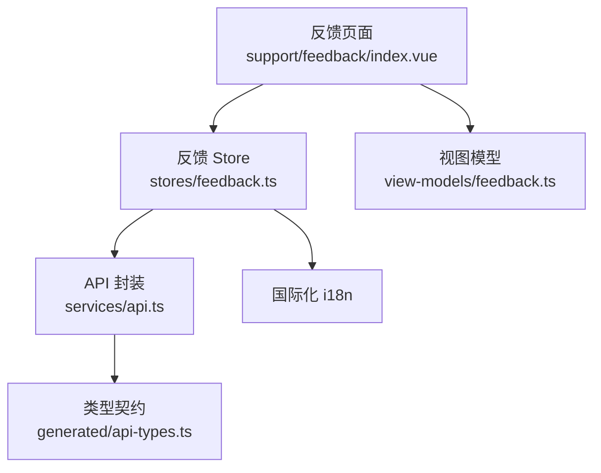
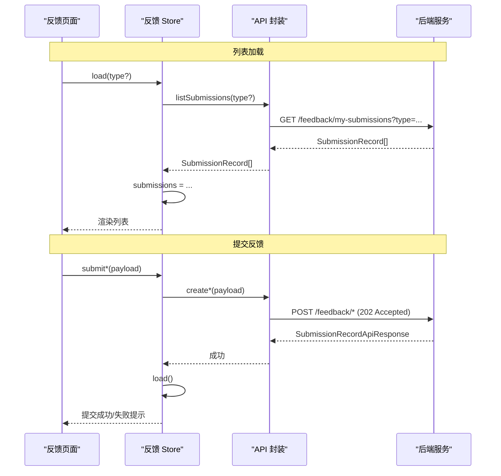
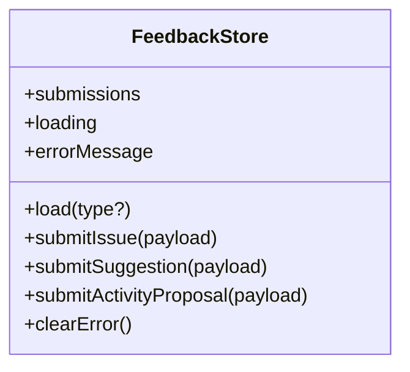
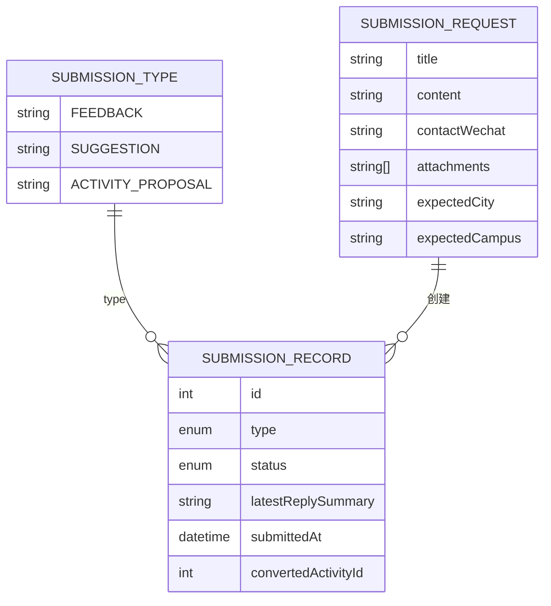
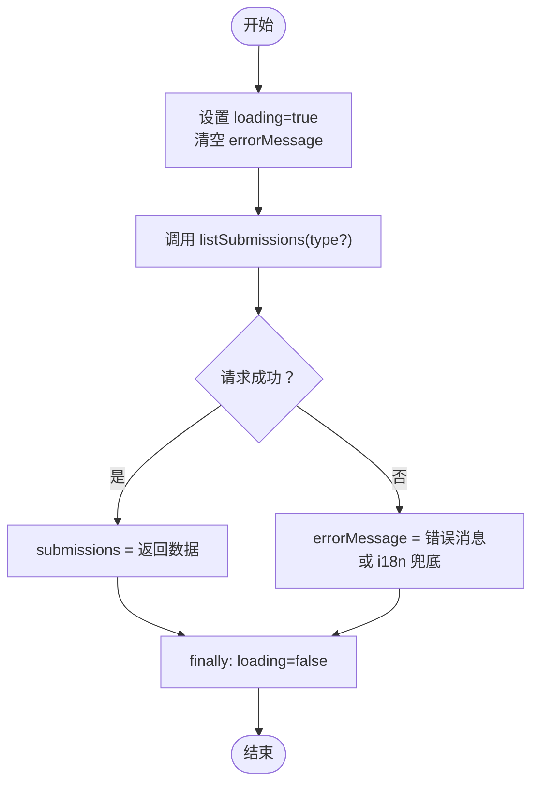
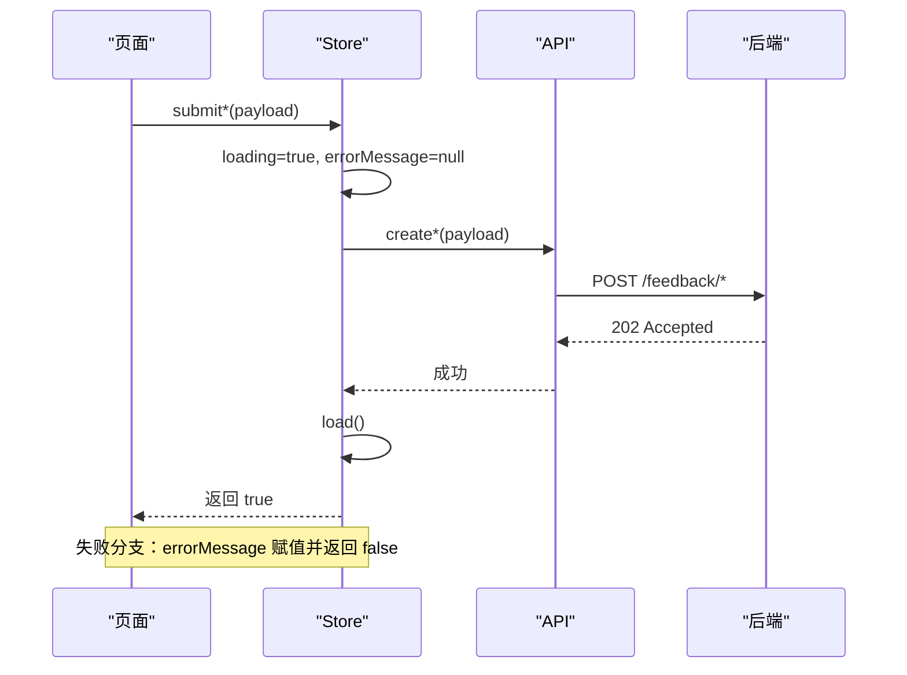
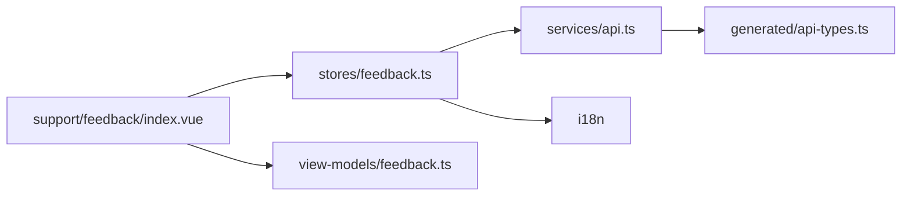

# 反馈系统状态

<cite>
**本文引用的文件**   
- [apps/client/src/stores/feedback.ts](file://apps/client/src/stores/feedback.ts)
- [apps/client/src/services/api.ts](file://apps/client/src/services/api.ts)
- [apps/client/src/services/generated/api-types.ts](file://apps/client/src/services/generated/api-types.ts)
- [apps/client/src/subpackages/support/feedback/index.vue](file://apps/client/src/subpackages/support/feedback/index.vue)
- [apps/client/src/view-models/feedback.ts](file://apps/client/src/view-models/feedback.ts)
- [apps/client/src/i18n/locales/zh-CN.ts](file://apps/client/src/i18n/locales/zh-CN.ts)
</cite>

## 目录
1. [简介](#简介)
2. [项目结构](#项目结构)
3. [核心组件](#核心组件)
4. [架构总览](#架构总览)
5. [详细组件分析](#详细组件分析)
6. [依赖关系分析](#依赖关系分析)
7. [性能与可用性考虑](#性能与可用性考虑)
8. [故障排查指南](#故障排查指南)
9. [结论](#结论)
10. [附录](#附录)

## 简介
本文面向“反馈系统”的前端状态管理，聚焦 Pinia Store `useFeedbackStore` 的职责、数据结构与交互流程。文档解释以下要点：
- 反馈列表加载、问题反馈提交、建议提交、活动提案提交流程
- 反馈数据模型（类型、记录、列表）与列表状态（submissions、loading、errorMessage）
- 统一提交处理模式（try/catch、i18n 错误文案、提交后刷新列表）
- 不同类型反馈的参数结构与返回值处理
- 用户体验优化（成功提示、失败重试、空态与加载态）
- 与后端 API 的对接方式（listSubmissions 查询与各 create* 提交接口）
- 扩展性设计（新增反馈类型、自定义验证规则）

## 项目结构
反馈相关代码主要分布在客户端应用内：
- 状态层：`apps/client/src/stores/feedback.ts`
- 服务层：`apps/client/src/services/api.ts`
- 类型契约：`apps/client/src/services/generated/api-types.ts`
- 页面与视图：`apps/client/src/subpackages/support/feedback/index.vue`
- 视图模型：`apps/client/src/view-models/feedback.ts`
- 国际化资源：`apps/client/src/i18n/locales/zh-CN.ts`

图表来源
- [apps/client/src/stores/feedback.ts:1-103](file://apps/client/src/stores/feedback.ts#L1-L103)
- [apps/client/src/services/api.ts:620-656](file://apps/client/src/services/api.ts#L620-L656)
- [apps/client/src/services/generated/api-types.ts:1217-1253](file://apps/client/src/services/generated/api-types.ts#L1217-L1253)
- [apps/client/src/subpackages/support/feedback/index.vue:1-50](file://apps/client/src/subpackages/support/feedback/index.vue#L1-L50)
- [apps/client/src/view-models/feedback.ts:1-28](file://apps/client/src/view-models/feedback.ts#L1-L28)

章节来源
- [apps/client/src/stores/feedback.ts:1-103](file://apps/client/src/stores/feedback.ts#L1-L103)
- [apps/client/src/services/api.ts:620-656](file://apps/client/src/services/api.ts#L620-L656)

## 核心组件
- 反馈 Store（Pinia）
  - 状态字段
    - submissions：反馈记录数组
    - loading：是否加载中
    - errorMessage：最近一次错误信息（null 表示无错误）
  - 动作方法
    - load(type?)：加载反馈列表（支持按类型筛选）
    - submitIssue(payload)：提交问题反馈
    - submitSuggestion(payload)：提交建议
    - submitActivityProposal(payload)：提交活动提案
    - clearError()：清除错误状态
- API 封装
  - listSubmissions(type?)：获取当前用户的反馈列表
  - createFeedbackIssue(payload)：提交问题反馈
  - createSuggestion(payload)：提交建议
  - createActivityProposal(payload)：提交活动提案
- 视图模型
  - toSubmissionStatusLabel(status)：将状态枚举映射为 i18n 文案
  - toSubmissionStatusTone(status)：根据状态返回展示色调（brand/warning/success）
- 页面组件
  - 反馈中心入口页，负责表单输入、图片上传、调用 Store 动作、展示结果与历史跳转

章节来源
- [apps/client/src/stores/feedback.ts:1-103](file://apps/client/src/stores/feedback.ts#L1-L103)
- [apps/client/src/services/api.ts:620-656](file://apps/client/src/services/api.ts#L620-L656)
- [apps/client/src/view-models/feedback.ts:1-28](file://apps/client/src/view-models/feedback.ts#L1-L28)
- [apps/client/src/subpackages/support/feedback/index.vue:1-50](file://apps/client/src/subpackages/support/feedback/index.vue#L1-L50)

## 架构总览
反馈系统的请求链路从页面到 Store，再到 API 封装，最终与后端交互；响应通过 Store 更新状态并驱动 UI。

图表来源
- [apps/client/src/stores/feedback.ts:22-98](file://apps/client/src/stores/feedback.ts#L22-L98)
- [apps/client/src/services/api.ts:620-656](file://apps/client/src/services/api.ts#L620-L656)

## 详细组件分析

### 反馈 Store 设计与职责
- 状态设计
  - submissions：类型为 `Awaited<ReturnType<typeof clientApi.listSubmissions>>`，即后端返回的 `SubmissionRecord` 数组
  - loading：布尔值，控制全局加载态
  - errorMessage：字符串或 null，承载最近一次错误信息，供 UI 显示
- 动作设计
  - 所有异步动作采用 try/catch 包裹，设置 loading=true，成功后触发列表刷新，失败时设置 errorMessage 并通过 i18n 提供兜底文案
  - 提交类动作统一返回 boolean，便于调用方判断成功与否
  - 提供 clearError() 重置错误状态

图表来源
- [apps/client/src/stores/feedback.ts:1-103](file://apps/client/src/stores/feedback.ts#L1-L103)

章节来源
- [apps/client/src/stores/feedback.ts:1-103](file://apps/client/src/stores/feedback.ts#L1-L103)

### 数据模型与类型契约
- SubmissionType
  - 枚举值："FEEDBACK" | "SUGGESTION" | "ACTIVITY_PROPOSAL"
- SubmissionRequest
  - title：标题（必填）
  - content：正文内容（必填）
  - contactWechat：可选联系人微信
  - attachments：附件 URL 数组（可选）
  - expectedCity：期望城市（可选）
  - expectedCampus：期望校园（可选）
- SubmissionRecord
  - id：主键
  - type：反馈类型（来自 SubmissionType）
  - status：状态（submitted/processing/reviewed/planned/converted）
  - latestReplySummary：最新回复摘要
  - submittedAt：提交时间（ISO 字符串）
  - convertedActivityId：如已转成活动则存在 ID（可选）

图表来源
- [apps/client/src/services/generated/api-types.ts:1217-1253](file://apps/client/src/services/generated/api-types.ts#L1217-L1253)

章节来源
- [apps/client/src/services/generated/api-types.ts:1217-1253](file://apps/client/src/services/generated/api-types.ts#L1217-L1253)

### 列表加载流程
- 触发点：页面初始化或用户选择筛选条件
- 关键步骤
  - Store.load(type?) 将 loading 置 true，清空 errorMessage
  - 调用 clientApi.listSubmissions(type)，若使用 Mock 模式则走 fixtures
  - 成功：将返回的 SubmissionRecord[] 赋值给 submissions
  - 失败：捕获异常，errorMessage 赋 Error.message 或 i18n 兜底文案
  - finally：无论成功失败都重置 loading=false

图表来源
- [apps/client/src/stores/feedback.ts:22-45](file://apps/client/src/stores/feedback.ts#L22-L45)
- [apps/client/src/services/api.ts:622-630](file://apps/client/src/services/api.ts#L622-L630)

章节来源
- [apps/client/src/stores/feedback.ts:22-45](file://apps/client/src/stores/feedback.ts#L22-L45)
- [apps/client/src/services/api.ts:622-630](file://apps/client/src/services/api.ts#L622-L630)

### 提交反馈的统一处理模式
- 通用流程
  - 设置 loading=true，errorMessage=null
  - 调用对应 create* 接口
  - 成功后立即执行 load() 刷新列表
  - 返回 true/false 指示结果
  - 失败时设置 errorMessage 并记录日志
- 三种提交动作
  - submitIssue：调用 createFeedbackIssue，后端路径 /feedback/issues
  - submitSuggestion：调用 createSuggestion，后端路径 /feedback/suggestions
  - submitActivityProposal：调用 createActivityProposal，后端路径 /feedback/activity-proposals

图表来源
- [apps/client/src/stores/feedback.ts:47-98](file://apps/client/src/stores/feedback.ts#L47-L98)
- [apps/client/src/services/api.ts:631-656](file://apps/client/src/services/api.ts#L631-L656)

章节来源
- [apps/client/src/stores/feedback.ts:47-98](file://apps/client/src/stores/feedback.ts#L47-L98)
- [apps/client/src/services/api.ts:631-656](file://apps/client/src/services/api.ts#L631-L656)

### 反馈类型与参数结构
- 问题反馈（issue）
  - 参数：SubmissionRequest（title/content/contactWechat/attachments/expectedCity/expectedCampus）
  - 后端接口：POST /feedback/issues
  - 返回：202 Accepted，包含 SubmissionRecordApiResponse
- 建议（suggestion）
  - 参数：SubmissionRequest
  - 后端接口：POST /feedback/suggestions
  - 返回：202 Accepted
- 活动提案（activityProposal）
  - 参数：SubmissionRequest
  - 后端接口：POST /feedback/activity-proposals
  - 返回：202 Accepted

章节来源
- [apps/client/src/services/generated/api-types.ts:2401-2475](file://apps/client/src/services/generated/api-types.ts#L2401-L2475)
- [apps/client/src/services/api.ts:631-656](file://apps/client/src/services/api.ts#L631-L656)

### 列表状态管理与展示
- 列表状态
  - submissions：用于渲染列表项
  - loading：控制顶部或全局加载骨架屏
  - errorMessage：在失败时展示错误提示
- 状态文案与色调
  - toSubmissionStatusLabel：将 status 映射为 i18n key，再翻译为本地文案
  - toSubmissionStatusTone：status 为 processing/planned → warning；reviewed/converted → success；其余 → brand

章节来源
- [apps/client/src/view-models/feedback.ts:1-28](file://apps/client/src/view-models/feedback.ts#L1-L28)
- [apps/client/src/i18n/locales/zh-CN.ts:4782-4790](file://apps/client/src/i18n/locales/zh-CN.ts#L4782-L4790)

### 页面集成与用户体验优化
- 页面职责
  - 收集表单数据（标题、正文、可选联系方式与附件）
  - 调用 Store 的 submit* 动作
  - 根据返回值显示成功提示或失败重试入口
  - 点击历史记录跳转到 history 页面
- 体验优化
  - 成功提示：提交成功后可展示轻提示
  - 失败重试：errorMessage 非空时提供重试按钮
  - 空态处理：submissions 为空时展示 EmptyState
  - 图片上传：最多 3 张，jpg/png/webp，单张 ≤ 5MB，上传后以缩略图网格展示并可预览/删除

章节来源
- [apps/client/src/subpackages/support/feedback/index.vue:1-50](file://apps/client/src/subpackages/support/feedback/index.vue#L1-L50)

## 依赖关系分析
- Store 依赖
  - Pinia defineStore
  - clientApi（HTTP 请求封装）
  - i18n（t 函数）
- API 依赖
  - request 封装、Mock 开关、类型定义
- 页面依赖
  - Store、ViewModel、i18n、工具函数（触觉反馈、时间格式化、隐私授权检查等）

图表来源
- [apps/client/src/stores/feedback.ts:1-103](file://apps/client/src/stores/feedback.ts#L1-L103)
- [apps/client/src/services/api.ts:620-656](file://apps/client/src/services/api.ts#L620-L656)
- [apps/client/src/subpackages/support/feedback/index.vue:1-50](file://apps/client/src/subpackages/support/feedback/index.vue#L1-L50)
- [apps/client/src/view-models/feedback.ts:1-28](file://apps/client/src/view-models/feedback.ts#L1-L28)

章节来源
- [apps/client/src/stores/feedback.ts:1-103](file://apps/client/src/stores/feedback.ts#L1-L103)
- [apps/client/src/services/api.ts:620-656](file://apps/client/src/services/api.ts#L620-L656)

## 性能与可用性考虑
- 并发提交
  - Store 未引入防抖/节流，频繁提交会重复刷新列表，建议在页面层对提交按钮做短时禁用或节流
- 列表刷新开销
  - 每次提交成功后均调用 load() 全量拉取，数据量大时可考虑增量插入新条目或分页
- 错误恢复
  - errorMessage 仅覆盖最近一次错误，UI 应保留“重试”操作以允许用户重新发起相同提交
- 图片上传
  - 大体积图片会增加提交耗时，建议在上传阶段增加进度与超时提示

[本节为通用指导，不直接分析具体文件]

## 故障排查指南
- 常见问题
  - 提交后未刷新列表：确认 Store 提交动作是否成功进入 finally 前的 load() 调用分支
  - 列表始终为空：检查 listSubmissions 是否正确传参以及后端返回结构
  - 错误提示未显示：检查 errorMessage 是否被 UI 正确绑定，且 clearError() 是否在合适时机调用
  - 状态文案不正确：确认 toSubmissionStatusLabel 映射表与 i18n key 一致
- 定位建议
  - 查看 console.error 输出，关注 store 层抛出的异常信息
  - 校验 API 返回的 HTTP 状态码（202/4xx/5xx）及响应体结构
  - 在 Mock 模式下切换测试用例，排除网络干扰

章节来源
- [apps/client/src/stores/feedback.ts:22-98](file://apps/client/src/stores/feedback.ts#L22-L98)
- [apps/client/src/view-models/feedback.ts:1-28](file://apps/client/src/view-models/feedback.ts#L1-L28)

## 结论
反馈 Store 通过统一的 try/catch 与 i18n 兜底文案实现了稳健的错误处理，并以简洁的状态字段（submissions/loading/errorMessage）驱动 UI 渲染。API 层将不同反馈类型抽象为统一的 SubmissionRequest 模型，配合 SubmissionRecord 的标准化返回结构，使前端能一致地处理列表与详情展示。结合页面层的成功提示、失败重试与空态展示，整体体验良好。未来可在页面层加入提交节流、Store 层引入增量刷新与更细粒度的错误分类，以提升可扩展性与性能表现。

[本节为总结性内容，不直接分析具体文件]

## 附录

### API 接口清单（与反馈相关）
- 查询
  - GET /feedback/my-submissions?type={SubmissionType}
  - 返回：SubmissionRecord[]
- 提交
  - POST /feedback/issues
  - POST /feedback/suggestions
  - POST /feedback/activity-proposals
  - 请求体：SubmissionRequest
  - 返回：202 Accepted，SubmissionRecordApiResponse

章节来源
- [apps/client/src/services/api.ts:620-656](file://apps/client/src/services/api.ts#L620-L656)
- [apps/client/src/services/generated/api-types.ts:2401-2475](file://apps/client/src/services/generated/api-types.ts#L2401-L2475)

### 扩展性设计建议
- 新增反馈类型
  - 在 SubmissionType 中追加枚举值
  - 在 API 层新增对应的 createXxx 方法与路由
  - 在 Store 中新增 submitXxx 动作，复用统一 try/catch 与刷新逻辑
  - 在页面层添加相应表单与入口
- 自定义验证规则
  - 在页面层对 title/content/attachments 等进行前置校验
  - 校验失败时直接阻止提交，避免不必要的网络请求
  - 校验失败提示同样使用 i18n key，保持文案一致性

[本节为概念性说明，不直接分析具体文件]