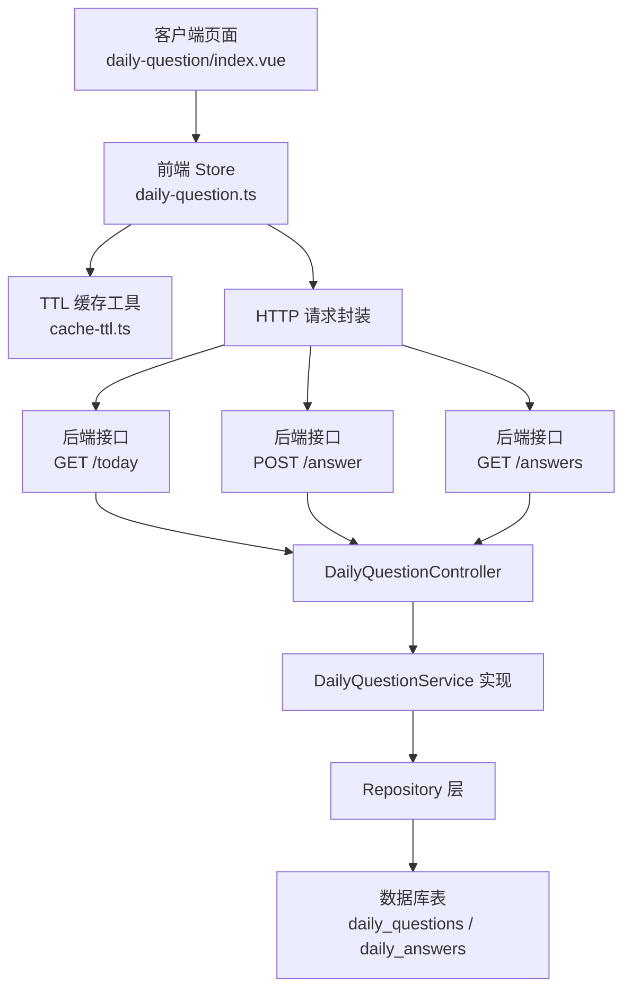
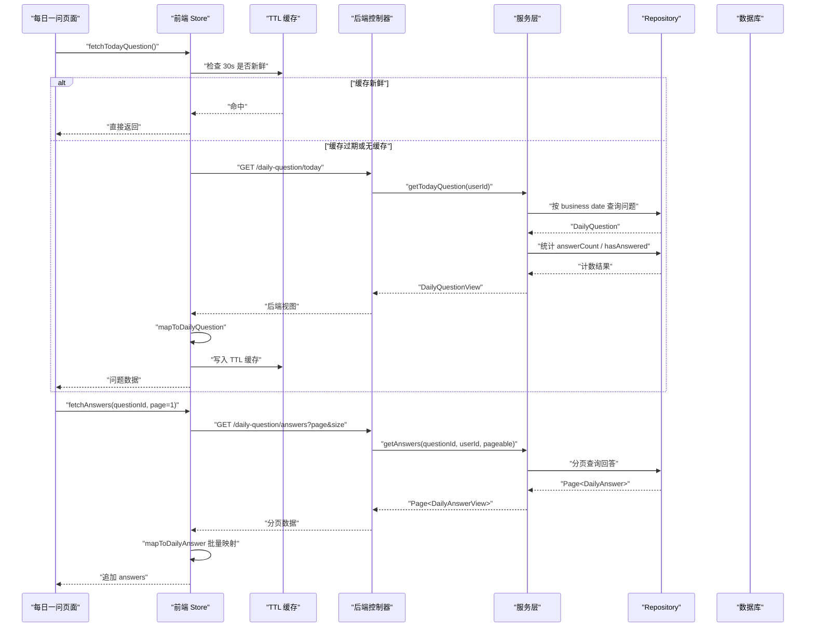
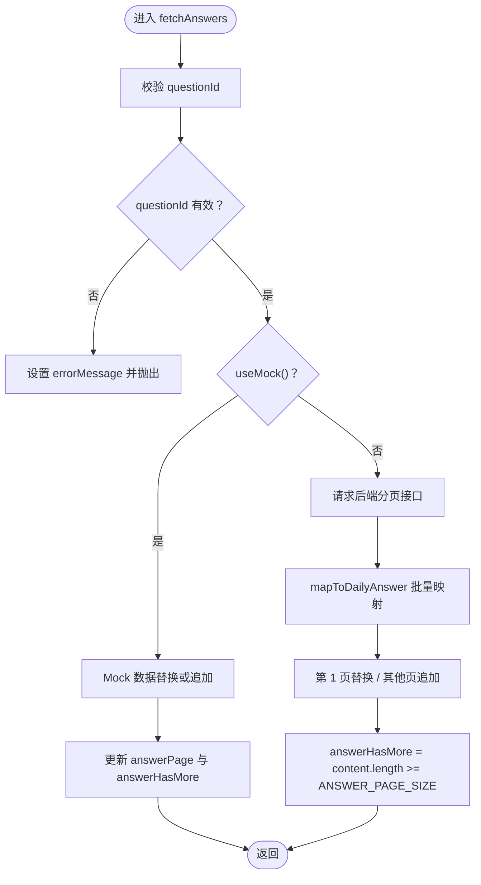
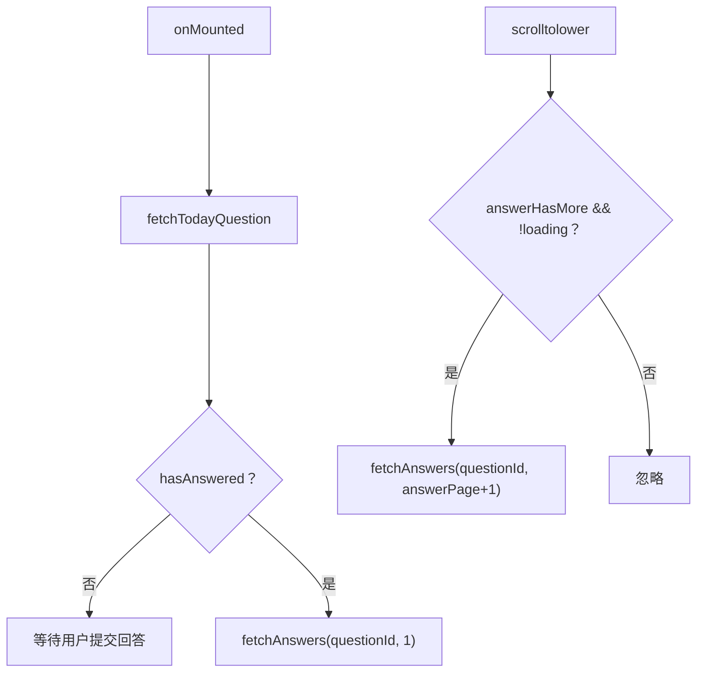
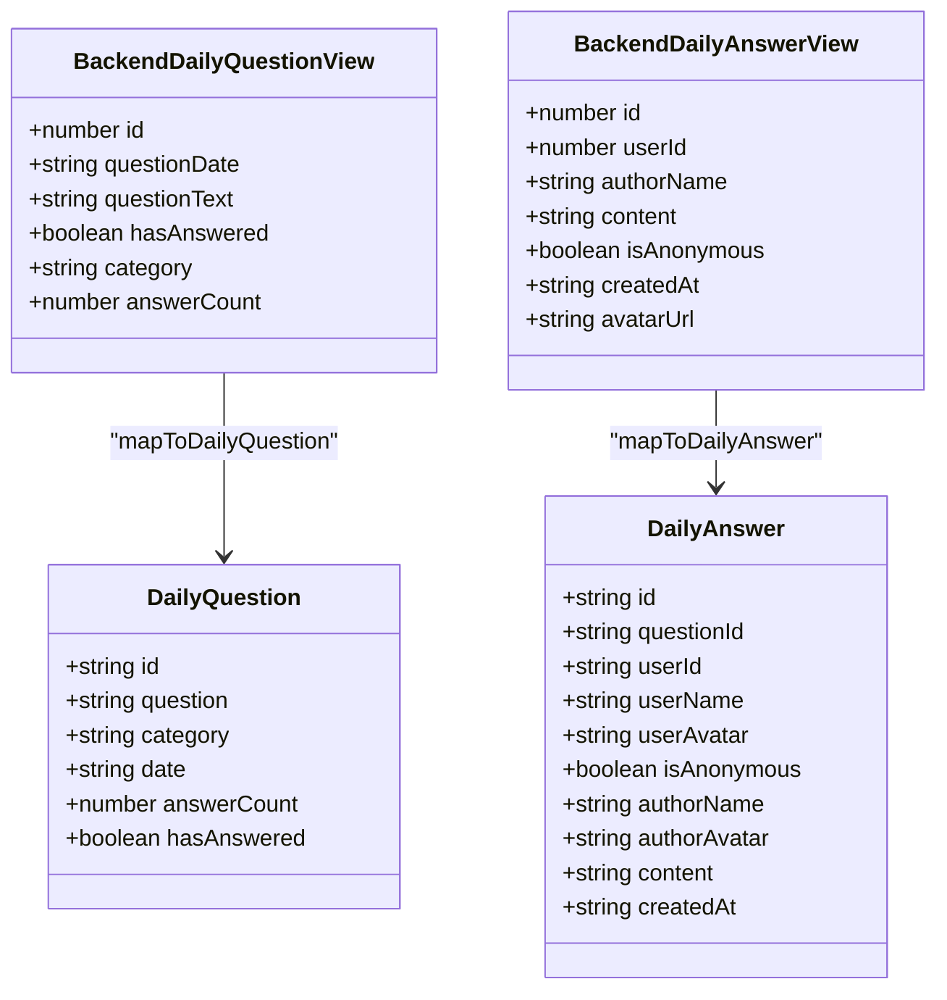
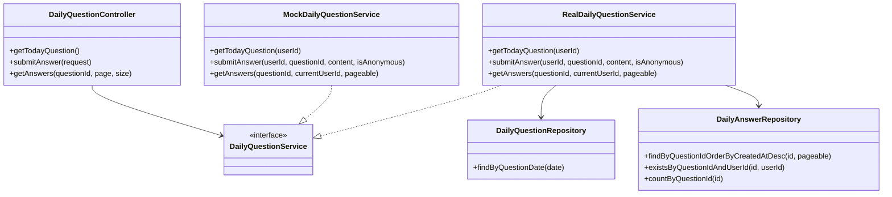
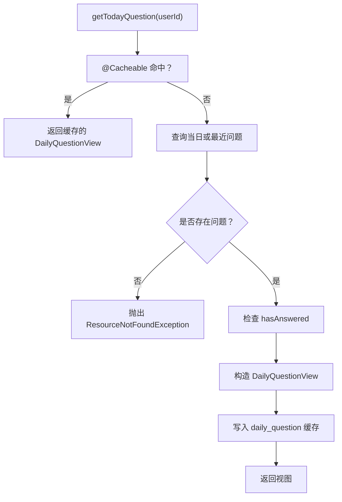
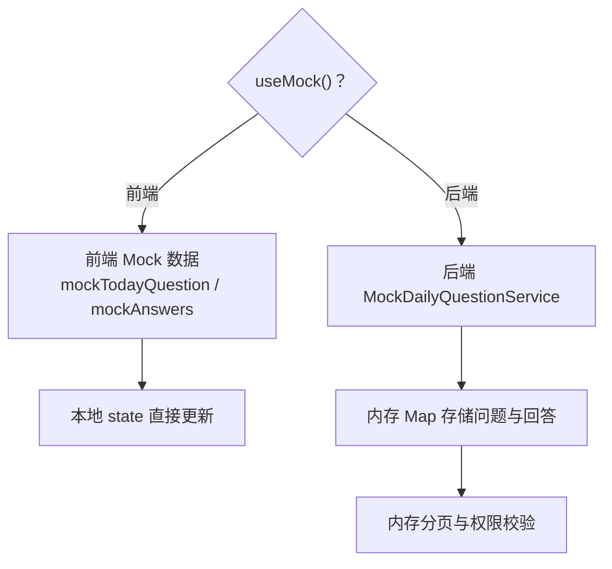

# 每日问答系统状态

<cite>
**本文引用的文件**   
- [daily-question.ts](file://apps/client/src/stores/daily-question.ts)
- [index.vue（每日一问页面）](file://apps/client/src/subpackages/tools/daily-question/index.vue)
- [cache-ttl.ts](file://apps/client/src/utils/cache-ttl.ts)
- [DailyQuestionController.java](file://apps/api/src/main/java/com/campuslove/api/discover/DailyQuestionController.java)
- [DailyQuestionService.java](file://apps/api/src/main/java/com/campuslove/api/discover/DailyQuestionService.java)
- [RealDailyQuestionService.java](file://apps/api/src/main/java/com/campuslove/api/discover/RealDailyQuestionService.java)
- [MockDailyQuestionService.java](file://apps/api/src/main/java/com/campuslove/api/discover/MockDailyQuestionService.java)
- [DailyQuestionView.java](file://apps/api/src/main/java/com/campuslove/api/discover/DailyQuestionView.java)
- [DailyAnswerView.java](file://apps/api/src/main/java/com/campuslove/api/discover/DailyAnswerView.java)
- [DailyQuestion.java](file://apps/api/src/main/java/com/campuslove/api/entity/DailyQuestion.java)
- [DailyAnswer.java](file://apps/api/src/main/java/com/campuslove/api/entity/DailyAnswer.java)
- [DailyQuestionRepository.java](file://apps/api/src/main/java/com/campuslove/api/repository/DailyQuestionRepository.java)
- [DailyAnswerRepository.java](file://apps/api/src/main/java/com/campuslove/api/repository/DailyAnswerRepository.java)
- [CacheNames.java](file://apps/api/src/main/java/com/campuslove/api/config/CacheNames.java)
- [V2026.05.31.0001__fix_entity_ddl_mismatches.sql](file://database/flyway/sql/V2026.05.31.0001__fix_entity_ddl_mismatches.sql)
</cite>

## 目录
1. [引言](#引言)
2. [项目结构与职责边界](#项目结构与职责边界)
3. [核心数据模型](#核心数据模型)
4. [架构总览](#架构总览)
5. [详细组件分析](#详细组件分析)
6. [依赖关系分析](#依赖关系分析)
7. [性能与缓存特性](#性能与缓存特性)
8. [错误处理策略](#错误处理策略)
9. [国际化与可访问性](#国际化与可访问性)
10. [Mock 数据与测试方案](#mock-数据与测试方案)
11. [故障排查指南](#故障排查指南)
12. [结论](#结论)

## 引言
本文面向“每日问答系统”的状态管理与交互流程，重点说明前端 Pinia Store、后端控制器与服务层、数据库实体及视图之间的数据契约。文档覆盖：
- 今日问题与回答的数据模型设计，包括问题分类、匿名回答、时间戳等字段。
- 问题获取、回答提交、答案浏览的分页加载机制。
- 前后端数据类型映射 `mapToDailyQuestion` 与 `mapToDailyAnswer`。
- 回答列表的懒加载实现：`answerPage`、`answerHasMore` 状态管理。
- 匿名回答的用户隐私保护与头像显示逻辑。
- 客户端 30 秒 TTL 缓存与后端 `@Cacheable` 缓存对数据一致性的影响。
- 国际化支持、错误处理策略与 Mock 数据测试方案。

## 项目结构与职责边界
每日问答系统由前端子包工具页、Pinia Store、HTTP 请求封装以及后端 Spring REST 服务组成。职责划分如下：
- 前端页面 `apps/client/src/subpackages/tools/daily-question/index.vue`：负责签到解锁、展示今日问题、提交回答、滚动加载更多回答。
- 前端 Store `apps/client/src/stores/daily-question.ts`：封装业务状态、TTL 缓存、分页逻辑、类型映射和 Mock 数据。
- 前端缓存工具 `apps/client/src/utils/cache-ttl.ts`：提供 30 秒 TTL 新鲜度判断与 stale-while-revalidate 语义。
- 后端控制器 `apps/api/.../discover/DailyQuestionController.java`：暴露 `/api/v1/daily-question/today`、`/answer`、`/answers` 三个接口。
- 后端服务 `RealDailyQuestionService` / `MockDailyQuestionService`：分别对接真实数据库与内存 Mock。
- 后端实体 `DailyQuestion` / `DailyAnswer` 与视图 `DailyQuestionView` / `DailyAnswerView`：定义持久化结构及对外 API 结构。
- 仓库接口 `DailyQuestionRepository` / `DailyAnswerRepository`：定义按日期、问题、用户、分页查询能力。

**图表来源**
- [index.vue（每日一问页面）:1-200](file://apps/client/src/subpackages/tools/daily-question/index.vue#L1-L200)
- [daily-question.ts:1-200](file://apps/client/src/stores/daily-question.ts#L1-L200)
- [cache-ttl.ts:1-124](file://apps/client/src/utils/cache-ttl.ts#L1-L124)
- [DailyQuestionController.java:1-100](file://apps/api/src/main/java/com/campuslove/api/discover/DailyQuestionController.java#L1-L100)
- [RealDailyQuestionService.java:1-200](file://apps/api/src/main/java/com/campuslove/api/discover/RealDailyQuestionService.java#L1-L200)

**章节来源**
- [index.vue（每日一问页面）:1-200](file://apps/client/src/subpackages/tools/daily-question/index.vue#L1-L200)
- [daily-question.ts:1-200](file://apps/client/src/stores/daily-question.ts#L1-L200)
- [DailyQuestionController.java:1-100](file://apps/api/src/main/java/com/campuslove/api/discover/DailyQuestionController.java#L1-L100)

## 核心数据模型
### 后端持久化实体
| 实体 | 关键字段 | 含义 |
| --- | --- | --- |
| `DailyQuestion` | `id`、`questionDate`、`questionText`、`category`、`createdAt`、`version` | 每日唯一问题；包含问题文本、分类、创建时间与乐观锁版本。 |
| `DailyAnswer` | `id`、`questionId`、`userId`、`content`、`isAnonymous`、`createdAt`、`version` | 对问题的回答；支持匿名标记、创建时间和乐观锁版本。 |

`DailyQuestion.category` 在实体中已存在，但原始 DDL 缺失，Flyway 迁移脚本通过 `ALTER TABLE daily_questions ADD COLUMN category ...` 补齐，保证实体与数据库一致。

**章节来源**
- [DailyQuestion.java:1-111](file://apps/api/src/main/java/com/campuslove/api/entity/DailyQuestion.java#L1-L111)
- [DailyAnswer.java:1-126](file://apps/api/src/main/java/com/campuslove/api/entity/DailyAnswer.java#L1-L126)
- [V2026.05.31.0001__fix_entity_ddl_mismatches.sql:1-14](file://database/flyway/sql/V2026.05.31.0001__fix_entity_ddl_mismatches.sql#L1-L14)

### 后端视图对象
| 视图 | 关键字段 | 含义 |
| --- | --- | --- |
| `DailyQuestionView` | `id`、`questionDate`、`questionText`、`hasAnswered`、`category`、`answerCount` | 对外暴露的问题视图；含当前用户是否已回答、分类、回答数量。 |
| `DailyAnswerView` | `id`、`userId`、`authorName`、`content`、`isAnonymous`、`createdAt`、`avatarUrl` | 对外暴露的回答视图；匿名时隐藏用户信息，头像为空。 |

**章节来源**
- [DailyQuestionView.java:1-17](file://apps/api/src/main/java/com/campuslove/api/discover/DailyQuestionView.java#L1-L17)
- [DailyAnswerView.java:1-17](file://apps/api/src/main/java/com/campuslove/api/discover/DailyAnswerView.java#L1-L17)

### 前端内部类型
| 类型 | 关键字段 | 含义 |
| --- | --- | --- |
| `DailyQuestion` | `id`、`question`、`category`、`date`、`answerCount`、`hasAnswered` | 前端问题模型，ID 转为字符串。 |
| `DailyAnswer` | `id`、`questionId`、`userId`、`userName`、`userAvatar`、`isAnonymous`、`authorName`、`authorAvatar`、`content`、`createdAt` | 前端回答模型；匿名时名称和头像均为空。 |
| `DailyQuestionState` | `todayQuestion`、`answers`、`hasAnswered`、`loading`、`errorMessage`、`answerPage`、`answerHasMore` | Store 状态，控制问题、回答列表、分页和错误态。 |

**章节来源**
- [daily-question.ts:1-200](file://apps/client/src/stores/daily-question.ts#L1-L200)

## 架构总览
每日问答系统的核心调用链如下：
1. 页面挂载后调用 Store 获取今日问题。
2. 若用户已签到且已回答问题，则拉取回答列表第一页。
3. 用户提交回答后，Store 更新本地状态并刷新回答列表头部。
4. 用户滚动到底部触发加载更多，Store 推进 `answerPage` 并追加回答。

**图表来源**
- [index.vue（每日一问页面）:1-200](file://apps/client/src/subpackages/tools/daily-question/index.vue#L1-L200)
- [daily-question.ts:201-416](file://apps/client/src/stores/daily-question.ts#L201-L416)
- [cache-ttl.ts:1-124](file://apps/client/src/utils/cache-ttl.ts#L1-L124)
- [DailyQuestionController.java:1-100](file://apps/api/src/main/java/com/campuslove/api/discover/DailyQuestionController.java#L1-L100)
- [RealDailyQuestionService.java:1-200](file://apps/api/src/main/java/com/campuslove/api/discover/RealDailyQuestionService.java#L1-L200)
- [DailyAnswerRepository.java:1-76](file://apps/api/src/main/java/com/campuslove/api/repository/DailyAnswerRepository.java#L1-L76)

## 详细组件分析
### 前端 Store：`useDailyQuestionStore`
Store 维护三类核心状态：
- 今日问题：`todayQuestion`。
- 回答列表：`answers`，按创建时间倒序追加。
- 分页控制：`answerPage`（从 1 开始）、`answerHasMore`（根据返回数据量判断）。

关键行为：
- `fetchTodayQuestion`：优先走 30 秒 TTL 缓存；Mock 分支同样设置缓存时间戳；失败时设置 `errorMessage`。
- `submitAnswer`：参数校验、Mock 本地插入、真实后端 POST；成功后将新回答插入列表头部并置 `hasAnswered=true`。
- `fetchAnswers`：第 1 页替换列表，后续页追加；后端使用 Spring Data `Page`，前端将后端 `page=0` 转换为自身 `page=1`。

**图表来源**
- [daily-question.ts:201-416](file://apps/client/src/stores/daily-question.ts#L201-L416)

**章节来源**
- [daily-question.ts:1-200](file://apps/client/src/stores/daily-question.ts#L1-L200)
- [daily-question.ts:201-416](file://apps/client/src/stores/daily-question.ts#L201-L416)

### 页面组件：`daily-question/index.vue`
页面承担以下职责：
- 未签到时显示锁定卡片，并提供“去签到”入口；签到成功后解锁每日一问。
- 已签到后展示今日问题、回答输入框、匿名选项。
- 仅在用户已回答时才拉取回答列表，避免后端因权限拒绝返回 422 或 400。
- 滚动到底部时调用 `loadMoreAnswers`，推进 `answerPage` 并依赖 Store 的 `answerHasMore` 控制。

**图表来源**
- [index.vue（每日一问页面）:1-200](file://apps/client/src/subpackages/tools/daily-question/index.vue#L1-L200)

**章节来源**
- [index.vue（每日一问页面）:1-200](file://apps/client/src/subpackages/tools/daily-question/index.vue#L1-L200)

### 后端控制器：`DailyQuestionController`
控制器暴露三个接口：
- `GET /api/v1/daily-question/today`：获取今日问题。
- `POST /api/v1/daily-question/answer`：提交回答，受速率限制、幂等注解与 `USER` 角色限制。
- `GET /api/v1/daily-question/answers`：分页获取回答，默认 `page=0`、`size=20`，上限 100。

请求体 `DailyAnswerRequest` 仅包含 `questionId`、`content`、`isAnonymous`，`userId` 由 JWT 上下文自动注入，不再由前端传入。

**章节来源**
- [DailyQuestionController.java:1-100](file://apps/api/src/main/java/com/campuslove/api/discover/DailyQuestionController.java#L1-L100)

### 后端服务：`RealDailyQuestionService`
真实实现负责：
- 获取今日问题：按业务时区计算当天日期；若无当日问题则回退最近问题；若系统中无任何问题则抛 `ResourceNotFoundException`。
- 提交回答：校验参数、防止重复回答、创建回答记录、主动失效当前用户的缓存 key。
- 获取回答列表：只有已回答用户才能查看；批量预加载用户信息，避免 N+1 查询。

匿名回答处理：
- 匿名时 `authorName` 使用统一常量匿名用户显示名，`userId` 置空，`avatarUrl` 为空。
- 非匿名时从用户昵称和头像字段填充。

**章节来源**
- [RealDailyQuestionService.java:1-200](file://apps/api/src/main/java/com/campuslove/api/discover/RealDailyQuestionService.java#L1-L200)
- [RealDailyQuestionService.java:200-309](file://apps/api/src/main/java/com/campuslove/api/discover/RealDailyQuestionService.java#L200-L309)

### 类型映射：`mapToDailyQuestion` 与 `mapToDailyAnswer`
前端 Store 中的映射函数确保前后端数据结构一致：
- `mapToDailyQuestion`：将后端 `DailyQuestionView` 映射为前端 `DailyQuestion`，ID 转为字符串，分类默认空字符串。
- `mapToDailyAnswer`：将后端 `DailyAnswerView` 映射为前端 `DailyAnswer`，匿名时清空用户名、头像、作者名称与头像。

**图表来源**
- [daily-question.ts:1-200](file://apps/client/src/stores/daily-question.ts#L1-L200)
- [DailyQuestionView.java:1-17](file://apps/api/src/main/java/com/campuslove/api/discover/DailyQuestionView.java#L1-L17)
- [DailyAnswerView.java:1-17](file://apps/api/src/main/java/com/campuslove/api/discover/DailyAnswerView.java#L1-L17)

**章节来源**
- [daily-question.ts:1-200](file://apps/client/src/stores/daily-question.ts#L1-L200)

## 依赖关系分析
### 类与模块依赖图

**图表来源**
- [DailyQuestionController.java:1-100](file://apps/api/src/main/java/com/campuslove/api/discover/DailyQuestionController.java#L1-L100)
- [DailyQuestionService.java](file://apps/api/src/main/java/com/campuslove/api/discover/DailyQuestionService.java)
- [RealDailyQuestionService.java:1-200](file://apps/api/src/main/java/com/campuslove/api/discover/RealDailyQuestionService.java#L1-L200)
- [MockDailyQuestionService.java:1-187](file://apps/api/src/main/java/com/campuslove/api/discover/MockDailyQuestionService.java#L1-L187)
- [DailyQuestionRepository.java:1-21](file://apps/api/src/main/java/com/campuslove/api/repository/DailyQuestionRepository.java#L1-L21)
- [DailyAnswerRepository.java:1-76](file://apps/api/src/main/java/com/campuslove/api/repository/DailyAnswerRepository.java#L1-L76)

**章节来源**
- [DailyQuestionController.java:1-100](file://apps/api/src/main/java/com/campuslove/api/discover/DailyQuestionController.java#L1-L100)
- [RealDailyQuestionService.java:1-200](file://apps/api/src/main/java/com/campuslove/api/discover/RealDailyQuestionService.java#L1-L200)
- [MockDailyQuestionService.java:1-187](file://apps/api/src/main/java/com/campuslove/api/discover/MockDailyQuestionService.java#L1-L187)
- [DailyQuestionRepository.java:1-21](file://apps/api/src/main/java/com/campuslove/api/repository/DailyQuestionRepository.java#L1-L21)
- [DailyAnswerRepository.java:1-76](file://apps/api/src/main/java/com/campuslove/api/repository/DailyAnswerRepository.java#L1-L76)

## 性能与缓存特性
### 客户端 30 秒 TTL 缓存
- Store 在 `fetchTodayQuestion` 中使用 `isCacheFresh("daily-question:today", QUESTION_TTL_MS)`，其中 `QUESTION_TTL_MS=30_000`。
- 成功拉取数据后调用 `setCachedValue("daily-question:today", true)`，使 30 秒内再次进入页面无需网络请求。
- Mock 模式也写入缓存时间戳，保证演示构建下行为稳定。
- `cache-ttl.ts` 还提供更通用的 `fetchWithStaleWhileRevalidate`，支持旧值即时返回并后台刷新，适合多标签页切换场景。

### 后端缓存策略
- `RealDailyQuestionService.getTodayQuestion` 使用 `@Cacheable(cacheNames = CacheNames.DAILY_QUESTION, key = "#userId + ':' + businessDate")`。
- `CacheNames.DAILY_QUESTION` 对应后端统一的每日问题缓存名称，注释说明 TTL 为 1 小时。
- `submitAnswer` 使用 `@CacheEvict` 主动失效当前用户的缓存 key，保证 `hasAnswered` 立即反映最新状态。
- 回答列表查询通过批量加载用户 Map，避免 N+1 查询。

**图表来源**
- [RealDailyQuestionService.java:1-200](file://apps/api/src/main/java/com/campuslove/api/discover/RealDailyQuestionService.java#L1-L200)
- [CacheNames.java:1-111](file://apps/api/src/main/java/com/campuslove/api/config/CacheNames.java#L1-L111)

**章节来源**
- [daily-question.ts:1-200](file://apps/client/src/stores/daily-question.ts#L1-L200)
- [cache-ttl.ts:1-124](file://apps/client/src/utils/cache-ttl.ts#L1-L124)
- [RealDailyQuestionService.java:1-200](file://apps/api/src/main/java/com/campuslove/api/discover/RealDailyQuestionService.java#L1-L200)
- [CacheNames.java:1-111](file://apps/api/src/main/java/com/campuslove/api/config/CacheNames.java#L1-L111)

## 错误处理策略
### 前端错误处理
- Store 所有异步操作捕获异常后设置 `errorMessage`，页面根据该字段显示错误提示并提供重试入口。
- 提交回答前进行前端参数校验：questionId 非空、内容非空、长度不超过 500。
- 页面 `retryQuestion` 允许用户在加载失败后重新拉取问题。

### 后端错误处理
- 未找到问题：抛出 `ResourceNotFoundException`，前端应得到友好 404。
- 重复回答：抛出 `ResourceConflictException`，返回 409。
- 未回答却查看他人回答：抛出 `InvalidOperationException`，返回 400。
- 控制器层对 `questionId`、`page`、`size` 做参数校验，防止非法分页参数。

**章节来源**
- [daily-question.ts:201-416](file://apps/client/src/stores/daily-question.ts#L201-L416)
- [index.vue（每日一问页面）:1-200](file://apps/client/src/subpackages/tools/daily-question/index.vue#L1-L200)
- [RealDailyQuestionService.java:1-200](file://apps/api/src/main/java/com/campuslove/api/discover/RealDailyQuestionService.java#L1-L200)
- [DailyQuestionController.java:1-100](file://apps/api/src/main/java/com/campuslove/api/discover/DailyQuestionController.java#L1-L100)

## 国际化与可访问性
- 页面使用 `vue-i18n` 的 `t()` 函数渲染导航标题、按钮文案、占位符、错误提示。
- Store 的错误消息使用 `storeErrors.dailyQuestion.*` 命名空间，便于集中管理翻译键。
- 输入框设置 `aria-label`，加载状态设置 `role="status"` 与 `aria-live="polite"`，提升可访问性。
- 国际化文案不直接硬编码在业务逻辑中，而是通过 i18n 键引用，便于多语言扩展。

**章节来源**
- [index.vue（每日一问页面）:1-200](file://apps/client/src/subpackages/tools/daily-question/index.vue#L1-L200)
- [daily-question.ts:1-200](file://apps/client/src/stores/daily-question.ts#L1-L200)

## Mock 数据与测试方案
### Mock 数据位置
- 前端 Store 内置 `mockTodayQuestion` 与 `mockAnswers`，用于演示构建下的问题与回答内容。
- 后端 `MockDailyQuestionService` 在 `mock` profile 下激活，提供内存存储、模拟分页、匿名用户示例。

### Mock 行为差异
- 前端 Mock 模式下，`fetchTodayQuestion` 直接返回固定问题，并写入 TTL 缓存。
- `submitAnswer` 在 Mock 模式下直接插入本地回答并更新 `hasAnswered`。
- `fetchAnswers` 在 Mock 模式下根据页码替换或追加 mock 数据，并通过 `answers.length >= ANSWER_PAGE_SIZE` 判断是否还有更多。
- 后端 Mock 服务在未注册用户回答时返回预设的三条 Mock 回答，其中一条为匿名回答。

**图表来源**
- [daily-question.ts:1-200](file://apps/client/src/stores/daily-question.ts#L1-L200)
- [MockDailyQuestionService.java:1-187](file://apps/api/src/main/java/com/campuslove/api/discover/MockDailyQuestionService.java#L1-L187)

**章节来源**
- [daily-question.ts:1-200](file://apps/client/src/stores/daily-question.ts#L1-L200)
- [MockDailyQuestionService.java:1-187](file://apps/api/src/main/java/com/campuslove/api/discover/MockDailyQuestionService.java#L1-L187)

## 故障排查指南
### 常见问题与定位建议
| 现象 | 可能原因 | 排查建议 |
| --- | --- | --- |
| 页面一直显示加载中 | Store loading 未重置或网络请求失败 | 检查 `errorMessage` 是否为空；确认 `finally` 是否执行；观察 TTL 是否阻止了重试。 |
| 已回答后仍无法查看评论 | 后端权限校验拒绝 | 确认 `hasAnswered` 是否正确；检查后端是否返回 400 或 422；确认页面是否在已回答后才调用 `fetchAnswers`。 |
| 加载更多无效 | `answerHasMore` 恒为 false | 检查后端返回的 `content.length` 是否小于 `ANSWER_PAGE_SIZE`；确认前端是否按 `page-1` 传递后端分页。 |
| 匿名回答仍显示头像 | 前端映射或后端视图未正确清空头像 | 检查 `mapToDailyAnswer` 中匿名分支；确认后端 `toAnswerView` 匿名时 `avatarUrl` 为空。 |
| 提交回答后 `hasAnswered` 不更新 | 后端缓存未失效 | 检查 `submitAnswer` 的 `@CacheEvict` 是否生效；确认缓存 key 是否与 `getTodayQuestion` 一致。 |
| 分类为空 | 数据库缺少 `category` 列 | 检查 Flyway 迁移是否执行；确认 `V2026.05.31.0001__fix_entity_ddl_mismatches.sql` 已运行。 |

**章节来源**
- [daily-question.ts:201-416](file://apps/client/src/stores/daily-question.ts#L201-L416)
- [RealDailyQuestionService.java:1-200](file://apps/api/src/main/java/com/campuslove/api/discover/RealDailyQuestionService.java#L1-L200)
- [V2026.05.31.0001__fix_entity_ddl_mismatches.sql:1-14](file://database/flyway/sql/V2026.05.31.0001__fix_entity_ddl_mismatches.sql#L1-L14)

## 结论
每日问答系统通过清晰的前后端类型契约、分层的服务实现与缓存策略，实现了“问题获取—回答提交—答案浏览”的完整闭环。前端 Store 以 Pinia 状态为中心，结合 30 秒 TTL 缓存保障弱网体验；后端通过 `@Cacheable` 与 `@CacheEvict` 保证每日问题的高命中率与提交后的状态一致性。匿名回答机制在视图层隐藏用户身份，配合 Repository 分页与批量用户加载优化查询性能。整体架构具备较好的可测试性（前后端均提供 Mock）、可扩展性（i18n 与错误文案分离）和可维护性（视图与实体解耦、缓存名称集中管理）。