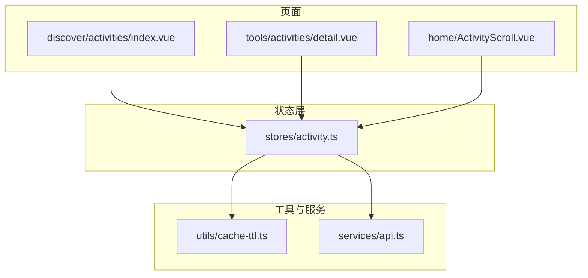
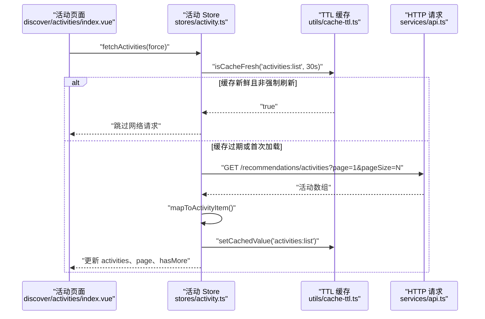
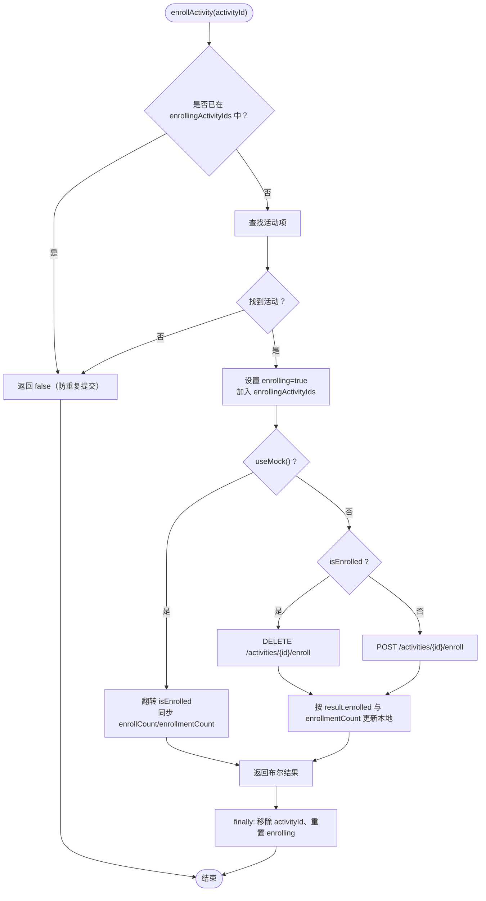
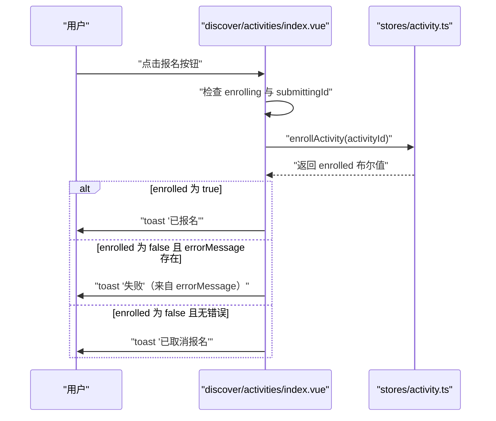
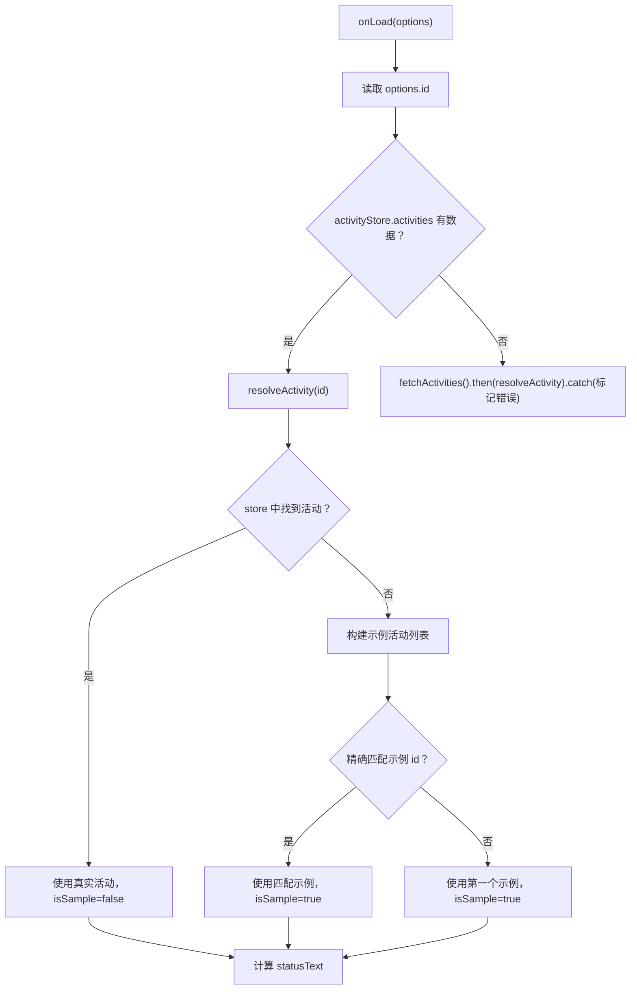
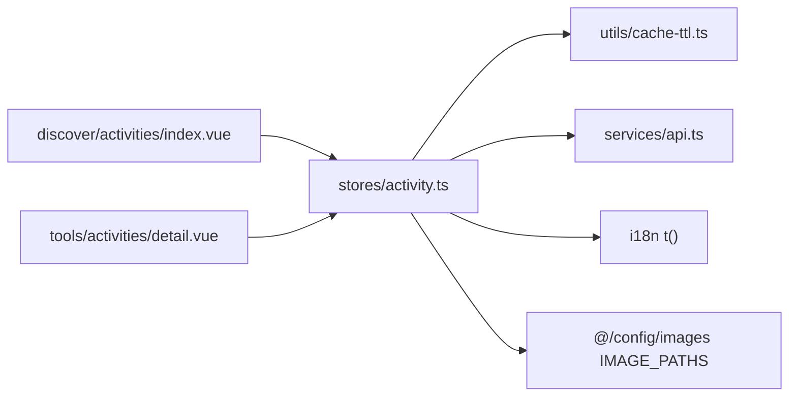

# 活动系统状态

<cite>
**本文引用的文件**
- [apps/client/src/stores/activity.ts](file://apps/client/src/stores/activity.ts)
- [apps/client/src/subpackages/discover/activities/index.vue](file://apps/client/src/subpackages/discover/activities/index.vue)
- [apps/client/src/subpackages/tools/activities/detail.vue](file://apps/client/src/subpackages/tools/activities/detail.vue)
- [apps/client/src/components/home/ActivityScroll.vue](file://apps/client/src/components/home/ActivityScroll.vue)
- [apps/client/src/utils/cache-ttl.ts](file://apps/client/src/utils/cache-ttl.ts)
- [apps/client/src/services/api.ts](file://apps/client/src/services/api.ts)
</cite>

## 目录
1. [引言](#引言)
2. [项目结构](#项目结构)
3. [核心组件](#核心组件)
4. [架构总览](#架构总览)
5. [详细组件分析](#详细组件分析)
6. [依赖关系分析](#依赖关系分析)
7. [性能与缓存策略](#性能与缓存策略)
8. [错误处理与国际化](#错误处理与国际化)
9. [图片资源统一管理](#图片资源统一管理)
10. [扩展点设计](#扩展点设计)
11. [故障排查指南](#故障排查指南)
12. [结论](#结论)

## 引言
本文面向线下活动系统的状态管理，重点解释以下能力：
- 活动列表加载机制、分页策略与 30 秒 TTL 缓存。
- 报名与取消报名的状态流转，包括并发守卫 `enrollingActivityIds` 和报名中 UI 反馈。
- 活动数据映射转换 `mapToActivityItem`、Mock 数据生成逻辑 `relativeDate`。
- 活动状态枚举的业务含义与展示逻辑。
- 错误处理、i18n 国际化支持、图片资源路径统一管理。
- 活动系统的扩展点设计与性能优化策略。

## 项目结构
活动系统相关代码主要分布在客户端小程序应用中，采用“Store + 页面 + 工具模块”的分层组织方式：
- Store 层：`stores/activity.ts` 集中管理活动数据、分页、报名状态、错误信息。
- 页面层：
  - 发现页活动入口：`subpackages/discover/activities/index.vue`。
  - 活动详情页：`subpackages/tools/activities/detail.vue`。
  - 首页活动滚动容器：`components/home/ActivityScroll.vue`。
- 工具层：
  - TTL 缓存：`utils/cache-ttl.ts`。
  - API 封装：`services/api.ts`（提供 request、mock、环境判断等）。

图示来源
- [apps/client/src/stores/activity.ts:150-407](file://apps/client/src/stores/activity.ts#L150-L407)
- [apps/client/src/subpackages/discover/activities/index.vue:1-120](file://apps/client/src/subpackages/discover/activities/index.vue#L1-L120)
- [apps/client/src/subpackages/tools/activities/detail.vue:1-120](file://apps/client/src/subpackages/tools/activities/detail.vue#L1-L120)
- [apps/client/src/components/home/ActivityScroll.vue:1-67](file://apps/client/src/components/home/ActivityScroll.vue#L1-L67)
- [apps/client/src/utils/cache-ttl.ts:1-124](file://apps/client/src/utils/cache-ttl.ts#L1-L124)
- [apps/client/src/services/api.ts:1-120](file://apps/client/src/services/api.ts#L1-L120)

章节来源
- [apps/client/src/stores/activity.ts:1-407](file://apps/client/src/stores/activity.ts#L1-L407)
- [apps/client/src/subpackages/discover/activities/index.vue:1-120](file://apps/client/src/subpackages/discover/activities/index.vue#L1-L120)
- [apps/client/src/subpackages/tools/activities/detail.vue:1-120](file://apps/client/src/subpackages/tools/activities/detail.vue#L1-L120)
- [apps/client/src/components/home/ActivityScroll.vue:1-67](file://apps/client/src/components/home/ActivityScroll.vue#L1-L67)
- [apps/client/src/utils/cache-ttl.ts:1-124](file://apps/client/src/utils/cache-ttl.ts#L1-L124)
- [apps/client/src/services/api.ts:1-120](file://apps/client/src/services/api.ts#L1-L120)

## 核心组件
- 活动 Store：定义 `ActivityItem` 类型、Mock 数据、活动列表获取、加载更多、报名/取消报名、详情拉取、数据映射。
- 发现页活动：负责视图切换、下拉刷新、上拉加载更多、快捷筛选、报名交互提示。
- 活动详情：从 URL 参数解析活动 ID，优先匹配 store 数据，未命中回退示例数据；计算状态文案并触发助手通知。
- TTL 缓存：提供 30s TTL 新鲜度判断、Stale-While-Revalidate 获取、in-flight 去重、清理接口。
- API 服务：提供请求封装、Mock 模式判断、上传、超时控制、错误处理辅助。

章节来源
- [apps/client/src/stores/activity.ts:1-407](file://apps/client/src/stores/activity.ts#L1-L407)
- [apps/client/src/subpackages/discover/activities/index.vue:1-120](file://apps/client/src/subpackages/discover/activities/index.vue#L1-L120)
- [apps/client/src/subpackages/tools/activities/detail.vue:1-120](file://apps/client/src/subpackages/tools/activities/detail.vue#L1-L120)
- [apps/client/src/utils/cache-ttl.ts:1-124](file://apps/client/src/utils/cache-ttl.ts#L1-L124)
- [apps/client/src/services/api.ts:1-120](file://apps/client/src/services/api.ts#L1-L120)

## 架构总览
活动系统的数据流以 Store 为中心，页面通过 Pinia Store 访问和更新活动状态，网络请求统一走 `request`，Mock 模式由 `useMock()` 控制。

图示来源
- [apps/client/src/stores/activity.ts:160-205](file://apps/client/src/stores/activity.ts#L160-L205)
- [apps/client/src/utils/cache-ttl.ts:33-61](file://apps/client/src/utils/cache-ttl.ts#L33-L61)
- [apps/client/src/services/api.ts:1-120](file://apps/client/src/services/api.ts#L1-L120)
- [apps/client/src/subpackages/discover/activities/index.vue:60-95](file://apps/client/src/subpackages/discover/activities/index.vue#L60-L95)

## 详细组件分析

### 活动 Store：状态、分页、报名与映射
- 数据模型：`ActivityItem` 包含 id、title、location、scheduleText、date、enrollCount、description、enrollmentCount、participantAvatars、isEnrolled、status、category、coverImage。
- Mock 数据：使用 `relativeDate(daysFromToday)` 生成相对今天的日期，避免固定日期导致 mock 活动全部显示已结束。
- 列表加载：
  - `fetchActivities(force)`：非 Mock 模式下，若 `!force` 且已有活动数据且 `isCacheFresh('activities:list', 30_000)` 为真，则直接返回；否则调用 `GET /recommendations/activities?page=1&pageSize=N`，成功后写入缓存。
  - `fetchMoreActivities()`：追加分页，向后端传递 `page=nextPage&pageSize=N`，成功才推进 `this.page`，避免失败污染状态。
- 报名/取消报名：
  - `enrollingActivityIds` 集合防止同一活动重复提交。
  - `enrolling` 全局标记用于禁用按钮。
  - Mock 模式就地翻转 `isEnrolled` 并同步 `enrollCount` 与 `enrollmentCount`。
  - Real 模式根据 `isEnrolled` 选择 POST 或 DELETE `/activities/{id}/enroll`，携带幂等键 `Idempotency-Key`，并按后端返回更新本地字段。
- 详情拉取：`fetchActivityDetail(activityId)` 返回 `ActivityItem | null`，失败时设置 `errorMessage`。
- 数据映射：`mapToActivityItem(raw)` 将后端字段对齐到 `ActivityItem`，兼容 `enrollCount` 与 `enrollmentCount` 双字段。

图示来源
- [apps/client/src/stores/activity.ts:252-340](file://apps/client/src/stores/activity.ts#L252-L340)

章节来源
- [apps/client/src/stores/activity.ts:1-407](file://apps/client/src/stores/activity.ts#L1-L407)

### 发现页活动：视图、刷新、加载更多与报名交互
- 视图切换：列表/日历两种模式，切换到日历时重新拉取活动数据。
- 下拉刷新：调用 `fetchActivities(true)`，穿透 30s TTL 强制刷新。
- 上拉加载更多：使用防抖 300ms 的 `debouncedLoadMore`，在 `loading` 或 `hasMore=false` 时短路。
- 报名交互：
  - 点击前检查 `activityStore.enrolling` 和本地 `submittingId`，防止重复点击。
  - 调用 `enrollActivity`，根据返回值与 `errorMessage` 区分“已取消报名”与“失败”，分别 toast 提示。
- 快捷筛选：按 scheduleText 文本关键字过滤“今天/周末”。

图示来源
- [apps/client/src/subpackages/discover/activities/index.vue:80-120](file://apps/client/src/subpackages/discover/activities/index.vue#L80-L120)
- [apps/client/src/stores/activity.ts:252-340](file://apps/client/src/stores/activity.ts#L252-L340)

章节来源
- [apps/client/src/subpackages/discover/activities/index.vue:1-120](file://apps/client/src/subpackages/discover/activities/index.vue#L1-L120)
- [apps/client/src/stores/activity.ts:252-340](file://apps/client/src/stores/activity.ts#L252-L340)

### 活动详情页：数据匹配、状态文案与示例回退
- 从 URL 参数读取 `id`，优先从 `activityStore.activities` 匹配真实活动；未命中则回退内置示例活动。
- 示例活动标题、地点、时间等文案全部来自 i18n `activities.sample.*`，封面复用 `IMAGE_PATHS.ACTIVITIES.*`。
- 状态文案计算：open→报名中，ongoing→进行中，ended/closed→已结束，其余→预告。
- 报名成功后向本地助手会话追加通知消息。

图示来源
- [apps/client/src/subpackages/tools/activities/detail.vue:1-120](file://apps/client/src/subpackages/tools/activities/detail.vue#L1-L120)

章节来源
- [apps/client/src/subpackages/tools/activities/detail.vue:1-200](file://apps/client/src/subpackages/tools/activities/detail.vue#L1-L200)

### 首页活动滚动容器：骨架屏与卡片展示
- 接收 `items`、`loading` 属性。
- loading 时渲染骨架占位卡片，非 loading 时渲染 `ActivityCard`。
- 仅负责展示，不持有业务状态。

章节来源
- [apps/client/src/components/home/ActivityScroll.vue:1-67](file://apps/client/src/components/home/ActivityScroll.vue#L1-L67)

### 活动数据映射与 Mock 日期生成
- `mapToActivityItem(raw)`：
  - 对齐 `date`、`enrollCount`/`enrollmentCount`、`participantAvatars`、`isEnrolled`、`category`、`coverImage`。
  - 保证 UI 消费端与 API 消费端字段一致性。
- `relativeDate(daysFromToday)`：
  - 基于当天日期偏移生成 ISO 格式的 YYYY-MM-DD 字符串。
  - 解决固定日期导致 mock 活动全部显示已过期的问题。

章节来源
- [apps/client/src/stores/activity.ts:36-120](file://apps/client/src/stores/activity.ts#L36-L120)
- [apps/client/src/stores/activity.ts:374-407](file://apps/client/src/stores/activity.ts#L374-L407)

### 活动状态枚举：业务含义与展示逻辑
- open：报名中。
- ongoing：进行中。
- upcoming：预告。
- ended：已结束。
- closed：已关闭。

展示逻辑：
- 详情页计算 `statusText`：open→“报名中”，ongoing→“进行中”，ended/closed→“已结束”，其他→“预告”。
- 列表/卡片可通过 status 字段决定标签样式与文案。

章节来源
- [apps/client/src/stores/activity.ts:36-36](file://apps/client/src/stores/activity.ts#L36-L36)
- [apps/client/src/subpackages/tools/activities/detail.vue:140-180](file://apps/client/src/subpackages/tools/activities/detail.vue#L140-L180)

## 依赖关系分析
活动 Store 依赖：
- `useMock()`：判断是否为 Mock 模式。
- `request`：统一 HTTP 请求封装。
- `isCacheFresh`/`setCachedValue`：TTL 缓存工具。
- `t`：i18n 翻译函数。
- `IMAGE_PATHS`：图片资源路径常量。

页面依赖：
- discover 活动页依赖 Store、i18n、导航、防抖工具、图片常量。
- 活动详情页依赖 Store、i18n、图片常量、助手通知工具。

图示来源
- [apps/client/src/stores/activity.ts:1-20](file://apps/client/src/stores/activity.ts#L1-L20)
- [apps/client/src/subpackages/discover/activities/index.vue:1-40](file://apps/client/src/subpackages/discover/activities/index.vue#L1-L40)
- [apps/client/src/subpackages/tools/activities/detail.vue:1-40](file://apps/client/src/subpackages/tools/activities/detail.vue#L1-L40)

章节来源
- [apps/client/src/stores/activity.ts:1-20](file://apps/client/src/stores/activity.ts#L1-L20)
- [apps/client/src/subpackages/discover/activities/index.vue:1-40](file://apps/client/src/subpackages/discover/activities/index.vue#L1-L40)
- [apps/client/src/subpackages/tools/activities/detail.vue:1-40](file://apps/client/src/subpackages/tools/activities/detail.vue#L1-L40)

## 性能与缓存策略
- 30 秒 TTL 缓存：
  - 键名：`activities:list`。
  - 新鲜度窗口：30,000 ms。
  - 行为：TTL 内直接返回缓存，不触发网络；过期后后台刷新，实现 Stale-While-Revalidate。
  - 并发保护：同 key 的多次请求共享一个进行中的 Promise，避免重复网络请求。
- 下拉刷新强制穿透 TTL：传入 `force=true`，绕过缓存短路，确保刷新体验。
- 分页优化：
  - 首次加载与加载更多统一使用 `?page=N&pageSize=M`。
  - 加载更多仅在 `!loading && hasMore` 时执行，并添加 300ms 防抖，避免滑动风暴。
- 状态短路：
  - `enrollingActivityIds` 防止同一活动重复提交。
  - `enrolling` 全局禁用报名按钮，避免跨活动的并发误操作。

章节来源
- [apps/client/src/utils/cache-ttl.ts:1-124](file://apps/client/src/utils/cache-ttl.ts#L1-L124)
- [apps/client/src/stores/activity.ts:160-205](file://apps/client/src/stores/activity.ts#L160-L205)
- [apps/client/src/stores/activity.ts:211-249](file://apps/client/src/stores/activity.ts#L211-L249)
- [apps/client/src/subpackages/discover/activities/index.vue:60-95](file://apps/client/src/subpackages/discover/activities/index.vue#L60-L95)
- [apps/client/src/stores/activity.ts:252-340](file://apps/client/src/stores/activity.ts#L252-L340)

## 错误处理与国际化
- 错误信息存储：Store 维护 `errorMessage`，供页面读取并 toast 提示。
- 错误来源：
  - 加载活动失败：`loadActivitiesFailed`。
  - 加载更多失败：`loadMoreFailed`。
  - 报名失败：`registerFailed`。
  - 详情加载失败：`loadDetailFailed`。
- 国际化：所有错误文案与活动状态文案均通过 `t(...)` 获取，便于多语言切换。
- 页面侧错误呈现：
  - 活动详情页记录 `loadError` 并提供重试按钮。
  - 活动列表页根据 `enrolled=false` 与 `errorMessage` 存在与否区分“已取消报名”与“失败”。

章节来源
- [apps/client/src/stores/activity.ts:190-205](file://apps/client/src/stores/activity.ts#L190-L205)
- [apps/client/src/stores/activity.ts:231-249](file://apps/client/src/stores/activity.ts#L231-L249)
- [apps/client/src/stores/activity.ts:315-340](file://apps/client/src/stores/activity.ts#L315-L340)
- [apps/client/src/stores/activity.ts:360-370](file://apps/client/src/stores/activity.ts#L360-L370)
- [apps/client/src/subpackages/discover/activities/index.vue:80-120](file://apps/client/src/subpackages/discover/activities/index.vue#L80-L120)
- [apps/client/src/subpackages/tools/activities/detail.vue:100-160](file://apps/client/src/subpackages/tools/activities/detail.vue#L100-L160)

## 图片资源统一管理
- 所有图片路径通过 `IMAGE_PATHS` 常量引用，避免硬编码字符串。
- 活动封面图使用 `IMAGE_PATHS.ACTIVITIES.*`。
- 图标使用 `IMAGE_PATHS.ICONS_EMOJI.*` 与 `IMAGE_PATHS.ICONS_COMMON.*`。
- 详情页与活动列表页均复用该常量体系，保证素材替换一致。

章节来源
- [apps/client/src/stores/activity.ts:12-18](file://apps/client/src/stores/activity.ts#L12-L18)
- [apps/client/src/subpackages/discover/activities/index.vue:18-30](file://apps/client/src/subpackages/discover/activities/index.vue#L18-L30)
- [apps/client/src/subpackages/tools/activities/detail.vue:20-40](file://apps/client/src/subpackages/tools/activities/detail.vue#L20-L40)

## 扩展点设计
- 新增活动状态：
  - 在 `ActivityItem.status` 联合类型中增加新状态。
  - 在详情页 `statusText` 计算逻辑中补充文案映射。
- 新增分页字段或排序规则：
  - 在 `fetchActivities` 与 `fetchMoreActivities` 的请求参数中添加字段。
  - 保持首次加载与加载更多参数一致。
- 新增 Mock 数据：
  - 在 `mockActivities` 中追加条目，使用 `relativeDate` 生成日期。
- 新增图片资源：
  - 在 `IMAGE_PATHS` 中补充路径常量，并在页面与 Store 中引用。
- 新增错误文案：
  - 在 i18n 配置中增加对应 key，并在 Store 的错误分支中使用 `t(...)` 引用。

章节来源
- [apps/client/src/stores/activity.ts:36-36](file://apps/client/src/stores/activity.ts#L36-L36)
- [apps/client/src/stores/activity.ts:160-205](file://apps/client/src/stores/activity.ts#L160-L205)
- [apps/client/src/stores/activity.ts:211-249](file://apps/client/src/stores/activity.ts#L211-L249)
- [apps/client/src/stores/activity.ts:36-120](file://apps/client/src/stores/activity.ts#L36-L120)
- [apps/client/src/subpackages/tools/activities/detail.vue:140-180](file://apps/client/src/subpackages/tools/activities/detail.vue#L140-L180)

## 故障排查指南
- 活动列表不刷新：
  - 检查是否被 30s TTL 短路；下拉刷新需传 `force=true`。
  - 确认 `isCacheFresh('activities:list', 30_000)` 行为是否符合预期。
- 加载更多无效：
  - 检查 `hasMore` 是否为真。
  - 检查 `loading` 是否阻止了重复请求。
  - 确认分页参数 `page` 是否正确递增并传给后端。
- 报名重复提交：
  - 检查 `enrollingActivityIds` 是否包含目标活动 ID。
  - 检查 `enrolling` 是否仍为真。
- 报名计数不一致：
  - 确认 `enrollCount` 与 `enrollmentCount` 同步更新。
  - Mock 与 Real 分支均需保持两字段一致。
- 详情页未匹配活动：
  - 检查 URL 参数 `id` 是否与 store 中活动 id 一致。
  - 未命中会回退示例活动，确认 `isSample` 标志与示例列表。
- 错误提示未显示：
  - 检查 Store 的 `errorMessage` 是否被正确设置。
  - 页面侧是否读取并 toast 该错误信息。

章节来源
- [apps/client/src/stores/activity.ts:160-205](file://apps/client/src/stores/activity.ts#L160-L205)
- [apps/client/src/stores/activity.ts:211-249](file://apps/client/src/stores/activity.ts#L211-L249)
- [apps/client/src/stores/activity.ts:252-340](file://apps/client/src/stores/activity.ts#L252-L340)
- [apps/client/src/subpackages/tools/activities/detail.vue:100-160](file://apps/client/src/subpackages/tools/activities/detail.vue#L100-L160)
- [apps/client/src/subpackages/discover/activities/index.vue:80-120](file://apps/client/src/subpackages/discover/activities/index.vue#L80-L120)

## 结论
活动系统通过 Store 集中管理状态，结合 30s TTL 缓存与分页策略，在保证用户体验的同时减少不必要的网络请求。报名流程通过并发守卫与全局标志防止重复提交，并以 i18n 与图片常量统一错误文案与素材路径。详情页提供示例回退与状态文案映射，增强容错性与可维护性。整体架构清晰、扩展点明确，适合继续迭代活动分类、状态扩展与更多交互场景。