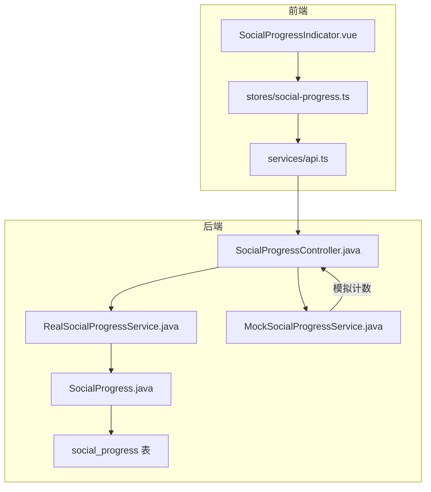
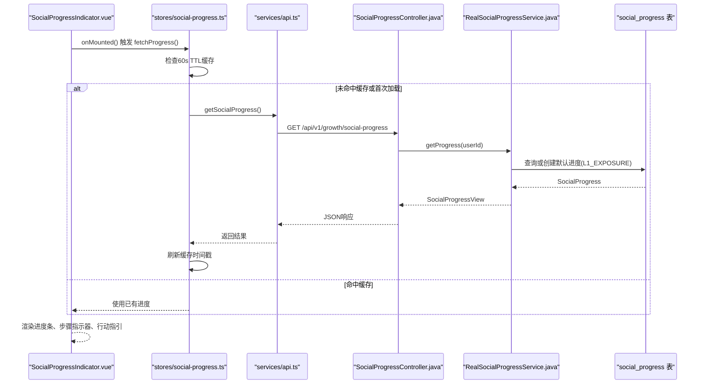
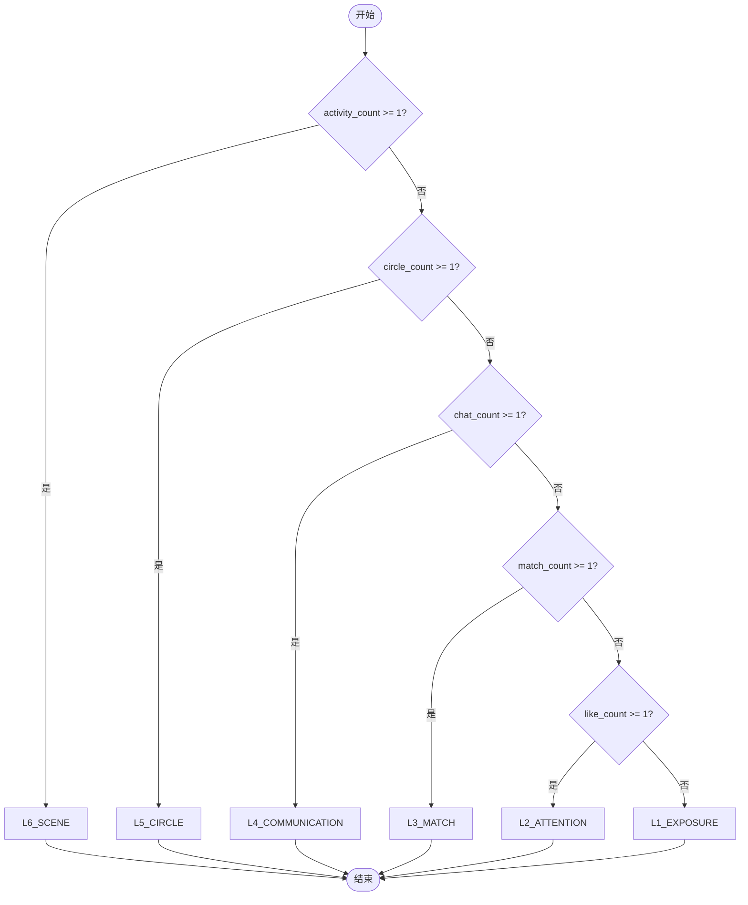
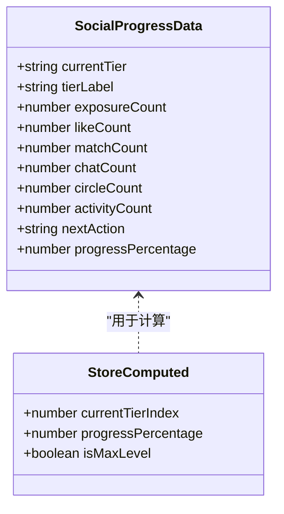
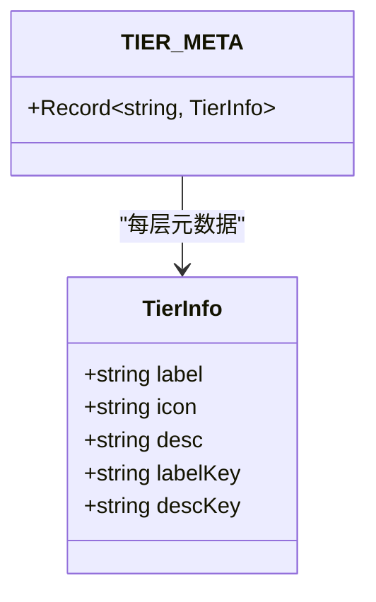
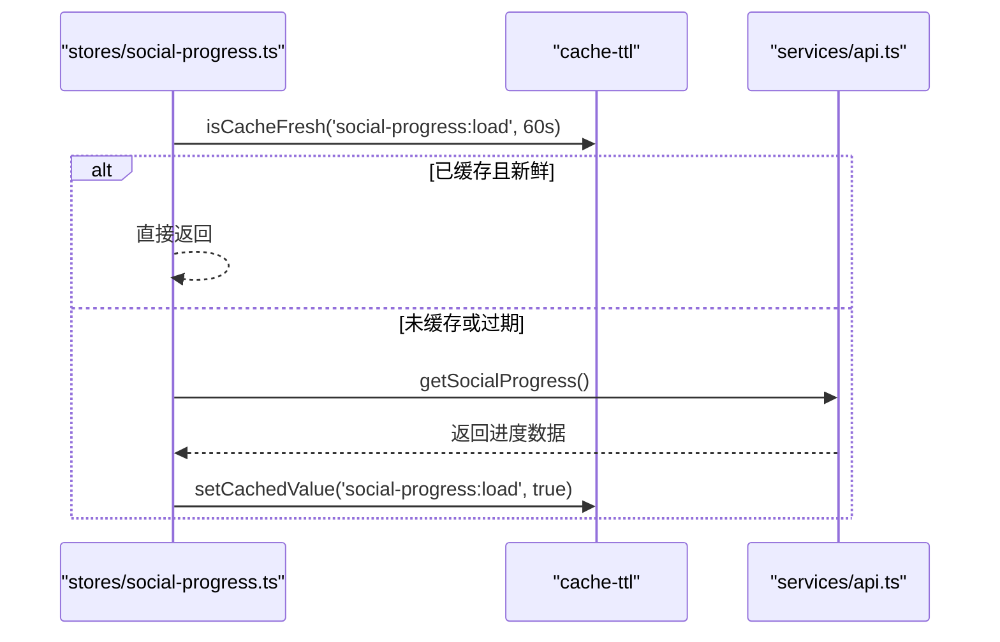
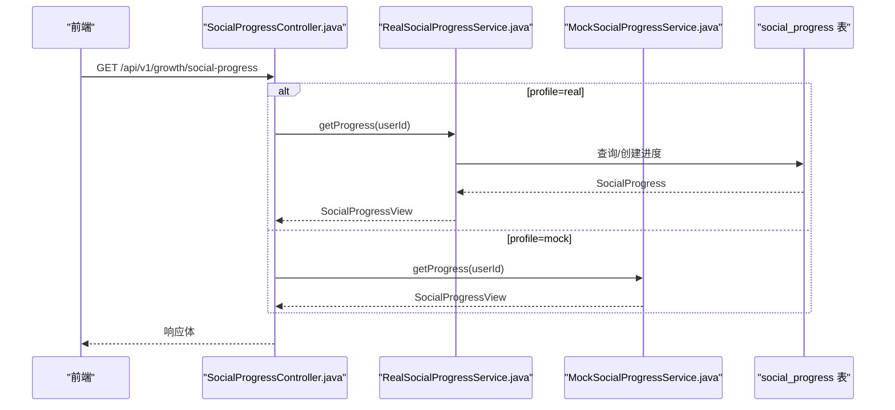
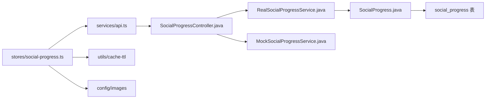

# 社交进度系统状态

<cite>
**本文引用的文件列表**
- [social-progress.ts](file://apps/client/src/stores/social-progress.ts)
- [SocialProgressIndicator.vue](file://apps/client/src/components/social/SocialProgressIndicator.vue)
- [api.ts](file://apps/client/src/services/api.ts)
- [RealSocialProgressService.java](file://apps/api/src/main/java/com/campuslove/api/growth/RealSocialProgressService.java)
- [MockSocialProgressService.java](file://apps/api/src/main/java/com/campuslove/api/growth/MockSocialProgressService.java)
- [SocialProgressController.java](file://apps/api/src/main/java/com/campuslove/api/growth/SocialProgressController.java)
- [SocialProgress.java](file://apps/api/src/main/java/com/campuslove/api/entity/SocialProgress.java)
- [V2026.05.28.0002__create_social_progress.sql](file://database/flyway/sql/V2026.05.28.0002__create_social_progress.sql)
- [social-progress.spec.ts](file://apps/client/src/tests/stores/social-progress.spec.ts)
</cite>

## 目录
1. [简介](#简介)
2. [项目结构](#项目结构)
3. [核心组件](#核心组件)
4. [架构总览](#架构总览)
5. [详细组件分析](#详细组件分析)
6. [依赖关系分析](#依赖关系分析)
7. [性能考量](#性能考量)
8. [故障排查指南](#故障排查指南)
9. [结论](#结论)
10. [附录](#附录)

## 简介
本技术文档围绕“社交升温进度系统”的状态管理展开，重点说明从曝光到线下见面的6层升温路径（L1_EXPOSURE、L2_ATTENTION、L3_MATCH、L4_COMMUNICATION、L5_CIRCLE、L6_SCENE）的设计与业务逻辑，并深入解析客户端 Store 中的 SocialProgressData 数据结构、层级元数据 TIER_META 的配置化管理、进度数据的获取机制（含60秒TTL缓存与Mock模式切换）、计算属性实现（currentTierIndex、progressPercentage、isMaxLevel），以及与用户行为追踪的集成方式。同时提供可视化组件接口设计与扩展建议，帮助开发者快速理解并扩展该子系统。

## 项目结构
社交升温进度系统由前端 Pinia Store、UI 指示器组件、API 服务封装以及后端服务与实体构成，前后端通过 RESTful API 交互。

图表来源
- [SocialProgressIndicator.vue:1-200](file://apps/client/src/components/social/SocialProgressIndicator.vue#L1-L200)
- [social-progress.ts:1-200](file://apps/client/src/stores/social-progress.ts#L1-L200)
- [api.ts:684-699](file://apps/client/src/services/api.ts#L684-L699)
- [SocialProgressController.java:1-41](file://apps/api/src/main/java/com/campuslove/api/growth/SocialProgressController.java#L1-L41)
- [RealSocialProgressService.java:1-200](file://apps/api/src/main/java/com/campuslove/api/growth/RealSocialProgressService.java#L1-L200)
- [MockSocialProgressService.java:1-172](file://apps/api/src/main/java/com/campuslove/api/growth/MockSocialProgressService.java#L1-L172)
- [SocialProgress.java:1-187](file://apps/api/src/main/java/com/campuslove/api/entity/SocialProgress.java#L1-L187)
- [V2026.05.28.0002__create_social_progress.sql:1-20](file://database/flyway/sql/V2026.05.28.0002__create_social_progress.sql#L1-L20)

章节来源
- [SocialProgressIndicator.vue:1-200](file://apps/client/src/components/social/SocialProgressIndicator.vue#L1-L200)
- [social-progress.ts:1-200](file://apps/client/src/stores/social-progress.ts#L1-L200)
- [api.ts:684-699](file://apps/client/src/services/api.ts#L684-L699)
- [SocialProgressController.java:1-41](file://apps/api/src/main/java/com/campuslove/api/growth/SocialProgressController.java#L1-L41)
- [RealSocialProgressService.java:1-200](file://apps/api/src/main/java/com/campuslove/api/growth/RealSocialProgressService.java#L1-L200)
- [MockSocialProgressService.java:1-172](file://apps/api/src/main/java/com/campuslove/api/growth/MockSocialProgressService.java#L1-L172)
- [SocialProgress.java:1-187](file://apps/api/src/main/java/com/campuslove/api/entity/SocialProgress.java#L1-L187)
- [V2026.05.28.0002__create_social_progress.sql:1-20](file://database/flyway/sql/V2026.05.28.0002__create_social_progress.sql#L1-L20)

## 核心组件
- 前端 Store：负责状态管理、数据获取（Mock/Real）、TTL缓存、计算属性与导出方法。
- 前端组件：展示6步漏斗进度、当前层级高亮卡片、行动指引卡片，支持i18n与无障碍标签。
- 后端控制器与服务：暴露REST端点，提供真实或模拟的社交进度查询与事件记录。
- 数据实体与数据库：持久化用户社交进度与计数，使用乐观锁保证并发安全。

章节来源
- [social-progress.ts:1-211](file://apps/client/src/stores/social-progress.ts#L1-L211)
- [SocialProgressIndicator.vue:1-779](file://apps/client/src/components/social/SocialProgressIndicator.vue#L1-L779)
- [SocialProgressController.java:1-41](file://apps/api/src/main/java/com/campuslove/api/growth/SocialProgressController.java#L1-L41)
- [RealSocialProgressService.java:1-325](file://apps/api/src/main/java/com/campuslove/api/growth/RealSocialProgressService.java#L1-L325)
- [MockSocialProgressService.java:1-172](file://apps/api/src/main/java/com/campuslove/api/growth/MockSocialProgressService.java#L1-L172)
- [SocialProgress.java:1-187](file://apps/api/src/main/java/com/campuslove/api/entity/SocialProgress.java#L1-L187)
- [V2026.05.28.0002__create_social_progress.sql:1-20](file://database/flyway/sql/V2026.05.28.0002__create_social_progress.sql#L1-L20)

## 架构总览
系统采用前后端分离架构：前端通过 Store 发起请求或读取本地 Mock 数据，渲染6层升温进度；后端在 real 模式下基于数据库维护进度，在 mock 模式下使用内存计数器模拟升级行为。

图表来源
- [SocialProgressIndicator.vue:1-200](file://apps/client/src/components/social/SocialProgressIndicator.vue#L1-L200)
- [social-progress.ts:1-200](file://apps/client/src/stores/social-progress.ts#L1-L200)
- [api.ts:684-699](file://apps/client/src/services/api.ts#L684-L699)
- [SocialProgressController.java:1-41](file://apps/api/src/main/java/com/campuslove/api/growth/SocialProgressController.java#L1-L41)
- [RealSocialProgressService.java:1-200](file://apps/api/src/main/java/com/campuslove/api/growth/RealSocialProgressService.java#L1-L200)
- [V2026.05.28.0002__create_social_progress.sql:1-20](file://database/flyway/sql/V2026.05.28.0002__create_social_progress.sql#L1-L20)

## 详细组件分析

### 6层升温路径设计与业务规则
- L1_EXPOSURE（发现心动）：默认层级，代表用户进入推荐流并获得曝光。
- L2_ATTENTION（表达喜欢）：当 like_count >= 1 时升级。
- L3_MATCH（双向匹配）：当 match_count >= 1 时升级。
- L4_COMMUNICATION（开启对话）：当 chat_count >= 1 时升级。
- L5_CIRCLE（参与社区）：当 circle_count >= 1 时升级。
- L6_SCENE（线下见面）：当 activity_count >= 1 时升级。

层级判断在后端按从高到低评估，确保满足最高层级生效；层级仅升不降。

图表来源
- [RealSocialProgressService.java:201-325](file://apps/api/src/main/java/com/campuslove/api/growth/RealSocialProgressService.java#L201-L325)

章节来源
- [RealSocialProgressService.java:1-325](file://apps/api/src/main/java/com/campuslove/api/growth/RealSocialProgressService.java#L1-L325)
- [MockSocialProgressService.java:1-172](file://apps/api/src/main/java/com/campuslove/api/growth/MockSocialProgressService.java#L1-L172)

### SocialProgressData 数据结构与计算属性
- 字段定义：包括 currentTier、tierLabel、exposureCount、likeCount、matchCount、chatCount、circleCount、activityCount、nextAction、progressPercentage。
- 计算属性：
  - currentTierIndex：根据 currentTier 在有序层级列表中的索引。
  - progressPercentage：直接取自进度对象的百分比字段。
  - isMaxLevel：判断当前层级是否为列表最后一项。

这些计算属性在前端 Store 中通过 computed 实现，并在测试中验证其初始值与加载后的行为。

图表来源
- [social-progress.ts:1-200](file://apps/client/src/stores/social-progress.ts#L1-L200)
- [social-progress.spec.ts:1-190](file://apps/client/src/tests/stores/social-progress.spec.ts#L1-L190)

章节来源
- [social-progress.ts:1-211](file://apps/client/src/stores/social-progress.ts#L1-L211)
- [social-progress.spec.ts:1-190](file://apps/client/src/tests/stores/social-progress.spec.ts#L1-L190)

### 层级元数据 TIER_META 配置化管理
- 每个层级包含 label、icon、desc，以及 i18n key（labelKey、descKey）。
- 图标资源统一从 IMAGE_PATHS 引入，避免硬编码路径。
- 组件通过 TIER_META 的 labelKey/descKey 调用 t() 渲染，确保多语言一致性。

图表来源
- [social-progress.ts:1-200](file://apps/client/src/stores/social-progress.ts#L1-L200)
- [SocialProgressIndicator.vue:1-200](file://apps/client/src/components/social/SocialProgressIndicator.vue#L1-L200)

章节来源
- [social-progress.ts:1-200](file://apps/client/src/stores/social-progress.ts#L1-L200)
- [SocialProgressIndicator.vue:1-200](file://apps/client/src/components/social/SocialProgressIndicator.vue#L1-L200)

### 进度数据获取机制（60秒TTL缓存与Mock模式）
- 首次加载或缓存过期时，Store 调用 clientApi.getSocialProgress()。
- 若启用 Mock，则返回本地 MOCK_PROGRESS。
- Real 模式拉取成功后更新缓存时间戳，60秒内重复请求将跳过网络调用。
- 错误处理：捕获异常并设置 errorMessage，保留现有进度数据。

图表来源
- [social-progress.ts:1-200](file://apps/client/src/stores/social-progress.ts#L1-L200)
- [api.ts:684-699](file://apps/client/src/services/api.ts#L684-L699)

章节来源
- [social-progress.ts:1-200](file://apps/client/src/stores/social-progress.ts#L1-L200)
- [api.ts:684-699](file://apps/client/src/services/api.ts#L684-L699)

### 后端服务与控制器
- Controller 暴露 GET /api/v1/growth/social-progress，从 JWT 上下文获取 userId。
- Real 服务实现读写事务，自动创建默认进度（L1_EXPOSURE），并按计数评估升级。
- Mock 服务使用内存计数器模拟各维度计数及层级升级。

图表来源
- [SocialProgressController.java:1-41](file://apps/api/src/main/java/com/campuslove/api/growth/SocialProgressController.java#L1-L41)
- [RealSocialProgressService.java:1-200](file://apps/api/src/main/java/com/campuslove/api/growth/RealSocialProgressService.java#L1-L200)
- [MockSocialProgressService.java:1-172](file://apps/api/src/main/java/com/campuslove/api/growth/MockSocialProgressService.java#L1-L172)
- [V2026.05.28.0002__create_social_progress.sql:1-20](file://database/flyway/sql/V2026.05.28.0002__create_social_progress.sql#L1-L20)

章节来源
- [SocialProgressController.java:1-41](file://apps/api/src/main/java/com/campuslove/api/growth/SocialProgressController.java#L1-L41)
- [RealSocialProgressService.java:1-325](file://apps/api/src/main/java/com/campuslove/api/growth/RealSocialProgressService.java#L1-L325)
- [MockSocialProgressService.java:1-172](file://apps/api/src/main/java/com/campuslove/api/growth/MockSocialProgressService.java#L1-L172)

### 进度系统与用户行为追踪集成
- 曝光：recordExposure 递增 exposureCount，并更新时间戳。
- 喜欢：recordLike 递增 likeCount，评估是否升级到 L2。
- 匹配：recordMatch 递增 matchCount，评估是否升级到 L3。
- 聊天：recordChat 递增 chatCount，评估是否升级到 L4。
- 社区：recordCircleActivity 递增 circleCount，评估是否升级到 L5。
- 活动：recordActivityParticipation 递增 activityCount，评估是否升级到 L6。

所有写操作均带事务控制，避免在只读事务中执行写入导致的异常。

章节来源
- [RealSocialProgressService.java:1-325](file://apps/api/src/main/java/com/campuslove/api/growth/RealSocialProgressService.java#L1-L325)

### 进度可视化组件接口与扩展
- 组件暴露：actionCardAria、stepAriaLabel 用于无障碍与自动化测试。
- 数据来源：绑定 Store 的 progress、loading、currentTierIndex、progressPercentage、isMaxLevel。
- 国际化：通过 TIER_META 的 labelKey/descKey 与 action 配置键进行 i18n。
- 扩展机制：
  - 新增层级：在 TIER_ORDER 添加新标识，并在 TIER_META 补充元数据。
  - 自定义行动指引：在 TIER_ACTIONS 中添加 path、titleKey、descKey、btnKey。
  - 样式扩展：调整 FUNNEL_COLORS/FUNNEL_TEXT_COLORS 以适配新层级视觉。

章节来源
- [SocialProgressIndicator.vue:1-779](file://apps/client/src/components/social/SocialProgressIndicator.vue#L1-L779)
- [social-progress.ts:1-200](file://apps/client/src/stores/social-progress.ts#L1-L200)

## 依赖关系分析
- 前端 Store 依赖：
  - Pinia 状态管理、Vue 响应式 API。
  - services/api.ts 的 getSocialProgress。
  - utils/cache-ttl 的 TTL 缓存工具。
  - config/images 的图标资源。
- 后端服务依赖：
  - Spring Profile 控制 real/mock 实现。
  - JPA Repository 与 Entity 映射。
  - Flyway 迁移脚本创建 social_progress 表。

图表来源
- [social-progress.ts:1-200](file://apps/client/src/stores/social-progress.ts#L1-L200)
- [api.ts:684-699](file://apps/client/src/services/api.ts#L684-L699)
- [SocialProgressController.java:1-41](file://apps/api/src/main/java/com/campuslove/api/growth/SocialProgressController.java#L1-L41)
- [RealSocialProgressService.java:1-200](file://apps/api/src/main/java/com/campuslove/api/growth/RealSocialProgressService.java#L1-L200)
- [MockSocialProgressService.java:1-172](file://apps/api/src/main/java/com/campuslove/api/growth/MockSocialProgressService.java#L1-L172)
- [SocialProgress.java:1-187](file://apps/api/src/main/java/com/campuslove/api/entity/SocialProgress.java#L1-L187)
- [V2026.05.28.0002__create_social_progress.sql:1-20](file://database/flyway/sql/V2026.05.28.0002__create_social_progress.sql#L1-L20)

章节来源
- [social-progress.ts:1-200](file://apps/client/src/stores/social-progress.ts#L1-L200)
- [api.ts:684-699](file://apps/client/src/services/api.ts#L684-L699)
- [SocialProgressController.java:1-41](file://apps/api/src/main/java/com/campuslove/api/growth/SocialProgressController.java#L1-L41)
- [RealSocialProgressService.java:1-325](file://apps/api/src/main/java/com/campuslove/api/growth/RealSocialProgressService.java#L1-L325)
- [MockSocialProgressService.java:1-172](file://apps/api/src/main/java/com/campuslove/api/growth/MockSocialProgressService.java#L1-L172)
- [SocialProgress.java:1-187](file://apps/api/src/main/java/com/campuslove/api/entity/SocialProgress.java#L1-L187)
- [V2026.05.28.0002__create_social_progress.sql:1-20](file://database/flyway/sql/V2026.05.28.0002__create_social_progress.sql#L1-L20)

## 性能考量
- 60秒TTL缓存显著减少重复请求，提升首屏渲染速度。
- 仅在缓存失效或首次加载时发起网络请求，降低服务器压力。
- Mock 模式适合开发调试，避免依赖后端。
- 后端使用独立事务记录埋点，避免外层只读事务导致的异常。

[本节为通用性能指导，无需特定文件引用]

## 故障排查指南
- 前端加载失败：
  - 检查 errorMessage 是否为空，确认网络请求是否正确。
  - 确认 useMock() 配置是否符合预期（开发/联调阶段可切换）。
  - 查看缓存是否过期，必要时清空缓存重试。
- 后端404：
  - 确认 Controller 已注册端点 /api/v1/growth/social-progress。
  - 确认 JWT 认证上下文能正确提取 userId。
- 事务异常：
  - 确认 record* 方法使用 REQUIRES_NEW 或 @Transactional，避免只读事务写入。
- 数据不一致：
  - 检查 optimistic lock version 冲突，必要时重试或提示用户。

章节来源
- [social-progress.ts:1-200](file://apps/client/src/stores/social-progress.ts#L1-L200)
- [SocialProgressController.java:1-41](file://apps/api/src/main/java/com/campuslove/api/growth/SocialProgressController.java#L1-L41)
- [RealSocialProgressService.java:1-200](file://apps/api/src/main/java/com/campuslove/api/growth/RealSocialProgressService.java#L1-L200)

## 结论
社交升温进度系统通过清晰的6层漏斗模型、完善的 Store 状态管理、灵活的可视化组件与稳健的后端服务，实现了从曝光到线下见面的全链路进度追踪。TIER_META 的多语言与图标资源配置提升了可扩展性，60秒TTL缓存优化了性能。建议在后续迭代中持续完善行为埋点、丰富行动指引，并加强错误监控与用户体验反馈。

[本节为总结性内容，无需特定文件引用]

## 附录
- 数据库表结构参考：social_progress 表包含用户ID、当前层级、各维度计数、审计字段与乐观锁版本。
- 单元测试覆盖：Store 的初始状态、加载时序、计算属性与静态配置均已覆盖。

章节来源
- [V2026.05.28.0002__create_social_progress.sql:1-20](file://database/flyway/sql/V2026.05.28.0002__create_social_progress.sql#L1-L20)
- [social-progress.spec.ts:1-190](file://apps/client/src/tests/stores/social-progress.spec.ts#L1-L190)