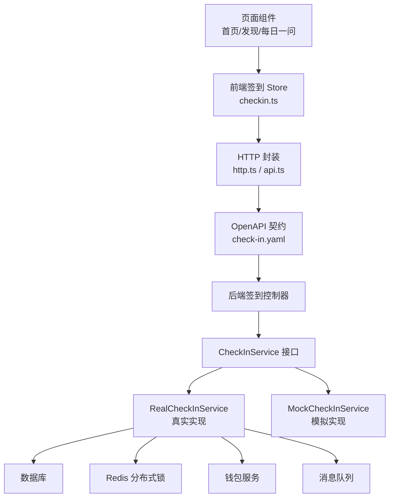
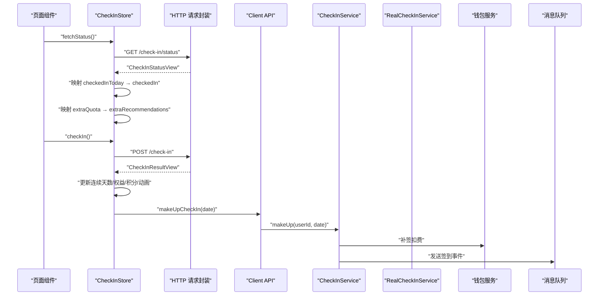
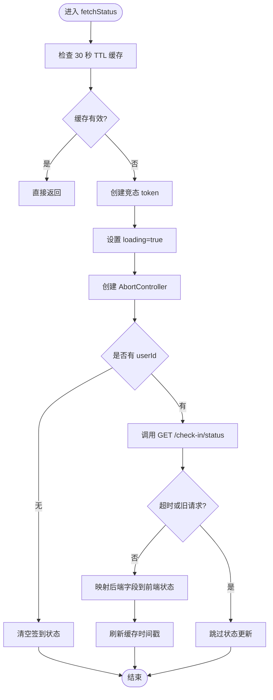
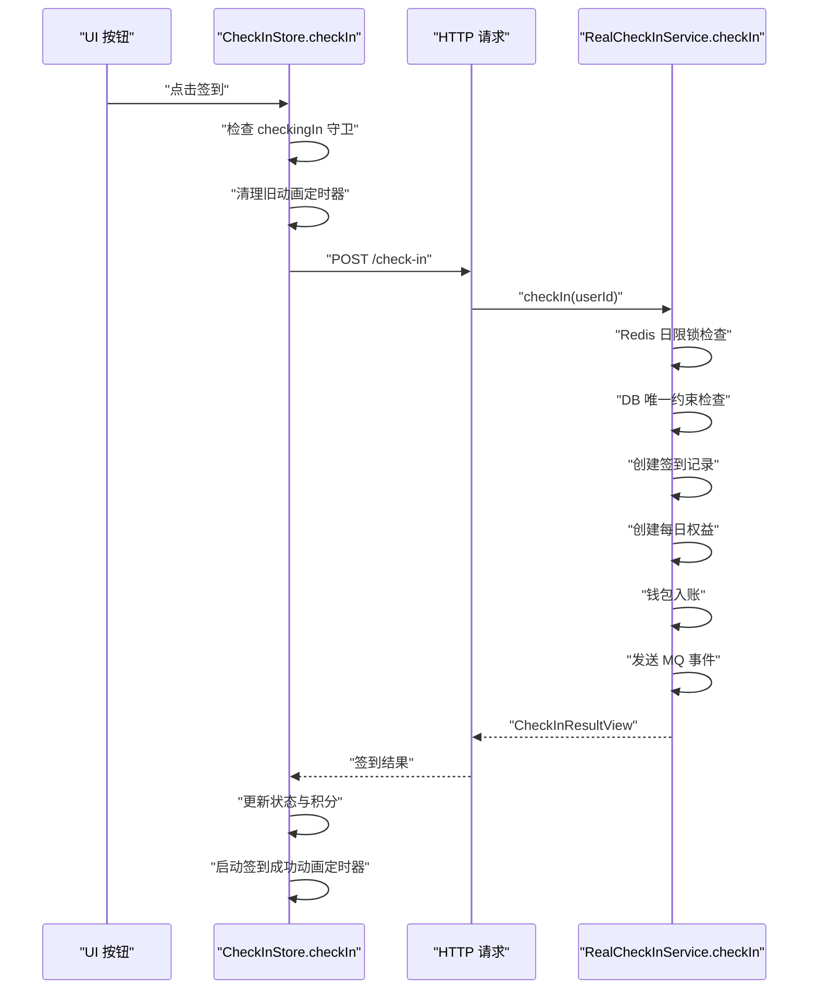
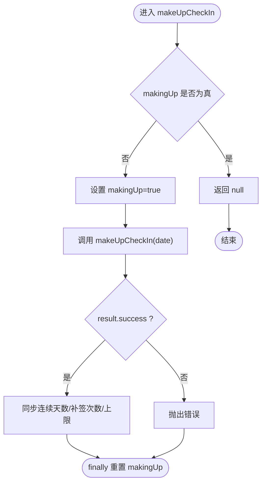
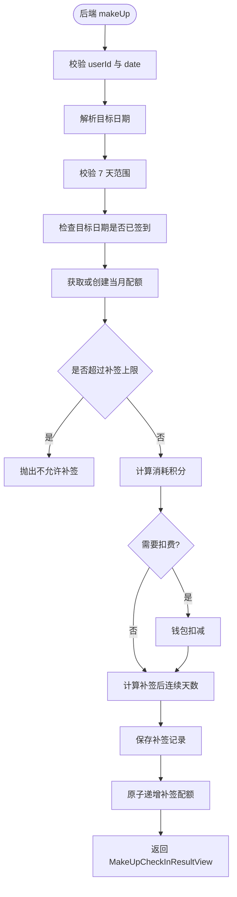
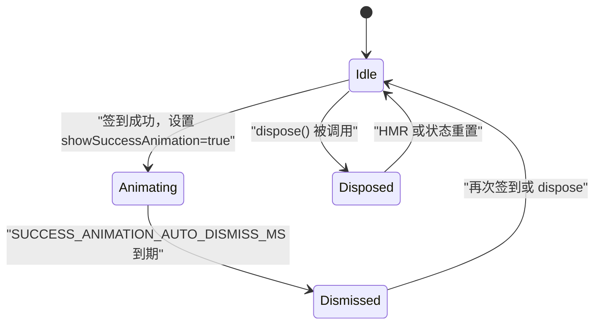
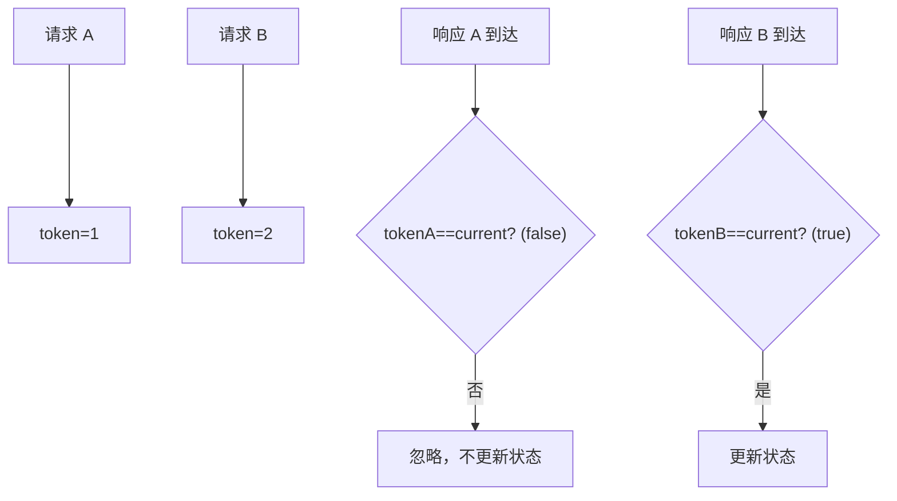
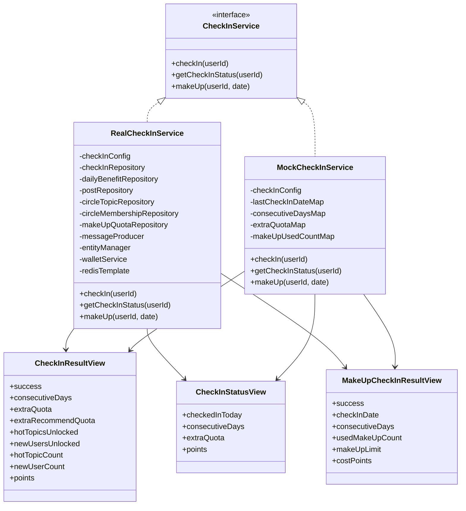
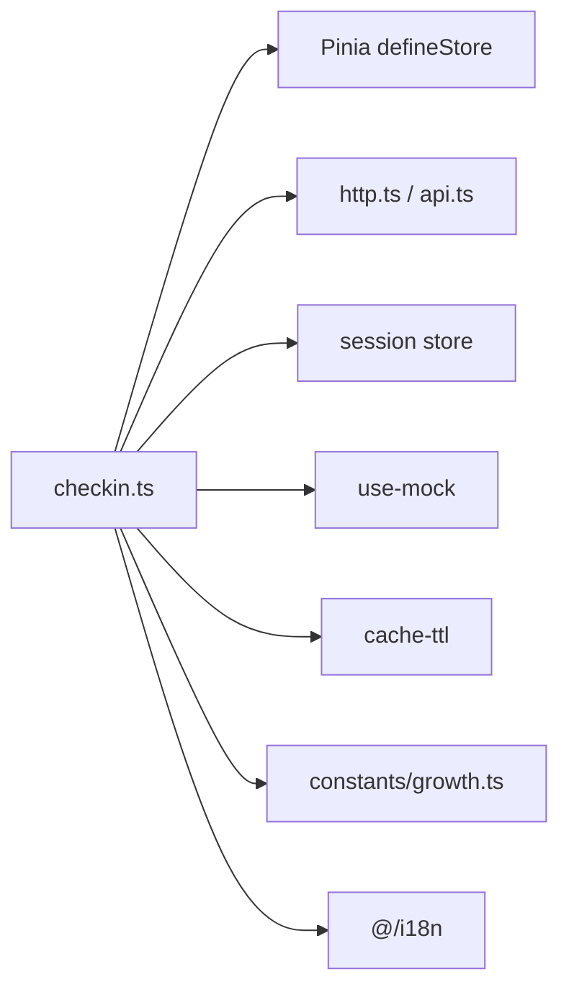

# 签到系统状态

<cite>
**本文引用的文件**   
- [apps/client/src/stores/checkin.ts](file://apps/client/src/stores/checkin.ts)
- [apps/client/src/constants/growth.ts](file://apps/client/src/constants/growth.ts)
- [apps/client/src/services/generated/api-types-supplement.ts](file://apps/client/src/services/generated/api-types-supplement.ts)
- [apps/client/src/services/api.ts](file://apps/client/src/services/api.ts)
- [apps/client/src/services/http.ts](file://apps/client/src/services/http.ts)
- [docs/openapi/check-in.yaml](file://docs/openapi/check-in.yaml)
- [apps/api/src/main/java/com/campuslove/api/growth/CheckInService.java](file://apps/api/src/main/java/com/campuslove/api/growth/CheckInService.java)
- [apps/api/src/main/java/com/campuslove/api/growth/RealCheckInService.java](file://apps/api/src/main/java/com/campuslove/api/growth/RealCheckInService.java)
- [apps/api/src/main/java/com/campuslove/api/growth/MockCheckInService.java](file://apps/api/src/main/java/com/campuslove/api/growth/MockCheckInService.java)
- [apps/api/src/main/java/com/campuslove/api/growth/MakeUpCheckInRequest.java](file://apps/api/src/main/java/com/campuslove/api/growth/MakeUpCheckInRequest.java)
- [apps/api/src/main/java/com/campuslove/api/growth/CheckInResultView.java](file://apps/api/src/main/java/com/campuslove/api/growth/CheckInResultView.java)
- [apps/api/src/main/java/com/campuslove/api/growth/CheckInStatusView.java](file://apps/api/src/main/java/com/campuslove/api/growth/CheckInStatusView.java)
- [apps/api/src/main/java/com/campuslove/api/growth/MakeUpCheckInResultView.java](file://apps/api/src/main/java/com/campuslove/api/growth/MakeUpCheckInResultView.java)
</cite>

## 目录

1. [引言](#引言)
2. [项目结构定位](#项目结构定位)
3. [核心数据结构](#核心数据结构)
4. [系统架构总览](#系统架构总览)
5. [签到业务流程](#签到业务流程)
6. [补签机制](#补签机制)
7. [签到成功动画与定时器管理](#签到成功动画与定时器管理)
8. [异步超时、AbortController 与错误处理](#异步超时abortcontroller-与错误处理)
9. [用户成长体系联动](#用户成长体系联动)
10. [配置参数与 Mock 模式](#配置参数与-mock-模式)
11. [依赖关系分析](#依赖关系分析)
12. [性能特性与优化建议](#性能特性与优化建议)
13. [故障排查指南](#故障排查指南)
14. [结论](#结论)

## 引言

本技术文档聚焦于签到系统的状态管理，围绕以下目标展开：

- 解释前端 `CheckInStatus` 与 `CheckInResult` 的数据结构设计，包括连续签到天数、额外推荐配额、热门话题解锁、新入圈用户解锁等字段。
- 梳理后端签到接口契约，说明 OpenAPI 中 `CheckInView`、`CheckInStatusView`、`MakeUpCheckInResultView` 的语义。
- 深入分析签到业务流程：状态检查、签到执行、权益发放、积分计算。
- 文档化补签机制：本月补签次数限制、日期范围校验、防重复触发保护、补签扣费与连续天数重算。
- 说明签到成功动画的定时器管理机制，避免内存泄漏和状态污染。
- 覆盖异步超时处理、`AbortController` 使用、并发竞态防护与错误重试策略。
- 解释签到状态与用户成长体系的联动：积分余额同步、推荐配额更新、钱包流水记录。
- 总结配置参数、Mock 模式支持与可落地的性能优化方案。

该文档同时面向前端 Pinia Store、后端 Java 服务、OpenAPI 契约以及测试与运维场景，帮助读者从“数据模型 → 流程 → 异常 → 配置”完整理解签到状态管理。

## 项目结构定位

签到系统在仓库中的职责边界如下：

| 层次 | 主要位置 | 职责 |
|---|---|---|
| 前端状态层 | `apps/client/src/stores/checkin.ts` | 管理签到状态、签到动作、补签动作、成功动画、错误信息、本地缓存与常量 |
| 前端类型与契约 | `apps/client/src/services/generated/api-types-supplement.ts`、`docs/openapi/check-in.yaml` | 定义前后端交互的视图类型与 OpenAPI 契约 |
| 前端网络层 | `apps/client/src/services/http.ts`、`apps/client/src/services/api.ts` | 提供带超时的请求封装、客户端 API 调用入口 |
| 后端服务接口 | `apps/api/src/main/java/com/campuslove/api/growth/CheckInService.java` | 暴露签到、状态查询、补签三个业务方法 |
| 后端真实实现 | `apps/api/src/main/java/com/campuslove/api/growth/RealCheckInService.java` | 数据库持久化、Redis 日限锁、钱包入账、MQ 通知、补签逻辑 |
| 后端 Mock 实现 | `apps/api/src/main/java/com/campuslove/api/growth/MockCheckInService.java` | 开发调试用的固定模拟数据 |
| 后端视图对象 | `CheckInResultView.java`、`CheckInStatusView.java`、`MakeUpCheckInResultView.java` | 对外返回的结构化结果 |
| 后端请求对象 | `MakeUpCheckInRequest.java` | 补签请求体与校验规则 |
| 前端常量 | `apps/client/src/constants/growth.ts` | 统一维护超时时间、动画延迟、补签上限、签到权益默认值 |

**图表来源**   
- [apps/client/src/stores/checkin.ts:201-558](file://apps/client/src/stores/checkin.ts#L201-L558)
- [apps/client/src/services/http.ts](file://apps/client/src/services/http.ts)
- [apps/client/src/services/api.ts](file://apps/client/src/services/api.ts)
- [docs/openapi/check-in.yaml:1-257](file://docs/openapi/check-in.yaml#L1-L257)
- [apps/api/src/main/java/com/campuslove/api/growth/CheckInService.java:1-43](file://apps/api/src/main/java/com/campuslove/api/growth/CheckInService.java#L1-L43)
- [apps/api/src/main/java/com/campuslove/api/growth/RealCheckInService.java:1-819](file://apps/api/src/main/java/com/campuslove/api/growth/RealCheckInService.java#L1-L819)
- [apps/api/src/main/java/com/campuslove/api/growth/MockCheckInService.java:1-195](file://apps/api/src/main/java/com/campuslove/api/growth/MockCheckInService.java#L1-L195)

**章节来源**   
- [apps/client/src/stores/checkin.ts:1-558](file://apps/client/src/stores/checkin.ts#L1-L558)
- [docs/openapi/check-in.yaml:1-257](file://docs/openapi/check-in.yaml#L1-L257)
- [apps/api/src/main/java/com/campuslove/api/growth/CheckInService.java:1-43](file://apps/api/src/main/java/com/campuslove/api/growth/CheckInService.java#L1-L43)

## 核心数据结构

### 前端签到状态 `CheckInStatus`

前端将后端 `CheckInStatusView` 映射为更贴近业务展示的 `CheckInStatus`，其核心字段如下：

| 字段名 | 含义 | 对应后端字段 | 默认或来源 |
|---|---|---|---|
| `checkedIn` | 今日是否已签到 | `checkedInToday` | 后端状态查询返回 |
| `consecutiveDays` | 连续签到天数 | `consecutiveDays` | 后端状态查询返回 |
| `extraRecommendations` | 签到获取的额外推荐次数 | `extraQuota` | 后端状态查询返回 |

此外，前端 Store 还维护一组展示与行为状态：

| 字段名 | 含义 |
|---|---|
| `extraRecommendQuota` | 今日额外推荐配额（签到权益） |
| `hotTopicsUnlocked` | 热门话题是否已解锁 |
| `newUsersUnlocked` | 新入圈用户是否已解锁 |
| `hotTopicCount` | 热门话题数量 |
| `newUserCount` | 新入圈用户数量 |
| `pointsBalance` | 我的积分余额 |
| `pointsEarned` | 本次签到获得积分 |
| `loading` | 是否正在加载 |
| `checkingIn` | 是否正在签到 |
| `showSuccessAnimation` | 是否显示签到成功动画 |
| `errorMessage` | 错误信息 |
| `makeUpUsedCount` | 本月已用补签次数 |
| `makeUpLimit` | 本月补签次数上限 |
| `makingUp` | 是否正在补签 |

**章节来源**   
- [apps/client/src/stores/checkin.ts:29-115](file://apps/client/src/stores/checkin.ts#L29-L115)
- [apps/client/src/stores/checkin.ts:201-260](file://apps/client/src/stores/checkin.ts#L201-L260)

### 前端签到结果 `CheckInResult`

前端 `CheckInResult` 是签到成功后的结果模型，用于驱动界面展示与后续业务状态更新：

| 字段名 | 含义 | 后端来源 |
|---|---|---|
| `checkInDate` | 签到日期 | 前端本地时区日期键 |
| `consecutiveDays` | 连续签到天数 | 后端 `consecutiveDays` |
| `extraRecommendations` | 签到获取的额外推荐次数 | 后端 `extraQuota` |
| `extraRecommendQuota` | 今日额外推荐配额 | 后端 `extraRecommendQuota` |
| `hotTopicsUnlocked` | 热门话题是否已解锁 | 后端 `hotTopicsUnlocked` |
| `newUsersUnlocked` | 新入圈用户是否已解锁 | 后端 `newUsersUnlocked` |
| `hotTopicCount` | 热门话题数量 | 后端 `hotTopicCount` |
| `newUserCount` | 新入圈用户数量 | 后端 `newUserCount` |
| `points` | 本次签到获得积分 | 后端 `points`，缺失时回退常量 |

**章节来源**   
- [apps/client/src/stores/checkin.ts:48-84](file://apps/client/src/stores/checkin.ts#L48-L84)
- [apps/client/src/stores/checkin.ts:380-440](file://apps/client/src/stores/checkin.ts#L380-L440)

### 后端视图对象

#### `CheckInStatusView`

后端状态视图包含四个字段：

| 字段名 | 类型 | 含义 |
|---|---|---|
| `checkedInToday` | `boolean` | 今日是否已签到 |
| `consecutiveDays` | `int` | 连续签到天数 |
| `extraQuota` | `int` | 累计额外推荐配额 |
| `points` | `long` | 积分余额，等于交友币钱包余额 |

**章节来源**   
- [apps/api/src/main/java/com/campuslove/api/growth/CheckInStatusView.java:1-13](file://apps/api/src/main/java/com/campuslove/api/growth/CheckInStatusView.java#L1-L13)

#### `CheckInResultView`

后端签到结果视图包含：

| 字段名 | 类型 | 含义 |
|---|---|---|
| `success` | `boolean` | 签到操作是否成功 |
| `consecutiveDays` | `int` | 连续签到天数 |
| `extraQuota` | `int` | 累计额外推荐配额 |
| `extraRecommendQuota` | `int` | 当日额外推荐配额 |
| `hotTopicsUnlocked` | `boolean` | 是否解锁热门话题 |
| `newUsersUnlocked` | `boolean` | 是否解锁新入圈用户 |
| `hotTopicCount` | `int` | 热门话题数量 |
| `newUserCount` | `int` | 新入圈用户数量 |
| `points` | `int` | 本次签到获得的积分（cents），不是余额 |

需要注意：后端注释明确强调 `points` 是“本次获得”，而非余额；前端按 `pointsBalance += pointsEarned` 累加，若误传余额会导致双计。

**章节来源**   
- [apps/api/src/main/java/com/campuslove/api/growth/CheckInResultView.java:1-24](file://apps/api/src/main/java/com/campuslove/api/growth/CheckInResultView.java#L1-L24)

#### `MakeUpCheckInResultView`

补签结果视图包含：

| 字段名 | 类型 | 含义 |
|---|---|---|
| `success` | `boolean` | 补签是否成功 |
| `checkInDate` | `String` | 补签日期 |
| `consecutiveDays` | `int` | 补签后连续签到天数 |
| `usedMakeUpCount` | `int` | 本月已用补签次数 |
| `makeUpLimit` | `int` | 本月补签次数上限 |
| `costPoints` | `int` | 补签消耗积分，首次免费时为 0 |

**章节来源**   
- [apps/api/src/main/java/com/campuslove/api/growth/MakeUpCheckInResultView.java:1-29](file://apps/api/src/main/java/com/campuslove/api/growth/MakeUpCheckInResultView.java#L1-L29)

#### OpenAPI 契约对齐

OpenAPI 规范中定义了 `CheckInView`、`CheckInStatusView`、`MakeUpCheckInResultView`，并约束了必填字段、最小值和示例响应。前端生成类型与手工补充类型共同构成 TypeScript 侧的类型真相源，但代码注释也提醒存在契约漂移风险。

**章节来源**   
- [docs/openapi/check-in.yaml:1-257](file://docs/openapi/check-in.yaml#L1-L257)
- [apps/client/src/services/generated/api-types-supplement.ts:544-557](file://apps/client/src/services/generated/api-types-supplement.ts#L544-L557)

## 系统架构总览

签到系统采用“前端状态层 + 后端服务接口 + 多实现 + 外部子系统”的分层结构：

**图表来源**   
- [apps/client/src/stores/checkin.ts:201-558](file://apps/client/src/stores/checkin.ts#L201-L558)
- [apps/client/src/services/api.ts](file://apps/client/src/services/api.ts)
- [apps/client/src/services/http.ts](file://apps/client/src/services/http.ts)
- [apps/api/src/main/java/com/campuslove/api/growth/CheckInService.java:1-43](file://apps/api/src/main/java/com/campuslove/api/growth/CheckInService.java#L1-L43)
- [apps/api/src/main/java/com/campuslove/api/growth/RealCheckInService.java:200-509](file://apps/api/src/main/java/com/campuslove/api/growth/RealCheckInService.java#L200-L509)

**章节来源**   
- [apps/client/src/stores/checkin.ts:201-558](file://apps/client/src/stores/checkin.ts#L201-L558)
- [apps/api/src/main/java/com/campuslove/api/growth/RealCheckInService.java:1-819](file://apps/api/src/main/java/com/campuslove/api/growth/RealCheckInService.java#L1-L819)

## 签到业务流程

### 状态检查流程

状态检查由前端的 `fetchStatus` 触发，核心步骤如下：

1. 如果非 Mock 模式且已有签到数据，并在 30 秒 TTL 内，则跳过重复请求。
2. 使用递增 token 防止旧请求覆盖新请求结果。
3. 设置 `loading = true`、清空错误信息。
4. 创建 `AbortController`，将信号传给超时包装器。
5. Mock 模式下直接设置本地 mock 状态和积分余额。
6. 未登录时无 userId，直接返回空状态，避免无效请求。
7. 调用后端 `GET /check-in/status`。
8. 仅当当前请求仍是最新 token 且未超时时，才更新前端状态。
9. 成功后刷新 30 秒缓存时间戳。

**图表来源**   
- [apps/client/src/stores/checkin.ts:220-320](file://apps/client/src/stores/checkin.ts#L220-L320)

**章节来源**   
- [apps/client/src/stores/checkin.ts:201-320](file://apps/client/src/stores/checkin.ts#L201-L320)
- [apps/api/src/main/java/com/campuslove/api/growth/RealCheckInService.java:420-470](file://apps/api/src/main/java/com/campuslove/api/growth/RealCheckInService.java#L420-L470)

### 签到执行流程

签到执行由 `checkIn` action 驱动，关键路径如下：

1. 使用 `checkingIn` 作为幂等守卫，防止重复点击触发多次签到。
2. 清理上一次签到成功动画的定时器。
3. 创建新的 `AbortController`。
4. Mock 模式下更新本地 mock 状态和积分余额。
5. 未登录时抛出业务错误。
6. 调用后端 `POST /check-in`，携带基于本地日期的幂等键。
7. 若超时或已取消，不再继续处理。
8. 更新前端状态：连续天数、额外推荐配额、热门话题与新用户解锁标志。
9. 累加本次签到获得积分，并更新积分余额。
10. 设置 `showSuccessAnimation = true`，启动自动收起定时器。

**图表来源**   
- [apps/client/src/stores/checkin.ts:320-500](file://apps/client/src/stores/checkin.ts#L320-L500)
- [apps/api/src/main/java/com/campuslove/api/growth/RealCheckInService.java:200-509](file://apps/api/src/main/java/com/campuslove/api/growth/RealCheckInService.java#L200-L509)

**章节来源**   
- [apps/client/src/stores/checkin.ts:320-500](file://apps/client/src/stores/checkin.ts#L320-L500)
- [apps/api/src/main/java/com/campuslove/api/growth/RealCheckInService.java:200-509](file://apps/api/src/main/java/com/campuslove/api/growth/RealCheckInService.java#L200-L509)

### 权益发放与热门话题解锁

后端真实实现中，签到成功后会：

- 创建 `DailyBenefit` 记录，设置额外推荐配额。
- 设置热门话题与新入圈用户解锁标志。
- 通过钱包服务写入签到奖励流水。
- 通过消息生产者异步推送签到事件。

这些操作在成功签到主流程中执行，其中钱包写入失败和权益重复创建采用降级日志策略，不阻断签到主流程。

**章节来源**   
- [apps/api/src/main/java/com/campuslove/api/growth/RealCheckInService.java:260-380](file://apps/api/src/main/java/com/campuslove/api/growth/RealCheckInService.java#L260-L380)

## 补签机制

### 补签业务规则

补签机制的核心规则如下：

| 规则 | 说明 |
|---|---|
| 补签日期范围 | 只能补签昨日及之前 7 天内的日期 |
| 不能补签当天 | 当天视为正常签到，不允许补签 |
| 不能补签未来日期 | 未来日期无效 |
| 不能补签已签到过的日期 | 已有签到记录时报错 |
| 每月补签次数上限 | 默认 3 次，由 `MakeUpQuota.limitCount` 控制 |
| 首次补签免费 | 当月第一次补签消耗 0 积分 |
| 后续补签收费 | 每次消耗 50 积分 |
| 防重复触发 | 前端 `makingUp` 状态作为锁 |

### 补签前端流程

前端 `makeUpCheckIn` 的实现要点：

1. 若 `makingUp` 为真，直接返回 `null`，防止重复触发。
2. 调用 `clientApi.makeUpCheckIn(date)`。
3. 成功后同步更新连续天数、已用补签次数、补签上限。
4. 捕获错误并设置 `errorMessage`。
5. `finally` 中重置 `makingUp`。

**图表来源**   
- [apps/client/src/stores/checkin.ts:470-520](file://apps/client/src/stores/checkin.ts#L470-L520)

### 补签后端流程

后端 `RealCheckInService.makeUp` 的关键步骤：

1. 校验 userId 和 date。
2. 解析目标日期并校验是否在昨日及之前 7 天内。
3. 检查目标日期是否已有签到记录。
4. 获取或创建当月补签配额记录。
5. 校验当月补签次数是否已达上限。
6. 计算消耗积分：首次免费，其后 50 积分。
7. 若需扣费，调用钱包服务扣减积分。
8. 重新计算补签后的连续签到天数。
9. 创建补签签到记录，source 标记为补签。
10. 原子递增补签配额 used_count。
11. 返回补签结果视图。

**图表来源**   
- [apps/api/src/main/java/com/campuslove/api/growth/RealCheckInService.java:470-819](file://apps/api/src/main/java/com/campuslove/api/growth/RealCheckInService.java#L470-L819)

**章节来源**   
- [apps/client/src/stores/checkin.ts:470-520](file://apps/client/src/stores/checkin.ts#L470-L520)
- [apps/api/src/main/java/com/campuslove/api/growth/RealCheckInService.java:470-819](file://apps/api/src/main/java/com/campuslove/api/growth/RealCheckInService.java#L470-L819)
- [apps/api/src/main/java/com/campuslove/api/growth/MakeUpCheckInRequest.java:1-20](file://apps/api/src/main/java/com/campuslove/api/growth/MakeUpCheckInRequest.java#L1-L20)

## 签到成功动画与定时器管理

### 问题背景

原实现直接在签到 action 内调用 `setTimeout` 修改 `showSuccessAnimation`，但没有保存定时器句柄，导致两个问题：

1. 用户连续触发签到时，旧定时器仍会触发，覆盖新状态。
2. 组件卸载后定时器仍会触发，修改已卸载状态。

### 修复方案

当前实现引入模块级单例 `successAnimationTimer`，并在以下时机管理定时器：

| 时机 | 行为 |
|---|---|
| 开始签到 | 清理上一次定时器 |
| 签到成功 | 设置 `showSuccessAnimation = true`，启动自动收起定时器 |
| 定时器回调 | 二次检查后关闭动画并清空句柄 |
| 组件销毁 | 调用 `dispose()` 清理定时器 |
| HMR 热更新 | 也可通过 `dispose()` 清理模块级定时器 |

**图表来源**   
- [apps/client/src/stores/checkin.ts:115-160](file://apps/client/src/stores/checkin.ts#L115-L160)
- [apps/client/src/stores/checkin.ts:380-440](file://apps/client/src/stores/checkin.ts#L380-L440)
- [apps/client/src/stores/checkin.ts:520-558](file://apps/client/src/stores/checkin.ts#L520-L558)
- [apps/client/src/constants/growth.ts:1-40](file://apps/client/src/constants/growth.ts#L1-L40)

**章节来源**   
- [apps/client/src/stores/checkin.ts:115-160](file://apps/client/src/stores/checkin.ts#L115-L160)
- [apps/client/src/stores/checkin.ts:380-440](file://apps/client/src/stores/checkin.ts#L380-L440)
- [apps/client/src/stores/checkin.ts:520-558](file://apps/client/src/stores/checkin.ts#L520-L558)
- [apps/client/src/constants/growth.ts:1-40](file://apps/client/src/constants/growth.ts#L1-L40)

## 异步超时、AbortController 与错误处理

### 超时包装器

前端的 `withTimeout` 委托给 `services/http.ts` 的 `withHttpTimeout`，并支持传入 `AbortController.signal`。超时或取消后，调用方可通过 `signal.aborted` 判断是否应跳过后续状态修改。

关键点：

- 超时错误被识别为 `EnhancedApiError.error === "timeout"`。
- 网络错误且 controller 已 abort 也被视为超时或取消。
- 其他业务错误或网络错误原样透传。
- 调用方 IIFE 内部检查 `controller.signal.aborted`，避免超时后继续修改状态。

**章节来源**   
- [apps/client/src/stores/checkin.ts:160-220](file://apps/client/src/stores/checkin.ts#L160-L220)
- [apps/client/src/services/http.ts](file://apps/client/src/services/http.ts)

### 竞态防护

状态查询使用递增 token：

- 每次 `fetchStatus` 递增 `fetchStatusToken`。
- 只有最新 token 的请求才允许更新 `checkedIn`、`consecutiveDays`、`extraRecommendations`。
- 这解决了“下拉刷新或快速切换页面时旧请求覆盖新请求”的问题。

签到执行使用 `checkingIn` 布尔锁：

- 若已在签到中，直接返回。
- 防止用户连续点击导致多次签到请求。

补签执行使用 `makingUp` 布尔锁：

- 若已在补签中，直接返回 `null`。
- 防止重复触发补签。

**图表来源**   
- [apps/client/src/stores/checkin.ts:201-240](file://apps/client/src/stores/checkin.ts#L201-L240)
- [apps/client/src/stores/checkin.ts:320-360](file://apps/client/src/stores/checkin.ts#L320-L360)
- [apps/client/src/stores/checkin.ts:470-520](file://apps/client/src/stores/checkin.ts#L470-L520)

**章节来源**   
- [apps/client/src/stores/checkin.ts:201-520](file://apps/client/src/stores/checkin.ts#L201-L520)

### 错误处理策略

| 场景 | 处理方式 |
|---|---|
| 未登录 | 前端直接返回空状态或抛出业务错误，避免无效请求 |
| 网络超时 | 通过 `EnhancedApiError` 识别，展示 i18n 错误文案 |
| 业务校验失败 | 后端抛出 `IllegalArgumentException`，前端捕获并展示 |
| 补签积分不足 | 后端抛出余额不足异常，前端差异化提示 |
| 重复签到 | 后端返回 `success=false`，points 为 0，防止前端双计 |
| 钱包入账失败 | 后端记录警告日志，不阻断签到主流程 |

**章节来源**   
- [apps/client/src/stores/checkin.ts:240-500](file://apps/client/src/stores/checkin.ts#L240-L500)
- [apps/api/src/main/java/com/campuslove/api/growth/RealCheckInService.java:200-509](file://apps/api/src/main/java/com/campuslove/api/growth/RealCheckInService.java#L200-L509)

## 用户成长体系联动

### 积分余额同步

前端与后端的积分语义存在差异：

| 层级 | 字段 | 语义 |
|---|---|---|
| 后端状态视图 | `points` | 当前积分余额 |
| 后端签到结果 | `points` | 本次签到获得的积分 |
| 前端状态 | `pointsBalance` | 本地积分余额 |
| 前端状态 | `pointsEarned` | 本次签到获得积分 |

同步规则：

1. `fetchStatus` 成功后，若后端返回 `points`，则直接赋值 `pointsBalance`。
2. `checkIn` 成功后，若后端未返回 `points`，则使用常量 `CHECKIN_POINTS_EARNED`。
3. `pointsBalance` 按 `pointsEarned` 累加，适用于 Mock 模式和本地回退场景。
4. 若未来后端在签到结果中直接返回最新余额，应改为直接赋值，避免双计。

**章节来源**   
- [apps/client/src/stores/checkin.ts:380-440](file://apps/client/src/stores/checkin.ts#L380-L440)
- [apps/api/src/main/java/com/campuslove/api/growth/CheckInResultView.java:1-24](file://apps/api/src/main/java/com/campuslove/api/growth/CheckInResultView.java#L1-L24)
- [apps/api/src/main/java/com/campuslove/api/growth/CheckInStatusView.java:1-13](file://apps/api/src/main/java/com/campuslove/api/growth/CheckInStatusView.java#L1-L13)

### 推荐配额更新

签到成功后，前端会更新：

- `extraRecommendations`：来自后端 `extraQuota`。
- `extraRecommendQuota`：来自后端 `extraRecommendQuota`。

后端真实实现中：

- `extraQuota` 通过累计计算得出。
- `extraRecommendQuota` 取配置项 `extraQuotaPerCheckIn`。
- 重复签到时返回已有权益，不重复增加配额。

**章节来源**   
- [apps/client/src/stores/checkin.ts:380-440](file://apps/client/src/stores/checkin.ts#L380-L440)
- [apps/api/src/main/java/com/campuslove/api/growth/RealCheckInService.java:200-380](file://apps/api/src/main/java/com/campuslove/api/growth/RealCheckInService.java#L200-L380)

### 钱包流水与签到奖励

后端真实实现中，签到成功后会调用钱包服务写入 CREDIT 流水：

- 订单号按 `userId + yyyyMMdd` 幂等。
- 相关类型为 `CHECKIN`。
- 金额由配置项 `rewardCentsPerCheckIn` 决定。
- 钱包写入失败仅记录日志，不阻断签到主流程。

补签扣费则走独立路径：

- 订单号包含补签日期。
- 相关类型为 `CHECKIN_MAKEUP`。
- 余额不足时抛出业务异常。

**章节来源**   
- [apps/api/src/main/java/com/campuslove/api/growth/RealCheckInService.java:300-380](file://apps/api/src/main/java/com/campuslove/api/growth/RealCheckInService.java#L300-L380)
- [apps/api/src/main/java/com/campuslove/api/growth/RealCheckInService.java:540-640](file://apps/api/src/main/java/com/campuslove/api/growth/RealCheckInService.java#L540-L640)

## 配置参数与 Mock 模式

### 前端常量

前端通过 `constants/growth.ts` 集中维护签到相关常量：

| 常量名 | 含义 | 默认值 |
|---|---|---|
| `ASYNC_TIMEOUT_MS` | 异步操作超时时间 | 15000 毫秒 |
| `SUCCESS_ANIMATION_AUTO_DISMISS_MS` | 签到成功动画自动收起延迟 | 3000 毫秒 |
| `DEFAULT_MAKEUP_LIMIT` | 默认补签次数上限 | 3 |
| `CHECKIN_EXTRA_RECOMMENDATIONS` | 签到获取的额外推荐次数 | 5 |
| `CHECKIN_EXTRA_QUOTA` | 签到权益额外推荐配额 | 5 |
| `CHECKIN_HOT_TOPIC_COUNT` | 签到解锁热门话题数量 | 3 |
| `CHECKIN_NEW_USER_COUNT` | 签到解锁新入圈用户数量 | 2 |
| `CHECKIN_POINTS_EARNED` | 每次签到获得积分 | 5 |
| `MOCK_POINTS_BALANCE` | Mock 模式初始积分余额 | 100 |

**章节来源**   
- [apps/client/src/constants/growth.ts:1-40](file://apps/client/src/constants/growth.ts#L1-L40)

### Mock 模式支持

前端 Mock：

- `useMock()` 控制是否走 Mock 分支。
- Mock 签到不会真正调用后端。
- Mock 状态和积分余额由模块级变量维护。
- Mock 补签通过 `mockFixtures.makeUpCheckIn` 返回。

后端 Mock：

- `MockCheckInService` 在 `mock` profile 下激活。
- 使用 `ConcurrentHashMap` 缓存用户签到历史、连续天数、额外配额、补签次数。
- Mock 补签校验日期范围、月配额、首次免费逻辑。
- Mock 状态查询返回固定积分余额 100。

**章节来源**   
- [apps/client/src/stores/checkin.ts:115-200](file://apps/client/src/stores/checkin.ts#L115-L200)
- [apps/api/src/main/java/com/campuslove/api/growth/MockCheckInService.java:1-195](file://apps/api/src/main/java/com/campuslove/api/growth/MockCheckInService.java#L1-L195)
- [apps/client/src/services/api.ts](file://apps/client/src/services/api.ts)

### 后端配置项

后端签到配置涉及以下概念：

| 配置项 | 用途 |
|---|---|
| `extraQuotaPerCheckIn` | 每次签到额外推荐配额 |
| `rewardCentsPerCheckIn` | 每次签到奖励积分（cents） |
| `checkin.redis.lock.ttl` | Redis 签到锁 TTL |
| `checkin.makeup.max-days-back` | 补签最大回溯天数 |
| `checkin.makeup.default-limit` | 默认补签次数上限 |

这些配置通过 `CheckInConfig` 注入真实实现，Mock 实现则使用硬编码常量。

**章节来源**   
- [apps/api/src/main/java/com/campuslove/api/growth/RealCheckInService.java:1-200](file://apps/api/src/main/java/com/campuslove/api/growth/RealCheckInService.java#L1-L200)
- [apps/api/src/main/java/com/campuslove/api/growth/MockCheckInService.java:1-195](file://apps/api/src/main/java/com/campuslove/api/growth/MockCheckInService.java#L1-L195)

## 依赖关系分析

### 类与服务关系

**图表来源**   
- [apps/api/src/main/java/com/campuslove/api/growth/CheckInService.java:1-43](file://apps/api/src/main/java/com/campuslove/api/growth/CheckInService.java#L1-L43)
- [apps/api/src/main/java/com/campuslove/api/growth/RealCheckInService.java:1-200](file://apps/api/src/main/java/com/campuslove/api/growth/RealCheckInService.java#L1-L200)
- [apps/api/src/main/java/com/campuslove/api/growth/MockCheckInService.java:1-195](file://apps/api/src/main/java/com/campuslove/api/growth/MockCheckInService.java#L1-L195)
- [apps/api/src/main/java/com/campuslove/api/growth/CheckInResultView.java:1-24](file://apps/api/src/main/java/com/campuslove/api/growth/CheckInResultView.java#L1-L24)
- [apps/api/src/main/java/com/campuslove/api/growth/CheckInStatusView.java:1-13](file://apps/api/src/main/java/com/campuslove/api/growth/CheckInStatusView.java#L1-L13)
- [apps/api/src/main/java/com/campuslove/api/growth/MakeUpCheckInResultView.java:1-29](file://apps/api/src/main/java/com/campuslove/api/growth/MakeUpCheckInResultView.java#L1-L29)

### 前端依赖关系

前端签到 Store 依赖：

- Pinia Store 定义。
- HTTP 请求封装与超时能力。
- Session Store，用于获取 userId。
- Mock 辅助函数。
- 本地缓存工具，用于 30 秒 TTL。
- 统一常量，用于超时、动画延迟和业务默认值。
- i18n 翻译函数。

**图表来源**   
- [apps/client/src/stores/checkin.ts:1-115](file://apps/client/src/stores/checkin.ts#L1-L115)
- [apps/client/src/constants/growth.ts:1-40](file://apps/client/src/constants/growth.ts#L1-L40)

**章节来源**   
- [apps/client/src/stores/checkin.ts:1-115](file://apps/client/src/stores/checkin.ts#L1-L115)
- [apps/api/src/main/java/com/campuslove/api/growth/CheckInService.java:1-43](file://apps/api/src/main/java/com/campuslove/api/growth/CheckInService.java#L1-L43)

## 性能特性与优化建议

### 现有优化

1. **30 秒 TTL 缓存**  
   状态查询在 home/discover 双入口去重，避免频繁请求后端。

2. **Redis 日限锁**  
   后端使用 Redis SETNX 实现用户+日期维度的分布式锁，快速拒绝重复签到。

3. **数据库唯一约束**  
   即使 Redis 不可用，DB 唯一约束仍保证签到幂等性。

4. **异步 MQ 通知**  
   签到事件通过消息队列异步推送，避免阻塞主流程。

5. **降级策略**  
   Redis 不可用时降级到仅 DB 检查；钱包入账失败不阻断签到；钱包余额查询失败降级为 0。

6. **前端竞态防护**  
   使用 token 和布尔锁防止旧请求覆盖状态和重复触发。

7. **定时器清理**  
   签到成功动画使用模块化定时器句柄，并在 dispose 中清理。

### 可进一步优化的方向

| 方向 | 建议 |
|---|---|
| 重试策略 | 对网络错误实现指数退避重试，但对业务校验错误不重试 |
| 批量状态刷新 | 首页与发现页共享一次状态拉取，减少重复请求 |
| 超时时间可调 | 将 `ASYNC_TIMEOUT_MS` 暴露为运行时配置，便于压测调优 |
| 动画性能 | 签到成功动画可结合 CSS transform 与 will-change，降低重排成本 |
| Mock 数据隔离 | Mock 状态可按用户维度隔离，避免不同用户间污染 |
| 补签幂等键 | 前端补签请求可携带 `clientRequestId`，配合后端订单号增强幂等 |
| 监控埋点 | 为签到成功率、超时率、补签失败原因增加埋点 |

[本节为通用性能建议，不直接分析具体源码片段]

## 故障排查指南

### 常见问题与定位路径

| 现象 | 可能原因 | 排查路径 |
|---|---|---|
| 签到按钮重复点击仍多次扣款 | 前端缺少幂等守卫 | 检查 `checkingIn` 状态 |
| 签到成功动画一直不消失 | 定时器未清理或组件未调用 `dispose()` | 检查 `successAnimationTimer` 与 `dispose()` |
| 签到后状态被旧请求覆盖 | 竞态 token 失效 | 检查 `fetchStatusToken` |
| 签到超时后仍更新状态 | 未检查 `controller.signal.aborted` | 检查 withTimeout 调用处 |
| 补签重复触发 | 前端 `makingUp` 未生效 | 检查 `makeUpCheckIn` 开头守卫 |
| 补签全部免费 | 后端未调用钱包扣费或 Mock 模式 | 检查 `RealCheckInService.makeUp` 扣费分支 |
| 积分余额异常增长 | 后端返回余额而非本次获得积分 | 核对 `CheckInResultView.points` 语义 |
| 签到状态不刷新 | 30 秒 TTL 缓存命中 | 清除缓存或等待过期 |
| Redis 不可用签到失败 | Redis 配置缺失或连接失败 | 检查 Redis 健康与降级逻辑 |
| 补签超出 7 天报错 | 日期范围校验失败 | 检查目标日期与今日差值 |

### 日志与错误分类

后端日志重点观察：

- “用户今日已签到”
- “唯一约束冲突”
- “签到奖励入账失败”
- “补签扣费失败”
- “本月补签次数已用完”

前端错误重点观察：

- 超时错误文案
- 未登录业务错误
- 补签失败业务错误
- 网络错误透传

**章节来源**   
- [apps/client/src/stores/checkin.ts:201-558](file://apps/client/src/stores/checkin.ts#L201-L558)
- [apps/api/src/main/java/com/campuslove/api/growth/RealCheckInService.java:200-819](file://apps/api/src/main/java/com/campuslove/api/growth/RealCheckInService.java#L200-L819)

## 结论

签到系统的状态管理是一个跨前端、后端、数据库、缓存、钱包与消息队列的完整闭环。其核心设计原则包括：

- **数据模型清晰**：前端 `CheckInStatus`、`CheckInResult` 与后端 `CheckInStatusView`、`CheckInResultView`、`MakeUpCheckInResultView` 明确区分状态、结果与补签语义。
- **流程幂等可靠**：前端使用布尔锁与 token，后端使用 Redis 锁与数据库唯一约束，共同保障重复提交安全。
- **权益发放分层**：签到权益、热门话题、新用户解锁、钱包流水、MQ 通知各司其职，失败路径具备降级能力。
- **补签机制严谨**：日期范围、已签到校验、月度配额、首次免费、扣费幂等共同构成完整的补签规则。
- **资源管理完善**：定时器句柄保存与清理、异步超时与 `AbortController`、竞态 token 共同避免内存泄漏和状态污染。
- **成长体系联动**：积分余额与签到积分、推荐配额与签到权益形成一致的数值口径，避免双计。

在实际使用中，建议优先关注三点：

1. 保持前端与后端对 `points` 语义一致，避免把余额当作本次获得积分。
2. 确保组件生命周期中正确调用 `dispose()`，避免签到动画定时器泄漏。
3. 在压测与线上环境中关注 Redis、钱包、MQ 的可用性，确认降级路径符合预期。