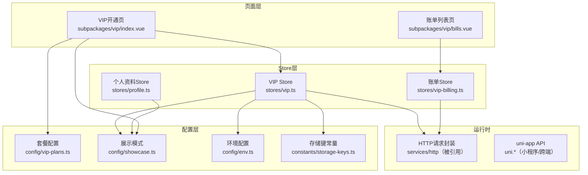
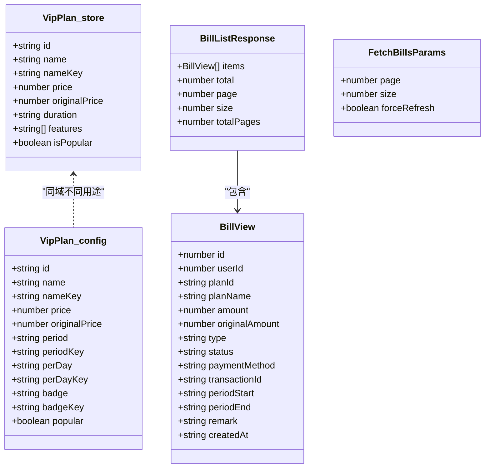
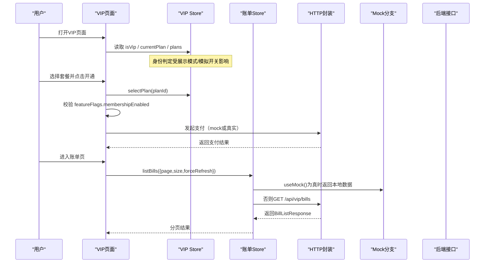
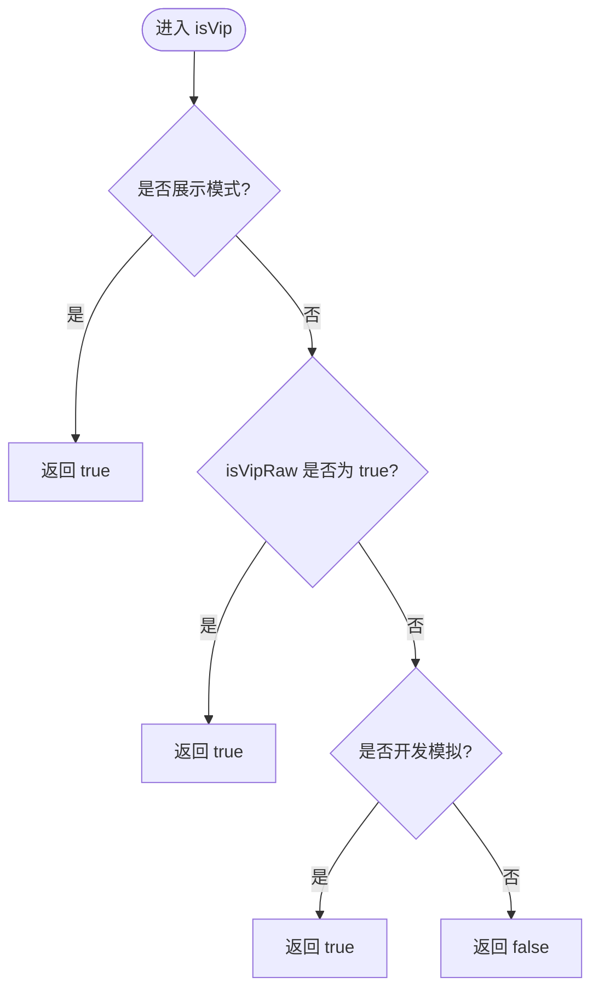
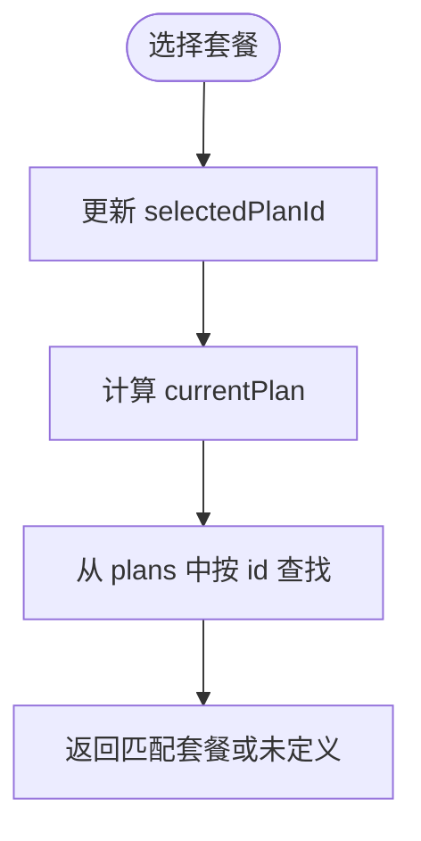
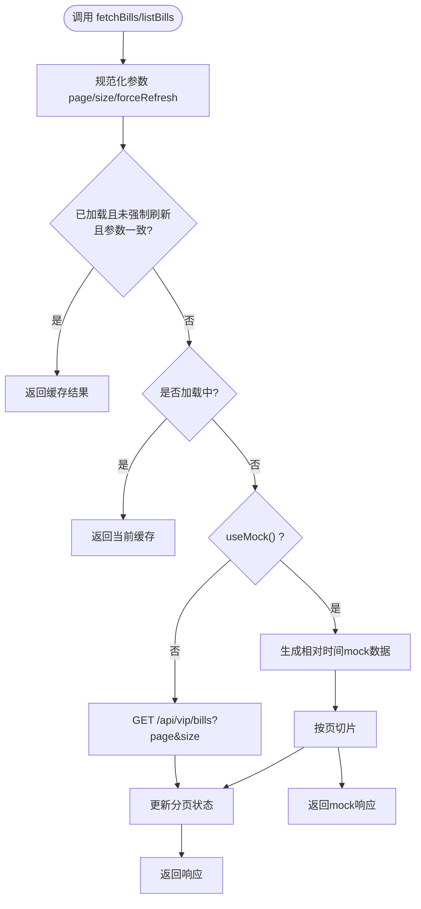
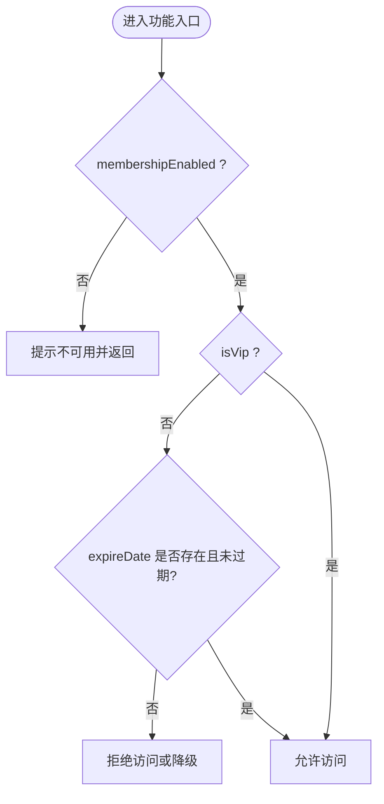
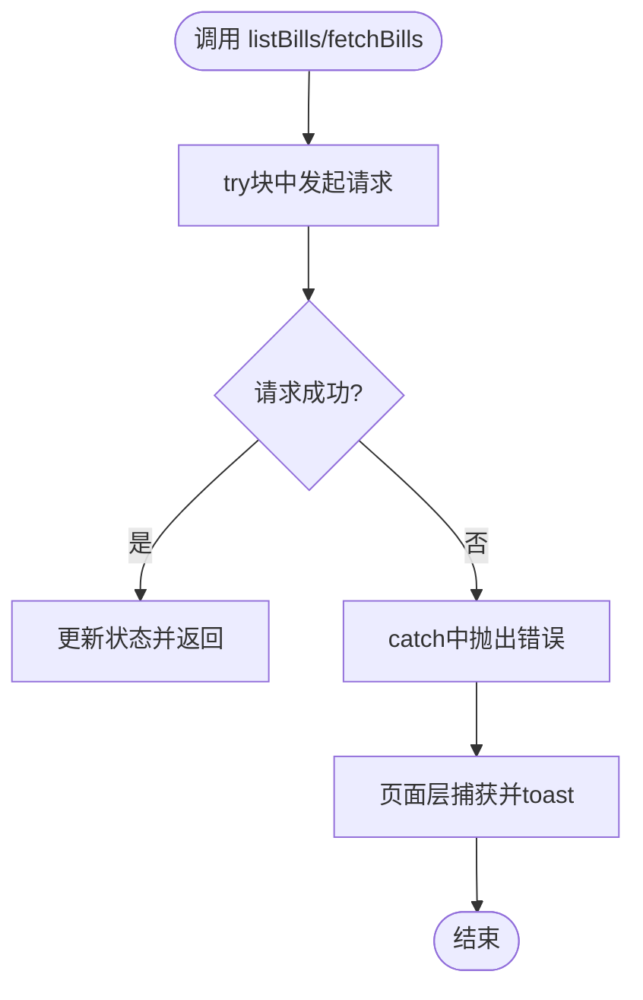
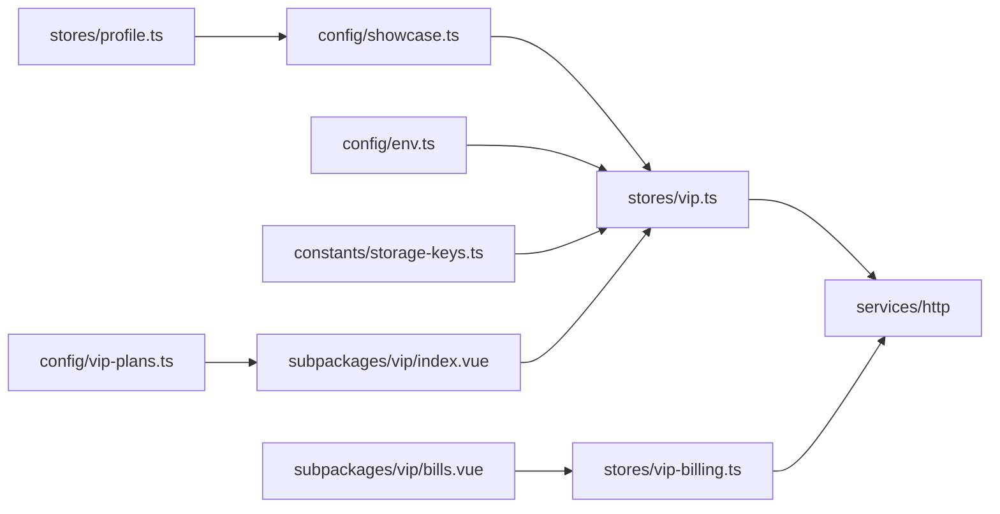

# VIP会员状态管理

<cite>
**本文引用的文件**   
- [apps/client/src/stores/vip.ts](file://apps/client/src/stores/vip.ts)
- [apps/client/src/config/vip-plans.ts](file://apps/client/src/config/vip-plans.ts)
- [apps/client/src/stores/vip-billing.ts](file://apps/client/src/stores/vip-billing.ts)
- [apps/client/src/subpackages/vip/index.vue](file://apps/client/src/subpackages/vip/index.vue)
- [apps/client/src/subpackages/vip/bills.vue](file://apps/client/src/subpackages/vip/bills.vue)
- [apps/client/src/config/showcase.ts](file://apps/client/src/config/showcase.ts)
- [apps/client/src/config/env.ts](file://apps/client/src/config/env.ts)
- [apps/client/src/constants/storage-keys.ts](file://apps/client/src/constants/storage-keys.ts)
- [apps/client/src/stores/profile.ts](file://apps/client/src/stores/profile.ts)
- [apps/client/src/tests/stores/profile.spec.ts](file://apps/client/src/tests/stores/profile.spec.ts)
- [apps/client/src/config/feature-flags.ts](file://apps/client/src/config/feature-flags.ts)
- [apps/client/src/services/http.ts](file://apps/client/src/services/http.ts)
- [apps/client/src/services/sentry.ts](file://apps/client/src/services/sentry.ts)
- [apps/client/src/utils/debounce.ts](file://apps/client/src/utils/debounce.ts)
- [apps/client/src/constants/api.ts](file://apps/client/src/constants/api.ts)
- [apps/client/src/i18n/locales/zh-CN.ts](file://apps/client/src/i18n/locales/zh-CN.ts)
- [apps/client/src/i18n/locales/en-US.ts](file://apps/client/src/i18n/locales/en-US.ts)
- [apps/api/src/main/java/com/campuslove/api/vip/VipOrderController.java](file://apps/api/src/main/java/com/campuslove/api/vip/VipOrderController.java)
- [apps/api/src/main/java/com/campuslove/api/config/GlobalExceptionHandler.java](file://apps/api/src/main/java/com/campuslove/api/config/GlobalExceptionHandler.java)
- [apps/api/src/main/java/com/campuslove/api/common/CommerceDisabledException.java](file://apps/api/src/main/java/com/campuslove/api/common/CommerceDisabledException.java)
- [apps/api/src/main/java/com/campuslove/api/wxpay/WxPayProperties.java](file://apps/api/src/main/java/com/campuslove/api/wxpay/WxPayProperties.java)
- [apps/client/.env.development](file://apps/client/.env.development)
</cite>

## 目录
1. [引言](#引言)
2. [项目结构与职责划分](#项目结构与职责划分)
3. [核心组件与数据模型](#核心组件与数据模型)
4. [架构总览](#架构总览)
5. [VIP身份判定与优先级](#vip身份判定与优先级)
6. [套餐选择系统](#套餐选择系统)
7. [VIP订阅支付流程（页面级实现）](#vip订阅支付流程页面级实现)
8. [账单查询与分页](#账单查询与分页)
9. [权限控制、功能解锁与有效期检查](#权限控制功能解锁与有效期检查)
10. [错误处理与API封装](#错误处理与api封装)
11. [mp-weixin兼容性](#mp-weixin兼容性)
12. [典型流程示例](#典型流程示例)
13. [依赖关系分析](#依赖关系分析)
14. [性能与健壮性建议](#性能与健壮性建议)
15. [故障排查指南](#故障排查指南)
16. [结论](#结论)

## 引言
本文围绕VIP会员状态管理系统，系统性梳理以下能力：
- VIP身份判定逻辑：`isVip`计算属性、展示模式`showcaseMode`、开发模式模拟`isDevVipSimulated`的优先级。
- 套餐选择系统：`VipPlan`结构、`currentPlan`计算逻辑、配置与页面交互。
- 账单查询：`FetchBillsParams`、`BillListResponse`、分页实现、mock数据生成和相对时间处理。
- 订阅支付编排：`subscribe` / `subscribeReal` / `requestVipOrder` / `requestPaymentAsync` 等动作所在的层级与调用链（real 模式真实拉起微信支付，仅两类预期错误降级）。
- 权限控制：状态同步、功能解锁判断、有效期检查。
- 错误处理、API调用封装与小程序端兼容性。
- 结合具体文件给出套餐切换、订阅支付、账单查询、权限判断的可执行参考路径。

## 项目结构与职责划分
VIP相关代码集中在客户端前端仓库中，主要涉及三类文件：
- Store层：集中维护VIP状态、套餐选择、账单分页。
- 配置层：集中定义套餐常量、展示模式、环境变量。
- 页面层：VIP开通页、账单列表页消费Store并提供用户交互。

图表来源
- [apps/client/src/stores/vip.ts:1-313](file://apps/client/src/stores/vip.ts#L1-L313)
- [apps/client/src/stores/vip-billing.ts:1-254](file://apps/client/src/stores/vip-billing.ts#L1-L254)
- [apps/client/src/subpackages/vip/index.vue:1-200](file://apps/client/src/subpackages/vip/index.vue#L1-L200)
- [apps/client/src/subpackages/vip/bills.vue:1-200](file://apps/client/src/subpackages/vip/bills.vue#L1-L200)
- [apps/client/src/config/vip-plans.ts:1-93](file://apps/client/src/config/vip-plans.ts#L1-L93)
- [apps/client/src/config/showcase.ts:1-77](file://apps/client/src/config/showcase.ts#L1-L77)
- [apps/client/src/config/env.ts:1-200](file://apps/client/src/config/env.ts#L1-L200)
- [apps/client/src/constants/storage-keys.ts:1-133](file://apps/client/src/constants/storage-keys.ts#L1-L133)

章节来源
- [apps/client/src/stores/vip.ts:1-313](file://apps/client/src/stores/vip.ts#L1-L313)
- [apps/client/src/stores/vip-billing.ts:1-254](file://apps/client/src/stores/vip-billing.ts#L1-L254)
- [apps/client/src/subpackages/vip/index.vue:1-200](file://apps/client/src/subpackages/vip/index.vue#L1-L200)
- [apps/client/src/subpackages/vip/bills.vue:1-200](file://apps/client/src/subpackages/vip/bills.vue#L1-L200)

## 核心组件与数据模型
本节聚焦VIP相关的类型与数据结构，明确字段语义与约束。

- `VipPlan`（store内）：用于购买/续费流程中的套餐对象，包含`id`、`name`、`nameKey`、`price`、`originalPrice`、`duration`、`features`、`isPopular`。
- `BillView`：单条账单视图对象，包含账单ID、用户ID、关联套餐、金额（分为单位）、类型、状态、支付方式、交易号、周期起止、备注、创建时间等。
- `BillListResponse`：账单列表响应，包含`items`、`total`、`page`、`size`、`totalPages`。
- `FetchBillsParams`：账单查询参数，支持`page`、`size`、`forceRefresh`。
- 配置文件中的`VipPlan`（`config/vip-plans.ts`）侧重静态运营配置，包含`period`、`perDay`、`badge`及对应i18n key。

图表来源
- [apps/client/src/stores/vip.ts:1-313](file://apps/client/src/stores/vip.ts#L1-L313)
- [apps/client/src/stores/vip-billing.ts:1-254](file://apps/client/src/stores/vip-billing.ts#L1-L254)
- [apps/client/src/config/vip-plans.ts:1-93](file://apps/client/src/config/vip-plans.ts#L1-L93)

章节来源
- [apps/client/src/stores/vip.ts:1-120](file://apps/client/src/stores/vip.ts#L1-L120)
- [apps/client/src/stores/vip-billing.ts:1-120](file://apps/client/src/stores/vip-billing.ts#L1-L120)
- [apps/client/src/config/vip-plans.ts:1-93](file://apps/client/src/config/vip-plans.ts#L1-L93)

## 架构总览
VIP系统由“身份判定”“套餐选择”“账单查询”三部分组成，分别由Store与页面协作完成。

图表来源
- [apps/client/src/subpackages/vip/index.vue:1-200](file://apps/client/src/subpackages/vip/index.vue#L1-L200)
- [apps/client/src/stores/vip.ts:1-313](file://apps/client/src/stores/vip.ts#L1-L313)
- [apps/client/src/stores/vip-billing.ts:1-254](file://apps/client/src/stores/vip-billing.ts#L1-L254)

## VIP身份判定与优先级
### 判定维度
- **展示模式**：`isShowcaseMode`来自构建期注入，开启后全局VIP全亮。
- **内部真实状态**：`isVipRaw`表示后端下发的真实会员状态。
- **开发模式模拟**：`isDevVipSimulated`仅在开发或mock环境下生效，读取本地存储键`STORAGE_KEYS.VIP_SIM_ENABLED`。

### 优先级规则
`isVip`的计算逻辑为：
- 若处于展示模式，则直接返回true；
- 否则，若内部真实状态为true，则返回true；
- 否则，若开发模式模拟为true，则返回true；
- 其他情况返回false。

因此优先级顺序是：
1. 展示模式（最高优先级）
2. 内部真实状态
3. 开发模式模拟（最低优先级）

图表来源
- [apps/client/src/stores/vip.ts:1-80](file://apps/client/src/stores/vip.ts#L1-L80)
- [apps/client/src/config/showcase.ts:1-77](file://apps/client/src/config/showcase.ts#L1-L77)
- [apps/client/src/config/env.ts:120-180](file://apps/client/src/config/env.ts#L120-L180)
- [apps/client/src/constants/storage-keys.ts:100-120](file://apps/client/src/constants/storage-keys.ts#L100-L120)

章节来源
- [apps/client/src/stores/vip.ts:1-80](file://apps/client/src/stores/vip.ts#L1-L80)
- [apps/client/src/config/showcase.ts:1-77](file://apps/client/src/config/showcase.ts#L1-L77)
- [apps/client/src/config/env.ts:120-180](file://apps/client/src/config/env.ts#L120-L180)
- [apps/client/src/constants/storage-keys.ts:100-120](file://apps/client/src/constants/storage-keys.ts#L100-L120)

## 套餐选择系统
### 配置与默认值
- 页面使用`config/vip-plans.ts`中的`VIP_PLANS`作为展示套餐列表，避免硬编码价格与文案。
- 默认选中项取配置数组首项；若为空则回退到`quarterly`。

### Store中的套餐选择
- Store内维护`plans`、`selectedPlan`、`currentPlan`。
- `currentPlan`是根据当前选中的`selectedPlan.id`在`plans`中查找的结果。
- `selectPlan(planId)`用于设置当前选中套餐。

图表来源
- [apps/client/src/subpackages/vip/index.vue:120-180](file://apps/client/src/subpackages/vip/index.vue#L120-L180)
- [apps/client/src/config/vip-plans.ts:1-93](file://apps/client/src/config/vip-plans.ts#L1-L93)
- [apps/client/src/stores/vip.ts:80-120](file://apps/client/src/stores/vip.ts#L80-L120)

章节来源
- [apps/client/src/subpackages/vip/index.vue:120-180](file://apps/client/src/subpackages/vip/index.vue#L120-L180)
- [apps/client/src/config/vip-plans.ts:1-93](file://apps/client/src/config/vip-plans.ts#L1-L93)
- [apps/client/src/stores/vip.ts:80-120](file://apps/client/src/stores/vip.ts#L80-L120)

## 账单查询与分页
### 参数与响应
- 查询参数：`FetchBillsParams`（store内）与`BillListParams`（billing store），均支持`page`、`size`、`forceRefresh`。
- 响应：`BillListResponse`包含`items`、`total`、`page`、`size`、`totalPages`。

### 分页与缓存策略
- 如果已加载且未强制刷新、且页码与大小一致，直接返回缓存结果。
- 若正在加载中，也返回当前缓存，避免重复并发请求。
- mock模式下，先构造全部mock账单，再按页切分；同时动态计算总页数。

### mock数据与相对时间
- 两个store都实现了mock账单列表，包含订阅、续费、退款三种类型。
- 日期通过`toLocalIso(offsetDays)`基于当前时间生成，避免固定日期过期。

图表来源
- [apps/client/src/stores/vip.ts:120-313](file://apps/client/src/stores/vip.ts#L120-L313)
- [apps/client/src/stores/vip-billing.ts:120-254](file://apps/client/src/stores/vip-billing.ts#L120-L254)

章节来源
- [apps/client/src/stores/vip.ts:120-313](file://apps/client/src/stores/vip.ts#L120-L313)
- [apps/client/src/stores/vip-billing.ts:120-254](file://apps/client/src/stores/vip-billing.ts#L120-L254)

## 权限控制、功能解锁与有效期检查
### 功能开关
- 会员功能通过`featureFlags.membershipEnabled`控制。
- VIP开通页与账单页在进入时都会检查该标志，未启用时toast提示并返回上一页或切换到“我的”标签页。

### 展示模式旁路
- 展示模式下，VIP身份强制为true，个人资料侧也通过`normalizeVipStatus`将非展示模式的VIP状态归一化，确保演示效果。

### 有效期检查
- Store提供`expireDate`字段用于表示到期时间；当前代码未包含自动失效逻辑，需要扩展比较当前时间与到期时间以决定功能可用性。
- 建议在权限判断处增加对`expireDate`的校验：若为空或已过期的，应视为非VIP。

图表来源
- [apps/client/src/subpackages/vip/index.vue:1-120](file://apps/client/src/subpackages/vip/index.vue#L1-L120)
- [apps/client/src/subpackages/vip/bills.vue:1-120](file://apps/client/src/subpackages/vip/bills.vue#L1-L120)
- [apps/client/src/stores/profile.ts:1-80](file://apps/client/src/stores/profile.ts#L1-L80)
- [apps/client/src/stores/vip.ts:1-80](file://apps/client/src/stores/vip.ts#L1-L80)

章节来源
- [apps/client/src/subpackages/vip/index.vue:1-120](file://apps/client/src/subpackages/vip/index.vue#L1-L120)
- [apps/client/src/subpackages/vip/bills.vue:1-120](file://apps/client/src/subpackages/vip/bills.vue#L1-L120)
- [apps/client/src/stores/profile.ts:1-80](file://apps/client/src/stores/profile.ts#L1-L80)
- [apps/client/src/stores/vip.ts:1-80](file://apps/client/src/stores/vip.ts#L1-L80)

## 错误处理与API封装
- Store中API调用失败会抛出`EnhancedApiError`（注释说明），页面层捕获并toast提示。
- 账单页在`loadBills`中使用try/catch捕获错误，若为Error则显示其message，否则显示国际化失败消息。
- VIP开通页在非mock模式下禁止假支付成功，避免生产环境资金风险；mock模式下使用定时器模拟支付延迟，并在卸载时清理定时器。

图表来源
- [apps/client/src/stores/vip-billing.ts:180-254](file://apps/client/src/stores/vip-billing.ts#L180-L254)
- [apps/client/src/subpackages/vip/bills.vue:80-140](file://apps/client/src/subpackages/vip/bills.vue#L80-L140)
- [apps/client/src/subpackages/vip/index.vue:180-260](file://apps/client/src/subpackages/vip/index.vue#L180-L260)

章节来源
- [apps/client/src/stores/vip-billing.ts:180-254](file://apps/client/src/stores/vip-billing.ts#L180-L254)
- [apps/client/src/subpackages/vip/bills.vue:80-140](file://apps/client/src/subpackages/vip/bills.vue#L80-L140)
- [apps/client/src/subpackages/vip/index.vue:180-260](file://apps/client/src/subpackages/vip/index.vue#L180-L260)

## mp-weixin兼容性
- 所有网络请求通过`request`封装，底层基于`uni.request`，不依赖`import.meta.env`。
- 展示模式与环境变量读取采用兼容策略：优先`import.meta.env`，回退到`process.env`。
- 页面事件使用`@tap`、`hover-class`等小程序兼容写法，避免H5专属的click/hover。
- 本地存储统一使用`uni.getStorageSync`/`setStorageSync`，并通过`STORAGE_KEYS`集中管理键名。

章节来源
- [apps/client/src/config/showcase.ts:1-77](file://apps/client/src/config/showcase.ts#L1-L77)
- [apps/client/src/config/env.ts:1-200](file://apps/client/src/config/env.ts#L1-L200)
- [apps/client/src/constants/storage-keys.ts:1-133](file://apps/client/src/constants/storage-keys.ts#L1-L133)
- [apps/client/src/subpackages/vip/index.vue:1-60](file://apps/client/src/subpackages/vip/index.vue#L1-L60)
- [apps/client/src/subpackages/vip/bills.vue:1-60](file://apps/client/src/subpackages/vip/bills.vue#L1-L60)

## 典型流程示例
以下为三个关键流程的代码级参考路径，便于快速定位实现位置：

### 套餐切换流程
- 选择套餐：页面更新`selectedPlanId`，Store暴露`selectPlan`方法。
- 计算当前套餐：`currentPlan`根据`selectedPlan.id`在`plans`中查找。
- 配置来源：页面使用`VIP_PLANS`作为展示数据，避免硬编码。

参考文件
- [套餐选择与默认值](file://apps/client/src/subpackages/vip/index.vue#L120-L180)
- [Store中currentPlan计算](file://apps/client/src/stores/vip.ts#L80-L120)
- [静态套餐配置](file://apps/client/src/config/vip-plans.ts#L1-L93)

### 账单查询流程
- 首次进入：页面调用`listBills()`，Store检测缓存与加载状态。
- mock模式：生成相对时间账单并按页切片。
- 真实模式：调用`GET /api/vip/bills`，解析分页字段并更新状态。

参考文件
- [账单页加载与错误处理](file://apps/client/src/subpackages/vip/bills.vue#L80-L140)
- [账单Store分页逻辑](file://apps/client/src/stores/vip-billing.ts#L120-L254)
- [VIP Store账单逻辑](file://apps/client/src/stores/vip.ts#L120-L313)

### 权限判断流程
- 功能开关：检查`featureFlags.membershipEnabled`。
- VIP身份：计算`isVip`，考虑展示模式、真实状态、开发模拟。
- 有效期：可基于`expireDate`进一步限制访问。

参考文件
- [VIP开通页功能守卫](file://apps/client/src/subpackages/vip/index.vue#L1-L120)
- [账单页功能守卫](file://apps/client/src/subpackages/vip/bills.vue#L1-L120)
- [isVip计算逻辑](file://apps/client/src/stores/vip.ts#L1-L80)
- [个人资料VIP状态归一化](file://apps/client/src/stores/profile.ts#L1-L80)

## 依赖关系分析

图表来源
- [apps/client/src/config/showcase.ts:1-77](file://apps/client/src/config/showcase.ts#L1-L77)
- [apps/client/src/config/env.ts:1-200](file://apps/client/src/config/env.ts#L1-L200)
- [apps/client/src/constants/storage-keys.ts:1-133](file://apps/client/src/constants/storage-keys.ts#L1-L133)
- [apps/client/src/config/vip-plans.ts:1-93](file://apps/client/src/config/vip-plans.ts#L1-L93)
- [apps/client/src/stores/vip.ts:1-313](file://apps/client/src/stores/vip.ts#L1-L313)
- [apps/client/src/stores/vip-billing.ts:1-254](file://apps/client/src/stores/vip-billing.ts#L1-L254)
- [apps/client/src/subpackages/vip/index.vue:1-200](file://apps/client/src/subpackages/vip/index.vue#L1-L200)
- [apps/client/src/subpackages/vip/bills.vue:1-200](file://apps/client/src/subpackages/vip/bills.vue#L1-L200)
- [apps/client/src/stores/profile.ts:1-80](file://apps/client/src/stores/profile.ts#L1-L80)

章节来源
- [apps/client/src/stores/vip.ts:1-313](file://apps/client/src/stores/vip.ts#L1-L313)
- [apps/client/src/stores/vip-billing.ts:1-254](file://apps/client/src/stores/vip-billing.ts#L1-L254)
- [apps/client/src/subpackages/vip/index.vue:1-200](file://apps/client/src/subpackages/vip/index.vue#L1-L200)
- [apps/client/src/subpackages/vip/bills.vue:1-200](file://apps/client/src/subpackages/vip/bills.vue#L1-L200)

## 性能与健壮性建议
- 避免重复实现：vip-store与billing-store存在重复的账单mock/分页实现，未来应考虑合并以减少漂移风险。
- 相对时间生成：mock账单日期基于当前时间计算，保证测试数据长期有效。
- 加载防抖：已在Store层加入loading检查，避免重复并发请求。
- 内存泄漏防护：VIP开通页在卸载时清理mock支付定时器，防止页面销毁后仍触发UI操作。
- 配置一致性：套餐价格与原价应保持前后端一致，后续应优先消费后端下发配置。

[本节为通用建议，不直接分析具体文件]

## 故障排查指南
常见问题与定位要点：
- 展示模式未生效：确认构建时注入了`VITE_SHOWCASE_MODE=true`，并检查`config/showcase.ts`中的读取逻辑。
- 开发模拟无效：检查是否在dev或mock环境下，并确认本地存储键`STORAGE_KEYS.VIP_SIM_ENABLED`值为`"1"`。
- 账单页空态：检查`onShow`是否注册在顶层而非函数体内，确认`featureFlags.membershipEnabled`是否开启。
- 支付流程卡住：检查mock支付定时器是否正确保存并在`onUnmounted`中清理。
- 权限误判：确认`isShowcaseMode`、`isVipRaw`、`isDevVipSimulated`三者优先级是否符合预期，并检查`expireDate`是否缺失或过期。

章节来源
- [apps/client/src/config/showcase.ts:1-77](file://apps/client/src/config/showcase.ts#L1-L77)
- [apps/client/src/constants/storage-keys.ts:100-120](file://apps/client/src/constants/storage-keys.ts#L100-L120)
- [apps/client/src/subpackages/vip/bills.vue:60-120](file://apps/client/src/subpackages/vip/bills.vue#L60-L120)
- [apps/client/src/subpackages/vip/index.vue:160-220](file://apps/client/src/subpackages/vip/index.vue#L160-L220)
- [apps/client/src/stores/vip.ts:1-80](file://apps/client/src/stores/vip.ts#L1-L80)

## 结论
VIP会员状态管理系统通过清晰的Store分层、集中化的配置与严格的兼容性处理，实现了：
- 可配置的VIP身份判定与优先级控制；
- 稳定的套餐选择与展示机制；
- 可靠的分页账单查询与mock数据生成；
- 面向小程序环境的稳健实现。

建议下一步：
- 合并重复的账单mock与分页逻辑；
- 引入后端套餐配置接口，消除前端硬编码价格；
- 补充有效期校验逻辑，确保VIP权益按时失效；
- 完善单元测试覆盖，尤其是权限判定与边界条件。

[本节为总结性内容，不直接分析具体文件]