# 付费功能状态

<cite>
**本文引用的文件**   
- [apps/client/src/subpackages/vip/index.vue](file://apps/client/src/subpackages/vip/index.vue)
- [apps/client/src/stores/vip.ts](file://apps/client/src/stores/vip.ts)
- [apps/client/src/stores/vip-auto-renew.ts](file://apps/client/src/stores/vip-auto-renew.ts)
- [apps/client/src/stores/vip-billing.ts](file://apps/client/src/stores/vip-billing.ts)
- [apps/client/src/stores/coins.ts](file://apps/client/src/stores/coins.ts)
- [apps/client/src/stores/promo-code.ts](file://apps/client/src/stores/promo-code.ts)
- [apps/api/src/main/java/com/campuslove/api/vip/BillingController.java](file://apps/api/src/main/java/com/campuslove/api/vip/BillingController.java)
- [apps/api/src/main/java/com/campuslove/api/vip/AutoRenewController.java](file://apps/api/src/main/java/com/campuslove/api/vip/AutoRenewController.java)
</cite>

## 目录

1. [引言](#引言)
2. [项目结构中的付费相关位置](#项目结构中的付费相关位置)
3. [核心状态模型](#核心状态模型)
4. [架构总览](#架构总览)
5. [VIP 会员状态管理](#vip-会员状态管理)
6. [自动续费机制与状态流转](#自动续费机制与状态流转)
7. [账单记录与退款状态](#账单记录与退款状态)
8. [虚拟货币系统与充值消费流程](#虚拟货币系统与充值消费流程)
9. [优惠码、促销与折扣计算](#优惠码促销与折扣计算)
10. [权限控制、功能解锁与安全边界](#权限控制功能解锁与安全边界)
11. [支付回调、订单跟踪与退款处理](#支付回调订单跟踪与退款处理)
12. [计费策略与财务准确性保证](#计费策略与财务准确性保证)
13. [性能与可靠性特征](#性能与可靠性特征)
14. [故障排查指南](#故障排查指南)
15. [结论](#结论)

## 引言

本技术文档聚焦于项目中“付费和增值功能”的状态管理系统，覆盖以下主题：

- VIP 会员状态、套餐选择、功能开关。
- 自动续费的开启、关闭、下次扣费信息和定时扫描。
- 账单记录的订阅、续费、退款状态。
- 虚拟货币（交友币）余额、流水、幂等消费和解锁场景。
- 优惠码校验、兑换、折扣类型和应付金额计算。
- 权限控制、功能解锁、有效期检查、安全回调。
- 支付回调、订单跟踪、退款处理和财务数据一致性。

该项目采用前端 Vue + Pinia Store 与后端 Spring Boot Controller / Service 的组合方式，面向微信小程序客户端、后台管理和 API 服务。付费相关能力由多个 Store 和控制器共同协作，通过 REST 接口进行状态同步。

## 项目结构中的付费相关位置

从仓库结构看，付费相关代码主要分布在两个领域：

- 前端 `apps/client`：页面入口、Pinia Store、配置常量、国际化文案、埋点和错误上报。
- 后端 `apps/api`：VIP 账单、自动续费、优惠码、钱包、实体和仓储。

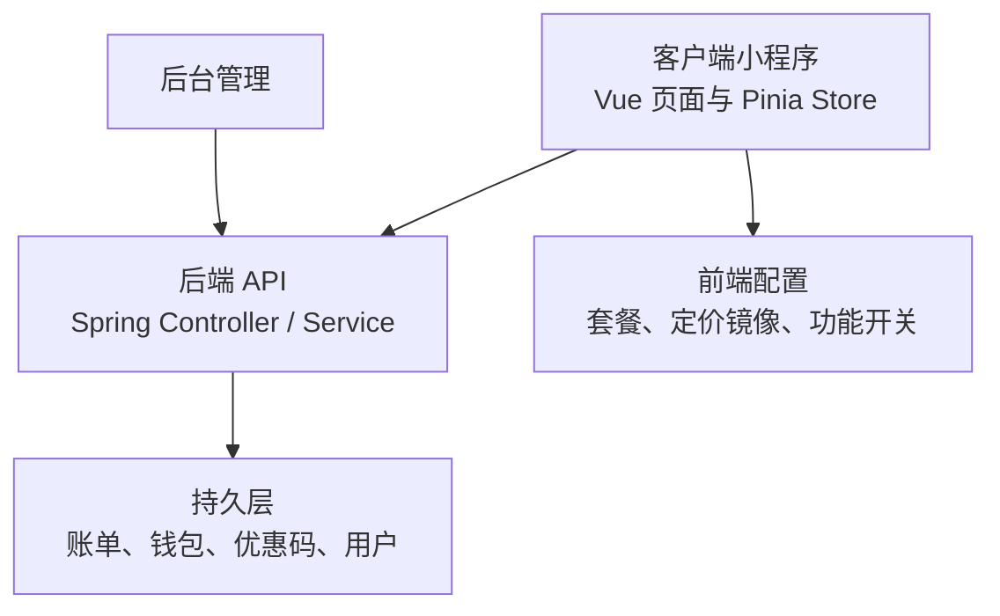

**图示来源**   
- [apps/client/src/subpackages/vip/index.vue:1-60](file://apps/client/src/subpackages/vip/index.vue#L1-L60)
- [apps/api/src/main/java/com/campuslove/api/vip/BillingController.java:1-40](file://apps/api/src/main/java/com/campuslove/api/vip/BillingController.java#L1-L40)
- [apps/api/src/main/java/com/campuslove/api/vip/AutoRenewController.java:1-35](file://apps/api/src/main/java/com/campuslove/api/vip/AutoRenewController.java#L1-L35)

**章节来源**   
- [apps/client/src/subpackages/vip/index.vue:1-60](file://apps/client/src/subpackages/vip/index.vue#L1-L60)
- [apps/api/src/main/java/com/campuslove/api/vip/BillingController.java:1-40](file://apps/api/src/main/java/com/campuslove/api/vip/BillingController.java#L1-L40)
- [apps/api/src/main/java/com/campuslove/api/vip/AutoRenewController.java:1-35](file://apps/api/src/main/java/com/campuslove/api/vip/AutoRenewController.java#L1-L35)

## 核心状态模型

付费系统涉及以下几类核心状态：

| 状态类别 | 主要字段 | 含义 |
|---|---|---|
| VIP 会员状态 | 是否会员、到期时间、展示模式、开发模拟标记 | 控制是否显示 VIP 权益、是否允许购买或续费 |
| 自动续费状态 | 是否启用、套餐 ID、下次扣费时间、下次扣费金额、支付方式 | 描述用户订阅的自动续费计划 |
| 账单状态 | 类型、状态、金额、原金额、交易号、周期起止、创建时间 | 记录订阅、续费、退款行为 |
| 钱包余额 | 余额分、已加载标志、流水分页信息 | 存储虚拟货币余额及消费流水 |
| 优惠码状态 | 折扣类型、折扣值、可用标志、原因、折后金额 | 表示优惠码是否有效、能省多少钱 |
| 解锁场景 | 场景类型、目标 ID、幂等订单号、扣费金额 | 决定使用哪种钱包消费路径 |

这些状态在前端以 Pinia Store 的响应式变量保存，在后端以 DTO、视图对象、实体和仓储维护。

**章节来源**   
- [apps/client/src/stores/vip.ts:1-80](file://apps/client/src/stores/vip.ts#L1-L80)
- [apps/client/src/stores/vip-auto-renew.ts:1-60](file://apps/client/src/stores/vip-auto-renew.ts#L1-L60)
- [apps/client/src/stores/vip-billing.ts:1-70](file://apps/client/src/stores/vip-billing.ts#L1-L70)
- [apps/client/src/stores/coins.ts:1-60](file://apps/client/src/stores/coins.ts#L1-L60)
- [apps/client/src/stores/promo-code.ts:1-70](file://apps/client/src/stores/promo-code.ts#L1-L70)

## 架构总览

付费功能的前后端交互可抽象为三层：

1. **表现层**：VIP 开通页、钱包页、优惠码页等页面。
2. **状态层**：Pinia Store，封装查询、缓存、Mock、错误提示。
3. **服务端层**：Controller 接收请求，Service 执行业务逻辑，Repository 读写数据库。

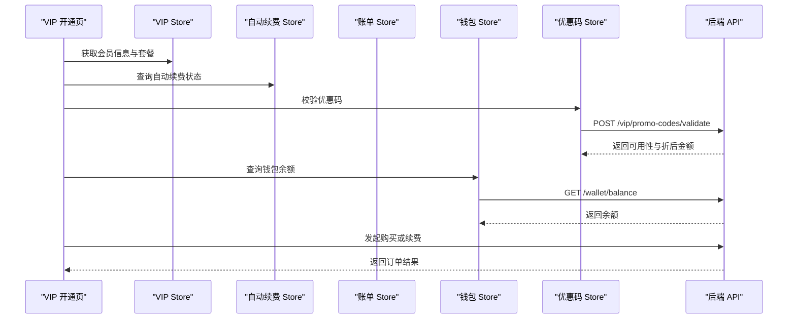

**图示来源**   
- [apps/client/src/subpackages/vip/index.vue:60-140](file://apps/client/src/subpackages/vip/index.vue#L60-L140)
- [apps/client/src/stores/promo-code.ts:60-140](file://apps/client/src/stores/promo-code.ts#L60-L140)
- [apps/client/src/stores/coins.ts:60-140](file://apps/client/src/stores/coins.ts#L60-L140)
- [apps/api/src/main/java/com/campuslove/api/vip/BillingController.java:150-222](file://apps/api/src/main/java/com/campuslove/api/vip/BillingController.java#L150-L222)

## VIP 会员状态管理

### 会员开关与页面守卫

VIP 开通页通过功能开关控制整体可用性。当会员功能未启用时：

- 页面进入即触发守卫。
- 若从「我的」Tab 进入，则返回上一页。
- 若直开链接且无栈，则回退到「我的」。
- 页面内所有购买、续费、权益交互均被短路。
- 不发起后端请求，避免误触发计费链路。

该设计确保“未上线的会员功能”不会成为生产环境的风险点。

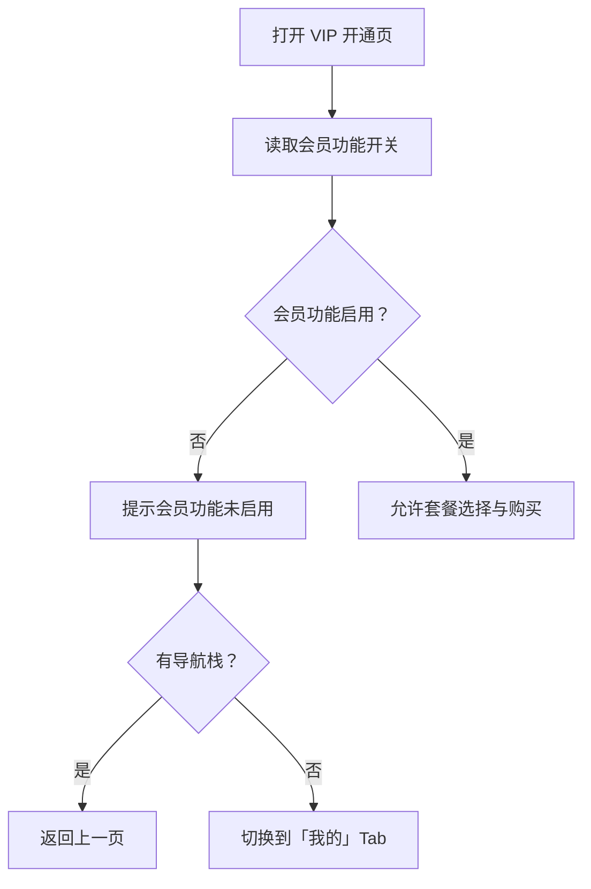

**图示来源**   
- [apps/client/src/subpackages/vip/index.vue:20-60](file://apps/client/src/subpackages/vip/index.vue#L20-L60)

### 会员身份判定

前端会员身份由三部分合成：

| 条件 | 效果 |
|---|---|
| 展示模式 | 全亮，VIP 恒为 true |
| 内部会员标记 | 正常业务状态 |
| 开发模拟标记 | 仅在开发或 Mock 模式下生效 |

这种分层判定既能支持演示环境全功能展示，又能防止本地残留标记污染生产环境。

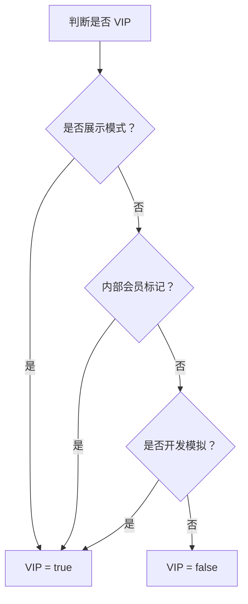

**图示来源**   
- [apps/client/src/stores/vip.ts:30-80](file://apps/client/src/stores/vip.ts#L30-L80)

### 套餐与价格

套餐数据集中管理，避免硬编码在页面中。默认套餐优先取配置首项；如果配置数组为空，则回退到季度套餐。套餐展示支持多语言键，价格数字本身不翻译。

前端对金额的单位转换遵循“后端以分为单位，前端展示以元为单位”的约定。

**章节来源**   
- [apps/client/src/subpackages/vip/index.vue:60-120](file://apps/client/src/subpackages/vip/index.vue#L60-L120)
- [apps/client/src/stores/vip.ts:80-160](file://apps/client/src/stores/vip.ts#L80-L160)

## 自动续费机制与状态流转

### 自动续费状态模型

自动续费状态包含以下关键信息：

| 字段 | 含义 |
|---|---|
| enabled | 是否开启自动续费 |
| planId | 当前绑定套餐 ID |
| planName | 当前套餐名称 |
| nextBillingAt | 下次扣费时间 |
| nextBillingAmount | 下次扣费金额 |
| paymentMethod | 绑定的支付方式 |

前端 Store 提供查询、开启、关闭和重置方法；后端 Controller 暴露 GET、POST、DELETE 接口。

### 自动续费操作流程

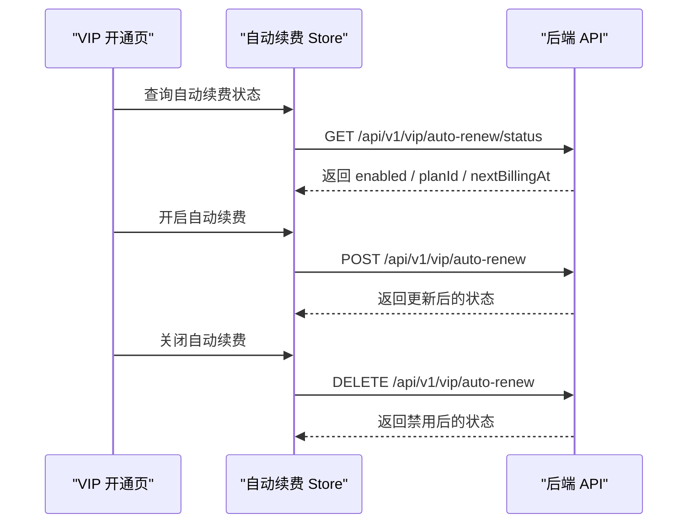

**图示来源**   
- [apps/client/src/stores/vip-auto-renew.ts:40-160](file://apps/client/src/stores/vip-auto-renew.ts#L40-L160)
- [apps/api/src/main/java/com/campuslove/api/vip/AutoRenewController.java:35-111](file://apps/api/src/main/java/com/campuslove/api/vip/AutoRenewController.java#L35-L111)

### 开启与关闭状态图

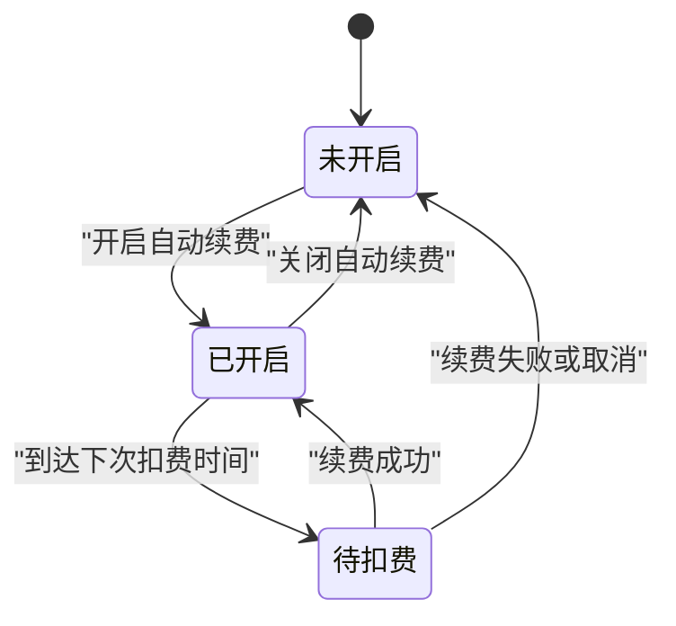

**图示来源**   
- [apps/client/src/stores/vip-auto-renew.ts:1-120](file://apps/client/src/stores/vip-auto-renew.ts#L1-L120)
- [apps/api/src/main/java/com/campuslove/api/vip/AutoRenewController.java:60-111](file://apps/api/src/main/java/com/campuslove/api/vip/AutoRenewController.java#L60-L111)

**章节来源**   
- [apps/client/src/stores/vip-auto-renew.ts:1-120](file://apps/client/src/stores/vip-auto-renew.ts#L1-L120)
- [apps/api/src/main/java/com/campuslove/api/vip/AutoRenewController.java:1-111](file://apps/api/src/main/java/com/campuslove/api/vip/AutoRenewController.java#L1-L111)

## 账单记录与退款状态

### 账单类型与状态

账单记录用于追踪用户与平台的资金和业务关系。账单类型包括：

- `SUBSCRIBE`：首次订阅。
- `RENEW`：自动续费。
- `REFUND`：退款。

账单状态包括：

- `SUCCESS`：成功。
- `FAILED`：失败。
- `REFUNDED`：已退款。

前端 Store 提供分页查询、Mock 数据、相对日期生成和加载状态控制。

### 账单列表状态流

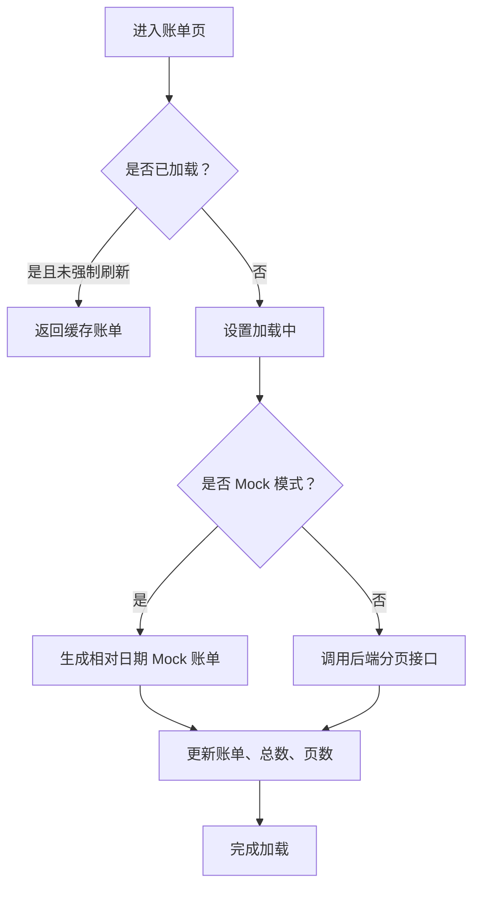

**图示来源**   
- [apps/client/src/stores/vip-billing.ts:70-180](file://apps/client/src/stores/vip-billing.ts#L70-L180)

### 退款状态说明

退款账单通常对应历史订阅或续费记录。状态从 `SUCCESS` 变为 `REFUNDED`，并在账单列表中保留审计轨迹。前端通过 `type` 和 `status` 区分正常消费、自动续费与退款。

**章节来源**   
- [apps/client/src/stores/vip-billing.ts:1-120](file://apps/client/src/stores/vip-billing.ts#L1-L120)
- [apps/client/src/stores/vip.ts:80-160](file://apps/client/src/stores/vip.ts#L80-L160)

## 虚拟货币系统与充值消费流程

### 钱包状态模型

钱包系统围绕“交友币”展开，核心状态包括：

| 字段 | 含义 |
|---|---|
| balanceCents | 余额，单位为分 |
| loaded | 是否已加载余额 |
| loading | 是否正在加载 |
| transactions | 当前页流水 |
| total | 流水总数 |
| page / size / totalPages | 分页元信息 |

### 解锁场景与定价镜像

钱包消费支持多种解锁场景：

| 场景 | 用途 | 定价来源 |
|---|---|---|
| MESSAGE | 解锁私信 | 客户端定价镜像 |
| VISITORS | 解锁访客 | 后端解锁接口或服务端定价 |
| LIKES | 解锁喜欢 | 后端解锁接口或服务端定价 |
| WHISPER | 解锁悄悄话 | 客户端定价镜像 |

客户端统一使用“定价镜像表”，禁止调用方任意传入金额，以降低前后端定价不一致风险。

### 钱包消费流程

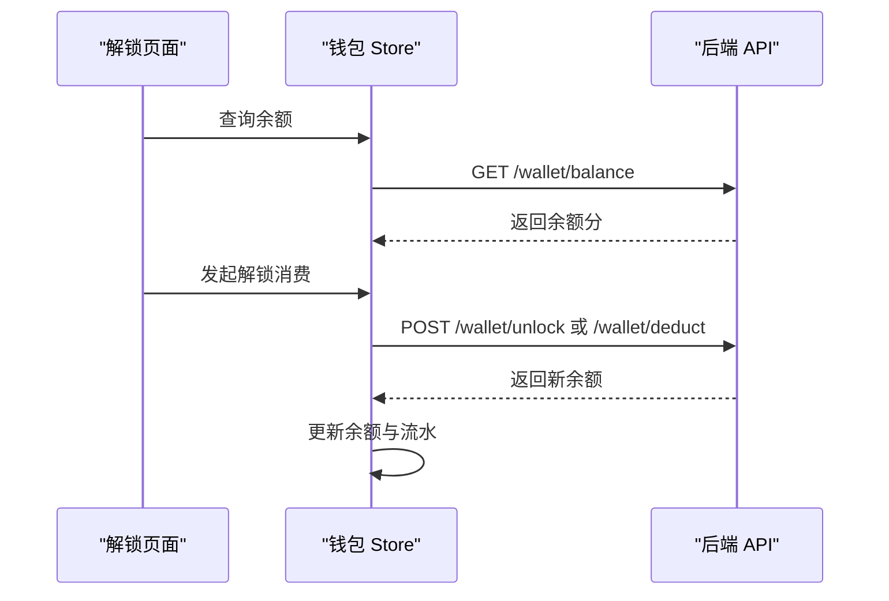

**图示来源**   
- [apps/client/src/stores/coins.ts:60-200](file://apps/client/src/stores/coins.ts#L60-L200)

### 幂等消费

钱包解锁消费使用幂等订单号，格式为 `UNLOCK-{scene}-{targetId}`。重复解锁不会重复扣费，这有助于防止网络重试或双击导致的资金异常。

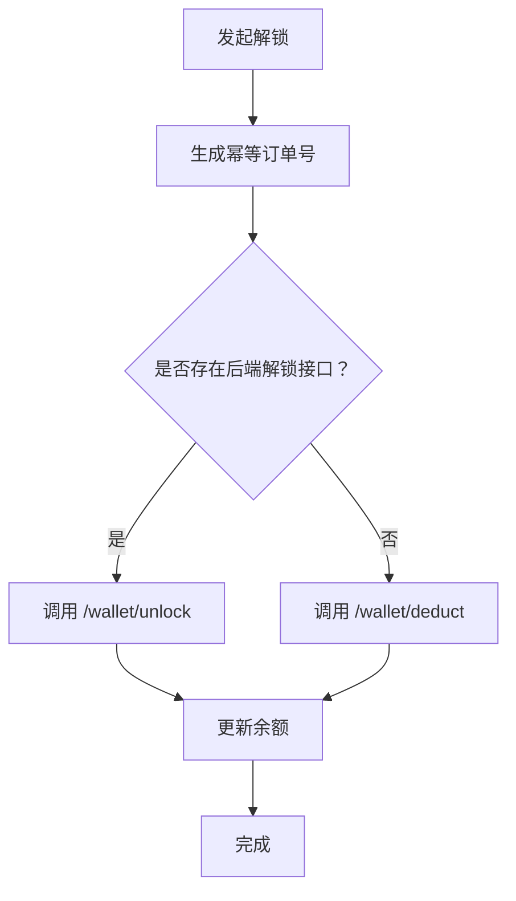

**图示来源**   
- [apps/client/src/stores/coins.ts:40-120](file://apps/client/src/stores/coins.ts#L40-L120)

**章节来源**   
- [apps/client/src/stores/coins.ts:1-120](file://apps/client/src/stores/coins.ts#L1-L120)
- [apps/client/src/stores/coins.ts:120-200](file://apps/client/src/stores/coins.ts#L120-L200)

## 优惠码、促销与折扣计算

### 优惠码状态模型

优惠码校验结果包含：

| 字段 | 含义 |
|---|---|
| code | 优惠码 |
| discountType | 折扣类型：满减或百分比 |
| discountValue | 折扣值 |
| description | 优惠描述 |
| payableAmount | 折后应付金额 |
| discountAmount | 优惠金额 |
| available | 是否可用 |
| reason | 不可用原因 |

兑换结果包含成功标志、实际优惠金额和折后金额。

### 优惠码校验与兑换流程

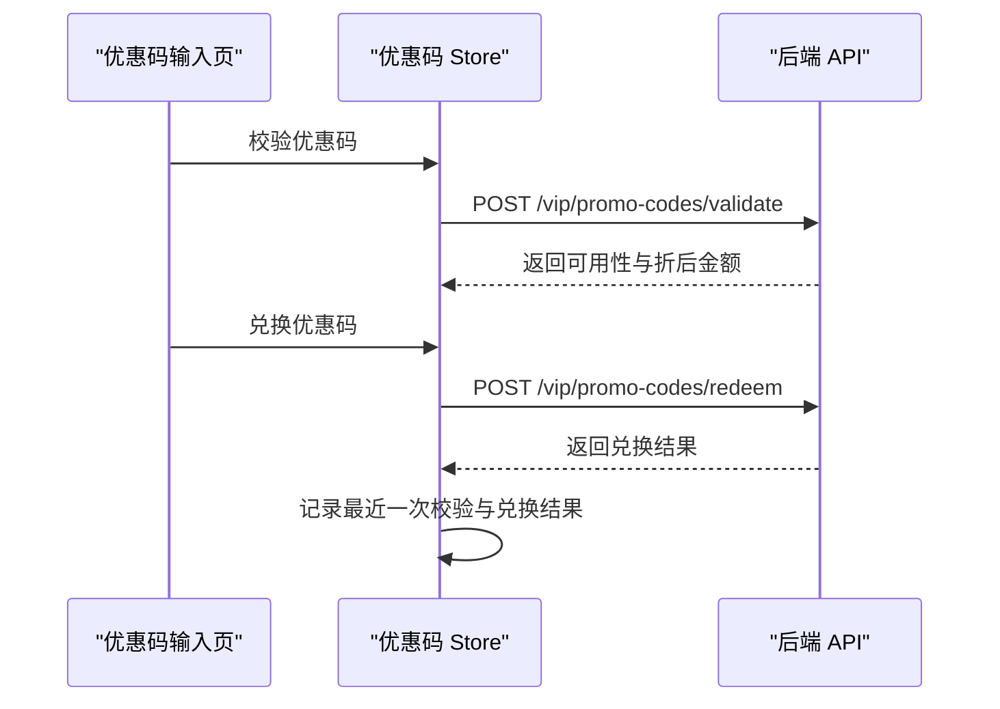

**图示来源**   
- [apps/client/src/stores/promo-code.ts:60-180](file://apps/client/src/stores/promo-code.ts#L60-L180)

### 防重复兑换

优惠码兑换存在防重复锁：

- 兑换中直接复用上一次结果。
- 校验失败清空上次校验结果。
- 兑换失败清空上次兑换结果。

这避免陈旧 UI 状态误导用户继续提交。

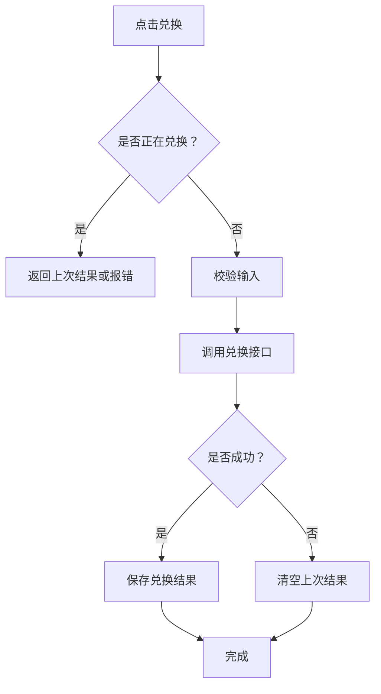

**图示来源**   
- [apps/client/src/stores/promo-code.ts:120-200](file://apps/client/src/stores/promo-code.ts#L120-L200)

**章节来源**   
- [apps/client/src/stores/promo-code.ts:1-120](file://apps/client/src/stores/promo-code.ts#L1-L120)
- [apps/client/src/stores/promo-code.ts:120-200](file://apps/client/src/stores/promo-code.ts#L120-L200)

## 权限控制、功能解锁与安全边界

### 权限控制要点

- 大部分 VIP 和钱包接口要求已认证用户。
- 自动续费手动触发续费扫描需要管理员角色。
- VIP 购买接口要求普通用户角色。
- 支付回调由微信服务器调用，不走 JWT，因此需要在安全配置中放行特定路径。

### 功能解锁

解锁逻辑由钱包 Store 统一收敛：

- 有后端解锁接口的场景优先走 `/wallet/unlock`。
- 没有后端解锁接口的场景走 `/wallet/deduct`，并使用客户端定价镜像。
- 所有解锁都生成统一幂等订单号。
- 前端不再接受调用方任意传入金额。

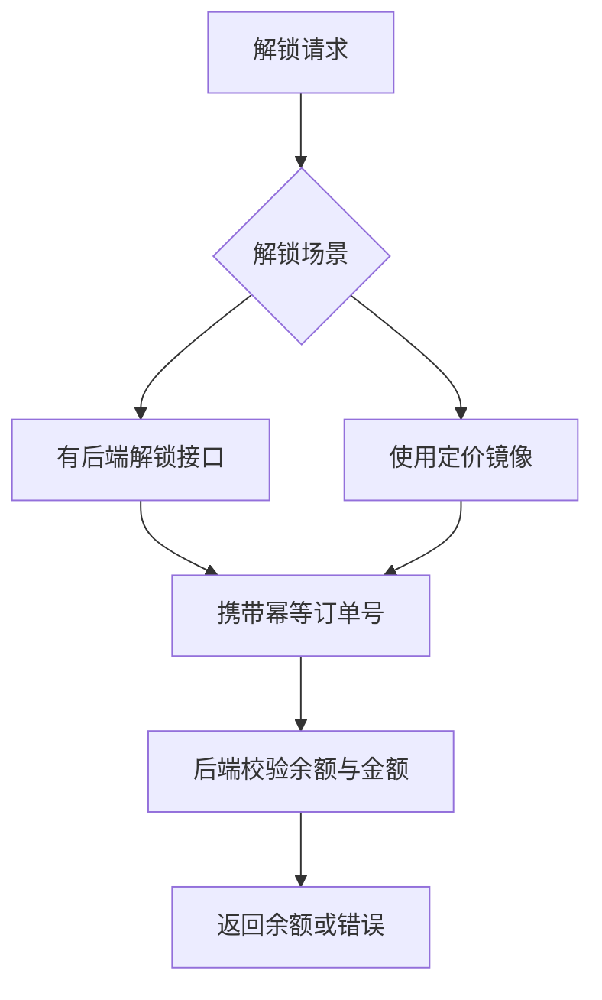

**图示来源**   
- [apps/client/src/stores/coins.ts:40-120](file://apps/client/src/stores/coins.ts#L40-L120)
- [apps/api/src/main/java/com/campuslove/api/vip/AutoRenewController.java:80-111](file://apps/api/src/main/java/com/campuslove/api/vip/AutoRenewController.java#L80-L111)

**章节来源**   
- [apps/client/src/stores/coins.ts:1-120](file://apps/client/src/stores/coins.ts#L1-L120)
- [apps/api/src/main/java/com/campuslove/api/vip/AutoRenewController.java:60-111](file://apps/api/src/main/java/com/campuslove/api/vip/AutoRenewController.java#L60-L111)

## 支付回调、订单跟踪与退款处理

### 支付回调入口

VIP 购买流程中，微信支付回调是唯一官方入口。其职责包括：

- 接收支付结果通知。
- 验签（当前为骨架实现）。
- 验单与金额对账。
- 开通或顺延 VIP。
- 写入账单。
- 按双键去重，避免重复开通。

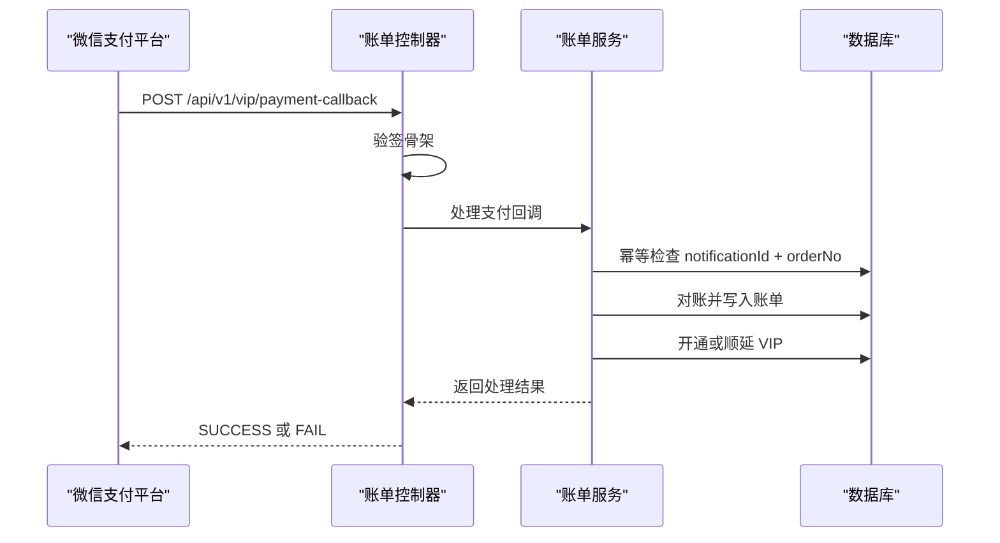

**图示来源**   
- [apps/api/src/main/java/com/campuslove/api/vip/BillingController.java:60-150](file://apps/api/src/main/java/com/campuslove/api/vip/BillingController.java#L60-L150)

### 订单跟踪与退款

订单跟踪主要通过账单记录体现：

- 订阅、续费、退款分别对应不同 `type`。
- 成功、失败、已退款对应不同 `status`。
- 退款账单保留历史审计信息。
- 支付回调通过通知 ID 和商户订单号做双键幂等。

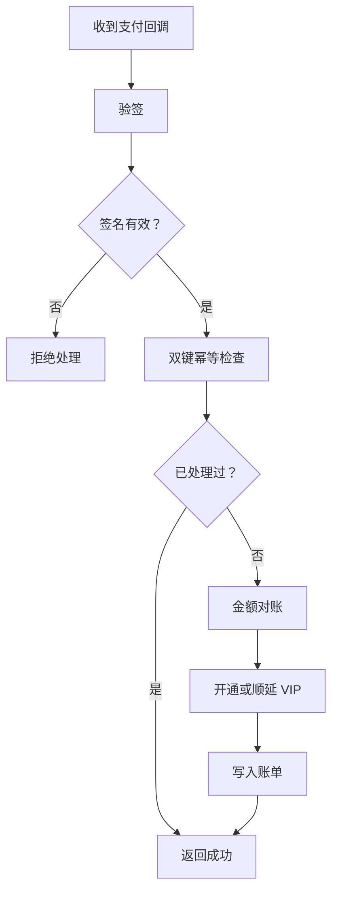

**图示来源**   
- [apps/api/src/main/java/com/campuslove/api/vip/BillingController.java:60-150](file://apps/api/src/main/java/com/campuslove/api/vip/BillingController.java#L60-L150)

**章节来源**   
- [apps/api/src/main/java/com/campuslove/api/vip/BillingController.java:60-150](file://apps/api/src/main/java/com/campuslove/api/vip/BillingController.java#L60-L150)

## 计费策略与财务准确性保证

### 金额单位统一

项目明确约定：后端钱包金额一律以“分”为单位，前端展示换算为“元”。这样可减少浮点数精度问题，同时让计费口径一致。

### 定价权威来源

计费策略强调“服务端定价权威”：

- 后端解锁接口优先使用服务端配置的单价。
- 客户端仅保留定价镜像用于 UI 提示和兜底路径。
- 客户端不得接受调用方随意传入金额。
- 优惠码折后金额由后端基于基础金额计算。

### 幂等与去重

系统多处使用幂等机制：

- 钱包解锁使用 `UNLOCK-{scene}-{targetId}` 作为幂等订单号。
- 支付回调使用通知 ID 和商户订单号双键去重。
- 优惠码兑换存在前端防重复锁。

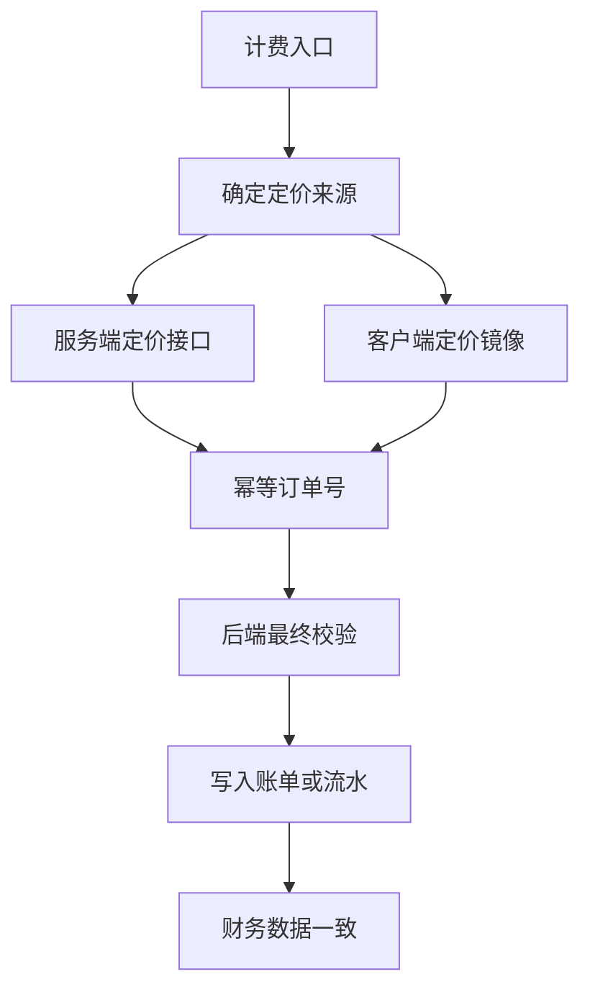

**图示来源**   
- [apps/client/src/stores/coins.ts:40-120](file://apps/client/src/stores/coins.ts#L40-L120)
- [apps/client/src/stores/promo-code.ts:60-140](file://apps/client/src/stores/promo-code.ts#L60-L140)
- [apps/api/src/main/java/com/campuslove/api/vip/BillingController.java:150-222](file://apps/api/src/main/java/com/campuslove/api/vip/BillingController.java#L150-L222)

**章节来源**   
- [apps/client/src/stores/coins.ts:1-120](file://apps/client/src/stores/coins.ts#L1-L120)
- [apps/client/src/stores/promo-code.ts:60-140](file://apps/client/src/stores/promo-code.ts#L60-L140)
- [apps/api/src/main/java/com/campuslove/api/vip/BillingController.java:150-222](file://apps/api/src/main/java/com/campuslove/api/vip/BillingController.java#L150-L222)

## 性能与可靠性特征

### 前端缓存与加载状态

- 自动续费 Store 在已加载且非强制刷新时直接返回缓存状态。
- 账单 Store 在相同页码和页大小时返回缓存列表。
- 钱包 Store 在余额非强制刷新时避免重复请求。
- 所有异步操作设置 `loading`、`updating`、`loaded` 标志，避免竞态。

### Mock 模式与演示模式

- Mock 模式用于联调，返回内存数据。
- 展示模式使 VIP 全亮，便于演示。
- 真实环境中，VIP 开通页会提示支付尚未就绪，防止假成功。

### 定时器清理

VIP 开通页在 mock 支付流程中使用定时器模拟延迟，并在页面卸载时清理定时器，避免已销毁页面继续调用 UI 方法。

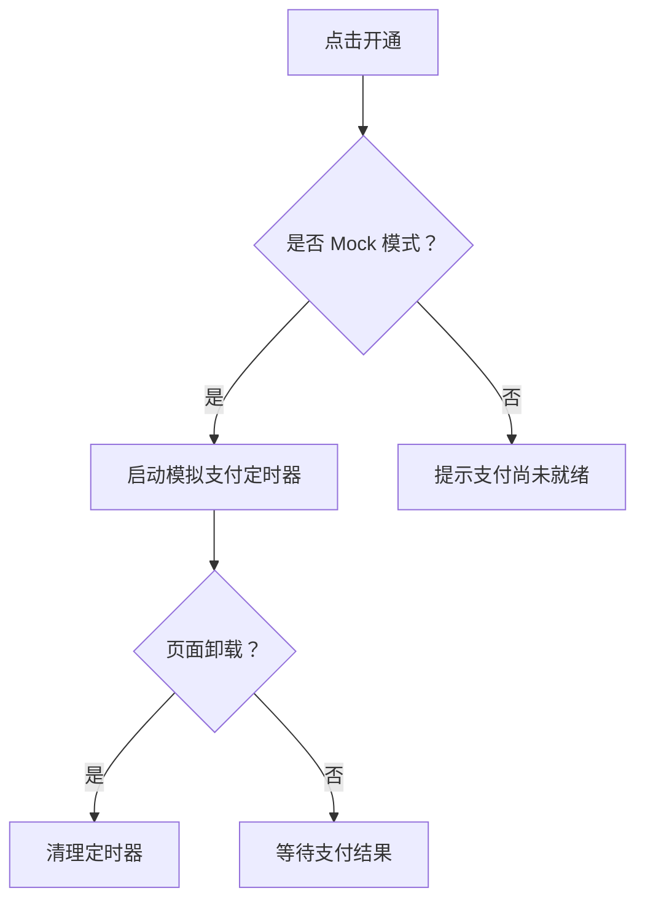

**图示来源**   
- [apps/client/src/subpackages/vip/index.vue:60-120](file://apps/client/src/subpackages/vip/index.vue#L60-L120)

**章节来源**   
- [apps/client/src/stores/vip-auto-renew.ts:40-100](file://apps/client/src/stores/vip-auto-renew.ts#L40-L100)
- [apps/client/src/stores/vip-billing.ts:120-200](file://apps/client/src/stores/vip-billing.ts#L120-L200)
- [apps/client/src/subpackages/vip/index.vue:60-120](file://apps/client/src/subpackages/vip/index.vue#L60-L120)

## 故障排查指南

### VIP 功能无法访问

**现象**：打开 VIP 页面提示功能未启用或立即返回。

**可能原因**：

- 会员功能开关未启用。
- 页面入口被守卫拦截。
- 直开链接无导航栈，回退到「我的」。

**排查步骤**：

1. 检查功能开关配置。
2. 确认页面 onLoad 守卫是否触发。
3. 检查路由栈情况。

**章节来源**   
- [apps/client/src/subpackages/vip/index.vue:20-60](file://apps/client/src/subpackages/vip/index.vue#L20-L60)

### 自动续费状态不更新

**现象**：开启或关闭自动续费后，前端状态未变化。

**可能原因**：

- 接口调用失败。
- 仍停留在旧缓存状态。
- Mock 数据未正确更新。

**排查步骤**：

1. 检查 Store 的 `fetchStatus`、`enableAutoRenew`、`disableAutoRenew`。
2. 观察 `loading`、`updating`、`loaded` 标志。
3. 确认后端返回结构与前端视图一致。

**章节来源**   
- [apps/client/src/stores/vip-auto-renew.ts:40-160](file://apps/client/src/stores/vip-auto-renew.ts#L40-L160)

### 优惠码反复提交

**现象**：快速点击兑换按钮导致重复提交或状态混乱。

**可能原因**：

- 未使用防重复锁。
- 上次校验或兑换结果未及时清空。

**排查步骤**：

1. 检查 `redeeming` 标志。
2. 检查校验失败时是否清空 `lastValidation`。
3. 检查兑换失败时是否清空 `lastRedeemResult`。

**章节来源**   
- [apps/client/src/stores/promo-code.ts:120-200](file://apps/client/src/stores/promo-code.ts#L120-L200)

### 钱包余额不足或重复扣费

**现象**：解锁失败或疑似重复扣费。

**可能原因**：

- 余额不足。
- 未使用统一幂等订单号。
- 前端传入了自定义金额。

**排查步骤**：

1. 检查 `balanceCents` 与 `amountCents`。
2. 检查幂等订单号生成逻辑。
3. 确认调用路径是 `/wallet/unlock` 还是 `/wallet/deduct`。

**章节来源**   
- [apps/client/src/stores/coins.ts:40-120](file://apps/client/src/stores/coins.ts#L40-L120)
- [apps/client/src/stores/coins.ts:120-200](file://apps/client/src/stores/coins.ts#L120-L200)

### 支付回调未生效

**现象**：支付成功后 VIP 未开通。

**可能原因**：

- 支付回调未接入真实验签。
- 回调端点在生产环境被提前启用。
- 通知 ID 或订单号幂等键冲突。

**排查步骤**：

1. 检查支付回调验签是否为骨架实现。
2. 确认是否接入微信支付 SDK。
3. 检查通知 ID 和订单号幂等逻辑。

**章节来源**   
- [apps/api/src/main/java/com/campuslove/api/vip/BillingController.java:60-150](file://apps/api/src/main/java/com/campuslove/api/vip/BillingController.java#L60-L150)

## 结论

该项目的付费和增值功能状态管理围绕“状态清晰、权限可控、幂等可靠、服务端定价权威”展开：

- VIP 会员状态由功能开关、展示模式和开发模拟共同控制，避免未上线功能误触。
- 自动续费提供完整的状态查询、开启、关闭和手动触发扫描能力。
- 账单记录覆盖订阅、续费、退款三类业务，并提供分页与 Mock。
- 钱包系统统一余额、流水、解锁场景和幂等订单号，避免重复扣费。
- 优惠码校验与兑换具备防重复锁和错误结果清理机制。
- 支付回调预留了验签、对账、幂等和权益开通路径，但需接入真实微信支付 SDK 才能在生产安全启用。
- 计费策略强调服务端权威，客户端仅做展示和辅助校验，减少前后端定价漂移风险。

后续若扩展更多付费能力，建议继续遵循当前契约：金额以分为单位、幂等键统一生成、服务端定价为主、前端状态只读可见，并通过 Store 集中封装异步流程与错误提示。